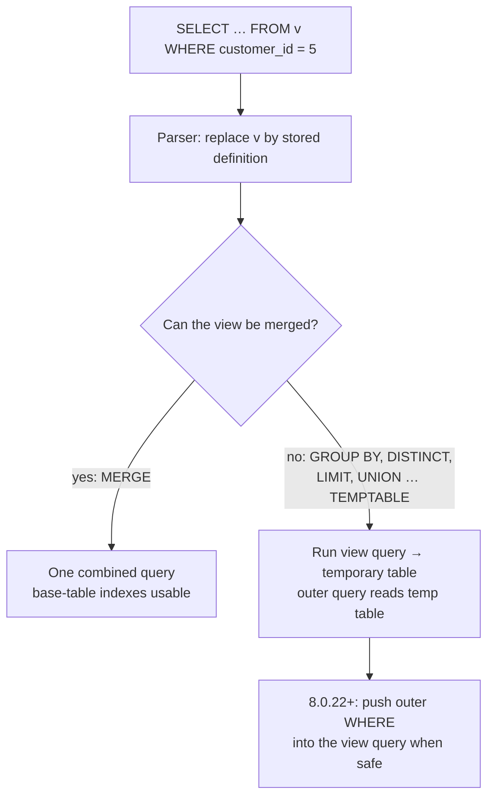

## Introduction

A **view** is a named query that you can use as if it were a table. You write `SELECT … FROM orders JOIN order_items …` once, give it a name such as `v_order_totals`, and from then on every report, application and analyst can write `SELECT * FROM v_order_totals WHERE customer_id = 5` without knowing — or being allowed to see — how the totals are computed.

That one sentence hides several professional questions this lesson answers:

- **Does a view store data?** In MySQL, no. A view stores the *text* of a query in the data dictionary. Every time you read from it, MySQL runs the underlying query again — either by **merging** it into your statement or by **materializing** it into a temporary table. Which of the two happens decides whether your indexes are used.
- **Can I write through a view?** Sometimes. A view whose rows map one-to-one to rows of a base table is *updatable*; a view with `GROUP BY`, `DISTINCT` or aggregates is not. `WITH CHECK OPTION` stops writes that would make a row disappear from the view.
- **Who is allowed to read what?** A view runs with the privileges of its **definer** (by default), so you can give someone access to a view of `customers` without email addresses while denying them the table itself.

You have already used derived tables and CTEs in Module 4 ([Multi-Table Joins](/lessons/m04-multi-table-joins), [Common Table Expressions](/lessons/m04-ctes)). A view is the persistent, shareable, privilege-checked version of the same idea.

:::note[Dataset]
The examples use the **shop** dataset (25 customers, 30 products, 80 orders, 182 order lines, 76 payments). Every output below was captured from a real MySQL server; run any block in your private lab.
:::

## DBMS Theory

:::theory[Views in the relational model]
In relational theory a **view** (also called a *virtual relation* or *derived relation*) is a relation defined by a relational-algebra expression over **base relations** (the stored tables). Formally a view is a pair (name, expression): `V := π_{order_id, total}(γ_{order_id; SUM(qty·price)→total}(orders ⋈ order_items))`. Its value is never stored; it is *defined* to be whatever the expression yields over the current database state.

Because the relational model is **closed** (every operator takes relations and returns a relation), a view can be used anywhere a base relation can — inside joins, subqueries and other views. This is the principle Codd called **logical data independence**: applications can be written against views and keep working when the base tables are restructured, as long as the view can be redefined to yield the same relation.
:::

Three formal ideas matter in practice:

1. **The ANSI/SPARC external level.** The three-schema architecture you met in [Schemas and the Three-Schema Architecture](/lessons/m01-schemas-three-schema-architecture) has an *external* level made of user-specific views over the *conceptual* schema. SQL views are how that level is implemented: each team or application gets its own picture of the data.
2. **The view-update problem.** Reading a view is always well defined; *writing* through one is not. If a view shows `SUM(amount)` per customer and you set it to 500, which payments should change? An update to a view is only well defined when every view row corresponds to exactly one identifiable base row and every view column to one base column. Database theory calls this the *view update translation* problem; it is undecidable in general, so every DBMS applies conservative syntactic rules. MySQL's rules are covered below.
3. **Virtual vs materialized views.** A **materialized view** stores the result and must be *maintained* (refreshed) when base tables change — a trade of storage and write cost for read speed. The SQL standard defines only virtual views; materialized views are vendor extensions (Oracle, PostgreSQL, SQL Server's indexed views). **MySQL has no materialized views**; you emulate them with summary tables (see *Alternative Approaches*).

| Term | Meaning |
|---|---|
| Base table | A table whose rows are physically stored |
| View | A named, stored query; its rows are computed when it is read |
| View resolution / merging | Rewriting the outer query so the view's definition replaces its name |
| Materialization | Executing the view's query into a temporary table, then reading that |
| Updatable view | A view through which `UPDATE`/`DELETE` (and possibly `INSERT`) are translated to one base table |
| Check option | A constraint that rows written through the view must satisfy the view's `WHERE` predicate |

## Why It Exists

Without views, every consumer of the database must embed the full query logic itself. That causes concrete problems:

- **Duplicated business logic.** "Revenue" is `SUM(quantity * unit_price)` over non-cancelled orders. If ten dashboards each write that expression, one of them will eventually forget to exclude cancelled orders. A view defines it once.
- **Coupling to the physical schema.** If you split `customers` into `customers` and `customer_contacts` (Module 6, normalization), every query that reads phone numbers breaks. A view named `customers_v` that re-joins the two tables keeps old queries working during the migration.
- **Column- and row-level security.** MySQL privileges can be granted on columns, but managing column grants for many users is painful, and there is no native row-level security. A view that exposes `customer_id, city, state` but not `email`, or only the rows of one region, combined with `GRANT SELECT ON the_view`, is the classic MySQL answer.
- **A stable contract for tools.** BI tools, data-pipeline extractors and reporting users can be pointed at a curated set of views with friendly column names, while the engineering team keeps the freedom to refactor tables underneath.

What views do **not** solve: they do not make queries faster by themselves (a view is the same query, just named), and they do not cache results. Misunderstanding this is the most common source of view-related performance problems.

## Internal Working

:::internals[What MySQL stores and how it executes a view]
**Storage.** `CREATE VIEW` parses and validates the `SELECT`, resolves `*` into an explicit column list, qualifies every column with its table, and stores the *canonical text* of that query plus metadata (algorithm, definer, SQL security, check option, character set of the client) in the transactional **data dictionary** (InnoDB tables in the `mysql` schema since 8.0). Nothing about the rows is stored. You can read the stored form from `information_schema.VIEWS` or `SHOW CREATE VIEW`.

**Execution.** When a statement references the view, the parser replaces the view name by its stored definition, and the optimizer chooses one of two **algorithms**:

- **MERGE** — the view's `SELECT` is *merged into the outer query*: its `FROM` tables join the outer `FROM`, its `WHERE` is `AND`-ed with the outer `WHERE`, its select list replaces column references. After merging there is no view any more, just one query, so every index on the base tables is available. This is identical to how MySQL merges derived tables (`derived_merge` optimizer switch).
- **TEMPTABLE** — the view's query is executed first and its result is written into an internal **temporary table** (in memory with the TempTable engine, spilling to disk if large); the outer query then reads that temporary table. In EXPLAIN this shows as `<derivedN>` with `select_type = DERIVED`, and in tree format as `Materialize`.

`ALGORITHM = UNDEFINED` (the default) lets MySQL choose, and it prefers MERGE whenever merging is legal. Merging is impossible when the view contains anything that makes its rows not correspond one-to-one to base rows: aggregate functions, `DISTINCT`, `GROUP BY`, `HAVING`, `LIMIT`, `UNION`/`UNION ALL`, subqueries in the select list, assignments to user variables, or a select list that refers only to literals.
:::



**Condition pushdown (MySQL 8.0.22 and later).** Before 8.0.22 a materialized view was fully computed and *then* filtered — `SELECT * FROM v_order_totals WHERE customer_id = 5` would aggregate every order first. Since 8.0.22 the optimizer can push an outer predicate *into* a materialized derived table or view: into its `WHERE` clause if the predicate uses only grouping columns, otherwise into its `HAVING`. You will see this in the execution walkthrough. It is controlled by the `derived_condition_pushdown` optimizer switch (on by default).

**Locks and consistency.** Reading a view reads the base tables, so it is subject to exactly the same MVCC snapshot and locking rules as the underlying query ([MVCC](/lessons/m08-mvcc)). A TEMPTABLE view releases base-table row locks earlier in some cases, because the temporary table is filled before the outer query runs — one reason the manual notes TEMPTABLE "may release locks sooner".

**Dependencies are not enforced.** The data dictionary does not prevent you from dropping or altering a base table that a view uses. The view simply becomes *invalid*, and the next query against it fails (error 1356, shown in *Common Mistakes*).

:::standard[Standard SQL vs MySQL]
`CREATE VIEW … AS SELECT`, the optional column list and `WITH [CASCADED | LOCAL] CHECK OPTION` are standard SQL. The `ALGORITHM` clause, `DEFINER`, `SQL SECURITY` and `CREATE OR REPLACE VIEW` are MySQL extensions (other systems have their own variants — PostgreSQL has `security_invoker` and `CREATE OR REPLACE`, SQL Server has `WITH SCHEMABINDING`). Materialized views are not in the standard and not in MySQL.
:::

## MySQL Implementation

The core syntax:

```sql
CREATE [OR REPLACE]
    [ALGORITHM = {UNDEFINED | MERGE | TEMPTABLE}]
    [DEFINER = user]
    [SQL SECURITY {DEFINER | INVOKER}]
    VIEW view_name [(column_list)]
    AS select_statement
    [WITH [CASCADED | LOCAL] CHECK OPTION];
```

Start with a reporting view: one row per order with its total. The `GROUP BY` means this view can only be materialized.

```sql run
CREATE VIEW v_order_totals AS
SELECT o.order_id,
       o.customer_id,
       o.status,
       SUM(oi.quantity * oi.unit_price) AS order_total
FROM orders o
JOIN order_items oi ON oi.order_id = o.order_id
GROUP BY o.order_id, o.customer_id, o.status;

SELECT * FROM v_order_totals ORDER BY order_total DESC, order_id LIMIT 5;
```

Now a simple *row-subset* view — no aggregation, one base table — which MySQL can merge:

```sql run
CREATE VIEW v_delivered_orders AS
SELECT order_id, customer_id, order_date, shipped_at
FROM orders
WHERE status = 'delivered';

SELECT COUNT(*) AS delivered FROM v_delivered_orders;
```

The data dictionary records what you created, including whether MySQL considers each view updatable and who its definer is:

```sql run
SELECT TABLE_NAME, CHECK_OPTION, IS_UPDATABLE, SECURITY_TYPE
FROM information_schema.VIEWS
WHERE TABLE_SCHEMA = DATABASE()
ORDER BY TABLE_NAME;
```

`v_order_totals` is not updatable (aggregation), `v_delivered_orders` is. Both have `SECURITY_TYPE = DEFINER`, the default. `SHOW CREATE VIEW` returns the canonical stored text — note that MySQL has qualified and back-quoted every identifier and added the `DEFINER` and `SQL SECURITY` clauses you did not write:

```sql run
SHOW CREATE VIEW v_delivered_orders;
```

:::note[The definer in your lab]
The `DEFINER` you see is your lab's own MySQL account, because a view's definer defaults to `CURRENT_USER`. In the sandbox you can only create views with yourself as the definer — naming any other account requires the `SET_ANY_DEFINER` privilege (8.2+; `SET_USER_ID` in earlier 8.0 releases), which lab accounts do not have. You will see that error later.
:::

## Syntax Breakdown

| Clause | Meaning and MySQL specifics |
|---|---|
| `CREATE VIEW v` | Fails if `v` exists (error 1050). Views and tables share one namespace per schema. |
| `OR REPLACE` | Replace an existing view atomically (same as `ALTER VIEW`). Privileges granted on the view are kept. MySQL extension. |
| `ALGORITHM = UNDEFINED` | Default. MySQL picks MERGE if legal, otherwise TEMPTABLE. Recommended. |
| `ALGORITHM = MERGE` | Request merging. If it is impossible, MySQL warns (1354) and uses UNDEFINED. |
| `ALGORITHM = TEMPTABLE` | Force materialization. Makes the view **non-updatable**. Rarely what you want. |
| `DEFINER = user` | Account whose privileges are checked when `SQL SECURITY DEFINER`. Defaults to `CURRENT_USER`. Naming another account needs `SET_ANY_DEFINER` (8.2+) / `SET_USER_ID`. |
| `SQL SECURITY DEFINER` | Default. Base-table privileges are checked against the definer; the invoker only needs `SELECT` on the view. |
| `SQL SECURITY INVOKER` | Base-table privileges are checked against the user running the query. The view is then a convenience, not a security boundary. |
| `(column_list)` | Names the view columns; must match the select list's count. Alternative to aliases. |
| `AS select_statement` | Any `SELECT` (joins, subqueries, CTEs, window functions, `UNION`). Cannot reference user variables, local routine variables or prepared-statement parameters, and cannot reference a `TEMPORARY` table. |
| `WITH CASCADED CHECK OPTION` | Rows inserted/updated through the view must satisfy its `WHERE` **and those of every view it is built on**. `WITH CHECK OPTION` alone means `CASCADED`. |
| `WITH LOCAL CHECK OPTION` | Checks this view's `WHERE`, and underlying views only if *they* have their own check option. |
| `ALTER VIEW v AS …` | Redefine (all clauses as in `CREATE`). |
| `DROP VIEW [IF EXISTS] v1, v2` | Remove views; base tables are untouched. |

**Updatability rules (MySQL).** A view is updatable (`UPDATE`, `DELETE`) when there is a one-to-one relationship between its rows and rows of an underlying table, which means none of: aggregates or window functions, `DISTINCT`, `GROUP BY`, `HAVING`, `UNION`, subqueries in the select list, certain joins, a non-updatable view in `FROM`, `ALGORITHM = TEMPTABLE`, or references only to literals. It is additionally **insertable** when every view column is a simple column reference (no expressions such as `price * 1.1`), no base column appears twice, and every base column omitted from the view has a default value. For a **join view**, `UPDATE` may change columns of only one table per statement, and `INSERT` works only if it targets one table; `DELETE` through a join view is not supported.

## Practical Examples

**1. A curated reporting view used like a table.** Revenue per customer, built on top of `v_order_totals`, excluding cancelled and refunded orders. Views can be stacked.

```sql run
CREATE VIEW v_customer_revenue AS
SELECT c.customer_id,
       CONCAT(c.first_name, ' ', c.last_name) AS customer_name,
       c.state,
       COUNT(*)            AS orders,
       SUM(t.order_total)  AS revenue
FROM customers c
JOIN v_order_totals t ON t.customer_id = c.customer_id
WHERE t.status NOT IN ('cancelled', 'refunded')
GROUP BY c.customer_id, c.first_name, c.last_name, c.state;

SELECT customer_name, state, orders, revenue
FROM v_customer_revenue
ORDER BY revenue DESC, customer_id
LIMIT 5;
```

Every consumer now shares one definition of "revenue". If finance later decides that refunds should count as negative revenue, one `CREATE OR REPLACE VIEW` changes every report.

**2. Column-level security: hiding personal data.** Support staff need to look customers up by city and loyalty tier, but must not see email addresses or phone numbers.

```sql run
CREATE VIEW v_customer_directory AS
SELECT customer_id, first_name, city, state, loyalty_tier
FROM customers;

SELECT * FROM v_customer_directory WHERE state = 'CA' ORDER BY customer_id;
```

In production you would then grant access to the view only. The sandbox cannot run `GRANT`, so this is display-only:

```sql
CREATE USER 'support'@'%' IDENTIFIED BY '…';
GRANT SELECT ON shop.v_customer_directory TO 'support'@'%';
-- no privilege on shop.customers: the view runs with its DEFINER's privileges,
-- so 'support' can read the five exposed columns and nothing else.
```

**3. Writing through an updatable view.** `v_delivered_orders` maps each row to exactly one `orders` row, so you can update through it. The change lands in the base table:

```sql run
UPDATE v_delivered_orders
SET shipped_at = shipped_at
WHERE order_id = 2;

SELECT TABLE_NAME, IS_UPDATABLE
FROM information_schema.VIEWS
WHERE TABLE_SCHEMA = DATABASE() AND TABLE_NAME IN ('v_delivered_orders', 'v_order_totals')
ORDER BY TABLE_NAME;
```

(The `SET shipped_at = shipped_at` is deliberately a no-op so later examples see unchanged data; the point is that MySQL accepted the `UPDATE`.) Trying the same against the aggregated view fails, because there is no single base row behind an order total:

```sql run error
UPDATE v_order_totals SET status = 'paid' WHERE order_id = 1;
```

**4. `WITH CHECK OPTION`: a view as a write constraint.** Suppose a warehouse tool may only work with *active* products. A view with a check option both filters reads and rejects writes that would produce an inactive product:

```sql run
CREATE VIEW v_active_products AS
SELECT product_id, sku, name, price, stock_qty, is_active
FROM products
WHERE is_active = 1
WITH CHECK OPTION;

UPDATE v_active_products SET stock_qty = stock_qty + 5 WHERE product_id = 13;
SELECT product_id, name, stock_qty FROM v_active_products WHERE product_id = 13;
```

Restocking an active product is fine. Deactivating a product *through this view* would make the row vanish from the view, which the check option forbids:

```sql run error
UPDATE v_active_products SET is_active = 0 WHERE product_id = 13;
```

Without `WITH CHECK OPTION`, that `UPDATE` would have succeeded and the row would silently disappear from the view — the "migrating row" problem.

**5. LOCAL vs CASCADED.** Build a view on top of another view. `v_cheap_active` checks its own predicate; whether the inner view's `is_active = 1` is also enforced depends on the check option type:

```sql run
CREATE VIEW v_all_cheap AS
SELECT product_id, name, price, is_active FROM products WHERE price < 50;

CREATE VIEW v_all_cheap_local AS
SELECT * FROM v_all_cheap WHERE is_active = 1
WITH LOCAL CHECK OPTION;

CREATE VIEW v_all_cheap_cascaded AS
SELECT * FROM v_all_cheap WHERE is_active = 1
WITH CASCADED CHECK OPTION;

-- LOCAL: only is_active = 1 is checked; the inner view has no check option,
-- so raising the price above 50 is allowed (the row leaves both views).
UPDATE v_all_cheap_local SET price = price WHERE product_id = 9;
SELECT product_id, name, price FROM v_all_cheap_local WHERE product_id = 9;
```

```sql run error
-- CASCADED: the inner view's price < 50 is checked as well
UPDATE v_all_cheap_cascaded SET price = 60 WHERE product_id = 9;
```

```sql run
-- the same change through the LOCAL view is accepted (then undone)
UPDATE v_all_cheap_local SET price = 60 WHERE product_id = 9;
SELECT product_id, price FROM products WHERE product_id = 9;
UPDATE products SET price = 39.99 WHERE product_id = 9;
```

`CASCADED` is the safer default (and what `WITH CHECK OPTION` means), because a view author usually expects the restrictions of the views they build on to hold.

## Execution Walkthrough

Let us trace how MySQL executes the same kind of filter against a mergeable view and a materialized one.

```walkthrough
title: SELECT … FROM view WHERE customer_id = 5 — MERGE vs TEMPTABLE
steps:
  - title: "1. The mergeable view becomes one query"
    explain: >-
      v_delivered_orders has no aggregation, so MySQL merges it. The plan below has no derived table at all:
      the view's WHERE (status = 'delivered') and the outer WHERE (customer_id = 5) are combined, and the
      optimizer uses the index idx_orders_customer on the base table directly.
    sql: EXPLAIN FORMAT=TREE SELECT * FROM v_delivered_orders WHERE customer_id = 5;
  - title: "2. The aggregating view is materialized"
    explain: >-
      v_order_totals has GROUP BY, so it must be materialized. Traditional EXPLAIN shows a PRIMARY row
      reading <derived2> and a DERIVED row for the view's own query. Look at the DERIVED rows' access type:
      orders is read with ref on idx_orders_customer — the outer customer_id = 5 was pushed down into the
      view's query (derived condition pushdown, 8.0.22+), so only that customer's orders are aggregated.
    sql: EXPLAIN SELECT * FROM v_order_totals WHERE customer_id = 5;
  - title: "3. The same plan as an iterator tree"
    explain: >-
      The tree format makes the order of work explicit: the innermost iterators run first (index lookup on
      orders for customer 5, nested-loop join to order_items through its primary key, aggregate), the result is written by Materialize into
      a temporary table, and only then does the outer Table scan on v_order_totals read it.
    sql: EXPLAIN FORMAT=TREE SELECT * FROM v_order_totals WHERE customer_id = 5;
  - title: "4. Forcing TEMPTABLE on a simple view"
    explain: >-
      ALGORITHM = TEMPTABLE materializes even a view that could have been merged. The plan gains a DERIVED
      step, and the view becomes non-updatable. There is almost never a reason to do this.
    sql: |
      CREATE ALGORITHM = TEMPTABLE VIEW v_orders_tt AS
      SELECT order_id, customer_id, status FROM orders;
      EXPLAIN SELECT * FROM v_orders_tt WHERE customer_id = 5;
  - title: "5. Requesting MERGE where it is impossible"
    explain: >-
      Asking for MERGE on an aggregating view is not an error — MySQL creates the view, warns with 1354 and
      falls back to UNDEFINED (which then materializes).
    sql: |
      CREATE ALGORITHM = MERGE VIEW v_orders_per_customer AS
      SELECT customer_id, COUNT(*) AS n FROM orders GROUP BY customer_id;
      SHOW WARNINGS;
```

## Output

The two views answer different questions, and the plans explain why their costs differ. Reading a mergeable view costs exactly what the equivalent hand-written query costs. Reading a materialized view costs the view's query (now restricted by any pushed-down predicate) **plus** writing and re-reading a temporary table. Here is the final result for customer 5 from both views side by side:

```sql run
SELECT d.order_id, d.order_date, t.order_total
FROM v_delivered_orders d
JOIN v_order_totals t ON t.order_id = d.order_id
WHERE d.customer_id = 5
ORDER BY d.order_id;
```

Reading the result: each row is a delivered order of customer 5 with its total computed from the line items. The join between a merged view and a materialized view is legal and common — MySQL merges the first, materializes the second, and joins the base table `orders` with the temporary table.

## Alternative Approaches

| Approach | Persistent? | Stores data? | Shared across sessions? | Best for |
|---|---|---|---|---|
| View | Yes (data dictionary) | No | Yes, with privileges | Reusable definitions, security, API for tools |
| CTE (`WITH …`) | No — one statement | No | No | Structuring one complex query ([CTEs](/lessons/m04-ctes)) |
| Derived table | No — one statement | No | No | Ad-hoc subquery in `FROM` |
| Summary table refreshed by a job | Yes | Yes | Yes | Expensive aggregates read often ("materialized view") |
| Generated column (+ index) | Yes | Optional (`STORED`) | Yes | A per-row expression you filter or sort on |

**Emulating a materialized view.** MySQL cannot store a view's result, but you can: create a table, fill it with `INSERT … SELECT` from the view, and refresh it on a schedule (an event — [Events and Scheduled Jobs](/lessons/m09-events) — or an external scheduler) or incrementally with triggers ([Triggers](/lessons/m09-triggers)).

```sql run
CREATE TABLE mv_customer_revenue AS
SELECT customer_id, customer_name, state, orders, revenue FROM v_customer_revenue;
ALTER TABLE mv_customer_revenue ADD PRIMARY KEY (customer_id);

SELECT COUNT(*) AS customers_with_revenue, SUM(revenue) AS total_revenue
FROM mv_customer_revenue;
```

The summary table is fast to read and indexable, but **stale** between refreshes, and the refresh itself is real work. That trade-off — freshness vs read cost — is exactly what materialized-view features in other databases manage for you.

**View vs CTE.** A CTE is local to one statement and invisible to other users and tools; a view is a schema object with privileges and a lifecycle (it must be versioned and migrated like a table). Prefer a CTE for one-off structure, a view when several consumers need the same definition or when you need the security boundary.

## Performance Analysis

A view's performance *is* its query's performance, plus the algorithm overhead. The key questions are:

| Situation | What happens | Cost implication |
|---|---|---|
| Mergeable view, outer filter on an indexed column | Merged; index used directly | Same as hand-written SQL |
| Materialized view, outer filter on a grouping column (8.0.22+) | Filter pushed into the view's `WHERE` | Only matching groups computed, plus temp-table overhead |
| Materialized view, outer filter on an aggregate | Pushed into the view's `HAVING` at best | Every group still computed |
| Materialized view joined to a big table | Temp table may get an auto-generated index (`<auto_key0>`) on the join column | Materialization paid once per statement |
| Views stacked several levels deep | Each non-mergeable level is a separate materialization | Hard to read plans; costs multiply |

Contrast a filter on an *aggregate* column with the pushed-down filter on `customer_id` you saw above:

```sql run
EXPLAIN FORMAT=TREE SELECT * FROM v_order_totals WHERE order_total > 1000;
```

Here MySQL must aggregate **every** order before it can test `order_total > 1000` — the predicate can at most move into the view's `HAVING`, and the `orders` table is scanned in full. On a production `orders` table with millions of rows, such a view is a performance trap that looks innocent from the outside.

:::performance[Theory vs measurement]
On the 80-order shop dataset all of these queries finish in well under a millisecond, so timings would tell you nothing. The plans show the *shape* of the work, which is what scales. When you suspect a view is slow, run `EXPLAIN ANALYZE` on the query that uses it ([EXPLAIN ANALYZE](/lessons/m07-explain-analyze)) and look for `Materialize` nodes with large row counts.
:::

Practical consequences:

- **Prefer views that can be merged** for hot paths. Keep aggregation out of views that are used for point lookups, or make sure the lookup column is a grouping column so pushdown applies.
- **Do not put `ORDER BY` or `LIMIT` in a view** unless the limit is the meaning of the view. `LIMIT` prevents merging; `ORDER BY` in a view is ignored when the outer query has its own `ORDER BY` and only costs a sort otherwise.
- **Watch view stacks.** A view that selects from a view that selects from a view is a common way for a team to lose track of what the database is actually executing.

## Best Practices

:::best-practice[Professional habits for views]
1. **Leave `ALGORITHM` as `UNDEFINED`.** MySQL merges when it can; forcing `TEMPTABLE` only costs performance and updatability.
2. **List columns explicitly** instead of `SELECT *`; the star is expanded once at creation time anyway, so being explicit documents the contract honestly.
3. **Use `WITH CHECK OPTION` (CASCADED) on every view you write through.** Without it, writes can silently move rows out of the view.
4. **Use views as a security boundary deliberately:** `SQL SECURITY DEFINER`, a dedicated low-privilege definer account (not `root`), and grants on the view only. Document which views are security-relevant.
5. **Name views clearly** (`v_` prefix or a separate schema such as `reporting`) so nobody mistakes them for tables when planning migrations.
6. **Keep view definitions in version control** and deploy them with migrations, like tables (Module 11, [Migrations and Versioning](/lessons/m11-migrations-versioning)). After changing a base table, re-create dependent views and check them with `CHECK TABLE view_name`.
7. **Avoid deep view stacks** and aggregation in views used for point lookups.
:::

## Common Mistakes

**Mistake 1 — expecting `SELECT *` to follow the table.** The star is expanded when the view is created. A column added later is not part of the view:

```sql run
CREATE TABLE price_list (sku VARCHAR(20) PRIMARY KEY, price DECIMAL(10,2));
INSERT INTO price_list VALUES ('A-1', 10.00), ('B-2', 20.00);
CREATE VIEW v_price_list AS SELECT * FROM price_list;
ALTER TABLE price_list ADD COLUMN currency CHAR(3) NOT NULL DEFAULT 'USD';
SELECT * FROM v_price_list ORDER BY sku;
```

The view still returns only `sku` and `price`. Fix: `CREATE OR REPLACE VIEW v_price_list AS SELECT sku, price, currency FROM price_list;`.

**Mistake 2 — breaking a view by changing its base table.** MySQL does not track dependencies. Drop a column a view uses, and the view is invalid until someone notices:

```sql run
ALTER TABLE price_list DROP COLUMN price;
```

```sql run error
SELECT * FROM v_price_list;
```

`CHECK TABLE v_price_list` reports the same problem, which is why migration pipelines should run it for every view after schema changes.

**Mistake 3 — inserting into a non-insertable view.** A view with an expression column can be updatable (for its plain columns) but never insertable. MySQL rejects the write as soon as it reaches the computed column (error 1348, *Column 'margin' is not updatable*):

```sql run
CREATE VIEW v_product_margin AS
SELECT product_id, name, price, price - cost AS margin FROM products;
```

```sql run error
INSERT INTO v_product_margin (product_id, name, price, margin) VALUES (99, 'Test', 10, 5);
```

**Mistake 4 — trying to give a view a different definer.** In environments with least privilege (like your lab) you cannot create objects that run as someone else; doing so would be a privilege escalation:

```sql run error
CREATE DEFINER = 'root'@'localhost' VIEW v_escalate AS SELECT 1 AS x;
```

**Mistake 5 — updating a view with a subquery on the same base table.** A natural way to write "touch the first delivered order" fails, because MySQL cannot update a merged view while a subquery reads the same base table in the same statement (the same restriction as error 1093 for plain tables):

```sql run error
UPDATE v_delivered_orders
SET shipped_at = shipped_at
WHERE order_id = (SELECT MIN(order_id) FROM orders WHERE status = 'delivered');
```

Compute the id first (a user variable, a derived table wrapped in another `SELECT`, or a multi-table `UPDATE … JOIN`), or update the base table directly.

**Mistake 6 — assuming a view caches its result.** Every read re-executes the query. A dashboard that reads an aggregating view every few seconds re-aggregates every few seconds. Use a summary table if that is too expensive.

**Mistake 7 — `SQL SECURITY DEFINER` with a powerful definer.** If a view's definer is an administrator account, anyone with `SELECT` on the view reads data with administrator rights through it. Use a dedicated definer with only the privileges the view needs.

## Industry Application

- **Reporting and BI layers.** Analytics teams commonly expose a `reporting` schema of views (`daily_revenue`, `active_customers`) to tools such as Looker, Tableau or Metabase. The views pin down business definitions; the tools never touch raw tables. When the read load grows, the heaviest views are replaced by summary tables refreshed by an orchestrator (Airflow, dbt) — dbt's "view" vs "table" materialization is exactly this trade-off.
- **PII protection and compliance.** Under GDPR/CCPA, support or analytics staff often get views with masked or omitted columns (`CONCAT(LEFT(email, 2), '***')`) instead of table access. Because MySQL has no row-level security, per-tenant or per-region views (`WHERE region = 'EU'`) are a common, if coarse, substitute; finer schemes check `CURRENT_USER()` inside the view definition.
- **Zero-downtime schema migrations.** When a table is renamed or split, teams create a view with the old name and shape so old application versions keep working during a rolling deployment, then drop it once all clients are upgraded ([Schema Evolution](/lessons/m12-schema-evolution)).
- **Legacy integration.** A vendor application expects a table `CUSTOMER_MASTER` with specific column names; a view maps your real schema onto that contract.
- **Where views hurt.** ORMs and microservices that generate queries against stacked aggregating views are a well-known source of production slowdowns; engineers then read `EXPLAIN` output full of `Materialize` nodes. Good teams keep views shallow and review them like code.

## Practice Exercises

```exercise
id: ex1
title: A customer directory view
difficulty: easy
kind: dml
concepts: [views]
prompt: |
  Create a view named **`v_customer_names`** over `customers` with exactly these columns, in this order:

  1. `customer_id`
  2. `full_name` — first name, a space, last name
  3. `city`

  The check query reads the view ordered by `customer_id`.
hints:
  - "CREATE VIEW v_customer_names AS SELECT …"
  - "CONCAT(first_name, ' ', last_name) AS full_name"
solution: |
  CREATE VIEW v_customer_names AS
  SELECT customer_id, CONCAT(first_name, ' ', last_name) AS full_name, city
  FROM customers;
check: |
  SELECT customer_id, full_name, city FROM v_customer_names ORDER BY customer_id;
explanation: |
  The view stores the query, not the rows; the check query re-executes it. The alias `full_name` becomes
  the view's column name — without it the column would be named after the expression text
  (`CONCAT(first_name,' ',last_name)`), which is awkward to reference. Alternatively you can name the
  columns in a list: `CREATE VIEW v_customer_names (customer_id, full_name, city) AS SELECT …`.
```

```exercise
id: ex2
title: A guarded view for pending orders
difficulty: medium
kind: dml
concepts: [check-option, updatable-views]
prompt: |
  Create a view **`v_open_orders`** showing `order_id`, `customer_id`, `order_date` and `status` for orders whose
  status is `'pending'` or `'paid'`. Writes through the view must never produce a row that falls outside the
  view (use the standard, cascading form of the option).

  Then, **through the view**, change every `'pending'` order to `'paid'`.

  The check query inspects the view's metadata and the resulting status counts.
hints:
  - "WHERE status IN ('pending', 'paid') WITH CHECK OPTION"
  - "UPDATE v_open_orders SET status = 'paid' WHERE status = 'pending'; — 'paid' still satisfies the view's WHERE, so the check option allows it."
solution: |
  CREATE VIEW v_open_orders AS
  SELECT order_id, customer_id, order_date, status
  FROM orders
  WHERE status IN ('pending', 'paid')
  WITH CHECK OPTION;
  UPDATE v_open_orders SET status = 'paid' WHERE status = 'pending';
check: |
  SELECT v.CHECK_OPTION, v.IS_UPDATABLE,
         (SELECT COUNT(*) FROM orders WHERE status = 'pending') AS pending_left,
         (SELECT COUNT(*) FROM v_open_orders) AS rows_in_view
  FROM information_schema.VIEWS v
  WHERE v.TABLE_SCHEMA = DATABASE() AND v.TABLE_NAME = 'v_open_orders';
explanation: |
  `WITH CHECK OPTION` defaults to `CASCADED`, which `information_schema.VIEWS.CHECK_OPTION` reports. The
  update is allowed because the new value `'paid'` still satisfies `status IN ('pending','paid')`; setting a row
  to `'shipped'` through this view would fail with error 1369. A common mistake is writing
  `WITH LOCAL CHECK OPTION` — for a view on a base table it behaves the same, but the metadata (and the
  intent) differ, so the check here fails.
```

```exercise
id: ex3
title: Revenue per product as a view
difficulty: medium
kind: dml
concepts: [views, view-algorithms]
prompt: |
  Create a view **`v_product_sales`** with one row per product **that has been sold at least once**, and columns:

  1. `product_id`
  2. `units_sold` — total quantity over all order lines
  3. `revenue` — Σ(quantity × unit_price)

  Do not filter by order status. The check query lists the five products with the highest revenue
  together with the view's `IS_UPDATABLE` flag — think about what that flag will be before you run it.
hints:
  - "Aggregate order_items grouped by product_id."
  - "SUM(quantity) and SUM(quantity * unit_price)."
solution: |
  CREATE VIEW v_product_sales AS
  SELECT product_id,
         SUM(quantity)              AS units_sold,
         SUM(quantity * unit_price) AS revenue
  FROM order_items
  GROUP BY product_id;
check: |
  SELECT s.product_id, s.units_sold, s.revenue,
         (SELECT IS_UPDATABLE FROM information_schema.VIEWS
          WHERE TABLE_SCHEMA = DATABASE() AND TABLE_NAME = 'v_product_sales') AS updatable
  FROM v_product_sales s
  ORDER BY s.revenue DESC, s.product_id
  LIMIT 5;
explanation: |
  Because of `GROUP BY` the view cannot be merged (it is materialized when read) and it is **not updatable**:
  no single `order_items` row stands behind a product's total. Joining `products` with an inner join would
  give the same rows; a `LEFT JOIN products` would add never-sold products with NULL totals, which the prompt
  excludes.
```

```exercise
id: ex4
title: Fix the frozen SELECT *
difficulty: hard
kind: dml
concepts: [views, logical-data-independence]
setup: |
  CREATE TABLE suppliers (supplier_id INT PRIMARY KEY, name VARCHAR(60) NOT NULL);
  INSERT INTO suppliers VALUES (1, 'Acme'), (2, 'Globex'), (3, 'Initech');
  CREATE VIEW v_suppliers AS SELECT * FROM suppliers;
  ALTER TABLE suppliers ADD COLUMN country CHAR(2) NOT NULL DEFAULT 'US';
  UPDATE suppliers SET country = 'DE' WHERE supplier_id = 2;
prompt: |
  The setup created a table `suppliers`, a view `v_suppliers AS SELECT * FROM suppliers`, and **then** added a
  `country` column. Applications complain that `v_suppliers` does not show the country.

  Redefine **`v_suppliers`** (keep the name) so that it returns `supplier_id`, `name` and `country`, in that order,
  and in such a way that the same surprise cannot happen silently again.
hints:
  - "The star in a view is expanded at creation time; the stored definition lists only supplier_id and name."
  - "CREATE OR REPLACE VIEW v_suppliers AS SELECT supplier_id, name, country FROM suppliers;"
solution: |
  CREATE OR REPLACE VIEW v_suppliers AS
  SELECT supplier_id, name, country FROM suppliers;
check: |
  SELECT * FROM v_suppliers ORDER BY supplier_id;
explanation: |
  `CREATE OR REPLACE VIEW` (or `ALTER VIEW`) replaces the stored definition while keeping grants on the view.
  Listing columns explicitly does not make future columns appear automatically — nothing does in MySQL — but it
  makes the contract visible in code review, so adding a column to the view becomes a deliberate change.
  Re-running `CREATE OR REPLACE VIEW … SELECT *` would also pass this check, but it hides the same trap for
  the next schema change.
```

```exercise
id: ex5
title: Design a PII-safe access layer
difficulty: challenge
kind: open
concepts: [definer-security, views]
prompt: |
  Your shop's support team (MySQL account `support`) must be able to look up customers and their recent orders
  by customer id, city or order id, but must **never** see `email` or `phone`. Analysts (account `analyst`) must
  see aggregated revenue per state but no individual customers.

  Design the views, their `SQL SECURITY` / `DEFINER` settings and the grants. Explain (a) why `SQL SECURITY
  INVOKER` would not work for this, (b) which account should be the definer, and (c) one performance pitfall
  of your analyst view and how you would avoid it.
solution: |
  **Views.**
  - `support.v_customer_lookup AS SELECT customer_id, first_name, last_name, city, state, loyalty_tier FROM shop.customers`
  - `support.v_customer_orders AS SELECT o.order_id, o.customer_id, o.order_date, o.status, o.shipped_at FROM shop.orders o`
  - `reporting.v_revenue_by_state AS SELECT c.state, COUNT(DISTINCT o.order_id) AS orders, SUM(oi.quantity*oi.unit_price) AS revenue FROM … GROUP BY c.state`

  **Security.** All three use `SQL SECURITY DEFINER` with a dedicated definer account (e.g. `views_owner`) that
  has `SELECT` on exactly the base tables needed and no other privileges, and that nobody logs in as. Grants:
  `GRANT SELECT ON support.v_customer_lookup, support.v_customer_orders TO support;`
  `GRANT SELECT ON reporting.v_revenue_by_state TO analyst;` — and no privileges on `shop.*` for either.

  (a) With `INVOKER`, MySQL checks the *caller's* privileges on the base tables; support would need `SELECT` on
  `customers`, which exposes `email` and `phone` directly. Only `DEFINER` security makes the view a boundary.
  (b) Not `root`: a view's definer privileges are exercised by anyone who can query the view, so a powerful
  definer widens the blast radius of any mistake in the view definition. Use a least-privilege service account.
  (c) The analyst view aggregates every order on every read (it is materialized), and a filter like
  `WHERE revenue > …` cannot be pushed into the scan. If analysts query it often, replace it with a summary
  table refreshed on a schedule and grant on that, or at least make sure filters target the grouping column
  (`state`), which 8.0.22+ can push down.
```

## Knowledge Assessment

```quiz
- id: q1
  question: "What does MySQL store when you run `CREATE VIEW v AS SELECT …`?"
  options:
    - "A copy of the result rows, refreshed when base tables change"
    - "The canonical text of the query plus metadata (algorithm, definer, security, check option)"
    - "A compiled execution plan that is reused for every query"
    - "An index on the base tables matching the view's WHERE clause"
  answer: 1
  explanation: "MySQL views are virtual: only the definition is stored in the data dictionary. MySQL has no materialized views, does not cache plans for views, and creates no indexes — every read re-executes the query."
  concepts: [views]
- id: q2
  question: "Which view definitions force the TEMPTABLE algorithm (cannot be merged)? (Select all that apply.)"
  type: multi
  options:
    - "SELECT customer_id, COUNT(*) FROM orders GROUP BY customer_id"
    - "SELECT order_id, status FROM orders WHERE status = 'paid'"
    - "SELECT DISTINCT city FROM customers"
    - "SELECT o.order_id, c.city FROM orders o JOIN customers c ON c.customer_id = o.customer_id"
    - "SELECT * FROM orders ORDER BY order_date DESC LIMIT 10"
  answer: [0, 2, 4]
  explanation: "Aggregates/GROUP BY, DISTINCT and LIMIT break the one-to-one mapping between view rows and base rows, so the view must be materialized. A filtered single-table view and a plain inner join are mergeable."
  concepts: [view-algorithms]
- id: q3
  question: "A view is defined `… FROM products WHERE is_active = 1 WITH CHECK OPTION`. What happens on `UPDATE v SET is_active = 0 WHERE product_id = 13`?"
  options:
    - "The row is updated and disappears from the view"
    - "The statement fails with error 1369 (CHECK OPTION failed)"
    - "The update is silently ignored"
    - "The view is dropped because it became empty"
  answer: 1
  explanation: "The check option rejects any write through the view that produces a row not satisfying the view's WHERE. Without the option, the row would be updated and 'migrate' out of the view, which is what the first distractor describes."
  concepts: [check-option]
- id: q4
  question: "EXPLAIN for `SELECT * FROM v WHERE customer_id = 5` shows `<derived2>` with select_type DERIVED, and inside it an index lookup on `orders` for customer_id = 5. What happened?"
  options:
    - "The view was merged into the outer query"
    - "The view was materialized, and the outer predicate was pushed down into the view's query"
    - "The view was materialized without any filter and then filtered"
    - "The query cache returned a stored result"
  answer: 1
  explanation: "DERIVED means materialization. The ref access on customer_id inside the derived table shows derived condition pushdown (8.0.22+). Without pushdown the inner query would scan all orders. The query cache was removed in 8.0."
  concepts: [view-algorithms]
- id: q5
  question: "Why does a view with `SQL SECURITY DEFINER` let a user read data from a table they have no privileges on?"
  options:
    - "Because views bypass the privilege system entirely"
    - "Because base-table privileges are checked against the view's definer account, and the user only needs SELECT on the view"
    - "Because MySQL copies the definer's grants to every user who queries the view"
    - "It does not — the user always needs SELECT on the base tables"
  answer: 1
  explanation: "With DEFINER security the view's body executes in the definer's security context. Privileges are not copied, and the privilege system is not bypassed: the user still needs SELECT on the view itself. The last option describes SQL SECURITY INVOKER."
  concepts: [definer-security]
- id: q6
  question: "You created `v AS SELECT * FROM t`, then ran `ALTER TABLE t ADD COLUMN c INT`. What does `SELECT * FROM v` return?"
  options:
    - "All columns of t including c"
    - "Only the columns t had when the view was created"
    - "An error, because the view is now invalid"
    - "All columns including c, but c is always NULL"
  answer: 1
  explanation: "The star is expanded to an explicit column list when the view is created. Adding a column does not invalidate the view; dropping or renaming a referenced column would (error 1356)."
  concepts: [views]
- id: q7
  question: "Which statement about updating through views in MySQL is correct?"
  options:
    - "Any view on a single table is updatable"
    - "A view with a computed column like `price - cost AS margin` can be updated for its plain columns but is not insertable"
    - "DELETE through a join view deletes the matching rows from all joined tables"
    - "ALGORITHM = TEMPTABLE views are updatable if they have a primary key"
  answer: 1
  explanation: "An expression column makes a view non-insertable while the plain columns stay updatable. A single-table view with GROUP BY or DISTINCT is not updatable; DELETE is not supported through join views; TEMPTABLE views are never updatable."
  concepts: [updatable-views]
- id: q8
  question: "Your dashboard reads an aggregating view of a 50-million-row table every 10 seconds and the server is overloaded. What is the most appropriate fix in MySQL?"
  options:
    - "Change the view to ALGORITHM = MERGE"
    - "Add WITH CHECK OPTION"
    - "Replace it with a summary table refreshed periodically (an emulated materialized view)"
    - "Enable the query cache"
  answer: 2
  explanation: "An aggregating view cannot be merged (MySQL would warn and fall back), CHECK OPTION only affects writes, and the query cache no longer exists in 8.x. A summary table trades freshness for cheap reads."
  concepts: [views, view-algorithms]
```
