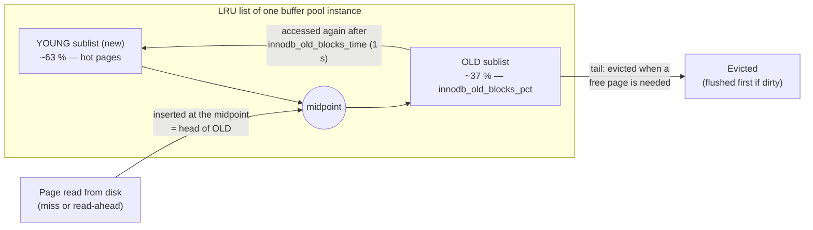

## Introduction

Every row InnoDB returns, and every row it changes, passes through one structure: the **buffer pool**, an area of memory that caches the 16 KB pages you met in [Tablespaces, Pages and Row Formats](/lessons/m10-pages-records). A query never reads a data file directly. It asks the buffer pool for page *(space, page number)*; if the page is cached, that costs a hash lookup and a latch; if not, a thread reads it from disk — a microsecond operation becomes a 100 µs (SSD) to 10 ms (spinning disk) one.

Consequently, the buffer pool is usually the most important memory setting of a MySQL server, and its behaviour explains many production phenomena:

- Why is a server slow for twenty minutes after a restart, and fine afterwards?
- Why does a nightly report that scans a 500 GB table not destroy the cache for daytime OLTP traffic?
- Why do writes complete in microseconds even though nothing has been written to the data files yet — and what eventually writes them?
- How large should `innodb_buffer_pool_size` be, and what do `innodb_buffer_pool_instances` and the chunk size do?

This lesson answers them with InnoDB's actual algorithms, and measures the buffer pool's counters during real workloads in your lab.

:::note[Global counters]
All `Innodb_buffer_pool_*` and `Innodb_pages_*` status variables are **global**: they count the whole server's activity since startup, not just your session, and `SHOW SESSION STATUS` returns the same global values. The workloads below are large enough to dominate the counters, but other activity on the build server at capture time is included. Variables are the **build server's** settings (MySQL 8.0 defaults); 8.4 defaults differ in several places and are listed in a `:::version` callout.
:::

## DBMS Theory

:::theory[Buffer management]
A **buffer manager** maintains a fixed number of in-memory **frames**, each holding one disk page, plus a page table mapping page ids to frames. Its interface is *fix(page)* (pin the page in a frame, reading it from disk on a miss) and *unfix(page, dirty?)*. When a miss occurs and no frame is free, a **replacement policy** chooses a victim; if the victim is **dirty** (modified since it was read), it must be written back first.

Classic policies:

- **LRU** — evict the least recently used page. Simple and good for temporal locality, but vulnerable to **sequential flooding**: a single scan of a table larger than the pool evicts the entire hot working set.
- **LRU-K / 2Q / ARC** — distinguish pages referenced once from pages referenced repeatedly, so one-off scans cannot evict the hot set. InnoDB's **midpoint insertion** is a 2Q-like scheme.
- **Clock** — an LRU approximation with cheaper bookkeeping (PostgreSQL uses clock-sweep).

Two policy dimensions interact with recovery (ARIES terminology):

- **Steal**: may a dirty page of an *uncommitted* transaction be written to disk? (Requires undo information to roll it back after a crash.)
- **Force**: must all pages a transaction modified be written to disk *at commit*? (Without force, durability needs redo logging.)

InnoDB is **steal / no-force**: maximum buffering freedom, made safe by undo and redo logs and the **write-ahead logging** rule — a dirty page may be written only after the redo records describing its changes are durable.
:::

| Concept | InnoDB term |
|---|---|
| Frame + control block | Buffer pool *block* (`buf_block_t`) with page frame |
| Page table | Page hash (per buffer pool instance) |
| Replacement list | **LRU list** split into a *young* (new) and an *old* sublist |
| Free frames | **Free list** |
| Dirty pages ordered by first modification | **Flush list** (ordered by oldest modification LSN) |
| Background writer | **Page cleaner** threads |
| Fix/pin | Buffer fix count + page latch (rw-lock) |

## Why It Exists

Why not let the operating system cache files, as MyISAM does? Because a transactional engine needs control that the OS cannot give:

1. **Write ordering (WAL).** The OS writes dirty file pages whenever it likes. InnoDB must guarantee that a page is never written before the redo records for its changes are on disk, and must be able to choose *which* pages to write to advance checkpoints. Only a DBMS-managed cache can enforce that.
2. **Replacement that understands database access patterns.** The OS cannot tell a hot index root page from a page read once by a backup scan. InnoDB's LRU knows which accesses came from scans and protects the hot set.
3. **No double caching.** With `innodb_flush_method = O_DIRECT` (the 8.4 default on Linux), data files bypass the OS cache, so memory is not spent twice on the same page.
4. **Latching and concurrency.** Pages carry InnoDB latches and are pinned while used; the buffer pool coordinates thousands of concurrent page accesses.
5. **More than table data.** Undo pages, change-buffer pages, system pages and the adaptive hash index all live in (or alongside) the buffer pool.

Without a buffer pool sized for the working set, every query becomes I/O-bound. The difference between a workload whose hot pages fit in memory and one that misses even 1 % of page requests is often an order of magnitude in throughput.

## Internal Working

### Structure

:::internals[Instances, chunks, lists]
- The buffer pool is divided into **instances** (`innodb_buffer_pool_instances`), each with its own LRU list, free list, flush list, page hash and mutexes. A page always maps to the same instance (by hashing its space id and page number), so instances reduce mutex contention on busy servers. With a buffer pool smaller than 1 GB there is one instance.
- Memory is allocated in **chunks** of `innodb_buffer_pool_chunk_size` (128 MB by default). Online resizing (`SET GLOBAL innodb_buffer_pool_size = …`) adds or removes whole chunks; the configured size is rounded up to a multiple of chunk size × instances.
- Each block has a **control block** (state, latch, LSNs, LRU links, …) stored outside the page frame; together with the page hash and other bookkeeping this is why `Innodb_buffer_pool_pages_misc` is non-zero and why the pool uses somewhat more memory than `innodb_buffer_pool_size`.
:::

### The midpoint-insertion LRU



:::internals[How a page moves through the LRU]
1. **Insertion at the midpoint.** A page read from disk is placed at the head of the **old** sublist, not the head of the whole list. The old sublist is `innodb_old_blocks_pct` percent of the LRU (default 37 %, about 3/8).
2. **Promotion ("made young").** If a page in the old sublist is accessed again, it moves to the head of the young sublist — but only if at least `innodb_old_blocks_time` milliseconds (default **1000**) have passed since its *first* access. A table scan touches each page many times in quick succession (once per row on the page), so its pages are *not* promoted: their repeated accesses all fall inside the 1-second window.
3. **Young-sublist accesses** of pages already near the head do not move them (to avoid constant list reshuffling under latches); pages deeper in the young sublist are moved to the head.
4. **Ageing.** As new pages are inserted at the midpoint, existing pages drift toward the tail. Unused young pages cross into the old sublist; unused old pages reach the tail.
5. **Eviction.** When a free frame is needed, the tail of the LRU is taken. A clean page is simply reused; a dirty page must first be written (the page cleaners try to keep enough clean pages near the tail so foreground threads never wait — `Innodb_buffer_pool_wait_free` counts the times they had to).

The result is **scan resistance**: a full scan streams through the old sublist and evicts only other old pages, while the hot working set stays in the young sublist. The old sublist is maintained only once the LRU list holds a minimum number of pages; in a nearly empty pool, newly read pages simply join the list.
:::

### Dirty pages and flushing

:::internals[Page cleaners, the LRU flush and the flush list]
A modified page becomes **dirty** and is added to the **flush list**, ordered by its *oldest modification LSN* (the redo position of its first unflushed change). Writing dirty pages back is the job of the **page cleaner** threads (`innodb_page_cleaners`), coordinated by a leader thread once per second (more often under pressure):

- **LRU flushing** keeps enough free/clean pages at the tail: each second, cleaners scan up to `innodb_lru_scan_depth` (1024) pages from each instance's LRU tail, writing dirty ones and moving clean ones to the free list.
- **Flush-list flushing** writes the pages with the oldest modifications first, which lets the **checkpoint LSN** advance and the redo log space be reused ([Redo and Undo](/lessons/m10-redo-undo)). *Adaptive flushing* sizes each batch from the redo generation rate and the checkpoint age, within the budget of `innodb_io_capacity` / `innodb_io_capacity_max`. When dirty pages exceed `innodb_max_dirty_pages_pct_lwm` (10 %), pre-flushing starts; above `innodb_max_dirty_pages_pct` (90 %) flushing becomes aggressive.
- **Sync flushing**: if the redo log is nearly full (checkpoint age close to capacity), InnoDB must flush synchronously and foreground writes stall — the classic symptom of an undersized redo log or `innodb_io_capacity` set too low for the hardware.

Every page write goes through the **doublewrite buffer** first ([Doublewrite](/lessons/m10-doublewrite-change-buffer)) and is preceded by a check that the redo log is flushed at least up to the page's newest modification LSN (WAL). `innodb_flush_neighbors` (0 by default since 8.0) can additionally flush dirty neighbours in the same extent — useful on spinning disks, wasteful on SSDs.
:::

### Read-ahead

InnoDB prefetches pages it expects to need. **Linear read-ahead**: if `innodb_read_ahead_threshold` (56) pages of one extent were read sequentially, the whole next extent is read asynchronously. **Random read-ahead** (off by default): if 13 pages of an extent are in the pool, the rest is read. Prefetched pages are inserted in the old sublist; `Innodb_buffer_pool_read_ahead_evicted` counts prefetched pages evicted without ever being used — a sign that read-ahead is wasted.

### Warmup: dump and load

At shutdown (`innodb_buffer_pool_dump_at_shutdown = ON`) InnoDB writes the **page ids** — not the contents — of the most recently used `innodb_buffer_pool_dump_pct` (25 %) of each instance's pages to the file `ib_buffer_pool` in the data directory. At startup (`innodb_buffer_pool_load_at_startup = ON`) a background thread reads those pages back, sorted by tablespace and page number for sequential I/O, while the server already accepts connections. `Innodb_buffer_pool_load_status` reports progress.

:::version[8.0 vs 8.4 defaults that change buffer-pool behaviour]
| Variable | 8.0 default | 8.4 default |
|---|---|---|
| `innodb_buffer_pool_instances` | 8 (1 if the pool is < 1 GB) | 1 if the pool is ≤ 1 GB; otherwise derived from the pool size, chunk size and number of logical processors |
| `innodb_page_cleaners` | 4 (capped at the number of instances) | equal to `innodb_buffer_pool_instances` |
| `innodb_io_capacity` / `_max` | 200 / 2000 | **10000** / 2 × `innodb_io_capacity` |
| `innodb_flush_method` (Linux) | `fsync` | `O_DIRECT` when supported |
| `innodb_numa_interleave` | OFF | ON |
| `innodb_buffer_pool_in_core_file` | ON | OFF where `MADV_DONTDUMP` is supported |
| `innodb_adaptive_hash_index` | ON | **OFF** |
| `innodb_change_buffering` | `all` | **`none`** |

The higher `innodb_io_capacity` reflects SSD-era hardware: on 8.4 the page cleaners are allowed to write far more pages per second before throttling. The last two rows are covered in [Doublewrite, Change Buffer and AHI](/lessons/m10-doublewrite-change-buffer).
:::

## MySQL Implementation

The build server's buffer-pool configuration:

```sql run
SELECT @@innodb_buffer_pool_size                         AS pool_bytes,
       @@innodb_buffer_pool_size / 1024 / 1024           AS pool_mb,
       @@innodb_buffer_pool_size DIV @@innodb_page_size  AS pool_pages,
       @@innodb_buffer_pool_chunk_size / 1024 / 1024     AS chunk_mb,
       @@innodb_buffer_pool_instances                    AS instances,
       @@innodb_old_blocks_pct                           AS old_pct,
       @@innodb_old_blocks_time                          AS old_blocks_time_ms;
```

The defaults: a 128 MB pool (8,192 pages of 16 KB), one 128 MB chunk, one instance (because the pool is under 1 GB), 37 % old sublist and a 1-second promotion delay. Production servers set the size explicitly — typically 50–75 % of RAM on a dedicated database host.

Flushing and warmup settings:

```sql run
SELECT @@innodb_page_cleaners           AS page_cleaners,
       @@innodb_lru_scan_depth          AS lru_scan_depth,
       @@innodb_io_capacity             AS io_capacity,
       @@innodb_io_capacity_max         AS io_capacity_max,
       @@innodb_max_dirty_pages_pct     AS max_dirty_pct,
       @@innodb_max_dirty_pages_pct_lwm AS dirty_lwm_pct,
       @@innodb_flush_neighbors         AS flush_neighbors,
       @@innodb_flush_method            AS flush_method;
```

```sql run
SELECT @@innodb_buffer_pool_dump_at_shutdown AS dump_at_shutdown,
       @@innodb_buffer_pool_load_at_startup  AS load_at_startup,
       @@innodb_buffer_pool_dump_pct         AS dump_pct,
       @@innodb_read_ahead_threshold         AS linear_read_ahead_threshold,
       @@innodb_random_read_ahead            AS random_read_ahead;
```

The current state of the pool, in pages (global, at capture time):

```sql run
SHOW GLOBAL STATUS WHERE Variable_name IN
  ('Innodb_buffer_pool_pages_total', 'Innodb_buffer_pool_pages_data', 'Innodb_buffer_pool_pages_free',
   'Innodb_buffer_pool_pages_misc', 'Innodb_buffer_pool_pages_dirty', 'Innodb_buffer_pool_load_status');
```

`pages_total` = 8,192 frames; `pages_data` holds cached pages (clean and dirty); `pages_free` are unused frames; `pages_misc` are frames used for internal structures (adaptive hash index, row locks and other overhead); `pages_dirty` are modified pages not yet written back. The load status shows the warmup that ran when the build server last started.

## Syntax Breakdown

### Configuration (administrators; not available in the sandbox)

```sql
-- Resize online in whole chunks (8.0/8.4); progress in Innodb_buffer_pool_resize_status
SET GLOBAL innodb_buffer_pool_size = 8 * 1024 * 1024 * 1024;

-- Scan resistance
SET GLOBAL innodb_old_blocks_pct  = 37;     -- 5..95
SET GLOBAL innodb_old_blocks_time = 1000;   -- ms before an old page can be made young

-- Warmup
SET GLOBAL innodb_buffer_pool_dump_now = ON;  -- write ib_buffer_pool now
SET GLOBAL innodb_buffer_pool_load_now = ON;  -- start loading it
SET GLOBAL innodb_buffer_pool_load_abort = ON;

-- Flushing
SET GLOBAL innodb_io_capacity = 2000;
SET GLOBAL innodb_max_dirty_pages_pct = 90;
```

### Status counters (global)

| Counter | Meaning |
|---|---|
| `Innodb_buffer_pool_read_requests` | **Logical** page requests (each fix of a page) |
| `Innodb_buffer_pool_reads` | Requests that **missed** and read the page from disk |
| `Innodb_buffer_pool_read_ahead` / `_read_ahead_evicted` | Pages prefetched / prefetched but evicted unused |
| `Innodb_buffer_pool_write_requests` | Modifications to pages in the pool |
| `Innodb_buffer_pool_pages_flushed` | Pages written back by flushing |
| `Innodb_buffer_pool_wait_free` | Times a thread had to wait for a clean free page (should be ~0) |
| `Innodb_buffer_pool_pages_*` / `_bytes_*` | Current composition: total, data, free, misc, dirty |
| `Innodb_pages_created` / `_read` / `_written` | Pages created, read from disk, written |
| `Innodb_buffer_pool_dump_status` / `_load_status` / `_resize_status` | Progress messages |

The **hit ratio** is `1 − Innodb_buffer_pool_reads / Innodb_buffer_pool_read_requests` over an interval (compute it from two samples, not from the since-startup totals). For OLTP, values well above 99 % are normal; what matters more is the *absolute* number of misses per second compared with what the storage can deliver.

### Introspection tables (need `PROCESS` — not in the sandbox)

```sql
SELECT POOL_ID, POOL_SIZE, FREE_BUFFERS, DATABASE_PAGES, OLD_DATABASE_PAGES, MODIFIED_DATABASE_PAGES,
       PAGES_MADE_YOUNG, PAGES_NOT_MADE_YOUNG, HIT_RATE
FROM information_schema.INNODB_BUFFER_POOL_STATS;

-- Which tables occupy the pool (expensive on large pools!)
SELECT TABLE_NAME, INDEX_NAME, COUNT(*) AS pages, SUM(IS_OLD = 'YES') AS old_pages
FROM information_schema.INNODB_BUFFER_PAGE_LRU
GROUP BY TABLE_NAME, INDEX_NAME ORDER BY pages DESC LIMIT 10;
```

The `BUFFER POOL AND MEMORY` section of `SHOW ENGINE INNODB STATUS` shows the same information. **Illustrative example** of its format (not captured from the build server; values invented for layout only):

```text
----------------------
BUFFER POOL AND MEMORY
----------------------
Total large memory allocated 0
Buffer pool size   8192
Free buffers       1024
Database pages     7040
Old database pages 2578
Modified db pages  312
Pending reads      0
Pages made young 15230, not young 88412
0.00 youngs/s, 0.00 non-youngs/s
Pages read 6100, created 9800, written 21000
Buffer pool hit rate 1000 / 1000, young-making rate 0 / 1000 not 0 / 1000
LRU len: 7040, unzip_LRU len: 0
```

"Pages made young / not young" show midpoint insertion at work: *not young* counts accesses to old pages that were **not** promoted because they happened within `innodb_old_blocks_time` — typically scan traffic.

## Practical Examples

### 1. Writes go to the buffer pool first

Create a 200,000-row table and watch pages being *created in memory* and marked dirty:

```sql run
SET SESSION cte_max_recursion_depth = 300000;
CREATE TABLE bp_demo (id INT PRIMARY KEY, grp INT NOT NULL, pad CHAR(100) NOT NULL);
SHOW GLOBAL STATUS WHERE Variable_name IN ('Innodb_pages_created', 'Innodb_buffer_pool_pages_dirty');
INSERT INTO bp_demo
  WITH RECURSIVE s(n) AS (SELECT 1 UNION ALL SELECT n + 1 FROM s WHERE n < 200000)
  SELECT n, n % 100, 'x' FROM s;
SHOW GLOBAL STATUS WHERE Variable_name IN ('Innodb_pages_created', 'Innodb_buffer_pool_pages_dirty');
```

Compare the two snapshots: `Innodb_pages_created` rose by well over a thousand — the leaf and non-leaf pages of the new clustered index, created directly in buffer-pool frames without any disk read — and `Innodb_buffer_pool_pages_dirty` rose by a similar amount. The `INSERT` returned without writing a single data page to the `.ibd` file: durability at commit came from the redo log; the pages themselves will be written later by the page cleaners.

### 2. Logical vs physical reads during a scan and a lookup

```sql run
SHOW GLOBAL STATUS WHERE Variable_name IN
  ('Innodb_buffer_pool_read_requests', 'Innodb_buffer_pool_reads', 'Innodb_rows_read');
SELECT SUM(LENGTH(pad)) AS scanned_bytes FROM bp_demo;
SHOW GLOBAL STATUS WHERE Variable_name IN
  ('Innodb_buffer_pool_read_requests', 'Innodb_buffer_pool_reads', 'Innodb_rows_read');
SELECT pad FROM bp_demo WHERE id = 777;
SHOW GLOBAL STATUS WHERE Variable_name IN
  ('Innodb_buffer_pool_read_requests', 'Innodb_buffer_pool_reads', 'Innodb_rows_read');
```

Read the three snapshots pairwise:

- **The full scan**: `Innodb_rows_read` rose by 200,000 (every row), but `Innodb_buffer_pool_read_requests` rose only by a couple of thousand — roughly one request per *page*, because the scan keeps a page fixed while it reads the ~100 rows on it. `Innodb_buffer_pool_reads` did not move (or barely moved): every page was already in memory, created there by the `INSERT`. A 100 % hit ratio.
- **The primary-key lookup**: `Innodb_rows_read` +1 and only a handful of page requests (four in this capture) — roughly one per level of the B+ tree, which for a table of this size has about three levels (root, one internal level, leaves). That is the cost of an index descent, measured.

On a production server the interesting case is the *miss*: run the same scan on a table that is not cached and `Innodb_buffer_pool_reads` (and `Innodb_buffer_pool_read_ahead`, as linear read-ahead kicks in) rises by roughly the number of pages. The lab cannot evict pages, so it cannot show a cold read.

### 3. Dirty pages are flushed in the background

```sql run
SHOW GLOBAL STATUS WHERE Variable_name IN ('Innodb_buffer_pool_pages_dirty', 'Innodb_buffer_pool_pages_flushed');
UPDATE bp_demo SET grp = grp + 1;
SHOW GLOBAL STATUS WHERE Variable_name IN ('Innodb_buffer_pool_pages_dirty', 'Innodb_buffer_pool_pages_flushed');
SELECT SLEEP(2) AS waited_seconds;
SHOW GLOBAL STATUS WHERE Variable_name IN ('Innodb_buffer_pool_pages_dirty', 'Innodb_buffer_pool_pages_flushed');
```

The `UPDATE` dirtied every leaf page of the table (plus undo pages) — yet the dirty count rose by less than the table's page count, because many of its pages were still dirty from the `INSERT` and the page cleaners were already writing pages while the statement ran (`pages_flushed` grew during the `UPDATE` too). While the session slept for two seconds, nothing in the lab issued any statement, yet `Innodb_buffer_pool_pages_flushed` grew and `Innodb_buffer_pool_pages_dirty` fell: the page cleaner threads, working through the flush list within their `innodb_io_capacity` budget, wrote pages back. (Exact numbers depend on timing and on other activity on the build server.)

### 4. Midpoint insertion, simulated

The interactive simulation below models one LRU list of **10 pages** with a 37 % old sublist. Pages `A`–`F` are loaded, then `A`, `B`, `C` are used again (they become young — the hot set). Then a "table scan" reads twelve pages `S1`–`S12` once each, more than the whole pool. Finally the application touches `A`, `B`, `C` again. Step through it (or edit the access sequence):

```viz
type: bufferpool
capacity: 10
oldPct: 37
accesses: [A, B, C, D, E, F, A, B, C, S1, S2, S3, S4, S5, S6, S7, S8, S9, S10, S11, S12, A, B, C]
```

What to observe:

- The second accesses to `A`, `B`, `C` hit pages in the old sublist and **promote** them to the young head.
- `S1`–`S12` each **miss** and are inserted at the **midpoint**; once the pool is full, each new scan page evicts the **oldest old page** — first the cold pages `D`–`F`, then earlier scan pages. (`S2` and `S3`, which arrived while the pool was still filling, land in the young part; real InnoDB likewise only maintains the old sublist once the LRU is long enough.)
- The final `A`, `B`, `C` are all **hits**. Under plain LRU, a 12-page scan through a 10-page pool would have evicted every one of them.

The simulation ignores `innodb_old_blocks_time`. In real InnoDB that delay is what stops a scan from promoting its own pages: each page is touched many times within milliseconds (once per row), and none of those touches count as a "second access" for promotion.

## Execution Walkthrough

How a single `SELECT pad FROM bp_demo WHERE id = 777` interacts with the buffer pool, step by step, with the counters you can observe:

```walkthrough
title: A primary-key lookup through the buffer pool
steps:
  - title: "1. Baseline"
    explain: >-
      Snapshot the global read counters. (Other server activity can move them slightly between steps.)
    sql: SHOW GLOBAL STATUS WHERE Variable_name IN ('Innodb_buffer_pool_read_requests', 'Innodb_buffer_pool_reads');
  - title: "2. Descend the clustered index"
    explain: >-
      The executor asks InnoDB for the row with id = 777. InnoDB hashes (space id, root page number) into the page
      hash of the right buffer-pool instance, finds the root frame, latches it in shared mode, binary-searches the
      page directory, follows the child pointer, and repeats down to the leaf. Each level is one logical read
      request; because every page is cached, no disk read happens. A page found in the old sublist more than one
      second after its first access would be made young.
    sql: SELECT pad FROM bp_demo WHERE id = 777;
  - title: "3. Count the page requests"
    explain: >-
      The difference in read requests from step 1 is the number of page fixes the lookup needed — one per B+ tree
      level for this 200,000-row table, plus any concurrent activity. Innodb_buffer_pool_reads is unchanged.
    sql: SHOW GLOBAL STATUS WHERE Variable_name IN ('Innodb_buffer_pool_read_requests', 'Innodb_buffer_pool_reads');
  - title: "4. What a miss would add"
    explain: >-
      Had the leaf page not been cached, the thread would take a free frame (or evict the LRU tail, writing it first
      if dirty), issue a synchronous read, verify the page checksum, insert the frame at the midpoint of the LRU, and
      only then continue. Innodb_buffer_pool_reads and Innodb_pages_read would each rise by one, and the lookup would
      take roughly one storage latency longer.
```

## Output

From the captured snapshots:

- **Inserting** 200,000 rows created over a thousand pages directly in memory, all dirty, with no data-file write at commit.
- **Scanning** them issued about one read request per page (a couple of thousand) to read 200,000 rows, with no physical reads — `Innodb_buffer_pool_reads` stayed flat.
- **A primary-key lookup** cost one read request per B+ tree level.
- **Background flushing** reduced the dirty-page count within seconds while the lab was idle.

The since-startup hit ratio of the build server can be computed from any snapshot: `1 − reads / read_requests`. With read requests in the hundreds of millions and reads in the thousands, it is above 99.99 % — which is exactly why a hit ratio alone says little; the absolute miss rate during peak load is what you size for.

## Alternative Approaches

| Approach | When it helps | Trade-offs |
|---|---|---|
| **Bigger buffer pool** | Working set slightly larger than the pool | Memory is finite; leave room for connections, sort/join buffers, OS and file-system metadata; swapping is far worse than misses |
| **Smaller working set** | Always | Narrower rows, better page fill (sequential keys), covering indexes, archiving cold rows, `DYNAMIC` row format — fewer pages to cache |
| **Faster storage** | Working set much larger than memory | NVMe reduces miss latency from milliseconds to ~100 µs; misses still cost CPU and latency |
| **Read replicas** | Read-heavy workloads | Each replica has its own buffer pool, so reads spread; replicas need their own warmup |
| **Application cache (Redis)** | Very hot, read-mostly objects | Avoids the database entirely for those reads; invalidation complexity |
| **Compression (`COMPRESSED`, page compression)** | Large, compressible, read-mostly tables | `COMPRESSED` keeps both compressed and uncompressed copies in the pool (unzip LRU) — can *increase* memory pressure for hot data |
| **Plain LRU or OS cache (MyISAM)** | — | No scan resistance, no WAL control; not an option for InnoDB data |

Other systems make different choices: PostgreSQL keeps a modest `shared_buffers` (often 25 % of RAM) and relies on the OS page cache for the rest (double buffering by design), using clock-sweep replacement and ring buffers for large scans; Oracle and SQL Server, like InnoDB, manage most memory themselves.

## Performance Analysis

**Sizing.** The rule of thumb for a dedicated server is 50–75 % of RAM (8.0/8.4's `innodb_dedicated_server` applies similar fractions automatically). The *right* size is "the working set plus headroom", where the working set is the pages touched during a busy period — often much smaller than the total data size. Signals that the pool is too small: `Innodb_buffer_pool_reads` per second high relative to storage capability, `Innodb_buffer_pool_wait_free` > 0, high "pages made young" churn, read latency dominating `EXPLAIN ANALYZE` times on a cold path.

**Cost of a miss.** One synchronous page read: ~0.1 ms on NVMe, ~0.2–1 ms on network block storage (cloud volumes), 5–10 ms on HDD. A query that touches 1,000 uncached pages therefore takes 0.1–10 s, versus a few milliseconds when cached. This is why the same query can be 100× slower right after a restart.

**Flushing.** Too little flushing capacity (`innodb_io_capacity` far below what storage can do) lets the checkpoint age grow until the redo log is nearly full, then forces sync flushing and stalls writes. Too much wastes I/O by rewriting hot pages repeatedly. The 8.4 default of 10,000 assumes SSDs.

**Instances.** On large pools with many concurrent threads, several instances reduce contention on LRU and flush-list mutexes. On small pools (< 1 GB) one instance is best.

:::performance[Theory vs measurement]
The counters shown above are real but come from a small, fully cached lab table on a lightly loaded server, so they demonstrate *mechanisms* (logical reads per page, background flushing), not performance. The latency figures in this section are typical published storage characteristics, not measurements from this server. On your own system, compute the miss rate per second from two `SHOW GLOBAL STATUS` samples, watch `Innodb_buffer_pool_wait_free` and checkpoint age (`Innodb_redo_log_current_lsn − Innodb_redo_log_checkpoint_lsn`), and use `performance_schema` file I/O summaries to see which tablespaces are read from disk.
:::

## Best Practices

:::best-practice[Running the buffer pool]
1. **Set `innodb_buffer_pool_size` explicitly** on every production server (or use `innodb_dedicated_server` on a dedicated host); the 128 MB default is for laptops.
2. **Size for the working set**, measured as misses per second at peak, not for the total data size; leave memory for connections and the OS, and never let the host swap.
3. **Keep the warmup on** (`dump_at_shutdown`/`load_at_startup`) and consider raising `innodb_buffer_pool_dump_pct` for servers whose hot set is large; schedule a `innodb_buffer_pool_dump_now` before planned restarts on replicas.
4. **Leave `innodb_old_blocks_time` at its default** unless you can prove scans are evicting the hot set (then raise it) or that a legitimately hot data set is not being promoted.
5. **Match `innodb_io_capacity` to the storage** (the 8.4 default 10,000 suits SSDs; HDD servers need far less) and size the redo log so the checkpoint age stays well below capacity.
6. **Use `O_DIRECT`** on Linux (8.4 default) to avoid double caching, unless the storage stack requires otherwise.
7. **Resize online in chunk multiples** and expect a brief pause while chunks are added or removed; monitor `Innodb_buffer_pool_resize_status`.
:::

## Common Mistakes

**Mistake 1 — judging health by the since-startup hit ratio.** Computed over months, it is almost always 99.9 % and hides a bad hour. Compute it over short intervals, and look at misses per second.

**Mistake 2 — setting the buffer pool to 90 % of RAM.** Connections, temporary tables, sort and join buffers, the OS and file-system cache for redo/binary logs need memory too. If the host swaps, buffer-pool hits become disk reads anyway — with worse latency.

**Mistake 3 — benchmarking right after a restart (or only after warmup).** Cold and warm performance differ by orders of magnitude. Decide which one you are measuring, and report it.

**Mistake 4 — trying to manage the pool from an application account.**

```sql run error
SET GLOBAL innodb_buffer_pool_dump_now = ON;
```

Buffer-pool control is server administration; in the sandbox it is rejected before it reaches the server, and on a real server it requires `SYSTEM_VARIABLES_ADMIN`.

**Mistake 5 — reading `SHOW SESSION STATUS LIKE 'Innodb_buffer_pool%'` as per-session.** These are global counters; the `SESSION` keyword does not scope them. Use `Handler_*` counters for per-session row access and the global InnoDB counters only for server-level trends.

## Industry Application

- **Failover and cold replicas.** When a primary fails over to a replica whose buffer pool is cold or holds a different working set, the new primary can be overwhelmed by misses. Operators warm standby replicas by sending them a share of read traffic, or by loading a recent `ib_buffer_pool` dump copied from the primary.
- **Cloud instance sizing.** Managed services set `innodb_buffer_pool_size` to ~75 % of instance memory by default (Amazon RDS uses a formula of this kind); choosing an instance class is largely choosing a buffer-pool size, and "memory-optimised" classes exist for this reason.
- **Batch jobs alongside OLTP.** ETL extracts and reporting scans run on the primary without destroying the cache because of midpoint insertion; teams that saw cache pollution from backups (`mysqldump` scanning everything) tuned `innodb_old_blocks_time` or moved backups to a replica.
- **Capacity planning.** Database teams track data growth versus pool size: when the hot set (e.g. the last 30 days of orders) is projected to exceed the pool, they plan memory upgrades, archiving, or sharding before latency degrades.
- **Monitoring.** Standard dashboards (PMM, Datadog, CloudWatch) chart buffer-pool reads vs read requests, dirty pages, pages flushed per second and wait_free — the counters you used in this lesson.

## Practice Exercises

```exercise
id: ex1
title: The pool in pages
difficulty: easy
kind: query
dataset: empty
concepts: [buffer-pool, buffer-pool-sizing, young-old-sublists]
prompt: |
  Return one row with:

  1. `pool_pages` — the buffer pool size in pages (`innodb_buffer_pool_size ÷ innodb_page_size`, integer)
  2. `chunks` — the number of chunks (`innodb_buffer_pool_size ÷ innodb_buffer_pool_chunk_size`, integer)
  3. `old_sublist_pages` — the approximate size of the old sublist if the whole pool were in the LRU:
     `pool_pages × innodb_old_blocks_pct / 100`, rounded to an integer
hints:
  - "Use DIV for integer division of system variables."
  - "ROUND((@@innodb_buffer_pool_size DIV @@innodb_page_size) * @@innodb_old_blocks_pct / 100)"
solution: |
  SELECT @@innodb_buffer_pool_size DIV @@innodb_page_size AS pool_pages,
         @@innodb_buffer_pool_size DIV @@innodb_buffer_pool_chunk_size AS chunks,
         ROUND((@@innodb_buffer_pool_size DIV @@innodb_page_size) * @@innodb_old_blocks_pct / 100) AS old_sublist_pages;
explanation: |
  With the defaults: 8,192 pages, one chunk, and about 3,031 pages (37 %) in the old sublist. The old sublist is the
  "probation" area where pages read by scans live and die without disturbing the young, hot pages. (In reality the
  LRU holds only data pages, so the old sublist is 37 % of Innodb_buffer_pool_pages_data rather than of all frames.)
```

```exercise
id: ex2
title: Hit ratio per interval
difficulty: medium
kind: query
dataset: empty
setup: |
  CREATE TABLE bp_samples (
    sampled_at     DATETIME PRIMARY KEY,
    read_requests  BIGINT NOT NULL,
    disk_reads     BIGINT NOT NULL
  );
  INSERT INTO bp_samples VALUES
    ('2026-03-02 09:00:00', 1000000000, 2000000),
    ('2026-03-02 09:01:00', 1006000000, 2003000),
    ('2026-03-02 09:02:00', 1012500000, 2006500),
    ('2026-03-02 09:03:00', 1014000000, 2096500),
    ('2026-03-02 09:04:00', 1020000000, 2099500);
concepts: [buffer-pool]
prompt: |
  `bp_samples` holds one-minute snapshots of the cumulative counters `Innodb_buffer_pool_read_requests` and
  `Innodb_buffer_pool_reads`. For every sample **except the first**, return:

  - `sampled_at`
  - `misses_per_sec` — (disk_reads − previous disk_reads) ÷ 60, rounded to 1 decimal
  - `hit_ratio_pct` — 100 × (1 − Δdisk_reads ÷ Δread_requests), rounded to 3 decimals

  Order by `sampled_at`.
hints:
  - "LAG(col) OVER (ORDER BY sampled_at) gives the previous sample's value."
  - "Compute the deltas in a derived table or CTE, then filter out the first row (where LAG is NULL)."
solution: |
  WITH d AS (
    SELECT sampled_at,
           read_requests - LAG(read_requests) OVER (ORDER BY sampled_at) AS d_req,
           disk_reads    - LAG(disk_reads)    OVER (ORDER BY sampled_at) AS d_reads
    FROM bp_samples
  )
  SELECT sampled_at,
         ROUND(d_reads / 60, 1) AS misses_per_sec,
         ROUND(100 * (1 - d_reads / d_req), 3) AS hit_ratio_pct
  FROM d
  WHERE d_req IS NOT NULL
  ORDER BY sampled_at;
orderMatters: true
explanation: |
  The since-startup ratio over these counters is about 99.79 % and looks healthy. Per interval, the 09:03 minute
  stands out: 90,000 misses (1,500 per second) at a 94 % hit ratio — perhaps a report scanning cold data, or a
  failover to a cold replica. Cumulative counters must always be differenced over intervals; the absolute miss rate
  per second is what you compare with the storage's IOPS capacity.
```

```exercise
id: ex3
title: Does the working set fit?
difficulty: hard
kind: query
dataset: empty
setup: |
  CREATE TABLE table_inventory (
    table_name   VARCHAR(40) PRIMARY KEY,
    data_mb      INT NOT NULL,
    index_mb     INT NOT NULL,
    hot_fraction DECIMAL(4,2) NOT NULL
  );
  INSERT INTO table_inventory VALUES
    ('orders',      40960, 12288, 0.10),
    ('order_items', 81920, 20480, 0.08),
    ('customers',    6144,  2048, 0.50),
    ('products',      512,   256, 1.00),
    ('audit_log',  204800,  4096, 0.01);
concepts: [buffer-pool-sizing]
prompt: |
  `table_inventory` lists each table's data and index size (MB) and the fraction of it that is touched during the
  busy hour. Return **one row** with:

  1. `working_set_mb` — Σ((data_mb + index_mb) × hot_fraction), rounded to an integer
  2. `pool_mb` — the server's `innodb_buffer_pool_size` in MB (integer)
  3. `recommended_pool_mb` — working_set_mb × 1.3 (30 % headroom), rounded **up** to the next multiple of 1024
hints:
  - "SUM((data_mb + index_mb) * hot_fraction) gives the working set."
  - "CEIL(x / 1024) * 1024 rounds up to a multiple of 1024."
solution: |
  SELECT ROUND(SUM((data_mb + index_mb) * hot_fraction)) AS working_set_mb,
         @@innodb_buffer_pool_size DIV (1024 * 1024) AS pool_mb,
         CEIL(SUM((data_mb + index_mb) * hot_fraction) * 1.3 / 1024) * 1024 AS recommended_pool_mb
  FROM table_inventory;
explanation: |
  The total data is about 365 GB (373,504 MB), but the busy-hour working set is only about 20 GB (20,470 MB); with 30 %
  headroom the recommendation is a 26 GB pool (26,624 MB) — a very different machine from "fit everything in memory". The method matters more than the numbers:
  estimate the hot fraction from access patterns (recent rows, hot indexes) and validate it by watching misses per
  second after deployment. The 128 MB default is clearly unsuitable for this workload.
```

```exercise
id: ex4
title: Explain scan resistance
difficulty: medium
kind: open
concepts: [midpoint-insertion, lru, young-old-sublists]
prompt: |
  At 02:00 a reporting job scans the entire 400 GB `events` table on a server with a 64 GB buffer pool that normally
  serves an OLTP workload with a 20 GB hot set. Explain step by step what happens to (a) the pages read by the scan
  and (b) the OLTP hot pages, under InnoDB's default settings. Then explain what would happen under a plain LRU
  policy, and which variable you would change if monitoring showed the OLTP hot set *was* being evicted.
solution: |
  **(a) Scan pages.** Each page read from disk is inserted at the midpoint — the head of the old sublist (37 % of the
  LRU, ~23 GB). The scan touches each page once per row within milliseconds, so all its accesses fall within
  `innodb_old_blocks_time` (1 s) of the first access and the page is **not** made young. As the scan continues, its
  pages drift down the old sublist and are evicted from the tail. Linear read-ahead prefetches extents, also into the
  old sublist.

  **(b) Hot pages.** The OLTP pages are accessed repeatedly over time, so they were promoted to the young sublist
  (~41 GB) and keep being re-referenced. Because new pages enter at the midpoint, the scan only displaces pages in the
  old sublist; the hot set survives. Only hot pages that age into the old sublist while unused risk eviction.

  **Plain LRU.** Every scanned page would enter at the head; 400 GB through a 64 GB pool would push out the entire
  hot set several times over, and the morning OLTP traffic would start cold — a "sequential flooding" failure.

  **Tuning.** If the hot set were still evicted (e.g. "pages made young" rising during the scan, or OLTP misses
  spiking), raise `innodb_old_blocks_time` (so slow scans that revisit pages after more than 1 s are not promoted) or
  reduce `innodb_old_blocks_pct` to shrink the probation area — or run the report on a replica.
```

```exercise
id: ex5
title: The slow first twenty minutes
difficulty: challenge
kind: open
concepts: [warmup, buffer-pool-sizing, page-cleaners, dirty-pages]
prompt: |
  After a planned restart of an 8.4 primary (256 GB RAM, 180 GB buffer pool), p99 latency is 15× higher for about
  twenty minutes. During the shutdown itself, the restart took much longer than expected. Explain both observations
  with buffer-pool internals, describe which settings and procedures would reduce each, and say how you would verify
  the warmup is working.
solution: |
  **Slow shutdown.** On a clean shutdown (`innodb_fast_shutdown = 1`, the default), InnoDB flushes all dirty pages from
  the buffer pool to the data files (through the doublewrite buffer) so that recovery is not needed. With a 180 GB
  pool and a high dirty fraction (up to `innodb_max_dirty_pages_pct` = 90 %), that can be tens of gigabytes of random
  writes. Mitigation: before the planned shutdown, lower `innodb_max_dirty_pages_pct` (e.g. to 0–10 %) and wait until
  `Innodb_buffer_pool_pages_dirty` falls, so the final flush is short; ensure `innodb_io_capacity`/`_max` match the
  storage.

  **Slow first twenty minutes.** After start the pool is empty: every first access to a hot page is a synchronous
  disk read, so queries that normally touch only memory wait on storage — p99 explodes until the working set is
  cached again. Mitigation: keep `innodb_buffer_pool_dump_at_shutdown` / `load_at_startup` ON (defaults) and raise
  `innodb_buffer_pool_dump_pct` from 25 % to cover the real hot set (e.g. 40–60 %), or run
  `SET GLOBAL innodb_buffer_pool_dump_now = ON` just before shutdown. The load reads pages sorted by
  tablespace/page for efficient I/O in the background. Operationally, restart a replica first, warm it, and fail over
  to it; or shift traffic gradually.

  **Verification.** Check that `ib_buffer_pool` was written at shutdown (`Innodb_buffer_pool_dump_status`), follow
  `Innodb_buffer_pool_load_status` after start ("Loaded x/y pages", then "load completed"), watch
  `Innodb_buffer_pool_pages_data` grow and `Innodb_buffer_pool_reads` per second fall back to its normal level, and
  compare p99 latency with the pre-restart baseline.
```

## Knowledge Assessment

```quiz
- id: q1
  question: "Where does InnoDB insert a page it has just read from disk into the LRU list?"
  options:
    - "At the head of the whole list"
    - "At the midpoint — the head of the old sublist (innodb_old_blocks_pct, 37 % by default)"
    - "At the tail of the list"
    - "In a separate scan buffer outside the LRU"
  answer: 1
  explanation: "Midpoint insertion keeps newly read pages on probation in the old sublist. Inserting at the head is plain LRU (vulnerable to scans); there is no separate scan ring in InnoDB (PostgreSQL uses ring buffers)."
  concepts: [midpoint-insertion]
- id: q2
  question: "Why are a full table scan's pages normally NOT promoted to the young sublist, even though each page is accessed many times?"
  options:
    - "Because scans bypass the buffer pool"
    - "Because all those accesses happen within innodb_old_blocks_time (1 s) of the page's first access"
    - "Because scanned pages are marked read-only"
    - "Because read-ahead pages can never become young"
  answer: 1
  explanation: "A page in the old sublist is made young only if it is accessed again after innodb_old_blocks_time has elapsed. A scan reads all rows of a page within milliseconds. Scans do use the buffer pool, and read-ahead pages can be promoted if used later."
  concepts: [young-old-sublists, midpoint-insertion]
- id: q3
  question: "A full scan of a cached 200,000-row table raised Innodb_rows_read by 200,000 but Innodb_buffer_pool_read_requests by only about 2,300. Why?"
  options:
    - "The counters are sampled"
    - "Read requests count page fixes; the scan reads all rows on a page while holding it, so it needs roughly one request per page"
    - "Most rows were read from the query cache"
    - "The table was compressed"
  answer: 1
  explanation: "Logical page reads are per page, not per row; with ~100 rows per page, 200,000 rows ≈ 2,000 pages. There is no query cache in 8.0+, and the table used the default DYNAMIC format."
  concepts: [buffer-pool]
- id: q4
  type: multi
  question: "Which of the following are reasons InnoDB manages its own buffer pool instead of relying on the OS page cache? (Select all that apply.)"
  options:
    - "To enforce write-ahead logging: a page may be written only after its redo records are durable"
    - "To choose which dirty pages to flush so the checkpoint can advance"
    - "To implement scan-resistant replacement"
    - "Because the OS page cache cannot cache files larger than 1 GB"
  answer: [0, 1, 2]
  explanation: "WAL ordering, checkpoint-driven flushing and a database-aware replacement policy all need DBMS control. The OS cache has no such size limit."
  concepts: [buffer-pool, flushing]
- id: q5
  question: "Which statement about dirty pages is correct?"
  options:
    - "A transaction's dirty pages are written to the data files at COMMIT"
    - "Dirty pages are written later by page cleaner threads (LRU and flush-list flushing); commit durability comes from the redo log"
    - "Dirty pages are discarded if the server is shut down cleanly"
    - "A page can only be dirty if its transaction has committed"
  answer: 1
  explanation: "InnoDB is no-force: commit only flushes redo. It is also steal: pages modified by uncommitted transactions can be written (undo makes that safe). A clean shutdown flushes dirty pages rather than discarding them."
  concepts: [dirty-pages, page-cleaners]
- id: q6
  question: "Innodb_buffer_pool_wait_free is increasing steadily. What does it indicate?"
  options:
    - "The warmup load is still running"
    - "Foreground threads had to wait for a clean free page because flushing is not keeping up (or the pool is too small)"
    - "The adaptive hash index is full"
    - "Too many buffer pool instances"
  answer: 1
  explanation: "wait_free counts waits for a free page; normally the page cleaners keep enough clean pages at the LRU tail (innodb_lru_scan_depth). Fix flushing capacity (innodb_io_capacity, cleaners) or the pool size."
  concepts: [page-cleaners, flushing]
- id: q7
  question: "What does the ib_buffer_pool dump file contain?"
  options:
    - "A full copy of the buffer pool's pages"
    - "The space ids and page numbers of the most recently used pages (innodb_buffer_pool_dump_pct per instance), used to reload them at startup"
    - "The redo log records not yet applied"
    - "A list of dirty pages to flush after a crash"
  answer: 1
  explanation: "Only page identifiers are dumped (a few bytes per page), so the file is small; at startup the pages are read back from the tablespaces in the background. Redo is in the redo log, and crash recovery does not use this file."
  concepts: [warmup]
- id: q8
  question: "Which 8.4 default change most directly lets page cleaners write more pages per second than an 8.0 server with defaults?"
  options:
    - "innodb_old_blocks_pct changed to 50"
    - "innodb_io_capacity changed from 200 to 10000"
    - "innodb_buffer_pool_chunk_size changed to 1 GB"
    - "innodb_flush_neighbors changed to 2"
  answer: 1
  explanation: "innodb_io_capacity is the flushing I/O budget; 8.4 raised its default to 10000 for SSD-era storage. old_blocks_pct (37), chunk size (128 MB) and flush_neighbors (0) are unchanged."
  concepts: [flushing, buffer-pool-sizing]
```
