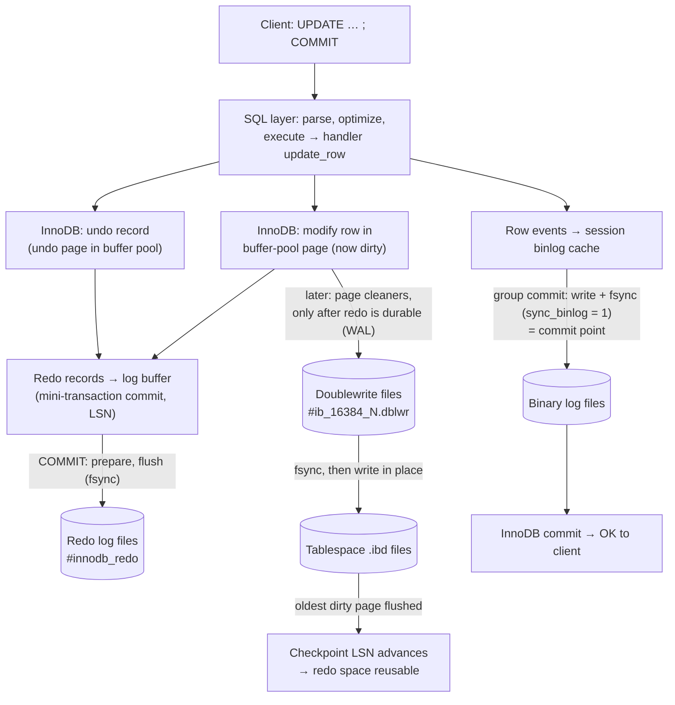
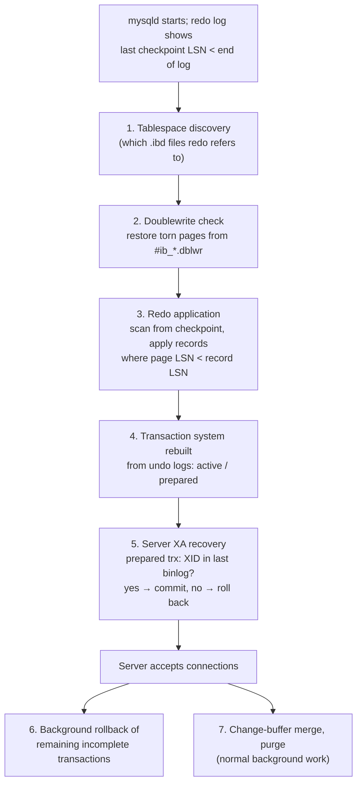

## Introduction

Everything in this module so far — pages, the buffer pool, redo and undo, the binary log, the doublewrite buffer — comes together at one moment: the restart after a crash. A power failure in the middle of peak traffic leaves the data files in a state that **never existed** logically: some pages carry changes of committed transactions, others still miss committed changes, some carry changes of transactions that never committed, and one page may be half-written. Within seconds to minutes, InnoDB must turn that into exactly the state "all committed transactions, no uncommitted ones" — and agree with the binary log about which transactions those are.

This lesson answers:

- What is a **checkpoint** in InnoDB, why is it *fuzzy*, and how does **checkpoint age** bound recovery time?
- What are the **phases** of InnoDB crash recovery, in order, and which happen before the server accepts connections?
- How does recovery decide the fate of a transaction that crashed **during** commit?
- What exactly does each **durability setting** risk, under which kind of failure?
- What are the shutdown modes, and when (and how carefully) is `innodb_force_recovery` used?

It also draws the **end-to-end write path** of a single committed change — the summary of the whole module.

:::note[What can be observed]
The lab cannot crash or restart the server, read the error log, or change durability settings. It can read every relevant setting, the redo/checkpoint LSNs and dirty-page counters (global), demonstrate that uncommitted work is invisible to others (what recovery rolls back), and measure rollback cost. Error-log output during recovery is shown as a clearly labelled **illustrative example**.
:::

## DBMS Theory

:::theory[Recovery in the ARIES family]
With a **steal / no-force** buffer manager and **write-ahead logging** (see [Redo and Undo](/lessons/m10-redo-undo)), a crash leaves the database with *winners* (committed transactions whose changes may be missing from disk) and *losers* (uncommitted transactions whose changes may already be on disk). ARIES (Mohan et al., 1992) recovers in three passes:

1. **Analysis** — read the log forward from the last checkpoint to reconstruct which transactions were active and which pages may be dirty, and find where redo must start.
2. **Redo ("repeating history")** — re-apply *all* logged changes from that point, for winners and losers alike, unless a page's pageLSN shows the change is already there. Afterwards the database is exactly in its state at the crash.
3. **Undo** — roll back all losers using their undo information, logging compensation records (CLRs) so that a crash during recovery does not undo the same change twice.

**Checkpoints** bound the work. A *sharp* checkpoint flushes all dirty pages and stops activity while doing so; a **fuzzy** checkpoint records "redo before LSN X is no longer needed" while pages continue to be flushed in the background — no pause, at the cost of a less recent recovery start point.

**Durability** is a contract: once a commit is acknowledged, its effects must survive the failures in the system's failure model (process crash, OS crash, power loss, media loss). Which failures are covered depends on *when* the log is forced to stable storage.
:::

InnoDB's recovery has the same shape, with InnoDB-specific mechanics:

| ARIES concept | InnoDB |
|---|---|
| Checkpoint | Fuzzy checkpoint LSN, written to the redo log header by the log checkpointer; advanced as page cleaners flush the oldest dirty pages |
| Analysis | Scan redo from the checkpoint LSN to the end of the log; transaction states (active, prepared, committed) are read from undo log headers in the rollback segments once redo has been applied |
| Torn-page protection | Doublewrite buffer restores intact copies before redo is applied |
| Redo | Redo records are parsed, grouped per page, and applied to pages whose `FIL_PAGE_LSN` is older than the record's LSN — repeating history, idempotent |
| Coordinator decision for in-doubt transactions | The binary log: prepared transactions whose XID is in the binlog are committed, others rolled back |
| Undo | Incomplete transactions rolled back from undo logs — in the background, while the server already accepts connections; rollback's own page changes are redo-logged, so a crash during rollback is itself recoverable (the role CLRs play in ARIES) |

## Why It Exists

Without crash recovery, every database would need either **force** (write every modified page at commit — slow, and still not atomic for multi-page changes) or a full consistency check and repair after every crash (MyISAM's world: `REPAIR TABLE`, possibly lost rows). InnoDB's recovery gives three properties at once:

- **Atomicity across a crash** — uncommitted transactions disappear entirely.
- **Durability** — acknowledged commits survive (within the failure model chosen by the durability settings).
- **Bounded restart time** — determined by the checkpoint age (redo to replay) and the size of incomplete transactions (undo to apply), not by database size.

What goes wrong when it is misunderstood: operators restart a crashed server, see it "hang" for twenty minutes, and kill it again (interrupting recovery, which then restarts from the checkpoint); teams set `innodb_flush_log_at_trx_commit = 2` and `sync_binlog = 0` for a benchmark, forget to revert, and lose acknowledged payments in the next power event; someone sets `innodb_force_recovery = 6` "to get the server up", writes to it, and corrupts it permanently.

## Internal Working

### The end-to-end write path



Reading the diagram from top to bottom is reading this module: the [query lifecycle](/lessons/m10-query-lifecycle) up to `update_row`, [undo and redo](/lessons/m10-redo-undo) generated by mini-transactions, the [binary log](/lessons/m10-binary-log) written at the commit point, the [buffer pool](/lessons/m10-buffer-pool) holding the dirty page, [doublewrite](/lessons/m10-doublewrite-change-buffer) before the in-place write, and the checkpoint that makes redo space reusable. At the moment of a crash, any of these arrows may be half-done.

### Fuzzy checkpoints and checkpoint age

:::internals[What the checkpoint means]
- The **checkpoint LSN** is (approximately) the smallest *oldest-modification LSN* of any dirty page in the buffer pool's flush lists: every change with a lower LSN is already in the data files. The log checkpointer thread writes it into the redo log's checkpoint header periodically.
- It is **fuzzy**: InnoDB never stops writers to take a checkpoint. Page cleaners flush the oldest dirty pages continuously (flush-list flushing, adaptive to the redo generation rate), and the checkpoint follows.
- **Checkpoint age** = current LSN − checkpoint LSN = the redo crash recovery would scan and possibly apply. It is bounded by `innodb_redo_log_capacity`; InnoDB pushes flushing harder as the age grows, so redo space never runs out.
- A **sharp** checkpoint happens at a normal shutdown (`innodb_fast_shutdown = 1`, the default): all dirty pages are flushed, so the next start needs no redo application at all.
:::

### The recovery phases



:::internals[Each phase in detail]
1. **Tablespace discovery.** InnoDB identifies the tablespace files that redo records refer to (using the data dictionary and the directories in `innodb_directories`), so it can open them for redo application.
2. **Doublewrite repair.** For pages that fail their checksum or whose header and trailer LSNs disagree, InnoDB looks for an intact copy in the doublewrite files and restores it ([Doublewrite](/lessons/m10-doublewrite-change-buffer)).
3. **Redo application.** Starting at the checkpoint LSN, InnoDB reads the redo log to its end (the last complete log block), parses records into a hash table keyed by page, and applies them in batches: each page is read once, and only records newer than the page's `FIL_PAGE_LSN` are applied. Mini-transactions are applied whole. This phase happens **before** the server accepts connections; its duration is roughly proportional to the checkpoint age (and the random reads of the affected pages). After a clean shutdown, this phase is skipped.
4. **Transaction system.** With undo pages now restored by redo, InnoDB reads the rollback segments' undo log headers to find transactions that were **active** (never prepared) or **prepared** at the crash.
5. **XA recovery with the binary log.** For each *prepared* transaction, the server scans the last binary log file for its XID: present → commit (it may already be on replicas); absent → roll back (the client never received OK). This keeps the binlog and InnoDB consistent ([The Binary Log](/lessons/m10-binary-log)). Incomplete DDL is also completed or rolled back here using the DDL log.
6. **Rollback of incomplete transactions.** Active transactions are rolled back using their undo logs. Large rollbacks run in a **background thread after the server starts accepting connections**; the rows they hold stay locked until rolled back. The manual warns that rolling back a transaction can take several times as long as the transaction ran before the crash.
7. **Change-buffer merge and purge** continue as ordinary background work.

`innodb_force_recovery` (1–6) disables pieces of this sequence for emergency data extraction: 1 ignores corrupt pages, 2 prevents background threads (purge, master) from running, 3 skips transaction rollback, 4 skips change-buffer merges, 5 ignores undo logs (treats incomplete transactions as committed), 6 skips redo application. Values ≥ 4 put InnoDB into read-only mode and can permanently corrupt data; they exist to let you **dump** what can be saved.
:::

:::version[Recovery-related changes in 8.0 and 8.4]
- **8.0:** redo-log redesign (dedicated writer/flusher/checkpointer threads); atomic DDL with the DDL log replayed or rolled back during recovery; the data dictionary itself is recovered like any InnoDB data.
- **8.0.20:** doublewrite in separate files; **8.0.30:** `innodb_redo_log_capacity` and `#innodb_redo` files, `DETECT_ONLY` doublewrite mode.
- **8.4:** the mechanisms are unchanged, but changed defaults affect recovery indirectly: `innodb_change_buffering = none` means no change-buffer backlog to merge; larger default `innodb_io_capacity` lets page cleaners keep checkpoint age lower; `innodb_dedicated_server` sizes the redo log.
:::

## MySQL Implementation

The durability-relevant settings of the build server:

```sql run
SELECT @@innodb_flush_log_at_trx_commit AS flush_log_at_trx_commit,
       @@sync_binlog                    AS sync_binlog,
       @@log_bin                        AS binlog_enabled,
       @@innodb_doublewrite             AS doublewrite,
       @@innodb_flush_method            AS flush_method,
       @@innodb_fast_shutdown           AS fast_shutdown,
       @@innodb_force_recovery          AS force_recovery,
       @@innodb_redo_log_capacity / 1024 / 1024 AS redo_capacity_mb;
```

This is the fully durable default profile: redo fsynced at every commit, binlog fsynced at every commit group, doublewrite on, normal shutdown mode, no forced recovery, a 100 MB redo log.

The recovery workload *right now* — what a crash at this instant would leave to recovery:

```sql run
SHOW GLOBAL STATUS WHERE Variable_name IN
  ('Innodb_redo_log_current_lsn', 'Innodb_redo_log_checkpoint_lsn', 'Innodb_redo_log_logical_size',
   'Innodb_buffer_pool_pages_dirty');
```

`Innodb_redo_log_logical_size` is the checkpoint age in bytes — the redo that recovery would scan — and `Innodb_buffer_pool_pages_dirty` is roughly the number of pages that redo application might have to read and repair. Both depend on what the server has just been doing: on an idle server they shrink towards zero within seconds, while right after a burst of writes — on the build server, other lessons' workloads may have just run — they can be tens of megabytes and thousands of pages.

### Watching the fuzzy checkpoint move

Generate a burst of changes and observe the checkpoint lag behind the current LSN, then catch up while nothing else happens in the session:

```sql run
SET SESSION cte_max_recursion_depth = 200000;
CREATE TABLE ckpt_demo (id INT PRIMARY KEY, v INT NOT NULL, pad CHAR(150) NOT NULL);
INSERT INTO ckpt_demo
  WITH RECURSIVE s(n) AS (SELECT 1 UNION ALL SELECT n + 1 FROM s WHERE n < 150000)
  SELECT n, 0, 'x' FROM s;
SHOW GLOBAL STATUS WHERE Variable_name IN
  ('Innodb_redo_log_logical_size', 'Innodb_buffer_pool_pages_dirty');
SELECT SLEEP(3) AS seconds_waited;
SHOW GLOBAL STATUS WHERE Variable_name IN
  ('Innodb_redo_log_logical_size', 'Innodb_buffer_pool_pages_dirty');
```

Right after the load, the checkpoint age is tens of megabytes and over a thousand pages are dirty: a crash at that moment would require recovery to replay that redo. Three seconds later, with no statements in between, both numbers are lower — the page cleaners flushed the oldest dirty pages and the checkpoint advanced, without ever pausing the workload. That is a fuzzy checkpoint at work. (These counters are global; other activity at capture time is included.)

## Syntax Breakdown

### The durability settings matrix

What can be lost after an acknowledged `COMMIT`, by setting and failure type (binary logging enabled):

| `innodb_flush_log_at_trx_commit` | `sync_binlog` | mysqld crash | OS crash / power loss | Notes |
|---|---|---|---|---|
| **1** | **1** | nothing | nothing | The default; fully durable; binlog and InnoDB always consistent |
| 1 | 0 or N > 1 | nothing | binlog may lack acknowledged transactions (InnoDB has them) | Replicas and PITR silently miss transactions |
| 2 | 1 | nothing | about the last second of InnoDB commits may be lost; recovery rolls back prepared transactions whose XID is not in the binlog, but a transaction already in the binlog yet missing from InnoDB's redo cannot be repaired automatically | Inconsistency risk between binlog and data |
| 2 | 0 | nothing | up to ~1 s of commits lost in InnoDB and binlog | Common "relaxed" profile for replicas that can be rebuilt |
| 0 | any | up to ~1 s of commits lost | up to ~1 s lost | Redo written and flushed only once per second |

And independently:

| Setting | Risk if relaxed |
|---|---|
| `innodb_doublewrite = OFF` | Torn pages after power loss cannot be repaired (unless storage guarantees atomic 16 KB writes) |
| `innodb_flush_method` | `O_DIRECT`/`O_DIRECT_NO_FSYNC` change how data files are synced; `O_DIRECT_NO_FSYNC` relies on the file system for metadata durability |
| `skip_log_bin` | No binlog: InnoDB commits in one phase; no replication or PITR |

### Shutdown modes and forced recovery

| Variable | Value | Meaning |
|---|---|---|
| `innodb_fast_shutdown` | `0` | **Slow** shutdown: full purge and change-buffer merge, then flush everything — needed before some upgrades/downgrades |
| | `1` (default) | Flush all dirty pages (sharp checkpoint), skip purge and merge — restart needs no redo |
| | `2` | Flush the redo log only and stop "cold", like a crash — fast shutdown, crash recovery on next start |
| `innodb_force_recovery` | `0` (default) | Normal |
| | `1`–`3` | Increasingly invasive skips (ignore corrupt pages, no background threads, no rollback); still relatively safe for dumping data |
| | `4`–`6` | Skip change-buffer merge, undo scan, redo application; InnoDB read-only; may corrupt data permanently — dump and rebuild |

```sql
-- Administrative examples (not available in the sandbox)
SET GLOBAL innodb_fast_shutdown = 0;  -- before a major upgrade
SHUTDOWN;
-- In my.cnf, for emergency data extraction only, then dump and rebuild:
-- [mysqld]
-- innodb_force_recovery = 1
```

## Practical Examples

### 1. What recovery must undo: uncommitted work is invisible

A transaction that has modified rows but not committed is exactly what recovery rolls back after a crash. Until it commits, other sessions see none of its changes — and after a crash, nobody ever will:

```concurrency
title: An in-flight transfer at the moment of a crash
description: Session A has debited one account and not yet credited the other. Session B looks at the data, as recovery would leave it.
steps:
  - session: A
    sql: START TRANSACTION; UPDATE accounts SET balance = balance - 100.00 WHERE account_id = 3;
    note: The debit is applied to the page in the buffer pool, with undo and redo records. The page may even be flushed to disk (steal).
  - session: B
    sql: SELECT account_id, balance FROM accounts WHERE account_id IN (3, 4) ORDER BY account_id;
    note: B's consistent read sees the committed balances only — A's debit is invisible (its DB_TRX_ID is not committed).
  - session: A
    sql: ROLLBACK;
    note: If the server had crashed instead, recovery would replay redo (re-creating the debit on the page), find A's transaction active (not prepared) in the undo log headers, and roll it back — the same result as this ROLLBACK.
  - session: B
    sql: SELECT account_id, balance FROM accounts WHERE account_id IN (3, 4) ORDER BY account_id;
    note: "Unchanged balances — atomicity across a crash means the half-done transfer never happened."
```

### 2. The cost of recovery's undo phase

Recovery's rollback of an incomplete transaction does the same work as a `ROLLBACK`: it applies the transaction's undo records one by one. Measure a large rollback against a commit:

```sql run measured
START TRANSACTION;
UPDATE ckpt_demo SET v = v + 1;
ROLLBACK;
START TRANSACTION;
UPDATE ckpt_demo SET v = v + 1;
COMMIT;
```

The `ROLLBACK` of 150,000 row changes takes the same order of time as the `UPDATE` that made them, while the `COMMIT` returns within milliseconds. After a crash, a transaction that had changed millions of rows becomes a long **background rollback** after startup — the server is up, but the rows that transaction locked stay locked until their rollback reaches them. This is why the manual advises keeping transactions short and why killing a long transaction rarely saves time.

### 3. Data that survives: committed work

The flip side: committed changes survive any crash in the failure model of the durability settings.

```sql run
START TRANSACTION;
UPDATE accounts SET balance = balance - 50.00 WHERE account_id = 3;
UPDATE accounts SET balance = balance + 50.00 WHERE account_id = 4;
COMMIT;
SELECT account_id, balance FROM accounts WHERE account_id IN (3, 4) ORDER BY account_id;
```

When `COMMIT` returned, with `innodb_flush_log_at_trx_commit = 1` and `sync_binlog = 1` the transaction's redo and binlog events were fsynced. The data pages may still be dirty in memory — after a crash, redo application recreates both changes from the log.

### 4. What the error log shows during recovery (illustrative)

The lab cannot read the server's error log. An **illustrative example** of the messages an 8.0/8.4 server writes when it starts after a crash — abridged, with codes and exact wording omitted because they vary by version; not captured from the build server:

```text
[InnoDB] Database was not shutdown normally!
[InnoDB] Starting crash recovery.
[InnoDB] Starting to apply a batch of log records to the database...
[InnoDB] Apply batch completed!
[InnoDB] Using undo tablespace './undo_001'.
[InnoDB] Using undo tablespace './undo_002'.
[InnoDB] 1 transaction(s) which must be rolled back or cleaned up in total 150000 row operations to undo
[Server] Starting XA crash recovery...
[Server] XA crash recovery finished.
[Server] /usr/sbin/mysqld: ready for connections.
[InnoDB] Starting in background the rollback of uncommitted transactions
[InnoDB] Rolling back trx with id …, 150000 rows to undo
[InnoDB] Rollback of trx with id … completed
```

Note the order: redo application and XA recovery complete **before** "ready for connections"; the rollback of the large incomplete transaction runs **after** it, in the background.

## Execution Walkthrough

### A crash in the middle of a busy second, step by step

```walkthrough
title: From power loss to a consistent database
steps:
  - title: "1. The state before the crash"
    explain: >-
      Three transactions are in flight: T1 committed (OK returned to its client), T2 is prepared (in the middle of
      COMMIT, binlog not yet written), T3 is still running (no COMMIT yet). Some of their pages are dirty in the
      buffer pool, some already flushed. The checkpoint LSN is somewhat behind the current LSN.
    sql: SHOW GLOBAL STATUS WHERE Variable_name IN ('Innodb_redo_log_checkpoint_lsn', 'Innodb_redo_log_current_lsn');
  - title: "2. Power fails"
    explain: >-
      Memory is lost: the buffer pool, the log buffer, the OS page cache. What survives: the redo log up to the last
      fsync (it includes T1's commit and T2's prepare, because both were flushed), the binary log up to its last
      fsync (T1's events and Xid; nothing of T2), data files (a mixture of old and new pages, possibly one torn), and
      the doublewrite files.
  - title: "3. Doublewrite and redo"
    explain: >-
      On restart InnoDB restores the torn page from the doublewrite file, then replays redo from the checkpoint LSN
      to the end of the log. This repeats history: the changes of T1, T2 and T3 that were logged are all reapplied,
      including T3's uncommitted ones, and the undo pages are restored too.
  - title: "4. Resolve transactions"
    explain: >-
      The undo log headers show T1 committed, T2 prepared and T3 active. The server scans the last binlog file:
      T2's XID is not there, so T2 is rolled back (its client never got OK, no replica has it). Had the crash come a
      millisecond later — after the binlog fsync — T2's XID would be found and T2 committed.
  - title: "5. Open for business, then finish the undo"
    explain: >-
      The server accepts connections. In the background, T3 is rolled back using its undo records; its locks are
      held until that finishes. The final state contains T1 completely and neither T2 nor T3 — exactly the committed
      transactions, consistent with the binary log.
    sql: SELECT COUNT(*) AS accounts, SUM(balance) AS total_balance FROM accounts;
```

The final query is a reminder of what "consistent" means in practice: invariants such as a total balance that transfers preserve must hold after recovery, because every transfer is either fully present or fully absent.

## Output

From the captured blocks:

- The build server's durability profile is the strict default: `innodb_flush_log_at_trx_commit = 1`, `sync_binlog = 1`, binlog on, doublewrite on, `innodb_fast_shutdown = 1`, `innodb_force_recovery = 0`.
- After a 150,000-row load, the checkpoint age was tens of megabytes with over a thousand dirty pages; three seconds later both were lower — the fuzzy checkpoint advanced in the background.
- An uncommitted transfer was invisible to another session and left no trace after rollback — the same outcome recovery guarantees after a crash.
- Rolling back 150,000 row changes took the same order of time as making them; committing them took milliseconds.

## Alternative Approaches

**Other recovery designs:**

| System | Approach | Restart behaviour |
|---|---|---|
| **InnoDB** | ARIES-like: doublewrite + physiological redo + undo logs; binlog-coordinated 2PC | Redo replay before opening; large rollbacks in background |
| **PostgreSQL** | WAL with full-page images; no undo (old versions in the heap, aborted transactions simply marked in the commit log) | Redo replay; no undo phase — aborted rows are dead tuples for VACUUM |
| **SQL Server** | ARIES with analysis/redo/undo; Accelerated Database Recovery (persistent version store) makes undo near-instant | Database available after redo; ADR removes long undo |
| **Aurora MySQL** | Redo shipped to a distributed storage layer that materialises pages; no doublewrite, no local checkpoint flushing | Near-instant restart: storage already holds current pages |
| **MyISAM** | No log | `REPAIR TABLE`, possible data loss |

**Ways to reduce recovery time and risk within MySQL:**

| Measure | Effect |
|---|---|
| Adequate `innodb_io_capacity` and page cleaners | Lower steady-state checkpoint age → less redo to replay |
| Very large `innodb_redo_log_capacity` | Fewer flush stalls, but a *higher* worst-case replay — size for both |
| Short transactions | Small undo phase |
| Replicas / InnoDB Cluster | Fail over instead of waiting for recovery; rebuild the crashed node later |
| `innodb_fast_shutdown = 1` (default) for planned restarts | No redo to apply on start |

## Performance Analysis

**Redo phase.** Time ≈ (redo to scan ÷ scan rate) + (distinct pages touched ÷ random-read rate). With a 2 GB checkpoint age touching 100,000 distinct pages on NVMe, this is typically seconds to a minute; on slow network storage, much longer. The redo capacity sets the upper bound; the page-cleaner rate sets the typical value.

**Undo phase.** Proportional to the row operations of incomplete transactions; runs after startup but holds locks. A crashed 50-million-row batch delete means tens of minutes or hours of background rollback with its rows locked.

**Steady-state cost of durability.** Each durable commit waits for one redo fsync and (with binlog) one binlog fsync, amortised over a commit group. On storage with ~1 ms fsync, a single-threaded application cannot exceed ~500 commits per second without batching; with concurrency, group commit raises throughput substantially.

:::performance[Theory vs measurement]
The checkpoint and rollback numbers above were measured on the build machine with a small, cached table; they illustrate the mechanisms (fuzzy checkpoints advance in the background; rollback cost scales with work done). Recovery time cannot be measured in the sandbox — it needs a crash. On your own staging system you can measure it safely: generate a realistic write load, kill `mysqld` with `SIGKILL` (or power off a VM), and time the phases from the error log; repeat with different `innodb_redo_log_capacity` and `innodb_io_capacity` values. The phase estimates above are derived from the algorithm, not from measurements on this server.
:::

## Best Practices

:::best-practice[Durability and recovery in production]
1. **Keep `innodb_flush_log_at_trx_commit = 1`, `sync_binlog = 1` and doublewrite ON** for primaries and any server whose data cannot be rebuilt. Document every exception and the failure it accepts.
2. **Relax only where data is reproducible** — CI databases, analytics replicas that can be re-cloned — and make sure such configurations cannot leak into production templates.
3. **Let recovery finish.** After a crash, watch the error log; do not restart a server that is applying redo or rolling back. If availability matters more than waiting, fail over to a replica.
4. **Size the redo log for both throughput and restart time**, and keep page cleaners fast enough that the checkpoint age stays well below capacity in normal operation.
5. **Keep transactions small** so that rollback — after an error, a kill or a crash — is short.
6. **Use `innodb_force_recovery` only to extract data**: start with 1, increase one step at a time, dump with `mysqldump`/`mysqlsh`, then rebuild the instance. Never run the application against a forced-recovery instance.
7. **Test recovery.** Practise kill-and-restart on staging, verify invariants (balances, counts) afterwards, and time it; test point-in-time recovery from backups and binlogs regularly.
:::

## Common Mistakes

**Mistake 1 — "COMMIT returned, so the data is in the table files".** It is in the redo log (and binlog). The pages may be flushed seconds or minutes later; recovery bridges the gap. Copying data files of a running server is therefore not a backup.

**Mistake 2 — assuming relaxed settings only risk "a second of data".** With `sync_binlog = 0` or `innodb_flush_log_at_trx_commit = 2`, an OS crash can also make the binary log and InnoDB **disagree**, which breaks replication consistency — a much larger problem than the lost second.

**Mistake 3 — killing a recovering server because it looks hung.** Redo application before "ready for connections" can take minutes; killing it restarts recovery from the same checkpoint. Read the error log first.

**Mistake 4 — using `innodb_force_recovery` as a fix.** It disables recovery steps; values ≥ 4 can corrupt data permanently and make InnoDB read-only. Dump and rebuild.

**Mistake 5 — changing durability settings from an application account.**

```sql run error
SET GLOBAL innodb_flush_log_at_trx_commit = 2;
```

These are server-wide durability guarantees: changing them is an administrative decision (rejected in the sandbox; requires `SYSTEM_VARIABLES_ADMIN` on a real server) — and one that should go through review, not a session.

## Industry Application

- **Financial systems** run the fully durable profile on primaries, with semi-synchronous or Group Replication so that an acknowledged commit also exists on another host — durability against the loss of a whole machine, beyond what crash recovery alone provides.
- **Relaxed replicas.** Many fleets run replicas with `innodb_flush_log_at_trx_commit = 2` and `sync_binlog = 0` to reduce replica lag; after an OS-level crash, such a replica is re-cloned (MySQL Clone plugin) rather than trusted.
- **Recovery-time objectives.** SRE teams set an RTO (e.g. "writes available within 60 s") and meet it with automated failover (Orchestrator, InnoDB Cluster, cloud Multi-AZ) rather than waiting for crash recovery on the failed host; recovery then happens offline while the node rejoins.
- **Chaos testing.** Mature teams regularly kill `mysqld` (and power-cycle hosts) in staging under load and verify invariants afterwards — the only way to be sure the durability settings, storage stack and application retries behave as documented.
- **Incident forensics.** After unexplained data loss, the first questions are the durability settings, the storage write cache (a disk with a volatile write cache that ignores flushes defeats every setting above), and whether the server was shut down with `innodb_fast_shutdown = 2` or killed.

## Practice Exercises

```exercise
id: ex1
title: Is this server fully durable?
difficulty: easy
kind: query
dataset: bank
concepts: [durability-settings]
prompt: |
  Return one row with the columns `flush_log_at_trx_commit`, `sync_binlog`, `doublewrite`, and `fully_durable`
  (`'yes'` if `innodb_flush_log_at_trx_commit = 1`, `sync_binlog = 1` and `innodb_doublewrite` is not `'OFF'`,
  otherwise `'no'`).
hints:
  - "@@innodb_doublewrite is a string such as 'ON', 'DETECT_ONLY' or 'OFF'."
  - "Combine the three conditions with AND inside IF() or CASE."
solution: |
  SELECT @@innodb_flush_log_at_trx_commit AS flush_log_at_trx_commit,
         @@sync_binlog AS sync_binlog,
         @@innodb_doublewrite AS doublewrite,
         IF(@@innodb_flush_log_at_trx_commit = 1 AND @@sync_binlog = 1 AND @@innodb_doublewrite <> 'OFF',
            'yes', 'no') AS fully_durable;
explanation: |
  The default profile answers `yes`. Note that `DETECT_ONLY` counts as "not OFF" here, but it only detects torn pages —
  a stricter check would require `ON`. Real audits also check the storage layer: a device write cache that does not
  honour flushes makes every SQL-level setting meaningless.
```

```exercise
id: ex2
title: Classify a fleet's durability
difficulty: medium
kind: query
dataset: empty
setup: |
  CREATE TABLE fleet_config (
    server_name             VARCHAR(20) PRIMARY KEY,
    flush_log_at_trx_commit TINYINT NOT NULL,
    sync_binlog             INT NOT NULL
  );
  INSERT INTO fleet_config VALUES
    ('pay-primary', 1, 1),
    ('pay-replica', 2, 0),
    ('web-primary', 1, 0),
    ('etl-scratch', 0, 0),
    ('crm-primary', 2, 1);
concepts: [durability-settings]
prompt: |
  For each server return `server_name`, `mysqld_crash_loss` and `os_crash_risk`, ordered by `server_name`, using these
  rules (from the durability matrix in this lesson):

  - `mysqld_crash_loss`: `'up to ~1s'` if `flush_log_at_trx_commit = 0`, otherwise `'none'`.
  - `os_crash_risk`: `'none'` if both settings are 1; `'binlog may miss commits'` if `flush_log_at_trx_commit = 1` and
    `sync_binlog <> 1`; otherwise `'up to ~1s of commits'`.
hints:
  - "Two CASE expressions, one per column."
  - "Check the 'both 1' case first in the second CASE."
solution: |
  SELECT server_name,
         CASE WHEN flush_log_at_trx_commit = 0 THEN 'up to ~1s' ELSE 'none' END AS mysqld_crash_loss,
         CASE WHEN flush_log_at_trx_commit = 1 AND sync_binlog = 1 THEN 'none'
              WHEN flush_log_at_trx_commit = 1 THEN 'binlog may miss commits'
              ELSE 'up to ~1s of commits' END AS os_crash_risk
  FROM fleet_config
  ORDER BY server_name;
orderMatters: true
explanation: |
  Only pay-primary is fully durable. web-primary is the dangerous one: it never loses InnoDB commits, but after an OS
  crash its binlog may lack transactions it committed, so replicas silently diverge — the "classic mistake" of relaxing
  sync_binlog alone. crm-primary (2, 1) can lose about a second of InnoDB commits whose binlog events may already be
  durable. pay-replica and etl-scratch are acceptable only if they can be rebuilt.
```

```exercise
id: ex3
title: Estimate the redo phase of recovery
difficulty: hard
kind: query
dataset: empty
setup: |
  CREATE TABLE recovery_inputs (
    server_name         VARCHAR(20) PRIMARY KEY,
    current_lsn         BIGINT NOT NULL,
    checkpoint_lsn      BIGINT NOT NULL,
    dirty_pages         INT NOT NULL,
    redo_scan_mb_per_s  INT NOT NULL,
    random_reads_per_s  INT NOT NULL
  );
  INSERT INTO recovery_inputs VALUES
    ('db-nvme',  72000000000, 70400000000, 120000, 800, 50000),
    ('db-cloud', 72000000000, 70400000000, 120000, 200,  3000),
    ('db-small',  9000000000,  8990000000,   1500, 200,  3000);
concepts: [checkpoint-age, redo-replay, crash-recovery]
prompt: |
  Estimate the duration of the **redo phase** of crash recovery for each server as
  `scan_seconds + read_seconds`, where:

  - `scan_seconds` = checkpoint age in MB (bytes ÷ 1024 ÷ 1024) ÷ `redo_scan_mb_per_s`
  - `read_seconds` = `dirty_pages` ÷ `random_reads_per_s` (assume every dirty page must be read once)

  Return `server_name`, `checkpoint_age_mb` (rounded to integer), and `est_redo_seconds` (rounded to 1 decimal),
  ordered by `est_redo_seconds` descending.
hints:
  - "Checkpoint age = current_lsn − checkpoint_lsn."
  - "Compute the age in MB once in a CTE, then add the two terms."
solution: |
  WITH a AS (
    SELECT server_name,
           (current_lsn - checkpoint_lsn) / 1024 / 1024 AS age_mb,
           dirty_pages, redo_scan_mb_per_s, random_reads_per_s
    FROM recovery_inputs
  )
  SELECT server_name,
         ROUND(age_mb) AS checkpoint_age_mb,
         ROUND(age_mb / redo_scan_mb_per_s + dirty_pages / random_reads_per_s, 1) AS est_redo_seconds
  FROM a
  ORDER BY est_redo_seconds DESC;
orderMatters: true
explanation: |
  The same 1.5 GB checkpoint age and 120,000 dirty pages cost about 48 s on slow cloud storage (dominated by random page
  reads) but only about 4 s on NVMe; the small server recovers in under a second. This simplified model ignores CPU
  for applying records and parallel reads, but it shows the two levers: keep the checkpoint age (and dirty pages) low
  with adequate flushing, and put the data on storage with high random-read throughput. The undo phase is separate and
  runs after startup.
```

```exercise
id: ex4
title: Map ARIES onto InnoDB
difficulty: medium
kind: open
concepts: [aries, crash-recovery, redo-replay, undo-rollback]
prompt: |
  Describe the three ARIES recovery passes (analysis, redo, undo) and, for each, explain what InnoDB does that
  corresponds to it and where InnoDB differs. Include the role of the doublewrite buffer and of the binary log, which
  have no counterpart in textbook ARIES.
solution: |
  **Analysis (ARIES):** scan the log from the last checkpoint to find the redo start point, the dirty pages and the
  active transactions. **InnoDB:** reads the checkpoint LSN from the redo log header and scans redo from there to the
  end of the log, grouping records per page; transaction states are not tracked in the log scan itself but are read
  from the undo log headers in the rollback segments after redo has restored those pages.

  **Redo (ARIES, "repeating history"):** re-apply all logged changes, for winners and losers, skipping those already
  reflected (pageLSN ≥ record LSN). **InnoDB:** the same principle — physiological mini-transaction records are applied to
  pages whose FIL_PAGE_LSN is older, making replay idempotent; whole mtrs keep structures such as B+ tree splits
  consistent. **Extra step:** before applying redo, InnoDB repairs torn pages from the doublewrite files, because redo
  needs a consistent base page (textbook ARIES assumes atomic page writes or uses other techniques).

  **Undo (ARIES):** roll back losers, writing compensation log records. **InnoDB:** rolls back incomplete transactions
  from undo logs; its rollback page changes are redo-logged, so a crash during rollback is recoverable. Large rollbacks
  run in the background after the server opens. **Extra step:** *prepared* transactions are not automatically losers:
  the binary log acts as 2PC coordinator, and a prepared transaction is committed if its XID is in the last binlog
  file, rolled back otherwise — necessary because the binlog and redo are two independent durable logs.
```

```exercise
id: ex5
title: The server that will not start
difficulty: challenge
kind: open
concepts: [innodb-force-recovery, crash-recovery, shutdown-modes]
prompt: |
  After a storage failure, an 8.4 server crashes during startup with an InnoDB assertion while applying redo; the error
  log mentions a page that fails its checksum and no valid doublewrite copy. There is a nightly backup and binlogs up to
  the failure on a separate volume, and one replica that was 30 seconds behind. Lay out your options in order of
  preference, what `innodb_force_recovery` levels you would try and why, what you would do with the instance afterwards,
  and how you would avoid data loss.
solution: |
  **1. Prefer not to repair in place.** Promote the replica (30 s behind): first apply any missing binlog events from
  the failed primary's binlog volume to the replica (via `mysqlbinlog` with GTIDs, `--exclude-gtids` for what it already
  has), so that it catches up to the last committed transaction; then fail over. This gives the fastest, cleanest
  recovery.

  **2. Alternatively, restore from backup + binlogs** to a new instance (PITR up to the end of the binlogs) — slower but
  independent of the damaged storage.

  **3. Only to salvage data the other paths cannot provide**, start the damaged instance on a copy of its files with
  `innodb_force_recovery` escalating one level at a time: 1 (ignore corrupt pages) may already let redo complete or
  skip the bad page; 2 (no background threads) and 3 (no rollback) if purge or rollback crash the server. Avoid 4–6 if
  at all possible: 4 skips change-buffer merges, 5 treats incomplete transactions as committed, 6 skips redo
  application — they make InnoDB read-only and can return inconsistent data. At each level, dump the affected tables
  (`mysqldump`/`mysqlsh util.dumpTables`), compare with the replica/backup, and never let applications write to it.

  **Afterwards.** Discard the damaged instance: re-initialise on healthy storage and reload or re-clone from the promoted
  primary. **Root cause:** check the storage (did the device lie about flushes? was doublewrite off?), verify that
  `innodb_doublewrite = ON`, `innodb_flush_log_at_trx_commit = 1` and `sync_binlog = 1` were set, and keep binlogs on a
  separate volume — which is what made a lossless recovery possible here.
```

## Knowledge Assessment

```quiz
- id: q1
  question: "What does InnoDB's checkpoint age (current LSN − checkpoint LSN) determine?"
  options:
    - "The number of active transactions"
    - "How much redo crash recovery would have to scan and possibly apply"
    - "The size of the binary log"
    - "How long the undo phase will take"
  answer: 1
  explanation: "Redo before the checkpoint is already reflected in the data files; recovery starts at the checkpoint. The undo phase depends on incomplete transactions, and binlog size is unrelated."
  concepts: [checkpoint-age]
- id: q2
  question: "Why is InnoDB's checkpointing called fuzzy?"
  options:
    - "Because the checkpoint LSN is approximate and may lose data"
    - "Because it does not stop the workload to flush all pages; it advances as page cleaners flush the oldest dirty pages in the background"
    - "Because checkpoints happen at random times"
    - "Because it only covers some tablespaces"
  answer: 1
  explanation: "A sharp checkpoint flushes everything at one moment (InnoDB does that at clean shutdown). Fuzzy checkpoints are exact about what is safe — they just do not pause activity."
  concepts: [fuzzy-checkpoint]
- id: q3
  question: "Which recovery steps complete BEFORE the server reports 'ready for connections'?"
  type: multi
  options:
    - "Restoring torn pages from the doublewrite buffer"
    - "Applying redo from the checkpoint"
    - "Resolving prepared transactions against the binary log"
    - "Rolling back a large incomplete transaction"
    - "Purging old undo"
  answer: [0, 1, 2]
  explanation: "Doublewrite repair, redo application and XA resolution happen during startup. Rolling back remaining incomplete transactions and purge run in the background after the server opens (locks of the rolled-back transaction remain until done)."
  concepts: [crash-recovery, redo-replay, undo-rollback]
- id: q4
  question: "After a crash, a transaction is found in the PREPARED state and its XID is in the last binary log file. What happens?"
  options:
    - "It is rolled back, because it never committed in InnoDB"
    - "It is committed, because the binary log — the coordinator — recorded the commit decision"
    - "The server refuses to start until an administrator decides"
    - "It is left prepared forever"
  answer: 1
  explanation: "The binlog write of the Xid event is the commit point. Rolling it back would make the primary disagree with replicas that may already have applied it. Only external XA transactions (XA PREPARE by an application) are left for an administrator."
  concepts: [crash-recovery]
- id: q5
  question: "A server runs with innodb_flush_log_at_trx_commit = 1 and sync_binlog = 0. Which statement is correct?"
  options:
    - "A mysqld crash can lose acknowledged commits"
    - "An OS crash cannot lose anything"
    - "After an OS crash or power loss, InnoDB keeps all acknowledged commits, but the binary log may miss some of them, so replicas diverge"
    - "Up to one second of commits is lost on every crash"
  answer: 2
  explanation: "Redo is fsynced per commit, so InnoDB is durable; the binlog relies on the OS to flush, so its tail can be lost on an OS crash. A mysqld-only crash loses nothing because the OS cache survives."
  concepts: [durability-settings]
- id: q6
  question: "Which innodb_fast_shutdown value makes the next startup perform crash recovery?"
  options: ["0", "1", "2", "None of them"]
  answer: 2
  explanation: "With 2, InnoDB flushes only the redo log and stops cold, as if it had crashed. 1 (default) flushes dirty pages so no redo is needed; 0 additionally purges and merges the change buffer."
  concepts: [shutdown-modes]
- id: q7
  question: "What is the correct use of innodb_force_recovery = 4 or higher?"
  options:
    - "As a permanent setting to make startup faster"
    - "To start a damaged instance read-only, dump whatever data can be saved, and then rebuild the instance"
    - "To speed up redo application"
    - "To roll back transactions faster"
  answer: 1
  explanation: "Values ≥ 4 skip essential recovery steps, put InnoDB into read-only mode and can corrupt data permanently. They are an emergency data-extraction tool, never a running configuration."
  concepts: [innodb-force-recovery]
- id: q8
  question: "A 40-minute DELETE of 30 million rows is interrupted by a crash. What should you expect after restart?"
  options:
    - "The server refuses connections until the rollback finishes"
    - "The server opens after redo and XA recovery; the DELETE is rolled back in the background, which can take as long as (or longer than) it ran, with its rows locked until then"
    - "The DELETE is completed automatically because it was mostly done"
    - "The deleted rows are lost because the DELETE had been running for 40 minutes"
  answer: 1
  explanation: "Incomplete transactions are rolled back, never completed; large rollbacks run in the background after startup. The manual warns that rollback can take several times longer than the time the transaction had run."
  concepts: [undo-rollback, crash-recovery]
```
