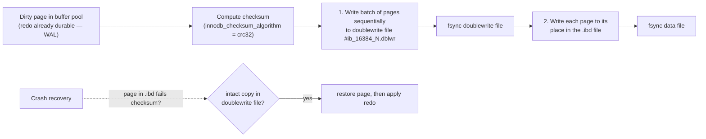

## Introduction

The buffer pool ([previous lesson](/lessons/m10-buffer-pool)) caches pages and the redo log ([Redo and Undo](/lessons/m10-redo-undo)) makes changes durable. Around them InnoDB has three more mechanisms that are frequently misunderstood, frequently tuned — and two of which changed their defaults in MySQL 8.4:

| Mechanism | Problem it solves | 8.0 default | 8.4 default |
|---|---|---|---|
| **Doublewrite buffer** | A crash in the middle of writing a 16 KB page leaves a *torn* page that redo cannot repair | ON | ON |
| **Change buffer** | Random I/O to read secondary-index pages just to insert or delete-mark one entry | `innodb_change_buffering = all` | **`none`** |
| **Adaptive hash index (AHI)** | CPU cost of repeated B+ tree descents for hot lookups | ON | **OFF** |

For each mechanism this lesson explains the theory, the algorithm, what you can observe from SQL, the cost, and the conditions under which experienced operators turn it off. You will measure the doublewrite traffic on the build server, see exactly which indexes are eligible for change buffering, and measure the cost of the secondary-index maintenance that the change buffer was invented to reduce.

:::note[Observation limits]
The lab can read all three mechanisms' settings and the doublewrite status counters (`Innodb_dblwr_*`, global). Change-buffer and AHI statistics live in `SHOW ENGINE INNODB STATUS` (section *INSERT BUFFER AND ADAPTIVE HASH INDEX*) and `information_schema.INNODB_METRICS`, which need the `PROCESS` privilege; they appear here as labelled illustrative examples. The build server runs **MySQL 8.0**, so its captured values show the **8.0 defaults** (change buffering `all`, AHI `ON`).
:::

## DBMS Theory

:::theory[Atomic page writes, deferred index maintenance, and hash shortcuts]
**Torn writes.** Storage devices guarantee atomic writes only up to their *sector* or *atomic write unit* (512 bytes or 4 KB, sometimes larger on enterprise SSDs or file systems with copy-on-write). A DBMS page is usually larger (InnoDB: 16 KB). If power fails mid-write, the page on disk can be a mixture of old and new sectors — a **torn** (partial) page. Physiological redo records ("insert this record at offset X") assume the page was in a consistent state before the change; applied to a torn page they produce garbage. Systems protect against this with either **full-page images** in the log (PostgreSQL writes the whole page into WAL at its first modification after each checkpoint) or a **double-write** area (InnoDB): write the page to a safe place first, then in place.

**Deferred index maintenance.** A secondary-index insert must place its entry at a key-ordered position, which for random keys means a random page — usually a random *read* if the page is not cached. Buffering such updates and applying them in bulk later is a long-standing idea (it underlies **LSM trees**, *buffer trees*, and InnoDB's insert buffer from the early 2000s): trade write latency now for batched, cheaper I/O later.

**Hash index over a tree.** A B+ tree lookup costs O(log n) comparisons and page latches; a hash lookup O(1). A self-tuning system can build hash entries for the *hot* part of a tree automatically — at the cost of maintaining them and of contention on the hash structure.
:::

## Why It Exists

- **Doublewrite**: without it, a power failure during a page flush could leave a page unrecoverable — the redo log can rebuild a page *from a consistent older version*, but not from a half-written one. Page checksums can *detect* such a page; only an intact copy elsewhere can *repair* it. The doublewrite buffer is that copy.
- **Change buffer**: in the era of spinning disks and buffer pools much smaller than data, inserting into a table with five secondary indexes could cost five random reads per row. Buffering the index changes turned these into occasional sequential merges and multiplied insert throughput for such workloads.
- **AHI**: for read-heavy workloads whose hot set fits in memory, the remaining cost of a lookup is CPU — descending three or four levels of a tree with latches. Hash lookups can skip most of that.

Why two of them are now off by default: hardware and workloads changed. SSDs made random reads cheap, buffer pools grew to hold most hot data, and the costs — complexity, merge work, latch contention, memory, and in the change buffer's case a history of hard-to-diagnose corruption and slow-shutdown issues — began to outweigh the benefits for typical deployments.

## Internal Working

### The doublewrite buffer



:::internals[How doublewrite works]
1. When page cleaners (or an LRU eviction) write dirty pages, InnoDB first copies a **batch** of them into a doublewrite buffer area in memory, writes the batch **sequentially** to a **doublewrite file**, and fsyncs it.
2. Only then are the pages written to their real locations in the tablespace files ("in place"), and fsynced.
3. **During crash recovery**, before applying redo, InnoDB checks pages: if a page in a data file is torn (its checksum does not match, or the LSNs in its header and trailer disagree) and the doublewrite file contains an intact copy, the copy is restored. Redo is then applied to a consistent page. If the crash hit while writing the doublewrite file itself, the data file still holds the intact *old* page, which redo can bring forward.

**Cost.** Every flushed page is written twice — but the doublewrite write is one large sequential write per batch, followed by one fsync, so the overhead in throughput is usually far less than 2×.

**Files (8.0.20+).** The doublewrite area moved from the system tablespace into dedicated files named `#ib_<page_size>_<n>.dblwr` (for example `#ib_16384_0.dblwr`), in the data directory or `innodb_doublewrite_dir`. There are separate files for flush-list flushing and LRU flushing, `innodb_doublewrite_files` in total, and `innodb_doublewrite_pages` is the maximum number of pages per batch write per thread.

**Modes (8.0.30+).** `innodb_doublewrite` accepts `ON` (= `DETECT_AND_RECOVER`), `DETECT_ONLY` (only page metadata goes to the doublewrite file: torn pages are detected, not repaired — less write volume) and `OFF`.

**Checksums.** Every page carries a checksum in its FIL header and trailer (`innodb_checksum_algorithm`, default `crc32`), verified when a page is read from disk. A mismatch without a doublewrite copy is reported as corruption.
:::

:::version[Doublewrite versions and defaults]
- **8.0.20:** doublewrite moved out of `ibdata1` into `#ib_*.dblwr` files; new variables `innodb_doublewrite_dir`, `innodb_doublewrite_files`, `innodb_doublewrite_pages`.
- **8.0.30:** `DETECT_AND_RECOVER` / `DETECT_ONLY` modes.
- **8.4 defaults:** `innodb_doublewrite_files` = **2** (8.0: 2 per buffer pool instance); `innodb_doublewrite_pages` = **128** (8.0: equal to `innodb_write_io_threads`, normally 4) — larger batches, fewer fsyncs.
:::

### The change buffer

:::internals[Buffering secondary-index changes]
- **What is buffered.** Changes to **non-unique secondary index** leaf pages that are **not currently in the buffer pool**: inserts, delete-marks (from `DELETE`/`UPDATE` of indexed columns) and purges (physical removal of delete-marked entries). `innodb_change_buffering` selects which: `none`, `inserts`, `deletes`, `changes` (inserts + delete-marks), `purges`, `all`.
- **Why not unique indexes.** To enforce uniqueness InnoDB must read the index page and check for a duplicate anyway; once the page is read, there is nothing to save. The primary key (clustered index) is never buffered either — the row must be inserted into its leaf page. Indexes containing descending key parts, spatial and full-text indexes are also excluded.
- **Where it lives.** The change buffer is itself a B+ tree stored in the **system tablespace**; its pages are cached in the buffer pool like any other page and may occupy up to `innodb_change_buffer_max_size` percent of it (default 25, maximum 50). An *insert buffer bitmap* page in each tablespace (page 1) tracks free space per page so that buffered inserts cannot overflow a page.
- **Merging.** Buffered changes for a page are **merged** when that page is read into the buffer pool for any reason (a query needs it), by the master thread in the background, during a slow shutdown (`innodb_fast_shutdown = 0`), and after crash recovery. Because buffered changes are redo-logged like other page changes, they are crash-safe.
- **Costs.** Merges happen at unpredictable times (a read that triggers a large merge is slow), the change buffer competes for buffer-pool memory, a large unmerged backlog makes slow shutdowns and some recovery steps take long, and the code path is complex.
:::

:::version[Change buffering in 8.4]
In **MySQL 8.4** the default of `innodb_change_buffering` changed from `all` to **`none`**: secondary-index changes are applied directly to the index pages, reading them if necessary. The variable still exists and `all` can be configured for workloads that demonstrably benefit (large write-heavy tables with many non-unique secondary indexes, on storage where random reads are expensive, with a working set much larger than the buffer pool).
:::

### The adaptive hash index

:::internals[Hash shortcuts over B+ tree pages]
- InnoDB monitors index searches. When it sees that a particular index is searched repeatedly with the same key-prefix pattern, and the pages involved are hot, it builds **hash index entries** mapping (a prefix of) the search key to the record's location in a buffer-pool page.
- Later searches with that pattern first probe the hash; on a hit they jump directly to the record without descending the tree. Only pages in the buffer pool are covered — the AHI is purely in-memory and is rebuilt after a restart.
- The AHI is **partitioned** into `innodb_adaptive_hash_index_parts` (default 8) partitions, each with its own latch, to reduce the contention that the single `btr_search_latch` caused in older versions.
- **Costs and pathologies.** Building and maintaining entries costs CPU on every modification of covered pages; under heavy concurrent writes or many range scans, threads contend on AHI latches (visible as waits on `btr_search` latches); entries consume buffer-pool memory (counted in `Innodb_buffer_pool_pages_misc`); dropping or truncating a large table historically had to remove its AHI entries, causing stalls; and the benefit is limited to equality-style lookups on hot data.
- **8.4:** `innodb_adaptive_hash_index` defaults to **OFF**. It remains dynamic and can be enabled for read-mostly workloads where measurements show a gain.
:::

## MySQL Implementation

The three mechanisms' settings on the build server (MySQL 8.0 — expect `none` and `OFF` for the last group on 8.4):

```sql run
SELECT @@innodb_doublewrite        AS doublewrite,
       @@innodb_doublewrite_files  AS dblwr_files,
       @@innodb_doublewrite_pages  AS dblwr_pages_per_batch,
       @@innodb_doublewrite_dir    AS dblwr_dir,
       @@innodb_checksum_algorithm AS checksum,
       @@innodb_flush_method       AS flush_method;
```

Doublewrite is on, with two files (one buffer-pool instance × 2) and batches of up to 4 pages (the 8.0 default, equal to `innodb_write_io_threads`); `innodb_doublewrite_dir` is NULL, meaning the files live in the data directory; pages carry CRC32 checksums.

```sql run
SELECT @@innodb_change_buffering         AS change_buffering,
       @@innodb_change_buffer_max_size   AS change_buffer_max_pct,
       @@innodb_adaptive_hash_index      AS adaptive_hash_index,
       @@innodb_adaptive_hash_index_parts AS ahi_partitions;
```

These are the **8.0** defaults — `all`, 25 %, AHI on with 8 partitions. On an 8.4 server with default settings the first and third values are `none` and `0`.

```sql
-- What an 8.4 server reports with defaults (display only; the capture server is 8.0)
SELECT @@innodb_change_buffering, @@innodb_adaptive_hash_index, @@innodb_doublewrite_pages;
-- → none, 0, 128
```

## Syntax Breakdown

| Variable | Values | 8.0 → 8.4 default | Dynamic? |
|---|---|---|---|
| `innodb_doublewrite` | `ON` (`DETECT_AND_RECOVER`), `DETECT_ONLY`, `OFF` | ON | Partly (ON ↔ DETECT_ONLY at runtime; OFF needs restart) |
| `innodb_doublewrite_dir` | path | data directory | No |
| `innodb_doublewrite_files` | 2–256 | 2 × instances → 2 | No |
| `innodb_doublewrite_pages` | 1–512 | `innodb_write_io_threads` → 128 | No |
| `innodb_checksum_algorithm` | `crc32`, `strict_crc32`, `innodb`, `none`, … | crc32 | Yes |
| `innodb_change_buffering` | `none`, `inserts`, `deletes`, `changes`, `purges`, `all` | all → **none** | Yes |
| `innodb_change_buffer_max_size` | 0–50 (% of buffer pool) | 25 | Yes |
| `innodb_adaptive_hash_index` | ON/OFF | ON → **OFF** | Yes |
| `innodb_adaptive_hash_index_parts` | 1–512 | 8 | No |

| Counter / source | What it shows | Access |
|---|---|---|
| `Innodb_dblwr_pages_written` | Pages written to the doublewrite files | `SHOW GLOBAL STATUS` (lab: yes) |
| `Innodb_dblwr_writes` | Doublewrite batch write operations | same |
| `Innodb_buffer_pool_pages_flushed`, `Innodb_pages_written` | Data-page writes | same |
| *INSERT BUFFER AND ADAPTIVE HASH INDEX* section | Change-buffer size, merges, AHI hash searches/s vs non-hash searches/s | `SHOW ENGINE INNODB STATUS` (`PROCESS`) |
| `INNODB_METRICS` (`ibuf_*`, `adaptive_hash_*`) | Detailed counters (some disabled by default) | `PROCESS` |

## Practical Examples

### 1. Doublewrite traffic, measured

Create dirty pages, give the page cleaners a few seconds to write them, and compare data-page writes with doublewrite writes (all counters are global):

```sql run
SET SESSION cte_max_recursion_depth = 300000;
CREATE TABLE dw_demo (id INT PRIMARY KEY, a INT NOT NULL, pad CHAR(200) NOT NULL);
SHOW GLOBAL STATUS WHERE Variable_name IN
  ('Innodb_buffer_pool_pages_flushed', 'Innodb_dblwr_pages_written', 'Innodb_dblwr_writes');
INSERT INTO dw_demo
  WITH RECURSIVE s(n) AS (SELECT 1 UNION ALL SELECT n + 1 FROM s WHERE n < 100000)
  SELECT n, n, 'x' FROM s;
SELECT SLEEP(3) AS seconds_for_page_cleaners;
SHOW GLOBAL STATUS WHERE Variable_name IN
  ('Innodb_buffer_pool_pages_flushed', 'Innodb_dblwr_pages_written', 'Innodb_dblwr_writes');
```

Compute three deltas from the two snapshots:

- `Innodb_buffer_pool_pages_flushed` — data pages written in place during the interval;
- `Innodb_dblwr_pages_written` — almost exactly the same number: **every flushed page was written to the doublewrite file first**;
- `Innodb_dblwr_writes` — roughly a quarter of that: the build server's `innodb_doublewrite_pages = 4` means each sequential doublewrite write carries up to four pages. On 8.4 (128 pages per batch) the number of doublewrite write operations would be far smaller for the same pages.

So doublewrite doubles the *number of page writes*, but the extra writes are sequential batches with one fsync each — which is why the throughput cost is typically modest, especially with larger batches.

### 2. Which indexes could the change buffer help?

Only **non-unique secondary indexes** are eligible. Create a table with every kind of index and ask the data dictionary:

```sql run
CREATE TABLE cb_orders (
  order_id    BIGINT PRIMARY KEY,
  order_ref   CHAR(12) NOT NULL,
  customer_id INT NOT NULL,
  status      VARCHAR(10) NOT NULL,
  created_at  DATETIME NOT NULL,
  notes       TEXT,
  UNIQUE KEY uq_order_ref (order_ref),
  KEY idx_customer (customer_id),
  KEY idx_status_created (status, created_at),
  KEY idx_created_desc (created_at DESC),
  FULLTEXT KEY ft_notes (notes)
);
SELECT INDEX_NAME,
       MAX(NON_UNIQUE) AS non_unique,
       MAX(INDEX_TYPE) AS index_type,
       GROUP_CONCAT(CONCAT(COLUMN_NAME, IF(COLLATION = 'D', ' DESC', '')) ORDER BY SEQ_IN_INDEX) AS columns_in_index,
       CASE
         WHEN INDEX_NAME = 'PRIMARY' THEN 'no: clustered index'
         WHEN MAX(NON_UNIQUE) = 0 THEN 'no: unique (needs the page for the duplicate check)'
         WHEN MAX(INDEX_TYPE) <> 'BTREE' THEN 'no: full-text/spatial'
         WHEN SUM(COLLATION = 'D') > 0 THEN 'no: descending key part'
         ELSE 'yes'
       END AS change_buffer_eligible
FROM information_schema.STATISTICS
WHERE TABLE_SCHEMA = DATABASE() AND TABLE_NAME = 'cb_orders'
GROUP BY INDEX_NAME
ORDER BY INDEX_NAME;
```

Only `idx_customer` and `idx_status_created` qualify. Every row inserted into `cb_orders` must still read the clustered-index page, the `uq_order_ref` page, the `idx_created_desc` page (descending key parts are excluded) and maintain the full-text index — the change buffer could only defer the two eligible ones.

### 3. The cost the change buffer targets: secondary-index maintenance

Insert the same 150,000 rows into three tables: no secondary indexes, three non-unique secondary indexes on randomly distributed columns, and three unique ones:

```sql run measured
SET SESSION cte_max_recursion_depth = 300000;
CREATE TABLE ins_no_sec   (id INT PRIMARY KEY, a INT, b INT, c INT, pad CHAR(50));
CREATE TABLE ins_3_nonuniq (id INT PRIMARY KEY, a INT, b INT, c INT, pad CHAR(50), KEY ka (a), KEY kb (b), KEY kc (c));
CREATE TABLE ins_3_unique  (id INT PRIMARY KEY, a INT, b INT, c INT, pad CHAR(50), UNIQUE KEY ka (a), UNIQUE KEY kb (b), UNIQUE KEY kc (c));
INSERT INTO ins_no_sec WITH RECURSIVE s(n) AS (SELECT 1 UNION ALL SELECT n + 1 FROM s WHERE n < 150000)
  SELECT n, (n * 7919) % 1000003, (n * 104729) % 1000033, (n * 15485863) % 1000037, 'x' FROM s;
INSERT INTO ins_3_nonuniq WITH RECURSIVE s(n) AS (SELECT 1 UNION ALL SELECT n + 1 FROM s WHERE n < 150000)
  SELECT n, (n * 7919) % 1000003, (n * 104729) % 1000033, (n * 15485863) % 1000037, 'x' FROM s;
INSERT INTO ins_3_unique WITH RECURSIVE s(n) AS (SELECT 1 UNION ALL SELECT n + 1 FROM s WHERE n < 150000)
  SELECT n, (n * 7919) % 1000003, (n * 104729) % 1000033, (n * 15485863) % 1000037, 'x' FROM s;
```

Compare the three `INSERT` timings (measured on the build machine): the tables with three secondary indexes take a multiple of the time of the table without — each row is inserted into four B+ trees instead of one, three of them at random positions. But the **non-unique and unique versions cost about the same**: all their index pages are in the buffer pool (the tables are small and freshly created), and the change buffer only buffers changes to pages that are *not* in the buffer pool. The change buffer pays off only when indexes are much larger than memory and inserts would otherwise wait for random page reads — the situation it was designed for, and one that large SSD-backed buffer pools have made rarer.

```sql run
SET SESSION information_schema_stats_expiry = 0;
ANALYZE TABLE ins_no_sec, ins_3_nonuniq, ins_3_unique;
SELECT TABLE_NAME, DATA_LENGTH DIV 16384 AS clustered_pages, INDEX_LENGTH DIV 16384 AS secondary_pages
FROM information_schema.TABLES
WHERE TABLE_SCHEMA = DATABASE() AND TABLE_NAME LIKE 'ins_%'
ORDER BY TABLE_NAME;
```

The three secondary indexes together occupy more pages than the clustered index itself: each entry is small (a 4-byte key plus the 4-byte primary key), but random insertion leaves their pages partly empty ([page splits](/lessons/m10-pages-records)). These are the pages a cold insert workload would have to read.

### 4. What the status output looks like (illustrative)

The *INSERT BUFFER AND ADAPTIVE HASH INDEX* section of `SHOW ENGINE INNODB STATUS` on a server with change buffering and AHI enabled. **Illustrative example** — not captured (the lab lacks `PROCESS`); numbers chosen for layout only:

```text
-------------------------------------
INSERT BUFFER AND ADAPTIVE HASH INDEX
-------------------------------------
Ibuf: size 1, free list len 0, seg size 2, 0 merges
merged operations:
 insert 0, delete mark 0, delete 0
discarded operations:
 insert 0, delete mark 0, delete 0
Hash table size 34679, node heap has 3 buffer(s)
Hash table size 34679, node heap has 1 buffer(s)
...
1520.33 hash searches/s, 410.12 non-hash searches/s
```

`Ibuf: size` is the change buffer in pages; `merges` and *merged operations* show how much buffered work was applied. For the AHI, the ratio of *hash searches/s* to *non-hash searches/s* tells you how often lookups were answered from the hash. A low hash-search share together with latch waits on `btr_search` is the classic signal to turn AHI off.

## Execution Walkthrough

### What happens to one flushed page — and to one secondary-index insert

```walkthrough
title: Doublewrite and change buffering, step by step
steps:
  - title: "1. A page is modified"
    explain: >-
      An UPDATE changes a row: its clustered-index leaf page becomes dirty in the buffer pool and redo describing
      the change is generated. Nothing is written to the .ibd file yet.
    sql: UPDATE dw_demo SET a = a + 1 WHERE id = 50000;
  - title: "2. The page is chosen for flushing"
    explain: >-
      Later, a page cleaner picks the page from the flush list. WAL check: the redo log must be durable up to the
      page's newest-modification LSN. The page checksum (crc32) is computed and stored in the page header and trailer.
  - title: "3. Doublewrite"
    explain: >-
      The page joins a batch (up to innodb_doublewrite_pages pages) that is written sequentially to a #ib_16384_N.dblwr
      file and fsynced. If power fails now, the data file still holds the old, intact page.
  - title: "4. In-place write"
    explain: >-
      The page is written to its own position in dw_demo.ibd and the file is fsynced. If power fails during this
      write, the page may be torn — but its intact copy is in the doublewrite file, and crash recovery will restore it
      before applying redo.
  - title: "5. A secondary-index insert with change buffering"
    explain: >-
      With innodb_change_buffering = all (8.0 default), an INSERT that must add an entry to a non-unique secondary
      index page that is not in the buffer pool records the entry in the change buffer instead of reading the page.
      The entry is merged into the real page the next time that page is read, or in the background. With the 8.4
      default (none), InnoDB reads the index page and inserts directly. Unique indexes always read the page.
    sql: |
      INSERT INTO cb_orders (order_id, order_ref, customer_id, status, created_at)
      VALUES (1, 'REF-000001', 42, 'new', '2026-11-09 10:00:00');
  - title: "6. Reading the table back"
    explain: >-
      Any read that brings the buffered index page into memory merges the pending change first, so queries always
      see a consistent index. Change buffering is invisible to SQL — only timing and internal counters reveal it.
    sql: SELECT order_id, customer_id, status FROM cb_orders WHERE customer_id = 42;
```

## Output

From the captured blocks:

- **Doublewrite** was enabled with 2 files and 4-page batches; over the measurement interval, the number of pages written to the doublewrite files closely matched the number of data pages flushed, in roughly a quarter as many write operations.
- **Change-buffer eligibility** in `cb_orders`: only the two plain non-unique B-tree secondary indexes qualified; the primary key, the unique key, the index with a descending key part and the full-text index did not.
- **Index maintenance cost**: three secondary indexes multiplied insert time several-fold on a fully cached table, identically for unique and non-unique indexes — because with everything cached, the change buffer has nothing to do.
- The build server shows the **8.0 defaults** (`all`, AHI ON); 8.4 defaults are `none` and OFF.

## Alternative Approaches

**Protecting against torn pages:**

| Approach | Used by | Trade-off |
|---|---|---|
| Doublewrite buffer | InnoDB | Extra sequential write + fsync per batch |
| Full-page images in the WAL | PostgreSQL (`full_page_writes`) | WAL volume grows after each checkpoint |
| Atomic writes from storage | Some enterprise SSDs/NVMe with atomic write units ≥ 16 KB, FusionIO historically, file systems like ZFS (copy-on-write) | Safe to set `innodb_doublewrite = OFF` **only** if atomicity is guaranteed end-to-end for 16 KB writes |
| `DETECT_ONLY` | InnoDB 8.0.30+ | Detects torn pages (so you can restore from a replica/backup) without the full write cost |
| Smaller pages | `innodb_page_size = 4K` on 4 KB-atomic devices | Lower fan-out, more pages; doublewrite still usually kept |

**Reducing secondary-index write cost:**

| Approach | Notes |
|---|---|
| Fewer secondary indexes | Drop unused/redundant ones (`sys.schema_unused_indexes`) — the most effective fix |
| Change buffering (`all`) | Helps when indexes ≫ buffer pool and storage is slow; measure merges and slow-shutdown impact |
| Larger buffer pool | Keeps index pages cached, making change buffering unnecessary |
| Sequential index keys | Inserts touch only the right edge of each index |
| LSM-based engines (MyRocks) | Write-optimised by design for very write-heavy workloads |

**Speeding up hot lookups (instead of AHI):** covering indexes, application caches, and simply relying on the buffer pool — a cached three-level descent is already microseconds.

## Performance Analysis

| Mechanism | Benefit | Cost | Watch |
|---|---|---|---|
| Doublewrite | Recoverability of torn pages | ~2× page writes (sequential), extra fsyncs | `Innodb_dblwr_pages_written / Innodb_dblwr_writes` (batch efficiency), write latency |
| Change buffer | Avoids random reads for non-unique index maintenance when pages are uncached | Merge work later; buffer-pool memory (≤ 25–50 %); slow shutdown/recovery with large backlogs | Ibuf size and merges; read latency spikes when merges happen |
| AHI | Fewer B+ tree descents for hot equality lookups | CPU and latching on writes; memory; contention | hash vs non-hash searches/s; `btr_search` latch waits in `performance_schema` |

:::performance[Theory vs measurement]
The doublewrite counters and the insert timings above are real measurements from the build server, but on small, fully cached tables. They show *mechanisms*: doublewrite writes match flushed pages; secondary indexes multiply insert work; the change buffer cannot help when pages are cached. The benefits of the change buffer and AHI appear only under conditions the lab cannot create (working sets far larger than memory; many concurrent readers on a hot set). Decide by measuring on production-like hardware: enable or disable one mechanism at a time, under a realistic load, and compare throughput, p99 latency and the counters above.
:::

## Best Practices

:::best-practice[Doublewrite, change buffer and AHI]
1. **Keep doublewrite ON** unless your storage guarantees atomic 16 KB writes end-to-end (and you have verified it); consider `DETECT_ONLY` rather than `OFF` when write volume matters.
2. **Put doublewrite files on fast storage** (`innodb_doublewrite_dir`) if the data directory is on slower media; on 8.0, consider larger `innodb_doublewrite_pages` to batch more.
3. **Accept the 8.4 defaults** (`innodb_change_buffering = none`, AHI OFF) for new deployments; re-enable either only after a measured benefit for your workload.
4. **When upgrading 8.0 → 8.4**, review explicit settings: a configuration file that never set these variables now gets `none`/OFF. Benchmark write-heavy workloads with many secondary indexes and read-heavy point-lookup workloads before and after.
5. **Drain the change buffer before risky operations** on 8.0 servers that use it heavily (a slow shutdown with `innodb_fast_shutdown = 0` before major upgrades merges everything).
6. **Reduce secondary indexes** before reaching for change buffering: every unused index costs writes, memory and doublewrite traffic.
:::

## Common Mistakes

**Mistake 1 — disabling doublewrite "because redo protects us".** Redo cannot repair a torn page; it needs a consistent page to apply changes to. Without doublewrite (and without atomic storage), a power failure can make a page — and with it a table — unrecoverable except from backup.

**Mistake 2 — expecting the change buffer to speed up inserts into a table with unique secondary keys.** Unique indexes always read their page for the duplicate check, as Example 2's eligibility query shows.

**Mistake 3 — interpreting "all pages cached, unique and non-unique equally slow" as "the change buffer is broken".** It only buffers changes to pages *not* in the buffer pool (Example 3).

**Mistake 4 — changing these settings from an application account.**

```sql run error
SET GLOBAL innodb_adaptive_hash_index = OFF;
```

They are server-wide settings for administrators (rejected by the sandbox; error 1227 for ordinary accounts on a real server).

**Mistake 5 — assuming 8.0 and 8.4 behave the same after an upgrade.** The same `my.cnf` produces different change-buffer and AHI behaviour (and larger doublewrite batches, higher `innodb_io_capacity`) on 8.4. Performance differences after an upgrade often trace back to these defaults.

## Industry Application

- **Cloud storage and doublewrite.** Some managed services and storage stacks guarantee atomic 16 KB writes and therefore disable doublewrite (Amazon Aurora's storage layer does not use InnoDB's doublewrite at all; some vendors document `innodb_doublewrite = OFF` with specific block devices). Self-managed deployments on ZFS commonly turn it off because ZFS is copy-on-write.
- **AHI in high-concurrency OLTP.** Many large MySQL operators disabled AHI years before 8.4 after diagnosing latch contention (`btr_search` waits) on many-core servers; others kept it for read-heavy services with stable hot sets. 8.4's default reflects that experience.
- **Change buffer and upgrades.** Operators of very large 8.0 instances with heavy secondary-index churn plan slow shutdowns or monitor change-buffer size before upgrades and restarts, because merging a large backlog delays shutdown or adds work after start.
- **Write-heavy analytics ingestion.** Teams ingesting events into InnoDB tables with several secondary indexes benchmark `innodb_change_buffering = all` vs `none` on 8.4 — on fast NVMe with a large buffer pool, `none` usually wins or ties; on slower network storage with indexes far larger than memory, `all` can still help.

## Practice Exercises

```exercise
id: ex1
title: Summarise the three mechanisms
difficulty: easy
kind: query
dataset: empty
concepts: [doublewrite-buffer, change-buffer, adaptive-hash-index, innodb-defaults-8-4]
prompt: |
  Return one row with four columns:

  1. `doublewrite` — the value of `innodb_doublewrite`
  2. `change_buffering` — the value of `innodb_change_buffering`
  3. `ahi_on` — the value of `innodb_adaptive_hash_index`
  4. `uses_84_defaults` — `'yes'` if change buffering is `none` **and** the AHI is off, otherwise `'no'`
hints:
  - "All four are @@ system variables; the AHI variable is 1/0."
  - "IF(@@innodb_change_buffering = 'none' AND @@innodb_adaptive_hash_index = 0, 'yes', 'no')"
solution: |
  SELECT @@innodb_doublewrite AS doublewrite,
         @@innodb_change_buffering AS change_buffering,
         @@innodb_adaptive_hash_index AS ahi_on,
         IF(@@innodb_change_buffering = 'none' AND @@innodb_adaptive_hash_index = 0, 'yes', 'no') AS uses_84_defaults;
explanation: |
  On the 8.0 build server the answer is `no` (change buffering `all`, AHI on); a default 8.4 server answers `yes`.
  Such a check is useful in upgrade validation scripts, because a configuration file carried over from 8.0 may or
  may not set these variables explicitly.
```

```exercise
id: ex2
title: Find the indexes eligible for change buffering
difficulty: medium
kind: query
dataset: empty
setup: |
  CREATE TABLE shipments (
    shipment_id BIGINT PRIMARY KEY,
    tracking_no CHAR(20) NOT NULL,
    carrier     VARCHAR(20) NOT NULL,
    dest_zip    CHAR(5) NOT NULL,
    shipped_at  DATETIME NOT NULL,
    UNIQUE KEY uq_tracking (tracking_no),
    KEY idx_carrier_shipped (carrier, shipped_at),
    KEY idx_zip (dest_zip)
  );
  CREATE TABLE carriers (
    carrier VARCHAR(20) PRIMARY KEY,
    name    VARCHAR(60) NOT NULL,
    KEY idx_name (name)
  );
concepts: [change-buffer, secondary-index-maintenance]
prompt: |
  Using `information_schema.STATISTICS`, return the `TABLE_NAME` and `INDEX_NAME` of every index in your schema that
  is eligible for change buffering: a **non-unique secondary** B-tree index (not `PRIMARY`). Return one row per index
  (not per column), ordered by `TABLE_NAME`, `INDEX_NAME`.
hints:
  - "STATISTICS has one row per index column; use DISTINCT or GROUP BY to get one row per index."
  - "Filter NON_UNIQUE = 1, INDEX_NAME <> 'PRIMARY' and INDEX_TYPE = 'BTREE'."
solution: |
  SELECT DISTINCT TABLE_NAME, INDEX_NAME
  FROM information_schema.STATISTICS
  WHERE TABLE_SCHEMA = DATABASE()
    AND NON_UNIQUE = 1
    AND INDEX_NAME <> 'PRIMARY'
    AND INDEX_TYPE = 'BTREE'
  ORDER BY TABLE_NAME, INDEX_NAME;
orderMatters: true
explanation: |
  `carriers.idx_name`, `shipments.idx_carrier_shipped` and `shipments.idx_zip` are eligible; `uq_tracking` is unique
  (the page must be read for the duplicate check) and the primary keys are clustered. A complete check would also
  exclude indexes with descending key parts (`COLLATION = 'D'`) — none exist here. The query is a quick way to
  estimate how much of a write workload change buffering could even touch.
```

```exercise
id: ex3
title: Doublewrite batch efficiency
difficulty: hard
kind: query
dataset: empty
setup: |
  CREATE TABLE dblwr_samples (
    server_name       VARCHAR(20) NOT NULL,
    mysql_version     VARCHAR(10) NOT NULL,
    sampled_at        DATETIME NOT NULL,
    dblwr_pages       BIGINT NOT NULL,
    dblwr_writes      BIGINT NOT NULL,
    pages_flushed     BIGINT NOT NULL,
    PRIMARY KEY (server_name, sampled_at)
  );
  INSERT INTO dblwr_samples VALUES
    ('db-a', '8.0.40', '2026-06-01 10:00:00', 1000000, 251000, 1002000),
    ('db-a', '8.0.40', '2026-06-01 11:00:00', 1720000, 432500, 1723000),
    ('db-b', '8.4.3',  '2026-06-01 10:00:00', 5000000,  60000, 5003000),
    ('db-b', '8.4.3',  '2026-06-01 11:00:00', 5900000,  68200, 5904000);
concepts: [doublewrite-buffer]
prompt: |
  Each server has two samples of cumulative counters one hour apart. For each server return:

  - `server_name`, `mysql_version`
  - `pages_per_batch` — Δdblwr_pages ÷ Δdblwr_writes, rounded to 1 decimal
  - `dblwr_share_pct` — Δdblwr_pages as a percentage of Δpages_flushed, rounded to 1 decimal
  - `dblwr_gb_per_hour` — Δdblwr_pages × 16 KB in GB (÷ 1024 ÷ 1024), rounded to 2 decimals

  Order by `server_name`.
hints:
  - "MAX(x) - MIN(x) per server gives the delta for monotonically increasing counters."
  - "GROUP BY server_name, mysql_version."
solution: |
  SELECT server_name, mysql_version,
         ROUND((MAX(dblwr_pages) - MIN(dblwr_pages)) / (MAX(dblwr_writes) - MIN(dblwr_writes)), 1) AS pages_per_batch,
         ROUND(100 * (MAX(dblwr_pages) - MIN(dblwr_pages)) / (MAX(pages_flushed) - MIN(pages_flushed)), 1) AS dblwr_share_pct,
         ROUND((MAX(dblwr_pages) - MIN(dblwr_pages)) * 16 / 1024 / 1024, 2) AS dblwr_gb_per_hour
  FROM dblwr_samples
  GROUP BY server_name, mysql_version
  ORDER BY server_name;
orderMatters: true
explanation: |
  db-a (8.0, 4-page batches) needs ~4 pages per doublewrite write; db-b (8.4, up to 128 pages) averages ~110 — far
  fewer doublewrite I/O operations and fsyncs for a similar volume. On both servers essentially every flushed page
  also went through doublewrite (≈ 100 %), so doublewrite adds about 11–14 GB of sequential writes per hour here —
  the figure to weigh against storage endurance and bandwidth when considering DETECT_ONLY or atomic-write storage.
```

```exercise
id: ex4
title: May we disable doublewrite?
difficulty: medium
kind: open
concepts: [doublewrite-buffer, torn-pages]
prompt: |
  A team proposes `innodb_doublewrite = OFF` on three servers to reduce write amplification: (a) a primary on ext4
  over cloud network block storage, (b) a replica on ZFS, (c) a CI database that is recreated for every test run.
  For each, decide and justify. What would you propose instead for (a)?
solution: |
  **(a) Primary on ext4 + network block storage: no.** Unless the provider explicitly guarantees atomic 16 KB writes
  end-to-end (device, virtualisation layer, file system), a power or host failure during a page write can tear a page,
  and redo cannot repair it — the primary could lose a table. Instead: keep doublewrite ON, put the doublewrite files
  on the fastest volume (`innodb_doublewrite_dir`), use 8.4's larger batches (`innodb_doublewrite_pages`), or consider
  `DETECT_ONLY` only if you can always rebuild from a replica/backup when a torn page is detected.

  **(b) Replica on ZFS: yes, commonly.** ZFS is copy-on-write: a block is never partially overwritten in place, so a
  torn page cannot occur (set the ZFS recordsize to match 16 KB pages). Also, a replica can be re-cloned from the
  source. Disabling doublewrite here is a documented, common practice.

  **(c) CI database: yes.** Durability is irrelevant for disposable data; you might also relax
  `innodb_flush_log_at_trx_commit` and even disable the binary log for speed — as long as this configuration can
  never be used in production.
```

```exercise
id: ex5
title: Upgrade impact analysis
difficulty: challenge
kind: open
concepts: [change-buffer, adaptive-hash-index, innodb-defaults-8-4]
prompt: |
  You are upgrading two MySQL 8.0 servers to 8.4 with an unchanged `my.cnf` that does not set
  `innodb_change_buffering` or `innodb_adaptive_hash_index`:

  - **ingest-db**: 2 TB of event tables with five non-unique secondary indexes each, 64 GB buffer pool, network block
    storage with ~1 ms read latency, 20,000 inserts/s.
  - **catalog-db**: 40 GB product catalogue that fits in a 96 GB buffer pool, 50,000 primary-key and secondary-index
    point lookups/s, very few writes, 64 cores.

  Predict how each server's behaviour may change because of the 8.4 defaults, explain the mechanism, and describe a
  test plan and the decision you would make.
solution: |
  **ingest-db.** On 8.0 (`all`), inserts whose secondary-index pages are not cached are recorded in the change buffer
  instead of waiting for ~1 ms random reads; with five indexes over 2 TB against a 64 GB pool, many index pages are
  uncached. On 8.4 (`none`), each insert must read those pages synchronously — potentially several reads per row — so
  insert latency and I/O can rise sharply and throughput may drop. AHI going OFF matters little here.
  *Test:* replay production insert traffic against an 8.4 staging copy with `none` and with `all`; compare inserts/s,
  p99 commit latency, buffer-pool reads/s and (for `all`) change-buffer size and merge rate, plus shutdown time.
  *Decision:* if `all` is clearly better, set `innodb_change_buffering = all` explicitly in `my.cnf` (and document why);
  also review whether all five indexes are needed — dropping one or two may beat any setting.

  **catalog-db.** Everything is cached, so the change buffer is irrelevant. The AHI was ON in 8.0 and may have served
  many point lookups from the hash (fewer tree descents, lower CPU per lookup). On 8.4 it is OFF: lookups descend the
  B+ trees — slightly more CPU per lookup — but on 64 cores the AHI could also have caused latch contention, so the
  net effect can go either way. *Test:* run the read workload on 8.4 with AHI OFF and ON (it is dynamic), comparing
  QPS, p99 latency, CPU and `btr_search` latch waits in performance_schema. *Decision:* keep OFF unless ON gives a
  clear, stable gain without contention; if enabled, consider more `innodb_adaptive_hash_index_parts`.

  In both cases: pin explicit values in `my.cnf` after deciding, so the next upgrade does not change behaviour silently.
```

## Knowledge Assessment

```quiz
- id: q1
  question: "Why can't the redo log alone repair a torn (half-written) 16 KB page?"
  options:
    - "Because redo is written after the page"
    - "Because physiological redo records modify a page assuming it was consistent before the change; applied to a torn page they cannot reconstruct the missing sectors"
    - "Because redo is stored in the doublewrite file"
    - "Because redo is disabled for data pages"
  answer: 1
  explanation: "Redo describes changes relative to a consistent page state. A torn page mixes old and new sectors, so InnoDB first restores an intact copy from the doublewrite file and then applies redo. WAL guarantees redo is written before the page, and redo is always enabled for data pages."
  concepts: [torn-pages, doublewrite-buffer]
- id: q2
  question: "Over an interval, Innodb_buffer_pool_pages_flushed rose by 652 and Innodb_dblwr_pages_written by 649, while Innodb_dblwr_writes rose by 163. What do these numbers show?"
  options:
    - "Doublewrite is off"
    - "Practically every flushed page was written to the doublewrite files first, in batches of about four pages per write"
    - "Only a quarter of pages were protected"
    - "The change buffer merged 163 pages"
  answer: 1
  explanation: "dblwr_pages ≈ pages flushed means doublewrite covered the flushes; pages ÷ writes ≈ 4 matches innodb_doublewrite_pages = 4 on an 8.0 default server. The change buffer has its own counters."
  concepts: [doublewrite-buffer]
- id: q3
  type: multi
  question: "Which index changes can the change buffer defer? (Select all that apply.)"
  options:
    - "Inserts into a non-unique secondary index whose leaf page is not in the buffer pool"
    - "Delete-marking entries of a non-unique secondary index whose page is not in the buffer pool"
    - "Inserts into a unique secondary index"
    - "Inserts into the clustered (primary key) index"
    - "Inserts into a non-unique secondary index whose page is already in the buffer pool"
  answer: [0, 1]
  explanation: "Only changes to uncached pages of non-unique secondary indexes are buffered (inserts, delete-marks and purges, depending on innodb_change_buffering). Unique indexes must read the page for the duplicate check, the clustered index stores the row itself, and cached pages are modified directly."
  concepts: [change-buffer]
- id: q4
  question: "What is the default value of innodb_change_buffering in MySQL 8.4?"
  options: ["all", "inserts", "changes", "none"]
  answer: 3
  explanation: "8.4 changed the default from all (8.0) to none. The variable still accepts the other values for workloads that benefit."
  concepts: [change-buffer, innodb-defaults-8-4]
- id: q5
  question: "Which statement about the adaptive hash index is correct?"
  options:
    - "It is a persistent index stored in each .ibd file"
    - "It is an in-memory hash over hot buffer-pool pages, built automatically from observed search patterns; it is OFF by default in 8.4"
    - "It replaces B+ tree indexes for all equality lookups"
    - "It can be created with CREATE INDEX … USING HASH on InnoDB"
  answer: 1
  explanation: "The AHI is automatic, in-memory and rebuilt after restarts; it shortcuts descents into existing B+ trees. InnoDB ignores USING HASH and creates a B-tree."
  concepts: [adaptive-hash-index]
- id: q6
  question: "On which server is setting innodb_doublewrite = OFF most defensible?"
  options:
    - "A primary on ext4 over cloud block storage"
    - "A replica on ZFS (copy-on-write, recordsize 16K), which can be re-cloned"
    - "Any server with innodb_flush_log_at_trx_commit = 1"
    - "Any server with SSDs"
  answer: 1
  explanation: "ZFS's copy-on-write semantics prevent partial overwrites, and a replica can be rebuilt. ext4 over network storage gives no 16 KB atomicity guarantee; redo flushing does not prevent torn pages; ordinary SSDs typically guarantee only 4 KB atomic writes."
  concepts: [doublewrite-buffer, torn-pages]
- id: q7
  question: "A benchmark shows inserting into a table with three unique secondary indexes costs the same as with three non-unique ones. All tables fit in the buffer pool. Why is that expected?"
  options:
    - "Because change buffering is broken in 8.0"
    - "Because the change buffer only defers changes to pages not in the buffer pool; with everything cached, both kinds of index are updated directly"
    - "Because unique indexes are change-buffered too"
    - "Because secondary indexes are not maintained during INSERT"
  answer: 1
  explanation: "The change buffer avoids reading uncached pages. When pages are cached there is nothing to avoid. Unique indexes are never buffered, and secondary indexes are always maintained."
  concepts: [change-buffer, secondary-index-maintenance]
- id: q8
  question: "Since MySQL 8.0.20, where does the doublewrite buffer live?"
  options:
    - "In the system tablespace ibdata1"
    - "In dedicated #ib_<page_size>_<n>.dblwr files (data directory or innodb_doublewrite_dir)"
    - "In the redo log"
    - "Only in memory"
  answer: 1
  explanation: "8.0.20 moved doublewrite out of ibdata1 into separate files, allowing them to be placed on fast storage and sized with innodb_doublewrite_files/pages. It was never in the redo log, and an in-memory-only copy would not survive a crash."
  concepts: [doublewrite-buffer]
```
