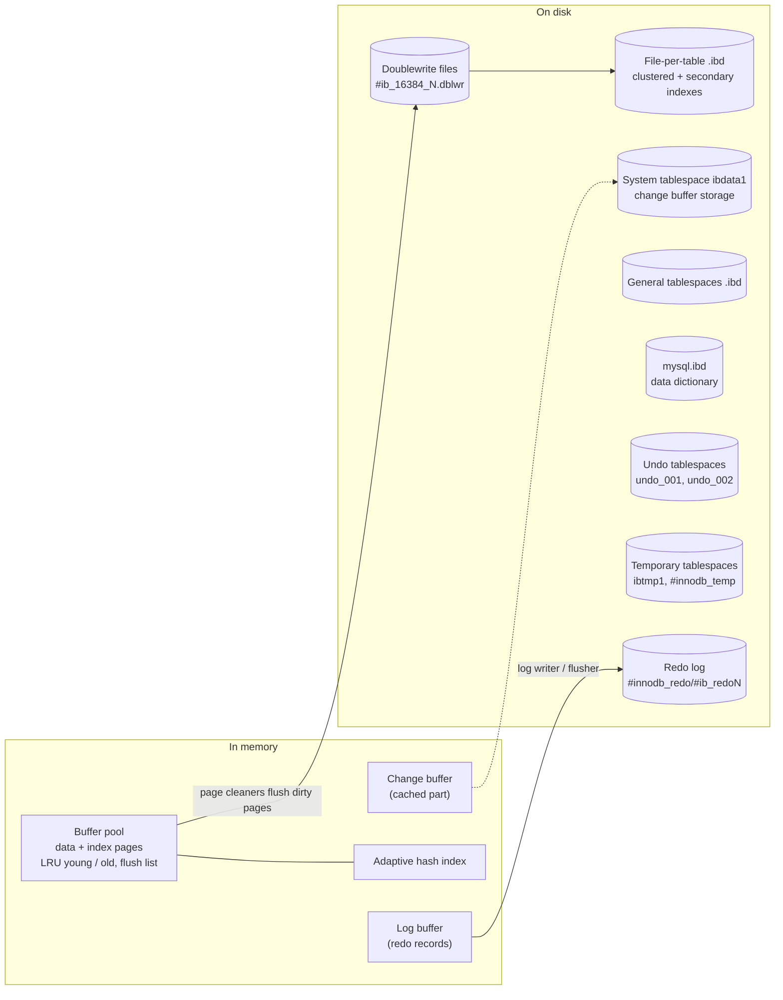

## Introduction

[Storage Engines](/lessons/m02-storage-engines) introduced the idea that each MySQL table has an engine and that InnoDB is the default. This lesson compares the two engines that defined MySQL's history at the level of their **internal architecture**:

- **MyISAM** — the default until MySQL 5.5: simple heap files, an index-only cache, table-level locks, no transactions and no crash recovery.
- **InnoDB** — the default since MySQL 5.5 (2010): index-organised tables, a buffer pool, row-level locks, MVCC, redo and undo logs, a doublewrite buffer and automatic crash recovery.

The comparison is not nostalgia. MyISAM still exists in 8.4, legacy schemas still contain MyISAM tables, migration projects still hit its behaviours, and — most importantly — *contrasting* the two designs is the fastest way to understand why InnoDB has each of its components. Every InnoDB structure in the rest of this module exists to fix a specific MyISAM weakness.

You will see, with real statements in your lab:

- a `ROLLBACK` that does nothing and a multi-row `INSERT` that half-succeeds,
- foreign keys that are silently ignored,
- a reader blocked by a table-level lock while InnoDB lets writers on different rows proceed in parallel,
- why `COUNT(*)` is instant in MyISAM but not in InnoDB,
- how clustering changes what a secondary index contains.

## DBMS Theory

:::theory[Storage-manager design choices]
A storage manager makes a handful of fundamental choices that determine everything else:

| Choice | Options |
|---|---|
| **File organisation** | *Heap file* (rows stored in insertion order, located by physical address) vs *index-organised table* (rows stored inside the leaf level of the primary-key B+ tree) |
| **Concurrency control granularity** | Table locks (simple, low overhead, poor concurrency) vs page locks vs **row locks** (more lock-manager work, high concurrency); plus **multi-versioning** so readers do not block writers |
| **Recovery** | None (repair tools after a crash) vs **write-ahead logging** with redo/undo (ARIES family) |
| **Buffer management** | Rely on the operating system's file cache vs a **DBMS-managed buffer pool** (needed to enforce WAL ordering — a page must not reach disk before its log records) |
| **Atomicity** | None, statement-level, or full transactional atomicity |

A transactional engine needs a coherent set of these: write-ahead logging requires a DBMS-managed buffer pool; row locking without MVCC makes long reads block writers; transactional atomicity requires undo information. MyISAM chose the simple end of every axis; InnoDB chose the transactional end of every axis.
:::

| Property | MyISAM | InnoDB |
|---|---|---|
| File organisation | Heap: `.MYD` data file, `.MYI` index file (plus a `.sdi` metadata file in 8.0) | Index-organised: rows live in the clustered (primary-key) B+ tree in a `.ibd` tablespace |
| Secondary index entries point to | The row's **file offset** (or row number for fixed-length rows) | The row's **primary-key value** |
| Caching | `key_buffer_size` caches **index blocks only**; data relies on the OS page cache | **Buffer pool** caches data and index pages (and undo, change buffer, …) |
| Locking | **Table-level** read/write locks (plus *concurrent inserts* at the end of the file) | **Row-level** record, gap and next-key locks; intention locks on tables |
| Readers vs writers | Readers block writers and vice versa | MVCC: plain `SELECT`s read a snapshot and neither block nor are blocked |
| Transactions | None (`ROLLBACK` has no effect) | ACID transactions, savepoints, XA |
| Statement atomicity | No — a failing multi-row statement leaves the rows it already wrote | Yes — a failing statement is rolled back to its start |
| Crash recovery | None — tables may be marked crashed and need `REPAIR TABLE`/`myisamchk` | Automatic: redo replay, undo of incomplete transactions, doublewrite for torn pages |
| Foreign keys | Parsed and **ignored** | Enforced |
| `COUNT(*)` without `WHERE` | Stored row count — instant | Must count visible index entries (MVCC) |
| Full-text / spatial indexes | Yes | Yes (full-text since 5.6, spatial since 5.7) |

## Why It Exists

MyISAM was designed in the 1990s for read-mostly web workloads on single-core machines where its simplicity was a strength: tiny per-row overhead, fast full scans, instant `COUNT(*)`, easy file-level copying. Its problems appear as soon as there is **concurrency** or **failure**:

- **Concurrency.** Every `UPDATE` locks the whole table. One slow report holding a read lock stalls every writer; one write stalls every reader. On multi-core hardware with mixed workloads this is a hard ceiling.
- **Failure.** MyISAM writes rows and index blocks through the OS cache without a log. A crash or power loss in the middle of a write leaves the data and index files inconsistent; at best the table is "marked as crashed" and must be repaired (a full rebuild that can take hours for large tables), at worst rows are silently lost or duplicated.
- **Correctness.** Without transactions, a money transfer that debits one account and fails before crediting the other stays half-done. Without statement atomicity, a bulk `INSERT` that hits a duplicate key leaves an unknown prefix of its rows.

InnoDB exists to solve exactly these. Its components map one-to-one onto MyISAM's failure modes:

| MyISAM problem | InnoDB component that solves it | Lesson |
|---|---|---|
| Table locks | Row-level lock manager + MVCC with undo logs | [MVCC](/lessons/m08-mvcc), [Redo and Undo](/lessons/m10-redo-undo) |
| No crash recovery | Write-ahead redo log + checkpoints | [Redo and Undo](/lessons/m10-redo-undo), [Crash Recovery](/lessons/m10-crash-recovery) |
| Torn (half-written) pages | Doublewrite buffer, page checksums | [Doublewrite](/lessons/m10-doublewrite-change-buffer) |
| OS cache ordering | Buffer pool with flush control | [The Buffer Pool](/lessons/m10-buffer-pool) |
| No transactions | Undo logs + transaction system | [ACID in InnoDB](/lessons/m08-acid-in-innodb) |
| Ignored foreign keys | FK checks in the engine | [Constraints](/lessons/m02-constraints-mysql) |

## Internal Working

### InnoDB architecture



:::internals[InnoDB in-memory and on-disk structures]
**In memory**

- **Buffer pool** — caches 16 KB pages of tables, indexes, undo logs and the change buffer, managed by a midpoint-insertion LRU and a flush list of dirty pages ([The Buffer Pool](/lessons/m10-buffer-pool)).
- **Change buffer** — caches changes to non-unique secondary-index pages that are not in the buffer pool, merging them later ([Doublewrite, Change Buffer and AHI](/lessons/m10-doublewrite-change-buffer)).
- **Adaptive hash index** — a hash index built automatically over hot B+ tree pages to shortcut tree descents.
- **Log buffer** — redo records waiting to be written to the redo log (`innodb_log_buffer_size`).

**On disk**

- **Tablespaces** — the *system* tablespace (`ibdata1`, holds the change buffer and, optionally, tables), *file-per-table* tablespaces (one `.ibd` per table, the default), *general* tablespaces (`CREATE TABLESPACE`), the *dictionary* tablespace `mysql.ibd`, *undo* tablespaces and *temporary* tablespaces ([Tablespaces, Pages and Row Formats](/lessons/m10-pages-records)).
- **Redo log** — since 8.0.30, files in the `#innodb_redo` directory sized by `innodb_redo_log_capacity`.
- **Doublewrite buffer files** — since 8.0.20, `#ib_<page_size>_<n>.dblwr` files where pages are written before being written in place.
- **Undo logs** — in undo tablespaces, organised in rollback segments.

**Threads** — page cleaners, log writer/flusher/checkpointer, purge coordinator and workers, read/write I/O threads, and the master thread run in the background ([Server Architecture](/lessons/m10-server-architecture)).
:::

### MyISAM architecture

:::internals[MyISAM's simple design]
- **Files.** `t.MYD` holds rows in a heap; `t.MYI` holds all indexes (B-trees) plus a header with the row count and table state; in 8.0+, `t_NNN.sdi` holds the table's serialized dictionary information.
- **Row formats.** *FIXED* (static, every row the same length — fast and easy to repair), *DYNAMIC* (variable-length rows, may fragment), *COMPRESSED* (`myisampack`, read-only).
- **Indexes.** Every index — including the primary key — is a separate B-tree whose leaf entries store a **pointer to the row** in `.MYD`. There is no clustered index; the primary key is just a unique index.
- **Caching.** The **key cache** (`key_buffer_size`) caches index blocks; data blocks are cached only by the operating system.
- **Locking.** The SQL layer takes a table-level read or write lock for every statement. With `concurrent_insert` (default `AUTO`), `INSERT`s may append to the end of the data file while readers hold read locks — but only if the file has no holes left by deletes.
- **Durability.** Writes go to the OS cache without logging; a "table was not closed properly" flag in the `.MYI` header records a possible inconsistency, and `myisam_recover_options` can trigger automatic repair on open.
:::

:::version[History and current status]
- InnoDB became the **default storage engine in MySQL 5.5.5** (2010).
- Through 5.7, the `mysql` system schema (grant tables, time zones, help) used MyISAM. **Since 8.0, all system tables are InnoDB** and the data dictionary is InnoDB, so a server can run with no MyISAM tables at all.
- MyISAM is still compiled into 8.0 and 8.4 and cannot be uninstalled, but you can prevent new tables with `disabled_storage_engines = 'MyISAM,MEMORY,…'`.
- MyISAM gets no new features; for example, it does not support atomic DDL, and partitioned MyISAM tables were removed in 8.0 (partitioning requires an engine with native partitioning, i.e. InnoDB).
:::

## MySQL Implementation

The engine-related settings of the build server:

```sql run
SELECT @@default_storage_engine      AS default_engine,
       @@disabled_storage_engines    AS disabled_engines,
       @@key_buffer_size             AS myisam_key_cache_bytes,
       @@concurrent_insert           AS myisam_concurrent_insert,
       @@innodb_buffer_pool_size     AS innodb_buffer_pool_bytes;
```

The MyISAM key cache (16 MB) and the InnoDB buffer pool (128 MB) are the defaults: two separate memory areas managed by two different engines. On a server that no longer uses MyISAM, `key_buffer_size` can be made small.

Create the same table twice, once per engine, with a primary key and a secondary index:

```sql run
SET SESSION cte_max_recursion_depth = 2000;
CREATE TABLE acct_innodb (
  id      INT PRIMARY KEY,
  branch  INT NOT NULL,
  owner   CHAR(50) NOT NULL,
  balance DECIMAL(12,2) NOT NULL,
  KEY idx_branch (branch)
) ENGINE = InnoDB;
CREATE TABLE acct_myisam LIKE acct_innodb;
ALTER TABLE acct_myisam ENGINE = MyISAM;
INSERT INTO acct_innodb
  WITH RECURSIVE s(n) AS (SELECT 1 UNION ALL SELECT n + 1 FROM s WHERE n < 1000)
  SELECT n, n % 50, CONCAT('owner ', n), 100.00 FROM s;
INSERT INTO acct_myisam SELECT * FROM acct_innodb;
ANALYZE TABLE acct_innodb, acct_myisam;
```

Now compare what each engine reports about its storage. Statistics in `information_schema.TABLES` are cached for a day by default, so disable the cache for this session first:

```sql run
SET SESSION information_schema_stats_expiry = 0;
SELECT TABLE_NAME, ENGINE, ROW_FORMAT, TABLE_ROWS, AVG_ROW_LENGTH,
       DATA_LENGTH, INDEX_LENGTH, MAX_DATA_LENGTH
FROM information_schema.TABLES
WHERE TABLE_SCHEMA = DATABASE() AND TABLE_NAME LIKE 'acct%'
ORDER BY TABLE_NAME;
```

Read the two rows side by side:

- **`ROW_FORMAT`**: InnoDB uses `Dynamic` (the 8.0 default); MyISAM chose `Fixed` because every column is fixed-length — each row occupies exactly `AVG_ROW_LENGTH` bytes in `.MYD`.
- **`DATA_LENGTH`**: for MyISAM, the exact size of the data file (rows × row length); for InnoDB, the size of the **clustered index** in whole 16 KB pages — rows *and* the primary-key B+ tree are the same structure.
- **`INDEX_LENGTH`**: for MyISAM, the `.MYI` file containing *both* indexes (the primary key is a separate B-tree); for InnoDB, only the *secondary* index `idx_branch`, because the primary key is the table itself.
- **`TABLE_ROWS`**: exact for MyISAM (stored in the header); an *estimate* for InnoDB, even if it happens to match here.
- **`MAX_DATA_LENGTH`**: a MyISAM concept — the largest data file its row-pointer size can address; InnoDB reports 0.

## Syntax Breakdown

| Statement | MyISAM | InnoDB |
|---|---|---|
| `CREATE TABLE … ENGINE = MyISAM / InnoDB` | Creates `.MYD`/`.MYI`/`.sdi` | Creates `.ibd` (file-per-table) |
| `ALTER TABLE t ENGINE = InnoDB` | Rebuilds the table in the new engine (copy) | Same; also used as a "null rebuild" to defragment an InnoDB table |
| `START TRANSACTION … ROLLBACK` | Accepted, no effect (warning 1196) | Undoes changes |
| `LOCK TABLES t READ/WRITE` | The only way to group statements with isolation | Works, but transactions are the right tool |
| `CHECK TABLE`, `REPAIR TABLE` | Detects/repairs corruption (`REPAIR` rebuilds files) | `CHECK` validates; `REPAIR` is not supported (InnoDB recovers itself) |
| `OPTIMIZE TABLE` | Defragments, sorts index pages, updates statistics | Mapped to `ALTER TABLE … FORCE` (rebuild) + analyze |
| `FOREIGN KEY (…) REFERENCES …` | Parsed, silently ignored | Enforced |
| `FULLTEXT`, `SPATIAL` indexes | Supported | Supported |
| `ROW_FORMAT=` | `FIXED`, `DYNAMIC`, `COMPRESSED` | `REDUNDANT`, `COMPACT`, `DYNAMIC`, `COMPRESSED` |

## Practical Examples

### 1. `ROLLBACK` cannot undo a MyISAM change

```sql run
START TRANSACTION;
UPDATE acct_innodb SET balance = balance - 30 WHERE id = 1;
UPDATE acct_myisam SET balance = balance - 30 WHERE id = 1;
ROLLBACK;
SELECT 'InnoDB' AS engine, balance FROM acct_innodb WHERE id = 1
UNION ALL
SELECT 'MyISAM', balance FROM acct_myisam WHERE id = 1;
```

The `ROLLBACK` returned warning 1196 ("Some non-transactional changed tables couldn't be rolled back"). InnoDB restored the old balance from its undo log; MyISAM has no undo log, so the debit is permanent. A transaction that mixes engines is only *partially* transactional — the most dangerous kind.

### 2. Statement atomicity: the half-finished multi-row INSERT

A multi-row `INSERT` whose third row violates the primary key:

```sql run error
INSERT INTO acct_myisam VALUES (2001, 1, 'new A', 0), (2002, 1, 'new B', 0), (1, 1, 'duplicate', 0), (2003, 1, 'new C', 0);
```

```sql run error
INSERT INTO acct_innodb VALUES (2001, 1, 'new A', 0), (2002, 1, 'new B', 0), (1, 1, 'duplicate', 0), (2003, 1, 'new C', 0);
```

```sql run
SELECT 'InnoDB' AS engine, COUNT(*) AS new_rows FROM acct_innodb WHERE id > 2000
UNION ALL
SELECT 'MyISAM', COUNT(*) FROM acct_myisam WHERE id > 2000;
```

Both statements failed with error 1062, but MyISAM kept the two rows it had inserted before the duplicate; InnoDB rolled the *statement* back to its start using undo records, even though autocommit was on and no explicit transaction existed. With MyISAM, an application that retries the failed statement now hits duplicates on rows 2001 and 2002 as well.

### 3. Foreign keys silently ignored

```sql run
CREATE TABLE branch_myisam (branch_id INT PRIMARY KEY) ENGINE = MyISAM;
CREATE TABLE loan_myisam (
  loan_id   INT PRIMARY KEY,
  branch_id INT,
  FOREIGN KEY (branch_id) REFERENCES branch_myisam (branch_id)
) ENGINE = MyISAM;
INSERT INTO loan_myisam VALUES (1, 999);
SELECT CONSTRAINT_NAME FROM information_schema.REFERENTIAL_CONSTRAINTS
WHERE CONSTRAINT_SCHEMA = DATABASE() AND TABLE_NAME = 'loan_myisam';
```

The `CREATE TABLE` succeeded without even a warning, the orphan loan referencing branch 999 was accepted, and the dictionary records no constraint (the result is empty). `SHOW CREATE TABLE loan_myisam` would show only an ordinary index on `branch_id`. Schemas migrated from MyISAM often contain years of orphans that make `ALTER TABLE … ADD FOREIGN KEY` fail after conversion — Exercise 4 practises the clean-up.

### 4. COUNT(*): stored counter vs MVCC

```sql run
EXPLAIN SELECT COUNT(*) FROM acct_myisam;
EXPLAIN SELECT COUNT(*) FROM acct_innodb;
```

MyISAM answers from the row count in the `.MYI` header ("Select tables optimized away"). InnoDB must scan an index and count the entries visible to the current read view, and the optimizer picks the **smallest** index — `idx_branch`, whose entries contain only `branch` and the primary key — rather than the clustered index with full rows. (Why a stored counter cannot work under MVCC is explained in [Aggregate Functions](/lessons/m03-aggregate-functions).)

### 5. What a secondary index contains

In InnoDB a secondary-index entry is *(indexed columns, primary key)*; in MyISAM it is *(indexed columns, row pointer)*. So the query "which account ids are in branch 7?" can be answered from the InnoDB secondary index alone:

```sql run
EXPLAIN SELECT id FROM acct_innodb WHERE branch = 7;
EXPLAIN SELECT id FROM acct_myisam WHERE branch = 7;
```

InnoDB shows `Using index` — a covering index scan, because `id` is stored in every `idx_branch` entry. MyISAM has no `Using index`: it must follow each row pointer into `.MYD` to read `id`. The flip side for InnoDB: a secondary lookup that needs *other* columns does two B+ tree descents (secondary, then clustered), and a wide primary key makes every secondary index wider. Both effects are covered in [Clustered and Secondary Indexes](/lessons/m07-clustered-secondary).

### 6. Holes and maintenance in MyISAM

Deleting from a fixed-format MyISAM table leaves a hole the size of one row, visible as `DATA_FREE`; while holes exist, concurrent inserts are disabled (with `concurrent_insert = AUTO`) because new rows go into holes rather than the end of the file:

```sql run
DELETE FROM acct_myisam WHERE id = 500;
SELECT TABLE_NAME, DATA_FREE FROM information_schema.TABLES
WHERE TABLE_SCHEMA = DATABASE() AND TABLE_NAME = 'acct_myisam';
CHECK TABLE acct_myisam;
```

`OPTIMIZE TABLE` would compact the file. For InnoDB, freed space inside pages is reused by later inserts into the same pages, and `DATA_FREE` reports free *extents* of the tablespace instead ([Pages and Row Formats](/lessons/m10-pages-records)).

## Execution Walkthrough

### Table-level vs row-level locking

MyISAM takes a table lock for every statement. A single short `UPDATE` holds it for milliseconds, which is too brief to observe, so the first scenario makes the lock explicit with `LOCK TABLES … WRITE` — the same lock a long-running MyISAM `UPDATE` or `ALTER` would hold. The second scenario shows InnoDB's behaviour for the same pattern.

```concurrency
title: MyISAM — one writer blocks every reader
description: Session A holds the table write lock (as a long UPDATE on a MyISAM table would). Session B only wants to read.
setup: |
  CREATE TABLE stock_myisam (sku INT PRIMARY KEY, qty INT NOT NULL) ENGINE = MyISAM;
  INSERT INTO stock_myisam VALUES (1, 10), (2, 20), (3, 30);
steps:
  - session: A
    sql: LOCK TABLES stock_myisam WRITE;
    note: A now holds the MyISAM table's write lock, as every MyISAM write statement does for its duration.
  - session: A
    sql: UPDATE stock_myisam SET qty = qty - 1 WHERE sku = 1;
  - session: B
    sql: SELECT SUM(qty) FROM stock_myisam;
    expect: blocks
    note: The reader waits ("Waiting for table level lock"), even though it touches no row A changed.
  - session: A
    sql: UNLOCK TABLES;
    note: The lock is released; B's SELECT completes now and sees A's change (59 instead of 60).
  - session: B
    sql: SELECT sku, qty FROM stock_myisam ORDER BY sku;
```

```concurrency
title: InnoDB — writers on different rows and readers proceed in parallel
description: Session A updates row 1 inside an open transaction. B updates row 2 and reads row 1 without waiting.
setup: |
  CREATE TABLE stock_innodb (sku INT PRIMARY KEY, qty INT NOT NULL) ENGINE = InnoDB;
  INSERT INTO stock_innodb VALUES (1, 10), (2, 20), (3, 30);
steps:
  - session: A
    sql: START TRANSACTION; UPDATE stock_innodb SET qty = qty - 1 WHERE sku = 1;
    note: A holds an exclusive record lock on sku 1 only.
  - session: B
    sql: UPDATE stock_innodb SET qty = qty - 1 WHERE sku = 2;
    note: A different row — no conflict, completes immediately.
  - session: B
    sql: SELECT sku, qty FROM stock_innodb ORDER BY sku;
    note: A plain SELECT is a consistent (MVCC) read. B sees sku 1 at its committed value 10 — A's uncommitted change is invisible — and sku 2 with its own committed change.
  - observe: locks
  - session: A
    sql: COMMIT;
  - session: B
    sql: SELECT sku, qty FROM stock_innodb ORDER BY sku;
    note: After A commits, both decrements are visible.
```

The lock snapshot in the InnoDB scenario shows A's `X,REC_NOT_GAP` lock on record `1` and table-level `IX` intention lock — B's autocommit update already finished and released its locks. MyISAM's table lock is a server-level lock and does not appear in InnoDB's lock tables at all.

## Output

The final results summarise the architectural difference:

- After the MyISAM scenario, `sku = 1` is 9 — but B *waited* for A's entire lock duration to read anything.
- After the InnoDB scenario, `sku = 1` is 9 and `sku = 2` is 19; B never waited, and its intermediate read saw a consistent snapshot.
- Earlier blocks showed MyISAM keeping a rolled-back debit, keeping two rows of a failed `INSERT`, accepting an orphan despite a declared foreign key, answering `COUNT(*)` from a header, and needing row-pointer lookups where InnoDB's secondary index covers the primary key.

## Alternative Approaches

When would anyone choose something other than InnoDB today?

| Need | Option | Comment |
|---|---|---|
| Read-only lookup data shipped as files | MyISAM (`myisampack`) | Rare; InnoDB with `ROW_FORMAT=COMPRESSED` or page compression is usually fine and crash-safe |
| Append-only archive with high compression | `ARCHIVE` engine | Inserts and full scans only, no indexes beyond auto-increment; or InnoDB compression; or move cold data to object storage / a warehouse |
| Scratch data in memory | `MEMORY` engine, or InnoDB temporary tables | `MEMORY` is non-persistent, table-locked, no BLOB/TEXT; internal temp tables use `TempTable` since 8.0 |
| Write-heavy, space-sensitive OLTP | MyRocks (LSM tree; Percona Server / MariaDB) | Better compression and write amplification; different tuning, not in Oracle MySQL |
| Analytics over large data | HeatWave (Oracle cloud), or a columnar warehouse fed by CDC | InnoDB is a row store optimised for OLTP |
| CSV interchange | `CSV` engine | Files readable by other tools; no indexes |

For everything transactional, the answer in 8.4 is InnoDB. A useful audit query for legacy schemas lists every non-InnoDB table — Exercise 1.

## Performance Analysis

| Workload | MyISAM behaviour | InnoDB behaviour |
|---|---|---|
| Single-threaded full scans of small rows | Fast: compact rows, no MVCC checks, no transaction overhead | Slightly more work per row (hidden columns, visibility checks) |
| Mixed reads and writes, many connections | Collapses under table-lock contention | Scales with row locks and MVCC |
| `COUNT(*)` with no `WHERE` | O(1) from header | O(rows) index scan (smallest index) |
| Point lookups by primary key | Index B-tree descent + data-file read | Single clustered B+ tree descent (row is in the leaf) |
| Secondary-index lookups returning other columns | Index + one data-file read | Secondary + clustered descent |
| Crash restart | Possibly hours of `REPAIR` on large tables | Seconds to minutes of redo replay (bounded by checkpoint age) |
| Write durability | OS-cached, no fsync per statement | fsync of redo per commit (by default) — slower per commit, but durable |

:::performance[Theory vs measurement]
These are qualitative consequences of the two designs. Benchmarks published by Oracle, Percona and others over the years consistently show InnoDB outperforming MyISAM under concurrent mixed workloads; single-threaded micro-benchmarks can favour MyISAM. The sandbox cannot run a meaningful multi-connection benchmark, so no timings are shown here; the concurrency scenario above demonstrates the *mechanism* (a blocked reader) rather than a throughput number. To compare on your own hardware, use `sysbench` OLTP workloads with increasing thread counts.
:::

## Best Practices

:::best-practice[Engines in production]
1. **Use InnoDB for every table** in 8.4; treat any other engine as an exception that needs a written reason.
2. **Audit legacy schemas** for non-InnoDB tables (`information_schema.TABLES WHERE ENGINE <> 'InnoDB'`) and convert them with `ALTER TABLE … ENGINE = InnoDB` — on large tables use an online schema-change tool and test in staging first.
3. **Set `disabled_storage_engines`** (for example `'MyISAM,MEMORY,ARCHIVE,BLACKHOLE,FEDERATED'`) on production servers so new non-InnoDB tables cannot be created by accident.
4. **Clean data before adding foreign keys** after a MyISAM conversion: find orphans with anti-joins and decide whether to delete or repair them.
5. **Re-check queries after conversion:** `COUNT(*)` on large tables becomes an index scan, and secondary indexes now implicitly include the primary key — some extra indexes may become redundant.
6. **Never mix engines in one transaction**; the non-transactional part cannot be rolled back.
7. **Free MyISAM memory** (`key_buffer_size`) once no MyISAM tables remain, and give it to the buffer pool.
:::

## Common Mistakes

**Mistake 1 — creating a MyISAM table by copying old DDL.** Scripts generated years ago often contain `ENGINE=MyISAM`. The table works — until the first crash or concurrent workload. Check after every import.

**Mistake 2 — believing `ROLLBACK` protected the data.** Shown in Example 1. Applications that call `ROLLBACK` on error, and use any non-transactional table in the transaction, silently keep partial changes.

**Mistake 3 — trusting `TABLE_ROWS` for InnoDB.** It is exact for MyISAM but an *estimate* for InnoDB (sampled statistics, cached). Use `COUNT(*)` when you need the truth.

**Mistake 4 — trying to `REPAIR` an InnoDB table.**

```sql run
REPAIR TABLE acct_innodb;
```

The result row reports `note … The storage engine for the table doesn't support repair`. InnoDB repairs itself during crash recovery; real InnoDB corruption is handled with `innodb_force_recovery` and a dump/reload, not `REPAIR TABLE` ([Crash Recovery](/lessons/m10-crash-recovery)).

**Mistake 5 — expecting a conversion to keep MyISAM-specific behaviour.** After `ALTER TABLE … ENGINE=InnoDB`, statements are atomic, `COUNT(*)` scans, and an `AUTO_INCREMENT` on the *second* column of a composite key (a MyISAM feature that numbers rows per group) is rejected — InnoDB requires the auto-increment column to be the first column of some index.

## Industry Application

- **The great migration.** Large web companies (Facebook, Wikipedia, Booking.com and many others) migrated from MyISAM to InnoDB during the 2000s and early 2010s, primarily for crash safety and concurrency; the change was a precondition for replication setups that survive failover without manual repair.
- **Cloud platforms.** Managed services strongly discourage or disallow MyISAM: Amazon RDS documents that point-in-time recovery and snapshot consistency are only supported for InnoDB tables, and MySQL HeatWave and InnoDB Cluster (Group Replication) require InnoDB with primary keys for replicated tables.
- **Upgrades to 8.0/8.4.** Because the system tables are InnoDB since 8.0, upgrade checklists include converting remaining user MyISAM tables, since they no longer benefit from any MyISAM-specific server tuning and break features such as Group Replication and atomic DDL.
- **Forensics after incidents.** "We lost rows after a power failure" in a legacy system is very often a MyISAM table; the post-mortem action item is conversion plus a review of every `ROLLBACK`-reliant code path.

## Practice Exercises

```exercise
id: ex1
title: Audit a schema for non-InnoDB tables
difficulty: easy
kind: query
dataset: empty
setup: |
  CREATE TABLE customers (id INT PRIMARY KEY) ENGINE = InnoDB;
  CREATE TABLE sessions_legacy (id INT PRIMARY KEY) ENGINE = MyISAM;
  CREATE TABLE audit_archive (id INT) ENGINE = ARCHIVE;
  CREATE TABLE orders (id INT PRIMARY KEY) ENGINE = InnoDB;
  CREATE TABLE cache_tmp (id INT PRIMARY KEY) ENGINE = MEMORY;
concepts: [storage-engines]
prompt: |
  Return the `TABLE_NAME` and `ENGINE` of every **base table** in your lab schema that does **not** use InnoDB,
  ordered by `TABLE_NAME`.
hints:
  - "information_schema.TABLES has TABLE_SCHEMA, TABLE_NAME, TABLE_TYPE and ENGINE."
  - "Filter TABLE_SCHEMA = DATABASE(), TABLE_TYPE = 'BASE TABLE' and ENGINE <> 'InnoDB'."
solution: |
  SELECT TABLE_NAME, ENGINE
  FROM information_schema.TABLES
  WHERE TABLE_SCHEMA = DATABASE()
    AND TABLE_TYPE = 'BASE TABLE'
    AND ENGINE <> 'InnoDB'
  ORDER BY TABLE_NAME;
orderMatters: true
explanation: |
  Filtering on TABLE_TYPE excludes views (whose ENGINE is NULL — and `NULL <> 'InnoDB'` is unknown, so they would be
  excluded anyway, but being explicit documents the intent). This query is the first step of every migration
  plan; run it across all schemas on a real server (without the DATABASE() filter, excluding the system schemas).
```

```exercise
id: ex2
title: Convert a legacy table
difficulty: medium
kind: dml
dataset: empty
setup: |
  CREATE TABLE legacy_orders (
    order_id INT PRIMARY KEY,
    customer_id INT NOT NULL,
    total DECIMAL(10,2) NOT NULL,
    KEY idx_customer (customer_id)
  ) ENGINE = MyISAM;
  INSERT INTO legacy_orders VALUES (1, 10, 25.00), (2, 11, 40.00), (3, 10, 12.50);
concepts: [storage-engines, crash-safety]
prompt: |
  Convert `legacy_orders` to InnoDB, keeping its data and indexes. The check query returns the engine and the
  row count.
hints:
  - "ALTER TABLE can change the engine."
  - "ALTER TABLE legacy_orders ENGINE = InnoDB;"
solution: |
  ALTER TABLE legacy_orders ENGINE = InnoDB;
check: |
  SELECT t.ENGINE, (SELECT COUNT(*) FROM legacy_orders) AS row_count
  FROM information_schema.TABLES t
  WHERE t.TABLE_SCHEMA = DATABASE() AND t.TABLE_NAME = 'legacy_orders';
explanation: |
  `ALTER TABLE … ENGINE = InnoDB` rebuilds the table: it creates an InnoDB table with the same definition, copies
  every row (the MyISAM table is read-locked during the copy) and swaps them atomically. For large production tables
  the copy can take hours and blocks writes, which is why online schema-change tools (gh-ost, pt-online-schema-change)
  are used. After conversion, the primary key becomes the clustered index and `idx_customer` implicitly contains
  `order_id`.
```

```exercise
id: ex3
title: Predict the outcome in each engine
difficulty: medium
kind: open
concepts: [statement-atomicity, myisam, crash-safety]
prompt: |
  Tables `t_inno` (InnoDB) and `t_myi` (MyISAM) each contain one row, `id = 3`, with `id` as primary key. Autocommit
  is on. For **each table**, predict the table contents after each step, and explain why:

  1. `INSERT INTO t VALUES (1), (2), (3), (4);` (fails with error 1062)
  2. `START TRANSACTION; INSERT INTO t VALUES (10); ROLLBACK;`
  3. `START TRANSACTION; DELETE FROM t; ` — and then the server process is killed before any COMMIT
     (assume the server restarts and, for MyISAM, the table is still readable).

  Then run steps 1 and 2 in your lab to check your predictions for those two steps.
solution: |
  **Step 1.** InnoDB: `{3}` — the failing statement is rolled back to its start using undo records (statement
  atomicity), even under autocommit. MyISAM: `{1, 2, 3}` — rows 1 and 2 were written before the duplicate was
  detected and there is no undo to remove them.

  **Step 2.** InnoDB: unchanged (`{3}`) — the transaction's insert is undone. MyISAM: `{1, 2, 3, 10}` — the insert is
  permanent; ROLLBACK only produces warning 1196.

  **Step 3.** InnoDB: `{3}` — the DELETE was never committed; crash recovery replays redo and then rolls back the
  incomplete transaction from its undo log. MyISAM: the DELETE took effect as it executed (no transaction), so the
  table is empty *if* the writes reached the OS; because MyISAM writes are not logged and the kill can interrupt the
  statement mid-way, the table may be marked as crashed, partially emptied, or have an index inconsistent with the
  data file — `CHECK TABLE` and possibly `REPAIR TABLE` are needed. This uncertainty is the core reason InnoDB is the
  default.
```

```exercise
id: ex4
title: Migrate a MyISAM pair and enforce the foreign key
difficulty: challenge
kind: dml
dataset: empty
setup: |
  CREATE TABLE branches (branch_id INT PRIMARY KEY, city VARCHAR(30)) ENGINE = MyISAM;
  CREATE TABLE loans (loan_id INT PRIMARY KEY, branch_id INT NOT NULL, amount DECIMAL(10,2)) ENGINE = MyISAM;
  INSERT INTO branches VALUES (1, 'San Jose'), (2, 'Oakland');
  INSERT INTO loans VALUES (100, 1, 5000), (101, 2, 7500), (102, 9, 1200), (103, 1, 300), (104, 7, 800);
concepts: [storage-engines, myisam, crash-safety]
prompt: |
  The legacy MyISAM tables `branches` and `loans` declared no foreign key (it would have been ignored anyway), and
  `loans` contains orphans referencing branches that do not exist. Business decision: **delete** orphan loans.
  Then:

  1. convert both tables to InnoDB, and
  2. add a foreign key named `fk_loans_branch` from `loans.branch_id` to `branches.branch_id`.

  The check query reports both engines, the number of foreign keys on `loans`, and the remaining loan ids.
hints:
  - "Find orphans with an anti-join: loans whose branch_id has no matching branch."
  - "DELETE l FROM loans l LEFT JOIN branches b ON b.branch_id = l.branch_id WHERE b.branch_id IS NULL;"
  - "Convert both tables before adding the constraint; InnoDB requires both sides of a foreign key to be InnoDB."
solution: |
  DELETE l FROM loans l
  LEFT JOIN branches b ON b.branch_id = l.branch_id
  WHERE b.branch_id IS NULL;
  ALTER TABLE branches ENGINE = InnoDB;
  ALTER TABLE loans ENGINE = InnoDB;
  ALTER TABLE loans ADD CONSTRAINT fk_loans_branch FOREIGN KEY (branch_id) REFERENCES branches (branch_id);
check: |
  SELECT (SELECT GROUP_CONCAT(CONCAT(TABLE_NAME, ':', ENGINE) ORDER BY TABLE_NAME)
            FROM information_schema.TABLES
           WHERE TABLE_SCHEMA = DATABASE() AND TABLE_NAME IN ('branches', 'loans')) AS engines,
         (SELECT COUNT(*) FROM information_schema.REFERENTIAL_CONSTRAINTS
           WHERE CONSTRAINT_SCHEMA = DATABASE() AND TABLE_NAME = 'loans'
             AND CONSTRAINT_NAME = 'fk_loans_branch') AS fk_count,
         (SELECT GROUP_CONCAT(loan_id ORDER BY loan_id) FROM loans) AS loan_ids;
explanation: |
  Order matters. Adding the foreign key while orphans exist fails (error 1452), and declaring it while either table
  is still MyISAM would be silently ignored. In production, deleting orphans is a business decision — alternatives
  are to create placeholder parent rows or to move orphans to a quarantine table for investigation. Loans 102 and 104
  referenced non-existent branches 9 and 7 and were removed.
```

```exercise
id: ex5
title: Why is InnoDB the default?
difficulty: hard
kind: open
concepts: [innodb-architecture, myisam, crash-safety, row-level-locking]
prompt: |
  A teammate argues: "MyISAM is faster for our read-heavy product catalogue, and we never use transactions, so we
  should keep it." Write a reasoned reply covering concurrency, crash safety, statement atomicity, replication and
  operations. Concede what is true in the argument.
solution: |
  **What is true.** For single-threaded full scans of small rows, MyISAM can be marginally faster (smaller rows, no
  visibility checks), and `COUNT(*)` without WHERE is instant.

  **Concurrency.** "Read-heavy" still means some writes: every catalogue update takes a table write lock and stalls
  all readers; a long report's read lock stalls all writers. InnoDB's row locks and MVCC let readers and writers
  proceed in parallel, which matters far more on multi-core servers than per-row micro-costs.

  **Crash safety.** MyISAM has no redo log: a crash or power loss can leave the table marked crashed and require
  `REPAIR TABLE` (downtime proportional to table size) or silently lose/duplicate rows. InnoDB recovers automatically
  from its redo log and doublewrite buffer.

  **Statement atomicity.** Even without explicit transactions, every InnoDB statement is atomic; a failed bulk insert
  or update on MyISAM leaves an unknown prefix applied, which complicates retries.

  **Replication and backups.** Consistent online backups (mysqldump `--single-transaction`, MySQL Enterprise Backup,
  Percona XtraBackup hot copies), crash-safe replicas, Group Replication/InnoDB Cluster and cloud point-in-time
  recovery all assume InnoDB. A MyISAM table on a replica can diverge after a crash.

  **Operations.** InnoDB's buffer pool caches data and indexes under the DBMS's control (MyISAM caches only index
  blocks), 8.0+ system tables are InnoDB anyway, and MyISAM receives no new features. If read speed is the concern,
  give InnoDB a buffer pool that holds the catalogue and use covering indexes; the difference disappears while the
  risks of MyISAM remain.
```

## Knowledge Assessment

```quiz
- id: q1
  question: "A transaction updates an InnoDB table and a MyISAM table, then calls ROLLBACK. What is the result?"
  options:
    - "Both changes are undone"
    - "Neither change is undone"
    - "The InnoDB change is undone; the MyISAM change remains, and a warning (1196) is issued"
    - "The ROLLBACK fails with an error and both changes remain"
  answer: 2
  explanation: "Transactions are an engine feature. InnoDB uses its undo log; MyISAM has none, so its change is permanent. The server reports warning 1196 rather than an error."
  concepts: [myisam, crash-safety]
- id: q2
  question: "In InnoDB, what does an entry of a secondary index on column b contain?"
  options:
    - "The value of b and the row's physical file offset"
    - "The value of b and the row's primary-key value"
    - "The value of b only"
    - "The entire row"
  answer: 1
  explanation: "InnoDB tables are clustered on the primary key, so secondary entries store the key to look the row up in the clustered index. A file offset is MyISAM's design. Because the PK is stored, SELECT pk FROM t WHERE b = ? is covered by the secondary index."
  concepts: [clustered-index]
- id: q3
  question: "Why is `SELECT COUNT(*) FROM t` answered instantly by MyISAM but not by InnoDB?"
  options:
    - "MyISAM keeps an exact row count in the .MYI header; InnoDB must count index entries visible to the current read view"
    - "InnoDB has no indexes for COUNT"
    - "MyISAM caches query results"
    - "InnoDB recounts the entire tablespace including other tables"
  answer: 0
  explanation: "Under MVCC concurrent transactions can see different row counts, so a single stored counter cannot be correct for all; InnoDB scans the smallest index. MyISAM, without transactions, can maintain one exact counter."
  concepts: [myisam, innodb-architecture]
- id: q4
  type: multi
  question: "Which of the following are MyISAM characteristics? (Select all that apply.)"
  options:
    - "Table-level locking"
    - "A key cache that stores only index blocks"
    - "Automatic crash recovery from a redo log"
    - "Foreign-key declarations parsed but ignored"
    - "MVCC consistent reads"
  answer: [0, 1, 3]
  explanation: "MyISAM locks whole tables, caches index blocks in key_buffer_size (data relies on the OS cache) and ignores FK clauses. Redo-based recovery and MVCC are InnoDB features."
  concepts: [myisam, table-level-locking]
- id: q5
  question: "A multi-row INSERT of 1,000 rows into a MyISAM table fails on row 600 with a duplicate key. How many of the 1,000 rows are in the table afterwards?"
  options: ["0", "599", "1,000", "It depends on autocommit"]
  answer: 1
  explanation: "MyISAM has no statement rollback: the 599 rows written before the error stay. InnoDB would roll the statement back to its start (0 rows), with or without autocommit."
  concepts: [statement-atomicity]
- id: q6
  question: "Which InnoDB component directly addresses the problem that a page can be half-written during a power failure?"
  options: ["The change buffer", "The adaptive hash index", "The doublewrite buffer", "The undo log"]
  answer: 2
  explanation: "Pages are first written to the doublewrite files; if an in-place write is torn, recovery restores the page from its doublewrite copy and then applies redo. The change buffer and AHI are performance features; undo supports rollback and MVCC."
  concepts: [innodb-architecture, crash-safety]
- id: q7
  question: "Since MySQL 8.0, which statement about the system tables in the mysql schema is correct?"
  options:
    - "They are MyISAM, so MyISAM cannot be disabled"
    - "They are InnoDB, and the data dictionary is stored in InnoDB (mysql.ibd)"
    - "They are stored in .frm files"
    - "They use the MEMORY engine for speed"
  answer: 1
  explanation: "8.0 converted the grant and other system tables to InnoDB and introduced the InnoDB-based data dictionary; .frm files no longer exist. Up to 5.7, many system tables were MyISAM."
  concepts: [innodb-architecture]
- id: q8
  question: "During a MyISAM UPDATE that takes 30 seconds, what happens to a concurrent SELECT on the same table?"
  options:
    - "It reads the old version of the rows via MVCC"
    - "It waits for the table lock until the UPDATE finishes"
    - "It reads rows that the UPDATE has not reached yet"
    - "It fails immediately with a lock error"
  answer: 1
  explanation: "MyISAM statements take table-level locks; a writer's lock blocks readers for its whole duration (the scenario above shows the wait). InnoDB would serve the SELECT from a consistent snapshot without waiting."
  concepts: [table-level-locking, row-level-locking]
```
