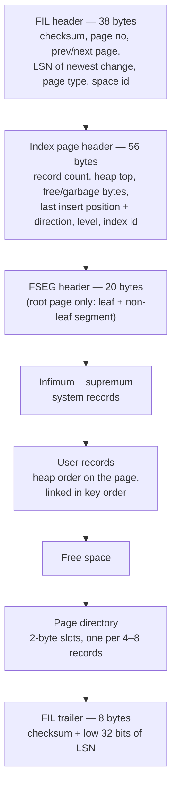

## Introduction

A B+ tree in a textbook is a diagram of boxes and arrows. In InnoDB, every box is a **16 KB page** at a fixed offset in a file, every arrow is a page number, and the "data" inside the leaves are **records** in a precise binary layout. Knowing that layout explains a whole family of production questions:

- Why does a table with 10,000 tiny rows already occupy more than one megabyte?
- Why does `CREATE TABLE` fail with *Row size too large (> 8126)* when the columns obviously fit in 65,535 bytes?
- Why does a table keyed by random UUIDs take more space — and more buffer pool — than the same data keyed by an auto-increment integer?
- What happens to a 50 KB `TEXT` value: is it in the row or somewhere else?
- What do `DATA_LENGTH`, `INDEX_LENGTH`, `DATA_FREE` and `AVG_ROW_LENGTH` in `information_schema.TABLES` actually measure?

This lesson builds on [Clustered and Secondary Indexes](/lessons/m07-clustered-secondary) (rows live in the leaves of the primary-key B+ tree) and [InnoDB vs MyISAM](/lessons/m10-innodb-myisam) (the overall architecture), and prepares [The Buffer Pool](/lessons/m10-buffer-pool), which caches exactly these pages.

:::note[What you can observe in the lab]
The sandbox cannot read `information_schema.INNODB_TABLESPACES`, `INNODB_TABLES` or `INNODB_INDEXES` (they need the `PROCESS` privilege), nor the files themselves. It *can* read the page size and tablespace settings, and `information_schema.TABLES` for its own tables — which reports sizes in units of pages and extents. Every size below was captured on the build server; to see *fresh* sizes the lesson disables the statistics cache and runs `ANALYZE TABLE` after loading data.
:::

## DBMS Theory

:::theory[Pages, extents and records]
Disk-based DBMSs move data between disk and memory in fixed-size **pages** (blocks): the unit of I/O, caching, locking of internal structures (latches), checksumming and logging. Page size is a trade-off: larger pages mean fewer B+ tree levels and better sequential throughput, but more wasted I/O for point lookups and more memory per cached hot row.

To keep related pages physically close, storage managers allocate space in **extents** — runs of contiguous pages — and assign extents to **segments**, one per logical object (an index, or one level of an index), so that a range scan reads mostly sequential pages.

Inside a page, the classic layout is the **slotted page**: a header, records growing from one end, free space in the middle, and a **slot directory** at the other end pointing to records, so records can move within the page without changing their external identity. A **record format** defines how column values, NULLs and variable lengths are encoded; long values that do not fit are stored **out of line** in overflow pages, with a pointer in the record.
:::

The concepts map onto InnoDB like this:

| Theory | InnoDB |
|---|---|
| Page | 16 KB by default (`innodb_page_size`: 4, 8, 16, 32 or 64 KB, chosen when the instance is initialised and never changed) |
| Extent | 64 consecutive pages = **1 MB** for 16 KB pages (1 MB also for 4/8 KB pages; 2 MB for 32 KB; 4 MB for 64 KB) |
| Segment | Each index has **two** segments — one for leaf pages, one for non-leaf pages — so leaves are allocated together for scans |
| File / storage area | **Tablespace**: one or more files (`.ibd`, `ibdata1`, `undo_00N`, `.ibt`) |
| Slotted page | **INDEX page** with a page directory of 2-byte slots |
| Record format | **Row format**: REDUNDANT, COMPACT, DYNAMIC (default), COMPRESSED |
| Overflow pages | **Off-page** (externally stored) BLOB pages for long `VARCHAR`/`VARBINARY`/`TEXT`/`BLOB`/`JSON` values |

## Why It Exists

Why not just write rows to the end of a file? Because the database must support **random access by key**, **in-place updates**, **concurrent modification** and **crash recovery** at the same time:

- **Fixed-size pages** make the buffer pool simple (every frame is the same size), make each page individually checksummable (torn-write detection), and let redo records name a change as "page *N* of tablespace *S*, offset *X*".
- **Extents and segments** prevent the fragmentation a page-at-a-time allocator would produce: without them, a table that grows slowly alongside others would have its leaves scattered across the file, and every range scan would become random I/O.
- **The slotted page with a directory** allows records to be inserted in any physical position while being found by binary search in key order.
- **Row formats with off-page storage** solve the conflict between B+ tree fan-out (many records per page) and the need to store multi-megabyte values: if a 1 MB document were stored inline, a leaf page could hold no other rows.

What goes wrong when these are ignored is visible in the classic incidents of this lesson: a schema with many wide `VARCHAR`/`TEXT` columns that hits the 8,126-byte row limit at `INSERT` time; random primary keys that make a table 50 % larger and its inserts I/O-bound; `ibdata1` that grew to 200 GB because tables were created in the system tablespace and space is never returned to the operating system.

## Internal Working

### Tablespaces

:::internals[The tablespaces of an InnoDB instance]
| Tablespace | Files | Contents |
|---|---|---|
| **System** | `ibdata1` (`innodb_data_file_path`, default `ibdata1:12M:autoextend`) | Change buffer storage; tables created with `TABLESPACE innodb_system` or when `innodb_file_per_table=OFF`. Before 8.0.20 also the doublewrite buffer, before 8.0 also undo logs and the old dictionary. **Never shrinks.** |
| **File-per-table** (default since 5.6.6) | `schema/table.ibd` | One table with all its indexes; dropped or rebuilt with the table, so space returns to the OS |
| **General** | `CREATE TABLESPACE ts ADD DATAFILE 'ts.ibd'` | Several tables sharing one file (fewer files for schemas with thousands of tables) |
| **Data dictionary** | `mysql.ibd` | The 8.0+ transactional dictionary and system tables |
| **Undo** | `undo_001`, `undo_002`, … (two by default since 8.0.14) | Undo logs in rollback segments ([Redo and Undo](/lessons/m10-redo-undo)) |
| **Global temporary** | `ibtmp1` | Rollback segments for changes to temporary tables; recreated at startup |
| **Session temporary** (8.0.16+) | `#innodb_temp/temp_N.ibt` | User-created temporary tables and internal on-disk temporary tables, per session |

Every tablespace has a numeric **space id**, and every page is addressed as *(space id, page number)*. In a file-per-table `.ibd`, the first pages are bookkeeping: page 0 (`FSP_HDR`: tablespace header and extent descriptors), page 1 (`IBUF_BITMAP`: change-buffer bitmap), page 2 (`INODE`: segment descriptors), page 3 (the root of the **SDI** index holding the table's serialized dictionary information, 8.0+), and then the root page of the clustered index.
:::

### Extents and segments

:::internals[How an index grows]
1. A new table's clustered index starts as a single page — the **root**, which is also a leaf.
2. When the root fills, it **splits**: its records move to two new leaf pages and the root becomes a non-leaf page pointing to them. The index is now three pages (one root, two leaves).
3. The first **32 pages** of each segment are allocated individually as **fragment pages** from shared fragment extents, so small tables do not waste whole megabytes.
4. After 32 pages, the segment is given **whole extents** (64 pages = 1 MB) at a time; the tablespace file grows by one or more extents.
5. Free space at the tablespace level — extents not yet assigned to any segment — is what `DATA_FREE` reports for file-per-table tables.

`DATA_LENGTH` in `information_schema.TABLES` is the clustered index's **allocated** size (all pages reserved by its two segments × page size), and `INDEX_LENGTH` the same for all secondary indexes. Because allocation happens in extents once a segment passes 32 pages, these numbers grow in 1 MB steps for all but the smallest tables — they measure reserved space, not bytes of data.
:::

### The anatomy of an index page



:::internals[Finding a record inside a page]
- Records are stored in **heap order** (the order they were inserted on this page) but linked into a **singly linked list in key order**, from the *infimum* (smaller than any key) to the *supremum* (larger than any key).
- The **page directory** at the end of the page holds a slot for roughly every 4–8 records. A lookup does a **binary search over the slots**, then follows the list for at most a few records. This is why a B+ tree descent costs only a handful of comparisons per level.
- Pages at the same level form a **doubly linked list** through the FIL header's *previous* and *next* page numbers — the path a range scan follows from leaf to leaf.
- The LSN in the FIL header records the newest redo record applied to the page; crash recovery compares it with redo records to decide whether a change must be replayed ([Crash Recovery](/lessons/m10-crash-recovery)). The checksum and the LSN copy in the trailer detect a **torn page**, half of which was written ([Doublewrite](/lessons/m10-doublewrite-change-buffer)).
- Deleting a record only **delete-marks** it; purge later unlinks it and its space becomes *garbage* reusable on the page. When a page's fill drops below `MERGE_THRESHOLD` (50 % by default), InnoDB tries to **merge** it with a neighbour.
:::

### The anatomy of a record (COMPACT / DYNAMIC)

| Part | Size | Content |
|---|---|---|
| Variable-length field lengths | 1–2 bytes per non-NULL variable-length column (stored in reverse column order) | Lengths of `VARCHAR`, `VARBINARY`, `TEXT`, `BLOB`, and of `CHAR` in multi-byte character sets |
| NULL bitmap | 1 bit per **nullable** column, rounded up to whole bytes | Which nullable columns are NULL (NULLs take no further space) |
| Record header | 5 bytes | Info bits (including the **delete mark**), number of records owned by a directory slot, heap number, record type, offset of the next record |
| Clustered-key columns | Their size | The primary key (or a unique NOT NULL key, or the hidden 6-byte `DB_ROW_ID` if neither exists) |
| `DB_TRX_ID` | 6 bytes | Id of the last transaction that modified the row — MVCC visibility ([MVCC](/lessons/m08-mvcc)) |
| `DB_ROLL_PTR` | 7 bytes | Pointer to the undo record holding the previous version |
| Other columns | Their size, or a 20-byte pointer if stored off-page | Non-key columns in definition order |

REDUNDANT, the original format, instead uses a 6-byte header and stores an offset for *every* field, which makes rows larger; COMPACT (5.0) introduced the layout above and saves roughly 20 % of row overhead.

### Row formats and off-page storage

:::internals[Where long values live]
A B+ tree page must hold **at least two records** for splits to work, so a record stored in a 16 KB page may be at most about **half a page: 8,126 bytes** (for 16 KB pages). Long variable-length values are moved **off-page** into chains of *BLOB pages* until the record fits:

| Row format | Long-value handling | Index key prefix limit |
|---|---|---|
| `REDUNDANT` | First **768 bytes** stay inline, remainder off-page with a 20-byte pointer | 767 bytes |
| `COMPACT` | Same as REDUNDANT (768-byte inline prefix) | 767 bytes |
| `DYNAMIC` (default since 5.7.9) | When the row is too long, a long column is stored **entirely** off-page; only a **20-byte pointer** stays inline. Values of 40 bytes or less always stay inline. | 3,072 bytes |
| `COMPRESSED` | Like DYNAMIC, plus zlib compression of pages to `KEY_BLOCK_SIZE` (1, 2, 4, 8 or 16 KB) | 3,072 bytes |

Off-page storage is decided **per row**, at insert/update time: a row whose values all fit stays entirely inline, whatever the declared types. Each externally stored value occupies its own BLOB page or chain of pages — off-page values are **not shared** between rows, so a 9 KB value still consumes a 16 KB page.

Separately, the **server** limits the declared size of a row to **65,535 bytes** over all columns (TEXT/BLOB columns count only their 9–12 byte pointer), regardless of engine.
:::

:::version[Version notes]
- `innodb_default_row_format = DYNAMIC` since **5.7.9**; `innodb_file_per_table = ON` since **5.6.6**.
- **8.0**: SDI embedded in each `.ibd` (no `.frm`); undo tablespaces separate from the system tablespace by default (two since **8.0.14**); session temporary tablespaces since **8.0.16**; doublewrite moved out of `ibdata1` in **8.0.20**; `AUTOEXTEND_SIZE` table/tablespace option since **8.0.23**; generated invisible primary keys (`sql_generate_invisible_primary_key`, default OFF) since **8.0.30**.
- **8.4** keeps these defaults; the page size, row formats and limits are the same as in 8.0.
:::

## MySQL Implementation

The page, tablespace and row-format settings of the build server:

```sql run
SELECT @@innodb_page_size                    AS page_size_bytes,
       @@innodb_page_size / 1024             AS page_size_kb,
       @@innodb_file_per_table               AS file_per_table,
       @@innodb_default_row_format           AS default_row_format,
       @@innodb_data_file_path               AS system_tablespace,
       @@innodb_temp_data_file_path          AS global_temp_tablespace,
       @@innodb_fill_factor                  AS fill_factor_pct,
       @@innodb_strict_mode                  AS strict_mode;
```

Default values throughout: 16 KB pages, one `.ibd` per table, DYNAMIC rows, a 12 MB auto-extending `ibdata1`, and strict mode, which turns row-format problems into errors at `CREATE TABLE` time.

### Watching a table grow: pages, then fragment pages, then extents

Create a table with ~220-byte rows and record its allocated size as it grows. `information_schema` statistics are cached for a day by default and InnoDB updates its persistent statistics in the background, so the session disables the cache and runs `ANALYZE TABLE` before each measurement:

```sql run
SET SESSION information_schema_stats_expiry = 0;
SET SESSION cte_max_recursion_depth = 300000;
CREATE TABLE grow (id INT PRIMARY KEY, pad CHAR(200) NOT NULL);
SELECT 0 AS row_count, DATA_LENGTH, DATA_LENGTH DIV 16384 AS pages, DATA_FREE
FROM information_schema.TABLES WHERE TABLE_SCHEMA = DATABASE() AND TABLE_NAME = 'grow';
```

An empty table already has one page: the root of its clustered index, which is also its only leaf.

```sql run
INSERT INTO grow WITH RECURSIVE s(n) AS (SELECT 1 UNION ALL SELECT n + 1 FROM s WHERE n < 50)
  SELECT n, 'x' FROM s;
ANALYZE TABLE grow;
SELECT 50 AS row_count, DATA_LENGTH, DATA_LENGTH DIV 16384 AS pages, DATA_FREE
FROM information_schema.TABLES WHERE TABLE_SCHEMA = DATABASE() AND TABLE_NAME = 'grow';
INSERT INTO grow WITH RECURSIVE s(n) AS (SELECT 51 UNION ALL SELECT n + 1 FROM s WHERE n < 100)
  SELECT n, 'x' FROM s;
ANALYZE TABLE grow;
SELECT 100 AS row_count, DATA_LENGTH, DATA_LENGTH DIV 16384 AS pages, DATA_FREE
FROM information_schema.TABLES WHERE TABLE_SCHEMA = DATABASE() AND TABLE_NAME = 'grow';
```

Fifty rows of roughly 230 bytes (200-byte `CHAR`, 4-byte key, 13 bytes of hidden `DB_TRX_ID` + `DB_ROLL_PTR`, header) still fit in the root page. At 100 rows the page has overflowed: the root split into two leaves and became a non-leaf page — **3 pages**, a two-level B+ tree.

```sql run
INSERT INTO grow WITH RECURSIVE s(n) AS (SELECT 101 UNION ALL SELECT n + 1 FROM s WHERE n < 2000)
  SELECT n, 'x' FROM s;
ANALYZE TABLE grow;
SELECT 2000 AS row_count, DATA_LENGTH, DATA_LENGTH DIV 16384 AS pages, DATA_FREE
FROM information_schema.TABLES WHERE TABLE_SCHEMA = DATABASE() AND TABLE_NAME = 'grow';
INSERT INTO grow WITH RECURSIVE s(n) AS (SELECT 2001 UNION ALL SELECT n + 1 FROM s WHERE n < 3000)
  SELECT n, 'x' FROM s;
ANALYZE TABLE grow;
SELECT 3000 AS row_count, DATA_LENGTH, DATA_LENGTH DIV 16384 AS pages, DATA_FREE
FROM information_schema.TABLES WHERE TABLE_SCHEMA = DATABASE() AND TABLE_NAME = 'grow';
INSERT INTO grow WITH RECURSIVE s(n) AS (SELECT 3001 UNION ALL SELECT n + 1 FROM s WHERE n < 20000)
  SELECT n, 'x' FROM s;
ANALYZE TABLE grow;
SELECT 20000 AS row_count, DATA_LENGTH, DATA_LENGTH DIV 16384 AS pages, DATA_FREE
FROM information_schema.TABLES WHERE TABLE_SCHEMA = DATABASE() AND TABLE_NAME = 'grow';
```

This is the extent allocator at work, visible in four numbers:

- At **2,000 rows** the index has exactly **32 pages** — the maximum number of individually allocated *fragment pages* per segment.
- At **3,000 rows** it jumps to **97 pages**: the next allocation was a whole **64-page extent** (32 + 64 = 96, plus the root page in the non-leaf segment). `DATA_FREE` also jumped to 4 MB: the `.ibd` file was extended by several extents at once, which are free but not yet assigned to the index.
- At **20,000 rows** the size has grown in 1 MB extent steps. Divide rows by pages to estimate rows per page — and remember that the last extent is only partly used.

## Syntax Breakdown

### Tablespace and row-format DDL

```sql
-- File-per-table (default) with an explicit row format
CREATE TABLE t (...) ROW_FORMAT = DYNAMIC;

-- Change row format (rebuilds the table)
ALTER TABLE t ROW_FORMAT = COMPACT;

-- Compressed pages (requires file-per-table or a general tablespace with matching FILE_BLOCK_SIZE)
CREATE TABLE t (...) ROW_FORMAT = COMPRESSED KEY_BLOCK_SIZE = 8;

-- General tablespace (requires the CREATE TABLESPACE privilege — not in the sandbox)
CREATE TABLESPACE ts1 ADD DATAFILE 'ts1.ibd' ENGINE = InnoDB;
CREATE TABLE t (...) TABLESPACE ts1;

-- Grow the .ibd file in larger steps (8.0.23+)
CREATE TABLE t (...) AUTOEXTEND_SIZE = 64M;

-- Lower the page-merge threshold for one index
CREATE TABLE t (..., KEY k (c) COMMENT 'MERGE_THRESHOLD=40');

-- Rebuild to defragment and reclaim space
OPTIMIZE TABLE t;            -- InnoDB maps this to ALTER TABLE ... FORCE + ANALYZE
ALTER TABLE t ENGINE = InnoDB;  -- "null rebuild"
```

### Reading sizes

| `information_schema.TABLES` column | Meaning for InnoDB |
|---|---|
| `ROW_FORMAT` | `Redundant`, `Compact`, `Dynamic` or `Compressed` |
| `DATA_LENGTH` | Pages allocated to the clustered index (leaf + non-leaf segments) × page size — includes off-page BLOB pages |
| `INDEX_LENGTH` | Pages allocated to all secondary indexes × page size |
| `DATA_FREE` | Free space in the tablespace not assigned to any segment (free extents) — for a file-per-table table, this table's file |
| `TABLE_ROWS` | Estimated rows (from sampled statistics) |
| `AVG_ROW_LENGTH` | `DATA_LENGTH / TABLE_ROWS` — allocated bytes per row, including page free space and partly used extents, **not** the record size |
| `CREATE_OPTIONS` | Non-default options such as `row_format=COMPRESSED KEY_BLOCK_SIZE=8` |

### Settings

| Variable | Default | Effect |
|---|---|---|
| `innodb_page_size` | 16384 | Page size, fixed at instance initialisation |
| `innodb_file_per_table` | ON | New tables get their own `.ibd` |
| `innodb_default_row_format` | DYNAMIC | Row format when `ROW_FORMAT` is omitted |
| `innodb_strict_mode` | ON | Row-size and option problems are errors, not warnings |
| `innodb_fill_factor` | 100 | Percentage of each page filled by **sorted index builds** (`CREATE INDEX`, rebuilds); 100 still leaves 1/16 of each page free |
| `innodb_data_file_path` | `ibdata1:12M:autoextend` | System tablespace files |
| `innodb_autoextend_increment` | 64 (MB) | Growth step of the **system** tablespace only |

## Practical Examples

### 1. Row formats and the 8,126-byte limit

Twelve `TEXT` columns are no problem for `DYNAMIC`, where each long value can shrink to a 20-byte pointer:

```sql run
CREATE TABLE profile_dynamic (
  id INT PRIMARY KEY,
  t1 TEXT, t2 TEXT, t3 TEXT, t4 TEXT, t5 TEXT, t6 TEXT,
  t7 TEXT, t8 TEXT, t9 TEXT, t10 TEXT, t11 TEXT, t12 TEXT
) ROW_FORMAT = DYNAMIC;
INSERT INTO profile_dynamic VALUES (1,
  REPEAT('a', 1000), REPEAT('b', 1000), REPEAT('c', 1000), REPEAT('d', 1000), REPEAT('e', 1000), REPEAT('f', 1000),
  REPEAT('g', 1000), REPEAT('h', 1000), REPEAT('i', 1000), REPEAT('j', 1000), REPEAT('k', 1000), REPEAT('l', 1000));
SELECT id, LENGTH(t1) + LENGTH(t12) AS sample_bytes FROM profile_dynamic;
```

The same definition in `COMPACT` is rejected, because in the worst case every `TEXT` keeps a 768-byte prefix inline — 12 × (768 + 20) bytes exceeds the 8,126-byte maximum record size:

```sql run error
CREATE TABLE profile_compact (
  id INT PRIMARY KEY,
  t1 TEXT, t2 TEXT, t3 TEXT, t4 TEXT, t5 TEXT, t6 TEXT,
  t7 TEXT, t8 TEXT, t9 TEXT, t10 TEXT, t11 TEXT, t12 TEXT
) ROW_FORMAT = COMPACT;
```

The error text tells you exactly what happened: "In current row format, BLOB prefix of 768 bytes is stored inline", and it suggests `ROW_FORMAT=DYNAMIC`. With `innodb_strict_mode = OFF` (it cannot be changed from the lab account) the table would be created with a warning and the error would surface later, at the first `INSERT` of a row with long values — a far worse time to find out.

Fixed-length columns cannot go off-page at all, so no row format helps when they alone exceed half a page:

```sql run error
CREATE TABLE too_wide_char (
  c1 CHAR(255), c2 CHAR(255), c3 CHAR(255), c4 CHAR(255), c5 CHAR(255), c6 CHAR(255), c7 CHAR(255), c8 CHAR(255),
  c9 CHAR(255), c10 CHAR(255), c11 CHAR(255), c12 CHAR(255), c13 CHAR(255), c14 CHAR(255), c15 CHAR(255), c16 CHAR(255),
  c17 CHAR(255), c18 CHAR(255), c19 CHAR(255), c20 CHAR(255), c21 CHAR(255), c22 CHAR(255), c23 CHAR(255), c24 CHAR(255),
  c25 CHAR(255), c26 CHAR(255), c27 CHAR(255), c28 CHAR(255), c29 CHAR(255), c30 CHAR(255), c31 CHAR(255), c32 CHAR(255)
) CHARSET = latin1;
```

32 × 255 = 8,160 bytes of fixed-length data, and "BLOB prefix of 0 bytes is stored inline" — DYNAMIC is already in use and there is nothing it can move. The server's separate 65,535-byte limit on the *declared* row applies before InnoDB is even asked:

```sql run error
CREATE TABLE too_long_declared (a VARCHAR(40000), b VARCHAR(40000)) CHARSET = latin1;
```

### 2. Off-page storage measured

Store 1,000 documents with a 9,600-byte body in each row format and compare the allocated sizes:

```sql run
CREATE TABLE doc_dynamic   (id INT PRIMARY KEY, title VARCHAR(100) NOT NULL, body MEDIUMTEXT NOT NULL) ROW_FORMAT = DYNAMIC;
CREATE TABLE doc_compact   (id INT PRIMARY KEY, title VARCHAR(100) NOT NULL, body MEDIUMTEXT NOT NULL) ROW_FORMAT = COMPACT;
CREATE TABLE doc_redundant (id INT PRIMARY KEY, title VARCHAR(100) NOT NULL, body MEDIUMTEXT NOT NULL) ROW_FORMAT = REDUNDANT;
INSERT INTO doc_dynamic
  WITH RECURSIVE s(n) AS (SELECT 1 UNION ALL SELECT n + 1 FROM s WHERE n < 1000)
  SELECT n, CONCAT('doc ', n), REPEAT(MD5(n), 300) FROM s;
INSERT INTO doc_compact   SELECT * FROM doc_dynamic;
INSERT INTO doc_redundant SELECT * FROM doc_dynamic;
ANALYZE TABLE doc_dynamic, doc_compact, doc_redundant;
SELECT TABLE_NAME, ROW_FORMAT, DATA_LENGTH, DATA_LENGTH DIV 16384 AS pages
FROM information_schema.TABLES
WHERE TABLE_SCHEMA = DATABASE() AND TABLE_NAME LIKE 'doc%'
ORDER BY TABLE_NAME;
```

How to read the result:

- All three tables need roughly **one 16 KB page per document**: a 9,600-byte body does not fit in a half-page record, so it is stored off-page, and off-page values do not share pages. More than 40 % of each BLOB page is empty — a real cost of storing values just above the half-page threshold.
- `DYNAMIC` is the smallest. Its clustered-index records are tiny (key, title, 20-byte pointer), so ~1,000 rows fit in a few leaf pages, whereas `COMPACT` and `REDUNDANT` keep a 768-byte prefix of every body inline and need dozens of leaf pages. Because `DATA_LENGTH` grows in whole 1 MB extents, the difference shows up as exactly one extent (64 pages) here.
- The difference matters far more than the totals suggest for queries that **do not read `body`**: a scan of `title` in a `DYNAMIC` table reads only the few leaf pages, while in `COMPACT` it drags 768-byte prefixes of every body through the buffer pool.

Now the same experiment with 960-byte bodies, which fit inline:

```sql run
CREATE TABLE note_dynamic (id INT PRIMARY KEY, title VARCHAR(100) NOT NULL, body TEXT NOT NULL) ROW_FORMAT = DYNAMIC;
CREATE TABLE note_compact (id INT PRIMARY KEY, title VARCHAR(100) NOT NULL, body TEXT NOT NULL) ROW_FORMAT = COMPACT;
INSERT INTO note_dynamic
  WITH RECURSIVE s(n) AS (SELECT 1 UNION ALL SELECT n + 1 FROM s WHERE n < 1000)
  SELECT n, CONCAT('note ', n), REPEAT(MD5(n), 30) FROM s;
INSERT INTO note_compact SELECT * FROM note_dynamic;
ANALYZE TABLE note_dynamic, note_compact;
SELECT TABLE_NAME, ROW_FORMAT, DATA_LENGTH DIV 16384 AS pages
FROM information_schema.TABLES
WHERE TABLE_SCHEMA = DATABASE() AND TABLE_NAME LIKE 'note%'
ORDER BY TABLE_NAME;
DROP TABLE doc_dynamic, doc_compact, doc_redundant, note_dynamic, note_compact;
```

Identical sizes: **off-page storage is decided per row**, and these rows fit entirely inline in both formats. The declared type (`TEXT` vs `VARCHAR`) does not decide where a value lives; its actual length does. (The tables are dropped afterwards to keep the lab small.)

### 3. Compressed and redundant formats are just table options

```sql run
CREATE TABLE fmt_compressed (id INT PRIMARY KEY, b TEXT) ROW_FORMAT = COMPRESSED KEY_BLOCK_SIZE = 8;
CREATE TABLE fmt_redundant  (id INT PRIMARY KEY, b VARCHAR(100)) ROW_FORMAT = REDUNDANT;
CREATE TABLE fmt_default    (id INT PRIMARY KEY, b VARCHAR(100));
SELECT TABLE_NAME, ROW_FORMAT, CREATE_OPTIONS
FROM information_schema.TABLES
WHERE TABLE_SCHEMA = DATABASE() AND TABLE_NAME LIKE 'fmt%'
ORDER BY TABLE_NAME;
```

`CREATE_OPTIONS` records explicit choices; the default table shows `Dynamic` with no option, because it inherited `innodb_default_row_format`.

## Execution Walkthrough

### Page splits: sequential versus random keys

When a leaf page is full, an insert must **split** it. InnoDB looks at the page header's *last insert position* and *direction*:

- If inserts keep arriving at the **end** of the page (ascending keys), InnoDB splits *at the insertion point*: the old page stays full and the new record starts a fresh page. Sequentially loaded indexes end up nearly full (InnoDB leaves about 1/16 free).
- If inserts land at **random** positions, InnoDB splits the page roughly in **half**. Each half then fills up with later random inserts and splits again; in the steady state pages are on average only about two-thirds full (the classic B-tree result is ln 2 ≈ 69 %).

The walkthrough loads the same 100,000 rows twice — once with ascending keys, once with keys in pseudo-random order (MD5 hashes) — and compares the allocated sizes.

```walkthrough
title: Sequential vs random primary-key inserts
steps:
  - title: "1. Two identical tables"
    explain: >-
      Both tables have a 32-character key and a 100-byte payload, so every row has exactly the same size.
      Only the order in which keys arrive differs.
    sql: |
      CREATE TABLE key_sequential (k CHAR(32) PRIMARY KEY, pad CHAR(100) NOT NULL);
      CREATE TABLE key_random     (k CHAR(32) PRIMARY KEY, pad CHAR(100) NOT NULL);
  - title: "2. Load ascending keys"
    explain: >-
      LPAD(n, 32, '0') produces keys in ascending order, so every insert goes to the right-most leaf and each
      split leaves a full page behind.
    sql: |
      INSERT INTO key_sequential
        WITH RECURSIVE s(n) AS (SELECT 1 UNION ALL SELECT n + 1 FROM s WHERE n < 100000)
        SELECT LPAD(n, 32, '0'), REPEAT('x', 100) FROM s;
  - title: "3. Load random keys"
    explain: >-
      MD5(n) produces 32-character keys spread uniformly over the key space, so each insert lands in a random
      leaf and full pages split in the middle — the pattern a UUIDv4 or hash key creates.
    sql: |
      INSERT INTO key_random
        WITH RECURSIVE s(n) AS (SELECT 1 UNION ALL SELECT n + 1 FROM s WHERE n < 100000)
        SELECT MD5(n), REPEAT('x', 100) FROM s;
  - title: "4. Compare the allocated sizes"
    explain: >-
      After ANALYZE TABLE (fresh statistics) compare pages and DATA_FREE. The random-key table holds the same rows
      in far more pages: its leaves are on average much less full, and every extra page also costs buffer-pool
      memory and I/O.
    sql: |
      ANALYZE TABLE key_sequential, key_random;
      SELECT TABLE_NAME, DATA_LENGTH DIV 16384 AS pages, AVG_ROW_LENGTH, DATA_FREE
      FROM information_schema.TABLES
      WHERE TABLE_SCHEMA = DATABASE() AND TABLE_NAME LIKE 'key_%'
      ORDER BY TABLE_NAME;
  - title: "5. Rebuild the random-key table"
    explain: >-
      OPTIMIZE TABLE on InnoDB is a rebuild (ALTER TABLE ... FORCE): rows are re-inserted in key order through a
      sorted index build, so the new pages are packed to innodb_fill_factor. The note in the output says so.
    sql: OPTIMIZE TABLE key_random;
  - title: "6. Compare again"
    explain: >-
      After the rebuild the random-key table is close to the sequential one. The gain is temporary: new random
      inserts start splitting the packed pages again.
    sql: |
      ANALYZE TABLE key_random;
      SELECT TABLE_NAME, DATA_LENGTH DIV 16384 AS pages, AVG_ROW_LENGTH, DATA_FREE
      FROM information_schema.TABLES
      WHERE TABLE_SCHEMA = DATABASE() AND TABLE_NAME LIKE 'key_%'
      ORDER BY TABLE_NAME;
```

## Output

The walkthrough's final comparison is the lesson's key result. With identical rows, the random-key table needed substantially more pages than the sequential one (compare the `pages` column in step 4: roughly half as many again), reported a larger `AVG_ROW_LENGTH` — the same rows, more allocated bytes per row — and more `DATA_FREE`. After the rebuild in step 5 it shrank to about 12 % above the sequential table — most, though not all, of the split overhead was removed, and because sizes move in whole extents the remaining gap is coarse.

Earlier blocks showed the rest of the storage model:

| Observation | Explanation |
|---|---|
| Empty table = 1 page; 100 rows = 3 pages | Root page; first split creates two leaves under a non-leaf root |
| 2,000 rows = 32 pages, 3,000 rows = 97 pages | 32 fragment pages per segment, then whole 64-page extents |
| `DATA_FREE` jumps to 4 MB | The `.ibd` file is extended by several extents at once |
| 12 × `TEXT` fails in COMPACT, works in DYNAMIC | 768-byte inline prefixes vs 20-byte pointers against the 8,126-byte record limit |
| 9.6 KB bodies ≈ one page per row | Off-page values occupy their own pages |
| 960-byte bodies: identical sizes in both formats | Off-page storage is decided per row by actual length |

## Alternative Approaches

| Problem | Options | Trade-offs |
|---|---|---|
| Large documents in rows | (a) Keep in InnoDB with `DYNAMIC`; (b) move bodies to a separate table `doc_body(id, body)`; (c) store in object storage (S3) and keep a URL | (a) simplest, full transactions; (b) narrow main table, fast scans, join when needed; (c) cheapest storage and CDN delivery, but no transactional consistency with the row |
| Space usage of compressible data | `ROW_FORMAT=COMPRESSED` (zlib per page, `KEY_BLOCK_SIZE`); **transparent page compression** (`COMPRESSION='zlib'` or `'lz4'`, relies on file-system hole punching); application-level compression of values | COMPRESSED costs CPU and buffer-pool memory (compressed and uncompressed copies); page compression depends on file system and sparse-file support; app compression is most effective but opaque to SQL |
| Random-key fragmentation | Sequential surrogate key (`AUTO_INCREMENT`) as PK with the UUID as a secondary unique key; time-ordered UUIDs (UUIDv7, or MySQL's `UUID_TO_BIN(UUID(), 1)` which moves the time fields first); periodic rebuilds | Sequential keys concentrate inserts on the last page (a hot spot under extreme concurrency, but excellent fill); UUIDv7 keeps global uniqueness with locality |
| Many small tables | General tablespaces | Fewer files and open handles; space freed by dropping a table stays inside the shared file |
| Wide sparse rows | Vertical partitioning into several tables; JSON column for rarely used attributes | Fewer bytes per row in the hot table; joins or JSON functions to reassemble |

## Performance Analysis

Every page in a table costs **disk space, buffer-pool memory and I/O**. The relationships to keep in mind:

| Factor | Effect |
|---|---|
| **Rows per leaf page** | Fan-out of scans: rows ÷ rows-per-page = pages read by a full scan. Narrower rows and better fill mean fewer pages |
| **Key size** | Non-leaf fan-out (16 KB ÷ (key + 6-byte child pointer + record overhead)); every secondary index entry also carries the primary key |
| **Fill factor after random inserts** | ~⅔ full on average → ~50 % more pages and buffer pool for the same data |
| **Off-page values** | Separate page reads per value when the column *is* selected; no cost when it is not (DYNAMIC) |
| **Inline prefixes (COMPACT/REDUNDANT)** | Up to 768 bytes per long column in every leaf record → wider leaves, slower scans of other columns |
| **Extent allocation** | Small tables round up to 1 MB steps; thousands of small tables waste space |

The height of the B+ tree follows directly. With 16 KB pages and a 4-byte integer key, a non-leaf page holds on the order of a thousand child pointers; with ~100 rows per leaf, three levels address ~10⁸ rows, which is why primary-key lookups in InnoDB rarely need more than 3–4 page accesses even for very large tables ([B-trees and B+ trees](/lessons/m07-btree-bplustree)).

:::performance[Theory vs measurement]
The page counts in this lesson are real measurements of *allocated space* on the build server. They do not show I/O or latency: every page of these small tables is in the buffer pool. The consequences for I/O appear when a table is larger than the buffer pool — then 50 % more pages means roughly 50 % more misses for the same workload. On your own server, combine `DATA_LENGTH`/`INDEX_LENGTH` with `innodb_buffer_pool_size` to judge whether the working set fits, and use `information_schema.INNODB_TABLESPACES` (`FILE_SIZE`, `ALLOCATED_SIZE`) and `INNODB_TABLESTATS` for per-tablespace detail (both need `PROCESS`).
:::

## Best Practices

:::best-practice[Designing for pages]
1. **Prefer short, monotonically increasing primary keys** (`INT`/`BIGINT AUTO_INCREMENT`, or time-ordered UUIDs stored as `BINARY(16)`) — good page fill, small secondary indexes, cache-friendly inserts.
2. **Keep `DYNAMIC`** (the default) unless you have a measured reason for `COMPRESSED`; convert legacy `COMPACT`/`REDUNDANT` tables with wide columns.
3. **Keep `innodb_strict_mode = ON`** so row-size problems fail at `CREATE TABLE`, not at the first long insert in production.
4. **Separate large, rarely read columns** (documents, images, raw payloads) into their own table or external storage so that hot scans stay narrow.
5. **Keep `innodb_file_per_table = ON`** and never create user tables in `innodb_system`; `ibdata1` never shrinks.
6. **Read sizes correctly:** `DATA_LENGTH`/`INDEX_LENGTH` are allocated pages; refresh with `ANALYZE TABLE` and `information_schema_stats_expiry = 0` before trusting them; `TABLE_ROWS` is an estimate.
7. **Rebuild only when it pays off** (after mass deletes or for random-key tables you rarely modify); rebuilding a busy random-key table buys space only until splits resume.
:::

## Common Mistakes

**Mistake 1 — reading stale sizes.** Without `ANALYZE TABLE` and with the default one-day statistics cache, `information_schema.TABLES` can show the size a table had when it was first queried. Always refresh before reporting sizes.

**Mistake 2 — treating `AVG_ROW_LENGTH` as the record size.** It is allocated bytes ÷ estimated rows. In the walkthrough the random-key table reported a much larger `AVG_ROW_LENGTH` than the sequential one for byte-identical rows.

**Mistake 3 — creating tables in the system tablespace.** `CREATE TABLE … TABLESPACE innodb_system` works, but the space can never be returned to the operating system after the table is dropped; only a dump and re-initialisation shrinks `ibdata1`. It is shown here display-only so the lesson does not grow the build server's `ibdata1`:

```sql
-- Works, but permanently grows ibdata1 — avoid
CREATE TABLE in_system (id INT PRIMARY KEY) TABLESPACE innodb_system;
```

**Mistake 4 — assuming `TEXT` is always off-page and `VARCHAR` always inline.** Placement depends on the row's actual length and the row format, as Example 2 showed. A `VARCHAR(5000)` holding 5,000 bytes can go off-page; a `TEXT` holding 100 bytes stays inline.

**Mistake 5 — a table with no primary key.** InnoDB then clusters on a hidden, server-wide-incremented 6-byte `DB_ROW_ID`, which you cannot use in queries, which makes row-based replication apply changes with full scans on replicas, and which is a mutex hot spot. Since 8.0.30, `sql_generate_invisible_primary_key = ON` adds an invisible `my_row_id` primary key automatically; the better fix is to declare one:

```sql run error
CREATE TABLE no_pk (a INT, b INT);
SELECT _rowid FROM no_pk;
```

`_rowid` is MySQL's alias for a single-column integer primary key; for a table clustered on the hidden `DB_ROW_ID` there is nothing to alias, so the query fails with error 1054.

## Industry Application

- **UUID primary keys at scale.** Many teams adopted UUIDv4 keys for distributed ID generation and then discovered bloated tables, insert slowdowns once the index exceeded the buffer pool, and replicas falling behind. The standard remediations are ordered UUIDs (UUIDv7, or `UUID_TO_BIN(UUID(), 1)` for MySQL's time-based v1 UUIDs) stored in `BINARY(16)`, or an `AUTO_INCREMENT` key with the UUID as a secondary unique column.
- **Schema reviews.** Database reviewers check row width (sum of column sizes), the number of long variable-length columns, and the row format; tables near the 8,126-byte limit are redesigned before launch, not after the first failing insert.
- **Capacity planning.** Storage forecasts are based on `DATA_LENGTH + INDEX_LENGTH` growth per day from `information_schema` snapshots, with headroom for page-split slack and rebuilds (a rebuild temporarily needs space for a second copy of the table).
- **Space reclamation.** After purging old data (for example deleting 80 % of an audit table), freed pages stay inside the `.ibd`; operations teams schedule `OPTIMIZE TABLE`/online rebuilds or, better, use partitioning (`DROP PARTITION` returns space instantly) for time-based retention (Module 12).
- **Compression.** Analytics-heavy MySQL deployments use `ROW_FORMAT=COMPRESSED` or transparent page compression for cold, read-mostly tables to cut storage costs, after measuring the CPU overhead.

## Practice Exercises

```exercise
id: ex1
title: Page and extent geometry of this server
difficulty: easy
kind: query
dataset: empty
concepts: [innodb-pages, extents]
prompt: |
  Return one row with:

  1. `page_kb` — the InnoDB page size in KB
  2. `extent_mb` — the extent size in MB, using the rule from this lesson: 1 MB for page sizes up to 16 KB,
     2 MB for 32 KB pages, 4 MB for 64 KB pages
  3. `pages_per_extent` — `extent_mb × 1024 / page_kb`
hints:
  - "@@innodb_page_size is in bytes."
  - "A CASE expression on @@innodb_page_size gives the extent size."
solution: |
  SELECT @@innodb_page_size / 1024 AS page_kb,
         CASE WHEN @@innodb_page_size <= 16384 THEN 1
              WHEN @@innodb_page_size = 32768 THEN 2
              ELSE 4 END AS extent_mb,
         CASE WHEN @@innodb_page_size <= 16384 THEN 1
              WHEN @@innodb_page_size = 32768 THEN 2
              ELSE 4 END * 1024 / (@@innodb_page_size / 1024) AS pages_per_extent;
explanation: |
  With the default 16 KB page an extent is 1 MB = 64 pages — the 64-page steps you saw in DATA_LENGTH once a
  segment passed its 32 fragment pages. Smaller page sizes (4 KB, 8 KB) keep 1 MB extents with more pages each;
  larger pages need larger extents.
```

```exercise
id: ex2
title: Make the wide profile table accept long values
difficulty: medium
kind: dml
dataset: empty
setup: |
  CREATE TABLE user_profile (
    id INT PRIMARY KEY,
    bio TEXT, interests TEXT, address TEXT, notes TEXT, prefs TEXT,
    history TEXT, links TEXT, skills TEXT, education TEXT, awards TEXT
  ) ROW_FORMAT = COMPACT;
concepts: [row-formats, off-page-storage]
prompt: |
  `user_profile` was created years ago with `ROW_FORMAT=COMPACT`. Its 10 `TEXT` columns each keep up to 768 bytes
  inline, leaving very little room before the 8,126-byte record limit. Change the table so long values are stored
  fully off-page (20-byte pointers), then insert the row `id = 1` with every text column set to
  `REPEAT('x', 2000)`. The check query reports the row format and the stored length of `awards`.
hints:
  - "The row format is a table option you can change with ALTER TABLE."
  - "ALTER TABLE user_profile ROW_FORMAT = DYNAMIC; then INSERT."
solution: |
  ALTER TABLE user_profile ROW_FORMAT = DYNAMIC;
  INSERT INTO user_profile VALUES (1,
    REPEAT('x', 2000), REPEAT('x', 2000), REPEAT('x', 2000), REPEAT('x', 2000), REPEAT('x', 2000),
    REPEAT('x', 2000), REPEAT('x', 2000), REPEAT('x', 2000), REPEAT('x', 2000), REPEAT('x', 2000));
check: |
  SELECT t.ROW_FORMAT, (SELECT LENGTH(awards) FROM user_profile WHERE id = 1) AS awards_length
  FROM information_schema.TABLES t
  WHERE t.TABLE_SCHEMA = DATABASE() AND t.TABLE_NAME = 'user_profile';
explanation: |
  `ALTER TABLE … ROW_FORMAT = DYNAMIC` rebuilds the table in the new format. In DYNAMIC, a long value that does not
  fit is moved entirely off-page and only a 20-byte pointer stays in the record, so ten 2,000-byte values cost about
  200 bytes inline. The rebuild copies the whole table — on a large production table, use an online schema-change
  procedure and check free disk space first.
```

```exercise
id: ex3
title: Measure page-split overhead
difficulty: hard
kind: query
dataset: empty
setup: |
  SET SESSION cte_max_recursion_depth = 30000;
  CREATE TABLE ev_seq (k CHAR(32) PRIMARY KEY, payload CHAR(120) NOT NULL);
  CREATE TABLE ev_rnd (k CHAR(32) PRIMARY KEY, payload CHAR(120) NOT NULL);
  INSERT INTO ev_seq WITH RECURSIVE s(n) AS (SELECT 1 UNION ALL SELECT n + 1 FROM s WHERE n < 30000)
    SELECT LPAD(n, 32, '0'), 'p' FROM s;
  INSERT INTO ev_rnd WITH RECURSIVE s(n) AS (SELECT 1 UNION ALL SELECT n + 1 FROM s WHERE n < 30000)
    SELECT MD5(n), 'p' FROM s;
concepts: [page-splits, extents]
prompt: |
  Two tables hold the same 30,000 rows; `ev_seq` was loaded in key order, `ev_rnd` in random key order. Return one
  row per table with `TABLE_NAME` and `pages` (the clustered index's allocated size in 16 KB pages,
  `DATA_LENGTH DIV 16384`), ordered by `TABLE_NAME`.

  Make sure the sizes are **fresh**: InnoDB statistics are updated in the background, and `information_schema`
  caches them.
hints:
  - "ANALYZE TABLE ev_seq, ev_rnd; refreshes InnoDB's statistics, including index sizes."
  - "SET SESSION information_schema_stats_expiry = 0; makes information_schema ask the engine instead of its cache."
  - "Then SELECT TABLE_NAME, DATA_LENGTH DIV 16384 AS pages FROM information_schema.TABLES WHERE TABLE_SCHEMA = DATABASE() …"
solution: |
  ANALYZE TABLE ev_seq, ev_rnd;
  SET SESSION information_schema_stats_expiry = 0;
  SELECT TABLE_NAME, DATA_LENGTH DIV 16384 AS pages
  FROM information_schema.TABLES
  WHERE TABLE_SCHEMA = DATABASE() AND TABLE_NAME IN ('ev_seq', 'ev_rnd')
  ORDER BY TABLE_NAME;
orderMatters: true
explanation: |
  Forgetting either refresh is the classic mistake: you may read sizes computed before the load finished (as little
  as one page). With fresh statistics, `ev_rnd` occupies clearly more pages for the same rows: random inserts split
  full pages in the middle, leaving pages around two-thirds full on average, while ascending inserts fill each page
  before starting the next. Note that sizes move in 64-page extents, so small differences are rounded up.
```

```exercise
id: ex4
title: Choose a primary key for an events table
difficulty: medium
kind: open
concepts: [page-splits, innodb-pages, clustered-index]
prompt: |
  A new `events` table will receive 5,000 inserts per second from 40 application servers and grow to 3 billion rows.
  The team proposes `id CHAR(36) PRIMARY KEY DEFAULT (UUID())`, with three secondary indexes. Evaluate the proposal
  from the point of view of pages, page splits, secondary-index size and buffer-pool usage, and propose a better
  design that keeps globally unique ids.
solution: |
  **Problems.** (1) A UUID in `CHAR(36)` costs at least 36 bytes (InnoDB stores `CHAR(N)` in utf8mb4 with at least N
  bytes; the ASCII text of a UUID needs exactly 36), versus 16 bytes for `BINARY(16)` or 8 for `BIGINT` — and the
  primary key is copied into **every entry of all three secondary indexes**. (2) If ids are not
  monotonic across servers and time, inserts land in random leaf pages: pages split in the middle and stay ~⅔ full,
  so the table needs ~50 % more pages; (3) the *whole* index becomes the working set for inserts — once it exceeds
  the buffer pool, nearly every insert reads a random leaf page from disk, and dirty pages are spread everywhere, so
  flushing becomes random I/O.

  **Better design.** Use a time-ordered 128-bit identifier — UUIDv7 generated by the application, or MySQL's
  `UUID_TO_BIN(UUID(), 1)` which reorders the time fields of a v1 UUID — stored as `BINARY(16)` primary key. Inserts
  then go to the right edge of the index (good fill, a small hot set of pages in memory), the key is 16 bytes in every
  secondary entry, and ids remain globally unique without coordination. An alternative is `BIGINT AUTO_INCREMENT` as
  the clustered key plus the external UUID as a `UNIQUE` secondary key — the smallest clustered key, at the cost of a
  second unique index. Also consider partitioning by time for retention (Module 12).
```

```exercise
id: ex5
title: Diagnose "Row size too large"
difficulty: challenge
kind: open
concepts: [row-formats, off-page-storage, page-structure]
prompt: |
  An `INSERT` into a product table fails in production with:

  `ERROR 1118 (42000): Row size too large (> 8126). Changing some columns to TEXT or BLOB may help. In current row
  format, BLOB prefix of 768 bytes is stored inline.`

  The table has 30 columns, including 14 `VARCHAR(500)` columns in `utf8mb4` and 6 `TEXT` columns, and was created
  on MySQL 5.6. Explain precisely why the error happens for *some* rows only, where the number 8126 comes from, why
  the message mentions 768 bytes, and give three fixes in order of preference.
solution: |
  **Why 8126.** InnoDB requires at least two records per 16 KB page so B+ tree splits are possible; after page
  overhead (FIL header/trailer, page header, infimum/supremum, directory) the maximum record size is 8,126 bytes for
  16 KB pages.

  **Why 768.** The table was created on 5.6 and is still `COMPACT` (or `REDUNDANT`): these formats keep the first 768
  bytes of every long variable-length value inline and only move the remainder off-page. Columns are moved off-page
  only when the row does not fit, and only down to 768 bytes each.

  **Why only some rows.** Placement is decided per row at insert time from actual lengths. Rows with short values fit;
  a row where many of the 14 `VARCHAR(500)` (up to 2,000 bytes each in utf8mb4) and 6 `TEXT` values are long cannot be
  reduced below roughly 20 × 788 bytes ≈ 15.7 KB in COMPACT, so it fails. With `innodb_strict_mode` OFF at creation
  time the table was accepted with only a warning, deferring the failure to these inserts.

  **Fixes, in order.** (1) `ALTER TABLE … ROW_FORMAT=DYNAMIC` (the default since 5.7.9): long values can be stored
  entirely off-page with 20-byte pointers, which makes such rows fit; plan it as an online rebuild. (2) Narrow the
  schema: right-size the `VARCHAR`s, move rarely used long attributes to a side table or a JSON column, which also
  speeds up scans. (3) Only if neither is possible, a larger `innodb_page_size` (32 KB/64 KB) raises the limit — but
  it requires a new instance and dump/reload and affects every table. Turn `innodb_strict_mode` ON so new tables fail
  at `CREATE` time.
```

## Knowledge Assessment

```quiz
- id: q1
  question: "With the default innodb_page_size, how large is an InnoDB extent?"
  options: ["16 KB", "64 KB", "1 MB (64 pages)", "64 MB"]
  answer: 2
  explanation: "An extent is 64 contiguous 16 KB pages = 1 MB. 64 MB is innodb_autoextend_increment, which applies only to the system tablespace; 16 KB is a single page."
  concepts: [extents]
- id: q2
  question: "A new table's DATA_LENGTH goes 16 KB → 48 KB → 512 KB → 1.5 MB as rows are added. What explains the jump after 512 KB?"
  options:
    - "The buffer pool was flushed"
    - "After 32 individually allocated fragment pages, the segment receives whole 64-page extents"
    - "The table was converted to COMPRESSED"
    - "The redo log was resized"
  answer: 1
  explanation: "Segments get their first 32 pages one at a time, then whole extents. 512 KB = 32 pages; the next allocation adds a 1 MB extent. Flushing and redo do not change allocated size."
  concepts: [extents, segments]
- id: q3
  question: "Why is the maximum InnoDB record size about 8,126 bytes with 16 KB pages?"
  options:
    - "Because the server limits rows to 8 KB"
    - "Because a B+ tree page must hold at least two records, so a record may use at most about half a page after page overhead"
    - "Because the redo log block is 8 KB"
    - "Because COMPACT rows store 768-byte prefixes"
  answer: 1
  explanation: "The half-page rule ensures splits can always distribute records. The server-level limit is 65,535 bytes for declared columns; redo log blocks are 512 bytes; the 768-byte prefix is a separate COMPACT/REDUNDANT behaviour."
  concepts: [page-structure, row-formats]
- id: q4
  question: "In a DYNAMIC table, a row's TEXT column holds 300 bytes and the whole row is 600 bytes. Where is the TEXT value stored?"
  options:
    - "Always off-page, because it is TEXT"
    - "Inline in the clustered-index record, because the row fits"
    - "768 bytes inline and the rest off-page"
    - "In the system tablespace"
  answer: 1
  explanation: "Off-page storage is decided per row by actual length. Short values stay inline regardless of declared type; the 768-byte prefix rule applies only to COMPACT/REDUNDANT, and only when the row does not fit."
  concepts: [off-page-storage]
- id: q5
  type: multi
  question: "Which of the following are stored in every InnoDB clustered-index record (COMPACT/DYNAMIC)? (Select all that apply.)"
  options:
    - "DB_TRX_ID (6 bytes)"
    - "DB_ROLL_PTR (7 bytes)"
    - "A 5-byte record header including a delete-mark flag"
    - "The table's name"
    - "A NULL bitmap covering every column, nullable or not"
  answer: [0, 1, 2]
  explanation: "Each record carries the last modifying transaction id, the roll pointer to its undo record and a 5-byte header with the delete mark. The table name is in the dictionary, not in records; the NULL bitmap only covers nullable columns."
  concepts: [page-structure]
- id: q6
  question: "Two tables contain identical rows; one was filled with ascending keys, the other with MD5-hash keys. The hash-key table is about 50% larger. Why?"
  options:
    - "Hash keys are longer"
    - "Random inserts split full pages roughly in half, leaving pages on average about two-thirds full; ascending inserts fill pages almost completely"
    - "The hash-key table uses COMPACT"
    - "MD5 values are compressed differently"
  answer: 1
  explanation: "Both keys were CHAR(32) of identical length. The difference is the split behaviour: InnoDB detects sequential inserts and splits at the insertion point, but splits in the middle for random positions."
  concepts: [page-splits]
- id: q7
  question: "Why should user tables not be created in the system tablespace (innodb_system)?"
  options:
    - "They cannot have indexes there"
    - "ibdata1 never shrinks, so space freed by dropping or rebuilding those tables is never returned to the operating system"
    - "They are not crash-safe there"
    - "They are always COMPRESSED there"
  answer: 1
  explanation: "File-per-table .ibd files are deleted or rebuilt with their table. Space inside ibdata1 can be reused by InnoDB but the file never shrinks without a dump and re-initialisation. Tables there are fully crash-safe and indexable."
  concepts: [tablespaces, file-per-table]
- id: q8
  question: "What does DATA_FREE report for a file-per-table InnoDB table?"
  options:
    - "Bytes of deleted rows inside its pages"
    - "Free space in its tablespace that is not yet assigned to any segment (free extents)"
    - "Free memory in the buffer pool"
    - "The size of the table's undo log"
  answer: 1
  explanation: "DATA_FREE counts free extents of the tablespace. Space freed inside pages by deletes (garbage) is not included; it is reused by later inserts into those pages or reclaimed by a rebuild."
  concepts: [tablespaces, extents]
```
