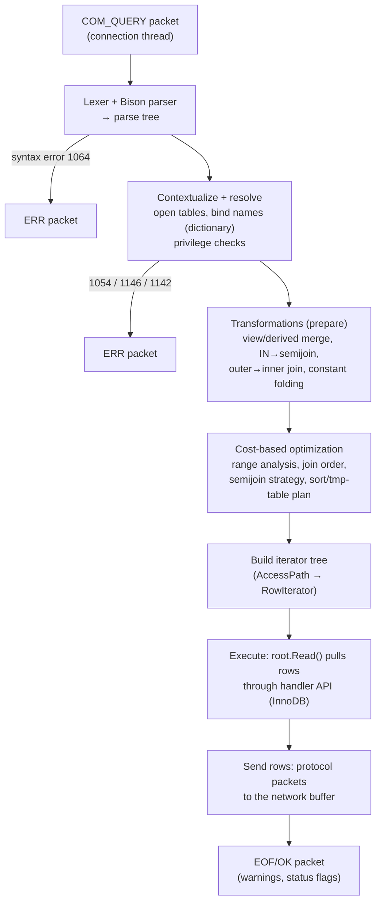

## Introduction

You already know how to *read* an execution plan ([Reading EXPLAIN](/lessons/m07-explain), [EXPLAIN ANALYZE](/lessons/m07-explain-analyze)) and how the optimizer *chooses* one ([How the Optimizer Decides](/lessons/m07-optimizer-decisions)). This lesson zooms out and follows a statement through **every phase** of its life inside `mysqld`, from the moment its bytes arrive in a `COM_QUERY` packet to the moment the last result row is written to the socket:

1. **Lexing and parsing** — text becomes a parse tree, or fails with error 1064.
2. **Resolution and privilege checks** — names are bound to dictionary objects; you must be allowed to touch them.
3. **Query transformations** — the query is rewritten into an equivalent, easier-to-optimize form: views merged, subqueries turned into semijoins, outer joins simplified, conditions normalised.
4. **Cost-based optimization** — access paths and join order are chosen with statistics and a cost model.
5. **Execution** — a tree of iterators pulls rows from the storage engine.
6. **Result delivery** — rows are serialized into protocol packets and streamed to the client.

Knowing the phases answers practical questions: *Why does a typo fail instantly but a missing index only shows up in production? Why does MySQL run my `IN (SELECT …)` as a join? Why does a `LEFT JOIN` sometimes behave like an inner join in EXPLAIN? Why was the query cache removed, and what replaces it?*

The primary instrument is the **optimizer trace** — a per-session JSON log of what the server did with your statement — which works in your lab.

## DBMS Theory

:::theory[From declarative SQL to a physical plan]
SQL is **declarative**: a query specifies *what* result is wanted, not *how* to compute it. A relational DBMS therefore compiles each statement in stages, a design dating back to System R:

- **Syntactic analysis** checks the statement against the grammar and builds an abstract syntax tree.
- **Semantic analysis** binds every name to a catalog object, infers types, and checks authorization.
- **Logical rewriting** applies *equivalence-preserving* transformations of relational algebra — e.g. σ pushdown, view expansion, subquery unnesting (an `IN` subquery becomes a semijoin ⋉), outer-join simplification (R ⟕ S becomes R ⋈ S when a later predicate rejects the NULL-extended rows). Rewrites are applied because they *usually* help, not because of costs.
- **Physical optimization** enumerates alternative physical plans (access methods, join orders, join algorithms) and picks the cheapest according to a **cost model** fed by **statistics** — the System R approach of Selinger et al. (1979).
- **Execution** evaluates the plan. The dominant model is the **iterator (Volcano) model** (Graefe, 1994): every operator implements `Init()` / `Read()` (`open/next/close`), and the root pulls rows one at a time from its children, so rows stream through the tree without materializing intermediate results unless an operator (sort, hash build, deduplication) needs to.
:::

Two properties of this pipeline matter in practice:

| Property | Consequence |
|---|---|
| **Early phases fail cheaply** | Syntax and name errors cost microseconds and touch no data. |
| **Rewrites are semantic equivalences** | Whatever the optimizer does, the result must be the same as the logical query order of [Logical Query Processing Order](/lessons/m04-logical-query-order). If a rewrite changes a result, it is a bug. |
| **Optimization uses estimates** | A plan can be optimal for the statistics and still slow on the real data; this is why EXPLAIN ANALYZE exists. |
| **Execution is demand-driven** | `LIMIT 10` can stop the whole tree after ten rows — unless a blocking operator (sort, aggregation over everything) sits below it. |

## Why It Exists

Why not execute SQL directly as written? Because the textual order of a query is a poor execution order. `SELECT … FROM a JOIN b JOIN c WHERE …` with three 1-million-row tables has six join orders, several access paths per table and multiple join algorithms; good and bad plans differ by orders of magnitude. Separating phases gives:

- **Correctness first.** Parsing and resolution guarantee the statement is well formed and authorised before any data is touched or locked.
- **Independence from formulation.** Different developers write the same question as `IN`, `EXISTS` or a join. Transformations normalise them, so performance depends less on phrasing.
- **Independence from physical design.** Adding an index changes the plan, not the query. That is *physical data independence* in action.
- **Pipelined execution.** The iterator model lets MySQL return the first rows of a large result before computing the rest, and bounds memory for most plans.

What goes wrong without a well-defined pipeline is illustrated by MySQL's **query cache**, which sat *before* the parser: it compared the raw statement text byte-for-byte with cached entries. Two queries differing only in whitespace or a comment were different cache keys; every write to a table invalidated all cached results of that table under one global mutex; on multi-core servers with any write load it became a scalability bottleneck. It was deprecated in 5.7.20 and **removed in 8.0.3**.

## Internal Working



:::internals[The phases inside mysqld]
**1. Lexing and parsing.** The hand-written lexer (`sql_lex.cc`) tokenises the text using the session's character set and SQL mode (for example, `ANSI_QUOTES` changes what `"…"` means). A Bison-generated LALR grammar (`sql_yacc.yy`) builds a **parse tree** of `Parse_tree_node` objects. Syntax errors stop here with error 1064, which quotes the text right after the failure point. Since 8.0 the parse tree is "contextualized" into the server's internal query representation: a `Query_expression` (one per `UNION`/query expression) containing `Query_block`s (one per `SELECT`).

**2. Resolution and privilege checks.** The server opens the referenced tables — fetching definitions from the **dictionary cache** (backed by the data dictionary) and table handles from the **table cache** (`table_open_cache`). It acquires **metadata locks** (MDL) so that a concurrent `ALTER TABLE` cannot change the definition mid-statement. It then binds every column reference to a table column (error 1054 if none matches, 1052 if ambiguous), expands `*`, resolves aliases, types and collations, and checks privileges at the global, schema, table and column levels (error 1142/1143 if missing). Views are expanded here: the view's stored definition is parsed and either *merged* into the outer query or marked for materialization.

**3. Transformations ("prepare").** Within `Query_block::prepare()` the server applies rule-based rewrites that do not need costs:
- removal of trivially true conditions (`1 = 1`) and simplification of constant expressions;
- **outer-join simplification**: `LEFT JOIN` becomes an inner join when the `WHERE` clause rejects NULLs from the inner table;
- **subquery transformations**: `IN`/`EXISTS` subqueries become **semijoins** (or antijoins for `NOT EXISTS`/`NOT IN` on non-nullable columns, since 8.0.17); scalar subqueries can become derived tables;
- **derived-table and view merging** (`derived_merge`) and **derived-condition pushdown** (8.0.22+).

**4. Cost-based optimization.** `JOIN::optimize()` normalises conditions (equality propagation into *multiple equalities*, constant propagation), finds usable key parts (`ref_optimizer_key_uses`), estimates rows per table with range analysis and index dives, enumerates join orders greedily, picks semijoin strategies (FirstMatch, LooseScan, Materialization, DuplicatesWeedout) and plans sorting and temporary tables. Every decision lands in the optimizer trace. This phase is the subject of [How the Optimizer Decides](/lessons/m07-optimizer-decisions).

**5. Iterator construction and execution.** The chosen plan is turned into a tree of `AccessPath` objects and then into `RowIterator`s (8.0.18+ for all queries): `TableScanIterator`, `IndexRangeScanIterator`, `RefIterator`, `NestedLoopIterator`, `HashJoinIterator`, `FilterIterator`, `SortingIterator`, `AggregateIterator`, `MaterializeIterator`, `LimitOffsetIterator` and more. Execution calls `Init()` on the root and then `Read()` repeatedly; leaf iterators call the handler API (`ha_rnd_next`, `ha_index_read_map`, …) and InnoDB fetches rows from buffer-pool pages. `EXPLAIN FORMAT=TREE` prints this tree; `EXPLAIN ANALYZE` runs it with timers.

**6. Result delivery.** For each row the root produces, the protocol layer serializes column values (text protocol for `COM_QUERY`, binary for prepared statements) into the connection's **network buffer** (`net_buffer_length`, grown as needed up to `max_allowed_packet`) and flushes it to the socket when full. Rows therefore stream to the client while execution continues; a slow client applies **backpressure** (`net_write_timeout`). The statement ends with an `OK`/`EOF` packet carrying the warning count and status flags, after which the statement's metadata locks are released (unless a transaction holds them) and, under autocommit, the transaction commits.
:::

:::version[Version notes]
- **Query cache:** deprecated 5.7.20, **removed in 8.0.3** — `query_cache_type`, `query_cache_size`, `SQL_CACHE` and `FLUSH QUERY CACHE` are gone (`SQL_NO_CACHE` is still accepted and ignored, with a deprecation warning).
- **Iterator executor:** completed in 8.0.18 together with `EXPLAIN ANALYZE` and hash joins; `EXPLAIN FORMAT=TREE` since 8.0.16.
- **Antijoin** transformation of `NOT EXISTS` / `NOT IN`: 8.0.17. **Derived condition pushdown**: 8.0.22.
- **Hypergraph optimizer:** present in 8.0/8.4 source but off (`optimizer_switch` flag `hypergraph_optimizer=off`), not supported for production in 8.4 community builds.
- **8.4:** `EXPLAIN FORMAT=JSON` gains a version 2 format (`explain_json_format_version = 2`, since 8.3) that mirrors the iterator tree.
:::

## MySQL Implementation

Turn on the optimizer trace for your session, run a statement, and read the trace back from `information_schema.OPTIMIZER_TRACE`. The trace keeps only the last `optimizer_trace_limit` statements (default 1), so the query you want to inspect must be the last traced statement before you read the trace:

```sql run
SELECT @@optimizer_trace_limit AS traces_kept,
       @@optimizer_trace_max_mem_size AS max_trace_bytes;
```

```sql run
SET SESSION optimizer_trace = 'enabled=on';
SELECT c.first_name
FROM customers c
WHERE c.customer_id IN (SELECT o.customer_id FROM orders o WHERE o.status = 'refunded')
  AND 1 = 1
  AND c.customer_id > 2 + 3
ORDER BY c.first_name
LIMIT 3;
```

The trace is one JSON document whose top-level `steps` array has one entry per phase:

```sql run
SELECT JSON_KEYS(JSON_EXTRACT(TRACE, '$.steps[0]')) AS phase_1,
       JSON_KEYS(JSON_EXTRACT(TRACE, '$.steps[1]')) AS phase_2,
       JSON_KEYS(JSON_EXTRACT(TRACE, '$.steps[2]')) AS phase_3,
       MISSING_BYTES_BEYOND_MAX_MEM_SIZE AS truncated_bytes
FROM information_schema.OPTIMIZER_TRACE;
```

`join_preparation` is resolution plus the rule-based transformations, `join_optimization` is the cost-based phase, and `join_execution` records execution-time events (such as sorting). Now look at what preparation did to the query:

```sql run
SELECT JSON_PRETTY(JSON_EXTRACT(TRACE, '$.steps[0].join_preparation.steps')) AS preparation
FROM information_schema.OPTIMIZER_TRACE;
```

Read the preparation steps in order:

1. The **subquery** (`select#2`) is prepared first, then the outer query (`select#1`).
2. The outer `expanded_query` is the resolved query in canonical form: every column qualified, `1 = 1` already **gone** (a trivially true conjunct is dropped during resolution), and `2 + 3` still present as an expression.
3. A `transformation` from `IN (SELECT)` **to `semijoin`** with `"chosen": true`, listing the semijoin condition and the *decorrelated predicate* (`o.customer_id` = `c.customer_id`).
4. `transformations_to_nested_joins` shows the rewritten query: `customers c semi join (orders o)` — the subquery has become a join operator the cost-based optimizer can reorder.

The cost-based phase then normalises the `WHERE` condition:

```sql run
SELECT JSON_PRETTY(JSON_EXTRACT(TRACE, '$**.condition_processing')) AS condition_processing
FROM information_schema.OPTIMIZER_TRACE;
```

`equality_propagation` replaces the individual equalities with **multiple equalities** — `multiple equal(c.customer_id, o.customer_id)` means "these columns are interchangeable", so a condition or index on either can be used for both. And in range analysis the constant expression has been evaluated: the chosen range for `customers` is `5 < customer_id`:

```sql run
SELECT jt.*
FROM information_schema.OPTIMIZER_TRACE,
     JSON_TABLE(JSON_EXTRACT(TRACE, '$**.rows_estimation[*]'), '$[*]'
       COLUMNS (table_name      VARCHAR(64) PATH '$.table',
                table_scan_rows INT         PATH '$.range_analysis.table_scan.rows',
                table_scan_cost DOUBLE      PATH '$.range_analysis.table_scan.cost',
                chosen_range    JSON        PATH '$.range_analysis.chosen_range_access_summary.range_access_plan.ranges')) AS jt;
```

For `customers` the range on the primary key (`5 < customer_id`) was chosen; for `orders` no range plan exists (the range on `idx_orders_customer` was rejected on cost, so `chosen_range` is NULL) and the table-scan estimate stands. The trace's `considered_execution_plans` (not shown in full — it is long) then compares join orders and semijoin strategies. Switch the trace off when you are done:

```sql run
SET SESSION optimizer_trace = 'enabled=off';
```

## Syntax Breakdown

| Tool | Phase it shows | How |
|---|---|---|
| Error codes 1064 / 1054, 1052, 1146 / 1142, 1143 | Parse / resolve / privilege check | `sql run error` blocks below |
| `SET SESSION optimizer_trace = 'enabled=on'` | Preparation, optimization, execution events | Then `SELECT TRACE FROM information_schema.OPTIMIZER_TRACE` |
| `optimizer_trace_limit`, `optimizer_trace_offset` | How many traces are kept | Default: the last 1 statement |
| `optimizer_trace_max_mem_size` | Trace size cap (default 1 MB) | `MISSING_BYTES_BEYOND_MAX_MEM_SIZE` > 0 means truncated |
| `optimizer_trace_features` | Which sections are traced | e.g. turn off `greedy_search` for huge joins |
| `EXPLAIN` + `SHOW WARNINGS` (note 1003) | The query after transformations | The rewritten SQL, e.g. merged views |
| `EXPLAIN FORMAT=TREE` | The iterator tree that will execute | Without running it |
| `EXPLAIN ANALYZE` | The iterator tree with actual rows, loops and time | Runs the query (results discarded) |
| `SHOW SESSION STATUS LIKE 'Last_query_cost'` | Optimizer's total cost of the last query | Session-scoped; 0 for statements not costed |
| `Bytes_sent`, `Com_*`, `Handler_*` | Delivery and engine calls | Session-scoped status counters |

| `TRACE` JSON key | Meaning |
|---|---|
| `expanded_query` | The resolved query in canonical form |
| `transformation` (`from`, `to`, `chosen`) | A subquery rewrite decision (semijoin, antijoin, materialization, EXISTS) |
| `transformations_to_nested_joins.transformations` | Rewrites such as `outer_join_to_inner_join`, `JOIN_condition_to_WHERE`, `semijoin` |
| `condition_processing` | Equality/constant propagation, trivial condition removal |
| `rows_estimation` / `range_analysis` | Per-table row estimates, ranges and their costs |
| `considered_execution_plans` | Join orders and access paths tried, with costs and `chosen` |
| `attaching_conditions_to_tables` | Which predicate is evaluated at which table |
| `join_execution` | Runtime events (e.g. `sorting_table`, `filesort_summary`) |

## Practical Examples

### 1. Each early phase has its own error

A typo in a keyword fails in the **parser** — no table is opened:

```sql run error
SELEC order_id FROM orders;
```

A misspelt column passes the parser (it is syntactically an identifier) and fails in **resolution**, where names are bound to the dictionary:

```sql run error
SELECT order_idd FROM orders;
```

A correct name you are not allowed to read fails in the **privilege check**:

```sql run error
SELECT * FROM performance_schema.threads;
```

All three fail before optimization and touch no rows, which is why "the query errors instantly" tells you nothing about its performance.

### 2. Outer-join simplification

A `LEFT JOIN` keeps customers without orders — unless a `WHERE` condition on the inner table throws those NULL-extended rows away again. The resolver detects that and converts the join:

```sql run
SET SESSION optimizer_trace = 'enabled=on';
SELECT c.first_name, o.order_id
FROM customers c LEFT JOIN orders o ON o.customer_id = c.customer_id
WHERE o.status = 'refunded'
ORDER BY o.order_id;
SELECT JSON_EXTRACT(TRACE, '$**.transformations_to_nested_joins') AS rewrite
FROM information_schema.OPTIMIZER_TRACE;
SET SESSION optimizer_trace = 'enabled=off';
```

The rewrite lists `outer_join_to_inner_join`, `JOIN_condition_to_WHERE` and `parenthesis_removal`: the `LEFT JOIN … ON` became a plain join with the `ON` condition moved to `WHERE`. This matters for performance (an inner join can start from either table; a left join must start from `customers`) and for understanding: if you *meant* to keep customers without refunded orders, the predicate belongs in the `ON` clause.

### 3. View merging

A view is stored SQL. When it is mergeable (no aggregation, `DISTINCT`, `LIMIT`, `UNION` …) its definition is folded into the outer query during preparation, and the outer `WHERE` can use the base table's indexes:

```sql run
CREATE VIEW refunded_orders AS
  SELECT order_id, customer_id FROM orders WHERE status = 'refunded';
EXPLAIN SELECT * FROM refunded_orders WHERE customer_id = 3;
```

EXPLAIN shows a single access to `orders` via `idx_orders_customer` — no trace of the view. The note 1003 attached to the EXPLAIN (in the warnings) is the rewritten query: `select … from orders where ((orders.status = 'refunded') and (orders.customer_id = 3))`.

### 4. The iterator tree, estimated and measured

The optimized plan for the semijoin query, as the executor will run it:

```sql run
EXPLAIN FORMAT=TREE
SELECT c.first_name
FROM customers c
WHERE c.customer_id IN (SELECT o.customer_id FROM orders o WHERE o.status = 'refunded')
ORDER BY c.first_name
LIMIT 3;
```

Read it bottom-up as a pull pipeline: a table scan of `orders` feeds a filter on `status`, whose rows are **materialized with deduplication** into a temporary table `<subquery2>` (the *semijoin materialization* strategy); `customers` is scanned and sorted by `first_name`; a nested-loop join probes `<subquery2>` once per customer; `Limit: 3` stops pulling after three rows. Because the sort is below the limit, all 25 customers are sorted — but the join stops after producing three matches. Now run it with instrumentation:

```sql run measured
EXPLAIN ANALYZE
SELECT c.first_name
FROM customers c
WHERE c.customer_id IN (SELECT o.customer_id FROM orders o WHERE o.status = 'refunded')
ORDER BY c.first_name
LIMIT 3;
```

The actual `rows` and `loops` show the demand-driven execution. The table scan read all 25 customers, because the sort must consume its whole input before emitting its first row. But the sort then *delivered* only 20 rows: the nested-loop join pulled sorted customers one at a time, probed `<subquery2>` once per customer (`loops=20`), and stopped as soon as `Limit` had its three rows — the remaining five sorted customers were never pulled. The materialization ran once (`loops=1`), turning the 5 refunded orders into 4 distinct customer ids. Compare this with the estimated `rows=333` for the join in the plain EXPLAIN: estimates describe the whole join, actuals describe what the limit let through.

### 5. The optimizer's total cost

`Last_query_cost` is the optimizer's estimate for the last statement it costed in this session — the number the planner minimised:

```sql run
SELECT COUNT(*) FROM orders o JOIN customers c USING (customer_id);
SHOW SESSION STATUS LIKE 'Last_query_cost';
```

Costs are in abstract units derived from the cost constants (reading a page, evaluating a row); compare them between alternative plans of the same query, never across servers or versions.

### 6. Result delivery is part of the query's cost

The executor does not finish and *then* send: rows stream into the network buffer as they are produced. `Bytes_sent` (session-scoped) shows what each result cost on the wire:

```sql run
SHOW SESSION STATUS LIKE 'Bytes_sent';
SELECT order_id FROM orders ORDER BY order_id LIMIT 1;
SHOW SESSION STATUS LIKE 'Bytes_sent';
SELECT o.*, c.* FROM orders o JOIN customers c USING (customer_id);
SHOW SESSION STATUS LIKE 'Bytes_sent';
```

Fetching all columns of the 80-row join cost many kilobytes; the one-value result cost a few hundred bytes, most of them protocol overhead (column definitions, OK packet) and the snapshot itself. `EXPLAIN ANALYZE` *excludes* this phase — it discards rows instead of sending them — so a query that looks fast in `EXPLAIN ANALYZE` can still be slow end-to-end when it returns megabytes to a distant client.

## Execution Walkthrough

```walkthrough
title: The lifecycle of SELECT … WHERE customer_id IN (SELECT … status = 'refunded') ORDER BY first_name LIMIT 3
steps:
  - title: "1. Parse — the statement is well formed"
    explain: >-
      The lexer and parser accept the text and build a parse tree with two query blocks: the outer SELECT
      (select#1) and the subquery (select#2). Nothing has been looked up yet. Enabling the trace here means the
      next statement is recorded.
    sql: SET SESSION optimizer_trace = 'enabled=on';
  - title: "2. Resolve — names bound, privileges checked"
    explain: >-
      The tables are opened through the dictionary cache, columns are bound, and SELECT privilege on customers
      and orders is verified. This step runs the statement; the next steps read its trace. The result itself
      appears here because execution and delivery follow once planning is done.
    sql: |
      SELECT c.first_name
      FROM customers c
      WHERE c.customer_id IN (SELECT o.customer_id FROM orders o WHERE o.status = 'refunded')
      ORDER BY c.first_name
      LIMIT 3;
  - title: "3. Transform — IN (SELECT) becomes a semijoin"
    explain: >-
      During preparation the subquery is unnested. The trace's transformation entry records from, to and
      chosen. From now on the optimizer sees a two-table join with semijoin semantics (each customer at most once).
    sql: |
      SELECT JSON_UNQUOTE(JSON_EXTRACT(JSON_EXTRACT(TRACE, '$**.transformation.from'), '$[0]')) AS transformed_from,
             JSON_UNQUOTE(JSON_EXTRACT(JSON_EXTRACT(TRACE, '$**.transformation.to'), '$[0]')) AS transformed_to,
             JSON_EXTRACT(JSON_EXTRACT(TRACE, '$**.transformation.chosen'), '$[0]') AS chosen
      FROM information_schema.OPTIMIZER_TRACE;
  - title: "4. Optimize — estimate rows, compare plans"
    explain: >-
      Row estimation gives each table's estimated rows, then considered_execution_plans compares join orders
      and semijoin strategies. This query has no range condition, so each table's estimate sits directly under
      table_scan (when a range condition exists it moves under range_analysis, as in the earlier example). The
      full set of strategies is in the trace's semijoin_strategy_choice entries.
    sql: |
      SELECT jt.*
      FROM information_schema.OPTIMIZER_TRACE,
           JSON_TABLE(JSON_EXTRACT(TRACE, '$**.rows_estimation[*]'), '$[*]'
             COLUMNS (table_name VARCHAR(64) PATH '$.table',
                      est_rows   INT         PATH '$.table_scan.rows')) AS jt;
  - title: "5. Execute — sorting is an execution event"
    explain: >-
      The join_execution section records runtime events. Here it contains the filesort of customers by
      first_name with the rows found, sort mode and memory used — and it notes that the priority-queue
      (top-N) optimization was not applicable, because the LIMIT sits above the join rather than directly on
      the sort.
    sql: |
      SELECT JSON_PRETTY(JSON_EXTRACT(TRACE, '$.steps[2].join_execution')) AS execution
      FROM information_schema.OPTIMIZER_TRACE;
  - title: "6. Deliver — and switch the instrument off"
    explain: >-
      The three rows of step 2 were streamed to the client as they were produced, followed by an EOF/OK packet.
      Tracing has overhead (it builds JSON for every decision), so turn it off when finished.
    sql: SET SESSION optimizer_trace = 'enabled=off';
```

## Output

The statement's result is the three alphabetically first customers who have at least one refunded order. The trace output is what makes the lifecycle visible:

- **Preparation** removed `1 = 1`, rewrote `IN (SELECT)` into a semijoin, and turned a `LEFT JOIN` with a NULL-rejecting `WHERE` into an inner join.
- **Optimization** propagated equalities, evaluated `2 + 3` to the range `5 < customer_id`, and estimated 25 rows for a scan of `customers` and 80 for `orders` (exact here, because the tables were just analysed and are tiny).
- **Execution** shows up in `join_execution` (the sort) and in `EXPLAIN ANALYZE` (actual rows and loops); delivery shows up in `Bytes_sent`.

## Alternative Approaches

**Skipping phases.** Some phases can be avoided for repeated statements:

| Approach | What it skips | Notes |
|---|---|---|
| **Server-side prepared statements** (`COM_STMT_PREPARE`, or SQL `PREPARE`) | Parsing and resolution on each execution | Optimization still runs per execution with the actual parameter values (MySQL does not cache plans across executions in the way Oracle or SQL Server do); re-prepared automatically if a table definition changes (`Com_stmt_reprepare`) |
| **Stored procedures** | Parsing after the first call per session (per-session SP cache) | Statements inside are still optimized at execution |
| **Application or proxy result caching** (Redis, ProxySQL query cache, CDN) | Everything | Invalidation is the application's responsibility; stale reads possible |
| **Summary tables / materialized results** | Re-computation of expensive aggregates | Refreshed by jobs, triggers or CDC (Module 12) |
| **The old query cache** (≤ 5.7) | Everything for byte-identical `SELECT`s | Removed in 8.0.3: global mutex, invalidation on every write, no help for parameterised traffic |

**Influencing phases instead of skipping them.** Optimizer hints (`/*+ NO_SEMIJOIN() */`, `/*+ JOIN_ORDER(...) */`, `/*+ SET_VAR(...) */`), `optimizer_switch` flags (`semijoin=off`, `derived_merge=off`), and index hints affect transformations and plan choice for one statement or session. Treat them as a last resort after fixing statistics and indexes — see [How the Optimizer Decides](/lessons/m07-optimizer-decisions).

**Different executor designs.** Vectorised execution (DuckDB, ClickHouse, HeatWave) processes batches of column values per `Read()` call instead of one row, which amortises per-row overhead for analytics; code generation (HyPer, Umbra) compiles the plan into machine code. MySQL's row-at-a-time iterators favour OLTP: small results, index lookups, low latency.

## Performance Analysis

Where does time go in a typical statement?

| Phase | Typical cost | When it becomes significant | Diagnose with |
|---|---|---|---|
| Parse | µs | Multi-megabyte statements (huge `INSERT … VALUES`, `IN` lists with 100k items) | Statement size; `performance_schema` stage `stage/sql/parsing` (where available) |
| Resolve / open tables | µs | Table cache misses on servers with many tables; MDL waits behind DDL (`Waiting for table metadata lock`) | `Opened_tables`, processlist state |
| Optimize | µs–ms | Many-table joins (search space), many ranges (index dives), complex views | Trace size and time; `stage/sql/optimizing`; `eq_range_index_dive_limit`, `optimizer_search_depth` |
| Execute | µs–hours | Almost always the dominant phase | `EXPLAIN ANALYZE`, handler and InnoDB counters |
| Send | µs–s | Large results, slow or distant clients, `SELECT *` | `Bytes_sent`, `stage/sql/Sending to client` (8.0 shows `executing` for most of the time) |

:::performance[Theory vs measurement]
On the shop dataset every phase finishes in well under a millisecond; the trace and `EXPLAIN ANALYZE` above show *what* happened, not meaningful timings. To attribute real latency to phases on a production server, enable `performance_schema` stage instruments and query `events_stages_history_long` for a statement, or use the `sys.session` and `sys.statement_analysis` views. In the sandbox those schemas are not readable. Keep in mind that the optimizer trace itself is expensive — it is a diagnostic for one session, not something to leave on.
:::

A useful mental model: **parse and optimize costs are per statement; execute costs are per row; send costs are per byte.** A dashboard issuing 5,000 tiny queries pays the per-statement costs 5,000 times — batch them or use prepared statements; a report returning 50 MB pays per byte — return less.

## Best Practices

:::best-practice[Working with the query pipeline]
1. **Use the optimizer trace when EXPLAIN surprises you** — it is the only place that shows *why* (transformations and rejected alternatives). Raise `optimizer_trace_max_mem_size` for big queries and check `MISSING_BYTES_BEYOND_MAX_MEM_SIZE`.
2. **Read the rewritten query** (`SHOW WARNINGS` after `EXPLAIN`) to see view merges, semijoins and join simplifications.
3. **Put outer-join filters on the inner table in `ON`**, not `WHERE`, unless you intend an inner join — the optimizer will otherwise (correctly) convert your join.
4. **Use prepared statements for repeated statements** to skip parsing and to prevent SQL injection; do not expect plan caching.
5. **Select only the columns you need** — result delivery is real cost, invisible to `EXPLAIN ANALYZE`.
6. **Do not try to recreate the query cache** at the server level; cache at the application layer with explicit invalidation, or use read replicas and summary tables.
7. **Avoid giant `IN` lists**; load the values into a temporary table and join, which keeps parsing and range analysis cheap.
:::

## Common Mistakes

**Mistake 1 — reading the trace of the wrong statement.** The trace keeps only the last traced statement by default. Running *another* query (even the one that reads a different part of the trace is fine, because `SELECT … FROM information_schema.OPTIMIZER_TRACE` is not itself traced) — such as a quick `SELECT COUNT(*)` to check something — replaces it. Raise `optimizer_trace_limit` or re-run the query of interest right before reading.

**Mistake 2 — a `LEFT JOIN` silently turned into an inner join.** Shown above: `WHERE o.status = 'refunded'` discards customers without refunded orders. If the requirement is "all customers, with their refunded orders if any", move the predicate:

```sql run
SELECT c.customer_id, c.first_name, o.order_id
FROM customers c LEFT JOIN orders o
  ON o.customer_id = c.customer_id AND o.status = 'refunded'
ORDER BY c.customer_id, o.order_id
LIMIT 8;
```

Customers without refunded orders now appear with `order_id` NULL.

**Mistake 3 — expecting the query cache.** Old tuning advice sets `query_cache_size`; in 8.0+ the variables do not exist:

```sql run error
SELECT @@query_cache_size;
```

**Mistake 4 — judging end-to-end latency with `EXPLAIN ANALYZE`.** It does not send rows to the client, so network transfer and client-side processing are excluded.

**Mistake 5 — assuming prepared statements freeze the plan.** In MySQL, each `EXECUTE` is optimized with the current statistics and parameter values. A plan regression after `ANALYZE TABLE` affects prepared statements too.

## Industry Application

- **Plan-regression investigations.** When a deploy or a statistics refresh makes a query slow, engineers capture the optimizer trace on a replica for the old and new behaviour and diff `considered_execution_plans` to see which estimate changed. The trace is also what MySQL support and bug reports ask for.
- **ORMs and generated SQL.** ORMs generate `IN (SELECT …)`, nested views and `LEFT JOIN`s liberally. Understanding semijoin conversion and outer-join simplification explains why generated SQL often performs better than it looks — and why some patterns (non-mergeable views with `GROUP BY`, correlated scalar subqueries) do not.
- **Caching tiers.** After the query cache was removed, organisations standardised on application caches (Redis/Memcached) keyed by business identifiers with explicit invalidation, ProxySQL's TTL-based query cache for read-heavy, staleness-tolerant endpoints, and read replicas.
- **Query review in CI.** Some teams run `EXPLAIN FORMAT=JSON` on every new query in CI against a production-like dataset and fail the build on full scans of large tables — the lifecycle's optimization phase, exercised before deployment.
- **Observability.** `performance_schema.events_statements_summary_by_digest` normalises statements (the *digest*, computed from the parsed token stream — literals replaced by `?`) so that "the same query with different values" is aggregated; tools like PMM and Datadog build their query analytics on it.

## Practice Exercises

```exercise
id: ex1
title: Which phase raised the error?
difficulty: easy
kind: open
concepts: [parsing, name-resolution, privilege-checks]
prompt: |
  For each failure, name the lifecycle phase that detects it and say whether any table data was read:

  1. `ERROR 1064: You have an error in your SQL syntax … near 'FORM orders'`
  2. `ERROR 1054: Unknown column 'totl' in 'field list'`
  3. `ERROR 1142: SELECT command denied to user … for table 'salaries'`
  4. `ERROR 1052: Column 'customer_id' in where clause is ambiguous`
  5. `ERROR 1205: Lock wait timeout exceeded`
solution: |
  1. **Parsing** (syntax) — no table is opened; nothing read.
  2. **Resolution** (name binding against the dictionary) — tables opened for their definitions, no rows read.
  3. **Privilege check** during resolution — no rows read.
  4. **Resolution** — two tables in scope have `customer_id`, so the reference cannot be bound; no rows read.
  5. **Execution** — the executor asked InnoDB for a lock on a row that another transaction holds; rows may
     already have been read or modified by the statement (which is rolled back to its start).
  The first four are compile-time errors, which is why they fail instantly and say nothing about performance.
```

```exercise
id: ex2
title: Confirm the semijoin transformation
difficulty: medium
kind: query
dataset: shop
concepts: [optimizer-trace, query-transformations]
prompt: |
  Enable the optimizer trace, run

  ~~~sql
  SELECT p.name FROM products p
  WHERE p.product_id IN (SELECT oi.product_id FROM order_items oi WHERE oi.quantity >= 3);
  ~~~

  and then return **one row** from `information_schema.OPTIMIZER_TRACE` with two columns:

  - `transformed_to` — the value of the subquery transformation's `to` field, as **plain text** (no JSON quotes)
  - `chosen` — the transformation's `chosen` field as plain text (`true` or `false`)
hints:
  - "The transformation entry is inside $.steps[0].join_preparation.steps; the wildcard path '$**.transformation.to' finds it wherever it is."
  - "JSON_EXTRACT with a ** path always returns an array of matches. Extract element $[0] from that array with a second JSON_EXTRACT, then JSON_UNQUOTE it."
  - "Remember the trace query must run after the traced SELECT, with nothing traced in between."
solution: |
  SET SESSION optimizer_trace = 'enabled=on';
  SELECT p.name FROM products p
  WHERE p.product_id IN (SELECT oi.product_id FROM order_items oi WHERE oi.quantity >= 3);
  SELECT JSON_UNQUOTE(JSON_EXTRACT(JSON_EXTRACT(TRACE, '$**.transformation.to'), '$[0]')) AS transformed_to,
         JSON_UNQUOTE(JSON_EXTRACT(JSON_EXTRACT(TRACE, '$**.transformation.chosen'), '$[0]')) AS chosen
  FROM information_schema.OPTIMIZER_TRACE;
explanation: |
  The trace records the IN (SELECT) → semijoin decision during join preparation, before any costs are known —
  it is a rule-based transformation. Wildcard paths (`$**.transformation.to`) return every match wrapped in an
  array (`["semijoin"]`), which is why the value needs a second extraction of `$[0]` before unquoting — writing
  `'$**.transformation.to[0]'` does not help, because the result of a wildcard path is still wrapped. A common error is reading the trace after running another statement, which replaces it.
```

```exercise
id: ex3
title: The optimizer's starting estimates
difficulty: hard
kind: query
dataset: shop
concepts: [optimizer-trace, cost-based-optimization]
prompt: |
  Trace the query

  ~~~sql
  SELECT c.city, COUNT(*) FROM customers c JOIN orders o ON o.customer_id = c.customer_id
  WHERE o.status = 'shipped' GROUP BY c.city;
  ~~~

  and use `JSON_TABLE` over the trace's `rows_estimation` entries to return one row per table with columns
  `table_name` (as it appears in the trace, e.g. `` `customers` `c` ``) and `table_scan_rows` (the estimated rows
  of a full scan of that table). This query has no range condition, so each entry holds its estimate directly
  in `table_scan.rows`.
hints:
  - "JSON_EXTRACT(TRACE, '$**.rows_estimation[*]') returns an array of per-table objects."
  - "JSON_TABLE(<that array>, '$[*]' COLUMNS (table_name VARCHAR(64) PATH '$.table', table_scan_rows INT PATH '$.table_scan.rows'))"
  - "Run the traced query immediately before the JSON_TABLE query."
solution: |
  SET SESSION optimizer_trace = 'enabled=on';
  SELECT c.city, COUNT(*) FROM customers c JOIN orders o ON o.customer_id = c.customer_id
  WHERE o.status = 'shipped' GROUP BY c.city;
  SELECT jt.table_name, jt.table_scan_rows
  FROM information_schema.OPTIMIZER_TRACE,
       JSON_TABLE(JSON_EXTRACT(TRACE, '$**.rows_estimation[*]'), '$[*]'
         COLUMNS (table_name VARCHAR(64) PATH '$.table',
                  table_scan_rows INT PATH '$.table_scan.rows')) AS jt;
explanation: |
  These are the statistics-based row counts the cost model starts from (25 customers, 80 orders — exact here
  because the lab's tables were analysed when it loaded). A common error is copying the path from a query that had
  a range condition: then the estimate lives under `range_analysis.table_scan`, and the wrong path silently returns
  NULL rather than an error. Every later cost — the join order, whether to use
  idx_orders_customer — is derived from such estimates, which is why stale statistics are the most common cause
  of a bad plan. JSON_TABLE turns the nested trace into a relational result you can filter and compare.
```

```exercise
id: ex4
title: Keep the customers without refunds
difficulty: medium
kind: query
dataset: shop
concepts: [query-transformations]
prompt: |
  A report must list **every customer** with the number of **refunded** orders they have (0 if none). A colleague
  wrote `… LEFT JOIN orders o ON o.customer_id = c.customer_id WHERE o.status = 'refunded' GROUP BY …`, which the
  optimizer converts into an inner join. Write a correct query returning `customer_id` and `refunded_orders` for all
  25 customers.
hints:
  - "A WHERE predicate on the inner table of a LEFT JOIN rejects the NULL-extended rows."
  - "Move the status predicate into the ON clause, and count a column of the inner table (COUNT(o.order_id)), not COUNT(*)."
solution: |
  SELECT c.customer_id, COUNT(o.order_id) AS refunded_orders
  FROM customers c
  LEFT JOIN orders o ON o.customer_id = c.customer_id AND o.status = 'refunded'
  GROUP BY c.customer_id;
explanation: |
  With the predicate in ON, customers without refunded orders are kept as NULL-extended rows, and COUNT(o.order_id)
  counts 0 for them (COUNT(*) would wrongly count 1). The optimizer trace for the colleague's version shows
  `outer_join_to_inner_join`: it was not an optimizer bug but a faithful implementation of a WHERE clause that
  cannot be true for NULL-extended rows.
```

```exercise
id: ex5
title: Explain the removal of the query cache
difficulty: hard
kind: open
concepts: [query-cache, result-delivery]
prompt: |
  A team migrating from MySQL 5.7 to 8.4 relied on `query_cache_type = 1` for a product-catalogue API with a 98 %
  read ratio. Explain (a) how the query cache worked and where in the lifecycle it sat, (b) why it was removed rather
  than fixed, and (c) what you would put in its place for this API, with the trade-offs.
solution: |
  **(a)** The query cache stored the complete result set of a `SELECT`, keyed by the exact statement bytes plus
  session properties (schema, character set, protocol). It was consulted **before parsing**: a byte-identical query
  returned the cached packets without parsing, optimizing or executing. Any change to a table (any INSERT,
  UPDATE, DELETE, DDL) invalidated **every** cached result that referenced it.

  **(b)** Its design could not scale: lookups and invalidations were serialised by a single global mutex, so on
  many-core servers it became a contention point; under any meaningful write rate, invalidation churn made the hit
  rate low while every query still paid the lookup; textually different but equivalent queries (whitespace,
  comments, literal values) never shared entries; and it could not work for transactions under MVCC without
  extra complexity. Fixing it would have meant a different design altogether, and caching closer to the
  application is more effective, so MySQL deprecated it in 5.7.20 and removed it in 8.0.3.

  **(c)** For a 98 % read catalogue: cache API responses or catalogue objects in **Redis/Memcached** keyed by
  product/category id, invalidated by the write path (or by CDC from the binary log) with a short TTL as a safety
  net; serve remaining reads from **read replicas**; and make the queries themselves cheap (covering indexes).
  Optionally a proxy-level TTL cache (ProxySQL) for staleness-tolerant endpoints. Trade-offs: explicit invalidation
  logic and possible staleness (bounded by TTL or replica lag), plus another component to operate — in exchange
  for caching that scales horizontally and does not serialise the database.
```

```exercise
id: ex6
title: The full lifecycle of an UPDATE
difficulty: challenge
kind: open
concepts: [query-lifecycle, iterator-executor, result-delivery]
prompt: |
  Describe, phase by phase, what happens inside `mysqld` (with binary logging on and default durability settings)
  when an autocommit client sends `UPDATE orders SET status = 'shipped' WHERE order_id = 42;` — from packet arrival
  to the client receiving `OK`. Include parsing, resolution and MDL, optimization, the executor and InnoDB's work,
  the commit, and what the client receives. Mention which earlier and later lessons cover each part.
solution: |
  1. **Packet arrival** — the connection thread reads a `COM_QUERY` packet ([Connections and Pooling](/lessons/m10-connections-pooling)).
  2. **Parse** — lexer/parser build a tree for an UPDATE with a WHERE clause; syntax errors would stop here.
  3. **Resolve** — open `orders` via the dictionary and table caches, take a shared-write **metadata lock** (so no
     concurrent DDL can change the table), bind `status` and `order_id`, check the UPDATE privilege (and SELECT for
     columns read in WHERE), validate `'shipped'` against the ENUM.
  4. **Optimize** — single-table UPDATE: the range optimizer sees an equality on the primary key and chooses a
     unique lookup; there is nothing to join.
  5. **Execute** — the executor asks InnoDB for the row by key with an exclusive (locking) read: InnoDB descends the
     clustered B+ tree in the buffer pool (reading the page from disk if missing), takes an X record lock, writes an
     **undo** record with the old value, modifies the row in the page (making it dirty) and generates **redo**
     records in the log buffer. Secondary indexes are untouched because `status` is not indexed. The server writes
     a row event (before and after image) into the session's **binlog cache** ([Redo and Undo](/lessons/m10-redo-undo),
     [Locking](/lessons/m08-locking)).
  6. **Commit (autocommit)** — internal two-phase commit: InnoDB prepare (redo flushed per
     `innodb_flush_log_at_trx_commit = 1`), binlog write + fsync (`sync_binlog = 1`) through group commit, InnoDB
     commit (locks released, undo handed to purge) ([The Binary Log](/lessons/m10-binary-log)).
  7. **Reply** — an `OK` packet with affected rows = 1 (or 0 if the status was already 'shipped'), "rows matched",
     warnings count and status flags. The dirty page is flushed later by page cleaners through the doublewrite
     buffer ([The Buffer Pool](/lessons/m10-buffer-pool), [Doublewrite](/lessons/m10-doublewrite-change-buffer)).
```

## Knowledge Assessment

```quiz
- id: q1
  question: "In which phase does `SELECT custmer_id FROM customers` fail?"
  options: ["Parsing", "Resolution (name binding)", "Cost-based optimization", "Execution"]
  answer: 1
  explanation: "custmer_id is a syntactically valid identifier, so the parser accepts it; binding it to a column of customers fails during resolution (error 1054). The optimizer and executor never see the statement."
  concepts: [name-resolution]
- id: q2
  question: "The optimizer trace of a query shows `\"transformations\": [\"outer_join_to_inner_join\", …]`. What caused it?"
  options:
    - "An index on the inner table"
    - "A WHERE condition that rejects NULLs from the inner table of the LEFT JOIN, making the outer join equivalent to an inner join"
    - "The optimizer_switch flag outer_join=off"
    - "Too many tables in the join"
  answer: 1
  explanation: "Outer-join simplification is a rule-based rewrite: if a later predicate can never be true for NULL-extended rows, the outer join produces the same rows as an inner join, and the inner join gives the optimizer more join orders. There is no outer_join switch, and indexes do not cause it."
  concepts: [query-transformations]
- id: q3
  question: "Which statement about MySQL server-side prepared statements is correct?"
  options:
    - "The execution plan is computed once at PREPARE and reused for every EXECUTE"
    - "They skip parsing and resolution on EXECUTE, but each execution is still optimized"
    - "They are cached in the query cache"
    - "They can only be used from stored procedures"
  answer: 1
  explanation: "PREPARE parses and resolves once; EXECUTE re-optimizes with the current parameter values and statistics. MySQL does not keep a reusable plan cache like Oracle's shared pool, and the query cache no longer exists."
  concepts: [parsing, cost-based-optimization]
- id: q4
  type: multi
  question: "Which of these are rule-based transformations applied during preparation (before costs are considered)? (Select all that apply.)"
  options:
    - "Merging a simple view into the outer query"
    - "Converting IN (SELECT …) into a semijoin"
    - "Choosing between FirstMatch and Materialization semijoin strategies"
    - "Removing the conjunct 1 = 1"
    - "Choosing a hash join instead of a nested-loop join"
  answer: [0, 1, 3]
  explanation: "View merging, subquery-to-semijoin conversion and trivial-condition removal happen in preparation. Choosing a semijoin strategy and choosing join algorithms are cost-based decisions of the optimization phase."
  concepts: [query-transformations, cost-based-optimization]
- id: q5
  question: "Why does EXPLAIN ANALYZE underestimate the end-to-end latency of `SELECT * FROM big_table` from a client in another region?"
  options:
    - "Because it uses estimated rows"
    - "Because it executes the plan but discards the rows instead of sending them, so network transfer is not measured"
    - "Because it disables the buffer pool"
    - "Because it only measures parsing"
  answer: 1
  explanation: "EXPLAIN ANALYZE runs the iterator tree with timers but does not deliver result rows to the client. Result delivery (serialisation and network) can dominate for large results."
  concepts: [result-delivery, iterator-executor]
- id: q6
  question: "In the iterator tree `Limit: 3 → Nested loop → [Sort: c.first_name → Table scan on c], …`, why are all customers read even though only 3 rows are returned?"
  options:
    - "Because LIMIT is applied after sending all rows"
    - "Because the sort is a blocking operator below the limit: it must read all its input before producing the first sorted row"
    - "Because nested loops always read the full inner table"
    - "Because InnoDB has no LIMIT support"
  answer: 1
  explanation: "Iterators pull on demand, so LIMIT stops the pipeline early — except that a sort cannot emit its first row until it has seen all input. An index providing the order would avoid the sort and let the limit stop the scan."
  concepts: [iterator-executor]
- id: q7
  question: "Which phrase best describes why the query cache was removed in MySQL 8.0?"
  options:
    - "It was replaced by an equivalent result cache in InnoDB"
    - "Its global-mutex design and table-level invalidation scaled poorly on multi-core servers with writes, and caching closer to the application is more effective"
    - "It was incompatible with the new data dictionary only"
    - "It only worked with MyISAM"
  answer: 1
  explanation: "The query cache serialised on one mutex and invalidated all results of a table on any write. There is no replacement result cache in the server; applications, proxies or replicas fill that role."
  concepts: [query-cache]
- id: q8
  question: "You enable the trace, run query Q, then run `SELECT COUNT(*) FROM orders`, then read information_schema.OPTIMIZER_TRACE. What do you see?"
  options:
    - "The trace of Q"
    - "The trace of SELECT COUNT(*) FROM orders, because only the last traced statement is kept by default"
    - "Both traces"
    - "Nothing; the trace is cleared by any SELECT"
  answer: 1
  explanation: "optimizer_trace_limit defaults to 1, so the most recent traced statement replaces the previous one. Raise the limit (and use optimizer_trace_offset) to keep several."
  concepts: [optimizer-trace]
```
