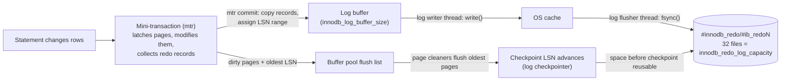
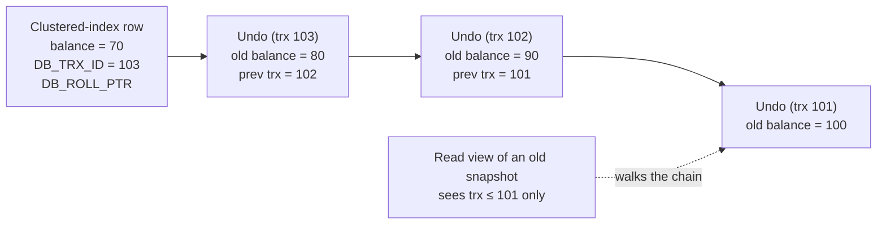

## Introduction

[Transaction Logs](/lessons/m08-transaction-logs) introduced the three logs involved in every commit and the order in which they are written. This lesson opens the two that belong to InnoDB and asks how they are *built*:

- **Redo log** — how does InnoDB describe a change to a page so that it can be replayed after a crash? What is a **mini-transaction**, a **log block**, an **LSN**? Where are the redo files in 8.0.30+, how big should `innodb_redo_log_capacity` be, and what happens when it is too small?
- **Undo log** — where do old row versions live? What are **undo tablespaces**, **rollback segments** and **undo slots**? Why can *insert* undo be thrown away at commit while *update* undo must be kept? What does **purge** do, and why can one idle transaction make a server's undo grow by gigabytes?

You will measure the redo generated by real statements through the LSN counters, compare the cost of `COMMIT` and `ROLLBACK` for a large transaction, and watch a long-running snapshot read old versions reconstructed from undo.

:::note[Lab limits]
The `Innodb_redo_log_*` status variables (8.0.30+) and the undo-tablespace counters are readable from the lab; they are **global** — every change on the build server advances the LSN, so deltas include other activity at capture time. `SHOW ENGINE INNODB STATUS`, `information_schema.INNODB_METRICS` (history list length) and resizing the redo log need administrative privileges and appear as display-only blocks.
:::

## DBMS Theory

:::theory[Write-ahead logging, redo and undo]
A storage manager that is **steal / no-force** (see [The Buffer Pool](/lessons/m10-buffer-pool)) needs two kinds of log information:

- **Redo** ("after" information) — because committed changes may not have reached the data pages (*no-force*), recovery must be able to **re-apply** them.
- **Undo** ("before" information) — because uncommitted changes may already be on disk (*steal*), recovery and rollback must be able to **reverse** them.

The **write-ahead logging (WAL)** protocol makes this safe with two rules:

1. Before a modified page is written to disk, all log records describing its changes must be on stable storage (*undo rule*, and the redo needed to rebuild it).
2. Before a transaction is reported committed, all its log records must be on stable storage (*redo rule*).

Log records are identified by a monotonically increasing **log sequence number (LSN)**. Every page stores the LSN of the last change applied to it (*pageLSN*), so recovery can decide, record by record, whether a change is already reflected in the page — making replay **idempotent**. ARIES (Mohan et al., 1992) combines this with *physiological* logging (physical to a page, logical within it), repeating history during redo, and compensation log records during undo.
:::

InnoDB follows the same principles with its own concrete design:

| Theory | InnoDB |
|---|---|
| Redo records | Physiological redo records of **mini-transactions** (mtr), e.g. "insert record into page (space, no) at offset X", "write N bytes at offset Y" |
| Undo records | **Logical** per-row records ("row with PK k had these old column values") stored in **undo log pages** — which are themselves ordinary pages, protected by redo |
| LSN | A byte offset into the logical redo stream; pages carry `FIL_PAGE_LSN` |
| Log buffer | `innodb_log_buffer_size` in memory; written and fsynced by dedicated threads |
| Log files | Since 8.0.30: 32 files in `#innodb_redo/`, total `innodb_redo_log_capacity` |
| Checkpoint | Fuzzy checkpoint: the LSN up to which all changes are known to be in data pages |
| Old versions for MVCC | The same update undo records, linked from each row's `DB_ROLL_PTR` |

The last row is InnoDB's distinctive choice: **one undo mechanism serves both rollback and MVCC**. PostgreSQL, by contrast, keeps old versions in the table heap itself (no undo log; `VACUUM` removes them) and has only redo-style WAL.

## Why It Exists

Without redo, InnoDB would have to **force** every modified page to disk at commit: a transaction touching 50 pages would wait for 50 random writes instead of one sequential append to the log. Redo turns many random page writes into one sequential log write, and lets dirty pages be written later, in bulk, by the page cleaners. Without redo, a crash would leave data pages in whatever state the OS had written.

Without undo, InnoDB could not let uncommitted changes reach disk (no *steal*), could not roll back a failing statement or transaction, and could not give readers a consistent snapshot while writers change rows — every reader would block on every writer, as in MyISAM.

What goes wrong when these logs are mis-sized or mis-used is also characteristic:

- **Redo too small** for the write rate: the checkpoint cannot keep up, InnoDB forces synchronous flushing, and write throughput collapses in periodic stalls.
- **Undo held too long**: a transaction or an open snapshot that lasts hours forces InnoDB to keep every old version created since it began; undo tablespaces grow, reads get slower walking long version chains, and purge falls behind.
- **Huge transactions**: one `UPDATE` of 50 million rows generates gigabytes of redo and undo; if it fails or is killed, the rollback can take as long as the forward work, or longer.

## Internal Working

### Redo: from mini-transaction to disk



:::internals[Mini-transactions, log blocks and LSNs]
**Mini-transactions.** Every physical change to pages happens inside a *mini-transaction* (mtr): an atomic unit at the page level, much smaller than a user transaction. Inserting one row may need one mtr that modifies a leaf page and an undo page; a page split is one mtr that changes several pages. The mtr latches the pages, modifies them in the buffer pool and accumulates **redo records** in a private buffer. At **mtr commit** it reserves an LSN range, copies its records into the shared **log buffer**, marks the pages dirty with that LSN, and releases the latches. Recovery replays whole mtrs only — so the B+ tree structure is never left half-split.

**LSN.** The log sequence number is a 64-bit **byte position** in the logical redo stream since the instance was created. Because it counts bytes, the difference between two LSNs is the amount of redo generated in between (including small block headers).

**Log blocks and files.** On disk, redo is written in **512-byte log blocks** (a header with the block number and data length, the records, a checksum trailer) — aligned with disk sectors so that a block write is atomic. Since 8.0.30 the redo log is **32 files** in the `#innodb_redo` directory, named `#ib_redoN` (in use) and `#ib_redoN_tmp` (spare), each 1/32 of `innodb_redo_log_capacity`. The log is used circularly: files that contain only redo older than the checkpoint are recycled.

**Threads (8.0 redesign).** User threads no longer write the log themselves. A **log writer** thread writes the log buffer to the files, a **log flusher** fsyncs them, **notifier** threads wake the user threads waiting for their commit LSN to be written/flushed, and a **log checkpointer** writes checkpoints. This design removed the old global log mutex bottleneck. (`innodb_log_writer_threads` can disable the dedicated threads on servers with very low concurrency.)

**Commit.** With `innodb_flush_log_at_trx_commit = 1`, a committing transaction waits until the flushed-to-disk LSN is at least its commit LSN. Group commit means one fsync serves many transactions. With `= 2`, it waits only for the write to the OS (fsync once per `innodb_flush_log_at_timeout` second); with `= 0`, it does not wait at all.

**Checkpoints.** InnoDB uses **fuzzy checkpoints**: it never stops the world to flush everything. The checkpoint LSN is (roughly) the oldest modification LSN of any dirty page in the flush lists; everything before it is in the data files. **Checkpoint age** = current LSN − checkpoint LSN = how much redo crash recovery would have to scan. It must stay below the redo capacity; as it approaches capacity, InnoDB flushes more aggressively (adaptive flushing), and very close to the limit it stalls new writes until flushing catches up.
:::

### Undo: where old versions live

:::internals[Undo tablespaces, rollback segments, undo logs]
- **Undo tablespaces.** Since 8.0.14 an instance has **two** default undo tablespaces (`undo_001`, `undo_002`, files in `innodb_undo_directory`); more can be added with `CREATE UNDO TABLESPACE` (up to 127). Undo for temporary tables lives in the global temporary tablespace and is **not** redo-logged (temporary tables need no crash recovery).
- **Rollback segments.** Each undo tablespace contains `innodb_rollback_segments` rollback segments (default and maximum 128). A rollback segment's header page holds **undo slots** — one per active undo log — `page size / 16` of them (1,024 for 16 KB pages).
- **Undo logs per transaction.** A read-write transaction gets up to two undo logs per kind of table: an **insert undo log** (for `INSERT`s) and an **update undo log** (for `UPDATE`s and `DELETE`s). The number of slots bounds the number of concurrent read-write transactions — roughly (slots × rollback segments × undo tablespaces) ÷ undo logs per transaction.
- **Undo records.** An insert undo record holds the new row's primary key (enough to delete it on rollback). An update undo record holds the primary key and the **old values of the changed columns**, plus the old `DB_TRX_ID` and `DB_ROLL_PTR`, so records form a **version chain**: row → newest undo → older undo → … The 7-byte `DB_ROLL_PTR` encodes an insert flag, the rollback segment id, and the undo page number and offset.
- **Redo protects undo.** Undo records are written into undo pages in the buffer pool inside mini-transactions, so they generate redo like any other page change. After a crash, redo replay restores the undo pages, and the undo then rolls back incomplete transactions.

**Insert vs update undo at commit.** Nothing older than a freshly inserted row exists, so no snapshot can need its insert undo once the transaction commits: insert undo is **freed at commit**. Update undo describes old versions that other transactions' **read views** may still need: at commit it is moved to the rollback segment's **history list**.

**Purge.** The purge coordinator thread and its workers (`innodb_purge_threads`) process the history list in commit order. Once no open read view can see a version older than a given transaction, purge (1) physically removes rows that were **delete-marked** by `DELETE` (InnoDB's `DELETE` only sets a flag; the space is reclaimed by purge), (2) removes delete-marked entries from secondary indexes, and (3) frees the undo log pages. The **history list length** — the number of committed update undo logs not yet purged — is the key health metric. Undo tablespaces that exceed `innodb_max_undo_log_size` (1 GB) are **truncated** automatically when `innodb_undo_log_truncate` is ON (default since 8.0.2).
:::



:::version[8.0 / 8.4 changes]
- **8.0.30:** `innodb_redo_log_capacity` (default 100 MB, dynamic — resizable with `SET GLOBAL`) replaces `innodb_log_file_size` × `innodb_log_files_in_group`, which are **deprecated** (if only they are set, capacity is derived from them). Redo files moved from `ib_logfile0/1` to `#innodb_redo/#ib_redoN`. New status variables `Innodb_redo_log_*`.
- **8.0.21:** `ALTER INSTANCE DISABLE INNODB REDO_LOG` for bulk loading into a new instance (not crash-safe!).
- **8.0.11–8.0.22:** the redo log was redesigned with dedicated writer/flusher/notifier/checkpointer threads (`innodb_log_writer_threads` since 8.0.22).
- **8.0.14:** two default undo tablespaces; `CREATE/ALTER/DROP UNDO TABLESPACE`; the old `innodb_undo_tablespaces` setting is deprecated.
- **8.4:** `innodb_log_buffer_size` default raised from 16 MB to **64 MB**; `innodb_purge_threads` default is 1 when the host has ≤ 16 logical processors (4 otherwise); `innodb_dedicated_server` also sizes `innodb_redo_log_capacity`.
:::

## MySQL Implementation

Redo configuration of the build server:

```sql run
SELECT @@innodb_redo_log_capacity                   AS redo_capacity_bytes,
       @@innodb_redo_log_capacity / 1024 / 1024     AS redo_capacity_mb,
       @@innodb_log_buffer_size / 1024 / 1024       AS log_buffer_mb,
       @@innodb_flush_log_at_trx_commit             AS flush_log_at_trx_commit,
       @@innodb_flush_log_at_timeout                AS flush_timeout_s,
       @@innodb_log_writer_threads                  AS dedicated_log_threads;
```

A 100 MB redo log, a 16 MB log buffer (the 8.0 default), fsync at every commit (`1`), and the dedicated log threads enabled. The live state of the redo log, from the 8.0.30+ status variables:

```sql run
SHOW GLOBAL STATUS WHERE Variable_name IN
  ('Innodb_redo_log_current_lsn', 'Innodb_redo_log_flushed_to_disk_lsn', 'Innodb_redo_log_checkpoint_lsn',
   'Innodb_redo_log_logical_size', 'Innodb_redo_log_physical_size', 'Innodb_redo_log_capacity_resized',
   'Innodb_redo_log_resize_status', 'Innodb_redo_log_enabled');
```

How to read it:

| Variable | Meaning |
|---|---|
| `current_lsn` | Redo generated up to now (bytes since the instance was created) |
| `flushed_to_disk_lsn` | How far the redo is durable; equal to (or just below) current LSN on a quiet server |
| `checkpoint_lsn` | Recovery would start here; changes before it are in the data files |
| `logical_size` | Redo in use between checkpoint and current LSN — the **checkpoint age** |
| `physical_size` | Bytes of redo files currently on disk |
| `capacity_resized` | The effective capacity (after any online resize) |

Undo configuration and state:

```sql run
SELECT @@innodb_rollback_segments    AS rollback_segments_per_undo_ts,
       @@innodb_max_undo_log_size / 1024 / 1024 AS undo_truncate_threshold_mb,
       @@innodb_undo_log_truncate    AS undo_truncate,
       @@innodb_purge_threads        AS purge_threads,
       @@innodb_purge_batch_size     AS purge_batch_size,
       @@innodb_max_purge_lag        AS max_purge_lag;
SHOW GLOBAL STATUS LIKE 'Innodb_undo_tablespaces%';
```

Two implicit undo tablespaces (created at initialisation), no explicit ones, both active; 128 rollback segments each; automatic truncation above 1 GB; four purge threads (the 8.0 default) and no purge-lag throttling (`0`).

## Syntax Breakdown

### Settings

| Variable | Default (8.0 → 8.4) | Effect |
|---|---|---|
| `innodb_redo_log_capacity` | 100 MB | Total redo space; dynamic since 8.0.30 |
| `innodb_log_buffer_size` | 16 MB → 64 MB | In-memory redo buffer; too small → `Innodb_log_waits` |
| `innodb_flush_log_at_trx_commit` | 1 | 1 = fsync per commit; 2 = write per commit, fsync per second; 0 = write+fsync per second |
| `innodb_flush_log_at_timeout` | 1 s | Interval for modes 0 and 2 |
| `innodb_log_writer_threads` | ON | Dedicated log writer/flusher threads |
| `innodb_rollback_segments` | 128 | Rollback segments per undo tablespace |
| `innodb_undo_directory` | datadir | Location of undo tablespaces |
| `innodb_undo_log_truncate` / `innodb_max_undo_log_size` | ON / 1 GB | Automatic truncation of large undo tablespaces |
| `innodb_purge_threads` | 4 → 1 or 4 | Purge worker threads |
| `innodb_purge_batch_size` | 300 | Undo log pages purged per batch |
| `innodb_max_purge_lag` / `_delay` | 0 (off) | Delay DML when the history list exceeds this length |

### Administrative statements (not available in the sandbox)

```sql
-- Resize the redo log online (8.0.30+)
SET GLOBAL innodb_redo_log_capacity = 8 * 1024 * 1024 * 1024;

-- Undo tablespaces (8.0.14+)
CREATE UNDO TABLESPACE undo_003 ADD DATAFILE 'undo_003.ibu';
ALTER UNDO TABLESPACE undo_003 SET INACTIVE;   -- marks it for truncation/removal
DROP UNDO TABLESPACE undo_003;

-- Bulk-load a brand-new instance without redo (NOT crash-safe; re-enable afterwards)
ALTER INSTANCE DISABLE INNODB REDO_LOG;
ALTER INSTANCE ENABLE INNODB REDO_LOG;

-- History list length (purge backlog)
SELECT NAME, COUNT FROM information_schema.INNODB_METRICS WHERE NAME = 'trx_rseg_history_len';
```

The `TRANSACTIONS` and `LOG` sections of `SHOW ENGINE INNODB STATUS` report the same state. **Illustrative example** of their format (not captured from the build server; numbers chosen for layout only):

```text
------------
TRANSACTIONS
------------
Trx id counter 412381
Purge done for trx's n:o < 412377 undo n:o < 0 state: running but idle
History list length 23
---
LOG
---
Log sequence number          4952076543
Log buffer assigned up to    4952076543
Log buffer completed up to   4952076543
Log written up to            4952076543
Log flushed up to            4952076543
Added dirty pages up to      4952076543
Pages flushed up to          4930112207
Last checkpoint at           4930112207
```

## Practical Examples

### 1. Redo volume and commit cost: small transactions vs a bulk change

The LSN counts bytes of redo, so the difference between two readings is the redo a workload generated:

```sql run
SET SESSION cte_max_recursion_depth = 300000;
CREATE TABLE ledger (id INT PRIMARY KEY, account INT NOT NULL, amount DECIMAL(12,2) NOT NULL, memo CHAR(100) NOT NULL);
INSERT INTO ledger
  WITH RECURSIVE s(n) AS (SELECT 1 UNION ALL SELECT n + 1 FROM s WHERE n < 200000)
  SELECT n, n % 1000, 10.00, 'opening balance' FROM s;
```

A single tiny statement is too small to measure reliably — InnoDB's status values are snapshots that can lag a change by a moment — so measure a thousand of them. The procedure below performs 1,000 single-row updates; called with autocommit on, each `UPDATE` is its own transaction:

```sql run
CREATE PROCEDURE small_updates(IN n INT)
BEGIN
  DECLARE i INT DEFAULT 0;
  WHILE i < n DO
    UPDATE ledger SET amount = amount + 1 WHERE id = 1 + (i * 37) % 200000;
    SET i = i + 1;
  END WHILE;
END;
```

```sql run measured
SHOW GLOBAL STATUS WHERE Variable_name IN ('Innodb_redo_log_current_lsn', 'Innodb_os_log_fsyncs');
CALL small_updates(1000);
SHOW GLOBAL STATUS WHERE Variable_name IN ('Innodb_redo_log_current_lsn', 'Innodb_os_log_fsyncs');
START TRANSACTION;
CALL small_updates(1000);
COMMIT;
SHOW GLOBAL STATUS WHERE Variable_name IN ('Innodb_redo_log_current_lsn', 'Innodb_os_log_fsyncs');
```

Compare the three snapshots (global counters; timings measured on the build machine):

- **1,000 autocommit transactions**: the LSN advanced by a few hundred kilobytes — several hundred bytes of redo per one-row transaction (the changed `DECIMAL` field in the clustered-index page, the undo record written to an undo page, and the commit records). `Innodb_os_log_fsyncs` rose by roughly one **per transaction**: with `innodb_flush_log_at_trx_commit = 1`, every commit waits for its own redo fsync, so the `CALL` took on the order of a millisecond per transaction — the loop is fsync-bound, not CPU-bound.
- **The same 1,000 updates in one transaction**: several times *less* redo — the per-transaction records (transaction start, undo log header, commit) are written once instead of a thousand times — only a handful of fsyncs (some of them from background activity), and the `CALL` finished in a small fraction of the time. Redo *volume* depends on what changes and how many transactions there are; commit *cost* depends on how many commits wait for the disk. This is why bulk loaders commit every few thousand rows, and why group commit matters under concurrency.

```sql run
SHOW GLOBAL STATUS WHERE Variable_name IN ('Innodb_redo_log_current_lsn', 'Innodb_os_log_written');
UPDATE ledger SET memo = 'restated balance';
SHOW GLOBAL STATUS WHERE Variable_name IN ('Innodb_redo_log_current_lsn', 'Innodb_os_log_written');
```

Rewriting a 100-byte `CHAR` column in 200,000 rows advances the LSN by tens of megabytes — a sizeable fraction of the 100 MB redo capacity from one statement. Each changed row costs redo for the page modification **and** for its update undo record (which holds the old 100-byte value), plus per-record overhead. `Innodb_os_log_written` (bytes written to the redo files) grows by a similar amount. Compute the deltas from the captured values: dividing the LSN delta by 200,000 gives the redo bytes per updated row.

### 2. Checkpoint age right after a burst

```sql run
SHOW GLOBAL STATUS WHERE Variable_name IN
  ('Innodb_redo_log_current_lsn', 'Innodb_redo_log_checkpoint_lsn', 'Innodb_redo_log_logical_size');
```

Immediately after the bulk update, the checkpoint LSN lags far behind the current LSN: the dirty pages created by the update have not all been flushed, so their redo must be kept. `Innodb_redo_log_logical_size` reports this checkpoint age directly — in captures on the build server, roughly three-quarters or more of the 100 MB capacity, the zone in which InnoDB's adaptive flushing works hardest. Within seconds the page cleaners flush those pages and the checkpoint advances again. If a workload kept the checkpoint age near capacity, InnoDB would have to throttle writers — the reason to size the redo log for peak write bursts.

### 3. Undo at work: rollback cost of a big transaction

Undo makes rollback possible, but rollback is not free: InnoDB has to read every undo record of the transaction, in reverse order, and apply it. Commit, by contrast, only writes a few redo records and waits for one fsync:

```sql run measured
START TRANSACTION;
UPDATE ledger SET amount = amount + 5;
ROLLBACK;
START TRANSACTION;
UPDATE ledger SET amount = amount + 5;
COMMIT;
```

Compare the timings of the statements (measured on the build machine; yours will differ): each `UPDATE` of 200,000 rows takes hundreds of milliseconds; the `ROLLBACK` also takes hundreds of milliseconds — the same order of magnitude as the work it undoes — while the `COMMIT` returns in a few tens of milliseconds at most, most of it the fsync. Rolling back is doing the work again in reverse, row by row from the undo log, and it generates its own redo, since restoring each row is again a page modification. A killed 3-hour batch job can therefore keep the server busy for hours of rollback.

### 4. Statement-level rollback and savepoints use undo too

```sql run
START TRANSACTION;
UPDATE ledger SET amount = 0 WHERE id = 1;
SAVEPOINT after_first;
UPDATE ledger SET amount = 0 WHERE id = 2;
ROLLBACK TO SAVEPOINT after_first;
COMMIT;
SELECT id, amount FROM ledger WHERE id IN (1, 2) ORDER BY id;
```

Row 1 was set to 0; the change to row 2 was undone by applying the undo records written after the savepoint. A failed statement inside a transaction is rolled back the same way, to an implicit savepoint at its start ([Savepoints](/lessons/m08-savepoints)).

## Execution Walkthrough

### An old snapshot reads through the version chain

Session A opens a consistent snapshot and reads a balance. Session B then updates the same row three times, committing each time. A's reads keep returning the original value — InnoDB reconstructs it by walking the row's `DB_ROLL_PTR` chain back through three update undo records. While A's snapshot is open, purge cannot discard those undo records.

```concurrency
title: A long-running snapshot keeps undo alive
description: Session A holds a REPEATABLE READ snapshot while session B commits three updates to the same row.
setup: |
  CREATE TABLE wallet (id INT PRIMARY KEY, balance INT NOT NULL);
  INSERT INTO wallet VALUES (1, 100), (2, 500);
steps:
  - session: A
    sql: START TRANSACTION WITH CONSISTENT SNAPSHOT; SELECT balance FROM wallet WHERE id = 1;
    note: A's read view is created now; it sees balance 100.
  - session: B
    sql: UPDATE wallet SET balance = 90 WHERE id = 1;
    note: Autocommit. The row now holds 90; the old value 100 is in an update undo record linked from DB_ROLL_PTR.
  - session: B
    sql: UPDATE wallet SET balance = 80 WHERE id = 1;
  - session: B
    sql: UPDATE wallet SET balance = 70 WHERE id = 1;
    note: Three committed versions are newer than A's snapshot. Their update undo logs sit on the history list; purge must keep them because A's read view may need them.
  - session: A
    sql: SELECT balance FROM wallet WHERE id = 1;
    note: Still 100. InnoDB sees DB_TRX_ID of the newest version is not visible to A's read view and follows the roll pointer through 80 and 90 to 100.
  - session: B
    sql: SELECT balance FROM wallet WHERE id = 1;
    note: B, with a fresh read, sees the current version 70.
  - session: A
    sql: COMMIT;
    note: A's read view closes. Purge may now discard the three undo records.
  - session: A
    sql: SELECT balance FROM wallet WHERE id = 1;
    note: A new statement (autocommit) gets a new read view and sees 70.
```

Scale the scenario up and you have one of the most common InnoDB incidents: a reporting session or an application connection that opened a transaction hours ago and never finished. Every row changed since then accumulates versions, the history list grows into millions, undo tablespaces grow by gigabytes, and every read of a hot row walks a long chain. Killing the forgotten session lets purge catch up.

## Output

The captured results show, in order:

- The build server's redo log: 100 MB capacity, 16 MB log buffer, flush at every commit; LSNs in the billions — billions of bytes of redo generated since the instance was created, recycled through a 100 MB circular log.
- 1,000 one-row autocommit transactions: several hundred bytes of redo and about one redo fsync each; the same updates in one transaction: much less redo, a few fsyncs, a fraction of the time. A 200,000-row update of a `CHAR(100)` column: tens of megabytes of redo — redo volume scales with rows **and** with bytes changed, including undo.
- The checkpoint age (`Innodb_redo_log_logical_size`) is non-zero right after a burst and shrinks as pages are flushed.
- A 200,000-row `ROLLBACK` took hundreds of milliseconds, the same order as the update itself; the `COMMIT` of the same work took a few tens of milliseconds at most.
- A snapshot opened before three committed updates still read the original value, reconstructed from undo.

## Alternative Approaches

**How other systems keep old versions and recover:**

| System | Redo | Old versions / rollback | Consequence |
|---|---|---|---|
| **InnoDB** | Physiological redo (mtr records) | Undo logs in undo tablespaces; rows updated in place | Tables stay compact; long snapshots grow undo; rollback cost ∝ work done |
| **PostgreSQL** | WAL with full-page images after each checkpoint | New row versions written into the heap; no undo log; `VACUUM` reclaims dead tuples | Rollback is instant (just mark the transaction aborted); tables bloat; `VACUUM` tuning matters |
| **Oracle** | Redo log | Undo segments (very similar to InnoDB) | "Snapshot too old" (ORA-01555) when undo was overwritten — InnoDB never discards undo a read view needs, it grows instead |
| **SQL Server** | Transaction log | In-place updates with log-based rollback; optional row versions in `tempdb` for snapshot isolation | Log growth under long transactions |

**Alternatives within MySQL for large changes:**

| Approach | Redo/undo effect |
|---|---|
| One huge `UPDATE`/`DELETE` | Maximum undo held at once; long rollback if it fails; replica lag |
| **Batches** (e.g. 1,000–10,000 rows per transaction, in key order) | Bounded undo per transaction; purge keeps up; restartable |
| `CREATE TABLE … AS SELECT` new + `RENAME` | No update undo for the old rows; new table built with sorted inserts |
| `TRUNCATE TABLE` / `DROP PARTITION` | DDL: drops and recreates the tablespace — no per-row undo or redo |
| `ALTER INSTANCE DISABLE INNODB REDO_LOG` | Only for initial loads into a fresh instance; a crash loses the instance |

## Performance Analysis

**Redo sizing.** The redo capacity bounds the checkpoint age. A widely used community rule of thumb (not a formula from the manual) is to hold roughly an hour of peak redo. More precisely: measure the redo generation rate at peak (bytes per second from two `Innodb_redo_log_current_lsn` samples) and make the capacity several times larger than the redo generated during the time the page cleaners need to catch up after a burst. If `Innodb_redo_log_logical_size` regularly approaches capacity, writes will stall. Larger capacity costs only disk space and a longer worst-case recovery scan.

**Commit cost.** With durable settings, each commit waits for an fsync of the redo (and, with binary logging, the binlog) — on NVMe tens of microseconds, on cloud block storage often 0.5–2 ms. Group commit amortises it; single-threaded loaders amortise it by committing every few thousand rows.

**Undo cost.** Each changed row writes an undo record (old values of changed columns). Reading old versions costs one undo record per newer version; long chains make even primary-key lookups slow. Purge needs CPU and I/O proportional to the change rate.

**Rollback cost.** Proportional to the undo records to apply, executed mostly single-threaded per transaction, generating redo of its own. After a crash, InnoDB rolls back incomplete transactions in the background after startup ([Crash Recovery](/lessons/m10-crash-recovery)).

:::performance[Theory vs measurement]
The LSN deltas and the rollback timing above were measured on the build machine against a 200,000-row lab table that fits in memory; they demonstrate proportionality (redo grows with rows and bytes changed; rollback ≈ forward work), not absolute speeds. LSN counters are global, so on a busy server take many samples. On your own system, chart the redo generation rate, `Innodb_redo_log_logical_size` against capacity, `Innodb_log_waits` (log buffer too small) and the history list length (`trx_rseg_history_len` in `INNODB_METRICS`).
:::

## Best Practices

:::best-practice[Redo and undo in production]
1. **Size `innodb_redo_log_capacity` for peak write bursts** (often several GB on busy servers; the 100 MB default suits only small instances) and resize online on 8.0.30+.
2. **Keep `innodb_flush_log_at_trx_commit = 1`** for data you cannot lose; use 2 only where losing about a second of commits on an OS crash is acceptable — and document it.
3. **Keep transactions short.** Batch large `UPDATE`/`DELETE` jobs into transactions of thousands of rows, in primary-key order, with pauses if replicas lag.
4. **Hunt long-running transactions and snapshots.** Alert when the oldest active transaction exceeds a threshold or the history list length grows steadily; find the owner in `INNODB_TRX` and fix or kill it.
5. **Never kill a huge transaction casually** — the rollback may take longer than letting it finish. Estimate from `trx_rows_modified` first.
6. **Leave undo truncation on** and consider a third undo tablespace if one is often being truncated, so there is always an active one.
7. **Never disable redo logging on a production instance** — `ALTER INSTANCE DISABLE INNODB REDO_LOG` is for initial loads of a disposable instance only.
:::

## Common Mistakes

**Mistake 1 — "the data files are up to date after COMMIT".** They are not; only the redo is. The data pages are written later. Backups that copy data files without the redo (or without a proper backup tool) are inconsistent.

**Mistake 2 — tuning the deprecated redo variables on 8.4.** Setting `innodb_log_file_size` and `innodb_log_files_in_group` in a modern configuration file is ignored when `innodb_redo_log_capacity` is set, and generates deprecation warnings. Set `innodb_redo_log_capacity`.

**Mistake 3 — killing a long `UPDATE` to "make it stop faster".** Rollback costs the same order of magnitude as the work already done (Example 3), and can take longer when the undo pages must be read back from disk. If it has been running for 2 hours, expect hours of rollback.

**Mistake 4 — leaving a transaction open in an interactive client.** A `START TRANSACTION` in a SQL editor left open over lunch holds a read view; every change on the server since then is retained in undo. Many GUI clients enable autocommit=0 by default — check.

**Mistake 5 — expecting `DELETE` to shrink a table.** It delete-marks rows; purge removes them later and the space becomes reusable *inside* the pages, not returned to the file system.

```sql run
SET SESSION information_schema_stats_expiry = 0;
ANALYZE TABLE ledger;
SELECT 'before' AS moment, TABLE_ROWS, DATA_LENGTH DIV 16384 AS pages
FROM information_schema.TABLES WHERE TABLE_SCHEMA = DATABASE() AND TABLE_NAME = 'ledger';
DELETE FROM ledger WHERE id > 100000;
ANALYZE TABLE ledger;
SELECT 'after' AS moment, TABLE_ROWS, DATA_LENGTH DIV 16384 AS pages
FROM information_schema.TABLES WHERE TABLE_SCHEMA = DATABASE() AND TABLE_NAME = 'ledger';
```

Half the rows are gone and the row estimate halves, but the allocated page count does not shrink: the pages stay allocated to the table, emptied (once purge has run) but reusable only by future inserts into this table. Space is returned to the operating system only by rebuilding the table (`OPTIMIZE TABLE`) or dropping partitions.

## Industry Application

- **Write-heavy services** (payments, telemetry, gaming) size the redo log to several gigabytes so that bursts do not trigger flush storms; it is one of the first settings changed from defaults in production `my.cnf` templates.
- **Online schema changes and backfills** (gh-ost, pt-online-schema-change, custom backfill jobs) are designed around undo: they copy or modify rows in small chunks, committing each, precisely to keep undo, purge lag and replica lag bounded.
- **Analytics on OLTP primaries** is a classic cause of history-list growth: a BI tool opens a REPEATABLE READ transaction and streams a large result for an hour. Teams move such reads to replicas or use READ COMMITTED for them.
- **Monitoring.** SRE dashboards include "history list length", "oldest transaction age", "checkpoint age / redo capacity" and "redo bytes per second"; runbooks connect a rising history list to `INNODB_TRX` queries that find the culprit.
- **Backups.** Hot backup tools (MySQL Enterprise Backup, Percona XtraBackup) copy data files while the server runs and copy the redo generated meanwhile; at restore they apply the redo — the same mechanism as crash recovery. MySQL's redo log archiving (`innodb_redo_log_archive_dirs`) exists to support them.

## Practice Exercises

```exercise
id: ex1
title: Redo log geometry
difficulty: easy
kind: query
dataset: empty
concepts: [redo-log, redo-log-capacity]
prompt: |
  Since 8.0.30 the redo log consists of 32 files that share `innodb_redo_log_capacity`. Return one row with:

  1. `capacity_mb` — `innodb_redo_log_capacity` in MB
  2. `file_mb` — the size of each of the 32 files in MB, rounded to 3 decimals
  3. `log_buffer_mb` — `innodb_log_buffer_size` in MB
hints:
  - "Divide the byte values by 1024 * 1024."
  - "file_mb = capacity / 32."
solution: |
  SELECT @@innodb_redo_log_capacity / 1024 / 1024 AS capacity_mb,
         ROUND(@@innodb_redo_log_capacity / 32 / 1024 / 1024, 3) AS file_mb,
         @@innodb_log_buffer_size / 1024 / 1024 AS log_buffer_mb;
explanation: |
  With the defaults the 100 MB capacity is split into 32 files of 3.125 MB each. InnoDB recycles whole files once
  the checkpoint has passed them, which is why capacity can be resized online by adding or removing files. The log
  buffer (16 MB in 8.0, 64 MB in 8.4) only needs to hold the redo generated between writes by the log writer thread.
```

```exercise
id: ex2
title: Checkpoint age from LSN samples
difficulty: medium
kind: query
dataset: empty
setup: |
  CREATE TABLE redo_samples (
    sampled_at      DATETIME PRIMARY KEY,
    current_lsn     BIGINT NOT NULL,
    checkpoint_lsn  BIGINT NOT NULL,
    capacity_bytes  BIGINT NOT NULL
  );
  INSERT INTO redo_samples VALUES
    ('2026-05-04 10:00:00', 91000000000, 90950000000, 2147483648),
    ('2026-05-04 10:00:10', 91600000000, 90980000000, 2147483648),
    ('2026-05-04 10:00:20', 92300000000, 90650000000, 2147483648),
    ('2026-05-04 10:00:30', 93100000000, 91050000000, 2147483648),
    ('2026-05-04 10:00:40', 93500000000, 92900000000, 2147483648);
concepts: [lsn, checkpoint-age, redo-log-capacity]
prompt: |
  Each sample records the current LSN, the checkpoint LSN and the redo capacity (2 GB). Return for each sample:

  - `sampled_at`
  - `checkpoint_age_mb` — (current_lsn − checkpoint_lsn) in MB, rounded to 1 decimal
  - `pct_of_capacity` — checkpoint age as a percentage of capacity, rounded to 1 decimal
  - `status` — `'CRITICAL'` if pct_of_capacity ≥ 90, `'WARN'` if ≥ 75, otherwise `'OK'`

  Order by `sampled_at`.
hints:
  - "Checkpoint age is a simple difference of two LSNs — LSNs are byte positions."
  - "Compute the percentage once in a derived table or CTE, then apply a CASE expression."
solution: |
  WITH a AS (
    SELECT sampled_at,
           (current_lsn - checkpoint_lsn) AS age_bytes,
           100 * (current_lsn - checkpoint_lsn) / capacity_bytes AS pct
    FROM redo_samples
  )
  SELECT sampled_at,
         ROUND(age_bytes / 1024 / 1024, 1) AS checkpoint_age_mb,
         ROUND(pct, 1) AS pct_of_capacity,
         CASE WHEN pct >= 90 THEN 'CRITICAL' WHEN pct >= 75 THEN 'WARN' ELSE 'OK' END AS status
  FROM a
  ORDER BY sampled_at;
orderMatters: true
explanation: |
  The checkpoint age climbs from under 50 MB to a WARN level (≈ 77 %) at 10:00:20 and to about 1.9 GB (≈ 95 % of
  capacity, CRITICAL) at 10:00:30 — InnoDB would be flushing synchronously and stalling writers at that point — and
  the age drops sharply at 10:00:40 when the page cleaners
  catch up. The redo generation rate during the burst (≈ 60–80 MB/s from consecutive current LSNs) is the input for
  sizing: a larger capacity would have absorbed the burst. Classify on the unrounded percentage, as here, so the
  thresholds are applied exactly.
```

```exercise
id: ex3
title: Redo bytes per changed row
difficulty: hard
kind: query
dataset: empty
setup: |
  CREATE TABLE batch_runs (
    run_id        INT PRIMARY KEY,
    description   VARCHAR(60) NOT NULL,
    lsn_before    BIGINT NOT NULL,
    lsn_after     BIGINT NOT NULL,
    rows_changed  INT NOT NULL
  );
  INSERT INTO batch_runs VALUES
    (1, 'UPDATE amount (DECIMAL) on 200k rows', 5000000000, 5021400000, 200000),
    (2, 'UPDATE memo (CHAR(100)) on 200k rows', 5021400000, 5074600000, 200000),
    (3, 'DELETE 100k rows',                      5074600000, 5098300000, 100000),
    (4, 'INSERT 50k rows',                       5098300000, 5106800000,  50000);
concepts: [lsn, redo-log, undo-log]
prompt: |
  `batch_runs` records the LSN before and after four batch statements on an otherwise idle server. Return, for each
  run, `run_id`, `redo_mb` (LSN delta in MB, rounded to 1 decimal) and `bytes_per_row` (LSN delta ÷ rows_changed,
  rounded to an integer), ordered by `bytes_per_row` descending.
hints:
  - "The LSN delta is lsn_after − lsn_before, in bytes."
  - "ROUND((lsn_after - lsn_before) / rows_changed) gives bytes per row."
solution: |
  SELECT run_id,
         ROUND((lsn_after - lsn_before) / 1024 / 1024, 1) AS redo_mb,
         ROUND((lsn_after - lsn_before) / rows_changed) AS bytes_per_row
  FROM batch_runs
  ORDER BY bytes_per_row DESC;
orderMatters: true
explanation: |
  Rewriting a 100-byte CHAR costs the most per row (≈ 266 bytes): redo for the new value in the page plus redo for the
  undo record holding the old 100-byte value. A DELETE (≈ 237) delete-marks the clustered record and each secondary
  index entry and writes undo with the whole old row's key. Changing a small DECIMAL costs ≈ 107 bytes, and an insert
  ≈ 170 (the new row's bytes; insert undo is small). The numbers here are illustrative, but the method — LSN deltas per
  row on an idle server — is how you estimate redo volume, binlog volume and replica impact before running a
  backfill in production.
```

```exercise
id: ex4
title: Why can insert undo be discarded at commit?
difficulty: medium
kind: open
concepts: [undo-log, purge, rollback-segments]
prompt: |
  Explain why InnoDB frees a transaction's **insert** undo log immediately at commit, but moves its **update** undo
  log to the history list for purge. Then explain what purge does with (a) the update undo of an `UPDATE` and (b) the
  update undo of a `DELETE`.
solution: |
  Undo serves two consumers: **rollback** of the owning transaction and **MVCC reads** by other transactions.

  An insert undo record only says "row with key k did not exist before". After commit, rollback is no longer
  possible, and no read view can need an *older version* of a row that did not exist — a snapshot that predates the
  insert simply does not see the row (its DB_TRX_ID is not visible), without consulting undo. So insert undo has no
  consumer after commit and is freed.

  An update undo record holds the *previous version* of an existing row. After commit, other transactions whose read
  views predate the commit may still need that version, so the undo log goes to the history list, ordered by commit.

  **Purge**, once the oldest open read view is newer than the transaction: (a) for an `UPDATE`, it simply frees the
  undo records (and removes stale secondary-index entries left by updates of indexed columns); (b) for a `DELETE`,
  which only *delete-marked* the clustered record and secondary entries, it physically removes those records from the
  pages, then frees the undo. This is why deleted rows keep occupying space until purge has run, and why a long-open
  read view delays both undo cleanup and physical deletion.
```

```exercise
id: ex5
title: The 80 GB undo tablespace incident
difficulty: challenge
kind: open
concepts: [history-list, purge, undo-log, rollback-segments]
prompt: |
  On a MySQL 8.4 primary, `undo_002` has grown to 80 GB over three days, `History list length` is 45 million, and
  primary-key lookups on a hot `inventory` table have become ten times slower. Disk usage alerts are firing. Explain
  the most likely root cause, how you would identify the responsible session, what happens when you end it, why the
  lookups got slower, and which preventive measures you would put in place. Address whether the 80 GB will be
  returned to the file system.
solution: |
  **Root cause.** A transaction (or a REPEATABLE READ snapshot) has been open for about three days — for example an
  application connection that began a transaction and never committed, or a long-running report/ETL session. Its read
  view is the oldest on the server, so purge cannot discard any update undo committed after it started: every update
  and delete on the server for three days is retained. The history list (45 M committed undo logs) and undo_002 grow
  accordingly.

  **Identify.** `SELECT trx_id, trx_started, trx_mysql_thread_id, trx_state, trx_rows_modified, trx_query FROM
  information_schema.INNODB_TRX ORDER BY trx_started LIMIT 5;` — the oldest `trx_started` is the culprit; map
  `trx_mysql_thread_id` to `performance_schema.threads`/`processlist` for user, host and program. It is often in
  `Sleep` state with no current query.

  **End it.** `KILL <thread_id>` (after confirming with the owner). If it modified few rows (`trx_rows_modified`),
  rollback is quick; if it modified many, rollback takes time. Once it is gone, the oldest read view advances and purge
  works through the backlog; history list length declines over minutes to hours depending on purge throughput
  (`innodb_purge_threads`, I/O).

  **Why lookups slowed.** Hot rows have long version chains. Any transaction whose read view is older than recent
  versions (and the oldest view itself) must follow `DB_ROLL_PTR` through many undo records; even current reads may
  have to examine delete-marked secondary-index entries not yet purged. Undo pages also compete for buffer-pool space.

  **Space.** With `innodb_undo_log_truncate = ON`, an undo tablespace larger than `innodb_max_undo_log_size` is
  truncated once purge has freed its rollback segments: InnoDB marks it inactive, redirects new transactions to the
  other undo tablespace, truncates it to its initial size and reactivates it — so the 80 GB **is** returned
  automatically, after purge catches up (this is why at least two undo tablespaces are required).

  **Prevention.** Alert on the oldest transaction age and history list length; set pool reset/rollback on connection
  return; use READ COMMITTED for long reporting reads or move them to replicas; enforce statement/transaction timeouts
  in applications; consider `innodb_max_purge_lag` to throttle writers if purge cannot keep up.
```

## Knowledge Assessment

```quiz
- id: q1
  question: "What does the difference between two Innodb_redo_log_current_lsn readings measure?"
  options:
    - "The number of transactions committed in between"
    - "The number of bytes of redo generated in between (server-wide)"
    - "The number of pages flushed in between"
    - "Milliseconds elapsed"
  answer: 1
  explanation: "The LSN is a byte position in the redo stream, so its delta is redo volume — for the whole server, since the counter is global. Commits, flushed pages and time are tracked by other counters."
  concepts: [lsn]
- id: q2
  question: "What is a mini-transaction (mtr) in InnoDB?"
  options:
    - "A user transaction with fewer than 10 statements"
    - "An atomic group of page modifications (e.g. a page split) whose redo records are copied to the log buffer together, so recovery never applies half of it"
    - "A transaction that only reads"
    - "A replication event group"
  answer: 1
  explanation: "Mini-transactions are internal, page-level atomic units; a single user statement executes many of them. They keep B+ tree structures consistent under recovery. They are unrelated to statement counts, read-only transactions or replication."
  concepts: [mini-transaction, redo-log]
- id: q3
  question: "Checkpoint age keeps approaching innodb_redo_log_capacity during peak hours. What happens, and what is the usual fix?"
  options:
    - "InnoDB discards old redo; increase innodb_log_buffer_size"
    - "InnoDB must flush dirty pages aggressively and eventually stalls writes; increase innodb_redo_log_capacity (and ensure flushing capacity matches storage)"
    - "Transactions are rolled back; lower innodb_flush_log_at_trx_commit"
    - "The binary log is purged; increase sync_binlog"
  answer: 1
  explanation: "Redo before the checkpoint can only be reused once pages are flushed; when space runs out, writers wait for flushing. A larger capacity absorbs bursts. Redo is never discarded while needed, and the log buffer size or binlog settings do not address checkpoint age."
  concepts: [checkpoint-age, redo-log-capacity]
- id: q4
  type: multi
  question: "Which statements about InnoDB undo are correct? (Select all that apply.)"
  options:
    - "Undo records are stored in undo tablespaces and their pages are protected by redo"
    - "Insert undo is freed at commit; update undo goes to the history list"
    - "Purge physically removes delete-marked rows once no read view needs them"
    - "InnoDB overwrites undo still needed by an old snapshot and returns 'snapshot too old'"
  answer: [0, 1, 2]
  explanation: "Undo pages are ordinary pages whose changes are redo-logged; insert undo has no MVCC consumer after commit; purge removes delete-marked records and frees undo. InnoDB never discards undo a read view needs — undo grows instead (Oracle's ORA-01555 is the other design)."
  concepts: [undo-log, purge]
- id: q5
  question: "A 200,000-row UPDATE took 1 second. You then run ROLLBACK. Roughly how long will it take?"
  options:
    - "A few milliseconds, like COMMIT"
    - "The same order of magnitude as the UPDATE — every undo record must be applied in reverse"
    - "Zero; rollback only discards the redo"
    - "It depends only on innodb_flush_log_at_trx_commit"
  answer: 1
  explanation: "Rollback replays undo records to restore each row and generates redo for those page changes. COMMIT writes a few records and waits for one fsync, which is why it is fast."
  concepts: [undo-log]
- id: q6
  question: "Where are the redo log files located in MySQL 8.0.30 and later?"
  options:
    - "ib_logfile0 and ib_logfile1 in the data directory"
    - "In the #innodb_redo directory, as #ib_redoN files (32 in total, sharing innodb_redo_log_capacity)"
    - "Inside ibdata1"
    - "In the binary log files"
  answer: 1
  explanation: "8.0.30 replaced the fixed ib_logfile pair with 32 files in #innodb_redo so that capacity can be resized online. ibdata1 never held the redo log, and the binary log is a separate server log."
  concepts: [redo-log]
- id: q7
  question: "Session A has had a REPEATABLE READ transaction open for 6 hours (idle). Which consequence is most likely?"
  options:
    - "Nothing, idle transactions have no effect"
    - "The history list grows because purge cannot discard update undo newer than A's read view; undo tablespaces grow"
    - "The redo log cannot be checkpointed"
    - "All other transactions are blocked"
  answer: 1
  explanation: "A's read view pins every old version created since it began. Checkpointing depends on dirty pages, not read views, and A blocks others only if it holds locks on rows they need."
  concepts: [history-list, purge]
- id: q8
  question: "With innodb_flush_log_at_trx_commit = 2, what can be lost?"
  options:
    - "Nothing, ever"
    - "Up to about one second of committed transactions if the operating system crashes or power fails; nothing if only mysqld crashes"
    - "All uncommitted data on a mysqld crash"
    - "Only binary log events"
  answer: 1
  explanation: "Mode 2 writes the redo to the OS at each commit but fsyncs only once per second. A mysqld crash leaves the OS cache intact; an OS crash or power loss can lose the unsynced second. Uncommitted data is always rolled back regardless of the setting."
  concepts: [write-ahead-logging, redo-log]
```
