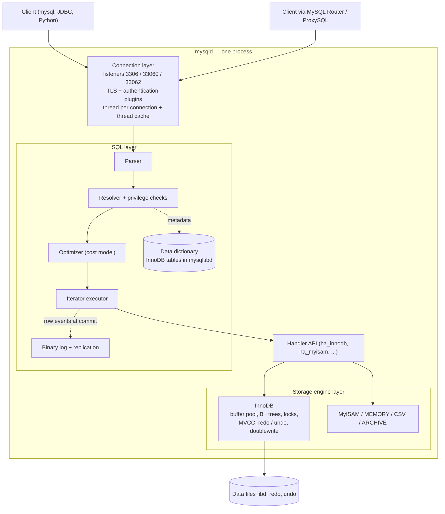

## Introduction

When an application sends `SELECT * FROM orders WHERE order_id = 42`, a surprising amount of machinery runs inside one operating-system process called `mysqld` before a row comes back. A network listener accepts the connection, a thread is assigned to it, the user is authenticated, the SQL text is parsed into a tree, names are resolved against the **data dictionary**, privileges are checked, the optimizer picks an access path, the executor drives a tree of iterators, and somewhere at the bottom a **storage engine** — almost always InnoDB — finds a 16 KB page in memory or on disk and hands a row back up the stack.

This module opens the box. This first lesson draws the map that every later lesson zooms into:

- **Which layers does the server have**, and what is each one responsible for?
- **Where does a given feature live?** Is the transaction log a server feature or an InnoDB feature? Who enforces foreign keys? Who caches pages? Who writes the binary log?
- **How are threads organised** — one per connection, plus a population of background threads inside InnoDB?
- **What changed in MySQL 8.0** when the file-based metadata (`.frm` files) was replaced by a **transactional data dictionary** stored in InnoDB — and why that made DDL *atomic*?
- **How is the server extended** — the older *plugin* API and the newer *component* infrastructure?

You have already met the pluggable-engine idea and the handler API in [What Is MySQL?](/lessons/m02-what-is-mysql) and [Storage Engines](/lessons/m02-storage-engines), and the iterator tree in [Reading EXPLAIN](/lessons/m07-explain). Here we connect them into one architecture and go one level deeper.

:::note[What can and cannot run here]
Your lab account has privileges only on its own schema. It can read system variables, its own session's status counters, `information_schema` (for its own objects) and execution plans — all of which reveal a lot about the architecture. It **cannot** read `performance_schema`, `sys` or the `mysql` system schema, install plugins or components, or run `SHOW ENGINE INNODB STATUS`. Those statements appear as display-only blocks. Every value shown under a runnable block was captured on the platform's build server (MySQL 8.0.x); the platform targets MySQL 8.4 LTS, and differences are flagged in `:::version` callouts.
:::

## DBMS Theory

:::theory[Layered DBMS architecture]
Textbook database systems (System R, and the classic architecture described by Hellerstein, Stonebraker and Hamilton in *Architecture of a Database System*) are organised in layers, each offering an abstraction to the one above:

1. **Process / client communications manager** — accepts connections, authenticates clients, and assigns each request to a *worker* (a process, a thread, or a lightweight task from a pool).
2. **Relational query processor** — parser, query rewriter, optimizer and executor. It thinks in relations, tuples and plans.
3. **Transactional storage manager** — access methods (B+ trees, heaps), buffer manager, lock manager and log manager. It thinks in pages, records, locks and log sequence numbers.
4. **Shared components and utilities** — the **catalog** (metadata about every schema object), memory management, administration, replication.

The key design property is **separation of concerns**: the query processor should not care how a record is laid out on a page, and the storage manager should not care whether a query used a hash join.
:::

MySQL implements this classic architecture with one unusual twist: the boundary between layer 2 and layer 3 is a **public, pluggable interface** — the *handler API* — so the storage manager is replaceable per table. That gives four practical layers:

| Classic layer | MySQL component | Examples of responsibilities |
|---|---|---|
| Client communications | **Connection layer** | TCP/Unix-socket listeners, protocol, TLS, authentication plugins, thread per connection, `max_connections` |
| Relational query processor | **SQL layer** (the "server") | Parser, resolver, privilege checks, optimizer, iterator executor, stored programs, views, triggers, **binary log**, replication |
| Transactional storage manager | **Storage engine layer** | InnoDB: clustered B+ trees, buffer pool, row locks, MVCC, redo/undo logs, doublewrite; MyISAM, MEMORY, CSV, ARCHIVE… |
| Catalog | **Data dictionary** (8.0+) | Definitions of schemas, tables, columns, indexes, routines — stored in InnoDB tables in the `mysql` schema |

The **thread model** cuts across the layers: one foreground thread serves each connection through all of them, while background threads (InnoDB's page cleaners, purge threads, log writer; the server's replication threads, the event scheduler) do work that no client is waiting for.

## Why It Exists

Why not build the database as one monolithic program? Because each layer changes for different reasons and at a different pace.

- **Storage needs differ by workload.** A transactional order table needs row locks, MVCC and crash recovery; an append-only audit archive needs compression; a scratch table needs nothing but speed. The handler API let MySQL ship InnoDB, MyISAM, MEMORY, ARCHIVE and more behind one SQL dialect — and let InnoDB, originally a third-party engine from Innobase, become the default in MySQL 5.5 without rewriting the SQL layer.
- **The SQL layer must be shared.** Parsing, optimisation, views, stored procedures, replication and the binary log are written once and work for every engine. This is why the **binary log is a server feature** (it records changes regardless of engine) while the **redo log is an InnoDB feature** (it records physical page changes only InnoDB understands). Keeping those two logs consistent requires an internal two-phase commit — a direct consequence of the layering, taught in [The Binary Log](/lessons/m10-binary-log).
- **Connections must be isolated from queries.** Network I/O, TLS handshakes and authentication should not leak into query processing; a slow client reading a large result must not hold locks deep in the engine longer than necessary.
- **Metadata must be trustworthy.** Before 8.0, table definitions lived in `.frm` files outside any transaction, while InnoDB kept its own internal dictionary. The two could disagree after a crash in the middle of `ALTER TABLE` ("orphaned" tables, "table doesn't exist in engine" errors). Moving all metadata into one transactional dictionary removed an entire class of production incidents.

What goes wrong without clean layering is visible in MySQL's own history: features that crossed layers awkwardly — the **query cache** (a server-level result cache invalidated by engine-level writes, protected by one global mutex) and **non-atomic DDL** — were exactly the ones that were removed or redesigned in 8.0.

## Internal Working



:::internals[The four layers in detail]
**Connection layer.** `mysqld` listens on the classic protocol port (`port`, default 3306), the X Protocol port of the `mysqlx` plugin (`mysqlx_port`, default 33060) and, since 8.0.14, an optional **administrative** interface (`admin_address` / `admin_port`, default port 33062) that is reserved for accounts with `SERVICE_CONNECTION_ADMIN` so that an operator can still log in when `max_connections` is exhausted. Each accepted connection goes through a handshake, optional TLS negotiation and authentication by an **authentication plugin** (`caching_sha2_password` is the default since 8.0). The community server then dedicates one OS thread to the connection (`thread_handling = one-thread-per-connection`); MySQL Enterprise offers a thread-pool plugin instead. Details are in [Connections and Pooling](/lessons/m10-connections-pooling).

**SQL layer.** For each statement the connection's thread runs the **parser** (a Bison-generated grammar that builds a parse tree), the **resolver** (binds names to dictionary objects, checks privileges, expands `*`, resolves views), the **optimizer** (logical transformations such as subquery-to-semijoin, then cost-based join ordering and access-path choice) and the **executor** — since 8.0.18 a tree of *iterators* in the Volcano style, which is what `EXPLAIN FORMAT=TREE` prints. The SQL layer also owns stored programs, views, triggers, the **binary log** and replication. [The Lifecycle of a Query](/lessons/m10-query-lifecycle) follows one statement through all of it.

**Handler API.** The boundary between the SQL layer and engines is a C++ class, `handler`, with methods such as `ha_open`, `index_read`, `rnd_next`, `write_row`, `update_row`, `delete_row`, plus transaction hooks (`prepare`, `commit`, `rollback`) implemented by a per-engine *handlerton*. Every row that crosses the boundary is counted in the session's `Handler_*` status variables — the cheapest window into what the executor asked the engine to do.

**Storage engine layer.** Engines store and retrieve rows and may offer transactions, locking and recovery. InnoDB brings its own buffer pool, B+ tree indexes, row-level locks, MVCC, redo and undo logs, doublewrite buffer and change buffer, and runs its own background threads. Engines are themselves **plugins** (`SHOW PLUGINS` lists them with type `STORAGE ENGINE`). Even the binary log appears as a pseudo-engine plugin named `binlog`, because it participates in the internal two-phase commit like a transactional engine.

**Data dictionary.** Since 8.0, metadata for every object lives in hidden InnoDB tables in the `mysql` schema (`mysql.tables`, `mysql.columns`, `mysql.indexes`, `mysql.schemata`, …), stored in the `mysql.ibd` tablespace. A **dictionary cache** in memory keeps hot definitions. `information_schema` tables are now mostly **views** over those dictionary tables, and each InnoDB `.ibd` file carries a copy of its own table's definition as **SDI** (serialized dictionary information, JSON) so that a tablespace can be imported or inspected (`ibd2sdi`) without the server.
:::

### Threads inside `mysqld`

| Thread | Layer | Purpose |
|---|---|---|
| One **foreground thread per connection** | Connection + SQL | Runs every statement of that session from parse to result delivery |
| Thread cache | Connection | Idle threads kept for reuse when a connection closes (`thread_cache_size`) |
| InnoDB **page cleaner** threads | InnoDB | Flush dirty pages from the buffer pool to the data files ([The Buffer Pool](/lessons/m10-buffer-pool)) |
| InnoDB **log writer / flusher / checkpointer** (8.0 redesign) | InnoDB | Write the redo log buffer to the redo files, fsync them, advance checkpoints ([Redo and Undo](/lessons/m10-redo-undo)) |
| InnoDB **purge** coordinator and workers | InnoDB | Remove undo no longer needed by any read view; physically delete delete-marked rows |
| InnoDB **I/O threads** (`innodb_read_io_threads`, `innodb_write_io_threads`) | InnoDB | Asynchronous page reads (read-ahead) and writes |
| InnoDB master thread | InnoDB | Periodic background work (e.g. merging the change buffer) |
| Replication receiver / applier threads | SQL | On a replica: fetch binary-log events and apply them |
| Event scheduler | SQL | Fires `CREATE EVENT` schedules (OFF in this sandbox) |
| Signal handler, main/accept thread | Server | Startup, shutdown, accepting new connections |

On a production server `performance_schema.threads` lists all of them (`TYPE = 'FOREGROUND'` or `'BACKGROUND'`) — display-only here:

```sql
-- Needs SELECT on performance_schema (not available in the sandbox)
SELECT TYPE, NAME, COUNT(*) AS n
FROM performance_schema.threads
GROUP BY TYPE, NAME
ORDER BY TYPE, n DESC;
```

:::version[MySQL 8.0 vs earlier, and 8.4 changes]
- **Data dictionary (8.0.0):** `.frm`, `.par`, `.TRN`, `.TRG` and `db.opt` files were removed; metadata moved to InnoDB dictionary tables; DDL became **atomic** for InnoDB tables.
- **Query cache:** deprecated in 5.7.20 and **removed in 8.0.3**. `query_cache_type` no longer exists.
- **Iterator executor:** introduced gradually in 8.0, complete by 8.0.18 (when `EXPLAIN ANALYZE` and hash join arrived).
- **Administrative interface:** `admin_port` since 8.0.14.
- **Components:** the component infrastructure (`INSTALL COMPONENT`) arrived in 8.0; several plugins were replaced by components. In **8.4**, the `keyring_file` and `keyring_encrypted_file` *plugins* are removed (use the keyring *components*), and the `mysql_native_password` authentication plugin is present but **disabled by default** (enable with `--mysql-native-password=ON`).
:::

## MySQL Implementation

Start by asking the server who it is and which interfaces it offers. These are global, read-only facts about the build server, readable from any session:

```sql run
SELECT VERSION()          AS version,
       @@version_comment  AS distribution,
       @@port             AS classic_port,
       @@mysqlx_port      AS x_protocol_port,
       @@admin_port       AS admin_port,
       @@thread_handling  AS thread_handling;
```

The capture server is an 8.0 release from a Linux distribution package, offering the classic protocol on 3306, the X Protocol on 33060, and configured with the default `one-thread-per-connection` model. (Whether the admin interface is actually *listening* depends on `admin_address` being set; the port variable has a default regardless.)

**The storage engine layer** is visible through `SHOW ENGINES`, or through `information_schema.ENGINES`, which you can filter and sort like any table:

```sql run
SELECT ENGINE, SUPPORT, TRANSACTIONS, XA, SAVEPOINTS
FROM information_schema.ENGINES
ORDER BY SUPPORT = 'DEFAULT' DESC, ENGINE;
```

Only one engine on this server — InnoDB, marked `DEFAULT` — supports transactions, XA (two-phase commit) and savepoints. Every other engine is non-transactional. That single fact explains much of the rest of this module: crash recovery, MVCC and durability are InnoDB features, not server features.

**Plugins** are the older extension mechanism. Engines are plugins, and so are authentication methods and the many `INFORMATION_SCHEMA` tables that InnoDB adds:

```sql run
SELECT PLUGIN_TYPE, COUNT(*) AS plugins
FROM information_schema.PLUGINS
WHERE PLUGIN_STATUS = 'ACTIVE'
GROUP BY PLUGIN_TYPE
ORDER BY plugins DESC, PLUGIN_TYPE;
```

```sql run
SELECT PLUGIN_NAME, PLUGIN_TYPE, PLUGIN_DESCRIPTION
FROM information_schema.PLUGINS
WHERE PLUGIN_NAME IN ('binlog', 'InnoDB', 'MyISAM', 'caching_sha2_password', 'mysql_native_password')
ORDER BY PLUGIN_TYPE, PLUGIN_NAME;
```

Look at the `binlog` row: the binary log registers itself as a **storage engine plugin** — "a pseudo storage engine to represent the binlog in a transaction". That is how the server makes the binary log a participant in every transaction's commit protocol alongside InnoDB, which you will be able to *observe* below through the `Handler_prepare` counter.

**The data dictionary** is not readable directly (the `mysql.*` dictionary tables are hidden even from administrators), but `information_schema` is now built on top of it. Ask the optimizer how it plans to answer a query on `information_schema.TABLES`:

```sql run
EXPLAIN
SELECT TABLE_NAME FROM information_schema.TABLES
WHERE TABLE_SCHEMA = DATABASE();
```

The plan does not read a "TABLES" table at all. It joins dictionary tables — `cat` (catalogs), `sch` (schemata), `tbl` (tables), `col` (collations), `ts` (tablespaces) and `stat` (cached table statistics) — using their indexes, exactly like a join over user tables. The note attached to the EXPLAIN (visible with `SHOW WARNINGS` or in the warnings panel) prints the rewritten query, naming `mysql.tables`, `mysql.schemata` and friends, and the hidden functions `can_access_table()` and `is_visible_dd_object()` that filter rows to what *you* are allowed to see. That filter is why a lab account sees only its own tables.

## Syntax Breakdown

### Introspection by layer

| Statement / object | Layer it reveals | Notes |
|---|---|---|
| `SELECT VERSION()`, `@@version_comment` | Server build | Full version string matters for 8.0 vs 8.4 behaviour |
| `@@port`, `@@mysqlx_port`, `@@admin_port`, `@@socket` | Connection layer | Global, read-only at runtime |
| `@@thread_handling`, `@@max_connections`, `@@thread_cache_size` | Connection layer | See next lesson |
| `SHOW PROCESSLIST`, `information_schema.PROCESSLIST` | Connection layer | Shows your own threads without `PROCESS`; `performance_schema.processlist` is the 8.0+ replacement (the I_S table is deprecated) |
| `SHOW ENGINES`, `information_schema.ENGINES` | Engine layer | Which engines exist; which is default |
| `SHOW PLUGINS`, `information_schema.PLUGINS` | All layers | Engines, auth, I_S tables, daemons |
| `SELECT * FROM mysql.component` | Components | Needs privileges on `mysql` (not in the sandbox) |
| `SHOW SESSION STATUS LIKE 'Handler_%'` | Handler API boundary | Session-scoped counters of engine calls |
| `EXPLAIN FORMAT=TREE` | SQL layer (executor) | The iterator tree |
| `information_schema.TABLES`, `COLUMNS`, `STATISTICS` | Data dictionary | Views over `mysql.*` dictionary tables |
| `SHOW ENGINE INNODB STATUS` | InnoDB internals | Needs `PROCESS` (not in the sandbox) |

### Extending the server

```sql
-- Plugins (older API; .so libraries in plugin_dir; registered in mysql.plugin)
INSTALL PLUGIN rpl_semi_sync_source SONAME 'semisync_source.so';
UNINSTALL PLUGIN rpl_semi_sync_source;

-- Components (8.0+ infrastructure; URN-addressed; registered in mysql.component)
INSTALL COMPONENT 'file://component_validate_password';
SELECT * FROM mysql.component;
UNINSTALL COMPONENT 'file://component_validate_password';
```

| | Plugins | Components (8.0+) |
|---|---|---|
| Interface | Plugin API: a library exports plugin descriptors of a given *type* (storage engine, authentication, audit, full-text parser, daemon, I_S table…) | **Service registry**: components provide and consume named *services* through a registry, with explicit dependencies |
| Coupling | Plugins may reach into server internals | Components interact only through services — better isolation |
| Registration | `INSTALL PLUGIN` → `mysql.plugin`; or `--plugin-load-add` | `INSTALL COMPONENT` → `mysql.component`; or a manifest file (keyrings) |
| Examples | InnoDB, MyISAM, `caching_sha2_password`, `mysqlx`, semi-sync replication, clone | `component_validate_password`, keyring components, `component_log_sink_json`, query attributes |
| Direction | Mature, still the way engines and auth methods are built | Where new extensions are going; some plugins (validate_password, keyring) replaced |

## Practical Examples

### 1. The handler boundary: who reads the rows?

The SQL layer never touches a page; it asks the engine for rows through the handler API and counts each request. `Handler_*` counters are **session-scoped**: they count only your connection's calls. Take a snapshot, run a filtered scan, and look again:

```sql run
SHOW SESSION STATUS LIKE 'Handler_read%';
```

```sql run
SELECT COUNT(*) AS delivered FROM orders WHERE status = 'delivered';
SHOW SESSION STATUS LIKE 'Handler_read%';
```

`Handler_read_rnd_next` jumped by 81 — one call for each of the 80 rows in `orders`, plus one final call that reported end-of-table: `orders` has no index on `status`, so InnoDB handed every row to the SQL layer, which evaluated `status = 'delivered'` itself. Compare a primary-key lookup:

```sql run
SELECT order_id, status FROM orders WHERE order_id = 42;
SHOW SESSION STATUS LIKE 'Handler_read%';
```

Now `Handler_read_key` moved by one: a single "find by key" call that InnoDB answered by descending its clustered B+ tree. The *same SQL layer* issued both requests; the *engine* decided how many pages that took.

### 2. The binary log participates in commit like an engine

`Handler_prepare` and `Handler_commit` count calls to the engines' transaction hooks — again per session. With binary logging enabled (the 8.0+ default), a write transaction has **two** participants — the `binlog` pseudo-engine and InnoDB — so the server runs an internal two-phase commit: both are asked to *prepare*, then both to *commit*. A read-only statement has nothing to make durable and skips prepare.

Take a snapshot, run an autocommit write, take another snapshot, run a read-only query, and take a third:

```sql run
CREATE TABLE arch_demo (id INT PRIMARY KEY, note VARCHAR(20));
SHOW SESSION STATUS WHERE Variable_name = 'Handler_prepare';
INSERT INTO arch_demo VALUES (1, 'write');
SHOW SESSION STATUS WHERE Variable_name = 'Handler_prepare';
SELECT COUNT(*) FROM arch_demo;
SHOW SESSION STATUS WHERE Variable_name = 'Handler_prepare';
```

Compare each snapshot with the previous one. The single-row `INSERT` raised `Handler_prepare` by **two** — one prepare call for each of the two participants. The `SELECT` left it untouched: a read-only statement has nothing to make durable, so no prepare phase runs. (`Handler_commit` is less useful for this experiment: it is incremented for every statement, read-only or not, including the bookkeeping statements the lab itself runs between blocks.) You have just watched the layering at work: the binary log lives in the SQL layer, the redo log in InnoDB, and the two-phase protocol between them is what keeps them consistent after a crash.

### 3. Atomic DDL thanks to the transactional dictionary

Because table definitions are rows in InnoDB dictionary tables, a DDL statement can be a transaction. `DROP TABLE` with a list of tables either drops all of them or none:

```sql run
CREATE TABLE ddl_keep (id INT PRIMARY KEY);
```

```sql run error
DROP TABLE ddl_keep, no_such_table;
```

```sql run
SELECT TABLE_NAME FROM information_schema.TABLES
WHERE TABLE_SCHEMA = DATABASE() AND TABLE_NAME = 'ddl_keep';
```

`ddl_keep` survived. In MySQL 5.7, the same statement would have dropped `ddl_keep` and then failed on `no_such_table` — a half-done DDL. In 8.0+ the error rolls the whole statement back. The same mechanism makes a crash during `CREATE TABLE` or `ALTER TABLE … ALGORITHM=COPY` recoverable: on restart InnoDB rolls back the dictionary transaction and the DDL log (`mysql.innodb_ddl_log`) cleans up any half-created files.

:::warning[Atomic DDL is not transactional DDL]
DDL in MySQL still causes an **implicit commit** of any open transaction before and after it, and you cannot roll back a successful `CREATE TABLE` with `ROLLBACK`. "Atomic" means *each DDL statement* is all-or-nothing, including across a crash — not that DDL can be grouped with DML in one transaction (as PostgreSQL allows).
:::

### 4. Dictionary-backed statistics are cached

`information_schema.TABLES` columns such as `TABLE_ROWS`, `DATA_LENGTH` and `UPDATE_TIME` are not dictionary *definitions*; they are statistics fetched from the storage engine and **cached** in `mysql.table_stats` for `information_schema_stats_expiry` seconds (default 86,400). A freshly inserted table may therefore report stale numbers:

```sql run
SELECT @@information_schema_stats_expiry AS cache_seconds;
-- first read: statistics are fetched from InnoDB and cached
SELECT TABLE_ROWS FROM information_schema.TABLES
WHERE TABLE_SCHEMA = DATABASE() AND TABLE_NAME = 'arch_demo';
INSERT INTO arch_demo VALUES (2, 'b'), (3, 'c'), (4, 'd');
-- second read: served from the cache
SELECT TABLE_ROWS FROM information_schema.TABLES
WHERE TABLE_SCHEMA = DATABASE() AND TABLE_NAME = 'arch_demo';
```

```sql run
SET SESSION information_schema_stats_expiry = 0;   -- always ask the engine
SELECT TABLE_ROWS FROM information_schema.TABLES
WHERE TABLE_SCHEMA = DATABASE() AND TABLE_NAME = 'arch_demo';
```

Read the results against what you inserted: the second read still reports the value cached by the first read, from before the three-row INSERT, while the uncached query asks InnoDB for its current estimate (`TABLE_ROWS` is an *estimate* for InnoDB even when fresh). `ANALYZE TABLE` refreshes both the optimizer statistics and the cache. Later lessons in this module set the expiry to 0 before reading table sizes.

### 5. Your own threads

Each connection is one thread with an ID that `CONNECTION_ID()` returns (the value differs per connection, so it is not shown):

```sql run volatile
SELECT CONNECTION_ID();
```

`SHOW PROCESSLIST` lists the threads you are allowed to see — without the `PROCESS` privilege, only those of your own account:

```sql run
SELECT COMMAND, STATE, INFO
FROM information_schema.PROCESSLIST
WHERE ID = CONNECTION_ID();
```

The thread is in `Query` state, executing the very statement that is looking at it.

## Execution Walkthrough

Let us trace one statement — `SELECT c.city, COUNT(*) FROM customers c JOIN orders o ON … WHERE o.status = 'delivered' GROUP BY c.city` — through the layers, using what each layer exposes.

```walkthrough
title: One query through the layers of mysqld
steps:
  - title: "1. Connection layer — which thread am I?"
    explain: >-
      The client's bytes arrive on a socket owned by this connection's dedicated thread. Authentication happened
      once at connect time; every statement afterwards is a COM_QUERY packet read by the same thread. The
      processlist row for that thread shows it executing.
    sql: SELECT COMMAND, STATE FROM information_schema.PROCESSLIST WHERE ID = CONNECTION_ID();
  - title: "2. SQL layer — parse and resolve"
    explain: >-
      The parser turns the text into a tree; the resolver looks up customers and orders in the data dictionary,
      binds columns, and checks SELECT privilege. A misspelt column fails here, before any data is touched
      (error 1054). The resolved definitions come from the dictionary, which information_schema exposes.
    sql: |
      SELECT TABLE_NAME, COLUMN_NAME, DATA_TYPE
      FROM information_schema.COLUMNS
      WHERE TABLE_SCHEMA = DATABASE() AND TABLE_NAME IN ('customers', 'orders')
        AND COLUMN_NAME IN ('customer_id', 'city', 'status')
      ORDER BY TABLE_NAME, COLUMN_NAME;
  - title: "3. SQL layer — optimize"
    explain: >-
      The optimizer chooses a join order and access paths using statistics supplied by the engine, and builds
      an iterator tree. EXPLAIN FORMAT=TREE prints that tree without executing it.
    sql: |
      EXPLAIN FORMAT=TREE
      SELECT c.city, COUNT(*) AS delivered
      FROM customers c JOIN orders o ON o.customer_id = c.customer_id
      WHERE o.status = 'delivered'
      GROUP BY c.city;
  - title: "4. Executor → handler API → InnoDB"
    explain: >-
      Executing the tree, the leaf iterators call the handler API: a table scan of orders (Handler_read_rnd_next
      or index reads), and one key lookup into customers per qualifying order (Handler_read_key). InnoDB serves
      each call from pages in its buffer pool. The session counters record the calls.
    sql: |
      SELECT c.city, COUNT(*) AS delivered
      FROM customers c JOIN orders o ON o.customer_id = c.customer_id
      WHERE o.status = 'delivered'
      GROUP BY c.city
      ORDER BY delivered DESC, c.city
      LIMIT 5;
  - title: "5. Back up the stack — result delivery and statement end"
    explain: >-
      The executor's root iterator produces grouped rows, which the connection layer serializes into result-set
      packets and writes to the socket. Bytes_sent (session-scoped) counts what went over the wire. Then the
      statement ends with a commit of its read-only work (Handler_commit + 1).
    sql: SHOW SESSION STATUS WHERE Variable_name IN ('Bytes_sent', 'Handler_commit', 'Handler_read_key');
```

## Output

The walkthrough's query returned the cities with the most delivered orders, but the more important "output" of this lesson is the **map**: for every observable effect you can now say which layer produced it.

| What you observed | Produced by |
|---|---|
| The processlist row and `CONNECTION_ID()` | Connection layer (thread per connection) |
| The column list from `information_schema.COLUMNS` | Data dictionary, via views over `mysql.*` tables |
| The iterator tree from `EXPLAIN FORMAT=TREE` | SQL layer: optimizer + executor |
| `Handler_read_key` / `Handler_read_rnd_next` | The handler API boundary between SQL layer and engine |
| `Handler_prepare` rising by two for an autocommit write, zero for a read | Internal two-phase commit between the `binlog` pseudo-engine and InnoDB |
| `DROP TABLE a, missing` leaving `a` intact | Atomic DDL over the transactional dictionary |
| `Bytes_sent` | Connection layer: protocol serialization |

## Alternative Approaches

MySQL's layered, pluggable design is one point in a design space. Knowing the alternatives helps you reason about what MySQL can and cannot do.

| Design | Example | Trade-off compared with MySQL |
|---|---|---|
| **Pluggable engines behind a shared SQL layer** | MySQL, MariaDB (adds Aria, MyRocks, ColumnStore, Spider) | Choice per table; but cross-engine features (FKs, transactions, consistent backups) only work within an engine, and the server/engine split forces internal 2PC between binlog and redo |
| **Single integrated engine, extensible SQL layer** | PostgreSQL (one heap/MVCC engine; *table access methods* since v12; extensions add types, indexes, FDWs) | One WAL for everything (no internal 2PC), transactional DDL; but alternative storage layouts are rarer |
| **Process per connection** | PostgreSQL, Oracle dedicated server | Strong isolation between sessions; heavier per connection (pooling with PgBouncer is near-mandatory) |
| **Thread pool / task scheduling** | MySQL Enterprise thread pool, Percona/MariaDB thread pool, SQL Server schedulers | Bounded concurrency regardless of connection count; scheduling complexity |
| **Disaggregated storage** | Amazon Aurora MySQL, Google AlloyDB, Neon | SQL layer stays MySQL/PostgreSQL-compatible, but redo is shipped to a distributed storage service that materialises pages; local doublewrite and checkpointing disappear |
| **Embedded library** | SQLite, DuckDB | No connection layer at all — the "client" calls the engine in-process |

Two lessons for practice. First, when you read that a cloud service is "MySQL-compatible", ask **which layer** was replaced: Aurora keeps the SQL layer and replaces InnoDB's storage and logging, so internals lessons about doublewrite or checkpoints apply differently there. Second, when you need a capability MySQL lacks — say a columnar analytics engine — the realistic options are a different engine plugin (HeatWave on Oracle's cloud, MariaDB ColumnStore) or, far more commonly, a separate system fed from the binary log.

## Performance Analysis

Each layer has its own cost profile, and diagnosing a slow system starts by locating the layer.

| Layer | Typical cost | Signals |
|---|---|---|
| Connection | TLS handshake and authentication per new connection (multiple round trips); one thread (with its stack, default 1 MB `thread_stack`) per connection | `Connections`, `Threads_created`, `Aborted_connects`; high connection churn → use pooling |
| SQL — parse/optimize | Usually microseconds; can be milliseconds for huge `IN` lists, many-table joins, or complex views | Optimizer trace size; `Last_query_cost`; prepared statements avoid re-parsing |
| SQL — execute | Join algorithms, sorts, temporary tables | `EXPLAIN ANALYZE`; `Created_tmp_disk_tables`; `Sort_merge_passes` |
| Handler/engine | Rows and pages touched; buffer-pool misses become disk reads | `Handler_read_*`, `Innodb_buffer_pool_reads` vs `_read_requests`, `Innodb_rows_read` |
| Logging/commit | Redo and binlog fsyncs at commit | `Innodb_os_log_fsyncs`, `Binlog_cache_disk_use`, commit latency |
| Dictionary | Opening table definitions; `table_open_cache`, `table_definition_cache` misses | `Opened_tables`, `Opened_table_definitions` growing quickly |

:::performance[Theory vs measurement]
The table describes where cost *can* arise. On the small shop dataset every query here completes in well under a millisecond, so timings would tell you nothing about layers. The counters are what reveal the access pattern. Note the scope: `Handler_*`, `Bytes_*`, `Com_*`, `Created_tmp_*` and `Sort_*` are **session-scoped** and isolate your statement; all `Innodb_*` counters and `Threads_*`, `Connections` are **global** — they include every other connection on the server. On a production server, `performance_schema` statement events break a statement's latency into stages (`stage/sql/optimizing`, `stage/sql/executing`, …), which is the precise way to attribute time to layers.
:::

The layering also has a cost of its own. Every row crosses the handler boundary as a call; MySQL mitigates this with batching (multi-range read, the InnoDB *prefetch cache* of rows for scans, *index condition pushdown* that evaluates parts of the WHERE clause inside the engine) and by letting engines answer some aggregates directly — the `Select tables optimized away` you saw for `MIN`/`MAX` in [Aggregate Functions](/lessons/m03-aggregate-functions).

## Best Practices

:::best-practice[Working with the architecture, not against it]
1. **Use InnoDB for every table** unless you can name the engine-specific feature you need; transactions, crash safety, atomic DDL and online DDL all depend on it. Audit with `information_schema.TABLES WHERE ENGINE <> 'InnoDB'`.
2. **Know which layer owns a feature** before tuning it: binary-log settings are server variables (`sync_binlog`, `binlog_*`); redo, buffer pool and flushing are InnoDB variables (`innodb_*`).
3. **Use session-scoped counters for statement analysis** (`Handler_*`, `Created_tmp_*`, `Sort_*`) and remember that `Innodb_*` and `Threads_*` counters are server-wide.
4. **Prefer `information_schema` and `performance_schema` over parsing `SHOW` output** in tooling; they are queryable, filterable and stable across versions.
5. **Remember statistics caching:** set `information_schema_stats_expiry = 0` in a session (or `ANALYZE TABLE`) when you need fresh sizes or row estimates.
6. **Prefer components over plugins** for features that exist as both (password validation, keyrings), especially on 8.4 where the keyring plugins were removed.
7. **Configure the administrative interface** (`admin_address`) on production servers so that operators can log in even when `max_connections` is exhausted.
:::

## Common Mistakes

**Mistake 1 — expecting the server to roll back changes to a non-InnoDB table.** Transactions belong to the engine layer. A MyISAM table ignores `ROLLBACK`:

```sql run
CREATE TABLE arch_myisam (id INT PRIMARY KEY) ENGINE = MyISAM;
START TRANSACTION;
INSERT INTO arch_myisam VALUES (1);
ROLLBACK;
SELECT COUNT(*) AS rows_after_rollback FROM arch_myisam;
```

The `ROLLBACK` succeeded with warning 1196 ("Some non-transactional changed tables couldn't be rolled back") and the row is still there. The SQL layer *accepted* the transaction syntax; the engine simply has no undo log. [InnoDB vs MyISAM](/lessons/m10-innodb-myisam) explores this further.

**Mistake 2 — trying to read the dictionary directly.** The dictionary tables are hidden; even a fully privileged account gets an error for `SELECT * FROM mysql.tables`. Use `information_schema` views:

```sql run error
SELECT * FROM mysql.tables LIMIT 1;
```

Note the wording of the error: it is not a missing privilege. The server refuses access to dictionary tables for every account, including `root`, so that nothing can bypass the dictionary's own consistency rules.

**Mistake 3 — looking for the query cache.** Tuning guides written for 5.x recommend `query_cache_size`. In 8.0+ the variables do not exist:

```sql run error
SELECT @@query_cache_type;
```

Cache results in the application or a cache tier (Redis, a CDN) instead; [The Lifecycle of a Query](/lessons/m10-query-lifecycle) explains why the server-level cache was removed.

**Mistake 4 — reading `Innodb_*` counters as if they were per session.** `SHOW SESSION STATUS LIKE 'Innodb_rows_read'` returns the *global* value even with the `SESSION` keyword, because InnoDB status variables are global. Use `Handler_*` for your own statement, or compute deltas on an otherwise idle server.

**Mistake 5 — assuming "DDL is atomic" means "DDL is transactional".** `START TRANSACTION; CREATE TABLE …; ROLLBACK;` does not remove the table: DDL commits implicitly.

## Industry Application

- **Incident triage by layer.** Site-reliability engineers classify a MySQL slowdown first by layer: *connection storms* (thousands of new connections per second after an application deploy, visible in `Threads_created` and `Connections`), *SQL-layer regressions* (a plan change after statistics drift), *engine pressure* (buffer pool misses, redo log full, purge lag), or *commit latency* (fsync stalls on a degraded disk). Each layer has its own dashboards.
- **Managed and "compatible" services.** Amazon RDS for MySQL runs stock `mysqld`; Aurora MySQL keeps the SQL layer but replaces the storage and logging layers; PlanetScale (Vitess) puts a proxy/sharding layer in front of many ordinary MySQL servers. Knowing the layers tells you which tuning advice transfers.
- **Extensions in practice.** Companies enable `component_validate_password` for compliance, audit plugins (MySQL Enterprise Audit, Percona's audit log plugin) for SOX/PCI evidence, and the `clone` plugin to provision replicas. Facebook's MyRocks (an LSM-tree engine) is an example of using the handler API to replace InnoDB for write-heavy, space-sensitive workloads.
- **Upgrades.** The 5.7 → 8.0 upgrade, which many organisations performed between 2019 and 2024, was dominated by the data-dictionary migration: `.frm` files were converted into the new dictionary in place, and upgrade checkers (`util.checkForServerUpgrade()` in MySQL Shell) flag objects that cannot be converted.

## Practice Exercises

```exercise
id: ex1
title: Which engines can take part in a transaction?
difficulty: easy
kind: query
dataset: shop
concepts: [storage-engine-layer]
prompt: |
  Using `information_schema.ENGINES`, return the **name** (`ENGINE`) of every engine on this server whose
  `TRANSACTIONS` column is `YES`, one row per engine.
hints:
  - "`information_schema.ENGINES` has one row per engine, with columns ENGINE, SUPPORT, TRANSACTIONS, XA, SAVEPOINTS."
  - "Filter with WHERE TRANSACTIONS = 'YES'."
solution: |
  SELECT ENGINE
  FROM information_schema.ENGINES
  WHERE TRANSACTIONS = 'YES';
explanation: |
  Transactions are implemented by the engine, not the SQL layer, so this is the definitive list of engines that
  support COMMIT/ROLLBACK. On a stock server it is only InnoDB. Engines whose SUPPORT is NO (for example
  FEDERATED) have NULL in TRANSACTIONS, so they are excluded too.
```

```exercise
id: ex2
title: Count the plugins by type
difficulty: medium
kind: query
dataset: shop
concepts: [plugins]
prompt: |
  Return one row per plugin type among **active** plugins, with two columns: `PLUGIN_TYPE` and `n` (the number of
  active plugins of that type).
hints:
  - "The information_schema.PLUGINS table has PLUGIN_TYPE and PLUGIN_STATUS columns."
  - "GROUP BY PLUGIN_TYPE and COUNT(*) after filtering PLUGIN_STATUS = 'ACTIVE'."
solution: |
  SELECT PLUGIN_TYPE, COUNT(*) AS n
  FROM information_schema.PLUGINS
  WHERE PLUGIN_STATUS = 'ACTIVE'
  GROUP BY PLUGIN_TYPE;
explanation: |
  The breakdown shows that most plugins on a stock server are INFORMATION SCHEMA tables (InnoDB alone contributes
  many), followed by storage engines and authentication methods. Components do not appear here — they are a
  separate infrastructure registered in mysql.component.
```

```exercise
id: ex3
title: Prove the atomicity of a multi-table DROP
difficulty: medium
kind: dml
dataset: empty
setup: |
  CREATE TABLE audit_2023 (id INT PRIMARY KEY);
  CREATE TABLE audit_2024 (id INT PRIMARY KEY);
concepts: [atomic-ddl, data-dictionary]
prompt: |
  A cleanup script runs `DROP TABLE audit_2023, audit_2024, audit_2025;` — but `audit_2025` does not exist.
  Write statements that **drop `audit_2023` and `audit_2024`** and do not fail, even though `audit_2025` is
  missing. (The check query lists the remaining `audit_%` tables.)
hints:
  - "In MySQL 8.0+ a multi-table DROP that hits a missing table fails as a whole and drops nothing."
  - "DROP TABLE IF EXISTS turns the missing-table error into a note, so the statement succeeds."
solution: |
  DROP TABLE IF EXISTS audit_2023, audit_2024, audit_2025;
check: |
  SELECT COUNT(*) AS remaining FROM information_schema.TABLES
  WHERE TABLE_SCHEMA = DATABASE() AND TABLE_NAME LIKE 'audit%';
explanation: |
  Without IF EXISTS, MySQL 8.0+ rolls back the entire DROP (atomic DDL over the transactional dictionary), so
  both existing tables would survive and the script would fail. MySQL 5.7 would have dropped the two existing
  tables and then reported the error — a partial DDL. `IF EXISTS` makes the intent explicit and the statement
  idempotent, which is what deployment scripts need.
```

```exercise
id: ex4
title: Place each feature in its layer
difficulty: hard
kind: open
concepts: [server-architecture, sql-layer, storage-engine-layer, connection-layer]
prompt: |
  For each feature below, name the layer that implements it (connection layer, SQL layer, storage engine layer,
  data dictionary) and give a one-sentence justification:

  1. `caching_sha2_password` authentication
  2. The binary log
  3. The redo log
  4. Foreign-key enforcement for InnoDB tables
  5. Choosing a hash join over a nested-loop join
  6. Remembering that column `orders.status` is an `ENUM`
  7. Row-level locks taken by `SELECT … FOR UPDATE`
  8. `max_connections`
solution: |
  1. **Connection layer** — authentication plugins run during the handshake, before any SQL is parsed.
  2. **SQL layer** — the binary log records logical changes for every engine and is written by the server at
     commit; it is engine-independent (and participates in commit as the `binlog` pseudo-engine).
  3. **Storage engine layer (InnoDB)** — it records physical page changes that only InnoDB can interpret.
  4. **Storage engine layer (InnoDB)** — InnoDB enforces foreign keys itself (MyISAM parses and ignores them);
     this is why cascades do not fire triggers.
  5. **SQL layer (optimizer/executor)** — join algorithms are executor iterators, engine-independent.
  6. **Data dictionary** — column definitions are rows in the dictionary tables (`mysql.columns`), cached in the
     dictionary cache and exposed through `information_schema.COLUMNS`.
  7. **Storage engine layer** — InnoDB's lock manager implements record, gap and next-key locks; the SQL layer
     only requests a locking read.
  8. **Connection layer** — it bounds the number of client connections (threads) the server will accept.
```

```exercise
id: ex5
title: Diagnose a "table doesn't exist in engine" story
difficulty: challenge
kind: open
concepts: [data-dictionary, atomic-ddl]
prompt: |
  A team running MySQL 5.7 regularly saw, after host crashes during schema migrations, tables that appeared in
  `SHOW TABLES` but failed with "Table doesn't exist in engine", and `.ibd` files with no matching table. They ask
  whether upgrading to MySQL 8.4 will help. Explain the root cause in 5.7, what changed in 8.0's architecture, what
  guarantees 8.4 gives for a crash in the middle of `ALTER TABLE`, and what it still does not guarantee.
solution: |
  **Root cause in 5.7.** Metadata lived in two places that were not updated atomically: the server's `.frm` file
  (written by the SQL layer through the file system) and InnoDB's internal dictionary (`SYS_TABLES` etc. in the
  system tablespace). A copying `ALTER TABLE` creates a temporary table, copies rows, then renames files and
  dictionary entries in several steps. A crash between steps left the two dictionaries disagreeing: an `.frm`
  without an InnoDB table ("doesn't exist in engine") or an orphaned `.ibd`/temporary table without an `.frm`.

  **What changed in 8.0.** There is a single transactional data dictionary stored in InnoDB tables (`mysql.ibd`);
  `.frm` files are gone. DDL updates dictionary rows inside an InnoDB transaction and records file operations in
  the DDL log (`mysql.innodb_ddl_log`). Each `.ibd` also carries SDI, a JSON copy of its definition.

  **Guarantee in 8.4.** DDL on InnoDB tables is atomic: after a crash during `ALTER TABLE`, recovery either
  completes or rolls back the dictionary transaction and replays/undoes the logged file operations, so the table
  is either in its old or its new definition, with no orphans. Multi-table DDL such as `DROP TABLE a, b` is also
  all-or-nothing.

  **Not guaranteed.** DDL still commits implicitly, so it cannot be grouped with DML in one transaction or rolled
  back after success. Non-InnoDB tables (MyISAM, CSV) do not get full atomicity for their data files. And
  atomicity does not make a long copying `ALTER` cheap: it may still need lots of disk space and time, and a
  rollback after a crash may take a while. Online schema-change tools or `ALGORITHM=INSTANT/INPLACE` remain
  relevant.
```

## Knowledge Assessment

```quiz
- id: q1
  question: "Which component writes the binary log?"
  options:
    - "InnoDB, as part of its redo log"
    - "The SQL layer (server), independently of the storage engine"
    - "The connection layer, as it receives each statement"
    - "The data dictionary"
  answer: 1
  explanation: "The binary log is a server-level, engine-independent log written at commit. InnoDB's redo log is a different, physical log. The connection layer only moves packets, and the dictionary stores metadata — neither logs changes for replication."
  concepts: [sql-layer, server-architecture]
- id: q2
  question: "`EXPLAIN SELECT … FROM information_schema.TABLES` shows a join of tables named tbl, sch and cat. Why?"
  options:
    - "information_schema tables are materialised into temporary tables before each query"
    - "In 8.0+ information_schema tables are mostly views over the InnoDB data dictionary tables (mysql.tables, mysql.schemata, mysql.catalogs …)"
    - "The optimizer rewrites every query to use the mysql schema"
    - "Because information_schema is stored in MyISAM"
  answer: 1
  explanation: "Since 8.0 the dictionary is stored in InnoDB tables and information_schema views query them with ordinary joins and indexes. In 5.7, by contrast, many I_S queries opened .frm files and built temporary tables — which is why they were slow."
  concepts: [data-dictionary]
- id: q3
  question: "An autocommit INSERT into an InnoDB table, with binary logging enabled, raises the session's Handler_prepare counter by 2. What does that indicate?"
  options:
    - "The INSERT was executed twice"
    - "Two indexes were updated"
    - "Two transaction participants — the binlog pseudo-engine and InnoDB — were asked to prepare as part of an internal two-phase commit"
    - "The statement was parsed and then prepared as a prepared statement"
  answer: 2
  explanation: "With the binary log enabled, commit is coordinated as an internal XA transaction between the binlog and InnoDB. Each participant's prepare hook is counted. Index maintenance is counted by Handler_write; prepared statements are Com_stmt_prepare."
  concepts: [server-architecture, plugins]
- id: q4
  question: "In MySQL 8.4, what happens to `DROP TABLE a, b` when table b does not exist?"
  options:
    - "a is dropped, then an error is reported for b"
    - "The statement fails and a is not dropped"
    - "Both are silently ignored"
    - "b is created and then dropped"
  answer: 1
  explanation: "Atomic DDL (since 8.0) makes the multi-table DROP all-or-nothing. Dropping a and then failing was the 5.7 behaviour. Silence requires IF EXISTS."
  concepts: [atomic-ddl]
- id: q5
  type: multi
  question: "Which of the following are implemented by InnoDB rather than by the SQL layer? (Select all that apply.)"
  options:
    - "Row-level locking"
    - "The iterator executor's hash join"
    - "MVCC consistent reads"
    - "Undo logs"
    - "Parsing of SQL text"
  answer: [0, 2, 3]
  explanation: "Row locks, MVCC snapshots and undo logs are InnoDB internals. Hash join is an executor iterator and parsing is the first SQL-layer phase; both work for any engine."
  concepts: [storage-engine-layer, sql-layer]
- id: q6
  question: "`SHOW SESSION STATUS LIKE 'Innodb_rows_read'` on a busy server returns 9,000,000 immediately after you connect. Why?"
  options:
    - "Your session read 9 million rows during authentication"
    - "InnoDB status variables are global; the SESSION keyword does not make them per-connection"
    - "The value is the number of rows in the largest table"
    - "Session counters are inherited from the thread cache"
  answer: 1
  explanation: "All Innodb_* status variables are server-wide. Session-scoped counters such as Handler_read_* start at zero for each connection and are the right tool for a single statement."
  concepts: [server-architecture]
- id: q7
  question: "What is the main architectural difference between a plugin and a component in MySQL 8.x?"
  options:
    - "Plugins are written in Java, components in C++"
    - "Components interact with the server and each other through a service registry with declared dependencies; plugins use the older plugin API and may depend on server internals"
    - "Plugins can only be storage engines"
    - "Components are loaded per session, plugins per server"
  answer: 1
  explanation: "The component infrastructure introduced in 8.0 is service-based and better isolated. Plugins come in many types (engines, auth, audit, I_S tables, daemons) and remain the mechanism for engines and authentication. Both are loaded server-wide."
  concepts: [plugins, components]
- id: q8
  question: "Why can an operator log in on port 33062 when the server reports 'Too many connections' on 3306?"
  options:
    - "33062 is the X Protocol port, which has no connection limit"
    - "The administrative connection interface (admin_address/admin_port) is separate from max_connections and restricted to accounts with SERVICE_CONNECTION_ADMIN"
    - "Port 33062 bypasses authentication"
    - "It cannot; 33062 is a replication port"
  answer: 1
  explanation: "Since 8.0.14 the optional admin interface has its own listener and is not limited by max_connections. The X Protocol uses 33060; authentication is always required; replication uses ordinary client connections."
  concepts: [connection-layer]
```
