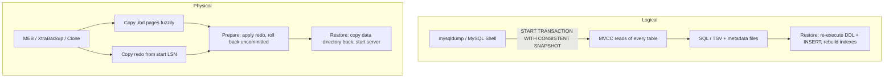

## Introduction

A backup is a copy of the database from which you can rebuild it after something goes wrong: a dropped table, a bad migration, a buggy deploy that corrupted rows, ransomware, a lost disk, a lost data centre. Replication does **not** replace backups — a `DROP TABLE` or `UPDATE` without `WHERE` replicates to every replica within milliseconds ([Replication and High Availability](/lessons/m11-replication-ha)). Backups are the only defence against *logical* disasters, and the starting point for every recovery.

Professional backup practice answers four questions:

1. **What kind of copy?** A *logical* backup (SQL statements or data files that recreate rows) or a *physical* backup (a copy of InnoDB's data and log files).
2. **Is it consistent?** Does the copy represent the database at *one* moment, so that every order in it has its line items and payments — even though the server kept accepting writes while the backup ran?
3. **How fast can we take it and restore it?** Which determines how often you can back up and how long an outage lasts.
4. **Does it actually work?** A backup that was never restored is a hope, not a backup.

This lesson covers the backup side; the next lesson, [Restoration and Point-in-Time Recovery](/lessons/m11-restore-pitr), covers restoring it and rolling forward with the binary log to the moment before the disaster.

:::note[What runs in the lab]
`mysqldump`, MySQL Shell, physical backup tools and `LOCK INSTANCE FOR BACKUP` cannot run from a lab, so their commands are shown as display-only `bash`/`sql` blocks and any output shown for them is **illustrative**. The *concepts* do run: you will take in-lab snapshots of tables, verify them with `CHECKSUM TABLE` and order-independent hashes, find differing rows with chunked checksums, generate dump-style `INSERT` statements with SQL, and use **real concurrent sessions** to see exactly what `mysqldump --single-transaction` relies on.
:::

## DBMS Theory

:::theory[Backup types and properties]
- **Logical backup** — a representation of the database's *contents* at the level of the data model: `CREATE TABLE` statements and rows (as `INSERT`s, CSV/TSV, or a structured format). Portable across versions, storage engines and platforms; slow to restore, because every row is re-inserted and every index rebuilt.
- **Physical (raw) backup** — a copy of the files that store the data (`.ibd` tablespaces, system and undo tablespaces, redo log). Fast to take and restore (file copy), but tied to the server version, configuration and platform.
- **Full / incremental / differential** — a full backup copies everything; an incremental copies changes since the previous backup of any kind; a differential copies changes since the last *full* backup. InnoDB physical tools implement incrementals by copying pages whose **LSN** (log sequence number) is newer than the previous backup's LSN.
- **Hot / warm / cold** — taken while the server accepts reads and writes / while writes are blocked / while it is shut down.
- **Consistency** — a backup is *transactionally consistent* if it equals the database state after some serial prefix of committed transactions: it contains all effects of transactions committed before a point and none after. For a DBMS with MVCC, the natural way to get one is to read everything inside **one transaction with one read view** — a *consistent snapshot*.
:::

The two metrics that drive backup design come from business continuity planning:

- **RPO — Recovery Point Objective:** how much data (measured in time) the business can afford to lose. A nightly backup with nothing else means an RPO of up to 24 hours.
- **RTO — Recovery Time Objective:** how long the service may be down while you restore. A 2 TB logical dump that takes 10 hours to reload cannot meet a 1-hour RTO.

Logical backups optimize portability; physical backups optimize RTO; binary-log archiving (next lesson) drives RPO toward zero.

## Why It Exists

Every database eventually needs a backup, for reasons that have nothing to do with hardware reliability:

- **Human and software error** is the most common cause of data loss: an `UPDATE` without `WHERE`, a migration that dropped the wrong column, an application bug that overwrote prices for a week.
- **Malicious action**: ransomware that encrypts files, an attacker with a stolen credential who deletes data, an insider.
- **Infrastructure loss**: a corrupted file system, a deleted cloud volume, a region outage.
- **Non-disaster uses**: building a staging copy, provisioning a new replica, migrating to a new version or platform, answering an audit question about the state of the data last March.

What goes wrong without a *proper* backup is usually one of these:

- **Inconsistent copy.** Tables copied one after another while writes continue: the copy has payments for orders that are not in it. You will reproduce this below.
- **Incomplete copy.** Rows without schema, schema without routines/triggers/events, a database without its users and grants.
- **Unrestorable copy.** Truncated files, a backup of the wrong server, encryption keys lost, a restore procedure nobody has ever executed — discovered during the outage.
- **Too slow to restore.** The backup works but takes longer to restore than the business can wait.

## Internal Working

:::internals[How a consistent logical backup works: mysqldump --single-transaction]
1. `mysqldump` connects and runs `SET SESSION TRANSACTION ISOLATION LEVEL REPEATABLE READ` followed by `START TRANSACTION WITH CONSISTENT SNAPSHOT`. The `WITH CONSISTENT SNAPSHOT` modifier makes InnoDB create the **read view immediately** (a plain `START TRANSACTION` creates it lazily at the first read).
2. With `--source-data` (or `--set-gtid-purged` under GTIDs), it briefly takes `FLUSH TABLES WITH READ LOCK` *before* starting the transaction, reads the binary-log coordinates / GTID set that correspond exactly to the snapshot, and releases the lock. That short global lock is the only blocking moment — and it can wait for long-running queries to finish.
3. It then reads every table with ordinary consistent `SELECT`s. Under MVCC ([MVCC](/lessons/m08-mvcc)) each read sees the database as of the read view — rows changed later are reconstructed from **undo logs**. Writers are never blocked by these reads.
4. While the transaction is open, InnoDB **cannot purge** undo records newer than its read view; a long dump on a busy server makes the history list grow.
5. Each table read takes a shared **metadata lock** that lasts until the transaction ends. DDL on a table already dumped waits behind it; DDL that rebuilds a table *not yet* dumped can make the dump fail with error 1412 (*Table definition has changed*). That is why dumps and schema migrations must not overlap.
6. The output is a stream of SQL: `CREATE TABLE`, `INSERT … VALUES (…),(…)` in multi-row batches, plus routines/events/triggers if requested. Consistency applies to **InnoDB tables only**; MyISAM tables read in the same run are not protected by the snapshot.
:::

:::internals[How a hot physical backup works]
Physical backup tools for InnoDB (MySQL Enterprise Backup, Percona XtraBackup) rely on the same mechanism as crash recovery ([Crash Recovery](/lessons/m10-crash-recovery)):

1. Record the current redo **LSN**, then start copying the redo log continuously from that point.
2. Copy the tablespace files page by page while the server keeps writing — the copied pages are *fuzzy* (some older, some newer than others).
3. Take a short backup lock (`LOCK INSTANCE FOR BACKUP`, which blocks DDL and file operations but not DML), copy non-InnoDB files and record the final LSN and binary-log coordinates.
4. **Prepare** step (offline): apply the copied redo to the fuzzy pages and roll back uncommitted transactions, exactly as crash recovery would. The result is a consistent data directory as of the end LSN.

The **Clone plugin** (8.0.17+) is the same idea built into the server: a recipient instance pulls a consistent physical snapshot of all InnoDB data directly from a donor over the network (`CLONE INSTANCE FROM …`) or to a local directory (`CLONE LOCAL DATA DIRECTORY = …`). InnoDB Cluster uses it to provision new members.
:::



## MySQL Implementation

In the lab you cannot run backup tools, but you can reproduce the building blocks. Start with a **table-level snapshot** — a copy of `orders` as it is now. The quick way is `CREATE TABLE … AS SELECT`:

```sql run
CREATE TABLE orders_snap_ctas AS SELECT * FROM orders;
SHOW CREATE TABLE orders_snap_ctas;
```

The rows are there, but look at the definition: no `PRIMARY KEY`, no secondary indexes, no `AUTO_INCREMENT` — `CREATE TABLE … AS SELECT` copies column types, not keys, indexes, foreign keys or triggers. A copy that preserves the full table definition needs two steps:

```sql run
CREATE TABLE orders_snap LIKE orders;
INSERT INTO orders_snap SELECT * FROM orders;
SELECT TABLE_NAME, TABLE_ROWS, INDEX_LENGTH
FROM information_schema.TABLES
WHERE TABLE_SCHEMA = DATABASE() AND TABLE_NAME LIKE 'orders%'
ORDER BY TABLE_NAME;
```

`CREATE TABLE … LIKE` copies the definition including indexes (but not foreign keys referencing other tables, and not triggers). The `INDEX_LENGTH` column shows the difference: the CTAS copy has no secondary-index pages at all. (`TABLE_ROWS` is an estimate for InnoDB — fine here, but never use it to verify a backup.)

**Verify the copy.** `CHECKSUM TABLE` computes a checksum over all rows of a table:

```sql run
CHECKSUM TABLE orders, orders_snap, orders_snap_ctas;
```

All three match: same rows, same values. `CHECKSUM TABLE` is convenient but has limits — the value depends on the row format and server version, so it is only comparable between tables on compatible servers, and it reads the whole table. A portable alternative is a **row count plus an order-independent hash** that you can compute on any server, including after a restore to a different version:

```sql run
SELECT 'orders' AS tbl, COUNT(*) AS row_count,
       BIT_XOR(CRC32(CONCAT_WS('|', order_id, customer_id, order_date, status,
                               COALESCE(shipped_at, '\\N'), COALESCE(discount_code, '\\N')))) AS content_hash
FROM orders
UNION ALL
SELECT 'orders_snap', COUNT(*),
       BIT_XOR(CRC32(CONCAT_WS('|', order_id, customer_id, order_date, status,
                               COALESCE(shipped_at, '\\N'), COALESCE(discount_code, '\\N'))))
FROM orders_snap;
```

`CRC32` hashes each row's canonical text; `BIT_XOR` combines the row hashes so that the result does not depend on row order (any scan order, any server). `COALESCE(…, '\N')` matters because `CONCAT_WS` *skips* NULL arguments — without it, `('a', NULL, 'b')` and `('a', 'b', NULL)` would hash identically.

## Syntax Breakdown

**mysqldump** — the classic logical backup client (display-only):

```bash
mysqldump --single-transaction --source-data=2 --routines --events --triggers \
          --hex-blob --set-gtid-purged=AUTO --databases shop \
          | zstd > shop-$(date +%F).sql.zst
```

| Option | Meaning |
|---|---|
| `--single-transaction` | One `REPEATABLE READ` consistent-snapshot transaction for all InnoDB tables — a hot, non-blocking, consistent dump |
| `--source-data[=1\|2]` | Record the binary-log file and position of the snapshot (`=2` writes it as a comment). Replaces the deprecated `--master-data`. Briefly takes `FLUSH TABLES WITH READ LOCK` |
| `--set-gtid-purged=ON\|OFF\|AUTO` | Write `SET @@GLOBAL.gtid_purged` so a restored server knows which GTIDs it contains (GTID replication / PITR) |
| `--routines`, `--events`, `--triggers` | Include stored procedures/functions and events (off by default) and triggers (on by default) |
| `--databases` / `--all-databases` | Include `CREATE DATABASE`/`USE` statements. Note: dumping accounts by dumping the `mysql` schema is discouraged — dump `CREATE USER`/`GRANT` statements instead (MySQL Shell does this) |
| `--hex-blob` | Write binary columns as hex literals (safe across character-set conversions) |
| `--no-data` / `--no-create-info` | Schema only / data only |
| `--where='…'` | Dump a subset of rows (for test data, not for backups) |
| `--lock-all-tables`, `--lock-tables` | Alternatives to `--single-transaction` for non-InnoDB tables — they block writes |
| `--quick` (part of the default `--opt`) | Stream rows instead of buffering whole tables in client memory |

**MySQL Shell dump utilities** — the modern logical backup (display-only, JavaScript mode):

```js
// parallel, chunked, compressed dump of the whole instance
util.dumpInstance("/backups/2026-11-09", {threads: 8, compression: "zstd", consistent: true})
util.dumpSchemas(["shop"], "/backups/shop-2026-11-09", {threads: 8})
util.dumpTables("shop", ["orders", "order_items"], "/backups/orders-only")
// restore, in parallel, optionally deferring secondary indexes
util.loadDump("/backups/2026-11-09", {threads: 8, deferTableIndexes: "all", dryRun: false})
```

| Feature | Why it matters |
|---|---|
| Parallel, chunked export | Large tables are split into PK ranges and exported by many threads — dumps and loads scale with cores |
| `consistent: true` | Uses a brief backup lock / global read lock to align all threads' snapshots to one point, then releases it |
| Metadata + users | Writes DDL, accounts and grants as separate files; `loadDump` can include or exclude users |
| `deferTableIndexes` | Loads rows first and builds secondary indexes afterwards — much faster restores |
| `ocimds`, compatibility options | Check and adjust a dump for MySQL HeatWave / managed targets |
| `dryRun` | Validate a dump or load without changing anything |

**Physical tools and server features** (display-only):

```sql
LOCK INSTANCE FOR BACKUP;      -- needs BACKUP_ADMIN; blocks DDL, not DML
UNLOCK INSTANCE;
INSTALL PLUGIN clone SONAME 'mysql_clone.so';
CLONE LOCAL DATA DIRECTORY = '/backups/clone-2026-11-09';                       -- local physical snapshot
CLONE INSTANCE FROM 'clone_user'@'db-primary.internal':3306 IDENTIFIED BY '…';  -- provision a replica
```

```bash
xtrabackup --backup --target-dir=/backups/full-2026-11-09          # Percona XtraBackup (8.4 series)
xtrabackup --prepare --target-dir=/backups/full-2026-11-09
mysqlbackup --backup-dir=/backups/meb backup-and-apply-log           # MySQL Enterprise Backup
```

:::version[Backups in MySQL 8.4]
- `mysqldump --master-data` is deprecated in favour of `--source-data`, matching 8.4's removal of MASTER/SLAVE statement syntax.
- **MySQL Shell** (`util.dumpInstance` / `util.loadDump`) is the recommended logical backup and migration tool for 8.x and HeatWave; `mysqlpump` was deprecated in 8.0.34 and is **not included in 8.4**.
- The **Clone plugin** is available in all 8.4 editions and is used by InnoDB Cluster and InnoDB ClusterSet to provision members.
- Physical backup tools must match the server's major version: use Percona XtraBackup 8.4 or MySQL Enterprise Backup 8.4 for MySQL 8.4.
:::

## Practical Examples

**1. What a logical dump contains.** A dump is SQL that recreates rows. You can generate the same shape yourself — this is, in miniature, what `mysqldump` writes for `categories`:

```sql run
SELECT CONCAT('INSERT INTO `categories` VALUES (', category_id, ',', QUOTE(name), ',',
              COALESCE(parent_id, 'NULL'), ');') AS dump_line
FROM categories
ORDER BY category_id;
```

`QUOTE()` escapes strings correctly and NULL is written as the keyword `NULL`. Real dumps batch many rows per `INSERT`, wrap the load in `SET FOREIGN_KEY_CHECKS=0` / `UNIQUE_CHECKS=0`, and write the `CREATE TABLE` first — then *every* index is rebuilt during the load, which is why logical restores are slow for big tables.

**2. Detecting drift between a backup and the source.** Simulate damage to the snapshot (one changed value, one deleted row), then let the verification queries find it:

```sql run
UPDATE orders_snap SET status = 'paid' WHERE order_id = 2;
DELETE FROM orders_snap WHERE order_id = 40;
CHECKSUM TABLE orders, orders_snap;
```

The checksums differ, but they do not tell you *where*. Tools such as `pt-table-checksum` (and MySQL Shell's checks) solve this by checksumming **chunks** of primary-key ranges and drilling into the chunks that differ:

```sql run
WITH src AS (
  SELECT FLOOR((order_id - 1) / 20) AS chunk, COUNT(*) AS n,
         BIT_XOR(CRC32(CONCAT_WS('|', order_id, customer_id, order_date, status,
                                 COALESCE(shipped_at, '\\N'), COALESCE(discount_code, '\\N')))) AS h
  FROM orders GROUP BY chunk
), bak AS (
  SELECT FLOOR((order_id - 1) / 20) AS chunk, COUNT(*) AS n,
         BIT_XOR(CRC32(CONCAT_WS('|', order_id, customer_id, order_date, status,
                                 COALESCE(shipped_at, '\\N'), COALESCE(discount_code, '\\N')))) AS h
  FROM orders_snap GROUP BY chunk
)
SELECT src.chunk, src.chunk * 20 + 1 AS first_id, src.chunk * 20 + 20 AS last_id,
       src.n AS source_rows, bak.n AS backup_rows, src.h = bak.h AS hashes_match
FROM src LEFT JOIN bak ON bak.chunk = src.chunk
ORDER BY src.chunk;
```

Only the first two chunks (ids 1–20 and 21–40) are flagged; within a flagged chunk, a row-level anti-join pinpoints the exact differences:

```sql run
SELECT 'missing or changed in backup' AS problem, o.order_id, o.status
FROM orders o
LEFT JOIN orders_snap s
  ON s.order_id = o.order_id AND s.status = o.status
WHERE o.order_id BETWEEN 1 AND 40 AND s.order_id IS NULL
ORDER BY o.order_id;
```

**3. Sizing a backup.** Before choosing a tool, estimate the volume. `information_schema.TABLES` gives the space InnoDB uses per table (data and index pages — a physical backup copies roughly this; a logical dump is often smaller for data but must rebuild the indexes on restore):

```sql run
SELECT TABLE_NAME,
       DATA_LENGTH  AS data_bytes,
       INDEX_LENGTH AS index_bytes,
       ROUND((DATA_LENGTH + INDEX_LENGTH) / 1024, 0) AS total_kib
FROM information_schema.TABLES
WHERE TABLE_SCHEMA = DATABASE() AND TABLE_NAME NOT LIKE 'orders_snap%'
ORDER BY DATA_LENGTH + INDEX_LENGTH DESC, TABLE_NAME;
```

On a toy dataset every table occupies the minimum allocation (16 KiB pages); on a production server the same query identifies the handful of tables that dominate backup time and size.

## Execution Walkthrough

The central property of `--single-transaction` is easiest to understand by watching it. Session **A** plays `mysqldump`; session **B** is the application, which places an order and records its payment in one transaction while the dump is running.

```concurrency
title: The dump's snapshot versus concurrent writes (what --single-transaction relies on)
description: Session A opens a consistent snapshot exactly as mysqldump does, then "dumps" orders and payments. Session B commits a new order with its payment in between.
steps:
  - session: A
    sql: SET SESSION TRANSACTION ISOLATION LEVEL REPEATABLE READ; START TRANSACTION WITH CONSISTENT SNAPSHOT;
    note: The read view is created now — the dump will see the database exactly as of this moment.
  - session: A
    sql: SELECT COUNT(*) AS orders_in_dump FROM orders;
    note: The "dump" of orders begins.
  - session: B
    sql: START TRANSACTION; INSERT INTO orders (customer_id, order_date, status) VALUES (3, '2024-12-31 23:00:00', 'paid'); INSERT INTO payments (order_id, amount, method, status, paid_at) VALUES (LAST_INSERT_ID(), 50.00, 'card', 'succeeded', '2024-12-31 23:00:05'); COMMIT;
    note: The application commits a new order and its payment. Nothing blocks — A's reads take no row locks.
  - session: B
    sql: SELECT COUNT(*) AS orders_now FROM orders; SELECT COUNT(*) AS payments_now, SUM(amount) AS paid_total FROM payments;
    note: The live database has the new order and payment.
  - session: A
    sql: SELECT COUNT(*) AS payments_in_dump, SUM(amount) AS paid_total_in_dump FROM payments;
    note: The dump reaches payments after B committed — but still sees the snapshot. No payment for an order missing from the dump.
  - session: A
    sql: COMMIT; SELECT COUNT(*) AS orders_after_dump FROM orders;
    note: Ending the transaction releases the read view; a new read sees B's order.
```

Without the snapshot — each table read in its own autocommit statement, which is what you get from a naive script or from `mysqldump` with neither `--single-transaction` nor table locks — the same interleaving produces an inconsistent backup:

```concurrency
title: Table-by-table copy without a snapshot
description: Session A reads orders and payments in separate autocommit statements; B commits an order and payment in between.
steps:
  - session: A
    sql: SELECT COUNT(*) AS orders_in_copy FROM orders;
    note: Autocommit — this read view ends with the statement.
  - session: B
    sql: START TRANSACTION; INSERT INTO orders (customer_id, order_date, status) VALUES (3, '2024-12-31 23:00:00', 'paid'); INSERT INTO payments (order_id, amount, method, status, paid_at) VALUES (LAST_INSERT_ID(), 50.00, 'card', 'succeeded', '2024-12-31 23:00:05'); COMMIT;
  - session: A
    sql: SELECT COUNT(*) AS payments_in_copy, SUM(amount) AS paid_total_in_copy FROM payments;
    note: The payment is in the copy, but its order is not — the restored database would contain an orphan payment (or fail its foreign key).
```

Finally, schema changes and the dump's metadata locks. A dump that has already read `orders` holds a shared metadata lock on it until it commits, so a migration that alters `orders` waits:

```concurrency
title: DDL waits for a running dump (metadata locks)
description: A has dumped orders inside its snapshot transaction; B tries to add a column to orders.
steps:
  - session: A
    sql: START TRANSACTION WITH CONSISTENT SNAPSHOT; SELECT COUNT(*) FROM orders;
  - session: B
    sql: ALTER TABLE orders ADD COLUMN gift_note VARCHAR(50);
    expect: blocks
    note: B waits for A's metadata lock on orders ("Waiting for table metadata lock"). Every later query on orders queues behind B's pending exclusive lock request — this is how a dump plus a migration can stall an application.
  - session: A
    sql: COMMIT;
    note: The dump finishes; B's ALTER proceeds.
  - session: B
    sql: SELECT COUNT(*) AS columns_now FROM information_schema.COLUMNS WHERE TABLE_SCHEMA = DATABASE() AND TABLE_NAME = 'orders';
```

## Output

The first scenario is the one to remember. Inside the snapshot, session A's view of `orders` and `payments` stayed at the dataset's state (80 orders; 76 payments) even though B committed a new order and payment between the two reads, and B saw 81 orders and 77 payments in the live database at the same moment. After `COMMIT`, A saw 81 orders. The "dump" is therefore consistent: every payment in it belongs to an order in it.

In the second scenario the copy contains 80 orders but 77 payments — one payment whose order is missing. In the third, B's `ALTER TABLE` was recorded as blocked until A committed.

From the verification examples: `CHECKSUM TABLE` and the count-plus-hash query agreed for an intact copy and disagreed after damage; the chunked comparison flagged only the two 20-id chunks containing the changed row (order 2) and the deleted row (order 40); and the anti-join listed exactly those two orders.

## Alternative Approaches

| Method | Type | Consistency | Speed (backup / restore) | Best for | Watch out for |
|---|---|---|---|---|---|
| `mysqldump --single-transaction` | Logical | Snapshot (InnoDB) | Slow / slow (single-threaded, indexes rebuilt) | Small databases (< tens of GB), schema exports, migrations | Long snapshot transactions grow undo; DDL during dump |
| MySQL Shell `util.dumpInstance` + `loadDump` | Logical | Snapshot, aligned across threads | Fast / fast (parallel, deferred indexes) | Logical backups of large databases, version/platform migrations, HeatWave | Still re-inserts rows on restore |
| `SELECT … INTO OUTFILE` / `LOAD DATA` | Logical (CSV) | Only if run in one snapshot transaction | Fast | Exports for analytics | Needs `FILE` privilege and `secure_file_priv`; no schema |
| MySQL Enterprise Backup | Physical | Crash-consistent + redo applied | Fast / fast; incrementals, compression, encryption | Large commercial deployments | Licence |
| Percona XtraBackup | Physical | Same | Fast / fast; incrementals | Large open-source deployments | Version must match server |
| Clone plugin | Physical | Consistent | Fast | Provisioning replicas/cluster members; local snapshot | Not a backup catalogue; no incrementals |
| Storage snapshots (LVM, ZFS, EBS, PD) | Physical | Crash-consistent; better with `LOCK INSTANCE FOR BACKUP` / FTWRL | Seconds / minutes | Cloud and SAN environments, very large data | Snapshot lives on the same storage system unless copied out |
| Delayed replica | Physical (live copy) | Lags by N hours | Instant "restore" by promoting | Fast undo of logical errors within the delay | Not a backup by itself; same failure domain |

A common production combination: **daily physical backups** (or snapshots) for fast RTO, **weekly logical dumps** for portability and long-term archives, **continuous binary-log archiving** for RPO, and a **delayed replica** for very fast recovery from recent human error.

## Performance Analysis

- **Logical backup cost** is a full read of every table through the SQL layer: CPU for formatting rows, I/O for every page, network to the client. On a busy server it competes for buffer pool space (cold pages pushed in, hot pages pushed out). Run dumps against a **replica** where possible.
- **The snapshot's hidden cost** is MVCC history: while the dump transaction is open, purge cannot remove undo records newer than its read view. A 6-hour dump on a write-heavy primary can grow the history list by millions of entries and slow down reads that must traverse longer version chains ([MVCC](/lessons/m08-mvcc)). Parallel tools shorten the transaction; dumping from a replica moves the cost away from the primary.
- **Logical restore is dominated by index builds and redo/binlog writes.** Every row is inserted and every secondary index maintained. Restores go faster with deferred index creation (MySQL Shell), larger `innodb_redo_log_capacity`, and — on a throwaway restore target only — relaxed durability (`innodb_flush_log_at_trx_commit=2`, binary logging disabled), never on the production server you will keep.
- **Physical backup cost** is sequential file I/O plus redo copying; restore is a file copy plus the prepare step, so RTO scales with data size and disk throughput rather than with the number of rows and indexes. That is why large databases (hundreds of GB and up) use physical backups for disaster recovery.
- **Verification has a cost too.** `CHECKSUM TABLE` and hash queries read whole tables; run them on restored copies or replicas, chunked and throttled.

:::performance[Theory vs measurement]
No backup was timed for this lesson; the relationships above follow from what each method does. Measure on your own data: time a full dump *and* a full restore into a scratch server, note the binary-log volume per hour, and compare with your RPO and RTO.
:::

## Best Practices

:::best-practice[A backup strategy you can trust]
1. **Define RPO and RTO first**, per system, with the business. Choose tools that meet them — and prove it with timed restores.
2. **Follow 3-2-1**: three copies, on two different media/storage systems, one off-site (another account/region), with at least one **immutable** copy (object lock / WORM) so ransomware or a compromised admin cannot delete it.
3. **Always take consistent backups**: `--single-transaction` for InnoDB-only logical dumps, MySQL Shell's `consistent` mode, or physical tools. Keep all tables InnoDB.
4. **Record the binlog position / GTID set** of every backup (`--source-data`, `--set-gtid-purged`, physical tools do it automatically) — without it, point-in-time recovery is impossible.
5. **Back up everything a restore needs**: schema, routines, triggers, events, users and grants, configuration files (`my.cnf`, `mysqld-auto.cnf`), TLS material and keyring/encryption keys (stored separately and securely).
6. **Do not overlap backups with DDL.** Schedule migrations outside backup windows, or take backups from a replica.
7. **Verify automatically**: after every backup, restore it into a scratch instance, run row counts and checksums against the source (or the replica the dump came from), and alert on failure. Run full recovery drills regularly.
8. **Encrypt and access-control backups** — they contain all your data. Use a dedicated backup account with minimal privileges ([Privileges and Roles](/lessons/m11-privileges-roles)).
9. **Monitor** backup success, duration, size trends and the age of the newest verified backup.
:::

## Common Mistakes

**Mistake 1 — using `CREATE TABLE … AS SELECT` as a "backup" of a table before a risky change.** You saw that it drops the primary key and all indexes; restoring from it gives you a different table. Use `CREATE TABLE … LIKE` + `INSERT … SELECT`, or better, a proper dump of the table.

**Mistake 2 — `mysqldump` without `--single-transaction` on a live InnoDB server.** By default (`--opt` includes `--lock-tables`) mysqldump locks each database's tables while dumping it — blocking writes; with locking disabled and no snapshot, you get the inconsistent copy of the second concurrency scenario.

**Mistake 3 — assuming replicas are backups.** A replica faithfully applies `DROP TABLE orders` and `UPDATE prices SET amount = 0`. Replicas protect against hardware failure, not against logical errors.

**Mistake 4 — verifying with `information_schema.TABLES.TABLE_ROWS`.** For InnoDB it is an estimate from sampled statistics. Use `COUNT(*)` plus checksums.

**Mistake 5 — hashing rows with `CONCAT_WS` on nullable columns.** `CONCAT_WS` skips NULLs, so different rows can produce the same text:

```sql run
SELECT CONCAT_WS('|', 'a', NULL, 'b') AS row_1_text,
       CONCAT_WS('|', 'a', 'b', NULL) AS row_2_text,
       CRC32(CONCAT_WS('|', 'a', NULL, 'b')) = CRC32(CONCAT_WS('|', 'a', 'b', NULL)) AS same_hash;
```

Replace NULLs with a marker (`COALESCE(col, '\N')`) as the verification queries above do. Also note that `BIT_XOR` cancels **pairs of identical rows** — always compare the row count alongside the hash.

**Mistake 6 — keeping backups only on the database host.** A disk failure, a ransomware infection or `rm -rf` of the data directory takes the backups with it.

**Mistake 7 — never restoring.** The most common backup failure is discovered during the outage: missing routines, the wrong schema, an expired encryption key, a 14-hour restore for a 1-hour RTO.

## Industry Application

- **Typical self-managed setup.** A nightly physical backup (XtraBackup or MEB) taken from a dedicated backup replica, streamed to object storage with encryption and object lock; hourly incremental backups; binary logs shipped continuously (next lesson); weekly MySQL Shell logical dumps for portability; an automated job that restores last night's backup into a scratch VM every day and compares checksums with the replica.
- **Managed cloud.** RDS/Aurora, Cloud SQL and Azure Database for MySQL take automated storage snapshots plus transaction-log archiving and offer point-in-time restore to any second within the retention window — a physical-backup strategy you configure rather than build. Teams still take periodic logical exports for long-term retention, cross-cloud portability and the "provider account compromised" scenario.
- **Data migration.** Moving from on-premises MySQL to HeatWave, or between major versions, is typically done with `util.dumpInstance` + `util.loadDump` (parallel, compatibility checks), often combined with replication from the old server to catch up after the load.
- **Provisioning.** New replicas and InnoDB Cluster members are provisioned with the Clone plugin or from the latest physical backup — the same artefact serves backup and scaling.
- **Compliance.** Regulations and contracts specify retention ("7 years of monthly backups"), encryption, separation of duties for deletion, and evidence of restore tests — auditors ask for the restore-test logs, not the backup logs.

## Practice Exercises

```exercise
id: ex1
title: Do the two snapshots match?
difficulty: easy
kind: query
setup: |
  CREATE TABLE products_snap_a LIKE products;
  INSERT INTO products_snap_a SELECT * FROM products;
  CREATE TABLE products_snap_b LIKE products;
  INSERT INTO products_snap_b SELECT * FROM products;
  UPDATE products_snap_b SET price = price + 0.01 WHERE product_id = 7;
concepts: [backup-verification, checksums]
prompt: |
  Two snapshots of `products` were taken: `products_snap_a` and `products_snap_b`. Write **one query** that returns
  one row with columns `rows_a`, `rows_b`, `hash_a`, `hash_b`, `identical` — the row counts, an order-independent
  content hash of each table over the columns `product_id`, `name`, `price`, `stock_qty`, and `identical` = 1 if
  both counts and both hashes are equal, else 0. Compute the hash as
  `BIT_XOR(CRC32(CONCAT_WS('|', product_id, name, price, stock_qty)))`.
hints:
  - "Compute each table's COUNT(*) and hash in a derived table (or CTE), then CROSS JOIN the two one-row results."
  - "identical = (rows_a = rows_b AND hash_a = hash_b)."
solution: |
  WITH a AS (
    SELECT COUNT(*) AS n, BIT_XOR(CRC32(CONCAT_WS('|', product_id, name, price, stock_qty))) AS h
    FROM products_snap_a
  ), b AS (
    SELECT COUNT(*) AS n, BIT_XOR(CRC32(CONCAT_WS('|', product_id, name, price, stock_qty))) AS h
    FROM products_snap_b
  )
  SELECT a.n AS rows_a, b.n AS rows_b, a.h AS hash_a, b.h AS hash_b,
         (a.n = b.n AND a.h = b.h) AS identical
  FROM a CROSS JOIN b;
explanation: |
  The counts match (30 = 30) but the hashes differ because one price was changed by one cent — the kind of silent
  difference that row counts alone never reveal. All four columns used here are NOT NULL, so `CONCAT_WS` is safe;
  for nullable columns wrap them in `COALESCE(col, '\N')`. `CHECKSUM TABLE products_snap_a, products_snap_b`
  answers the same question on one server, but its value is not portable across versions or row formats.
```

```exercise
id: ex2
title: Find the rows that differ
difficulty: medium
kind: query
setup: |
  CREATE TABLE customers_backup LIKE customers;
  INSERT INTO customers_backup SELECT * FROM customers;
  UPDATE customers_backup SET city = 'Unknown' WHERE customer_id = 6;
  DELETE FROM customers_backup WHERE customer_id = 17;
  INSERT INTO customers_backup (customer_id, first_name, last_name, email, city, state, signup_date)
    SELECT 99, 'Ghost', 'Row', 'ghost@example.com', 'Nowhere', 'NV', signup_date FROM customers WHERE customer_id = 1;
concepts: [backup-verification]
prompt: |
  Compare `customers` (source) with `customers_backup` on the columns `customer_id`, `email`, `city`. Return every
  difference as rows with columns `customer_id` and `problem`, where `problem` is `'missing in backup'`,
  `'extra in backup'` or `'changed'`. Order by `customer_id`.
hints:
  - "Three cases: anti-join source→backup, anti-join backup→source, and an inner join where a column differs."
  - "Combine the three SELECTs with UNION ALL. Use <=> if a compared column could be NULL."
solution: |
  SELECT c.customer_id, 'missing in backup' AS problem
  FROM customers c LEFT JOIN customers_backup b ON b.customer_id = c.customer_id
  WHERE b.customer_id IS NULL
  UNION ALL
  SELECT b.customer_id, 'extra in backup'
  FROM customers_backup b LEFT JOIN customers c ON c.customer_id = b.customer_id
  WHERE c.customer_id IS NULL
  UNION ALL
  SELECT c.customer_id, 'changed'
  FROM customers c JOIN customers_backup b ON b.customer_id = c.customer_id
  WHERE NOT (c.email <=> b.email AND c.city <=> b.city)
  ORDER BY customer_id;
orderMatters: true
explanation: |
  MySQL has no `FULL OUTER JOIN`; `EXCEPT` (8.0.31+) can list rows present on one side only, but not classify
  them. The classic pattern is therefore two anti-joins plus a changed-rows join. The null-safe `<=>` prevents a NULL-to-value change from
  being missed (`NULL <> 'x'` is UNKNOWN, not true). On large tables, run this only on the chunks that a chunked
  checksum flagged.
```

```exercise
id: ex3
title: A faithful table snapshot
difficulty: medium
kind: dml
concepts: [logical-backup, backup-verification]
prompt: |
  Before a risky data fix, take a snapshot of `order_items` named **`order_items_pre_fix`** that keeps the full table
  definition (primary key and indexes), copy all rows into it, and then record a verification row in a new table
  **`snapshot_log(table_name VARCHAR(64), row_count INT, checksum_value BIGINT)`** with the snapshot's row count and
  its `BIT_XOR(CRC32(CONCAT_WS('|', order_id, product_id, quantity, unit_price)))`.

  The checker compares the snapshot's index definitions and the log row.
hints:
  - "CREATE TABLE order_items_pre_fix LIKE order_items; INSERT INTO order_items_pre_fix SELECT * FROM order_items;"
  - "INSERT INTO snapshot_log SELECT 'order_items_pre_fix', COUNT(*), BIT_XOR(…) FROM order_items_pre_fix;"
solution: |
  CREATE TABLE order_items_pre_fix LIKE order_items;
  INSERT INTO order_items_pre_fix SELECT * FROM order_items;
  CREATE TABLE snapshot_log (table_name VARCHAR(64), row_count INT, checksum_value BIGINT);
  INSERT INTO snapshot_log
  SELECT 'order_items_pre_fix', COUNT(*),
         BIT_XOR(CRC32(CONCAT_WS('|', order_id, product_id, quantity, unit_price)))
  FROM order_items_pre_fix;
check: |
  SELECT l.table_name, l.row_count, l.checksum_value,
         (SELECT GROUP_CONCAT(DISTINCT INDEX_NAME ORDER BY INDEX_NAME)
            FROM information_schema.STATISTICS
           WHERE TABLE_SCHEMA = DATABASE() AND TABLE_NAME = 'order_items_pre_fix') AS indexes
  FROM snapshot_log l;
explanation: |
  `CREATE TABLE … LIKE` keeps the composite primary key and secondary indexes, so restoring rows from the snapshot
  (`REPLACE INTO order_items SELECT * FROM order_items_pre_fix …`) behaves like the original table. Logging the
  count and hash at snapshot time lets you prove later that the snapshot was not modified. `CREATE TABLE … AS
  SELECT` would have produced a table with no indexes at all — the checker's index list would be empty.
```

```exercise
id: ex4
title: Which backups meet the RPO?
difficulty: hard
kind: query
setup: |
  CREATE TABLE backup_catalog (
    backup_id INT PRIMARY KEY, system_name VARCHAR(20) NOT NULL, kind ENUM('physical','logical') NOT NULL,
    started_at DATETIME NOT NULL, finished_at DATETIME NULL, verified BOOLEAN NOT NULL);
  INSERT INTO backup_catalog VALUES
    (1,'orders','physical','2026-11-08 01:00:00','2026-11-08 01:40:00',TRUE),
    (2,'orders','physical','2026-11-09 01:00:00','2026-11-09 01:42:00',FALSE),
    (3,'orders','logical','2026-11-07 03:00:00','2026-11-07 05:10:00',TRUE),
    (4,'billing','physical','2026-11-05 02:00:00','2026-11-05 02:20:00',TRUE),
    (5,'billing','physical','2026-11-09 02:00:00',NULL,FALSE),
    (6,'catalog','logical','2026-11-08 22:00:00','2026-11-08 22:05:00',TRUE);
concepts: [backup-verification, logical-backup, physical-backup]
prompt: |
  `backup_catalog` lists backups; `finished_at` is NULL for a backup that did not complete. For each system, find
  its **newest verified, completed** backup and the hours between that backup's `started_at` and
  **2026-11-09 06:00:00** (the data-loss window if the server died at that moment and only full backups existed).
  Columns: `system_name`, `backup_id`, `hours_exposed` (integer, `TIMESTAMPDIFF(HOUR, …)`), `meets_24h_rpo`
  (1 if `hours_exposed <= 24`). Order by `system_name`.
hints:
  - "Filter verified AND finished_at IS NOT NULL, then rank per system by started_at DESC with ROW_NUMBER()."
  - "A backup's data is as of when its snapshot was taken (≈ started_at), not when the copy finished."
solution: |
  WITH ranked AS (
    SELECT system_name, backup_id, started_at,
           ROW_NUMBER() OVER (PARTITION BY system_name ORDER BY started_at DESC) AS rn
    FROM backup_catalog
    WHERE verified AND finished_at IS NOT NULL
  )
  SELECT system_name, backup_id,
         TIMESTAMPDIFF(HOUR, started_at, '2026-11-09 06:00:00') AS hours_exposed,
         TIMESTAMPDIFF(HOUR, started_at, '2026-11-09 06:00:00') <= 24 AS meets_24h_rpo
  FROM ranked
  WHERE rn = 1
  ORDER BY system_name;
orderMatters: true
explanation: |
  The newest *orders* backup (id 2) is not verified, so the trustworthy one is a day older; *billing*'s newest
  backup never finished, leaving a backup that is days old. Counting only verified, completed backups is the whole
  point: an unverified backup does not reduce your real RPO. A consistent snapshot represents the moment it was
  taken (for `--single-transaction`, the start), which is why `started_at` is used. Binary-log archiving (next
  lesson) would shrink these windows to minutes.
```

```exercise
id: ex5
title: Choose a backup architecture
difficulty: challenge
kind: open
concepts: [logical-backup, physical-backup, consistent-snapshot, mysql-shell-dump]
prompt: |
  An InnoDB-only MySQL 8.4 database of 1.5 TB (growing 40 GB/month) runs an e-commerce site 24/7 with one primary and
  two replicas. Requirements: RPO 5 minutes, RTO 2 hours for a full-server loss, restore of a single dropped table
  within 1 hour, 1 year of monthly archives, and protection against ransomware. Design the backup architecture:
  tools, schedule, where backups are taken from and stored, how consistency and verification are ensured, and how
  each requirement is met. Explain why `mysqldump` alone would not work.
solution: |
  - **Why not mysqldump alone:** a single-threaded dump of 1.5 TB takes many hours and holds one snapshot
    transaction (undo growth on the source); the restore re-inserts every row and rebuilds every index — likely far
    beyond 2 hours. It also gives only a once-a-day recovery point.
  - **Physical backups for RTO:** nightly full + hourly incremental physical backups (Percona XtraBackup 8.4 or MEB)
    taken from a dedicated replica (no load on the primary), compressed and encrypted, streamed to object storage
    in another account/region with object lock (immutable, ransomware-resistant) and a local copy for fast
    restores. Restore time ≈ copy + prepare, which scales with disk throughput — measure it to confirm < 2 h; if not,
    keep a recent prepared copy on standby storage or rely on storage snapshots.
  - **Binlog archiving for RPO:** continuously copy binary logs off the server (e.g. `mysqlbinlog
    --read-from-remote-server --raw --stop-never` on a separate host, or a managed log-shipping job) so at most a few
    seconds/minutes are lost; with GTIDs, PITR replays from the backup's GTID set (next lesson). RPO of 5 minutes is
    met by the shipping lag, not by backup frequency.
  - **Single-table restore within 1 hour:** physical tools can restore individual tablespaces (partial restore /
    transportable tablespaces), or keep weekly MySQL Shell `util.dumpSchemas` logical dumps (parallel, per-table
    files) from which one table can be loaded with `util.loadDump` and `includeTables`; then replay that table's
    binlog events if needed. A delayed replica (e.g. 6 h) offers even faster recovery from recent mistakes.
  - **Archives:** keep the first full backup of each month for a year (lifecycle rules), plus monthly logical dumps
    for portability across future versions.
  - **Consistency:** physical tools apply redo (crash-consistent + consistent binlog/GTID position via backup
    lock); logical dumps use MySQL Shell's `consistent` mode; no DDL during backup windows.
  - **Verification:** daily automated restore of the latest backup into a scratch instance, start MySQL, run row
    counts/checksums against the source replica (chunked), and replay a sample of binlogs; monthly full DR drill
    measuring actual RTO; alert on backup failure, size anomalies and age of the newest verified backup.
  - **Security:** dedicated least-privilege backup account, encryption keys in a KMS separate from the backup
    storage, separate credentials for deleting backups.
```

## Knowledge Assessment

```quiz
- id: q1
  question: "What does `mysqldump --single-transaction` do to produce a consistent backup of InnoDB tables?"
  options:
    - "Locks all tables for reading until the dump finishes"
    - "Starts one REPEATABLE READ transaction WITH CONSISTENT SNAPSHOT and reads every table through that read view"
    - "Copies the .ibd files and applies the redo log"
    - "Dumps each table in its own autocommit transaction"
  answer: 1
  explanation: "A single snapshot gives one consistent point without blocking writers (MVCC). Locking tables is the --lock-tables behaviour; copying files is physical backup; per-table autocommit reads produce the inconsistent copy seen in the second scenario."
  concepts: [consistent-snapshot, mysqldump]
- id: q2
  question: "During a `--single-transaction` dump that has already read `orders`, a migration runs `ALTER TABLE orders ADD COLUMN …`. What happens?"
  options:
    - "The ALTER succeeds immediately and the dump includes the new column"
    - "The ALTER waits for the dump's metadata lock on orders, and new queries on orders queue behind it"
    - "The dump is automatically restarted"
    - "The ALTER is applied only to the dump file"
  answer: 1
  explanation: "The dump transaction holds a shared metadata lock on every table it has read until it commits. The ALTER's exclusive MDL request waits, and subsequent statements on the table wait behind that request — a classic cause of application stalls."
  concepts: [consistent-snapshot]
- id: q3
  question: "Which statements about logical vs physical backups are correct? (Select all that apply.)"
  type: multi
  options:
    - "Logical backups are portable across MySQL versions and platforms"
    - "Physical backups usually restore much faster for large databases"
    - "Logical restores must rebuild all indexes"
    - "Physical backups can be restored into any MySQL major version"
  answer: [0, 1, 2]
  explanation: "Logical backups recreate data through SQL (portable, slow to restore because indexes are rebuilt). Physical backups copy files (fast) but are tied to the server version and configuration."
  concepts: [logical-backup, physical-backup]
- id: q4
  question: "A team uses `CREATE TABLE prices_backup AS SELECT * FROM prices` before a bulk update. What is lost?"
  options:
    - "Nothing; it is an exact copy"
    - "The rows with NULL values"
    - "The primary key, indexes, AUTO_INCREMENT, foreign keys and triggers — only columns and rows are copied"
    - "The column data types"
  answer: 2
  explanation: "CTAS copies column definitions and rows, but not keys, indexes or other table properties. CREATE TABLE … LIKE + INSERT … SELECT keeps the definition (except foreign keys to other tables and triggers)."
  concepts: [logical-backup]
- id: q5
  question: "Why should a backup verification query hash `COALESCE(col, '\\N')` rather than `col` inside `CONCAT_WS`?"
  options:
    - "CONCAT_WS cannot handle numbers"
    - "CONCAT_WS skips NULL arguments, so rows that differ only in which column is NULL can hash identically"
    - "CRC32 fails on NULL"
    - "BIT_XOR ignores NULL rows"
  answer: 1
  explanation: "('a', NULL, 'b') and ('a', 'b', NULL) both become 'a|b'. A marker for NULL keeps them distinct. CONCAT_WS handles numbers fine; the issue is NULL skipping."
  concepts: [backup-verification, checksums]
- id: q6
  question: "Why are replicas not a substitute for backups?"
  options:
    - "Replicas cannot be read"
    - "Replicas apply logical errors such as DROP TABLE or a bad UPDATE within seconds, so they lose the data too"
    - "Replicas use a different storage engine"
    - "Replication is not supported in MySQL 8.4"
  answer: 1
  explanation: "Replication copies every change, including destructive ones. It protects against hardware loss, not logical disasters; only backups (or a deliberately delayed replica, within its delay) let you go back in time."
  concepts: [logical-backup]
- id: q7
  question: "Which tool is recommended in MySQL 8.4 for fast, parallel logical dumps and loads of large databases?"
  options: ["mysqlpump", "MySQL Shell util.dumpInstance / util.loadDump", "SELECT … INTO OUTFILE for every table", "mysqlhotcopy"]
  answer: 1
  explanation: "MySQL Shell's dump utilities are parallel, chunked and support deferred index builds. mysqlpump was deprecated in 8.0.34 and is not in 8.4; INTO OUTFILE needs FILE privilege and has no schema or consistency handling; mysqlhotcopy was a MyISAM-era script removed long ago."
  concepts: [mysql-shell-dump]
- id: q8
  question: "A physical backup tool copies InnoDB pages while the server is writing. How does the backup become consistent?"
  options:
    - "It blocks all writes during the copy"
    - "It copies the redo log from the start LSN and, in the prepare step, applies it to the fuzzy pages and rolls back uncommitted transactions — like crash recovery"
    - "It re-runs all queries from the general log"
    - "It cannot become consistent; physical backups are always fuzzy"
  answer: 1
  explanation: "Hot physical backups rely on the same redo-based recovery InnoDB uses after a crash. Writes are not blocked (only DDL, briefly, by the backup lock); the general log is irrelevant."
  concepts: [physical-backup]
```
