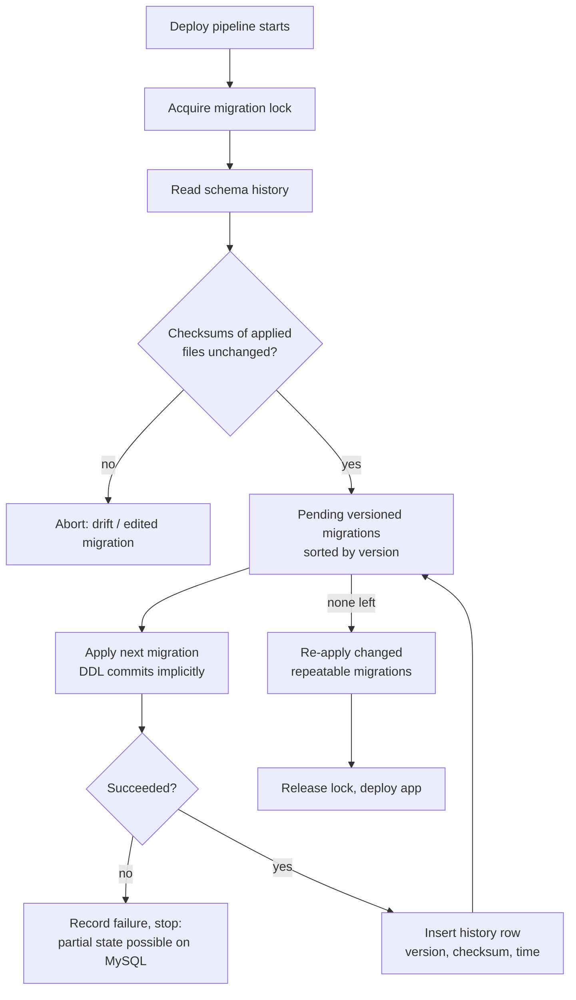

## Introduction

Application code lives in Git: every change is reviewed, versioned, tested and deployed through a pipeline, and any environment can be rebuilt from a commit. The database schema must follow the same discipline — but with one crucial difference: **a database has state**. You cannot "redeploy" a production schema by dropping it and creating the new version; you must *transform* the existing schema, with all its data, from version *n* to version *n + 1*, while the application keeps running.

A **database migration** is one such transformation: a script that moves the schema (and sometimes the data) one step forward. **Migration management** is the practice of:

- writing every schema change as an **ordered, immutable script** stored next to the application code;
- recording in the database itself **which scripts have been applied** (a schema history table), with checksums to detect tampering;
- applying pending scripts **automatically and identically** in every environment — developer laptop, CI, staging, production;
- planning **how to undo** or **roll forward** when a change goes wrong;
- **reviewing and testing** schema changes in CI like any other code.

This lesson covers the concepts and the MySQL-specific engineering: why MySQL's DDL is not transactional (and what that means for failed migrations), how online DDL algorithms (`INSTANT`, `INPLACE`, `COPY`) and metadata locks decide whether a migration causes downtime, and how the **expand/contract** pattern makes changes backward compatible. The production-scale techniques — large backfills, gh-ost and pt-online-schema-change — are developed further in [Schema Migrations and Schema Evolution in Production](/lessons/m12-schema-evolution).

:::note[What runs in the lab]
Migration tools themselves (Flyway, Liquibase, Alembic) run outside the database, so their configuration and commands are display-only. Everything they *do* inside MySQL runs here: you will build a schema history table, write a small migration runner as a stored procedure, apply ordered migrations, detect a modified script by its checksum, watch DDL commit implicitly, try online DDL algorithms and see the errors for unsupported combinations, and observe metadata-lock queues with real concurrent sessions.
:::

## DBMS Theory

:::theory[Schema evolution as a sequence of transformations]
Let *S₀* be the empty schema and *mᵢ* the *i*-th migration, a function from schema-and-data states to schema-and-data states. The schema at version *n* is defined as

> Sₙ = mₙ(mₙ₋₁(… m₁(S₀)))

Correct migration management guarantees three properties:

1. **Determinism and order** — every environment applies the *same* migrations in the *same* order, so every environment at version *n* has the same schema. Migrations are identified by a monotonically increasing version, never by timestamps of when someone happened to run them.
2. **Immutability** — once *mᵢ* has been applied anywhere that matters, it is never edited; a correction is a new migration *mᵢ₊₁*. Checksums enforce this.
3. **Exactly-once application** — each migration is applied at most once per database, recorded atomically with its effect if the DBMS allows it.

**Versioned** migrations are applied once, in order. **Repeatable** migrations (views, stored routines, seed reference data) are re-applied whenever their content changes; they must be idempotent ("create or replace"). The theory of **schema evolution** also distinguishes changes that are *backward compatible* (old application code still works: adding a nullable column, adding a table, adding an index) from *breaking* changes (renaming or dropping a column, changing a type) — the distinction that drives the expand/contract pattern.
:::

| Term | Meaning |
|---|---|
| Migration | Script that changes schema and/or data from version *n* to *n + 1* |
| Schema history table | Table in the target database recording applied migrations (`flyway_schema_history`, `DATABASECHANGELOG`, `alembic_version`, Rails' `schema_migrations`) |
| Checksum | Hash of a migration's content, stored at apply time; a mismatch later means the file was edited |
| Baseline | Marking an existing database as being at version *n* without running migrations 1…*n* |
| Down / undo migration | Script that reverses a migration |
| Roll forward | Fixing a bad migration with a new migration instead of reversing it |
| Expand / contract | Make a breaking change in backward-compatible steps: add new structure, migrate, switch, remove old structure |
| Drift | Differences between the schema the migrations describe and the schema actually present |

## Why It Exists

Before migration tools, schema changes were applied by hand: a DBA ran a script from an e-mail on production, someone else ran a slightly different version on staging, and developers' databases diverged from both. The results were predictable:

- **"Works on my machine"** — tests pass against a developer schema that production does not have.
- **Lost or duplicated changes** — a column added on staging but never on production; an index created twice; a migration half-applied after an error with nobody sure which half.
- **No audit trail** — nobody can say when a column changed type or why.
- **Unrepeatable environments** — a new developer, a CI runner or a disaster-recovery server cannot be built to the current schema reliably.
- **Deployments coupled to downtime** — breaking changes applied together with the new code, so old and new versions of the application cannot run side by side during a rolling deploy.

Migration management turns schema changes into reviewed, versioned artefacts that are applied the same way everywhere, and the expand/contract discipline makes them compatible with zero-downtime deployments.

## Internal Working

:::internals[What a migration tool does on each run]
1. **Connect and lock.** Acquire an exclusive lock so two deployers cannot migrate concurrently (Flyway uses a database lock — on MySQL, `GET_LOCK()`; Liquibase a `DATABASECHANGELOGLOCK` row).
2. **Read history.** Create the history table if missing; read applied versions and their checksums.
3. **Validate.** Compute checksums of the migration files and compare with the recorded ones. A mismatch (an applied file was edited), a missing file, or an out-of-order new file aborts the run by default.
4. **Plan.** Pending = available migrations whose version is not in the history, sorted by version; plus repeatable migrations whose checksum changed.
5. **Apply.** For each pending migration: execute its statements, then insert a history row (version, description, checksum, installed_by, installed_on, execution_time, success). On databases with **transactional DDL** (PostgreSQL), steps 5's statements and the history row run in one transaction. On **MySQL they cannot**: each DDL statement commits implicitly, so a failure in the middle of a multi-statement migration leaves the earlier statements applied and the history row marked failed (or absent).
6. **Release the lock** and report.
:::

:::internals[MySQL DDL: atomic per statement, not transactional]
- Since 8.0, the **data dictionary** is transactional and InnoDB DDL is **atomic**: a single `CREATE TABLE`, `ALTER TABLE` or `DROP TABLE` either completes fully or is rolled back, even across a crash.
- But DDL statements **implicitly commit** the current transaction before and after themselves. `START TRANSACTION; ALTER …; ALTER …; ROLLBACK;` does not undo either `ALTER`. A migration made of several statements is therefore *not* atomic as a whole.
- Every DDL statement needs an **exclusive metadata lock (MDL)** on the table, at least briefly (at the start and at the end even for `ALGORITHM=INSTANT`/`INPLACE` with `LOCK=NONE`). It must wait for every transaction that has touched the table to finish, and **while it waits, every new statement on the table queues behind it**. A single long-running transaction can turn a "100-millisecond instant ALTER" into an outage.
- **Online DDL algorithms**: `INSTANT` changes only metadata (add/rename columns, change defaults, extend `ENUM`/`SET` at the end, drop columns in 8.0.29+ when no index uses them); `INPLACE` rebuilds or modifies the table inside InnoDB while allowing concurrent DML for most operations (add secondary index, extend `VARCHAR` within the same length-byte size); `COPY` builds a new table and copies rows, blocking writes (`LOCK=SHARED`) for the duration. Specifying `ALGORITHM=` and `LOCK=` explicitly makes MySQL **refuse** the change instead of silently choosing a slower, more blocking algorithm.
:::



## MySQL Implementation

First, the property that shapes everything else — DDL commits implicitly, so it cannot be rolled back:

```sql run
START TRANSACTION;
CREATE TABLE coupons (code VARCHAR(20) PRIMARY KEY, pct TINYINT UNSIGNED NOT NULL);
INSERT INTO coupons VALUES ('WELCOME10', 10);
ROLLBACK;
SELECT COUNT(*) AS coupons_rows,
       (SELECT COUNT(*) FROM information_schema.TABLES
         WHERE TABLE_SCHEMA = DATABASE() AND TABLE_NAME = 'coupons') AS table_exists;
```

`CREATE TABLE` committed the (empty) transaction and itself; the `INSERT` then ran in autocommit mode because the transaction had already ended — so even the row survived the `ROLLBACK`. A migration tool on MySQL cannot wrap a migration in a transaction to make it all-or-nothing.

Now the **schema history table**. This one follows the columns that Flyway's `flyway_schema_history` records, simplified:

```sql run
DROP TABLE coupons;
CREATE TABLE schema_migrations (
  version        INT          NOT NULL PRIMARY KEY,
  description    VARCHAR(200) NOT NULL,
  checksum       BIGINT       NOT NULL,              -- CRC32 of the script text
  installed_on   DATETIME     NOT NULL,
  success        BOOLEAN      NOT NULL
);
CREATE TABLE migration_files (                        -- stands in for the files in db/migrations/
  version     INT          NOT NULL PRIMARY KEY,
  description VARCHAR(200) NOT NULL,
  script      TEXT         NOT NULL
);
INSERT INTO migration_files VALUES
  (1, 'create coupons',            'CREATE TABLE coupons (code VARCHAR(20) PRIMARY KEY, pct TINYINT UNSIGNED NOT NULL)'),
  (2, 'seed welcome coupon',       'INSERT INTO coupons VALUES (''WELCOME10'', 10)'),
  (3, 'add coupon to orders',      'ALTER TABLE orders ADD COLUMN coupon_code VARCHAR(20) NULL, ALGORITHM=INSTANT'),
  (4, 'index orders.coupon_code',  'ALTER TABLE orders ADD INDEX idx_orders_coupon (coupon_code), ALGORITHM=INPLACE, LOCK=NONE');
SELECT version, description, CRC32(script) AS checksum FROM migration_files ORDER BY version;
```

Real tools read `V1__create_coupons.sql`, `V2__seed_welcome_coupon.sql`, … from a directory; the table plays that role here. Each "file" holds a single statement so that the lab's runner can execute it with `PREPARE` (which accepts one statement); real tools split multi-statement files themselves.

Next, a **migration runner** — the core loop of every migration tool, as a stored procedure. It applies pending migrations in version order, stops at the first failure, and records each result:

```sql run
CREATE PROCEDURE migrate(IN p_now DATETIME)
BEGIN
  DECLARE done BOOLEAN DEFAULT FALSE;
  DECLARE v_version INT;
  DECLARE v_desc VARCHAR(200);
  DECLARE v_script TEXT;
  DECLARE pending CURSOR FOR
    SELECT f.version, f.description, f.script
    FROM migration_files f
    LEFT JOIN schema_migrations m ON m.version = f.version
    WHERE m.version IS NULL
    ORDER BY f.version;
  DECLARE CONTINUE HANDLER FOR NOT FOUND SET done = TRUE;
  DECLARE EXIT HANDLER FOR SQLEXCEPTION
  BEGIN
    INSERT INTO schema_migrations VALUES (v_version, v_desc, CRC32(v_script), p_now, FALSE);
    SELECT CONCAT('migration ', v_version, ' failed; stopped') AS result;
  END;
  OPEN pending;
  apply_loop: LOOP
    FETCH pending INTO v_version, v_desc, v_script;
    IF done THEN LEAVE apply_loop; END IF;
    SET @migration_sql = v_script;
    PREPARE m FROM @migration_sql;
    EXECUTE m;
    DEALLOCATE PREPARE m;
    INSERT INTO schema_migrations VALUES (v_version, v_desc, CRC32(v_script), p_now, TRUE);
  END LOOP;
  CLOSE pending;
  SELECT 'all pending migrations applied' AS result;
END;
CALL migrate('2026-11-09 09:00:00');
SELECT version, description, checksum, installed_on, success FROM schema_migrations ORDER BY version;
```

All four migrations are recorded, with the checksum of exactly the text that was applied. Running the tool again is a no-op — nothing is pending:

```sql run
CALL migrate('2026-11-09 09:05:00');
SELECT COUNT(*) AS history_rows FROM schema_migrations;
```

## Syntax Breakdown

How the three most common tools express the same ideas (display-only):

```text
db/migration/                       # Flyway (Java ecosystem; also CLI/Docker)
  V1__create_coupons.sql            # versioned: V<version>__<description>.sql, applied once, in order
  V2__seed_welcome_coupon.sql
  V3__add_coupon_to_orders.sql
  R__v_customer_directory.sql       # repeatable: re-applied whenever its checksum changes
  U3__add_coupon_to_orders.sql      # undo (Flyway Teams/Enterprise editions)
```

```bash
flyway -url=jdbc:mysql://db:3306/shop -user=migrator info      # applied / pending
flyway validate                                                 # checksums, missing files
flyway migrate
flyway repair                                                   # fix history after a failed MySQL migration
```

```yaml
# Liquibase changelog (YAML; XML/JSON/SQL also supported)
databaseChangeLog:
  - changeSet:
      id: 3-add-coupon-to-orders
      author: maria
      changes:
        - addColumn:
            tableName: orders
            columns:
              - column: {name: coupon_code, type: VARCHAR(20)}
      rollback:
        - dropColumn: {tableName: orders, columnName: coupon_code}
```

```python
# Alembic (SQLAlchemy ecosystem): versions/3f2a_add_coupon_to_orders.py
revision = "3f2a"
down_revision = "9c1b"            # revisions form a graph; branches can be merged

def upgrade():
    op.add_column("orders", sa.Column("coupon_code", sa.String(20), nullable=True))

def downgrade():
    op.drop_column("orders", "coupon_code")
```

| Concept | Flyway | Liquibase | Alembic | Rails / Django |
|---|---|---|---|---|
| Unit | SQL/Java file with version | changeSet (id + author + file) | revision module | migration class/file |
| Order | version number | changelog order | `down_revision` graph | timestamp / dependency graph |
| History table | `flyway_schema_history` (checksum, success, execution time) | `DATABASECHANGELOG` (MD5 checksum) + `DATABASECHANGELOGLOCK` | `alembic_version` (current head only) | `schema_migrations` / `django_migrations` |
| Repeatable | `R__` files | `runOnChange: true` | (manual) | (manual) |
| Rollback | `U` undo files (paid editions); otherwise roll forward | `rollback` blocks, `rollback --tag` | `downgrade()` | `down` / reverse operations |
| Drift detection | `validate`, checksums | checksums, `diff` | `--autogenerate` diff against models | schema dump diff |

MySQL statements every migration author must know:

| Statement / clause | Use in migrations |
|---|---|
| `ALTER TABLE … , ALGORITHM = INSTANT \| INPLACE \| COPY` | Demand a specific algorithm; error 1845/1846 if impossible, instead of a silent table copy |
| `ALTER TABLE … , LOCK = NONE \| SHARED \| EXCLUSIVE \| DEFAULT` | Demand a concurrency level during the operation |
| `SET SESSION lock_wait_timeout = N` | Bound how long DDL waits for the metadata lock (default 31,536,000 s = one year!) |
| `CREATE TABLE IF NOT EXISTS`, `DROP … IF EXISTS`, `CREATE OR REPLACE VIEW` | Idempotent statements — useful for repeatable migrations and re-running a partially failed one |
| `RENAME TABLE a TO a_old, a_new TO a` | Atomic multi-table rename — the cut-over step of copy-based tools |
| `GET_LOCK('migrations', 10)` / `RELEASE_LOCK` | Named advisory lock for "only one migrator at a time" |

:::version[Online DDL in MySQL 8.0/8.4]
- `ALGORITHM=INSTANT` arrived in 8.0.12 for adding columns at the end; **8.0.29** extended it to adding columns at any position and **dropping columns**, using row versions in the table metadata. A table supports a limited number of instant row versions before a rebuild is required — check the manual for your release's limit.
- `ALGORITHM=INSTANT` is the **default** choice when an operation supports it; specifying it explicitly turns "supported?" into an error you can see in CI.
- `RENAME COLUMN` (8.0) is instant; older `CHANGE COLUMN old new <type>` may rebuild if the type changes.
- gh-ost and pt-online-schema-change remain the tools of choice for changes that would otherwise need `COPY` on large tables ([Schema Evolution](/lessons/m12-schema-evolution)).
:::

## Practical Examples

**1. Detecting an edited migration (drift).** Somebody "fixes" migration 2 after it was applied — the coupon should give 15 %, not 10 %. The file changes; the database does not. A validation step compares checksums:

```sql run
UPDATE migration_files SET script = 'INSERT INTO coupons VALUES (''WELCOME10'', 15)' WHERE version = 2;
SELECT m.version, m.description,
       m.checksum           AS checksum_applied,
       CRC32(f.script)      AS checksum_in_repo,
       CASE WHEN f.version IS NULL THEN 'file missing'
            WHEN CRC32(f.script) <> m.checksum THEN 'EDITED AFTER APPLY'
            ELSE 'ok' END    AS validation
FROM schema_migrations m
LEFT JOIN migration_files f ON f.version = m.version
ORDER BY m.version;
```

Validation fails for version 2: environments that run the migrations from scratch would now get 15 %, environments that applied it earlier have 10 % — exactly the divergence migration management exists to prevent. The correct fix is to restore the original file and add **migration 5**: `UPDATE coupons SET pct = 15 WHERE code = 'WELCOME10'`.

```sql run
UPDATE migration_files SET script = 'INSERT INTO coupons VALUES (''WELCOME10'', 10)' WHERE version = 2;
INSERT INTO migration_files VALUES (5, 'welcome coupon is 15 percent', 'UPDATE coupons SET pct = 15 WHERE code = ''WELCOME10''');
CALL migrate('2026-11-09 10:00:00');
SELECT version, description, success FROM schema_migrations WHERE version >= 4 ORDER BY version;
SELECT * FROM coupons;
```

**2. A failing migration on MySQL leaves partial state.** Migration 6 tries to add a column and a `CHECK` constraint that existing data violates. Because the runner applies one statement per migration, the *first* statement of the change (6) succeeds and the *second* (7) fails:

```sql run
INSERT INTO migration_files VALUES
  (6, 'add coupon max_uses',             'ALTER TABLE coupons ADD COLUMN max_uses INT NULL, ALGORITHM=INSTANT'),
  (7, 'coupon pct must be at most 10',   'ALTER TABLE coupons ADD CONSTRAINT chk_coupon_pct CHECK (pct <= 10)'),
  (8, 'add coupon expiry',               'ALTER TABLE coupons ADD COLUMN expires_on DATE NULL, ALGORITHM=INSTANT');
CALL migrate('2026-11-09 11:00:00');
SELECT version, description, success FROM schema_migrations WHERE version >= 6 ORDER BY version;
SELECT COLUMN_NAME FROM information_schema.COLUMNS
WHERE TABLE_SCHEMA = DATABASE() AND TABLE_NAME = 'coupons' ORDER BY ORDINAL_POSITION;
```

Migration 6 is applied, 7 is recorded as failed (the existing 15 % coupon violates the constraint), and 8 never ran. If 6 and 7 had been one multi-statement *file*, the database would now be in a state that matches *no* version — half of migration 6/7. This is why, on MySQL:

- keep **one DDL statement per migration** where possible (or make each statement idempotent so the migration can be re-run after a fix);
- after a failure, inspect the actual schema, fix forward with a new migration, and repair the history (`flyway repair` deletes failed rows);
- **test migrations against a copy of production data** in CI — a constraint that holds on empty test tables can fail on real data, as here.

**3. Expand / contract: replacing a column without downtime.** The application must move from `customers.phone` (free text such as `+1-450-555-4657`) to a normalized `phone_digits` column. Renaming or changing the type in place would break the running application version. Expand/contract splits it into backward-compatible steps:

```sql run
-- EXPAND: add the new column (instant, nullable, old code unaffected)
ALTER TABLE customers ADD COLUMN phone_digits VARCHAR(15) NULL, ALGORITHM=INSTANT;
-- keep it in sync for writes from old and new application versions
CREATE TRIGGER trg_customers_phone_ins BEFORE INSERT ON customers FOR EACH ROW
  SET NEW.phone_digits = NULLIF(REGEXP_REPLACE(NEW.phone, '[^0-9]', ''), '');
CREATE TRIGGER trg_customers_phone_upd BEFORE UPDATE ON customers FOR EACH ROW
  SET NEW.phone_digits = NULLIF(REGEXP_REPLACE(NEW.phone, '[^0-9]', ''), '');
-- BACKFILL existing rows (in production: in small batches by primary-key range)
UPDATE customers SET phone_digits = NULLIF(REGEXP_REPLACE(phone, '[^0-9]', ''), '')
WHERE customer_id BETWEEN 1 AND 25;
SELECT customer_id, phone, phone_digits FROM customers ORDER BY customer_id LIMIT 6;
```

Now old code (writing `phone`) and new code (reading `phone_digits`) both work. Verify the backfill and the trigger before switching reads:

```sql run
UPDATE customers SET phone = '+1 (512) 555-0199' WHERE customer_id = 1;
SELECT COUNT(*) AS rows_out_of_sync
FROM customers
WHERE NOT (phone_digits <=> NULLIF(REGEXP_REPLACE(phone, '[^0-9]', ''), ''));
SELECT customer_id, phone, phone_digits FROM customers WHERE customer_id = 1;
```

After all application versions read and write `phone_digits`, the **contract** migration removes the old structure — in a *later* release, once no running code uses it:

```sql
-- CONTRACT (a separate, later migration)
DROP TRIGGER trg_customers_phone_ins;
DROP TRIGGER trg_customers_phone_upd;
ALTER TABLE customers DROP COLUMN phone, ALGORITHM=INSTANT;   -- 8.0.29+, no index on the column
```

**4. Choosing the online DDL algorithm deliberately.** Demanding the algorithm and lock level turns surprises into errors. Extending a `VARCHAR` within the same length-byte size is in-place and allows concurrent writes:

```sql run
ALTER TABLE customers MODIFY last_name VARCHAR(60) NOT NULL, ALGORITHM=INPLACE, LOCK=NONE;
```

Shrinking or changing a column's type requires a full table copy, and MySQL says so instead of quietly blocking writes:

```sql run error
ALTER TABLE customers MODIFY last_name VARCHAR(40) NOT NULL, ALGORITHM=INPLACE, LOCK=NONE;
```

A secondary index cannot be added instantly — but can be built in place with concurrent DML:

```sql run error
ALTER TABLE customers ADD INDEX idx_customers_phone_digits (phone_digits), ALGORITHM=INSTANT;
```

```sql run
ALTER TABLE customers ADD INDEX idx_customers_phone_digits (phone_digits), ALGORITHM=INPLACE, LOCK=NONE;
```

And `COPY` can never be combined with `LOCK=NONE`, because the copy must block writes:

```sql run error
ALTER TABLE customers MODIFY last_name VARCHAR(40) NOT NULL, ALGORITHM=COPY, LOCK=NONE;
```

Error 1845 means "this algorithm is not supported for this operation"; error 1846 explains why and which algorithm or lock level would work. In CI, running every migration with explicit `ALGORITHM`/`LOCK` against a production-like schema catches table rebuilds before they reach production.

## Execution Walkthrough

The most dangerous moment of an "instant" migration is waiting for its metadata lock. Session **A** is an application transaction that has read `products` and not yet committed (a slow request, an idle-in-transaction connection, a long report); session **B** is the migration; session **C** is ordinary traffic.

```concurrency
title: An instant ALTER waits for a metadata lock — and blocks everyone behind it
description: A long-running transaction holds a shared metadata lock on products; the migration queues for an exclusive one; new queries queue behind the migration.
steps:
  - session: A
    sql: START TRANSACTION; SELECT COUNT(*) AS active_products FROM products WHERE is_active = TRUE;
    note: A's transaction now holds a shared metadata lock on products until it commits.
  - session: B
    sql: ALTER TABLE products ADD COLUMN warranty_months TINYINT UNSIGNED NULL, ALGORITHM=INSTANT;
    expect: blocks
    note: The instant ALTER needs an exclusive metadata lock, if only for milliseconds. It waits for A ("Waiting for table metadata lock").
  - session: C
    sql: SELECT COUNT(*) FROM products;
    expect: blocks
    note: A plain SELECT now waits too — pending exclusive MDL requests take priority over new shared ones, so traffic queues behind the migration. On a busy table this is an outage.
  - session: A
    sql: COMMIT;
    note: A releases its lock; B's ALTER runs (instantly) and then C's SELECT proceeds.
  - session: C
    sql: SELECT COUNT(*) AS columns_now FROM information_schema.COLUMNS WHERE TABLE_SCHEMA = DATABASE() AND TABLE_NAME = 'products';
```

The defence is to bound the wait and retry: run migrations with a short `lock_wait_timeout` so that the `ALTER` gives up (error 1205) instead of stalling traffic, then retry later — and to find and fix long transactions first (`information_schema.INNODB_TRX`, `performance_schema.metadata_locks`).

```sql
SET SESSION lock_wait_timeout = 3;   -- in the migration session only
ALTER TABLE products ADD COLUMN warranty_months TINYINT UNSIGNED NULL, ALGORITHM=INSTANT;
-- on error 1205: back off and retry; tools like gh-ost and Liquibase/Flyway wrappers automate this
```

## Output

The captured results trace the life of a migrated schema:

- **Implicit commit:** after `START TRANSACTION; CREATE TABLE …; INSERT …; ROLLBACK`, both the table and its row still existed.
- **Runner:** migrations 1–4 were applied in order and recorded with their checksums; a second run applied nothing (still four history rows).
- **Drift:** editing migration 2 after it was applied produced a checksum mismatch flagged `EDITED AFTER APPLY`; restoring it and adding migration 5 set the coupon to 15 % the correct way.
- **Failure:** migration 6 succeeded, 7 failed against real data (recorded with `success = 0`), 8 was never attempted — and the `coupons` table now has the `max_uses` column but no `expires_on`: a partial state that only a forward fix can resolve.
- **Expand/contract:** the new column was backfilled and kept in sync by triggers (zero rows out of sync after an update through the old column).
- **Online DDL:** in-place `VARCHAR` extension and index build succeeded; shrinking in place (1846), an instant index (1845) and `COPY` with `LOCK=NONE` (1846) were refused with explanations.
- **Metadata locks:** both the instant `ALTER` and a plain `SELECT` were recorded as blocked until the long transaction committed.

## Alternative Approaches

| Approach | How it works | Strengths | Weaknesses |
|---|---|---|---|
| **Versioned migrations** (Flyway, Liquibase, Alembic, framework migrations) | Ordered imperative scripts + history table | Explicit, reviewable, full control of data migrations and ordering | Authors must write every change; drift if someone changes production by hand |
| **Declarative / state-based** (Skeema, Atlas, MySQL Shell / Workbench schema diff, SSDT-style tools) | Desired schema is stored as `CREATE` statements; the tool diffs it against the live database and generates DDL | No hand-written ALTERs; drift detection built in | Generated plans need review (a rename looks like drop + add — data loss); data migrations still need scripts |
| **ORM auto-generation** (Django `makemigrations`, Alembic `--autogenerate`, Prisma Migrate) | Generates migration files from model changes | Fast developer loop | Generated DDL can be naive about locking and online DDL; review required |
| **Online schema change tools** (gh-ost, pt-online-schema-change, Spirit) | Shadow table + copy + change capture (binlog or triggers) + atomic rename | Large-table changes without blocking writes, throttling, pausing | Operational complexity; foreign keys and triggers complicate them |
| **Managed schema-change platforms** (Bytebase, PlanetScale-style deploy requests, Vitess online DDL) | Review workflow, policy checks, scheduled online migrations | Governance, approvals, automatic online execution | Platform dependency |
| **Manual scripts** | DBA runs SQL by hand | None worth having | All the problems in "Why It Exists" |

**Rollback strategies** compared:

| Strategy | When it works | Caveat on MySQL |
|---|---|---|
| Down/undo migrations | Pure additive changes (drop the added column/index) | Undo of a destructive change (dropped column) cannot recover data; DDL not transactional |
| **Roll forward** (new corrective migration) | Almost always — the default in mature teams | Requires fast pipeline to ship the fix |
| Expand/contract with feature flags | Breaking changes | Rollback = switch the flag back; old structure still exists until contract |
| Restore from backup / PITR | Catastrophic data loss | Slow; loses later writes ([PITR](/lessons/m11-restore-pitr)) |

## Performance Analysis

What a migration costs depends almost entirely on the **algorithm** and on **locking**, not on the number of statements:

| Operation (InnoDB, 8.0.29+/8.4) | Typical algorithm | Concurrent DML | Cost grows with |
|---|---|---|---|
| Add nullable column, rename column, change default, extend ENUM at end | INSTANT | Yes | Constant (metadata only) — plus the MDL wait |
| Drop column (no index on it) | INSTANT | Yes | Constant |
| Add secondary index | INPLACE | Yes (LOCK=NONE) | Table size (sorted index build, temp space, redo) |
| Extend VARCHAR within same length-byte size (≤255 or >255 bytes) | INPLACE | Yes | Constant |
| Change column type / shrink, add `NOT NULL` without default on existing data, change PK | COPY (or INPLACE rebuild) | No for COPY | Table size × indexes |
| `ALTER TABLE … ENCRYPTION`, `CONVERT TO CHARACTER SET` | Rebuild | Often no | Table size |

Hidden costs to plan for:

- **Replication**: DDL replicates as one event and is applied on each replica *after* it finished on the source — a 40-minute `INPLACE` index build on the source becomes 40 minutes of replica lag, unless the change is applied by an online schema change tool that replicates as ordinary row changes.
- **Backfills** generate redo, undo and binlog proportional to the rows changed; run them in small batches (e.g. 1,000–10,000 rows by primary-key range), with pauses, watching replica lag ([Handling Millions of Records](/lessons/m12-large-tables)).
- **MDL waits** can turn any DDL into an outage, as the concurrency scenario showed; always set `lock_wait_timeout` for migration sessions.
- **Instant row versions** accumulate; after many instant add/drop operations a table eventually needs a rebuild.

:::performance[Theory vs measurement]
The operations in this lesson ran on tables of a few dozen rows, so their duration says nothing about production. The algorithm and lock level are what matter, and those are verified by the captured successes and errors. Measure real migrations on a production-sized copy in CI or staging, including replica lag.
:::

## Best Practices

:::best-practice[Schema changes as code]
1. **Every schema change is a migration in the application repository**, reviewed in a pull request. Nobody changes production schemas by hand; drift detection alerts if they do.
2. **Never edit an applied migration.** Fix forward with a new one. Enforce with checksum validation in CI and at deploy time.
3. **One logical change per migration, one DDL statement per migration on MySQL** where practical; make statements idempotent where tools allow (`IF NOT EXISTS`).
4. **Make changes backward compatible** with expand/contract, so old and new application versions run side by side during rolling deploys; contract in a later release.
5. **Specify `ALGORITHM` and `LOCK`** for every `ALTER TABLE` and set `lock_wait_timeout` in the migration session.
6. **Separate schema changes from large data changes**: backfills run as batched, throttled jobs, not inside a migration that holds locks.
7. **Run migrations with a dedicated migrator account** that has DDL privileges on the application schema only ([Privileges and Roles](/lessons/m11-privileges-roles)); the application account has none.
8. **Test in CI** against a production-like schema (and ideally anonymized production-sized data): apply all migrations from scratch, apply pending ones on a copy of production's current version, run the test suite, check for table rebuilds and long locks, and lint for dangerous patterns (dropping columns still referenced, adding `NOT NULL` without default, missing `ALGORITHM`).
9. **Plan rollback before deploying**: is the change additive (easy undo), behind a flag, or irreversible (needs a backup checkpoint)?
10. **Use large-table tooling** (gh-ost, pt-online-schema-change) when a change would need `COPY` on a big table.
:::

## Common Mistakes

**Mistake 1 — editing a migration that has already run somewhere.** You saw the checksum mismatch: environments diverge silently if validation is off. Add a new migration instead.

**Mistake 2 — wrapping a MySQL migration in `START TRANSACTION … ROLLBACK` and expecting atomicity.** DDL commits implicitly (the first example); the "rollback" undoes nothing.

**Mistake 3 — renaming or dropping a column in the same release that stops using it.** During a rolling deploy, old application instances still query the old column and fail. Expand, migrate, switch, *then* contract in a later release.

**Mistake 4 — trusting that an ALTER will be online.** Without `ALGORITHM=`/`LOCK=`, MySQL picks the least restrictive algorithm the operation supports — which may be a full table `COPY` that blocks writes for an hour. Specify them so impossible combinations fail fast, as in Example 4.

**Mistake 5 — ignoring metadata locks.** An instant `ALTER` behind a forgotten open transaction blocks all traffic on the table (the concurrency scenario). Set `lock_wait_timeout`, kill or wait out long transactions, and run migrations at low-traffic times.

**Mistake 6 — huge backfills in one statement.** `UPDATE customers SET phone_digits = …` on 200 million rows is one transaction: hours of locks, enormous undo, and a replica that lags by the full duration. Batch by primary-key ranges.

**Mistake 7 — migrations that depend on application code.** A migration that imports the current ORM models breaks when the models change later; migrations must be self-contained snapshots of what the schema looked like at that version.

## Industry Application

- **Typical CI/CD pipeline.** Pull request → CI spins up MySQL 8.4 in a container → applies all migrations from scratch *and* applies pending migrations on a snapshot of the current production schema → runs tests → a schema linter flags risky operations (missing `ALGORITHM`, dropping columns, non-batched updates) → a reviewer with database expertise approves → on deploy, the pipeline's migrator account runs `flyway migrate` (or equivalent) before rolling out application instances.
- **Large tables.** Teams with very large MySQL tables route changes through gh-ost or pt-online-schema-change (or Vitess/PlanetScale online DDL), scheduled and throttled by replica lag, with the migration tool recording the result in its history afterwards.
- **Monorepos and many services.** Each service owns its schema and migrations; cross-service changes go through APIs, not shared tables. Migration ownership and review rules are encoded in CODEOWNERS.
- **Regulated environments.** Change management requires approvals and audit trails; the schema history table plus PR history provide evidence of who changed what, when, and why.
- **Data warehouses and analytics.** The same principles apply to dbt models and warehouse DDL — versioned, reviewed, tested transformations — showing that "schema as code" is general practice, not just an OLTP habit.

## Practice Exercises

```exercise
id: ex1
title: Which migrations are pending?
difficulty: easy
kind: query
dataset: empty
setup: |
  CREATE TABLE schema_migrations (version INT PRIMARY KEY, description VARCHAR(200), checksum BIGINT, success BOOLEAN);
  INSERT INTO schema_migrations VALUES (1,'create users',111,TRUE),(2,'create orders',222,TRUE),(3,'add orders.total',333,TRUE),(5,'index orders.user_id',555,TRUE);
  CREATE TABLE migration_files (version INT PRIMARY KEY, description VARCHAR(200), checksum BIGINT);
  INSERT INTO migration_files VALUES (1,'create users',111),(2,'create orders',222),(3,'add orders.total',333),(4,'add users.locale',444),(5,'index orders.user_id',555),(6,'create refunds',666),(7,'add refunds.reason',777);
concepts: [versioned-migrations, schema-migrations]
prompt: |
  `schema_migrations` is the history of applied migrations and `migration_files` lists the files in the repository.
  Return the migrations that have **not** been applied, with columns `version` and `description`, in the order a
  migration tool would apply them.
hints:
  - "Anti-join: files LEFT JOIN history … WHERE history.version IS NULL."
  - "A migration tool applies pending migrations in ascending version order."
solution: |
  SELECT f.version, f.description
  FROM migration_files f
  LEFT JOIN schema_migrations m ON m.version = f.version
  WHERE m.version IS NULL
  ORDER BY f.version;
orderMatters: true
explanation: |
  Version 4 is pending although 5 is already applied — an **out-of-order** migration (typically from a feature
  branch merged late). Flyway refuses it by default (`outOfOrder=false`) because applying 4 after 5 means this
  database's history differs from environments that applied them in order. The team must decide whether 4 is safe to
  apply out of order or should be renumbered.
```

```exercise
id: ex2
title: Validate checksums
difficulty: medium
kind: query
dataset: empty
setup: |
  CREATE TABLE schema_migrations (version INT PRIMARY KEY, description VARCHAR(200), checksum BIGINT, success BOOLEAN);
  INSERT INTO schema_migrations VALUES (1,'create users',111,TRUE),(2,'create orders',222,TRUE),(3,'add orders.total',333,FALSE),(4,'add users.locale',444,TRUE),(5,'seed countries',555,TRUE);
  CREATE TABLE migration_files (version INT PRIMARY KEY, description VARCHAR(200), checksum BIGINT);
  INSERT INTO migration_files VALUES (1,'create users',111),(2,'create orders',299),(3,'add orders.total',333),(5,'seed countries',555),(6,'create refunds',666);
concepts: [schema-migrations, schema-ci]
prompt: |
  Implement a `validate` step. For every row in the history, return `version` and `problem`, where problem is
  `'file missing'` (no file with that version), `'checksum mismatch'` (file content changed), or
  `'failed migration'` (`success` is false). Return only rows with a problem; if several apply, report the first in
  that order. Order by `version`.
hints:
  - "LEFT JOIN history to files on version and use CASE with the checks in the required order."
  - "Wrap it in a derived table and filter problem IS NOT NULL."
solution: |
  SELECT version, problem
  FROM (
    SELECT m.version,
           CASE WHEN f.version IS NULL THEN 'file missing'
                WHEN f.checksum <> m.checksum THEN 'checksum mismatch'
                WHEN NOT m.success THEN 'failed migration'
           END AS problem
    FROM schema_migrations m
    LEFT JOIN migration_files f ON f.version = m.version
  ) v
  WHERE problem IS NOT NULL
  ORDER BY version;
orderMatters: true
explanation: |
  Three different problems need three different responses: an edited file (2) must be restored and the change
  re-expressed as a new migration; a failed migration (3) on MySQL means the schema may be half-changed — inspect it,
  fix forward, then repair the history; a missing file (4) means someone deleted history from the repository, so new
  environments can no longer be built. Migration 6 is simply pending and not a validation error.
```

```exercise
id: ex3
title: Build a migrations table and apply ordered migrations
difficulty: hard
kind: dml
dataset: empty
setup: |
  CREATE TABLE migration_files (version INT PRIMARY KEY, description VARCHAR(200) NOT NULL, script TEXT NOT NULL);
  INSERT INTO migration_files VALUES
    (1,'create authors','CREATE TABLE authors (author_id INT PRIMARY KEY, name VARCHAR(100) NOT NULL)'),
    (2,'create books','CREATE TABLE books (book_id INT PRIMARY KEY, author_id INT NOT NULL, title VARCHAR(200) NOT NULL, CONSTRAINT fk_books_author FOREIGN KEY (author_id) REFERENCES authors (author_id))'),
    (3,'seed authors','INSERT INTO authors VALUES (1, ''Codd''), (2, ''Date'')'),
    (4,'add books.published_year','ALTER TABLE books ADD COLUMN published_year SMALLINT NULL, ALGORITHM=INSTANT');
concepts: [schema-migrations, versioned-migrations]
prompt: |
  The setup provides `migration_files(version, description, script)`. Create the history table
  **`schema_migrations(version INT PRIMARY KEY, description VARCHAR(200) NOT NULL, checksum BIGINT NOT NULL,
  success BOOLEAN NOT NULL)`** and apply migrations **1 to 4 in order**, recording each with
  `checksum = CRC32(script)` and `success = TRUE`. You may execute the scripts directly or write a runner procedure.

  The checker reads the history and the structure of the resulting tables.
hints:
  - "Simplest: run the four statements yourself in order, then INSERT INTO schema_migrations SELECT version, description, CRC32(script), TRUE FROM migration_files;"
  - "Order matters: books references authors, and migration 4 alters books."
solution: |
  CREATE TABLE schema_migrations (
    version INT PRIMARY KEY, description VARCHAR(200) NOT NULL, checksum BIGINT NOT NULL, success BOOLEAN NOT NULL);
  CREATE TABLE authors (author_id INT PRIMARY KEY, name VARCHAR(100) NOT NULL);
  INSERT INTO schema_migrations SELECT version, description, CRC32(script), TRUE FROM migration_files WHERE version = 1;
  CREATE TABLE books (book_id INT PRIMARY KEY, author_id INT NOT NULL, title VARCHAR(200) NOT NULL,
    CONSTRAINT fk_books_author FOREIGN KEY (author_id) REFERENCES authors (author_id));
  INSERT INTO schema_migrations SELECT version, description, CRC32(script), TRUE FROM migration_files WHERE version = 2;
  INSERT INTO authors VALUES (1, 'Codd'), (2, 'Date');
  INSERT INTO schema_migrations SELECT version, description, CRC32(script), TRUE FROM migration_files WHERE version = 3;
  ALTER TABLE books ADD COLUMN published_year SMALLINT NULL, ALGORITHM=INSTANT;
  INSERT INTO schema_migrations SELECT version, description, CRC32(script), TRUE FROM migration_files WHERE version = 4;
check: |
  SELECT 'history' AS kind, CONCAT(version, ':', description, ':', checksum = (SELECT CRC32(script) FROM migration_files f WHERE f.version = m.version), ':', success) AS detail
  FROM schema_migrations m
  UNION ALL
  SELECT 'column', CONCAT(TABLE_NAME, '.', COLUMN_NAME)
  FROM information_schema.COLUMNS
  WHERE TABLE_SCHEMA = DATABASE() AND TABLE_NAME IN ('authors', 'books')
  UNION ALL
  SELECT 'authors', CAST(COUNT(*) AS CHAR) FROM authors
  ORDER BY kind, detail;
explanation: |
  Recording each migration right after applying it mirrors what tools do on MySQL: there is no transaction to bind
  the DDL and the history row together, so the history row is written immediately after the statement succeeds. A
  runner procedure (as in the lesson) is the reusable version of the same loop. The checksum is what later lets a
  `validate` step detect an edited file.
```

```exercise
id: ex4
title: Expand step with backfill and sync trigger
difficulty: hard
kind: dml
concepts: [expand-contract, online-ddl]
prompt: |
  Begin an expand/contract change on `customers`: the application will switch from `email` to a normalized
  **`email_normalized`** column (lower-case, trimmed).

  1. Add `email_normalized VARCHAR(255) NULL` with **`ALGORITHM=INSTANT`**.
  2. Create a **`BEFORE UPDATE`** trigger named **`trg_customers_email_norm`** that sets
     `NEW.email_normalized = LOWER(TRIM(NEW.email))`.
  3. Backfill all existing rows.
  4. Through the *old* column, change customer 3's email to `'  Mixed.Case@Example.COM '`.

  The checker reads the trigger's timing, the count of out-of-sync rows and customer 3's normalized value.
hints:
  - "ALTER TABLE customers ADD COLUMN email_normalized VARCHAR(255) NULL, ALGORITHM=INSTANT;"
  - "CREATE TRIGGER trg_customers_email_norm BEFORE UPDATE ON customers FOR EACH ROW SET NEW.email_normalized = LOWER(TRIM(NEW.email));"
  - "Backfill with UPDATE customers SET email_normalized = LOWER(TRIM(email)); — the trigger would also fire, harmlessly."
solution: |
  ALTER TABLE customers ADD COLUMN email_normalized VARCHAR(255) NULL, ALGORITHM=INSTANT;
  CREATE TRIGGER trg_customers_email_norm BEFORE UPDATE ON customers FOR EACH ROW
    SET NEW.email_normalized = LOWER(TRIM(NEW.email));
  UPDATE customers SET email_normalized = LOWER(TRIM(email));
  UPDATE customers SET email = '  Mixed.Case@Example.COM ' WHERE customer_id = 3;
check: |
  SELECT (SELECT ACTION_TIMING FROM information_schema.TRIGGERS
           WHERE TRIGGER_SCHEMA = DATABASE() AND TRIGGER_NAME = 'trg_customers_email_norm') AS trigger_timing,
         (SELECT COUNT(*) FROM customers WHERE NOT (email_normalized <=> LOWER(TRIM(email)))) AS out_of_sync,
         (SELECT email_normalized FROM customers WHERE customer_id = 3) AS customer_3_normalized;
explanation: |
  The instant `ADD COLUMN` keeps the expand step cheap; the trigger keeps rows written by the *old* application
  version in sync; the backfill covers existing rows. A complete change also needs a `BEFORE INSERT` trigger (or
  application dual-writes) — omitted here to keep the exercise focused. Only after every running version reads
  `email_normalized` does a later contract migration drop the triggers and the old column. On a large table the
  backfill must run in batches.
```

```exercise
id: ex5
title: Rollback strategy and CI for a risky change
difficulty: challenge
kind: open
concepts: [rollback-strategy, schema-ci, expand-contract, online-ddl]
prompt: |
  A product team wants to split `orders.status` (an ENUM) into a new `order_status_history` table and drop the
  `status` column, in a 300-million-row MySQL 8.4 table, as part of next week's release. Write the migration plan
  (steps and releases), the rollback strategy for each step, and the CI checks you would require before any step
  reaches production. Explain the MySQL-specific risks.
solution: |
  **Plan (expand/contract over several releases).**
  1. *Release 1 — expand:* migration `CREATE TABLE order_status_history (…)` (new table, no risk). Application
     dual-writes: every status change updates `orders.status` *and* inserts a history row. Rollback: drop the new
     table / turn off the dual-write flag — no data loss, old code unaffected.
  2. *Backfill job (not a migration):* insert the current status of every order into the history table in batches
     of a few thousand rows by primary-key range, throttled on replica lag, resumable, idempotent
     (`INSERT … ON DUPLICATE KEY UPDATE` / `INSERT IGNORE`). Rollback: stop the job, truncate the new table.
  3. *Release 2 — switch reads:* behind a feature flag, read status from the history table; compare results with
     `orders.status` in shadow mode first. Rollback: flip the flag.
  4. *Release 3 — stop writing `orders.status`:* remove dual-writes after a soak period. Rollback: re-enable
     dual-writes and re-backfill the gap (keep it possible by retaining the column).
  5. *Release 4 — contract:* `ALTER TABLE orders DROP COLUMN status, ALGORITHM=INSTANT, LOCK=NONE` (instant in 8.0.29+
     if no index includes it — otherwise drop the index first, or use gh-ost). Rollback: **none** without data loss —
     take a backup checkpoint (and keep a column snapshot table) before this step; after it, the only way back is
     restore/PITR. That is why the contract step happens only after weeks of the new path in production.

  **MySQL-specific risks.** DDL is not transactional — a multi-statement migration can half-apply, so one statement
  per migration with explicit `ALGORITHM`/`LOCK`; metadata-lock waits on a hot 300 M-row table can stall traffic —
  `lock_wait_timeout` of a few seconds with retries, no long transactions during the window; any operation that
  falls back to `COPY` would rebuild 300 M rows with writes blocked — use gh-ost/pt-osc instead; DDL replicates after
  completing on the source — replica lag; instant row-version limits after many instant changes; the backfill's
  redo/undo/binlog volume and replica lag.

  **CI checks.** Apply all migrations from scratch on MySQL 8.4; apply pending ones on a snapshot of the current
  production schema (and a sampled copy of data); assert every `ALTER` declares `ALGORITHM` and `LOCK` and succeeds
  with them; run the application test suite against old *and* new code with the migrated schema (backward
  compatibility); lint for destructive operations requiring explicit approval (drop column/table, type changes,
  `NOT NULL` additions); checksum validation of history; record expected duration on production-sized data in
  staging; require a database reviewer and a documented rollback for each step.
```

## Knowledge Assessment

```quiz
- id: q1
  question: "Migration V7 was applied in production last month. A developer finds a typo in it. What should they do?"
  options:
    - "Edit V7 and re-run the migration tool"
    - "Leave V7 unchanged and add V8 that corrects the problem"
    - "Delete V7's row from the history table and re-apply the edited file"
    - "Edit V7 and disable checksum validation"
  answer: 1
  explanation: "Applied migrations are immutable; corrections are new migrations so every environment converges. Editing, deleting history or disabling validation makes environments diverge silently."
  concepts: [versioned-migrations]
- id: q2
  question: "On MySQL, a migration file contains `ALTER TABLE a …; ALTER TABLE b …;` and the second statement fails. What is the state?"
  options:
    - "Both ALTERs are rolled back because the tool uses a transaction"
    - "The first ALTER is applied (DDL commits implicitly); the schema matches no version until fixed forward"
    - "Neither statement ran"
    - "MySQL retries the second statement automatically"
  answer: 1
  explanation: "MySQL DDL is atomic per statement but implicitly commits, so multi-statement migrations are not atomic. Tools record a failed migration; you inspect and fix forward."
  concepts: [rollback-strategy]
- id: q3
  question: "Which changes are backward compatible with application code that does not know about them? (Select all that apply.)"
  type: multi
  options:
    - "Adding a nullable column"
    - "Adding a new table"
    - "Renaming a column the application reads"
    - "Adding a secondary index"
  answer: [0, 1, 3]
  explanation: "Additive changes do not break existing queries (as long as code avoids SELECT * assumptions and positional INSERTs). Renaming a used column breaks old code — use expand/contract."
  concepts: [expand-contract]
- id: q4
  question: "`ALTER TABLE t ADD INDEX i (c), ALGORITHM=INSTANT` fails with error 1845. What is the right reaction?"
  options:
    - "Retry without ALGORITHM so MySQL chooses"
    - "Use ALGORITHM=INPLACE, LOCK=NONE, which builds the index while allowing concurrent DML"
    - "Use ALGORITHM=COPY, LOCK=NONE"
    - "Run FLUSH TABLES first"
  answer: 1
  explanation: "Secondary indexes cannot be added instantly but can be built in place online. Omitting ALGORITHM works but hides what MySQL chose; COPY cannot be combined with LOCK=NONE (error 1846)."
  concepts: [online-ddl]
- id: q5
  question: "An instant ALTER on a hot table hangs, and soon every query on that table is waiting. What is the most likely cause?"
  options:
    - "INSTANT operations copy the table"
    - "The ALTER waits for an exclusive metadata lock behind a long-running transaction, and new statements queue behind the pending ALTER"
    - "The buffer pool is full"
    - "Instant ALTERs require a server restart"
  answer: 1
  explanation: "All DDL needs an exclusive MDL briefly. A pending exclusive request blocks new shared requests, so traffic queues. Set lock_wait_timeout low and fix long transactions."
  concepts: [online-ddl]
- id: q6
  question: "What is a repeatable migration (e.g. Flyway's `R__` files) best used for?"
  options:
    - "Large data backfills"
    - "Objects that can be recreated idempotently from their full definition, such as views and stored routines, re-applied when their checksum changes"
    - "Dropping tables"
    - "Changing column types"
  answer: 1
  explanation: "Repeatable migrations re-run whenever their content changes, so they must be idempotent full definitions (CREATE OR REPLACE VIEW). Backfills and destructive or type changes belong in versioned migrations."
  concepts: [repeatable-migrations]
- id: q7
  question: "Which rollback approach do mature teams default to on MySQL, and why?"
  options:
    - "Down migrations for every change, because DDL is transactional"
    - "Roll forward with a new corrective migration (plus expand/contract and feature flags), because DDL is not transactional and destructive changes cannot be undone by a down script"
    - "Restore from backup after every failed deploy"
    - "Never change the schema"
  answer: 1
  explanation: "Down scripts cannot restore dropped data and MySQL cannot roll back DDL. Rolling forward, with breaking changes split into reversible steps, keeps deployments fast and safe; backups are for disasters."
  concepts: [rollback-strategy]
- id: q8
  question: "Which CI checks catch the most dangerous schema-change problems before production? (Select all that apply.)"
  type: multi
  options:
    - "Applying pending migrations to a copy of the current production schema with realistic data"
    - "Requiring explicit ALGORITHM/LOCK clauses and verifying they succeed"
    - "Running the old application version's tests against the migrated schema"
    - "Skipping migration tests to keep the pipeline fast"
  answer: [0, 1, 2]
  explanation: "Realistic data exposes constraint and duration problems; explicit algorithms expose table rebuilds; running old code against the new schema proves backward compatibility. Skipping tests moves discovery to production."
  concepts: [schema-ci]
```
