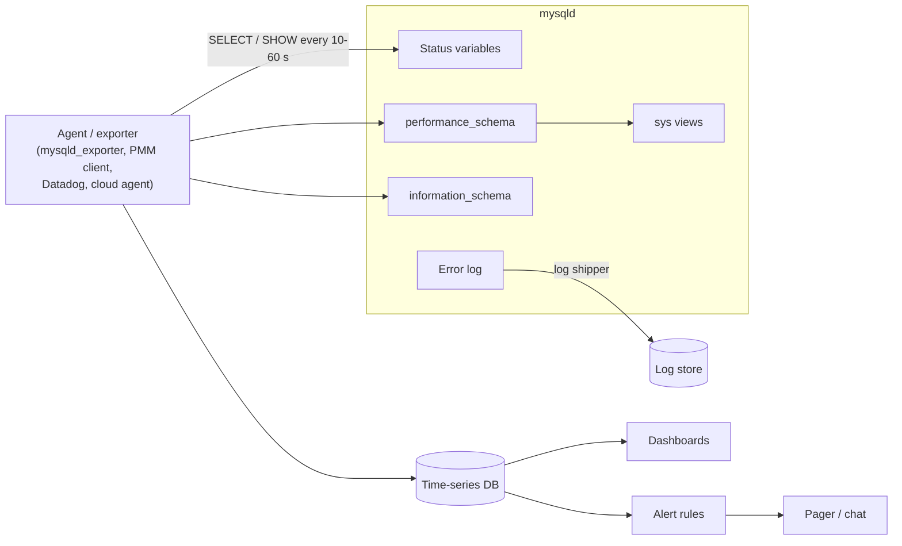

## Introduction

A database that is not monitored fails twice: once when something goes wrong, and again when nobody notices until customers do. **Monitoring** is the continuous collection of measurements about the server — how much work it does, how long the work takes, which resources are saturated, which errors occur — so that you can answer three questions at any moment:

1. **Is it healthy right now?** (dashboards, alerts)
2. **What changed?** (trends, comparisons with yesterday or last week, correlation with deploys)
3. **Why?** (drill-down from a symptom — "checkout is slow" — to a cause — "one query's plan changed and it now examines 40× more rows")

MySQL exposes thousands of measurements: **status variables** (`SHOW GLOBAL STATUS`), **system variables** (configuration), **`performance_schema`** (detailed instrumentation of statements, waits, locks, memory, I/O), the **`sys` schema** (readable views over `performance_schema`), `information_schema` (metadata, sizes, InnoDB state), and the **error log**. The skill is not reading all of them — it is knowing the dozen that matter, turning raw counters into **rates and ratios**, and alerting on **symptoms** with sensible thresholds.

This lesson builds on [Slow Query Diagnostics](/lessons/m07-slow-query-diagnostics), which covers the slow query log and statement digests in depth; here the focus is server-level health and the monitoring pipeline.

:::note[What the lab can and cannot read]
Status variables are readable by every account, so `SHOW SESSION STATUS` and even `SHOW GLOBAL STATUS` run in your lab — their values below are **real captures from the build server at capture time** and will differ every time. Reading `performance_schema`, `sys`, the error-log table or InnoDB transaction tables requires privileges a lab account does not have (you will see the errors); those queries are display-only and their outputs are **illustrative**. To practise the analysis side, you will work on tables of **synthetic metric samples** that have the same shape a monitoring agent stores.
:::

## DBMS Theory

:::theory[Measurements, signals and methods]
**Kinds of measurement.**
- A **counter** only increases (until restart): `Questions`, `Innodb_buffer_pool_reads`, `Slow_queries`. Its absolute value is meaningless; its **rate** (Δvalue ÷ Δtime) is the signal.
- A **gauge** is a current level: `Threads_running`, `Threads_connected`, `Innodb_buffer_pool_pages_free`. It is meaningful as sampled, but a single sample can miss spikes.
- A **distribution** (histogram) describes latencies: averages hide outliers, so you track **percentiles** (p50, p95, p99). MySQL's `performance_schema` keeps per-digest latency histograms.

**Methods for choosing what to watch.**
- **Golden signals** (Google SRE): *latency, traffic, errors, saturation* — for the service as its users experience it.
- **RED** (for request-driven services): *Rate, Errors, Duration* of requests — for MySQL, of statements.
- **USE** (for resources, Brendan Gregg): for every resource — CPU, memory, disk, network, connections, locks — check *Utilization, Saturation, Errors*.

**Alerting principle.** Page a human for **symptoms** that affect users or will soon (high latency, errors, replication lag beyond the RPO, disk about to fill), not for every **cause** (CPU at 85 % may be fine). Causes belong on dashboards to speed up diagnosis.
:::

Monitoring has a measurement theory of its own:

- **Sampling interval** bounds what you can see. A 60-second scrape cannot see a 5-second connection storm in a gauge; it will see it in counters (`Aborted_connects`, `Connection_errors_max_connections` rates) because counters integrate over the interval.
- **Rates need two samples**, and counter **resets** (server restart, `FLUSH STATUS`) produce negative deltas that must be detected and discarded (the same rule as Prometheus' `rate()`).
- **Ratios must be computed from deltas**, not from lifetime totals. A buffer-pool hit ratio computed from `Innodb_buffer_pool_reads / Innodb_buffer_pool_read_requests` since start-up averages over weeks and hides today's problem.
- **Observer effect.** Instrumentation costs CPU and memory. `performance_schema` is designed to be cheap and is ON by default; enabling every instrument and consumer is not.

## Why It Exists

Without monitoring, database problems are discovered by their consequences:

- **Connection exhaustion**: `max_connections` is reached during a traffic spike or a stuck application pool; new connections fail with *Too many connections* (error 1040). With monitoring, `Threads_connected` approaching `max_connections` and `Connection_errors_max_connections` rising would have alerted first.
- **Disk full**: binary logs, an undo tablespace or a runaway temporary table fill the disk; the server stops accepting writes. Disk-usage trends predict this days ahead.
- **Silent performance regression**: a deploy introduces a query without an index; p99 latency triples but averages barely move. Per-digest latency and rows-examined rates expose it within minutes.
- **Replication lag**: a replica falls hours behind; read-your-writes breaks, failover would lose data ([Replication and High Availability](/lessons/m11-replication-ha)).
- **Lock pile-ups**: a forgotten transaction holds locks; `Threads_running` climbs while throughput falls ([Locking](/lessons/m08-locking)).
- **Backup failures** unnoticed for weeks ([Logical and Physical Backups](/lessons/m11-backups)).

Monitoring also exists for **capacity planning** (when do we need a bigger server?), **SLO reporting** (were we within our latency objective this month?) and **incident review** (what exactly happened at 03:12?).

## Internal Working

:::internals[Where MySQL's numbers come from]
- **Status variables** are counters and gauges maintained by the server as it works. Most exist per session *and* globally: each thread increments its own copy, and the global value aggregates them (finished sessions' values are folded into the global totals). `SHOW SESSION STATUS` shows your thread's values; `SHOW GLOBAL STATUS` the server-wide ones. Since 8.0 the underlying tables are `performance_schema.global_status`, `session_status` and `status_by_thread`.
- **`performance_schema`** is an in-memory storage engine fed by **instruments** compiled into the server (statements, stages, waits on mutexes/rwlocks/files/sockets, transactions, memory, metadata locks, data locks). **Consumers** decide which events are kept (current, history, summaries). Summary tables aggregate by digest, thread, account, user, host, object, index or file. Memory is allocated up front/at sizing time; nothing is written to disk.
- **The `sys` schema** is a set of views, functions and procedures over `performance_schema` and `information_schema` that format raw picosecond timers and byte counts into readable values (`sys.statement_analysis`, `sys.schema_unused_indexes`, `sys.innodb_lock_waits`, `sys.host_summary`).
- **InnoDB** exposes its own counters through status variables (`Innodb_*`), `information_schema.INNODB_METRICS` (enable/disable per counter), `INNODB_TRX`, and `SHOW ENGINE INNODB STATUS` (a text report).
- **The error log** receives start-up/shutdown messages, crashes, InnoDB warnings, replication errors, authentication failures (at higher verbosity), and deprecation notes. Its pipeline is configurable components (`log_error_services`): a filter, then sinks (file, JSON, syslog). The last messages are also kept in memory and readable as `performance_schema.error_log` (8.0.22+).
:::



## MySQL Implementation

**Session status** shows the work *your* connection has done. Read a few handler and select counters, run a query, read them again:

```sql run
SHOW SESSION STATUS WHERE Variable_name IN
  ('Questions', 'Select_scan', 'Handler_read_key', 'Handler_read_next', 'Handler_read_rnd_next');
```

```sql run
SELECT COUNT(*) AS vip20_orders FROM orders WHERE discount_code = 'VIP20';
```

```sql run
SHOW SESSION STATUS WHERE Variable_name IN
  ('Questions', 'Select_scan', 'Handler_read_key', 'Handler_read_next', 'Handler_read_rnd_next');
```

`discount_code` has no index, so the query was a full scan: `Select_scan` went up by one and `Handler_read_rnd_next` — "read the next row of a scan" — by about the table's row count plus one (the end-of-table call). Globally, a high `Handler_read_rnd_next` rate is the classic sign of queries scanning tables. Now an indexed lookup (`orders.customer_id` is indexed):

```sql run
SELECT COUNT(*) AS customer_9_orders FROM orders WHERE customer_id = 9;
SHOW SESSION STATUS WHERE Variable_name IN
  ('Questions', 'Select_scan', 'Handler_read_key', 'Handler_read_next', 'Handler_read_rnd_next');
```

This time `Handler_read_key` (index dives) and `Handler_read_next` (steps along the index) grew, while `Handler_read_rnd_next` and `Select_scan` did not. `Questions` counts statements sent by the client, including the `SHOW` statements themselves — a reminder that monitoring queries are part of the load.

**Global status** is readable too. Because the values change constantly, this block is marked *measured*: it is a snapshot of the build server at capture time, not something you can reproduce:

```sql run measured
SHOW GLOBAL STATUS WHERE Variable_name IN
  ('Uptime', 'Questions', 'Threads_connected', 'Threads_running', 'Max_used_connections',
   'Slow_queries', 'Aborted_connects', 'Connection_errors_max_connections',
   'Innodb_buffer_pool_read_requests', 'Innodb_buffer_pool_reads', 'Innodb_row_lock_waits');
```

Every one of these is a lifetime counter or a current gauge; on their own they say little. `Questions ÷ Uptime` is the average statement rate since start-up — useless for spotting today's spike. A monitoring agent samples them every 10–60 seconds and stores the time series, from which rates and ratios are computed (Practical Examples below).

The **configuration** that monitoring depends on is in system variables:

```sql run
SELECT @@performance_schema  AS performance_schema_on,
       @@max_connections     AS max_connections,
       @@slow_query_log      AS slow_query_log,
       @@long_query_time     AS long_query_time,
       @@log_error_verbosity AS error_log_verbosity,
       @@log_error_services  AS error_log_pipeline;
```

`performance_schema` is ON (the default). The slow query log is OFF on this development server and `long_query_time` is at its default of 10 seconds — far too high for an OLTP service, where 0.5–1 s (or 0 with sampling, for full workload capture) is common. Error-log verbosity 2 logs errors and warnings; the default pipeline is the built-in filter plus the file sink.

The deeper sources need privileges a monitoring account has and a lab account does not:

```sql run error
SELECT EVENT_NAME, COUNT_STAR FROM performance_schema.events_statements_summary_global_by_event_name LIMIT 5;
```

```sql run error
SELECT * FROM information_schema.INNODB_TRX;
```

Error 1142 (no `SELECT` on `performance_schema`) and error 1227 (`PROCESS` required) tell you exactly what a monitoring account must be granted.

## Syntax Breakdown

| Statement / object | What it shows | Notes |
|---|---|---|
| `SHOW [GLOBAL \| SESSION] STATUS [LIKE 'pat' \| WHERE …]` | Status variables | Default is SESSION. `WHERE Variable_name IN (…)` filters precisely |
| `performance_schema.global_status`, `session_status`, `status_by_thread` | The same as tables | Joinable; `status_by_thread` per connection (e.g. `Ssl_cipher` per session) |
| `SHOW [GLOBAL] VARIABLES` | Configuration | Also `performance_schema.variables_info` (where each value came from: compiled, file, persisted, dynamic) |
| `SHOW PROCESSLIST` / `performance_schema.processlist` | Current connections and statements | `information_schema.PROCESSLIST` is deprecated; needs `PROCESS` to see other users' threads |
| `performance_schema.events_statements_summary_by_digest` | Per normalized statement: count, total/avg/max latency, rows examined/sent, errors, temp tables, sort merges | The single most useful table for query monitoring |
| `performance_schema.data_locks`, `data_lock_waits` | Current InnoDB row/table locks and who waits for whom | `sys.innodb_lock_waits` formats them |
| `performance_schema.table_io_waits_summary_by_index_usage` | Reads/writes per index | `sys.schema_unused_indexes` |
| `performance_schema.memory_summary_global_by_event_name` | Memory by allocation type | Find memory growth |
| `performance_schema.error_log` | Recent error-log messages as rows | `PRIO`, `ERROR_CODE`, `SUBSYSTEM`, `DATA` |
| `information_schema.TABLES` | Sizes (`DATA_LENGTH`, `INDEX_LENGTH`, `DATA_FREE`) | Estimates for InnoDB |
| `information_schema.INNODB_TRX` | Running InnoDB transactions (age, rows locked) | Find long transactions |
| `SHOW ENGINE INNODB STATUS` | InnoDB text report (latest deadlock, semaphores, buffer pool, log) | Needs `PROCESS` |
| `sys.statement_analysis`, `sys.host_summary`, `sys.schema_table_statistics` | Readable summaries | Views over `performance_schema` |

**The metrics that matter most** (global status unless noted):

| Signal | Metric(s) | Derive | Typical alert |
|---|---|---|---|
| Traffic | `Questions`, `Com_select`, `Com_insert`, `Com_update`, `Com_delete` | rate per second | Drop to near zero (outage) or 3× baseline |
| Latency | digest `SUM_TIMER_WAIT`/`COUNT_STAR`, p95/p99 from histograms; `Slow_queries` | rate, percentiles | p99 above SLO for 5 min |
| Errors | `Aborted_connects`, `Connection_errors_*`, digest `SUM_ERRORS`, error log `PRIO='Error'` | rate | Sustained increase |
| Saturation — connections | `Threads_connected` vs `max_connections`, `Max_used_connections` | ratio | > 80 % of max |
| Saturation — CPU/work | `Threads_running` (gauge) | sample / max | > CPU cores for minutes |
| Buffer pool | `Innodb_buffer_pool_reads` vs `_read_requests`, `_pages_free`, `_wait_free` | ratio from deltas | Miss rate jump; `_wait_free` > 0 |
| Locks | `Innodb_row_lock_waits`, `Innodb_row_lock_time`, deadlocks (`Innodb_deadlocks` via INNODB_METRICS / error log) | rate | Spikes |
| Redo / checkpoint | `Innodb_log_waits`, checkpoint age (INNODB_METRICS) | rate | `Innodb_log_waits` > 0 sustained |
| Temp work | `Created_tmp_disk_tables`, `Sort_merge_passes`, `Select_full_join` | rate | Increase after deploy |
| Replication | `SHOW REPLICA STATUS`, `performance_schema.replication_applier_status_by_worker` | lag seconds, errors | Lag > RPO; IO/SQL thread stopped |
| Storage | disk free, binlog size, `DATA_FREE`, undo size | trend | Days-to-full < 7 |
| Availability | `Uptime` (restarts), ability to connect and run `SELECT 1` | — | Restart detected; probe fails |

:::version[Monitoring changes in 8.0/8.4]
- `information_schema.PROCESSLIST` and `SHOW PROCESSLIST`'s legacy implementation are deprecated; `performance_schema.processlist` (8.0.22+) avoids the global mutex of the old implementation.
- `performance_schema.error_log` (8.0.22+) makes the error log queryable with SQL.
- Replication monitoring in 8.4 uses `SHOW REPLICA STATUS` and `SHOW REPLICAS`; the `SHOW SLAVE STATUS` / `SHOW SLAVE HOSTS` forms are removed. Exporters and dashboards built for 5.7 need updating.
- The query cache (and its `Qcache_*` metrics) was removed in 8.0 — dashboards that still show them are reading nothing.
:::

## Practical Examples

The analysis side of monitoring is SQL over time series. Create a table shaped like what an agent stores: one row per sample per server, with **raw cumulative counters** and a few gauges (synthetic values, built to show typical patterns — not captured from a server):

```sql run
CREATE TABLE metrics_samples (
  server        VARCHAR(20) NOT NULL,
  sampled_at    DATETIME    NOT NULL,
  questions     BIGINT NOT NULL,   -- counter (signed on purpose, see Common Mistakes)
  bp_read_req   BIGINT NOT NULL,   -- Innodb_buffer_pool_read_requests (counter)
  bp_reads      BIGINT NOT NULL,   -- Innodb_buffer_pool_reads (counter: misses → disk)
  slow_queries  BIGINT NOT NULL,   -- counter
  threads_running INT NOT NULL,             -- gauge
  threads_connected INT NOT NULL,           -- gauge
  PRIMARY KEY (server, sampled_at)
);
INSERT INTO metrics_samples VALUES
  ('db1', '2026-11-09 10:00:00', 1000000, 50000000, 20000, 100,  6, 120),
  ('db1', '2026-11-09 10:01:00', 1090000, 54500000, 20450, 101,  5, 118),
  ('db1', '2026-11-09 10:02:00', 1181000, 59050000, 20900, 101,  7, 121),
  ('db1', '2026-11-09 10:03:00', 1270000, 63500000, 41000, 140, 38, 145),
  ('db1', '2026-11-09 10:04:00', 1342000, 67100000, 62500, 188, 44, 149),
  ('db1', '2026-11-09 10:05:00', 1410000, 70500000, 83000, 230, 41, 150),
  ('db1', '2026-11-09 10:06:00',     5200,    260000,  1200,   0,  4,  60),
  ('db1', '2026-11-09 10:07:00',    95000,   4750000,  3900,   1,  6, 115);
SELECT COUNT(*) AS samples FROM metrics_samples;
```

**1. Counters to rates, with reset detection.** `LAG()` pairs each sample with the previous one; the rate is Δcounter ÷ Δseconds. A negative delta means the server restarted (counters reset), and that interval must be discarded:

```sql run
SELECT sampled_at,
       questions - LAG(questions) OVER w AS delta_questions,
       TIMESTAMPDIFF(SECOND, LAG(sampled_at) OVER w, sampled_at) AS seconds,
       CASE WHEN questions < LAG(questions) OVER w THEN NULL
            ELSE ROUND((questions - LAG(questions) OVER w)
                       / TIMESTAMPDIFF(SECOND, LAG(sampled_at) OVER w, sampled_at), 1)
       END AS qps,
       questions < LAG(questions) OVER w AS counter_reset
FROM metrics_samples
WHERE server = 'db1'
WINDOW w AS (ORDER BY sampled_at)
ORDER BY sampled_at;
```

Throughput was steady around 1,500 statements per second, sagged to about 1,100–1,200 at 10:04–10:05, the server **restarted** between 10:05 and 10:06 (the reset), and recovered afterwards. A naive "lifetime average" (`Questions ÷ Uptime`) would hide all of it.

**2. The buffer-pool miss ratio — from deltas.** The fraction of page requests that had to go to disk in each interval:

```sql run
SELECT sampled_at,
       ROUND(100 * (bp_reads - LAG(bp_reads) OVER w)
                 / NULLIF(bp_read_req - LAG(bp_read_req) OVER w, 0), 3) AS miss_pct_interval,
       ROUND(100 * bp_reads / bp_read_req, 3) AS miss_pct_lifetime
FROM metrics_samples
WHERE server = 'db1' AND sampled_at <= '2026-11-09 10:05:00'
WINDOW w AS (ORDER BY sampled_at)
ORDER BY sampled_at;
```

Per interval, the miss rate jumped roughly 45-fold at 10:03 (from 0.010 % to 0.452 % of page requests) — a working set that no longer fits in memory, or a new scan-heavy query evicting hot pages. The lifetime ratio moved far less, which is why it is the wrong number to alert on. `NULLIF(…, 0)` prevents a division by zero if an interval had no requests.

**3. An alert rule with a duration.** Alert when `threads_running` exceeds 32 **for at least three consecutive samples** — the SQL equivalent of a Prometheus rule with `for: 3m`. A gaps-and-islands calculation finds runs of breaching samples:

```sql run
WITH flagged AS (
  SELECT sampled_at, threads_running, threads_running > 32 AS breach,
         ROW_NUMBER() OVER (ORDER BY sampled_at)
       - ROW_NUMBER() OVER (PARTITION BY threads_running > 32 ORDER BY sampled_at) AS grp
  FROM metrics_samples
  WHERE server = 'db1'
)
SELECT MIN(sampled_at) AS breach_started, MAX(sampled_at) AS breach_last_seen,
       COUNT(*) AS consecutive_samples, MAX(threads_running) AS peak_threads_running
FROM flagged
WHERE breach
GROUP BY grp
HAVING COUNT(*) >= 3;
```

One alert: from 10:03 to 10:05, three samples, peaking at 44 running threads. A single noisy sample would not have fired — that is how good alerts avoid paging people for blips. (Window functions and the gaps-and-islands pattern are covered in Module 4.)

**4. Error-log triage.** `performance_schema.error_log` (illustrated here with a table of the same columns and invented messages) lets you count problems by severity and code instead of grepping files:

```sql run
CREATE TABLE error_log_sample (
  logged     DATETIME    NOT NULL,
  prio       ENUM('System','Error','Warning','Note') NOT NULL,
  error_code VARCHAR(10) NOT NULL,
  subsystem  VARCHAR(10) NOT NULL,
  data       VARCHAR(200) NOT NULL
);
INSERT INTO error_log_sample VALUES
  ('2026-11-09 10:03:10', 'Warning', 'MY-010055', 'Server', 'IP address could not be resolved: Name or service not known'),
  ('2026-11-09 10:03:40', 'Warning', 'MY-013360', 'Server', 'Plugin mysql_native_password reported: deprecated'),
  ('2026-11-09 10:04:02', 'Error',   'MY-012592', 'InnoDB', 'Operating system error number 28 in a file operation'),
  ('2026-11-09 10:04:05', 'Error',   'MY-012592', 'InnoDB', 'Operating system error number 28 in a file operation'),
  ('2026-11-09 10:05:30', 'System',  'MY-010116', 'Server', 'mysqld starting as process 4242'),
  ('2026-11-09 10:05:58', 'System',  'MY-010931', 'Server', 'ready for connections'),
  ('2026-11-09 10:06:20', 'Warning', 'MY-010055', 'Server', 'IP address could not be resolved: Name or service not known');
SELECT prio, error_code, subsystem, COUNT(*) AS occurrences,
       MIN(logged) AS first_seen, MAX(logged) AS last_seen
FROM error_log_sample
GROUP BY prio, error_code, subsystem
ORDER BY FIELD(prio, 'System', 'Error', 'Warning', 'Note'), occurrences DESC, error_code;
```

The story is visible at a glance: InnoDB errors (OS error 28 is *No space left on device*) followed by a restart. The disk filled, which also explains the buffer-pool and threads-running symptoms in the samples. The DNS warnings are a separate finding (`skip_name_resolve` would remove them, see [Users and Authentication](/lessons/m11-users-authentication)).

## Execution Walkthrough

Follow one monitoring cycle, from raw scrape to alert, for the incident in the samples.

```walkthrough
title: From counters to a page — the 10:03 incident on db1
steps:
  - title: "1. Scrape"
    explain: >-
      Every 60 s the agent runs SHOW GLOBAL STATUS (or reads performance_schema.global_status) and stores the
      values with a timestamp. Here are the raw samples around the incident — counters are cumulative and gauges are
      instantaneous.
    sql: |
      SELECT sampled_at, questions, bp_reads, slow_queries, threads_running
      FROM metrics_samples WHERE server = 'db1' AND sampled_at <= '2026-11-09 10:05:00' ORDER BY sampled_at;
  - title: "2. Derive rates"
    explain: >-
      The time-series database computes per-interval rates. Slow queries go from about one per minute to dozens per
      minute; disk reads (buffer-pool misses) explode; throughput drops.
    sql: |
      SELECT sampled_at,
             ROUND((questions - LAG(questions) OVER w) / 60, 0)  AS qps,
             (slow_queries - LAG(slow_queries) OVER w)            AS slow_per_min,
             ROUND((bp_reads - LAG(bp_reads) OVER w) / 60, 0)     AS disk_reads_per_s,
             threads_running
      FROM metrics_samples
      WHERE server = 'db1' AND sampled_at <= '2026-11-09 10:05:00'
      WINDOW w AS (ORDER BY sampled_at)
      ORDER BY sampled_at;
  - title: "3. Evaluate the rule"
    explain: >-
      The saturation rule (threads_running > 32 for 3 samples) fires at 10:05. A latency-SLO rule on digest p99
      (not modelled here) would typically fire in the same window. Only symptom-based rules page; the buffer-pool
      ratio is shown on the dashboard as a likely cause.
  - title: "4. Diagnose with deeper sources"
    explain: >-
      The on-call engineer opens the dashboard and the error log (the triage query above shows OS error 28, disk
      full), then checks performance_schema digests for the queries with the most rows examined and temp tables in
      the window, and disk usage per file (binary logs, undo, temporary tablespace). Those reads need the monitoring
      account's PROCESS and performance_schema privileges.
```

## Output

From the captured results:

- **Session counters**: the unindexed `discount_code` query incremented `Select_scan` by one and `Handler_read_rnd_next` by roughly the number of rows in `orders`, while the `customer_id` lookup moved only `Handler_read_key` and `Handler_read_next`. These are the same counters that, as global rates, reveal scan-heavy workloads.
- **Global snapshot**: lifetime values from the build server at capture time — meaningful only as inputs to rate calculations.
- **Synthetic time series**: about 1,500 qps falling during the incident, a counter reset marking the restart, a ~45× jump in the interval buffer-pool miss rate at 10:03 (the lifetime ratio merely crept from 0.035 % to 0.065 %), one duration-based saturation alert from 10:03 to 10:05 peaking at 44 running threads, and an error log showing disk-full errors before the restart.

The method generalizes: **rates from deltas, ratios from deltas, alerts on sustained symptoms, logs for causes**.

## Alternative Approaches

| Tooling | What it is | Strengths | Considerations |
|---|---|---|---|
| Prometheus + `mysqld_exporter` + Grafana | Open-source pull-based metrics | Flexible queries (PromQL), alerting via Alertmanager, huge community dashboards | You run and scale it; long-term storage needs extra components |
| Percona Monitoring and Management (PMM) | Open-source bundle (exporters, query analytics, dashboards) | Query Analytics from performance_schema/slow log out of the box | Another platform to operate |
| MySQL Enterprise Monitor | Oracle's commercial monitor | Advisors, query analyzer, tight integration with Enterprise features | Licence; Oracle's direction now emphasizes HeatWave/OCI tooling |
| Datadog, New Relic, Dynatrace | SaaS observability with MySQL integrations | Correlates DB with app traces and infrastructure | Cost per host/metric; data leaves your network |
| Cloud-native (CloudWatch / RDS Performance Insights–style tools, Cloud SQL Insights, Azure Monitor) | Provider dashboards for managed MySQL | Zero setup; wait-event analysis | Provider-specific; limited retention unless exported |
| Plain SQL + cron | Scripts that sample status into tables (as in this lesson) | No new infrastructure; great for learning and ad-hoc analysis | No alert routing, HA or visualization |
| Log-based (slow log + pt-query-digest, error log to ELK/Loki) | Text logs shipped to a search store | Complete statement detail | Volume; parsing; delay |

Most organizations combine a **metrics** pipeline (Prometheus or SaaS), **query analytics** (performance_schema digests or the slow log), **logs** (error log, audit log) and **synthetic probes** (a `SELECT 1` and a real read/write transaction from outside, measuring end-to-end availability and latency).

## Performance Analysis

Monitoring itself has a cost, and getting it wrong can cause the incidents it is meant to detect:

- **`performance_schema` overhead** is low with the default instruments and consumers (statement, stage summaries) and grows when you enable detailed wait instruments or history-long consumers. Memory is allocated for its tables; check `performance_schema.memory_summary_global_by_event_name` for `memory/performance_schema/%`. Enable extra instrumentation temporarily, for diagnosis.
- **Scrape cost** is a handful of statements every interval — negligible — *unless* the exporter queries expensive sources: `information_schema.TABLES` over hundreds of thousands of tables (it opens table metadata), `SHOW ENGINE INNODB STATUS` every few seconds, or full scans of large `performance_schema` tables. Configure exporters to collect expensive metrics less often.
- **`SHOW PROCESSLIST` legacy implementation** takes a global mutex; on servers with thousands of connections, frequent calls hurt. Use `performance_schema.processlist`.
- **The slow log at `long_query_time = 0`** writes every statement — useful for a short capture, too heavy to leave on for busy servers without sampling (`log_slow_rate_limit` is Percona-specific; MySQL offers `min_examined_row_limit` and `log_throttle_queries_not_using_indexes`).
- **Cardinality** in the metrics store: per-digest or per-table metrics multiplied by many servers create millions of series; keep labels bounded.

:::performance[Theory vs measurement]
The per-interval rates and ratios in this lesson are computed from synthetic samples designed to illustrate typical incidents; they are not measurements. The global status snapshot is a real but arbitrary moment on the build server. Calibrate thresholds from your own baselines (for example, the p99 of `threads_running` over a normal week) rather than copying numbers.
:::

## Best Practices

:::best-practice[A monitoring baseline for MySQL]
1. **Collect continuously** at 10–60 s: global status, key variables, replication status, InnoDB metrics, OS metrics (CPU, memory, disk I/O, disk free, network), and per-digest statement summaries.
2. **Use a dedicated monitoring account** with only what it needs (typically `PROCESS`, `REPLICATION CLIENT`, `SELECT` on `performance_schema` — and `sys` if used), connection-limited (`WITH MAX_USER_CONNECTIONS 3`) and TLS-protected.
3. **Compute rates and ratios from deltas**; handle counter resets; never alert on lifetime averages.
4. **Alert on symptoms with durations**: p99 latency vs SLO, error rate, availability probe, replication lag vs RPO, connection saturation, disk days-to-full. Route cause-level signals to dashboards.
5. **Keep latency as distributions** (p95/p99 per digest), not averages.
6. **Ship the error log** to a central store and alert on `Error`-priority messages and on restarts (`Uptime` reset).
7. **Watch the slow path**: slow query log with a realistic `long_query_time` (e.g. 0.5–1 s), digest top-N by total latency, rows examined per row sent ([Slow Query Diagnostics](/lessons/m07-slow-query-diagnostics)).
8. **Annotate deploys and migrations** on dashboards — most regressions start there.
9. **Monitor the monitors**: alert when a scrape fails or a backup/archive job reports nothing.
10. **Review alerts**: every page should be actionable; tune or delete the rest.
:::

## Common Mistakes

**Mistake 1 — alerting on a lifetime ratio.** The buffer-pool hit ratio since start-up moves too slowly to show today's incident (Example 2). Compute it per interval.

**Mistake 2 — averaging latency.** A mean of 4 ms can hide a p99 of 2 s for 1 % of checkouts. Use percentiles per digest.

**Mistake 3 — treating `Threads_connected` as load.** Idle pooled connections are cheap; **`Threads_running`** (statements executing right now) is the saturation gauge. Hundreds of connected but sleeping threads are normal for pooled applications.

**Mistake 4 — reading a cumulative counter as a gauge.** `Slow_queries = 230` says nothing without the time window — 230 since start-up a month ago is fine, 230 in the last minute is an incident.

**Mistake 5 — trusting `Seconds_Behind_Source` as the only replication-lag metric.** It is computed from event timestamps on the replica and can read 0 while the replica's receiver is stalled or disconnected. Monitor the I/O and SQL thread states and use a heartbeat table ([Replication](/lessons/m11-replication-ha)).

**Mistake 6 — granting the monitoring agent `SUPER` or `ALL`.** Exporters need read access to metadata and statistics, not the power to change the server. A compromised monitoring host should not be able to drop databases.

**Mistake 7 — forgetting that `SHOW STATUS` defaults to SESSION.** On the 8.0 capture server, `SHOW STATUS LIKE 'Questions'` without `GLOBAL` returns your connection's count:

```sql run
SHOW STATUS LIKE 'Questions';
```

A small number like this is your own session's statement count, not the server's — always write `GLOBAL` or `SESSION` explicitly.

**Mistake 8 — computing deltas on `UNSIGNED` columns.** Status counters are non-negative, so storing them as `BIGINT UNSIGNED` looks natural — until a restart resets a counter and the delta becomes negative. MySQL does not wrap or return a negative number; it raises an error and the whole rate query fails:

```sql run error
SELECT CAST(5200 AS UNSIGNED) - CAST(1410000 AS UNSIGNED) AS delta_after_restart;
```

Store samples as signed `BIGINT` (as `metrics_samples` does), or `CAST(… AS SIGNED)` before subtracting, so that resets show up as negative deltas you can detect and discard.

## Industry Application

- **SRE practice.** Database teams define SLOs (e.g. "99.9 % of primary-key reads complete within 10 ms; 99.95 % monthly availability") and alert on *error-budget burn rates* rather than raw thresholds: a fast burn pages immediately, a slow burn opens a ticket.
- **Fleet management.** Companies running hundreds of MySQL servers standardize on one exporter configuration, one dashboard set and generated alert rules per cluster, with ownership metadata so alerts route to the right team.
- **Query governance.** Weekly reviews of the top digests by total latency and rows examined, new digests after deploys, and unused indexes (`sys.schema_unused_indexes`) keep performance from degrading silently.
- **Capacity planning.** Long-term trends of QPS, CPU, buffer-pool miss rate, disk growth and connection counts feed quarterly capacity decisions — scale up, add replicas, archive old data ([Handling Millions of Records](/lessons/m12-large-tables)).
- **Security monitoring.** The same pipeline detects anomalies: authentication-failure spikes (`Aborted_connects`, error-log access-denied entries at verbosity 3), new statement digests from the application account (possible injection, see [SQL Injection](/lessons/m11-sql-injection)), unusual data volumes (`Bytes_sent` rate).
- **Managed services.** Even when the provider runs the server, the customer remains responsible for query performance, connection management and capacity — provider dashboards cover the basics, and teams export metrics to their central observability stack.

## Practice Exercises

```exercise
id: ex1
title: Requests per second from cumulative counters
difficulty: easy
kind: query
dataset: empty
setup: |
  CREATE TABLE status_samples (sampled_at DATETIME PRIMARY KEY, questions BIGINT UNSIGNED NOT NULL);
  INSERT INTO status_samples VALUES
    ('2026-11-09 12:00:00', 500000), ('2026-11-09 12:00:30', 530000),
    ('2026-11-09 12:01:00', 562000), ('2026-11-09 12:01:30', 590500), ('2026-11-09 12:02:00', 640000);
concepts: [metrics-rates, status-variables]
prompt: |
  `status_samples(sampled_at, questions)` holds 30-second samples of the global `Questions` counter. For every
  sample **except the first**, return `sampled_at` and `qps` — the statements per second during the interval ending
  at that sample, rounded to 1 decimal. Order by `sampled_at`.
hints:
  - "LAG(questions) OVER (ORDER BY sampled_at) gives the previous sample."
  - "Divide the delta by TIMESTAMPDIFF(SECOND, previous sampled_at, sampled_at); filter out the first row (its LAG is NULL) in an outer query."
solution: |
  SELECT sampled_at, qps
  FROM (
    SELECT sampled_at,
           ROUND((questions - LAG(questions) OVER (ORDER BY sampled_at))
                 / TIMESTAMPDIFF(SECOND, LAG(sampled_at) OVER (ORDER BY sampled_at), sampled_at), 1) AS qps
    FROM status_samples
  ) r
  WHERE qps IS NOT NULL
  ORDER BY sampled_at;
orderMatters: true
explanation: |
  Window functions cannot appear in `WHERE`, so the filter goes in an outer query. The last interval shows a burst
  (about 1,650 qps versus ~1,000 before) that the lifetime average `Questions / Uptime` would never show. Dividing
  by the actual elapsed seconds (instead of assuming 30) keeps rates correct when a scrape is late.
```

```exercise
id: ex2
title: Connection saturation report
difficulty: medium
kind: query
dataset: empty
setup: |
  CREATE TABLE conn_samples (server VARCHAR(20) NOT NULL, sampled_at DATETIME NOT NULL,
    threads_connected INT NOT NULL, max_connections INT NOT NULL, PRIMARY KEY (server, sampled_at));
  INSERT INTO conn_samples VALUES
    ('db1','2026-11-09 09:00:00',120,500),('db1','2026-11-09 09:01:00',410,500),('db1','2026-11-09 09:02:00',455,500),
    ('db2','2026-11-09 09:00:00',300,1000),('db2','2026-11-09 09:01:00',320,1000),('db2','2026-11-09 09:02:00',310,1000),
    ('db3','2026-11-09 09:00:00',140,151),('db3','2026-11-09 09:01:00',151,151),('db3','2026-11-09 09:02:00',150,151);
concepts: [monitoring, alerting]
prompt: |
  For each server in `conn_samples`, return `server`, `peak_connected` (maximum `threads_connected`),
  `max_connections`, `peak_pct` (peak as a percentage of `max_connections`, rounded to 1 decimal) and
  `samples_over_80pct` (number of samples above 80 % of `max_connections`). Return only servers whose peak exceeded
  80 %. Order by `peak_pct` descending.
hints:
  - "GROUP BY server, max_connections; SUM(threads_connected > 0.8 * max_connections) counts breaching samples."
  - "Use HAVING for the 80 % peak filter."
solution: |
  SELECT server,
         MAX(threads_connected) AS peak_connected,
         max_connections,
         ROUND(100 * MAX(threads_connected) / max_connections, 1) AS peak_pct,
         SUM(threads_connected > 0.8 * max_connections) AS samples_over_80pct
  FROM conn_samples
  GROUP BY server, max_connections
  HAVING MAX(threads_connected) > 0.8 * max_connections
  ORDER BY peak_pct DESC;
orderMatters: true
explanation: |
  db3 hit its limit (151 is the default `max_connections`) — new connections would have failed with error 1040,
  and `Connection_errors_max_connections` would have increased. db1 is close. Whether to raise `max_connections` or
  fix the application's pool sizing depends on `Threads_running`: hundreds of idle connections call for smaller
  pools, not a higher limit.
```

```exercise
id: ex3
title: Top statements by total latency
difficulty: medium
kind: query
dataset: empty
setup: |
  CREATE TABLE digest_summary (
    digest_text VARCHAR(200) PRIMARY KEY, count_star BIGINT NOT NULL, sum_timer_wait_ps BIGINT NOT NULL,
    sum_rows_examined BIGINT NOT NULL, sum_rows_sent BIGINT NOT NULL);
  INSERT INTO digest_summary VALUES
    ('SELECT * FROM `orders` WHERE `order_id` = ?', 9000000, 4500000000000000, 9000000, 9000000),
    ('SELECT * FROM `orders` WHERE `discount_code` = ?', 12000, 3600000000000000, 960000000, 180000),
    ('UPDATE `products` SET `stock_qty` = `stock_qty` - ? WHERE `product_id` = ?', 400000, 800000000000000, 400000, 0),
    ('SELECT `c` . * FROM `customers` `c` WHERE `email` LIKE ?', 3000, 1500000000000000, 75000000, 6000),
    ('SELECT COUNT ( * ) FROM `reviews` WHERE `product_id` = ?', 200000, 100000000000000, 1800000, 200000);
concepts: [performance-schema, monitoring]
prompt: |
  `digest_summary` mirrors columns of `performance_schema.events_statements_summary_by_digest` (timers are in
  **picoseconds**). Return the **top 3 digests by total latency** with columns `digest_text`, `calls`,
  `total_s` (total latency in seconds, rounded to 1), `avg_ms` (average latency per call in milliseconds, rounded
  to 2) and `examined_per_sent` (rows examined per row sent, rounded to 1; NULL when no rows were sent).
  Order by `total_s` descending.
hints:
  - "1 s = 10^12 ps, 1 ms = 10^9 ps."
  - "NULLIF(sum_rows_sent, 0) avoids division by zero for the UPDATE."
solution: |
  SELECT digest_text,
         count_star AS calls,
         ROUND(sum_timer_wait_ps / 1e12, 1) AS total_s,
         ROUND(sum_timer_wait_ps / count_star / 1e9, 2) AS avg_ms,
         ROUND(sum_rows_examined / NULLIF(sum_rows_sent, 0), 1) AS examined_per_sent
  FROM digest_summary
  ORDER BY sum_timer_wait_ps DESC
  LIMIT 3;
orderMatters: true
explanation: |
  The primary-key lookup has the highest *total* latency only because it runs nine million times at 0.5 ms — it is
  fine. The `discount_code` query is the real problem: 300 ms per call and over 5,000 rows examined per row sent, the
  signature of a missing index. Ranking by total latency finds where time goes; the per-call and
  examined-per-sent columns tell you which entries are fixable. `sys.statement_analysis` presents the same data.
```

```exercise
id: ex4
title: Detect restarts and discard bad intervals
difficulty: hard
kind: query
dataset: empty
setup: |
  CREATE TABLE uptime_samples (server VARCHAR(20) NOT NULL, sampled_at DATETIME NOT NULL, uptime_s BIGINT NOT NULL,
    slow_queries BIGINT NOT NULL, PRIMARY KEY (server, sampled_at));
  INSERT INTO uptime_samples VALUES
    ('db1','2026-11-09 08:00:00',86400,500),('db1','2026-11-09 08:05:00',86700,503),
    ('db1','2026-11-09 08:10:00',120,0),('db1','2026-11-09 08:15:00',420,2),
    ('db2','2026-11-09 08:00:00',5000,10),('db2','2026-11-09 08:05:00',5300,12),('db2','2026-11-09 08:10:00',5600,30);
concepts: [metrics-rates, alerting]
prompt: |
  `uptime_samples` holds 5-minute samples of `Uptime` and the `Slow_queries` counter. A **restart** happened in an
  interval if `uptime_s` decreased. For every interval (each sample except the first per server) return `server`,
  `sampled_at`, `restarted` (1/0) and `slow_in_interval` — the increase of `slow_queries`, or **NULL** for intervals
  with a restart (the delta is meaningless there). Order by `server`, `sampled_at`.
hints:
  - "LAG(...) OVER (PARTITION BY server ORDER BY sampled_at) — per server."
  - "Compute the LAG values in a derived table, then apply CASE and filter out rows whose previous sample is NULL."
solution: |
  SELECT server, sampled_at,
         uptime_s < prev_uptime AS restarted,
         CASE WHEN uptime_s < prev_uptime THEN NULL ELSE slow_queries - prev_slow END AS slow_in_interval
  FROM (
    SELECT server, sampled_at, uptime_s, slow_queries,
           LAG(uptime_s)     OVER (PARTITION BY server ORDER BY sampled_at) AS prev_uptime,
           LAG(slow_queries) OVER (PARTITION BY server ORDER BY sampled_at) AS prev_slow
    FROM uptime_samples
  ) s
  WHERE prev_uptime IS NOT NULL
  ORDER BY server, sampled_at;
orderMatters: true
explanation: |
  Without the restart rule, db1's 08:10 interval would show −503 slow queries (or, with unsigned arithmetic, an
  error or a huge number). Discarding reset intervals is exactly what Prometheus' `rate()` does. The restart itself
  deserves an alert (`Uptime` reset), and db2's jump of 18 slow queries in five minutes after a quiet period is
  the kind of change a rate-based alert should catch.
```

```exercise
id: ex5
title: Design alerting for a MySQL service
difficulty: challenge
kind: open
concepts: [alerting, monitoring, performance-schema, error-log]
prompt: |
  You run a MySQL 8.4 primary with two replicas behind an order-management API. The SLO is: 99.9 % of API requests
  succeed and 99 % complete in under 300 ms, measured monthly; RPO for failover is 30 seconds. Propose (1) the
  monitoring account and collection setup, (2) the dashboard panels, (3) **paging** alerts and **ticket** alerts with
  conditions and durations, and (4) how you would keep alerts actionable. Justify each paging alert as a symptom.
solution: |
  **1. Collection.** A `monitor` account: `CREATE USER 'monitor'@'10.0.8.%' IDENTIFIED BY RANDOM PASSWORD REQUIRE SSL
  WITH MAX_USER_CONNECTIONS 3; GRANT PROCESS, REPLICATION CLIENT ON *.* …; GRANT SELECT ON performance_schema.* …`.
  mysqld_exporter (or PMM/Datadog) scraping every 15 s: global status, variables, InnoDB metrics, replication
  (`SHOW REPLICA STATUS`, `replication_applier_status_by_worker`), digest summaries every 60 s; node exporter for
  CPU/memory/disk/network; error log shipped to the log store; a synthetic probe that every 30 s connects through the
  same path as the API and runs a read and a small write transaction, recording latency and errors. A heartbeat
  table updated on the primary every second for true replication lag.

  **2. Dashboards.** Traffic (qps by `Com_*`), latency (p50/p95/p99 per top digests), errors (statement errors,
  aborted connects, probe failures), saturation (`Threads_running` vs cores, connections vs `max_connections`,
  CPU, disk I/O utilization), InnoDB (buffer-pool miss rate per interval, row-lock waits, deadlocks, redo/checkpoint
  pressure, history list length), temp tables to disk, replication lag and thread states, disk free and binlog volume,
  backup/archive job status; deploy annotations.

  **3a. Paging (symptoms).**
  - Probe failure rate > 1 % for 3 min, or primary unreachable for 1 min → users cannot place orders.
  - API-path DB latency: probe/digest p99 > 300 ms for 10 min, or error-budget burn rate > 14× over 1 h → SLO at risk.
  - Replication lag (heartbeat) > 30 s for 2 min on the designated failover replica, or its applier/receiver stopped
    → failover would violate the RPO.
  - Disk free on the primary projected to reach 0 within 4 h (linear prediction) → imminent outage.
  - Connections > 95 % of `max_connections` for 2 min → new requests about to fail.

  **3b. Tickets (causes/trends).** Buffer-pool miss rate 3× baseline for 30 min; new digests with high rows examined
  after a deploy; `Created_tmp_disk_tables` rate up; deadlocks > baseline; disk days-to-full < 14; backup or binlog
  archive older than expected; certificate expiry < 21 days; error-log `Error` messages; server restart (`Uptime`
  reset) — post-incident review if not planned.

  **4. Keeping alerts actionable.** Every alert links to a runbook; durations suppress blips; multi-window
  burn-rate alerts replace static latency thresholds; alerts are deduplicated per cluster; monthly review of fired
  alerts (delete or tune any page that did not need action); the monitoring pipeline itself is monitored (scrape
  failures alert to a separate channel).
```

## Knowledge Assessment

```quiz
- id: q1
  question: "`SHOW GLOBAL STATUS LIKE 'Questions'` returns 1,250,000,000. What can you conclude?"
  options:
    - "The server is overloaded"
    - "Almost nothing — it is a cumulative counter; you need two samples and the elapsed time to compute a rate"
    - "The server handles 1.25 billion queries per second"
    - "The query cache is working"
  answer: 1
  explanation: "Counters accumulate since start-up. Load is the rate (Δ/Δt). The query cache was removed in MySQL 8.0."
  concepts: [status-variables, metrics-rates]
- id: q2
  question: "Which metric best indicates CPU/work saturation on a MySQL server with a large application connection pool?"
  options: ["Threads_connected", "Threads_running", "Max_used_connections", "Uptime"]
  answer: 1
  explanation: "Threads_running counts statements executing now. Threads_connected includes idle pooled connections; Max_used_connections is a historical peak; Uptime is time since start."
  concepts: [monitoring]
- id: q3
  question: "Why compute the buffer-pool miss ratio from per-interval deltas rather than from lifetime totals?"
  options:
    - "Lifetime totals are not available in MySQL 8.4"
    - "Lifetime ratios average over the entire uptime and barely move during a current incident"
    - "Deltas are always smaller numbers"
    - "The buffer pool resets every minute"
  answer: 1
  explanation: "After weeks of uptime, a severe 10-minute problem is diluted into the lifetime ratio. Interval ratios reflect current behaviour. Both counters exist; the buffer pool does not reset."
  concepts: [metrics-rates]
- id: q4
  question: "A monitoring agent fails with error 1227 when reading `information_schema.INNODB_TRX`. What should you grant?"
  options: ["SUPER", "PROCESS", "ALL PRIVILEGES ON *.*", "SELECT ON mysql.*"]
  answer: 1
  explanation: "INNODB_TRX (and SHOW ENGINE INNODB STATUS, other users' processlist entries) require PROCESS. SUPER and ALL are excessive for a read-only agent; mysql.* is unrelated."
  concepts: [monitoring, performance-schema]
- id: q5
  question: "Which conditions should page an on-call engineer? (Select all that apply.)"
  type: multi
  options:
    - "Probe-measured p99 latency above the SLO for 10 minutes"
    - "CPU at 70 % for one sample"
    - "Replica lag above the failover RPO for several minutes"
    - "Disk projected to fill within a few hours"
  answer: [0, 2, 3]
  explanation: "Pages are for sustained symptoms affecting users or imminent failures. A single CPU sample at 70 % is a cause-level signal for dashboards, not a page."
  concepts: [alerting]
- id: q6
  question: "In a time series of `Slow_queries`, one interval shows a large negative delta. What most likely happened?"
  options:
    - "Queries became faster"
    - "The counter was reset — the server restarted (or FLUSH STATUS ran) — so this interval must be discarded"
    - "The slow log was disabled"
    - "performance_schema ran out of memory"
  answer: 1
  explanation: "Counters only increase until reset; a decrease marks a reset. Rate calculations must detect and skip it. Faster queries reduce the rate, never the counter."
  concepts: [metrics-rates]
- id: q7
  question: "Which source gives per-normalized-statement call counts, total latency and rows examined?"
  options:
    - "SHOW GLOBAL STATUS"
    - "performance_schema.events_statements_summary_by_digest (or sys.statement_analysis)"
    - "information_schema.TABLES"
    - "The error log"
  answer: 1
  explanation: "Digest summaries aggregate statements by their normalized form. Global status has only server-wide counters; TABLES has sizes; the error log has messages."
  concepts: [performance-schema]
- id: q8
  question: "In MySQL 8.4, how can you query recent error-log messages with SQL?"
  options:
    - "SELECT * FROM mysql.general_log"
    - "SELECT * FROM performance_schema.error_log"
    - "SHOW ERRORS"
    - "SELECT * FROM information_schema.ERROR_LOG"
  answer: 1
  explanation: "performance_schema.error_log (8.0.22+) exposes buffered error-log events. mysql.general_log is the general query log (when log_output=TABLE); SHOW ERRORS shows the current session's last statement errors."
  concepts: [error-log]
```
