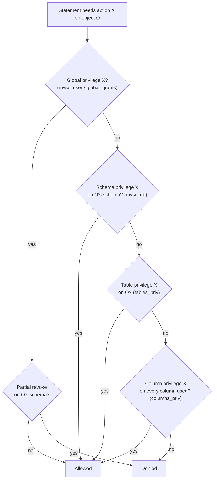

## Introduction

[Authentication](/lessons/m11-users-authentication) told the server *who* is connected. Every statement that follows is checked against a second question: **is this account allowed to do this, to this object?** That is **authorization**, and in MySQL it is implemented by **privileges** granted at several levels — the whole server, one schema, one table, one column, one stored routine — and, since MySQL 8.0, by **roles**: named collections of privileges that are granted to accounts.

Authorization is where security design becomes concrete. "The reporting tool must not be able to change data", "the application must not be able to drop tables", "only the migration pipeline may run DDL", "analysts may see orders but not customer e-mail addresses", "the backup job needs to read everything but change nothing" — each sentence becomes a handful of `GRANT` statements, and each mistake becomes a breach waiting for a bug to exploit it.

This lesson covers:

- the privilege levels and how MySQL combines them when it checks a statement;
- `GRANT`, `REVOKE`, `WITH GRANT OPTION` and partial revokes;
- roles, default roles, role activation and mandatory roles;
- views and stored procedures with `SQL SECURITY DEFINER` as a finer-grained access layer;
- a least-privilege design for the four accounts almost every system needs: **application**, **migrator**, **read-only analyst** and **backup**.

:::note[Least privilege, live]
The sandbox you are using *is* a least-privilege design. Every lab is a separate MySQL account whose only privileges are on its own schema; it cannot see other labs' schemas, read the `mysql` system schema, create accounts or change grants. The first examples below inspect exactly that — real captures from your lab's account. `GRANT`, `REVOKE`, `CREATE ROLE` and `SET ROLE` are therefore display-only here; you will see the sandbox refuse them.
:::

## DBMS Theory

:::theory[Access control models]
- **Discretionary access control (DAC).** The owner of an object decides who may use it and may delegate that right. SQL's `GRANT … WITH GRANT OPTION` is DAC: a grantee holding the grant option can pass the privilege on. The SQL standard defines a grant *graph*, and `REVOKE … CASCADE` revokes privileges that were passed on from the revoked grant.
- **Role-based access control (RBAC, NIST model).** Permissions are assigned to **roles** that model job functions; users are assigned to roles; a **session** activates a subset of the user's roles. RBAC adds role hierarchies (a senior role inherits a junior role's permissions) and constraints such as *separation of duties* (no one holds both "create payment" and "approve payment").
- **Mandatory access control (MAC).** A central policy (labels such as *confidential*, *secret*) decides access; users cannot delegate. Relational systems approximate it with row-level security features; MySQL has none built in and uses views and definer routines instead.

The governing principle is **least privilege** (Saltzer and Schroeder, 1975): every principal should operate with the smallest set of privileges necessary for its task, for the shortest necessary time. Its companion is **complete mediation** — every access must be checked — which a DBMS provides by checking every statement.
:::

In a relational DBMS, a **privilege** is a triple *(grantee, action, object)*: `kim` may `SELECT` on `shop.orders`. Objects form a containment hierarchy — server ⊇ schema ⊇ table ⊇ column — and a privilege at an outer level implies it on everything inside. Formally, the set of permitted actions for an account on an object is the **union** of the privileges granted at every enclosing level, directly or through roles:

> allowed(a, act, obj) ⇔ ∃ level ℓ ⊇ obj : (a, act, ℓ) ∈ Grants ∪ ⋃<sub>r ∈ activeRoles(a)</sub> Grants(r)

MySQL implements this union model with one exception — **partial revokes**, which subtract a schema from a global grant — and it does **not** implement the standard's cascading revocation: revoking from a grantee does not automatically revoke what that grantee passed on.

## Why It Exists

Authentication alone produces an all-or-nothing system: anyone who can log in can do anything. Privileges exist because different principals need different powers, and because **the blast radius of every failure is determined by the privileges of the account involved**:

- An **SQL injection** in a search page ([SQL Injection and Prepared Statements](/lessons/m11-sql-injection)) can only read what the page's account can read, and can only `DROP` if the account can `DROP`.
- A **leaked credential** of the read-only analyst account cannot change data.
- A **buggy migration** run with the application account fails loudly instead of altering production, because the application account has no `ALTER`.
- A **compromised backup host** can read data but cannot destroy it or create new accounts.
- **Separation of duties** — the person who writes payment code cannot also approve payouts in production — needs the database to distinguish the accounts involved.

Without roles, the same privilege set has to be repeated for every account ("all analysts get these 14 grants"), drifts as people copy-paste, and is hard to audit. Roles make the *policy* explicit (`r_analyst` means "read orders and products") and accounts simply refer to it.

## Internal Working

:::internals[Stage 2: request verification]
After connection verification, every statement goes through **request verification**:

1. The parser and resolver determine which **objects** the statement touches and which **actions** it needs: `UPDATE orders SET status = … WHERE customer_id = …` needs `UPDATE` on `orders.status` and `SELECT` on `orders.customer_id` (columns read in `WHERE`).
2. The server consults its **in-memory ACL caches**, which mirror the grant tables: global privileges (`mysql.user`, plus `mysql.global_grants` for dynamic privileges), schema privileges (`mysql.db`), table privileges (`mysql.tables_priv`), column privileges (`mysql.columns_priv`), routine privileges (`mysql.procs_priv`), and the role graph (`mysql.role_edges`, `mysql.default_roles`).
3. Privileges are checked from the outside in: if a global privilege grants the action, the check succeeds; otherwise schema level; otherwise table; otherwise column. **The privileges of the session's active roles are added** to the account's own. Partial revokes (`mysql.user.User_attributes` restrictions) are subtracted.
4. If no level grants the action, the statement fails with a privilege error (1142 for table-level, 1143 for column-level, 1227 for global/administrative, 1044 for schema-level operations, 1370 for routines).
:::



Three internal details explain behaviour that surprises people:

- **When changes take effect.** `GRANT`/`REVOKE` update the grant tables and the in-memory cache atomically. According to the manual, table and column privilege changes take effect with the client's next request; schema-level changes take effect the next time the client selects that default schema (`USE`); global privileges and passwords are unaffected for already-connected clients and apply from their next connection. A long-lived pooled connection can therefore keep a global privilege after it is revoked — recycle the pool after revoking.
- **Roles are accounts.** A role is stored in `mysql.user` as a **locked** account with no password; `GRANT r_analyst TO 'kim'@'%'` adds an edge to `mysql.role_edges`. That is why role names have a host part too (`'r_analyst'@'%'` by default) and why `CREATE ROLE` and `CREATE USER` share a namespace.
- **Static vs dynamic privileges.** The classic privileges (`SELECT`, `INSERT`, …, `SUPER`, `PROCESS`, `RELOAD`) are **static** columns of `mysql.user`. Since 8.0, administrative powers are split into fine-grained **dynamic** privileges stored in `mysql.global_grants` — `BACKUP_ADMIN`, `BINLOG_ADMIN`, `CONNECTION_ADMIN`, `REPLICATION_SLAVE_ADMIN`, `SYSTEM_VARIABLES_ADMIN`, `ROLE_ADMIN`, `SET_ANY_DEFINER`, … — so that operational accounts no longer need the all-powerful `SUPER`, which is deprecated.

## MySQL Implementation

Begin with your own privileges, as the server reports them:

```sql run
SHOW GRANTS;
```

Two lines describe the entire policy of a lab account: no global privileges (`USAGE` is a placeholder meaning "no privileges"), and every schema-level privilege on one schema. `information_schema` exposes the same facts as rows you can query — one row per privilege:

```sql run
SELECT GRANTEE, TABLE_SCHEMA, PRIVILEGE_TYPE, IS_GRANTABLE
FROM information_schema.SCHEMA_PRIVILEGES
ORDER BY PRIVILEGE_TYPE;
```

Eighteen schema privileges, none of them grantable (`IS_GRANTABLE = 'NO'`: the account cannot pass them on — no `GRANT OPTION`). The global level holds only `USAGE`, and there are no table-level grants:

```sql run
SELECT 'global' AS level, PRIVILEGE_TYPE, IS_GRANTABLE
FROM information_schema.USER_PRIVILEGES
UNION ALL
SELECT 'table', CONCAT(TABLE_NAME, '.', PRIVILEGE_TYPE), IS_GRANTABLE
FROM information_schema.TABLE_PRIVILEGES;
```

Least privilege also limits **visibility**. `information_schema` shows only objects the account has some privilege on, so other labs' schemas, the dataset master copies and the `mysql` schema simply do not appear:

```sql run
SELECT SCHEMA_NAME FROM information_schema.SCHEMATA ORDER BY SCHEMA_NAME;
```

(`information_schema` and `performance_schema` are listed because every account may see that they exist; reading `performance_schema` tables still needs `SELECT` on them, which the lab account does not have.) Referencing another schema directly is refused by the server itself:

```sql run error
SELECT COUNT(*) FROM t_shop.customers;
```

Error 1142 is MySQL's table-level privilege error. Granting privileges is refused before it reaches the server — the sandbox's statement filter stops it, and on a plain server the account would fail anyway because it has no `GRANT OPTION`:

```sql run error
GRANT SELECT ON customers TO 'report_reader'@'10.0.2.%';
```

The lab account has no roles; the role functions still work and report that:

```sql run
SELECT CURRENT_ROLE() AS active_roles,
       @@activate_all_roles_on_login AS activate_all_roles_on_login,
       @@mandatory_roles AS mandatory_roles,
       @@partial_revokes AS partial_revokes;
```

`CURRENT_ROLE()` returns `NONE`; the three server settings are at their defaults (roles are *not* activated automatically at login unless they are default roles; no mandatory roles; partial revokes disabled).

## Syntax Breakdown

```sql
-- Privilege levels
GRANT priv_list ON *.*            TO account;   -- global
GRANT priv_list ON shop.*         TO account;   -- schema
GRANT priv_list ON shop.orders    TO account;   -- table
GRANT SELECT (order_id, status), UPDATE (status)
             ON shop.orders       TO account;   -- column
GRANT EXECUTE ON PROCEDURE shop.refund_order TO account;   -- routine
GRANT BACKUP_ADMIN ON *.*         TO account;   -- dynamic privilege (always global)

-- Delegation and revocation
GRANT SELECT ON shop.* TO account WITH GRANT OPTION;
REVOKE INSERT, UPDATE ON shop.* FROM account;
REVOKE ALL PRIVILEGES, GRANT OPTION FROM account;

-- Roles
CREATE ROLE 'r_app_rw', 'r_read_only', 'r_migrator';
GRANT SELECT, INSERT, UPDATE, DELETE ON shop.* TO 'r_app_rw';
GRANT 'r_app_rw' TO 'orders_app'@'10.0.1.%';
SET DEFAULT ROLE ALL TO 'orders_app'@'10.0.1.%';   -- or: SET DEFAULT ROLE 'r_app_rw' TO …
SET ROLE 'r_read_only';                            -- inside a session
SELECT CURRENT_ROLE();
SHOW GRANTS FOR 'orders_app'@'10.0.1.%' USING 'r_app_rw';
DROP ROLE 'r_old';

-- Partial revoke (requires partial_revokes=ON)
GRANT SELECT ON *.* TO 'auditor'@'10.0.9.%';
REVOKE SELECT ON payroll.* FROM 'auditor'@'10.0.9.%';
```

| Element | Meaning and professional notes |
|---|---|
| `ON *.*` | Global level. Avoid for anything but administrative/dynamic privileges; a global `SELECT` includes `mysql.*` (password hashes) and every future schema. |
| `ON db.*` | Schema level — the usual level for application accounts. Covers tables created later. |
| `ON db.tbl` / column list | Finer control; more grant rows to maintain. Column privileges are checked for every column a statement *reads or writes*, including in `WHERE`. |
| `ALL [PRIVILEGES]` | Every privilege available at that level **except** `GRANT OPTION` (and, at global level, it includes powerful ones such as `SHUTDOWN`, `FILE`). Rarely appropriate. |
| `USAGE` | "No privileges"; appears in `SHOW GRANTS` for every account. |
| `WITH GRANT OPTION` | Grantee may grant the privileges *it holds at that level* to others. Treat as administrative. |
| `REVOKE` | Removes privileges at the **same level** they were granted. Revoking `SELECT ON shop.orders` does nothing if the account holds `SELECT ON shop.*`. MySQL does **not** cascade revocations to accounts the grantee granted to. |
| `CREATE ROLE` / `GRANT role TO account` | A role is a locked account; granting a role adds an edge in the role graph. Roles may be granted to roles (hierarchies). |
| `SET DEFAULT ROLE` | Which granted roles are **active at login**. Without it, granted roles are inactive until `SET ROLE`, unless `activate_all_roles_on_login=ON`. |
| `mandatory_roles` | Roles granted to every account implicitly (cannot be revoked per account). Use sparingly. |
| `SHOW GRANTS … USING role` | Expands what the account can do with that role active — the best way to review effective privileges. |
| Partial revoke | With `partial_revokes=ON`, subtracts a schema from a global grant. Recorded as a restriction on the account. |
| `SQL SECURITY DEFINER` (views, routines) | The object's body runs with the **definer's** privileges; callers need only `SELECT` on the view or `EXECUTE` on the routine. Creating objects with another definer needs `SET_ANY_DEFINER` (8.2+; `SET_USER_ID` before). |

:::version[Privileges in MySQL 8.4]
- `SUPER` is deprecated; use the dynamic privileges it was split into (`BINLOG_ADMIN`, `CONNECTION_ADMIN`, `REPLICATION_SLAVE_ADMIN`, `SYSTEM_VARIABLES_ADMIN`, …).
- `SET_USER_ID` was deprecated in 8.2 and replaced by **`SET_ANY_DEFINER`** (create objects with any definer) and **`ALLOW_NONEXISTENT_DEFINER`** (create or keep objects whose definer does not exist). The 8.0 capture server still reports `SET_USER_ID` in its error messages — you will see that below.
- Replication privileges keep their historic names (`REPLICATION SLAVE`, `REPLICATION_SLAVE_ADMIN`) even though 8.4 removed the MASTER/SLAVE *statement* syntax; see [Replication and High Availability](/lessons/m11-replication-ha).
:::

## Practical Examples

**1. A definer view as a column-level security layer.** The support team should see customers' names and cities but never their e-mail addresses or phone numbers. Instead of granting column privileges on `customers`, expose a view and grant only the view ([Views](/lessons/m09-views) covers definer security in depth):

```sql run
CREATE SQL SECURITY DEFINER VIEW v_customer_directory AS
SELECT customer_id, first_name, last_name, city, state
FROM customers;
SELECT TABLE_NAME, SECURITY_TYPE, DEFINER
FROM information_schema.VIEWS
WHERE TABLE_SCHEMA = DATABASE();
```

The view's `SECURITY_TYPE` is `DEFINER`: when `'support'@'10.0.3.%'` queries it, MySQL checks the *definer's* privileges on `customers` and only `SELECT` on the view against `support`. The grant that makes it work is display-only:

```sql
GRANT SELECT ON shop.v_customer_directory TO 'r_support';
-- no privilege on shop.customers at all
```

**2. A definer procedure as a controlled write path.** Support may refund a delivered order, but must not be able to `UPDATE orders` arbitrarily (set any status, touch other columns, change other orders). Wrap the permitted operation in a procedure:

```sql run
CREATE PROCEDURE refund_delivered_order(IN p_order_id INT UNSIGNED)
SQL SECURITY DEFINER
MODIFIES SQL DATA
BEGIN
  UPDATE orders
  SET status = 'refunded'
  WHERE order_id = p_order_id AND status = 'delivered';
  SELECT ROW_COUNT() AS orders_refunded;
END;
CALL refund_delivered_order(2);
CALL refund_delivered_order(1);
```

Order 2 was delivered and is refunded (one row); order 1 is not delivered, so nothing changes. With `GRANT EXECUTE ON PROCEDURE shop.refund_delivered_order TO 'r_support'` and no `UPDATE` privilege, the procedure *is* the policy: the only change support can make is this one. Stored routines used this way are often called a **database API**; their security depends on the routine never building SQL from its parameters ([SQL Injection](/lessons/m11-sql-injection)).

**3. Modelling roles to reason about effective privileges.** Because roles cannot be created in the lab, model the role graph in tables — the same shape as `mysql.role_edges` and the privilege tables — and compute effective privileges with SQL. This is also how access-review tools work on exported grant data:

```sql run
CREATE TABLE role_privileges (
  role_name  VARCHAR(32) NOT NULL,
  object     VARCHAR(64) NOT NULL,   -- 'shop.*' or 'shop.orders'
  privilege  VARCHAR(32) NOT NULL,
  PRIMARY KEY (role_name, object, privilege)
);
CREATE TABLE account_roles (
  account    VARCHAR(64) NOT NULL,
  role_name  VARCHAR(32) NOT NULL,
  is_default BOOLEAN NOT NULL,
  PRIMARY KEY (account, role_name)
);
CREATE TABLE direct_privileges (
  account    VARCHAR(64) NOT NULL,
  object     VARCHAR(64) NOT NULL,
  privilege  VARCHAR(32) NOT NULL,
  PRIMARY KEY (account, object, privilege)
);
INSERT INTO role_privileges VALUES
  ('r_read_only', 'shop.*', 'SELECT'),
  ('r_app_rw',    'shop.*', 'SELECT'), ('r_app_rw', 'shop.*', 'INSERT'),
  ('r_app_rw',    'shop.*', 'UPDATE'), ('r_app_rw', 'shop.*', 'DELETE'),
  ('r_migrator',  'shop.*', 'ALTER'),  ('r_migrator', 'shop.*', 'CREATE'),
  ('r_migrator',  'shop.*', 'DROP'),   ('r_migrator', 'shop.*', 'INDEX'),
  ('r_migrator',  'shop.*', 'REFERENCES'), ('r_migrator', 'shop.*', 'SELECT');
INSERT INTO account_roles VALUES
  ('orders_app@10.0.1.%',   'r_app_rw',    TRUE),
  ('analyst_kim@10.0.9.%',  'r_read_only', TRUE),
  ('ci_migrator@10.0.5.10', 'r_migrator',  TRUE),
  ('ci_migrator@10.0.5.10', 'r_app_rw',    FALSE);
INSERT INTO direct_privileges VALUES
  ('analyst_kim@10.0.9.%', 'shop.orders', 'UPDATE');
SELECT ar.account, rp.object, rp.privilege, CONCAT('role ', ar.role_name) AS via
FROM account_roles ar
JOIN role_privileges rp ON rp.role_name = ar.role_name
WHERE ar.is_default
UNION ALL
SELECT account, object, privilege, 'direct grant'
FROM direct_privileges
ORDER BY account, object, privilege;
```

The effective-privilege listing immediately shows a problem a reviewer would flag: `analyst_kim` holds a **direct** `UPDATE` on `shop.orders`, outside any role — a "temporary" grant that was never removed. It also shows that `ci_migrator`'s second role (`r_app_rw`) is not a default role, so it is inactive at login: the migrator runs DDL with `r_migrator` and must `SET ROLE` explicitly to write data.

**4. "Can this account do that?"** The question every access review and every incident asks. With the model above, a privilege check is an `EXISTS` over the union — the same logic as the server's request verification:

```sql run
SELECT a.account, p.privilege,
       EXISTS (
         SELECT 1 FROM account_roles ar
         JOIN role_privileges rp ON rp.role_name = ar.role_name
         WHERE ar.account = a.account AND ar.is_default
           AND rp.privilege = p.privilege AND rp.object IN ('shop.*', 'shop.orders')
         UNION ALL
         SELECT 1 FROM direct_privileges d
         WHERE d.account = a.account AND d.privilege = p.privilege
           AND d.object IN ('shop.*', 'shop.orders')
       ) AS allowed_on_orders
FROM (SELECT DISTINCT account FROM account_roles) a
CROSS JOIN (SELECT 'SELECT' AS privilege UNION ALL SELECT 'UPDATE' UNION ALL SELECT 'DROP') p
ORDER BY a.account, p.privilege;
```

`object IN ('shop.*', 'shop.orders')` encodes the containment hierarchy: a schema-level grant covers the table. The matrix shows the migrator can `DROP` but not `UPDATE` (its write role is inactive), the application can `UPDATE` but not `DROP`, and the analyst can `UPDATE` — the anomaly again.

## Execution Walkthrough

Follow a statement through request verification for a realistic account. The account statements are display-only; each step's query runs against the role model from Example 3 to show the decision the server makes.

```walkthrough
title: "orders_app@10.0.1.% runs: UPDATE orders SET status = 'shipped' WHERE order_id = 11"
steps:
  - title: "1. Determine the required privileges"
    explain: >-
      The resolver sees that the statement writes orders.status and reads orders.order_id (in WHERE). It needs
      UPDATE on the written column and SELECT on the read column — at any level that contains them.
  - title: "2. Collect the session's privilege sources"
    explain: >-
      The session has the account's direct grants plus the privileges of its active roles. orders_app has one
      default role, r_app_rw, activated at login by SET DEFAULT ROLE. No direct grants.
    sql: |
      SELECT role_name, is_default FROM account_roles WHERE account = 'orders_app@10.0.1.%';
  - title: "3. Check outside-in: global, schema, table, column"
    explain: >-
      No global privileges. At schema level, r_app_rw grants SELECT and UPDATE on shop.* — the check succeeds at
      this level; table and column grants are never consulted.
    sql: |
      SELECT rp.object, rp.privilege
      FROM account_roles ar JOIN role_privileges rp ON rp.role_name = ar.role_name
      WHERE ar.account = 'orders_app@10.0.1.%' AND ar.is_default
        AND rp.privilege IN ('SELECT', 'UPDATE')
      ORDER BY rp.privilege;
  - title: "4. Execute"
    explain: >-
      The statement runs. Had the same session attempted ALTER TABLE orders …, the check would find ALTER at no
      level and fail with error 1142 before touching the table — the application account cannot change schema.
    sql: |
      UPDATE orders SET status = 'shipped' WHERE order_id = 11;
      SELECT order_id, status FROM orders WHERE order_id = 11;
```

The real statements behind this model:

```sql
CREATE ROLE 'r_app_rw';
GRANT SELECT, INSERT, UPDATE, DELETE ON shop.* TO 'r_app_rw';
CREATE USER 'orders_app'@'10.0.1.%' IDENTIFIED BY RANDOM PASSWORD REQUIRE SSL;
GRANT 'r_app_rw' TO 'orders_app'@'10.0.1.%';
SET DEFAULT ROLE 'r_app_rw' TO 'orders_app'@'10.0.1.%';
SHOW GRANTS FOR 'orders_app'@'10.0.1.%' USING 'r_app_rw';
```

*Illustrative output of the last statement (not captured — the lab cannot create accounts):*

```text
GRANT USAGE ON *.* TO `orders_app`@`10.0.1.%`
GRANT SELECT, INSERT, UPDATE, DELETE ON `shop`.* TO `orders_app`@`10.0.1.%`
GRANT `r_app_rw`@`%` TO `orders_app`@`10.0.1.%`
```

## Output

The captured outputs tell one consistent story. Your lab account's `SHOW GRANTS` and `SCHEMA_PRIVILEGES` list eighteen non-grantable privileges on one schema and nothing else; `SCHEMATA` lists only your schema and the two system schemas every account can see; and both the server (error 1142 on `t_shop.customers`, and on `mysql.user` in the previous lesson) and the sandbox (refusing `GRANT`) enforce the boundary.

In the role model, the effective-privilege listing and the permission matrix found the classic access-review defect — a direct grant (`UPDATE` on `shop.orders` for the analyst) outside the role design — and showed that a non-default role contributes nothing until it is activated. In the walkthrough, the `UPDATE` by the application account passed at the schema level and changed order 11 to `shipped`.

## Alternative Approaches

There are several ways to express the same access policy. Choose by granularity, maintainability and auditability.

| Approach | Granularity | Strengths | Weaknesses |
|---|---|---|---|
| Direct schema-level grants per account | Schema | Simple, few rows | Repeated per account, drifts, hard to review |
| Roles (+ default roles) | Any | Policy defined once; review by role; quick on/offboarding | Activation rules confuse people (default roles, `SET ROLE`) |
| Table/column grants | Table, column | Precise | Many grant rows; every new column needs a decision; `SELECT *` fails for column-restricted users |
| Definer views | Column and **row** (WHERE) | Hides columns and rows; can rename/mask (`CONCAT(LEFT(email,1),'***')`) | Must be kept in sync with the schema; definer must stay valid |
| Definer procedures (database API) | Operation | Only predefined operations possible; enforces business rules | More code in the database ([Database vs Application Logic](/lessons/m09-db-vs-app-logic)); injection risk if they build SQL |
| Separate schemas or servers | Schema/instance | Strong isolation (multi-tenant SaaS, PCI scope reduction) | More objects to operate; cross-schema queries need grants |
| Application-level authorization only | Application | Flexible business rules | The database trusts the app completely — one bug exposes everything; keep DB privileges as a backstop |
| Enterprise features (MySQL Enterprise Firewall, Data Masking) | Statement / value | Allow-lists of statement digests; built-in masking functions | Commercial editions |

The usual professional answer is a **combination**: roles for the coarse policy, definer views for sensitive columns and row subsets, definer procedures for a few high-risk operations, and application authorization for user-level rules ("a customer may see only their own orders") — with the database privileges as the backstop that contains application bugs.

## Performance Analysis

Privilege checking is rarely a performance concern, because it is done against **in-memory** structures and is proportional to the number of objects in the statement, not to the number of rows. A few practical points:

- **Column-level privileges add per-column checks** at resolve time; on very wide tables with many column grants this is measurable but small next to query execution. The bigger cost is human: every schema change needs grant maintenance.
- **Huge numbers of accounts or grant rows** (tens of thousands — e.g. one account per tenant) increase memory for the ACL caches and the time for `FLUSH PRIVILEGES` and grant statements, which take locks on the ACL structures. Multi-tenant systems normally use a few accounts and enforce tenant isolation with schemas or application logic.
- **Definer views are merged** into the outer query when possible (MERGE algorithm), so a view used as a security layer costs nothing extra at execution time; a view that needs TEMPTABLE (aggregates, `DISTINCT`, `LIMIT`) materializes and can hide indexes ([Views](/lessons/m09-views)).
- **Stored-procedure APIs** add a call overhead per operation and a round trip per `CALL` result set; for high-throughput OLTP paths, measure.
- **Role activation** happens at login (default roles) or per `SET ROLE`; it is cheap, but `SET ROLE` in every request through a pool adds a statement per checkout.

There is nothing in this lesson's examples to time meaningfully; the plans and costs are those of the underlying queries.

## Best Practices

:::best-practice[A least-privilege baseline]
1. **Grant to roles, not to accounts.** Define roles per job function (`r_app_rw`, `r_read_only`, `r_migrator`, `r_backup`, `r_monitor`), grant roles to accounts, and set them as default roles.
2. **Use schema-level grants for applications**, never `*.*`. An application account needs `SELECT, INSERT, UPDATE, DELETE` (and perhaps `EXECUTE`) on its schema — no DDL, no `FILE`, no `PROCESS`, no `GRANT OPTION`.
3. **Separate DDL from DML.** Only the migration account (used by CI/CD) holds `CREATE, ALTER, DROP, INDEX, REFERENCES` (and `CREATE VIEW`, `CREATE ROUTINE`, `TRIGGER` if migrations manage them).
4. **Read-only means read-only.** Analysts and reporting tools get `SELECT` (and `SHOW VIEW`) on curated schemas or views, ideally on a replica.
5. **Backups get read plus the minimal administrative privileges** of the tool (e.g. `SELECT, SHOW VIEW, TRIGGER, EVENT, LOCK TABLES, PROCESS, RELOAD, REPLICATION CLIENT, BACKUP_ADMIN` depending on tool and options) — and nothing that writes data.
6. **Never grant `ALL ON *.*` or `WITH GRANT OPTION`** to anything but a small number of named, MFA-protected administrator accounts, and avoid `SUPER`.
7. **Protect sensitive columns** with definer views or separate tables, not with "the app doesn't select it".
8. **Review effective privileges regularly** with `SHOW GRANTS … USING`, export them, diff against the intended policy, and remove direct grants that bypass roles.
9. **Recycle connection pools after revoking global privileges**, since connected sessions keep them.
:::

## Common Mistakes

**Mistake 1 — expecting `REVOKE` at a lower level to override a higher-level grant.** An account with `SELECT ON shop.*` keeps reading `shop.payments` after `REVOKE SELECT ON shop.payments FROM …`; MySQL even reports an error because there is no table-level grant to revoke (`There is no such grant defined …`, error 1147). Privileges are a union across levels. Grant at the right level from the start, or use partial revokes (schema subtraction from a *global* grant only).

**Mistake 2 — granting a role and forgetting to activate it.** After `GRANT 'r_app_rw' TO 'orders_app'@'10.0.1.%'`, the application still gets error 1142: the role is granted but not active. Fix with `SET DEFAULT ROLE 'r_app_rw' TO …` (or `SET DEFAULT ROLE ALL`), or set `activate_all_roles_on_login=ON` server-wide.

**Mistake 3 — `GRANT ALL ON *.*` "just for the migration".** It includes `FILE` (read/write server files), `SHUTDOWN`, `CREATE USER`, `SUPER`-like dynamic privileges and `SELECT` on `mysql.user`. Grant the migration role on the application schema only.

**Mistake 4 — naming an account as definer that you are not.** Creating an object with `DEFINER = 'reports_owner'@'%'` requires `SET_ANY_DEFINER` (8.2+) or `SET_USER_ID` (8.0) — otherwise anyone who can create a view could borrow any account's privileges. The capture server shows the 8.0 message:

```sql run error
CREATE DEFINER = 'root'@'localhost' SQL SECURITY DEFINER VIEW v_escalate AS
SELECT customer_id, email FROM customers;
```

**Mistake 5 — `SQL SECURITY INVOKER` on a view meant as a security boundary.** With `INVOKER` the caller needs privileges on the base tables, so the view hides nothing. Use `DEFINER` (the default) for views and procedures that implement access control, and give the definer account only the privileges the objects need (a dedicated, locked definer account is good practice).

**Mistake 6 — forgetting that `WHERE` columns need `SELECT`.** With column privileges `UPDATE (status)` only, `UPDATE orders SET status = 'paid' WHERE order_id = 11` fails with error 1143, because the server must *read* `order_id` to evaluate the filter. Grant `SELECT (order_id)` too.

**Mistake 7 — unescaped `_` and `%` in schema-level grants.** In `GRANT … ON db_name.*`, the characters `_` and `%` in the schema name are **wildcards**, exactly as in `LIKE`. `GRANT SELECT ON shop_eu.* …` also grants on `shopXeu`, `shop1eu`, and any schema created later whose name fits the pattern. Careful tooling escapes them — and the platform does: your lab's grant is stored as `lab\_…`, which is why the schema name in `SCHEMA_PRIVILEGES` is one character longer than `DATABASE()` and contains a backslash:

```sql run
SELECT TABLE_SCHEMA = DATABASE()  AS names_equal,
       CHAR_LENGTH(TABLE_SCHEMA)  AS grant_name_length,
       CHAR_LENGTH(DATABASE())    AS schema_name_length,
       LOCATE('\\', TABLE_SCHEMA) AS backslash_position
FROM information_schema.SCHEMA_PRIVILEGES
LIMIT 1;
```

The comparison is false because the grant names the *pattern* `lab\_…` (a literal underscore), not the schema name itself. (The platform displays the name as `your_lab` everywhere, so you only see the difference through these functions.) Write ``GRANT … ON `shop\_eu`.* …`` when the underscore is meant literally, and audit existing grants for unintended patterns.

## Industry Application

- **Four-account baseline.** Most production MySQL deployments end up with at least: an **application** account (DML on its schema, default role, host-restricted, TLS), a **migrator** account (DDL on the schema, used only by CI/CD with credentials injected at deploy time), **read-only** accounts for analytics and support (often on replicas, often through views), and a **backup** account with the tool's minimal administrative privileges. Add **replication** (`REPLICATION SLAVE`), **monitoring** (`PROCESS`, `REPLICATION CLIENT`, `SELECT ON performance_schema.*`) and named **human admin** accounts.
- **Managed services.** RDS, Aurora and Cloud SQL keep the real superuser to themselves; your administrative user receives a curated set of privileges and roles. Designs that rely on `SUPER` (or `FILE`) break there — another reason to design with fine-grained privileges.
- **Access reviews and compliance.** SOC 2 / ISO 27001 / PCI DSS require periodic reviews of who can access what. Teams export `SHOW GRANTS` for every account (or query the grant tables with an admin account), store the expected policy as code (Terraform's MySQL provider, Ansible's `mysql_user`, or SQL scripts in Git), and alert on drift — Example 3 in miniature.
- **Just-in-time access.** Instead of permanent production write access for engineers, tools such as HashiCorp Vault, Teleport or cloud IAM issue time-limited credentials with a specific role for the duration of an approved ticket — RBAC plus "for the shortest necessary time".
- **Multi-tenant SaaS.** Schema-per-tenant designs grant each tenant's service account on its own schema only — exactly like this platform's labs. Shared-schema designs rely on application-enforced `tenant_id` filters, often backed by definer views per tenant for reporting access.

## Practice Exercises

```exercise
id: ex1
title: List your lab account's privileges
difficulty: easy
kind: query
concepts: [privileges, privilege-levels]
prompt: |
  Using `information_schema`, return the privileges your current account holds **at schema level**, one row per
  privilege, with a single column `privilege_type`, ordered alphabetically. (Your account has schema privileges on
  exactly one schema, so no schema filter is needed.)
hints:
  - "The view is information_schema.SCHEMA_PRIVILEGES; one row per (grantee, schema, privilege)."
  - "Careful if you add `WHERE TABLE_SCHEMA = DATABASE()`: see Common Mistakes — the grant's schema name is escaped."
solution: |
  SELECT PRIVILEGE_TYPE AS privilege_type
  FROM information_schema.SCHEMA_PRIVILEGES
  ORDER BY PRIVILEGE_TYPE;
orderMatters: true
explanation: |
  `SCHEMA_PRIVILEGES` mirrors `mysql.db` for the accounts you are allowed to see — here, only your own. Filtering
  with `TABLE_SCHEMA = DATABASE()` returns nothing, because the lab's grant was written with an escaped
  underscore (`lab\_…`) — Mistake 7 explains why. You will
  find DDL privileges (`CREATE`, `ALTER`, `DROP`) in the list: the lab account is the *owner* of its schema. A
  production application account should have far fewer — usually just `SELECT`, `INSERT`, `UPDATE`, `DELETE`.
```

```exercise
id: ex2
title: Find direct grants that bypass roles
difficulty: medium
kind: query
setup: |
  CREATE TABLE role_privileges (role_name VARCHAR(32), object VARCHAR(64), privilege VARCHAR(32), PRIMARY KEY (role_name, object, privilege));
  CREATE TABLE account_roles (account VARCHAR(64), role_name VARCHAR(32), is_default BOOLEAN, PRIMARY KEY (account, role_name));
  CREATE TABLE direct_privileges (account VARCHAR(64), object VARCHAR(64), privilege VARCHAR(32), PRIMARY KEY (account, object, privilege));
  INSERT INTO role_privileges VALUES
    ('r_read_only','shop.*','SELECT'),
    ('r_app_rw','shop.*','SELECT'),('r_app_rw','shop.*','INSERT'),('r_app_rw','shop.*','UPDATE'),('r_app_rw','shop.*','DELETE');
  INSERT INTO account_roles VALUES
    ('orders_app@10.0.1.%','r_app_rw',TRUE),('analyst_kim@10.0.9.%','r_read_only',TRUE),
    ('analyst_raj@10.0.9.%','r_read_only',TRUE),('support_li@10.0.3.%','r_read_only',TRUE);
  INSERT INTO direct_privileges VALUES
    ('analyst_kim@10.0.9.%','shop.orders','UPDATE'),
    ('orders_app@10.0.1.%','shop.*','SELECT'),
    ('support_li@10.0.3.%','shop.customers','DELETE'),
    ('support_li@10.0.3.%','shop.*','SELECT'),
    ('analyst_raj@10.0.9.%','shop.*','DROP');
concepts: [roles, least-privilege]
prompt: |
  Tables: `role_privileges(role_name, object, privilege)`, `account_roles(account, role_name, is_default)`,
  `direct_privileges(account, object, privilege)`.

  Return every **direct** grant that is **not already covered** by one of the account's **default** roles. A role
  privilege on `'shop.*'` covers the same privilege on `'shop.*'` and on any `'shop.<table>'`; a role privilege on a
  table covers only that table. Columns: `account`, `object`, `privilege`. Order by `account`, `object`, `privilege`.
hints:
  - "Start from direct_privileges and use NOT EXISTS against the account's default-role privileges."
  - "Coverage condition: rp.privilege = d.privilege AND (rp.object = d.object OR rp.object = 'shop.*')."
solution: |
  SELECT d.account, d.object, d.privilege
  FROM direct_privileges d
  WHERE NOT EXISTS (
    SELECT 1
    FROM account_roles ar
    JOIN role_privileges rp ON rp.role_name = ar.role_name
    WHERE ar.account = d.account
      AND ar.is_default
      AND rp.privilege = d.privilege
      AND (rp.object = d.object OR rp.object = 'shop.*')
  )
  ORDER BY d.account, d.object, d.privilege;
orderMatters: true
explanation: |
  Redundant direct grants (the app's and support's `SELECT ON shop.*`) are harmless duplicates; the report keeps
  the ones that *add* power: an analyst who can `UPDATE` orders, another who can `DROP` tables, and support staff
  who can `DELETE` customers. `NOT EXISTS` is the natural anti-join here; a `LEFT JOIN … IS NULL` works too but
  must put the coverage condition in the `ON` clause.
```

```exercise
id: ex3
title: Implement a role-like access view
difficulty: hard
kind: dml
setup: |
  CREATE TABLE role_privileges (role_name VARCHAR(32), object VARCHAR(64), privilege VARCHAR(32), PRIMARY KEY (role_name, object, privilege));
  CREATE TABLE account_roles (account VARCHAR(64), role_name VARCHAR(32), is_default BOOLEAN, PRIMARY KEY (account, role_name));
  CREATE TABLE direct_privileges (account VARCHAR(64), object VARCHAR(64), privilege VARCHAR(32), PRIMARY KEY (account, object, privilege));
  INSERT INTO role_privileges VALUES
    ('r_read_only','shop.*','SELECT'),
    ('r_app_rw','shop.*','SELECT'),('r_app_rw','shop.*','INSERT'),('r_app_rw','shop.*','UPDATE'),('r_app_rw','shop.*','DELETE'),
    ('r_migrator','shop.*','ALTER'),('r_migrator','shop.*','CREATE'),('r_migrator','shop.*','DROP');
  INSERT INTO account_roles VALUES
    ('orders_app@10.0.1.%','r_app_rw',TRUE),('analyst_kim@10.0.9.%','r_read_only',TRUE),
    ('ci_migrator@10.0.5.10','r_migrator',TRUE),('ci_migrator@10.0.5.10','r_app_rw',FALSE);
  INSERT INTO direct_privileges VALUES ('analyst_kim@10.0.9.%','shop.orders','UPDATE');
concepts: [roles, default-roles, definer-security]
prompt: |
  Create a view named **`v_effective_privileges`** with columns `account`, `object`, `privilege`, `source` that lists
  each account's effective privileges **at login**:

  - privileges of the account's **default** roles, with `source` = the role name;
  - the account's direct grants, with `source` = `'direct'`.

  Non-default roles must not appear. Keep duplicates out: if the same (account, object, privilege) is reachable
  in two ways, list both sources (one row each) — that is useful for reviews.

  The checker runs `SELECT * FROM v_effective_privileges ORDER BY account, object, privilege, source`.
hints:
  - "Two SELECTs combined with UNION ALL: one joining account_roles to role_privileges, one from direct_privileges."
  - "Filter ar.is_default in the first branch; use the literal 'direct' as source in the second."
solution: |
  CREATE VIEW v_effective_privileges AS
  SELECT ar.account, rp.object, rp.privilege, ar.role_name AS source
  FROM account_roles ar
  JOIN role_privileges rp ON rp.role_name = ar.role_name
  WHERE ar.is_default
  UNION ALL
  SELECT account, object, privilege, 'direct'
  FROM direct_privileges;
check: |
  SELECT * FROM v_effective_privileges ORDER BY account, object, privilege, source;
explanation: |
  This is the logic of `SHOW GRANTS … USING` and of the server's own check, expressed as a view. The migrator's
  `r_app_rw` rows are absent because the role is not a default role — exactly the behaviour that surprises people
  after `GRANT role TO account`. In production you would build the same view over exported grant data and grant
  `SELECT` on it to the security team — a definer view as an access-review API.
```

```exercise
id: ex4
title: Guarded status change through a definer procedure
difficulty: hard
kind: dml
concepts: [definer-security, least-privilege]
prompt: |
  Support may **cancel** an order only while it is `'pending'` or `'paid'`. Create a procedure
  **`cancel_open_order(IN p_order_id INT UNSIGNED)`** with `SQL SECURITY DEFINER` that sets `status = 'cancelled'`
  for that order **only** if its current status is `'pending'` or `'paid'` (otherwise it changes nothing). Then call
  it for orders **1, 2, 4 and 5**.

  The checker reads `order_id, status` for orders 1–5 and the procedure's `SECURITY_TYPE`.
hints:
  - "Put the status rule in the UPDATE's WHERE clause: WHERE order_id = p_order_id AND status IN ('pending', 'paid')."
  - "Four CALL statements after CREATE PROCEDURE."
solution: |
  CREATE PROCEDURE cancel_open_order(IN p_order_id INT UNSIGNED)
  SQL SECURITY DEFINER
  MODIFIES SQL DATA
  BEGIN
    UPDATE orders
    SET status = 'cancelled'
    WHERE order_id = p_order_id AND status IN ('pending', 'paid');
  END;
  CALL cancel_open_order(1);
  CALL cancel_open_order(2);
  CALL cancel_open_order(4);
  CALL cancel_open_order(5);
check: |
  SELECT o.order_id, o.status, r.SECURITY_TYPE
  FROM orders o
  CROSS JOIN information_schema.ROUTINES r
  WHERE r.ROUTINE_SCHEMA = DATABASE() AND r.ROUTINE_NAME = 'cancel_open_order'
    AND o.order_id BETWEEN 1 AND 5
  ORDER BY o.order_id;
explanation: |
  With `GRANT EXECUTE ON PROCEDURE shop.cancel_open_order TO 'r_support'` and no `UPDATE` on `orders`, support
  can make exactly this change and nothing else: delivered or shipped orders stay untouched, and no other column can
  be modified. Putting the rule in the `WHERE` clause makes the check and the change one atomic statement — a
  separate `SELECT status …` followed by `UPDATE` would race with concurrent changes unless it used
  `SELECT … FOR UPDATE`.
```

```exercise
id: ex5
title: Design a least-privilege account set
difficulty: challenge
kind: open
concepts: [least-privilege, roles, default-roles, privileges]
prompt: |
  Design the roles, accounts and grants for the `shop` schema on MySQL 8.4 for:

  1. the **application** (runs on 10.0.1.0/24);
  2. the **migrator** used by CI/CD (10.0.5.10) — it applies DDL, including views, routines and triggers;
  3. a **read-only analyst** group (VPN 10.0.9.0/24) who must not see `customers.email` or `customers.phone`;
  4. the nightly **logical backup** job (on the DB host) using `mysqldump --single-transaction --routines --events
     --source-data`.

  Write the SQL, then justify each privilege and explain what an attacker could and could not do with each
  account's credentials.
solution: |
  ~~~sql
  CREATE ROLE 'r_app_rw', 'r_migrator', 'r_analyst', 'r_backup';

  GRANT SELECT, INSERT, UPDATE, DELETE, EXECUTE ON shop.* TO 'r_app_rw';

  GRANT SELECT, INSERT, UPDATE, DELETE, CREATE, ALTER, DROP, INDEX, REFERENCES,
        CREATE VIEW, SHOW VIEW, CREATE ROUTINE, ALTER ROUTINE, TRIGGER, EVENT
        ON shop.* TO 'r_migrator';

  -- analysts: curated definer views in a separate schema, no access to shop tables
  CREATE SQL SECURITY DEFINER VIEW analytics.v_customers AS
    SELECT customer_id, first_name, last_name, city, state, loyalty_tier FROM shop.customers;
  CREATE SQL SECURITY DEFINER VIEW analytics.v_orders AS SELECT * FROM shop.orders;
  GRANT SELECT, SHOW VIEW ON analytics.* TO 'r_analyst';

  GRANT SELECT, SHOW VIEW, TRIGGER, EVENT, LOCK TABLES ON shop.* TO 'r_backup';
  GRANT PROCESS, RELOAD, REPLICATION CLIENT ON *.* TO 'r_backup';  -- tablespaces, FTWRL, binlog coordinates

  CREATE USER 'orders_app'@'10.0.1.0/24'   IDENTIFIED BY RANDOM PASSWORD REQUIRE SSL;
  CREATE USER 'ci_migrator'@'10.0.5.10'    IDENTIFIED BY RANDOM PASSWORD REQUIRE SSL;
  CREATE USER 'analyst_kim'@'10.0.9.0/24'  IDENTIFIED BY RANDOM PASSWORD REQUIRE SSL
    FAILED_LOGIN_ATTEMPTS 5 PASSWORD_LOCK_TIME 1;
  CREATE USER 'backup'@'localhost'         IDENTIFIED WITH auth_socket;

  GRANT 'r_app_rw'   TO 'orders_app'@'10.0.1.0/24';
  GRANT 'r_migrator' TO 'ci_migrator'@'10.0.5.10';
  GRANT 'r_analyst'  TO 'analyst_kim'@'10.0.9.0/24';
  GRANT 'r_backup'   TO 'backup'@'localhost';
  SET DEFAULT ROLE ALL TO 'orders_app'@'10.0.1.0/24', 'ci_migrator'@'10.0.5.10',
                          'analyst_kim'@'10.0.9.0/24', 'backup'@'localhost';
  ~~~

  - **Application**: DML and `EXECUTE` on its own schema only. A stolen credential (or an injection) can read and
    modify shop data — the unavoidable minimum — but cannot change the schema, drop tables, read other schemas,
    read or write server files (`FILE`), see other sessions' queries (`PROCESS`) or create accounts. Host and TLS
    restrictions make the credential useless outside the pod subnet.
  - **Migrator**: DDL on `shop` only, never `*.*` and never `GRANT OPTION`. Its credential lives only in the
    CI/CD secret store; a leak allows schema damage in `shop` (backups and PITR are the mitigation) but not access to
    other schemas or account management. Some teams split "migrator" and "data-fix" duties further.
  - **Analyst**: `SELECT` on definer views that omit e-mail and phone. With no privilege on `shop` tables, the
    columns are unreachable even with crafted SQL. Best run against a replica; humans get lockout and, ideally,
    SSO/LDAP authentication.
  - **Backup**: read-only plus the tool's administrative needs: `LOCK TABLES` (only needed without
    `--single-transaction`), `PROCESS` (tablespace information; or use `--no-tablespaces`), `RELOAD` (the brief
    `FLUSH TABLES WITH READ LOCK` that `--source-data` uses to read consistent coordinates) and `REPLICATION
    CLIENT` (`SHOW BINARY LOG STATUS`). It cannot modify data. Using `auth_socket` means there is no password to
    steal; the backup files themselves must be encrypted and access-controlled, because they contain everything.
  - Roles make each policy reviewable in one place; default roles avoid the "granted but inactive" trap.
```

## Knowledge Assessment

```quiz
- id: q1
  question: "An account holds `SELECT ON shop.*`. An administrator runs `REVOKE SELECT ON shop.payments FROM …`. What happens?"
  options:
    - "The account can no longer read shop.payments"
    - "The REVOKE fails (no such table-level grant) and the account still reads shop.payments through the schema-level grant"
    - "The schema-level grant is removed entirely"
    - "MySQL converts the schema grant into table grants for every other table"
  answer: 1
  explanation: "Privileges are a union across levels and REVOKE removes grants at the level named. There is no table-level grant to remove (error 1147). Partial revokes only subtract schemas from global grants, and MySQL never rewrites grants automatically."
  concepts: [grant-revoke, privilege-levels]
- id: q2
  question: "After `GRANT 'r_app_rw' TO 'orders_app'@'10.0.1.%'`, the application still gets error 1142 on INSERT. What is the most likely cause?"
  options:
    - "Roles only work for SELECT"
    - "The role is granted but not active: no SET DEFAULT ROLE and activate_all_roles_on_login is OFF"
    - "FLUSH PRIVILEGES was not run"
    - "The role must be granted WITH GRANT OPTION"
  answer: 1
  explanation: "Granted roles are inactive at login unless they are default roles (or activate_all_roles_on_login=ON). GRANT statements update the ACL cache themselves, so FLUSH PRIVILEGES is unnecessary; grant option is about delegation, not use."
  concepts: [roles, default-roles]
- id: q3
  question: "Which privileges does a typical **application** account need on its schema? (Select all that apply.)"
  type: multi
  options: ["SELECT", "INSERT, UPDATE, DELETE", "ALTER and DROP", "FILE", "GRANT OPTION"]
  answer: [0, 1]
  explanation: "DML is the application's job. DDL belongs to the migration account; FILE (server file access) and GRANT OPTION (delegation) are administrative powers that would enlarge the blast radius of an injection or a leaked credential."
  concepts: [least-privilege]
- id: q4
  question: "Support staff must see customer names but never e-mail addresses. Which design enforces this in the database?"
  options:
    - "GRANT SELECT ON shop.customers and tell the application not to select email"
    - "A SQL SECURITY INVOKER view without the email column"
    - "A SQL SECURITY DEFINER view without the email column, with SELECT granted on the view only"
    - "GRANT SELECT ON shop.* WITH GRANT OPTION"
  answer: 2
  explanation: "With DEFINER security, base-table privileges are checked against the definer, so support needs only SELECT on the view and cannot reach customers.email. An INVOKER view would require SELECT on the table (hiding nothing); relying on the application is not enforcement."
  concepts: [definer-security]
- id: q5
  question: "Why can a pooled connection keep a **global** privilege after it is revoked?"
  options:
    - "Because REVOKE is asynchronous"
    - "Because global privilege changes do not affect already-connected clients; they apply from the next connection"
    - "Because the pool caches query results"
    - "Because REVOKE requires a server restart"
  answer: 1
  explanation: "Per the manual, table and column privilege changes apply to the client's next request, schema changes at the next USE, but global privileges and passwords are unaffected for connected clients. Recycle the pool after revoking."
  concepts: [grant-revoke]
- id: q6
  question: "In MySQL 8.4, which privilege lets an account create a view with `DEFINER = 'someone_else'@'%'`?"
  options: ["CREATE VIEW", "SET_ANY_DEFINER", "GRANT OPTION", "SHOW VIEW"]
  answer: 1
  explanation: "SET_ANY_DEFINER (8.2+, replacing the deprecated SET_USER_ID) is required to name another account as definer. CREATE VIEW only allows creating views as yourself; GRANT OPTION and SHOW VIEW are unrelated."
  concepts: [definer-security]
- id: q7
  question: "A column-restricted user has `UPDATE (status) ON shop.orders` only. `UPDATE orders SET status = 'paid' WHERE order_id = 11` fails. Why?"
  options:
    - "Column privileges are not supported for UPDATE"
    - "The WHERE clause reads order_id, which needs SELECT on that column"
    - "The user needs UPDATE on every column"
    - "Column privileges require a role"
  answer: 1
  explanation: "Every column a statement reads needs SELECT, including columns used only for filtering. UPDATE is checked only for the columns written; roles are optional."
  concepts: [privilege-levels]
- id: q8
  question: "What is a MySQL role, internally?"
  options:
    - "A separate object type stored in mysql.roles with no host part"
    - "A locked account without a password, stored in mysql.user, with grants linked through mysql.role_edges"
    - "A session variable"
    - "A view over mysql.user"
  answer: 1
  explanation: "Roles share the account namespace (hence 'r_app_rw'@'%'), are locked so nobody can log in as them, and are connected to accounts by edges in mysql.role_edges; default roles live in mysql.default_roles."
  concepts: [roles]
```
