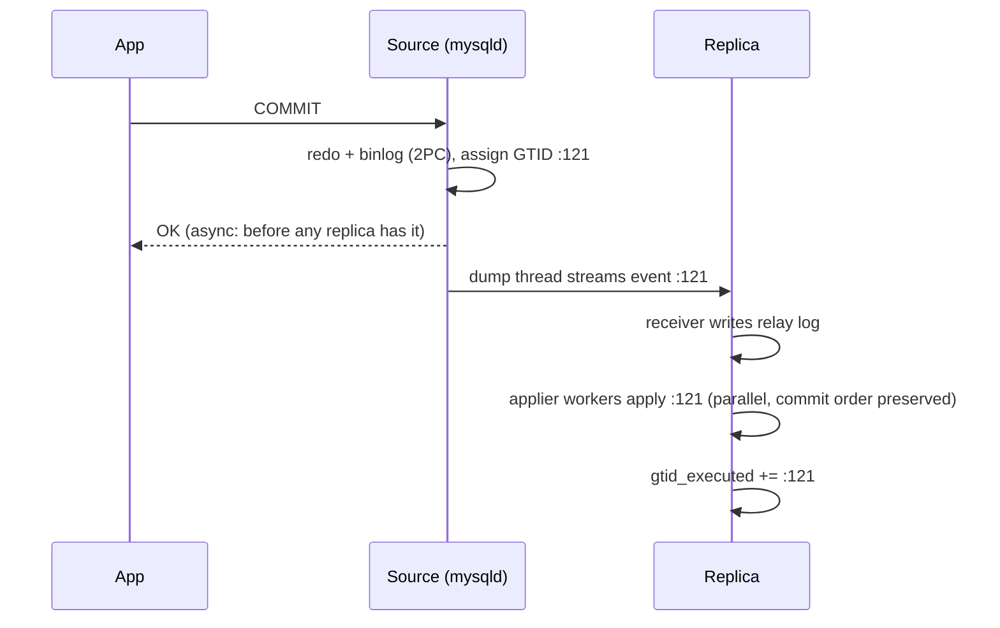

## Introduction

**Replication** keeps one or more copies of a database — **replicas** — continuously up to date with a **source** by shipping and re-applying the source's changes. It is the foundation of almost every production MySQL architecture:

- **High availability (HA):** if the source fails, a replica is promoted and the service continues within seconds or minutes instead of hours.
- **Read scaling:** read-heavy workloads (product pages, reports) are spread across replicas ([Read Replicas](/lessons/m12-read-replicas)).
- **Disaster recovery:** a replica in another region survives the loss of a whole data centre ([HA and DR](/lessons/m12-ha-dr)).
- **Operational work without downtime:** backups taken from a replica, schema changes tested on a replica, version upgrades done replica-first.

Replication is also a source of subtle correctness problems: **lag** (replicas are behind), **lost transactions** at failover (the source committed something no replica received), **split brain** (two servers both accept writes), and **stale reads** (a user does not see the change they just made). This lesson explains how MySQL replication works, which guarantees each mode gives, and how professionals handle these problems.

:::warning[Replication is not a backup]
Every change replicates — including `DROP TABLE`. Replication protects against losing a *server*; only backups and point-in-time recovery protect against losing *data* to a bad statement ([Restoration and Point-in-Time Recovery](/lessons/m11-restore-pitr)).
:::

:::note[What runs in the lab]
Configuring replication needs administrative privileges, so `CHANGE REPLICATION SOURCE TO`, `START REPLICA`, `SHOW REPLICA STATUS` and cluster operations are display-only, with **illustrative** output. What does run: the capture server's replication-related variables, the privilege errors a non-replication account receives, the real **GTID set functions** (`GTID_SUBSET`, `GTID_SUBTRACT`) used by failover tooling, and simulations of lag, semi-sync acknowledgements, failover selection and read-your-writes routing with tables.
:::

## DBMS Theory

:::theory[Replicated state machines and log shipping]
If two deterministic state machines start in the same state and apply the same sequence of inputs in the same order, they end in the same state. Database replication applies this idea to the database: the **source** orders all committed transactions into a **log**, and each replica applies the log in order. Three design dimensions follow:

1. **What is shipped.** *Statements* (compact but non-deterministic functions and ordering cause divergence), *row changes* (deterministic; MySQL's default, `binlog_format=ROW`), or *physical pages/redo* (used by some systems, e.g. Aurora's storage layer).
2. **When the source considers a commit done.**
   - *Asynchronous*: after its own commit; replicas catch up later. Fast; transactions can be lost if the source dies.
   - *Semi-synchronous*: after at least *k* replicas acknowledge receipt (not apply) of the transaction. No acknowledged transaction is lost when the source dies; adds a network round trip to every commit.
   - *Synchronous / consensus-based*: after a **majority** of group members agree on the transaction's place in the global order (Paxos/Raft). Tolerates the failure of a minority; needs ≥ 3 members.
3. **Who may write.** *Single-primary* (one writer — no write conflicts) or *multi-primary* (several writers — conflicts must be detected and resolved).

**CAP and PACELC.** During a network partition a replicated database must choose between consistency and availability; even without partitions it trades **latency for consistency** (PACELC). Asynchronous replication chooses latency and availability; semi-sync and Group Replication pay latency for stronger guarantees.
:::

Key terms:

| Term | Meaning |
|---|---|
| Source / replica | The server whose binary log is copied / a server that applies it (8.4 terminology; "master/slave" syntax is removed) |
| GTID | Global transaction identifier `source_uuid:transaction_number` (8.3+: optionally `uuid:tag:number`), unique across the topology |
| `gtid_executed` | The set of GTIDs a server has applied, e.g. `3e11fa47-…:1-120` |
| Replication lag | How far a replica's applied state is behind the source, in time |
| Failover / switchover | Unplanned / planned promotion of a replica to source |
| Errant transaction | A transaction executed directly on a replica (its GTID has the replica's own UUID) — it does not exist on the source and breaks failover |
| Split brain | Two servers both accepting writes for the same data after a failover mistake |
| Fencing | Making sure the old source can no longer accept writes (`super_read_only`, network isolation, STONITH) |

## Why It Exists

A single database server is a single point of failure, and a single machine has finite capacity. Without replication:

- A hardware failure or a kernel panic means downtime for as long as it takes to repair the server or restore a backup — hours, with data loss up to the last backup or archived binlog.
- Planned maintenance (OS patches, MySQL upgrades, disk replacement) requires downtime.
- Every read competes with writes on one machine; reporting queries slow down checkout.
- Recovering from the loss of a data centre requires rebuilding everything elsewhere from backups.

Replication turns these into routine events: promote a replica, upgrade replicas one at a time, route reports to a replica, keep a warm standby in another region. The price is the new failure modes above, which is why the *mode* of replication and the *failover procedure* matter as much as turning it on.

## Internal Working

:::internals[The asynchronous replication pipeline]
1. **Source — commit.** A transaction commits on the source; InnoDB's redo log and the **binary log** are written in a two-phase commit, so the binlog contains exactly the committed transactions in commit order ([Binary Log](/lessons/m10-binary-log)). With GTIDs ON, each transaction gets the next GTID, e.g. `3e11fa47-…:121`.
2. **Source — dump thread.** For each connected replica, a *binlog dump thread* reads the binary log and streams events to the replica.
3. **Replica — receiver (I/O) thread.** Connects to the source with a replication account (`REPLICATION SLAVE` privilege), requests events after its current position (with `SOURCE_AUTO_POSITION=1`: "everything not in my `gtid_executed`"), and writes them to the local **relay log**.
4. **Replica — applier (SQL) threads.** A coordinator reads the relay log and dispatches transactions to `replica_parallel_workers` worker threads (default 4). Transactions that do not touch the same rows can be applied in parallel; dependency information comes from the source (8.4: always **WRITESET**-based — hashes of the rows each transaction modified). With `replica_preserve_commit_order=ON` (default) workers commit in source order, so the replica never exposes a state the source never had.
5. **Replica — commit.** Each applied transaction's GTID is added to the replica's `gtid_executed` (persisted in `mysql.gtid_executed`), so the replica knows exactly what it has — the basis for crash-safe replication and automatic positioning.
:::



:::internals[Semi-synchronous replication]
With the `rpl_semi_sync_source` plugin on the source and `rpl_semi_sync_replica` on replicas, the source waits after writing the transaction to the binary log until `rpl_semi_sync_source_wait_for_replica_count` replicas (default 1) **acknowledge that they have written it to their relay log**. With `rpl_semi_sync_source_wait_point = AFTER_SYNC` (the default, "lossless"), the source waits *before* committing to InnoDB, so no client can see a transaction that no replica has. If no acknowledgement arrives within `rpl_semi_sync_source_timeout` (default 10,000 ms), the source **falls back to asynchronous** replication — a deliberate availability-over-durability choice you must monitor.
:::

:::internals[Group Replication and InnoDB Cluster]
**Group Replication** (GR) is a plugin that turns a set of servers (typically 3, up to 9) into a group using a Paxos-based group communication system (XCom):

- Every read-write transaction is sent to the group with its **write set**; the group agrees on a total order; each member **certifies** the transaction (does it conflict with a concurrent transaction already ordered?) deterministically and either commits or rolls it back. The client's commit returns after the group has agreed (a majority has the transaction), not after every member has applied it.
- **Single-primary mode** (default): one member accepts writes; on its failure the group elects a new primary automatically. **Multi-primary** mode allows writes everywhere, with certification conflicts surfacing as rollbacks.
- A group of *n* members tolerates ⌊(n − 1)/2⌋ failures: 3 members tolerate 1, 5 tolerate 2. A member that loses contact with the majority stops accepting writes, which prevents split brain.
- **Flow control** throttles writers when members fall too far behind applying.

**InnoDB Cluster** = Group Replication + **MySQL Router** (routes application connections to the current primary or to secondaries) + **MySQL Shell AdminAPI** (`dba.createCluster()`, `cluster.addInstance()`, which uses the **Clone plugin** to provision new members). **InnoDB ClusterSet** links a primary cluster to replica clusters in other regions with asynchronous replication for disaster recovery, with managed switchover and emergency failover. **InnoDB ReplicaSet** manages classic asynchronous source–replica topologies with the same tooling.
:::

## MySQL Implementation

Start with what the capture server reports about itself — the settings every replication topology depends on:

```sql run
SELECT @@server_id                     AS server_id,
       @@log_bin                       AS log_bin,
       @@gtid_mode                     AS gtid_mode,
       @@enforce_gtid_consistency      AS enforce_gtid_consistency,
       @@read_only                     AS read_only,
       @@super_read_only               AS super_read_only,
       @@replica_parallel_workers      AS replica_parallel_workers,
       @@replica_preserve_commit_order AS replica_preserve_commit_order;
```

This standalone development server has binary logging on, GTIDs off and is writable — a source in waiting. Every server in a topology needs a **unique `server_id`** (the default 1 is fine only for a standalone server) and, for GTID replication, `gtid_mode=ON` plus `enforce_gtid_consistency=ON`. Replicas run with `super_read_only=ON` so that not even administrators can write to them by accident (the classic source of errant transactions). The applier defaults — 4 parallel workers, commit order preserved — are the 8.0.27+ and 8.4 defaults.

On 8.0 the source still exposes how it computes parallelism hints, with a deprecation warning:

```sql run
SELECT @@binlog_transaction_dependency_tracking AS dependency_tracking;
```

:::version[MySQL 8.4 replication changes]
- **Terminology:** `CHANGE MASTER TO`, `START/STOP SLAVE`, `SHOW SLAVE STATUS`, `SHOW SLAVE HOSTS`, `SHOW MASTER STATUS` and `RESET MASTER` are **removed**. Use `CHANGE REPLICATION SOURCE TO`, `START/STOP REPLICA`, `SHOW REPLICA STATUS`, `SHOW REPLICAS`, `SHOW BINARY LOG STATUS`, `RESET BINARY LOGS AND GTIDS`. Options are renamed (`SOURCE_HOST`, `SOURCE_AUTO_POSITION`, `SOURCE_SSL`…), as are status fields (`Seconds_Behind_Source`, `Replica_IO_Running`).
- `binlog_transaction_dependency_tracking` (shown above as `COMMIT_ORDER` on 8.0) is **removed in 8.4**; the source always generates WRITESET-based dependency information.
- Semi-sync plugins are `rpl_semi_sync_source` / `rpl_semi_sync_replica` (`semisync_source.so`, `semisync_replica.so`); the old `master`/`slave` plugin names are gone.
- Group Replication in 8.4 defaults `group_replication_consistency` to `BEFORE_ON_PRIMARY_FAILOVER` (a newly elected primary applies its backlog before serving reads/writes).
:::

Replication commands need replication privileges. The lab account has none, so the server refuses:

```sql run error
SHOW REPLICA STATUS;
```

```sql run error
SHOW REPLICAS;
```

**GTID sets are values you can compute with.** The GTID functions are ordinary functions available to every account; failover tools use exactly these operations. A replica has applied transactions 1–115 of a source that has executed 1–120:

```sql run
SET @source_executed  = '3e11fa47-71ca-11e1-9e33-c80aa9429562:1-120';
SET @replica_executed = '3e11fa47-71ca-11e1-9e33-c80aa9429562:1-115';
SELECT GTID_SUBSET(@replica_executed, @source_executed)  AS replica_is_subset_of_source,
       GTID_SUBTRACT(@source_executed, @replica_executed) AS replica_is_missing,
       GTID_SUBTRACT(@replica_executed, @source_executed) AS replica_has_extra;
```

The replica is behind by five transactions (116–120) and has nothing the source lacks. If `replica_has_extra` were not empty, the replica would contain an **errant transaction** — a write made directly on it.

Waiting for a GTID — the building block of read-your-writes — requires GTIDs to be enabled; on the capture server the function refuses:

```sql run error
SELECT WAIT_FOR_EXECUTED_GTID_SET('3e11fa47-71ca-11e1-9e33-c80aa9429562:1-120', 1);
```

## Syntax Breakdown

Setting up a GTID-based replica in MySQL 8.4 (display-only):

```sql
-- On the source: a replication account (TLS required, minimal privilege)
CREATE USER 'repl'@'10.0.2.%' IDENTIFIED BY RANDOM PASSWORD REQUIRE SSL;
GRANT REPLICATION SLAVE ON *.* TO 'repl'@'10.0.2.%';

-- On the replica (provisioned from a backup or with CLONE INSTANCE FROM ...):
CHANGE REPLICATION SOURCE TO
  SOURCE_HOST = 'db-primary.internal',
  SOURCE_PORT = 3306,
  SOURCE_USER = 'repl',
  SOURCE_PASSWORD = '…from the secrets manager…',
  SOURCE_AUTO_POSITION = 1,
  SOURCE_SSL = 1,
  SOURCE_SSL_CA = '/etc/mysql/tls/ca.pem',
  SOURCE_SSL_VERIFY_SERVER_CERT = 1;
START REPLICA;
SHOW REPLICA STATUS\G
```

*Illustrative excerpt of `SHOW REPLICA STATUS` (not captured):*

```text
             Replica_IO_State: Waiting for source to send event
                  Source_Host: db-primary.internal
           Replica_IO_Running: Yes
          Replica_SQL_Running: Yes
        Seconds_Behind_Source: 0
           Retrieved_Gtid_Set: 3e11fa47-71ca-11e1-9e33-c80aa9429562:1-120
            Executed_Gtid_Set: 3e11fa47-71ca-11e1-9e33-c80aa9429562:1-120
                Auto_Position: 1
```

| Element | Meaning |
|---|---|
| `SOURCE_AUTO_POSITION = 1` | GTID auto-positioning: the replica sends its `gtid_executed`, the source sends everything else. No file/position bookkeeping; makes re-pointing replicas trivial |
| `SOURCE_LOG_FILE` / `SOURCE_LOG_POS` | File/position-based replication (without GTIDs) |
| `SOURCE_SSL…` / `GET_SOURCE_PUBLIC_KEY` | Encrypt and verify the replication channel; `GET_SOURCE_PUBLIC_KEY=1` lets a `caching_sha2_password` replication user authenticate without TLS via RSA (prefer TLS) |
| `SOURCE_DELAY = N` | Delayed replica: apply transactions N seconds after they committed on the source |
| `SOURCE_CONNECTION_AUTO_FAILOVER = 1` | Asynchronous connection failover: the replica switches to another source in a configured list if its source fails |
| `FOR CHANNEL 'name'` | Multi-source replication: one replica, several sources |
| `PRIVILEGE_CHECKS_USER`, `REQUIRE_ROW_FORMAT` | Applier runs with a restricted account / accepts only row events — hardening for replication across trust boundaries |
| `START REPLICA UNTIL SQL_BEFORE_GTIDS = '…'` | Apply up to (not including) a GTID — used for delayed-replica recovery |
| `Seconds_Behind_Source` | Difference between the replica's clock and the original commit timestamp of the event being applied; 0 when idle; NULL when the applier is not running |
| `super_read_only = ON` | Rejects writes even from accounts with `CONNECTION_ADMIN`/`SUPER`; set on every replica |

Semi-synchronous replication (display-only):

```sql
-- source
INSTALL PLUGIN rpl_semi_sync_source SONAME 'semisync_source.so';
SET PERSIST rpl_semi_sync_source_enabled = ON,
            rpl_semi_sync_source_wait_for_replica_count = 1,
            rpl_semi_sync_source_timeout = 10000;     -- ms before falling back to async
-- each replica
INSTALL PLUGIN rpl_semi_sync_replica SONAME 'semisync_replica.so';
SET PERSIST rpl_semi_sync_replica_enabled = ON;
STOP REPLICA IO_THREAD; START REPLICA IO_THREAD;
```

InnoDB Cluster with MySQL Shell (display-only, JavaScript mode):

```js
dba.configureInstance('admin@db1:3306')
var cluster = dba.createCluster('orders')                 // on db1
cluster.addInstance('admin@db2:3306', {recoveryMethod: 'clone'})
cluster.addInstance('admin@db3:3306', {recoveryMethod: 'clone'})
cluster.status()
// DR: a ClusterSet with a replica cluster in another region
var cs = cluster.createClusterSet('orders-global')
cs.createReplicaCluster('admin@dr1:3306', 'orders-dr')
```

## Practical Examples

The following examples model a topology with tables so that the decisions replication tooling makes can be computed in SQL.

**1. Measuring replication lag correctly.** The source writes a **heartbeat** row every second (`pt-heartbeat` and many cloud tools do this); each replica reports the newest heartbeat it has applied. Lag is *now − newest applied heartbeat*, which also detects a stalled or disconnected receiver — a situation in which `Seconds_Behind_Source` may still read 0:

```sql run
CREATE TABLE replica_observations (
  replica               VARCHAR(20)  NOT NULL PRIMARY KEY,
  observed_at           DATETIME(3)  NOT NULL,
  last_heartbeat_applied DATETIME(3) NOT NULL,
  io_running            BOOLEAN      NOT NULL,
  sql_running           BOOLEAN      NOT NULL,
  seconds_behind_source INT          NULL      -- as reported by SHOW REPLICA STATUS
);
INSERT INTO replica_observations VALUES
  ('db2', '2026-11-09 12:00:10.000', '2026-11-09 12:00:09.850', TRUE,  TRUE,  0),
  ('db3', '2026-11-09 12:00:10.000', '2026-11-09 11:58:31.200', TRUE,  TRUE,  98),
  ('db4', '2026-11-09 12:00:10.000', '2026-11-09 11:41:02.000', FALSE, TRUE,  0),
  ('dr1', '2026-11-09 12:00:10.000', '2026-11-09 12:00:08.900', TRUE,  TRUE,  1);
SELECT replica,
       ROUND(TIMESTAMPDIFF(MICROSECOND, last_heartbeat_applied, observed_at) / 1e6, 1) AS heartbeat_lag_s,
       seconds_behind_source,
       CASE WHEN NOT io_running OR NOT sql_running THEN 'BROKEN'
            WHEN TIMESTAMPDIFF(MICROSECOND, last_heartbeat_applied, observed_at) > 30e6 THEN 'LAGGING'
            ELSE 'OK' END AS state
FROM replica_observations
ORDER BY replica;
```

`db4` is the trap: its receiver thread stopped 19 minutes ago, it has applied everything it received, and `Seconds_Behind_Source` says 0 — but its data is 19 minutes old. Heartbeat lag plus thread state catches it.

**2. Semi-sync: what a commit waits for.** Each transaction is written to the source's binlog; replicas acknowledge receipt. With `wait_for_replica_count = 1` the commit returns at the **first** acknowledgement, or after the 10-second timeout with a fallback to asynchronous replication:

```sql run
CREATE TABLE semisync_flush (trx VARCHAR(10) PRIMARY KEY, binlog_flushed_at DATETIME(3) NOT NULL);
CREATE TABLE semisync_ack (trx VARCHAR(10) NOT NULL, replica VARCHAR(10) NOT NULL, acked_at DATETIME(3) NOT NULL,
                           PRIMARY KEY (trx, replica));
INSERT INTO semisync_flush VALUES
  ('t1', '2026-11-09 12:00:00.000'), ('t2', '2026-11-09 12:00:00.100'), ('t3', '2026-11-09 12:00:00.200');
INSERT INTO semisync_ack VALUES
  ('t1', 'db2', '2026-11-09 12:00:00.004'), ('t1', 'dr1', '2026-11-09 12:00:00.071'),
  ('t2', 'db2', '2026-11-09 12:00:00.103'),
  ('t3', 'dr1', '2026-11-09 12:00:00.281');
SELECT f.trx,
       TIMESTAMPDIFF(MICROSECOND, f.binlog_flushed_at, MIN(a.acked_at)) / 1000 AS wait_ms,
       COUNT(a.replica) AS acks_received,
       CASE WHEN MIN(a.acked_at) IS NULL
              OR TIMESTAMPDIFF(MICROSECOND, f.binlog_flushed_at, MIN(a.acked_at)) > 10000000
            THEN 'timeout: fell back to async' ELSE 'semi-sync' END AS outcome
FROM semisync_flush f
LEFT JOIN semisync_ack a ON a.trx = f.trx
GROUP BY f.trx, f.binlog_flushed_at
ORDER BY f.trx;
```

The commit latency added by semi-sync is the round trip to the *nearest* acknowledging replica: about 4 ms and 3 ms when the in-region replica `db2` answered, but 81 ms for `t3`, when only the cross-region `dr1` acknowledged (`db2` was, say, restarting). That is why semi-sync replicas are kept close to the source and why the number of required acknowledgements is a latency decision.

**3. Choosing a failover candidate with GTID sets.** The source has died. Which replica should be promoted? It must (a) have applied everything any other surviving replica has (otherwise transactions are lost or replicas cannot follow it), and (b) have no **errant** transactions:

```sql run
CREATE TABLE replica_gtids (replica VARCHAR(10) PRIMARY KEY, gtid_executed TEXT NOT NULL);
INSERT INTO replica_gtids VALUES
  ('db2', '3e11fa47-71ca-11e1-9e33-c80aa9429562:1-1187'),
  ('db3', '3e11fa47-71ca-11e1-9e33-c80aa9429562:1-1203'),
  ('db4', '3e11fa47-71ca-11e1-9e33-c80aa9429562:1-1203,7d1c4a2e-1111-11ef-a1b2-0242ac120004:1-2');
SET @last_known_source_set = '3e11fa47-71ca-11e1-9e33-c80aa9429562:1-1205';
SELECT r.replica,
       GTID_SUBTRACT(@last_known_source_set, r.gtid_executed) AS missing_vs_source,
       NOT EXISTS (SELECT 1 FROM replica_gtids o
                   WHERE o.replica <> r.replica
                     AND NOT GTID_SUBSET(GTID_SUBTRACT(o.gtid_executed, '7d1c4a2e-1111-11ef-a1b2-0242ac120004:1-2'),
                                         r.gtid_executed)) AS has_everything_others_have,
       GTID_SUBTRACT(r.gtid_executed, @last_known_source_set) AS errant_transactions
FROM replica_gtids r
ORDER BY r.replica;
```

`db3` and `db4` are equally advanced (1–1203), but `db4` contains two errant transactions with its own UUID — someone wrote to it directly. Promoting `db4` would make those writes part of history and force every other replica to fetch transactions that do not exist on the old source. `db3` is the candidate. Transactions 1204–1205 were committed on the source but reached no replica: with **asynchronous** replication they are lost (semi-sync would have prevented this). The errant-set subtraction inside `NOT EXISTS` is a simplification for this example; failover tools compare against the set of UUIDs that legitimately acted as source.

**4. Read-your-writes routing.** A user updates their profile and the next page reads from a replica that has not applied it yet — they see the old value. With GTIDs, the application (or a proxy) records the GTID of the user's last write (`session_track_gtids=OWN_GTID` returns it in the OK packet) and reads from a replica only if that GTID is already applied there:

```sql run
CREATE TABLE user_sessions (session_id INT PRIMARY KEY, last_write_gtid VARCHAR(80) NULL);
INSERT INTO user_sessions VALUES
  (1, '3e11fa47-71ca-11e1-9e33-c80aa9429562:1180'),
  (2, '3e11fa47-71ca-11e1-9e33-c80aa9429562:1195'),
  (3, NULL),
  (4, '3e11fa47-71ca-11e1-9e33-c80aa9429562:1204');
SELECT s.session_id,
       COALESCE(
         (SELECT MIN(r.replica) FROM replica_gtids r
          WHERE r.replica <> 'db4'                        -- quarantined: errant transactions
            AND (s.last_write_gtid IS NULL OR GTID_SUBSET(s.last_write_gtid, r.gtid_executed))),
         'source') AS route_read_to
FROM user_sessions s
ORDER BY s.session_id;
```

Session 1's write (1180) is on every healthy replica; session 2's (1195) only on `db3`; session 3 has written nothing and can read anywhere; session 4's write (1204) is on no replica yet, so its reads go to the source. Alternatives: `WAIT_FOR_EXECUTED_GTID_SET(gtid, timeout)` on the replica (block until applied), sticky routing to the source for a few seconds after a write, or Group Replication's `group_replication_consistency = AFTER`/`BEFORE` levels.

## Execution Walkthrough

A planned **switchover** from `db1` (source) to `db3`, done safely with GTIDs. The replication statements are display-only; the GTID checks run.

```walkthrough
title: GTID-based switchover db1 → db3
steps:
  - title: "1. Stop writes on the old source and fence it"
    explain: >-
      SET PERSIST super_read_only = ON on db1 (and drain/redirect the application, e.g. by changing the proxy or
      MySQL Router target). From now on db1 cannot accept writes, so its gtid_executed is final — say :1-1205.
  - title: "2. Wait until the candidate has everything"
    explain: >-
      On db3, wait until db1's final set is applied — SELECT WAIT_FOR_EXECUTED_GTID_SET('…:1-1205', 60) — or
      poll GTID_SUBSET. Here db3 still lacks 1204–1205; the switchover must wait (in an unplanned failover these
      would be the lost transactions).
    sql: |
      SELECT GTID_SUBSET('3e11fa47-71ca-11e1-9e33-c80aa9429562:1-1205', gtid_executed) AS caught_up,
             GTID_SUBTRACT('3e11fa47-71ca-11e1-9e33-c80aa9429562:1-1205', gtid_executed) AS still_missing
      FROM replica_gtids WHERE replica = 'db3';
  - title: "3. Candidate catches up"
    explain: >-
      The applier finishes 1204–1205. The check now passes and nothing is missing.
    sql: |
      UPDATE replica_gtids SET gtid_executed = '3e11fa47-71ca-11e1-9e33-c80aa9429562:1-1205' WHERE replica = 'db3';
      SELECT GTID_SUBSET('3e11fa47-71ca-11e1-9e33-c80aa9429562:1-1205', gtid_executed) AS caught_up,
             GTID_SUBTRACT('3e11fa47-71ca-11e1-9e33-c80aa9429562:1-1205', gtid_executed) AS still_missing
      FROM replica_gtids WHERE replica = 'db3';
  - title: "4. Promote db3 and re-point everyone"
    explain: >-
      On db3: STOP REPLICA; RESET REPLICA ALL; SET PERSIST super_read_only = OFF, read_only = OFF. On db2 (and db1,
      which becomes a replica): CHANGE REPLICATION SOURCE TO SOURCE_HOST='db3', SOURCE_AUTO_POSITION=1; START REPLICA.
      Auto-positioning means no file/position calculation — each server simply asks db3 for the GTIDs it lacks.
      Finally route writes to db3. New transactions on db3 get db3's server UUID.
```

## Output

The captured results show the essential facts a replication engineer works with:

- The capture server is a standalone, writable server with binary logging, GTIDs off, and 8.0's default applier settings (4 workers, commit order preserved); replication statements fail with error 1227 for an account without replication privileges, and `WAIT_FOR_EXECUTED_GTID_SET` refuses to run with GTIDs off.
- GTID arithmetic: a replica with `:1-115` against a source with `:1-120` is missing `:116-120` and has nothing extra.
- Lag: heartbeat lag flagged `db3` (about 99 s behind, consistent with its `Seconds_Behind_Source`) and exposed `db4` as **BROKEN** — 19 minutes stale while `Seconds_Behind_Source` claimed 0.
- Semi-sync: commits waited about 3–4 ms for the in-region replica and 81 ms when only the remote replica acknowledged.
- Failover: `db3` is the only safe candidate; `db4` carries errant transactions; transactions 1204–1205 existed only on the dead source.
- Routing: two sessions could read from replicas, one needed `db3` specifically, one had to read from the source.

## Alternative Approaches

| Approach | Durability on source failure | Write latency | Automatic failover | Typical use |
|---|---|---|---|---|
| Asynchronous source–replica | Transactions not yet received are **lost** | Lowest | External tool (Orchestrator, MHA-style scripts, ProxySQL + scripts, InnoDB ReplicaSet manual) | Read scaling, DR replicas, simple HA where seconds of loss are acceptable |
| Semi-synchronous (`AFTER_SYNC`) | No acknowledged transaction lost (unless it fell back to async) | + 1 RTT to nearest replica | External tool | HA within a region with RPO ≈ 0 |
| Group Replication / InnoDB Cluster | No loss while a majority survives | + consensus round trip; flow control | Built in (primary election) + MySQL Router | HA with automatic failover, 3–9 members in one region |
| InnoDB ClusterSet | Async between clusters (DR region may lose recent transactions) | Local cluster latency | Switchover managed; regional failover is an explicit emergency operation | Multi-region DR |
| Delayed replica | — (a recovery tool) | — | No | Fast recovery from human error |
| Storage-level replication (DRBD, SAN mirroring, Aurora/cloud storage) | Synchronous at block or storage level | Storage-dependent | Cluster manager / provider | Managed services; legacy HA |
| Managed HA (RDS Multi-AZ, Cloud SQL HA, Azure zone-redundant) | Synchronous standby (provider-specific) | Provider-specific | Provider | Teams that prefer not to operate HA themselves |

Choosing is a matter of **RPO** (can we lose the last second of transactions?), **RTO** (seconds or minutes?), **latency budget** (can every commit pay a cross-zone round trip?), operational skill and cost.

## Performance Analysis

- **Commit latency.** Asynchronous replication adds nothing to commits. Semi-sync adds one round trip to the nearest acknowledging replica (sub-millisecond to a few milliseconds within a region; tens of milliseconds across regions, as the simulation illustrated). Group Replication adds a consensus round among members. Batching (group commit) amortizes this across concurrent transactions, so throughput suffers less than single-transaction latency.
- **Replica apply throughput** is the classic lag cause: the source commits transactions from many concurrent sessions; the replica must apply them. Parallel appliers (WRITESET dependency tracking, `replica_parallel_workers`) narrow the gap; hot rows and large transactions serialize it. A single huge transaction (`DELETE` of 50 M rows) replicates as one unit and stalls the applier for as long as it took on the source — another reason to batch large changes ([Handling Millions of Records](/lessons/m12-large-tables)).
- **Network and binlog volume.** `binlog_row_image=FULL` (default) logs all columns of changed rows; `MINIMAL` reduces volume at the cost of less information for recovery tools. Binlog transaction compression (`binlog_transaction_compression`) trades CPU for bandwidth on WAN links.
- **Read scaling limits.** Replicas multiply read capacity but every replica applies every write; adding replicas does not scale writes. Writes scale by sharding ([Sharding](/lessons/m12-sharding)).
- **Group Replication flow control** deliberately slows writers when a member falls behind, converting lag into latency.

:::performance[Theory vs measurement]
The latencies in the semi-sync example are synthetic values chosen to illustrate the mechanism, not measurements. Measure commit latency and lag on your own network and workload (for example by comparing p99 commit time with semi-sync on and off in a staging environment).
:::

## Best Practices

:::best-practice[Replication you can fail over]
1. **Use GTIDs with auto-positioning** (`gtid_mode=ON`, `enforce_gtid_consistency=ON`, `SOURCE_AUTO_POSITION=1`) and **row-based** logging.
2. **Make replicas crash-safe and read-only**: default `relay_log_recovery`-style crash safety in 8.x, `super_read_only=ON` on every replica, unique `server_id`s.
3. **Encrypt and authenticate replication**: a dedicated `REPLICATION SLAVE`-only account with `REQUIRE SSL` and verified TLS (`SOURCE_SSL_VERIFY_SERVER_CERT=1`).
4. **Choose durability explicitly**: semi-sync (`AFTER_SYNC`) or Group Replication when RPO must be ≈ 0; monitor semi-sync fallbacks (`Rpl_semi_sync_source_status`).
5. **Monitor lag with heartbeats** plus thread state and error fields, and alert against your RPO.
6. **Detect errant transactions** continuously (`GTID_SUBTRACT(replica_set, source_set)`), and never write to replicas.
7. **Fence before you promote**: make the old source read-only or unreachable *before* the new one accepts writes, to prevent split brain.
8. **Automate failover, but drill it**: InnoDB Cluster/Router, Orchestrator or a managed service — and practise switchovers regularly so the unplanned one is boring.
9. **Keep at least one replica that is not used for reads** as the failover candidate, so read load does not make it lag.
10. **Handle read-your-writes in the application**: GTID-aware routing, `WAIT_FOR_EXECUTED_GTID_SET`, or sticky-to-source after writes.
:::

## Common Mistakes

**Mistake 1 — writing to a replica.** A maintenance script run "on the replica because it's safer" creates errant transactions; a later failover either loses them or breaks replication on the other replicas. `super_read_only=ON` prevents it.

**Mistake 2 — trusting `Seconds_Behind_Source` alone.** It reads 0 when the receiver is stalled or disconnected (Example 1), and NULL when the applier is stopped. Use heartbeats and thread state.

**Mistake 3 — promoting the "first" replica instead of the most advanced.** Promoting `db2` in Example 3 would lose transactions 1188–1203 that `db3` has — and `db3` could not replicate from `db2` without discarding them.

**Mistake 4 — failover without fencing.** If the old source comes back writable after a network blip, two servers accept writes: split brain. Data diverges and must be reconciled by hand.

**Mistake 5 — assuming semi-sync is always on.** After `rpl_semi_sync_source_timeout` without acknowledgements, the source silently degrades to asynchronous. Monitor and alert on it.

**Mistake 6 — using 5.7-era syntax on 8.4.** `CHANGE MASTER TO`, `START SLAVE` and `SHOW SLAVE STATUS` no longer exist in 8.4; automation and runbooks must be updated before upgrading. (On the 8.0 capture server the old forms still parse, which is why scripts break only after the upgrade.)

**Mistake 7 — huge single transactions.** A `DELETE` of millions of rows replicates as one transaction; replicas fall behind by the transaction's full duration, and Group Replication may reject transactions that exceed `group_replication_transaction_size_limit`. Batch large changes.

## Industry Application

- **Classic web stack.** One source, two or three replicas in the same region (one reserved for failover, others for reads), one asynchronous replica in another region, a delayed replica for recovery, and ProxySQL or MySQL Router in front; failover automated by Orchestrator or InnoDB Cluster.
- **InnoDB Cluster deployments.** Three-member single-primary clusters per service, MySQL Router on each application host, ClusterSet for a DR region; the Clone plugin provisions members automatically.
- **Managed cloud.** RDS/Aurora, Cloud SQL and Azure provide HA standbys and read replicas with automatic failover endpoints; teams still design for lag (read-your-writes), monitor replica health, and practise failovers.
- **Large-scale MySQL.** Companies running MySQL at very large scale (social networks, marketplaces, payment processors) combine semi-sync or consensus-based replication within a region, asynchronous replication across regions, GTID-based automated failover, and sharding for write scale; Vitess (used by several of them) builds sharding and failover on top of MySQL replication.
- **Migrations and upgrades.** Replication is the standard way to migrate with near-zero downtime: build the new server (new version, new hardware, new cloud) as a replica, let it catch up, switch over — the same procedure as the walkthrough.
- **Change data capture.** Tools such as Debezium read the binary log like a replica and stream row changes to Kafka for search indexes, caches and analytics — another consumer of the same replication protocol.

## Practice Exercises

```exercise
id: ex1
title: What is each replica missing?
difficulty: easy
kind: query
setup: |
  CREATE TABLE replica_gtids (replica VARCHAR(10) PRIMARY KEY, gtid_executed TEXT NOT NULL);
  INSERT INTO replica_gtids VALUES
    ('r1','3e11fa47-71ca-11e1-9e33-c80aa9429562:1-500'),
    ('r2','3e11fa47-71ca-11e1-9e33-c80aa9429562:1-487'),
    ('r3','3e11fa47-71ca-11e1-9e33-c80aa9429562:1-450:452-500');
concepts: [gtid, replication-lag]
prompt: |
  The source's `gtid_executed` is `3e11fa47-71ca-11e1-9e33-c80aa9429562:1-500`. For each replica in
  `replica_gtids(replica, gtid_executed)` return `replica`, `caught_up` (1 if the source's set is a subset of the
  replica's) and `missing` (the GTIDs the replica lacks, as returned by `GTID_SUBTRACT`). Order by `replica`.
hints:
  - "GTID_SUBSET(source_set, replica_set) is 1 when the replica has everything."
  - "GTID_SUBTRACT(source_set, replica_set) returns what is left; an empty string means nothing is missing."
solution: |
  SELECT replica,
         GTID_SUBSET('3e11fa47-71ca-11e1-9e33-c80aa9429562:1-500', gtid_executed) AS caught_up,
         GTID_SUBTRACT('3e11fa47-71ca-11e1-9e33-c80aa9429562:1-500', gtid_executed) AS missing
  FROM replica_gtids
  ORDER BY replica;
orderMatters: true
explanation: |
  r2 is simply behind (488–500). r3 is more interesting: it has a **gap** — transaction 451 is missing even though
  later ones were applied. With parallel appliers and `replica_preserve_commit_order=OFF`, gaps can exist
  temporarily; a persistent gap usually means someone skipped a transaction manually. GTID sets make such states
  visible, which file/position replication cannot.
```

```exercise
id: ex2
title: Route reads to a replica that has the user's write
difficulty: medium
kind: query
setup: |
  CREATE TABLE replica_gtids (replica VARCHAR(10) PRIMARY KEY, gtid_executed TEXT NOT NULL, healthy BOOLEAN NOT NULL);
  INSERT INTO replica_gtids VALUES
    ('r1','3e11fa47-71ca-11e1-9e33-c80aa9429562:1-950', TRUE),
    ('r2','3e11fa47-71ca-11e1-9e33-c80aa9429562:1-990', TRUE),
    ('r3','3e11fa47-71ca-11e1-9e33-c80aa9429562:1-1000', FALSE);
  CREATE TABLE user_sessions (session_id INT PRIMARY KEY, last_write_gtid VARCHAR(80) NULL);
  INSERT INTO user_sessions VALUES
    (10,'3e11fa47-71ca-11e1-9e33-c80aa9429562:900'), (11,'3e11fa47-71ca-11e1-9e33-c80aa9429562:960'),
    (12,NULL), (13,'3e11fa47-71ca-11e1-9e33-c80aa9429562:995');
concepts: [read-your-writes, gtid]
prompt: |
  For each session in `user_sessions(session_id, last_write_gtid)`, choose where its next read goes: the
  alphabetically first **healthy** replica whose `gtid_executed` contains the session's last write (any healthy
  replica if the session has not written), otherwise `'source'`. Columns: `session_id`, `route_to`.
  Order by `session_id`.
hints:
  - "A correlated scalar subquery with MIN(replica) over the qualifying replicas returns NULL when none qualifies."
  - "COALESCE(…, 'source') supplies the fallback."
solution: |
  SELECT s.session_id,
         COALESCE((SELECT MIN(r.replica) FROM replica_gtids r
                   WHERE r.healthy
                     AND (s.last_write_gtid IS NULL OR GTID_SUBSET(s.last_write_gtid, r.gtid_executed))),
                  'source') AS route_to
  FROM user_sessions s
  ORDER BY s.session_id;
orderMatters: true
explanation: |
  Session 13's write (995) exists only on r3, which is unhealthy, so its read goes to the source — reading from an
  unhealthy replica would trade staleness for unreliability. This is the logic proxies and ORMs implement with
  `session_track_gtids` (to learn the write's GTID) and either such a check or `WAIT_FOR_EXECUTED_GTID_SET` on the
  replica.
```

```exercise
id: ex3
title: Pick the failover candidate
difficulty: hard
kind: query
setup: |
  CREATE TABLE replica_gtids (replica VARCHAR(10) PRIMARY KEY, gtid_executed TEXT NOT NULL);
  INSERT INTO replica_gtids VALUES
    ('r1','3e11fa47-71ca-11e1-9e33-c80aa9429562:1-2040'),
    ('r2','3e11fa47-71ca-11e1-9e33-c80aa9429562:1-2048,9a9a9a9a-0000-11ef-8000-000000000002:1'),
    ('r3','3e11fa47-71ca-11e1-9e33-c80aa9429562:1-2048'),
    ('r4','3e11fa47-71ca-11e1-9e33-c80aa9429562:1-2031');
concepts: [failover, gtid]
prompt: |
  The source (UUID `3e11fa47-71ca-11e1-9e33-c80aa9429562`) is gone. A replica is **eligible** if it has **no errant
  transactions** — nothing outside the source UUID, i.e.
  `GTID_SUBTRACT(gtid_executed, '3e11fa47-71ca-11e1-9e33-c80aa9429562:1-1000000') = ''` — **and** no other
  replica has a source transaction it lacks. Return the eligible replica(s) with columns `replica`,
  `gtid_executed`. Order by `replica`.
hints:
  - "Restrict other replicas' sets to the source UUID with GTID_SUBTRACT(o.gtid_executed, GTID_SUBTRACT(o.gtid_executed, '<uuid>:1-1000000'))."
  - "Use NOT EXISTS over the other replicas with NOT GTID_SUBSET(their_source_part, r.gtid_executed)."
solution: |
  SELECT r.replica, r.gtid_executed
  FROM replica_gtids r
  WHERE GTID_SUBTRACT(r.gtid_executed, '3e11fa47-71ca-11e1-9e33-c80aa9429562:1-1000000') = ''
    AND NOT EXISTS (
      SELECT 1 FROM replica_gtids o
      WHERE o.replica <> r.replica
        AND NOT GTID_SUBSET(
              GTID_SUBTRACT(o.gtid_executed, GTID_SUBTRACT(o.gtid_executed, '3e11fa47-71ca-11e1-9e33-c80aa9429562:1-1000000')),
              r.gtid_executed)
    )
  ORDER BY r.replica;
orderMatters: true
explanation: |
  r2 and r3 are equally advanced on source transactions (1–2048), but r2 has an errant transaction with its own UUID,
  so only r3 is eligible. Subtracting the non-source part twice (`A − (A − S)`) is a set *intersection* with the
  source's UUID range, since MySQL has no `GTID_INTERSECT` function. Promoting r3 and re-pointing r1, r2 and r4 with
  auto-positioning lets each fetch exactly what it lacks; r2's errant transaction must still be investigated and
  either reconciled or removed (by rebuilding r2).
```

```exercise
id: ex4
title: A replica-lag view for dashboards
difficulty: medium
kind: dml
setup: |
  CREATE TABLE replica_observations (replica VARCHAR(20) PRIMARY KEY, observed_at DATETIME(3) NOT NULL,
    last_heartbeat_applied DATETIME(3) NOT NULL, io_running BOOLEAN NOT NULL, sql_running BOOLEAN NOT NULL);
  INSERT INTO replica_observations VALUES
    ('db2','2026-11-09 12:00:10.000','2026-11-09 12:00:09.500',TRUE,TRUE),
    ('db3','2026-11-09 12:00:10.000','2026-11-09 11:59:20.000',TRUE,TRUE),
    ('db4','2026-11-09 12:00:10.000','2026-11-09 12:00:08.000',TRUE,FALSE),
    ('dr1','2026-11-09 12:00:10.000','2026-11-09 11:59:45.250',TRUE,TRUE);
concepts: [replication-lag, monitoring]
prompt: |
  Create a view **`v_replica_lag`** over `replica_observations` with columns `replica`, `lag_s` (seconds between
  `last_heartbeat_applied` and `observed_at`, with millisecond precision, rounded to 1 decimal) and `state`:
  `'BROKEN'` if either thread is not running, else `'LAGGING'` if `lag_s` exceeds **30**, else `'OK'`.

  The checker runs `SELECT * FROM v_replica_lag ORDER BY replica`.
hints:
  - "TIMESTAMPDIFF(MICROSECOND, a, b) / 1e6 gives fractional seconds."
  - "Check the thread states first in the CASE expression."
solution: |
  CREATE VIEW v_replica_lag AS
  SELECT replica,
         ROUND(TIMESTAMPDIFF(MICROSECOND, last_heartbeat_applied, observed_at) / 1e6, 1) AS lag_s,
         CASE WHEN NOT io_running OR NOT sql_running THEN 'BROKEN'
              WHEN TIMESTAMPDIFF(MICROSECOND, last_heartbeat_applied, observed_at) > 30000000 THEN 'LAGGING'
              ELSE 'OK' END AS state
  FROM replica_observations;
check: |
  SELECT * FROM v_replica_lag ORDER BY replica;
explanation: |
  `db4` looks fresh (2 s) but its applier thread is stopped — it will only get staler, so it is BROKEN regardless of
  the number. `db3` is 50 s behind. Ordering the CASE branches this way makes the most severe state win. A view like
  this, refreshed from real `SHOW REPLICA STATUS` and heartbeat data, is what a lag dashboard panel and an alert
  rule ("LAGGING for 2 minutes on the failover candidate") are built on.
```

```exercise
id: ex5
title: Design HA for an order service
difficulty: challenge
kind: open
concepts: [replication, group-replication, semi-synchronous-replication, failover]
prompt: |
  An order service on MySQL 8.4 needs 99.95 % availability, **no loss of committed orders** if one server or one
  availability zone fails, failover within 30 seconds, read scaling for the catalogue pages, and a DR copy in another
  region (RPO ≤ 1 minute there). Propose a topology (asynchronous + semi-sync, or InnoDB Cluster/ClusterSet), the key
  configuration, how failover and fencing work, how the application connects and handles read-your-writes, and what
  you monitor. Discuss the trade-offs of your choice.
solution: |
  **Option chosen: InnoDB Cluster (3 members, one per AZ) + InnoDB ClusterSet replica cluster in the DR region.**
  - *Durability:* Group Replication commits only after a majority (2 of 3) has the transaction, so losing one
    server or one AZ loses no committed order. Single-primary mode avoids write conflicts.
  - *Failover:* automatic primary election in seconds; members that lose the majority stop accepting writes
    (no split brain); `group_replication_consistency = BEFORE_ON_PRIMARY_FAILOVER` (8.4 default) prevents reading
    stale data from a freshly elected primary. MySQL Router on each app host follows the primary automatically —
    the application uses the Router's read-write port; failover time is election + Router detection, within the
    30 s target (validate in drills).
  - *Read scaling:* catalogue reads go to the Router's read-only port (secondaries); add asynchronous read replicas
    attached to the cluster if more read capacity is needed, so read load does not slow the GR members.
  - *Read-your-writes:* order pages read from the primary; for other pages, use `session_track_gtids` +
    `WAIT_FOR_EXECUTED_GTID_SET` with a short timeout on secondaries, or set `group_replication_consistency = AFTER`
    for the specific sessions that need it.
  - *DR:* ClusterSet replicates asynchronously to a replica cluster in another region; RPO ≤ 1 min is met when
    cross-region lag stays below that — monitor it. Regional failover is an explicit emergency operation
    (`clusterSet.forcePrimaryCluster()`), accepting the loss of transactions in flight.
  - *Configuration:* GTIDs ON, row format, `super_read_only` on secondaries (managed by GR), TLS between members and
    for replication, `group_replication_transaction_size_limit` respected by batching large changes, Clone plugin for
    provisioning, backups from a secondary or the DR cluster.
  - *Monitoring:* member states (ONLINE/RECOVERING/UNREACHABLE), applier queue and flow-control throttling,
    certification conflicts, primary changes, Router health, cross-region lag (heartbeat), backups/binlog archiving.
  - *Trade-offs:* every commit pays a cross-AZ consensus round trip (a few ms); write throughput is bounded by the
    slowest majority member via flow control; operational complexity is higher than plain async replication. The
    alternative — async + semi-sync (`AFTER_SYNC`, one ack from another AZ) with Orchestrator-style failover and
    ProxySQL — has similar latency, but its failover/fencing is external and semi-sync can silently fall back to async
    under a 10 s timeout, which weakens the "no loss" guarantee unless the timeout is raised and fallbacks are alerted.
```

## Knowledge Assessment

```quiz
- id: q1
  question: "With asynchronous replication, the source crashes immediately after a client's COMMIT returned OK. What can happen to that transaction?"
  options:
    - "Nothing; replicas always have it before OK is returned"
    - "It can be lost after failover, because no replica may have received it yet"
    - "It is automatically rolled back on the source"
    - "Replicas apply it from the source's redo log"
  answer: 1
  explanation: "Asynchronous replication returns OK after the local commit; replicas fetch later. Semi-sync or Group Replication are needed to guarantee another server has it. Replicas never read the source's redo log."
  concepts: [replication]
- id: q2
  question: "What does a replica acknowledge in semi-synchronous replication with AFTER_SYNC?"
  options:
    - "That it has applied and committed the transaction"
    - "That it has received the transaction and written it to its relay log"
    - "That it has checked the transaction for conflicts"
    - "That it has flushed the source's binary log"
  answer: 1
  explanation: "Semi-sync acknowledges receipt (relay log), not application. AFTER_SYNC makes the source wait for that ack before committing to InnoDB, so no client sees an unreplicated transaction. Conflict certification is Group Replication."
  concepts: [semi-synchronous-replication]
- id: q3
  question: "A replica's `gtid_executed` contains GTIDs with the replica's own server UUID. What does that mean?"
  options:
    - "Normal operation"
    - "Errant transactions were executed directly on the replica; they do not exist on the source and complicate failover"
    - "The replica is lagging"
    - "The replica is in multi-source mode"
  answer: 1
  explanation: "GTIDs carry the UUID of the server where the transaction originated. Writes on a replica create errant transactions; super_read_only prevents them. Lag shows as missing source GTIDs, not extra ones."
  concepts: [gtid, failover]
- id: q4
  question: "Which statements are valid in MySQL 8.4? (Select all that apply.)"
  type: multi
  options:
    - "CHANGE REPLICATION SOURCE TO SOURCE_HOST='db1', SOURCE_AUTO_POSITION=1"
    - "START SLAVE"
    - "SHOW REPLICA STATUS"
    - "SHOW BINARY LOG STATUS"
  answer: [0, 2, 3]
  explanation: "8.4 removed the MASTER/SLAVE forms (START SLAVE, SHOW SLAVE STATUS, SHOW MASTER STATUS, CHANGE MASTER TO). The SOURCE/REPLICA forms and SHOW BINARY LOG STATUS replace them."
  concepts: [replication]
- id: q5
  question: "`Seconds_Behind_Source` shows 0 on a replica whose data is 20 minutes old. How is that possible?"
  options:
    - "It cannot happen"
    - "The receiver (I/O) thread is stalled or disconnected; the applier has applied everything it received, so it reports 0"
    - "The replica's clock is 20 minutes fast"
    - "Parallel appliers always report 0"
  answer: 1
  explanation: "Seconds_Behind_Source measures the event being applied; with nothing in the relay log it reads 0 even though the source has moved on. Heartbeat-based lag plus thread state detects it."
  concepts: [replication-lag]
- id: q6
  question: "How many member failures can a 5-member Group Replication group tolerate while still accepting writes?"
  options: ["1", "2", "3", "4"]
  answer: 1
  explanation: "A majority (3 of 5) must remain: ⌊(5 − 1)/2⌋ = 2 failures. With 3 members, one failure is tolerated."
  concepts: [group-replication]
- id: q7
  question: "A user changes their address and immediately sees the old one on the next page, which reads from a replica. Which fixes address the problem? (Select all that apply.)"
  type: multi
  options:
    - "Record the write's GTID and read from a replica only after WAIT_FOR_EXECUTED_GTID_SET succeeds (or read from the source)"
    - "Route the user's reads to the source for a short time after a write"
    - "Increase replica_parallel_workers and hope"
    - "Disable binary logging"
  answer: [0, 1]
  explanation: "Read-your-writes needs causality: wait for the GTID or read from the source. More workers may reduce lag but give no guarantee; disabling the binlog stops replication entirely."
  concepts: [read-your-writes]
- id: q8
  question: "During a manual failover the old source is restarted by a monitoring tool and accepts writes again while the new source is live. What is this called and how is it prevented?"
  options:
    - "Replication lag; prevented by semi-sync"
    - "Split brain; prevented by fencing the old source (super_read_only, network isolation) before promoting the new one"
    - "An errant transaction; prevented by GTIDs"
    - "Flow control; prevented by Group Replication"
  answer: 1
  explanation: "Two writable sources diverge — split brain. Fencing (and quorum-based systems like Group Replication) prevents it. Lag, errant transactions and flow control are different issues."
  concepts: [failover]
```
