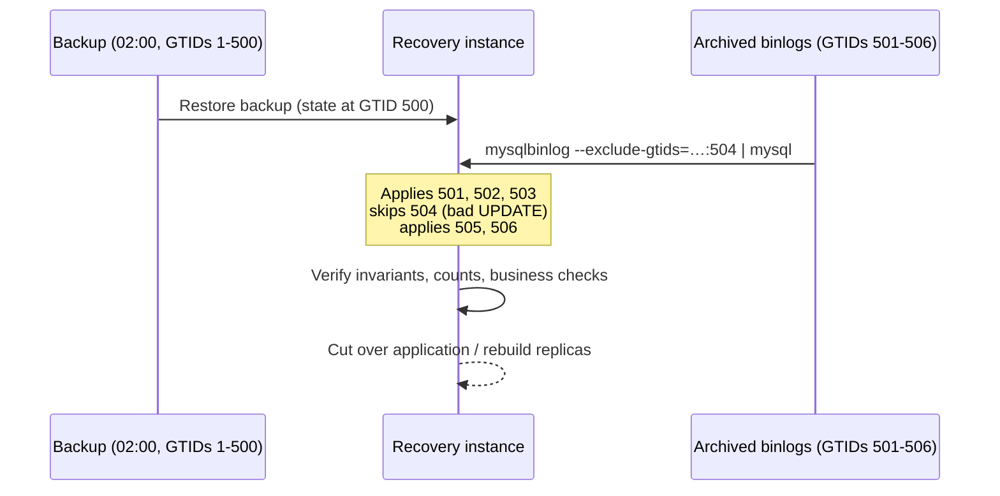

## Introduction

At 10:17:42 a deployment script runs `UPDATE accounts SET balance = 0.00` — no `WHERE` clause. It commits in milliseconds and replicates to every replica. The last full backup was taken at 02:00. What now?

Restoring last night's backup alone would lose eight hours of deposits, withdrawals and transfers. What you want is the database **exactly as it was a moment before the bad statement**, plus — ideally — the legitimate transactions that happened *after* it. That is **point-in-time recovery (PITR)**:

1. **Restore** the most recent good backup — the state at the backup's consistent point.
2. **Roll forward** by replaying the **binary log** — the server's ordered record of every committed change ([Binary Log](/lessons/m10-binary-log)) — from the backup's position up to the chosen point, or past it while **skipping** the destructive transaction.
3. **Verify** the result before letting the application back in.

This lesson walks through the restore procedure, both PITR strategies and their trade-offs, the role of GTIDs, how RPO and RTO are achieved and measured, and why only regular **recovery drills** prove that any of it works. Backups themselves were covered in [Logical and Physical Backups](/lessons/m11-backups).

:::note[How the lab simulates the binary log]
Restoring servers and running `mysqlbinlog` are impossible from a lab, so those commands are display-only. The **mechanics** run for real: you will take an in-lab backup of the bank tables, record post-backup activity in an **event-log table modelled on the binary log** (GTID, event time, statement), apply it to produce the disaster, restore from the backup, and replay the events with a stored procedure — once stopping at a time, once excluding one GTID. The capture server's real binary-log settings are shown where they can be read.
:::

## DBMS Theory

:::theory[Recovery = checkpoint + log replay]
PITR is the same principle as crash recovery, at a larger scale. A DBMS can reconstruct any committed state from:

- a **checkpoint** — a consistent image of the database at log position *p₀* (for crash recovery, the data files plus checkpoint LSN; for PITR, a backup plus its binary-log coordinates or GTID set), and
- the **log** of all committed transactions after *p₀*, in commit order.

If the log is a *redo log of committed transactions* (MySQL's binary log is one, at the logical level), then replaying the log from *p₀* to any position *p* yields the state **S(p)** — the state after exactly the transactions committed up to *p*. Correctness requires that (1) the backup really corresponds to *p₀* (consistent snapshot + exact coordinates), (2) the log is **complete** from *p₀* to *p* (no gap), and (3) replay is **deterministic** (row-based logging records the actual row changes, so replay does not depend on functions like `NOW()` or `UUID()` producing the same values again).
:::

Two ways to choose the target:

- **Stop before the error** (*point-in-time* in the strict sense): replay up to the position, timestamp or GTID just before the destructive transaction. Simple and safe; loses every legitimate transaction after the error.
- **Skip the error** (*transaction-level* recovery): replay everything except the destructive transaction. Keeps later work, but is only correct if later transactions did **not depend** on the damaged state — e.g. an application that read a zeroed balance and wrote a decision based on it cannot be "replayed past".

And the two business metrics that recovery is measured against:

| Metric | Definition | What determines it |
|---|---|---|
| **RPO** (Recovery Point Objective) | Maximum acceptable data loss, as time | How continuously the binary log is copied off the server (seconds to minutes) — not how often full backups run |
| **RTO** (Recovery Time Objective) | Maximum acceptable time to restore service | Backup restore speed (physical ≫ logical), volume of binlog to replay, detection time, decision time, verification time |

## Why It Exists

Without PITR, every logical disaster forces a choice between two bad options: restore last night's backup and lose a day of business, or try to repair the damage by hand — writing ad-hoc `UPDATE` statements against a production database under pressure, with no reliable record of what the correct values were.

The problems PITR solves are exactly the ones replication and RAID do not:

- **Destructive statements** (`DELETE`/`UPDATE` without `WHERE`, `DROP TABLE`, `TRUNCATE`) — replicated everywhere within seconds.
- **Application bugs** that corrupt data over hours ("since the 09:00 deploy, discounts were applied twice").
- **Malicious changes** by an attacker or insider, discovered later.
- **Failed migrations** that left a schema half-changed.

And without **drills**, PITR fails at the worst possible moment: binary logs were purged before the backup they were needed with, the backup's coordinates were never recorded, nobody remembers the commands, or replaying three days of binlog takes longer than the RTO.

## Internal Working

:::internals[What the restore and roll-forward actually do]
1. **Provision a target.** Recover into a *new* instance (or a scratch instance), not on top of the damaged primary: you keep the evidence, can compare, and can retry. Configuration (`my.cnf`), version and character sets must match the backup's source.
2. **Restore the backup.**
   - *Physical* (XtraBackup/MEB): copy the prepared data directory into place, fix ownership, start `mysqld`. The server starts at the backup's consistent point.
   - *Logical*: start an empty server and load the dump (`mysql < dump.sql` or `util.loadDump`). The dump re-creates schema, routines, users and rows; with `--set-gtid-purged` it also sets `gtid_purged` to the backup's GTID set.
3. **Find the start point.** The backup recorded either the binary-log file and position of its snapshot (`--source-data`, `xtrabackup_binlog_info`) or its GTID set (`gtid_purged`/`gtid_executed`).
4. **Find the stop point.** Search the binary logs for the destructive event: `mysqlbinlog --base64-output=DECODE-ROWS -v` decodes row events into pseudo-SQL (`### UPDATE … ### WHERE … ### SET …`), and with `binlog_rows_query_log_events=ON` the original statement text is logged too. Note its **position**, **timestamp** and **GTID**.
5. **Replay.** `mysqlbinlog` reads the binary log files and emits SQL (with `BINLOG '…'` base64 row events and `SET @@SESSION.GTID_NEXT=…` statements); piping it into the `mysql` client applies the transactions in order. Options select the range: `--start-position`/`--stop-position`, `--start-datetime`/`--stop-datetime`, `--include-gtids`/`--exclude-gtids`.
6. **GTID auto-skip.** On a GTID-enabled server, a transaction whose GTID is already in `gtid_executed` is silently skipped. That makes replay idempotent with respect to the backup: you can start replay a bit too early and transactions already contained in the backup are not applied twice.
7. **Verify and cut over.** Check invariants and row counts, compare with what the business knows, then repoint the application (or rebuild replicas from the recovered instance).
:::



Why a **row-based** binary log matters here: with `binlog_format=ROW` (the default since 5.7.7, and the only sensible choice), the log contains the before/after images of changed rows. Replay reproduces exactly the original changes even for non-deterministic statements, and `mysqlbinlog -v` lets you see *which rows* the bad statement changed — which also enables targeted repair (reverse the row changes) when a full PITR is too disruptive.

## MySQL Implementation

First, the capture server's binary-log configuration — the settings PITR depends on:

```sql run
SELECT @@log_bin                        AS log_bin,
       @@binlog_format                  AS binlog_format,
       @@gtid_mode                      AS gtid_mode,
       @@sync_binlog                    AS sync_binlog,
       @@innodb_flush_log_at_trx_commit AS flush_at_commit,
       @@binlog_expire_logs_seconds     AS binlog_retention_seconds;
```

Binary logging is ON and row-based (the deprecation warning on `binlog_format` is about the variable, not about row logging: future releases will support only row-based logging). `sync_binlog = 1` and `innodb_flush_log_at_trx_commit = 1` make every commit durable in both logs ([Transaction Logs](/lessons/m08-transaction-logs)). Retention is 2,592,000 seconds — 30 days, the default — so a backup older than 30 days cannot be rolled forward with the binlogs still on this server, unless they were archived. GTIDs are OFF on this development server; production servers that use replication normally run with `gtid_mode=ON`.

Listing the binary log files requires the `REPLICATION CLIENT` privilege, which a lab account does not have:

```sql run error
SHOW BINARY LOGS;
```

:::version[Binary-log statements in 8.4]
MySQL 8.4 removed `SHOW MASTER STATUS` and `RESET MASTER`. Use:

```sql
SHOW BINARY LOG STATUS;          -- current file, position, Executed_Gtid_Set (8.2+)
SHOW BINARY LOGS;                -- list of files and sizes
RESET BINARY LOGS AND GTIDS;     -- replaces RESET MASTER (destructive!)
PURGE BINARY LOGS TO 'binlog.000123';
```

mysqldump's `--source-data` replaces `--master-data`, and backups record the source position with the new terminology.
:::

Now build the scenario. **Step 1 — the 02:00 backup.** Snapshot the two bank tables (in production: a consistent dump or physical backup), and note the bank's invariant: each account's balance equals the `balance_after` of its latest ledger row.

```sql run
CREATE TABLE accounts_backup LIKE accounts;
INSERT INTO accounts_backup SELECT * FROM accounts;
CREATE TABLE transactions_backup LIKE transactions;
INSERT INTO transactions_backup SELECT * FROM transactions;
SELECT (SELECT COUNT(*) FROM accounts_backup)     AS accounts_in_backup,
       (SELECT COUNT(*) FROM transactions_backup) AS ledger_rows_in_backup,
       (SELECT SUM(balance) FROM accounts_backup) AS total_balance_in_backup;
```

**Step 2 — the binary log after the backup.** Each row is one event: the transaction's GTID, its commit time and its statement. (A real row-based binlog stores row images rather than statements; statements keep the simulation readable.) GTID `src-uuid:504` is the disaster:

```sql run
CREATE TABLE binlog_events (
  seq        INT PRIMARY KEY,          -- order in the log (file + position in real life)
  gtid       VARCHAR(60) NOT NULL,
  event_time DATETIME    NOT NULL,
  stmt       TEXT        NOT NULL
);
INSERT INTO binlog_events VALUES
 (1, 'src-uuid:501', '2024-09-01 02:15:00', 'UPDATE accounts SET balance = balance + 200.00, version = version + 1 WHERE account_id = 1'),
 (2, 'src-uuid:501', '2024-09-01 02:15:00', 'INSERT INTO transactions VALUES (167, 1, ''deposit'', 200.00, 692.57, ''DEP-9001'', ''2024-09-01 02:15:00'')'),
 (3, 'src-uuid:502', '2024-09-01 08:40:00', 'UPDATE accounts SET balance = balance - 150.00, version = version + 1 WHERE account_id = 3'),
 (4, 'src-uuid:502', '2024-09-01 08:40:00', 'INSERT INTO transactions VALUES (168, 3, ''withdrawal'', 150.00, 10082.88, NULL, ''2024-09-01 08:40:00'')'),
 (5, 'src-uuid:503', '2024-09-01 09:05:00', 'UPDATE accounts SET balance = balance - 300.00, version = version + 1 WHERE account_id = 4'),
 (6, 'src-uuid:503', '2024-09-01 09:05:00', 'UPDATE accounts SET balance = balance + 300.00, version = version + 1 WHERE account_id = 5'),
 (7, 'src-uuid:503', '2024-09-01 09:05:00', 'INSERT INTO transactions VALUES (169, 4, ''transfer_out'', 300.00, 7646.37, ''TRF-777'', ''2024-09-01 09:05:00'')'),
 (8, 'src-uuid:503', '2024-09-01 09:05:00', 'INSERT INTO transactions VALUES (170, 5, ''transfer_in'', 300.00, 7298.91, ''TRF-777'', ''2024-09-01 09:05:00'')'),
 (9, 'src-uuid:504', '2024-09-01 10:17:42', 'UPDATE accounts SET balance = 0.00'),
 (10,'src-uuid:505', '2024-09-01 10:18:30', 'UPDATE accounts SET balance = balance + 75.00, version = version + 1 WHERE account_id = 9'),
 (11,'src-uuid:505', '2024-09-01 10:18:30', 'INSERT INTO transactions VALUES (171, 9, ''deposit'', 75.00, 9244.88, ''DEP-9002'', ''2024-09-01 10:18:30'')'),
 (12,'src-uuid:506', '2024-09-01 10:25:00', 'UPDATE accounts SET balance = balance + 40.00, version = version + 1 WHERE account_id = 2'),
 (13,'src-uuid:506', '2024-09-01 10:25:00', 'INSERT INTO transactions VALUES (172, 2, ''deposit'', 40.00, 4468.20, ''DEP-9003'', ''2024-09-01 10:25:00'')');
SELECT gtid, MIN(event_time) AS committed_at, COUNT(*) AS events
FROM binlog_events GROUP BY gtid ORDER BY MIN(seq);
```

**Step 3 — the replay engine.** This procedure plays the role of `mysqlbinlog … | mysql`: it reads events in log order, optionally stops before a time (`--stop-datetime`) and optionally excludes one GTID (`--exclude-gtids`), and executes each statement:

```sql run
CREATE PROCEDURE replay_events(IN p_stop_before DATETIME, IN p_exclude_gtid VARCHAR(60))
BEGIN
  DECLARE done BOOLEAN DEFAULT FALSE;
  DECLARE v_stmt TEXT;
  DECLARE cur CURSOR FOR
    SELECT stmt FROM binlog_events
    WHERE (p_stop_before IS NULL OR event_time < p_stop_before)
      AND (p_exclude_gtid IS NULL OR gtid <> p_exclude_gtid)
    ORDER BY seq;
  DECLARE CONTINUE HANDLER FOR NOT FOUND SET done = TRUE;
  SET @replayed = 0;
  OPEN cur;
  replay: LOOP
    FETCH cur INTO v_stmt;
    IF done THEN LEAVE replay; END IF;
    SET @s = v_stmt;
    PREPARE ev FROM @s;
    EXECUTE ev;
    DEALLOCATE PREPARE ev;
    SET @replayed = @replayed + 1;
  END LOOP;
  CLOSE cur;
END;
```

**Step 4 — production runs into the disaster.** Applying the whole log to the live tables reproduces what the primary did between 02:00 and 10:25:

```sql run
CALL replay_events(NULL, NULL);
SELECT @replayed AS events_applied;
SELECT account_id, balance FROM accounts WHERE account_id IN (1, 2, 3, 4, 5, 9) ORDER BY account_id;
```

The balances are zero — except accounts 9 and 2, which received deposits *after* the bad statement and now hold only those amounts. The invariant check makes the extent of the damage measurable:

```sql run
SELECT COUNT(*) AS accounts_violating_invariant
FROM accounts a
JOIN (SELECT account_id, balance_after,
             ROW_NUMBER() OVER (PARTITION BY account_id ORDER BY created_at DESC, txn_id DESC) AS rn
      FROM transactions) last_txn
  ON last_txn.account_id = a.account_id AND last_txn.rn = 1
WHERE a.balance <> last_txn.balance_after;
```

## Syntax Breakdown

The real recovery commands (display-only):

```bash
# 1. Find the bad event (decode row events; search around the reported time)
mysqlbinlog --base64-output=DECODE-ROWS -v \
  --start-datetime="2024-09-01 10:15:00" --stop-datetime="2024-09-01 10:20:00" \
  /archive/binlog.000042 | less

# 2a. Restore the backup into a NEW instance (logical example)
mysql --host=recovery-db < /backups/full-2024-09-01-0200.sql
#     or: mysqlsh recovery-db -- util load-dump /backups/2024-09-01 --threads=8

# 2b. Read the backup's start point
grep -m1 "CHANGE REPLICATION SOURCE TO" /backups/full-2024-09-01-0200.sql   # file + position (--source-data=2)
#     physical backups: cat xtrabackup_binlog_info

# 3a. PITR by time/position: stop just before the bad event
mysqlbinlog --start-position=157 --stop-position=48211 \
  /archive/binlog.000041 /archive/binlog.000042 | mysql --host=recovery-db

# 3b. PITR by GTID: replay everything except the bad transaction
mysqlbinlog --exclude-gtids='3e11fa47-71ca-11e1-9e33-c80aa9429562:504' \
  /archive/binlog.000041 /archive/binlog.000042 | mysql --host=recovery-db
```

| Option / element | Meaning and caveats |
|---|---|
| `--start-position=N` / `--stop-position=N` | Byte offsets in the binlog file. Precise; positions apply to the **first** / **last** file named. The stop position is *exclusive* of events starting at or after it. |
| `--start-datetime` / `--stop-datetime` | Event timestamps (server time zone, second resolution). Several transactions can share a second — a datetime stop can include or exclude more than intended. Prefer positions or GTIDs for the final cut. |
| `--include-gtids` / `--exclude-gtids` | Select transactions by GTID set. The cleanest way to skip exactly one transaction. |
| GTID auto-skip | Transactions already in the target's `gtid_executed` are skipped — replay from the backup's GTID set is idempotent. |
| `--base64-output=DECODE-ROWS -v` | Show row events as commented pseudo-SQL for investigation (not for replay). |
| `--read-from-remote-server --raw --stop-never` | Stream binlogs from a running server and save them as files — continuous binlog archiving for RPO. |
| One `mysqlbinlog` process for all files | Pass all files to a single invocation. Replaying files in separate `mysql` sessions can break statements that rely on session state (e.g. temporary tables in statement-based logs). |
| `SET GTID_NEXT='uuid:504'; BEGIN; COMMIT; SET GTID_NEXT='AUTOMATIC';` | Inject an *empty* transaction with the bad GTID so that later replay or replication skips it. |

:::version[MySQL 8.4 options]
MySQL 8.4's `mysqlbinlog` speaks the new terminology in its output (`CHANGE REPLICATION SOURCE TO` comments in dumps, `SOURCE_LOG_FILE`/`SOURCE_LOG_POS`). In 8.4 you can also replay archived binary logs through the **replication applier** — copying them into place as relay logs and using `START REPLICA SQL_THREAD UNTIL SQL_BEFORE_GTIDS = '…:504'` — which applies transactions in parallel with `replica_parallel_workers` (default 4) and is often much faster than piping `mysqlbinlog` into one client session. Test this technique in drills before relying on it.
:::

## Practical Examples

**1. Find the destructive event.** In production you would scan the decoded binlog around the reported time. Here, search the event log for `UPDATE`/`DELETE` statements without a `WHERE` clause:

```sql run
SELECT seq, gtid, event_time, stmt
FROM binlog_events
WHERE (stmt LIKE 'UPDATE %' OR stmt LIKE 'DELETE %')
  AND stmt NOT LIKE '% WHERE %'
ORDER BY seq;
```

One event, GTID `src-uuid:504`, at 10:17:42. That gives you all three possible stop markers: its time, its log position (here `seq`), and its GTID.

**2. Restore the backup.** Replace the damaged tables with the backup's contents. Child rows go first because `transactions` references `accounts` (dump files avoid this by running `SET FOREIGN_KEY_CHECKS = 0` during the load):

```sql run
DELETE FROM transactions;
DELETE FROM accounts;
INSERT INTO accounts SELECT * FROM accounts_backup;
INSERT INTO transactions SELECT * FROM transactions_backup;
SELECT COUNT(*) AS accounts, SUM(balance) AS total_balance FROM accounts;
```

The database is back at the 02:00 state — consistent, but eight hours old.

**3. Strategy A — stop before the error (`--stop-datetime`).**

```sql run
CALL replay_events('2024-09-01 10:17:42', NULL);
SELECT @replayed AS events_applied;
SELECT account_id, balance FROM accounts WHERE account_id IN (1, 2, 3, 4, 5, 9) ORDER BY account_id;
```

Accounts 1, 3, 4 and 5 have their correct balances again. Accounts 2 and 9 are at their 02:00 balances: the two deposits made *after* 10:17:42 are lost. The data is consistent (the invariant holds), but two customers' deposits must be re-entered by hand — the RPO of this strategy is "everything after the error".

**4. Strategy B — skip only the bad transaction (`--exclude-gtids`).** Restore again and replay all events except GTID 504:

```sql run
DELETE FROM transactions;
DELETE FROM accounts;
INSERT INTO accounts SELECT * FROM accounts_backup;
INSERT INTO transactions SELECT * FROM transactions_backup;
CALL replay_events(NULL, 'src-uuid:504');
SELECT @replayed AS events_applied;
SELECT account_id, balance FROM accounts WHERE account_id IN (1, 2, 3, 4, 5, 9) ORDER BY account_id;
```

Every legitimate transaction is preserved and the bad one never happened. This worked because transactions 505 and 506 were **relative** updates (`balance = balance + …`) that did not depend on the zeroed balances. If the application had *read* a zero balance at 10:20 and, say, rejected a withdrawal or charged an overdraft fee, that decision would be in the log too and skipping 504 would leave it in place — the business would need to review every transaction after the error.

## Execution Walkthrough

Verify the recovered state the way a recovery runbook would, before the application is allowed back.

```walkthrough
title: Verifying the GTID-based recovery
steps:
  - title: "1. Invariant: every balance equals its latest ledger entry"
    explain: >-
      The bank's own consistency rule is the strongest check available — it catches both lost and duplicated
      transactions. After the disaster it failed for most accounts; after recovery it must hold for all of them.
    sql: |
      SELECT COUNT(*) AS accounts_violating_invariant
      FROM accounts a
      JOIN (SELECT account_id, balance_after,
                   ROW_NUMBER() OVER (PARTITION BY account_id ORDER BY created_at DESC, txn_id DESC) AS rn
            FROM transactions) last_txn
        ON last_txn.account_id = a.account_id AND last_txn.rn = 1
      WHERE a.balance <> last_txn.balance_after;
  - title: "2. Completeness: every replayed transaction left its ledger row"
    explain: >-
      The six post-backup ledger rows (txn 167–172) must all be present exactly once — none lost by the replay,
      none applied twice.
    sql: |
      SELECT txn_id, account_id, txn_type, amount, reference
      FROM transactions WHERE txn_id > 166 ORDER BY txn_id;
  - title: "3. Money conservation: totals reconcile with the backup"
    explain: >-
      The total balance must equal the backup's total plus the net effect of the replayed transactions: +200 −150
      +0 (the transfer moves money between accounts) +75 +40 = +165.00.
    sql: |
      SELECT (SELECT SUM(balance) FROM accounts_backup)            AS total_at_backup,
             (SELECT SUM(balance) FROM accounts)                   AS total_now,
             (SELECT SUM(balance) FROM accounts) - (SELECT SUM(balance) FROM accounts_backup) AS net_change;
  - title: "4. Decision: cut over"
    explain: >-
      All checks pass, so the recovered instance can be promoted: point the application at it, rebuild replicas from
      it (or clone them), and archive the damaged instance for the incident review.
```

## Output

The captured results tell the whole story:

- **Disaster:** after applying the full log, most balances were zero and the invariant check found 24 of the 25 accounts violating it (the one exception is account 12, a closed account whose balance really is 0.00, so the zeroing happened to leave it correct).
- **Restore:** the tables returned to the backup's 25 accounts and total balance.
- **Strategy A** (stop at 10:17:42) applied the 8 events before the error; accounts 2 and 9 lost their later deposits.
- **Strategy B** (exclude GTID 504) applied 12 of the 13 events; all six balances are correct.
- **Verification:** zero invariant violations, ledger rows 167–172 present once each, and a net change of exactly +165.00 relative to the backup.

## Alternative Approaches

| Approach | When it fits | Trade-offs |
|---|---|---|
| Full restore + binlog replay to a point (this lesson) | Any logical disaster; the general solution | RTO = restore time + replay time; needs complete archived binlogs |
| Restore + skip one GTID | Single bad transaction; later transactions independent of it | Requires business review of dependent transactions |
| **Targeted repair** from row images (`mysqlbinlog -v` before-images, or tools that generate reverse SQL such as *binlog2sql*-style flashback utilities) | One bad statement affecting a known table; full PITR too disruptive | Fast and local; must be generated carefully (later changes to the same rows complicate it) |
| Restore a single table into a scratch instance and copy rows back | Dropped/damaged single table in a large database | Much faster than full restore; cross-table consistency must be reasoned about |
| **Delayed replica** (`SOURCE_DELAY = 3600`) | Very fast recovery from recent errors: stop the replica before it applies the bad transaction (`START REPLICA UNTIL SQL_BEFORE_GTIDS = '…:504'`) and promote or copy from it | Costs a server; only covers errors detected within the delay |
| Managed-service PITR (RDS/Aurora, Cloud SQL, Azure) | Cloud deployments | Restores to a *new* instance at a chosen second; you still choose the time and verify; Aurora "backtrack" rewinds in place (MySQL-compatible Aurora only) |
| Application-level correction (compensating transactions) | Errors that are business events (wrong refunds) rather than data corruption | No database recovery at all; keeps an audit trail |

## Performance Analysis

RTO is a sum, and each term has its own scaling behaviour:

| Phase | Scales with | Levers |
|---|---|---|
| Detection and decision | Monitoring, on-call, runbooks | Alerts on mass changes (rows affected), clear ownership |
| Provisioning the target | Infrastructure automation | Pre-built recovery instances / templates |
| Restoring the backup | Data size; logical restore also with row and index count | Physical backups; parallel `util.loadDump`; deferred index builds; fast local copies |
| Replaying binlogs | Volume of changes since the backup; single-threaded `mysqlbinlog \| mysql` | More frequent backups (less to replay); applier-based parallel replay; relaxed durability on the throwaway target during replay |
| Verification | Data size, depth of checks | Precomputed invariants, chunked checksums |

Concretely, binlog replay time is roughly *(binlog volume since backup) ÷ (single-session apply rate)*. A server that writes 5 GB of binlog per day and is backed up daily may need to replay up to 5 GB; if one session applies, say, a few thousand row events per second on your hardware, that can take hours — **measure it in a drill**. Taking backups more often (or incrementals) cuts the replay term; it does not change RPO, which comes from how quickly binlogs leave the server.

RPO is set by binlog archiving lag. If binlogs are copied hourly, a server lost at 10:59 loses up to an hour. Streaming with `mysqlbinlog --read-from-remote-server --stop-never` (or semi-synchronous replicas, [Replication](/lessons/m11-replication-ha)) brings it to seconds.

:::performance[Theory vs measurement]
The lab's 13-event replay is instantaneous and says nothing about production speed; no timing was captured for it. The only trustworthy RTO is the one measured in a full drill on production-sized data.
:::

## Best Practices

:::best-practice[Making recovery boring]
1. **Keep binary logging ON, row-based, with `sync_binlog=1`** and (for replication setups) **GTIDs ON** — GTIDs make start points, skips and auto-skip far less error-prone than file positions.
2. **Archive binlogs continuously off-host** (streaming `mysqlbinlog` or a managed equivalent) with retention ≥ the age of your oldest backup you might roll forward from. Never let `binlog_expire_logs_seconds` purge logs you have not archived.
3. **Record each backup's start point** (GTID set and file/position) in the backup catalogue.
4. **Recover into a new instance**, never on top of the damaged one. Keep the damaged instance for forensics.
5. **Prefer GTID or position stops** over `--stop-datetime` for the final cut; use datetime only to narrow the search.
6. **Write and rehearse a runbook**: who decides the recovery point, exact commands, verification queries, cut-over steps, communication.
7. **Drill regularly** (quarterly at least, plus after major changes): restore the latest backup, replay to a chosen GTID, run verification, and record the measured RTO and achieved RPO. Treat a failed drill as an incident.
8. **Protect the recovery chain**: backups and archived binlogs encrypted, immutable, in a separate account; encryption keys available in the DR environment.
9. **Prevent the common disasters**: `sql_safe_updates` for interactive sessions (rejects `UPDATE`/`DELETE` without a key in `WHERE`), reviewed migrations, least-privilege accounts.
:::

## Common Mistakes

**Mistake 1 — replaying binlogs from the wrong start point.** Starting *after* the backup's position loses transactions; starting *before* it re-applies transactions (duplicates) unless GTID auto-skip is in effect. Always take the start point from the backup's own metadata.

**Mistake 2 — a gap in the binlog chain.** One missing file between the backup position and the target makes every later transaction unrecoverable (replay would produce wrong data, not an error, if the missing transactions were independent). Verify the chain is contiguous before you need it.

**Mistake 3 — recovering on the production primary.** If the replay fails halfway, you have destroyed the evidence *and* the partially working system. Always recover into a separate instance.

**Mistake 4 — `--stop-datetime` cutting in the middle of a busy second.** Timestamps have one-second resolution; several transactions — including the bad one — can share the same second. Narrow the search by time, then stop by position or GTID.

**Mistake 5 — skipping a transaction that later transactions depended on.** Strategy B is correct only for independent later work. Review application behaviour (reads that drove decisions) before choosing it.

**Mistake 6 — the bad statement is prevented by a safety setting nobody uses.** The disaster statement in this lesson would have been rejected interactively with safe-updates mode:

```sql run error
SET SESSION sql_safe_updates = 1;
UPDATE accounts SET balance = 0.00;
```

Error 1175 refuses `UPDATE`/`DELETE` without a key-based `WHERE` (or `LIMIT`). The `mysql` client enables it with `--safe-updates` (alias `--i-am-a-dummy`). It is a guard rail for humans, not a substitute for backups.

```sql run
SET SESSION sql_safe_updates = 0;
```

## Industry Application

- **Runbooks and incident command.** Mature teams have a written PITR runbook per database class, with named decision makers ("who chooses the recovery point?"), pre-approved commands and verification queries. During an incident, the first actions are to stop the damage (block the faulty job, revoke its account), note the bad transaction's GTID, and start provisioning a recovery instance in parallel with the investigation.
- **Continuous archiving.** Self-managed fleets stream binlogs to object storage from a dedicated host; managed services do it automatically and expose a "restore to time" API with second granularity within the retention window (typically 1–35 days).
- **Delayed replicas.** Companies with large databases keep a replica delayed by one to several hours specifically for fast recovery from human error: they stop it before the bad GTID and extract or promote from it in minutes instead of restoring terabytes.
- **Drills as evidence.** SOC 2 and ISO 27001 audits ask for proof of periodic restore tests; many teams automate a nightly "restore + replay + verify" pipeline and publish the measured RTO on a dashboard.
- **Regulated industries.** Banks and payment companies combine PITR with compensating transactions: the database is recovered technically, while customer-facing corrections (reversed fees, re-issued transfers) are made as new, audited business transactions.

## Practice Exercises

```exercise
id: ex1
title: Locate the destructive transaction
difficulty: easy
kind: query
dataset: empty
setup: |
  CREATE TABLE binlog_events (seq INT PRIMARY KEY, gtid VARCHAR(60) NOT NULL, event_time DATETIME NOT NULL, stmt TEXT NOT NULL);
  INSERT INTO binlog_events VALUES
    (1,'aaa:1001','2026-11-09 08:00:01','UPDATE products SET price = price * 1.05 WHERE category_id = 3'),
    (2,'aaa:1002','2026-11-09 08:03:12','INSERT INTO orders VALUES (900, 4, ''2026-11-09 08:03:12'', ''paid'', NULL, NULL)'),
    (3,'aaa:1003','2026-11-09 08:05:40','DELETE FROM order_items'),
    (4,'aaa:1004','2026-11-09 08:05:41','UPDATE customers SET loyalty_tier = ''gold'' WHERE customer_id = 7'),
    (5,'aaa:1005','2026-11-09 08:09:00','DELETE FROM payments WHERE payment_id = 12');
concepts: [point-in-time-recovery, binary-log]
prompt: |
  `binlog_events(seq, gtid, event_time, stmt)` models a decoded binary log. Return the `seq`, `gtid` and
  `event_time` of every `UPDATE` or `DELETE` that has **no `WHERE` clause**, ordered by `seq`.
hints:
  - "stmt LIKE 'DELETE %' OR stmt LIKE 'UPDATE %'"
  - "… AND stmt NOT LIKE '% WHERE %'"
solution: |
  SELECT seq, gtid, event_time
  FROM binlog_events
  WHERE (stmt LIKE 'UPDATE %' OR stmt LIKE 'DELETE %')
    AND stmt NOT LIKE '% WHERE %'
  ORDER BY seq;
orderMatters: true
explanation: |
  The parentheses matter: without them `AND` binds tighter than `OR`, and every `UPDATE` would match. With the GTID
  in hand you can exclude exactly this transaction (`--exclude-gtids='aaa:1003'`). Note that event 4 committed one
  second later — a `--stop-datetime='2026-11-09 08:05:41'` cut would be correct here, but on a busy server several
  transactions share each second, which is why GTIDs or positions are preferred.
```

```exercise
id: ex2
title: Measure recovery drills against the RTO
difficulty: medium
kind: query
dataset: empty
setup: |
  CREATE TABLE recovery_drills (
    drill_id INT PRIMARY KEY, system_name VARCHAR(20) NOT NULL, rto_minutes INT NOT NULL,
    started_at DATETIME NOT NULL, restore_done_at DATETIME NULL, replay_done_at DATETIME NULL, verified_at DATETIME NULL);
  INSERT INTO recovery_drills VALUES
    (1,'orders',120,'2026-08-03 09:00:00','2026-08-03 09:52:00','2026-08-03 10:31:00','2026-08-03 10:45:00'),
    (2,'orders',120,'2026-11-02 09:00:00','2026-11-02 10:05:00','2026-11-02 11:20:00','2026-11-02 11:41:00'),
    (3,'billing',60,'2026-10-12 14:00:00','2026-10-12 14:20:00','2026-10-12 14:31:00','2026-10-12 14:40:00'),
    (4,'catalog',240,'2026-09-21 13:00:00','2026-09-21 15:10:00',NULL,NULL);
concepts: [rpo-rto, recovery-drills]
prompt: |
  `recovery_drills` records each drill's milestones; a drill that never reached `verified_at` failed. Return per drill:
  `drill_id`, `system_name`, `restore_min` (minutes from start to restore done), `replay_min` (restore done →
  replay done), `total_min` (start → verified), and `outcome`: `'FAILED'` if not verified, `'MISSED RTO'` if
  `total_min > rto_minutes`, otherwise `'OK'`. Use `TIMESTAMPDIFF(MINUTE, …)`. Order by `drill_id`.
hints:
  - "TIMESTAMPDIFF returns NULL when an argument is NULL — useful for the failed drill."
  - "Check the FAILED case first in the CASE expression."
solution: |
  SELECT drill_id, system_name,
         TIMESTAMPDIFF(MINUTE, started_at, restore_done_at)    AS restore_min,
         TIMESTAMPDIFF(MINUTE, restore_done_at, replay_done_at) AS replay_min,
         TIMESTAMPDIFF(MINUTE, started_at, verified_at)        AS total_min,
         CASE
           WHEN verified_at IS NULL THEN 'FAILED'
           WHEN TIMESTAMPDIFF(MINUTE, started_at, verified_at) > rto_minutes THEN 'MISSED RTO'
           ELSE 'OK'
         END AS outcome
  FROM recovery_drills
  ORDER BY drill_id;
orderMatters: true
explanation: |
  The *orders* system passed in August but missed its 120-minute RTO in November — replay time grew from 39 to 75
  minutes as binlog volume increased. That trend is exactly what drills are for: it argues for more frequent
  backups (less to replay) or applier-based parallel replay. The *catalog* drill failed outright; a failed drill is
  an incident, not a footnote.
```

```exercise
id: ex3
title: Perform the GTID-based recovery
difficulty: hard
kind: dml
setup: |
  CREATE TABLE accounts_backup LIKE accounts;
  INSERT INTO accounts_backup SELECT * FROM accounts;
  CREATE TABLE binlog_events (seq INT PRIMARY KEY, gtid VARCHAR(60) NOT NULL, event_time DATETIME NOT NULL, stmt TEXT NOT NULL);
  INSERT INTO binlog_events VALUES
    (1,'src:801','2024-09-02 09:00:00','UPDATE accounts SET balance = balance + 500.00 WHERE account_id = 6'),
    (2,'src:802','2024-09-02 09:30:00','UPDATE accounts SET balance = balance - 100.00 WHERE account_id = 8'),
    (3,'src:803','2024-09-02 09:31:10','UPDATE accounts SET status = ''frozen'''),
    (4,'src:804','2024-09-02 09:45:00','UPDATE accounts SET balance = balance + 25.00 WHERE account_id = 10');
  CREATE PROCEDURE replay_events(IN p_stop_before DATETIME, IN p_exclude_gtid VARCHAR(60))
  BEGIN
    DECLARE done BOOLEAN DEFAULT FALSE;
    DECLARE v_stmt TEXT;
    DECLARE cur CURSOR FOR
      SELECT stmt FROM binlog_events
      WHERE (p_stop_before IS NULL OR event_time < p_stop_before)
        AND (p_exclude_gtid IS NULL OR gtid <> p_exclude_gtid)
      ORDER BY seq;
    DECLARE CONTINUE HANDLER FOR NOT FOUND SET done = TRUE;
    OPEN cur;
    replay: LOOP
      FETCH cur INTO v_stmt;
      IF done THEN LEAVE replay; END IF;
      SET @s = v_stmt;
      PREPARE ev FROM @s;
      EXECUTE ev;
      DEALLOCATE PREPARE ev;
    END LOOP;
    CLOSE cur;
  END;
  CALL replay_events(NULL, NULL);
concepts: [point-in-time-recovery, gtid, restore]
prompt: |
  The setup restored nothing yet: it took a backup (`accounts_backup`), then **applied the whole binlog** to the
  live `accounts` table — including GTID `src:803`, which froze every account. A procedure
  `replay_events(p_stop_before DATETIME, p_exclude_gtid VARCHAR(60))` is available.

  Recover `accounts` so that it reflects **every transaction except `src:803`**: restore the rows from
  `accounts_backup`, then replay. (Use `UPDATE … JOIN` for the restore — `DELETE FROM accounts` and `REPLACE`
  are blocked by the ledger's foreign key.)

  The checker reads `account_id, balance, status` for accounts 6–12.
hints:
  - "REPLACE INTO accounts SELECT * FROM accounts_backup; would delete-and-reinsert rows (and fail on the FK). Instead: UPDATE accounts a JOIN accounts_backup b USING (account_id) SET a.balance = b.balance, a.status = b.status, a.version = b.version;"
  - "Then CALL replay_events(NULL, 'src:803');"
solution: |
  UPDATE accounts a
  JOIN accounts_backup b ON b.account_id = a.account_id
  SET a.balance = b.balance, a.status = b.status, a.version = b.version;
  CALL replay_events(NULL, 'src:803');
check: |
  SELECT account_id, balance, status FROM accounts WHERE account_id BETWEEN 6 AND 12 ORDER BY account_id;
explanation: |
  The restore puts every account back to its backup state — including account 7 (frozen) and 12 (closed), whose
  real statuses were overwritten by the disaster — and the replay re-applies the three legitimate transactions.
  Replaying *without* first restoring would apply 801, 802 and 804 a second time (double deposits): this is the
  "wrong start point" mistake, which GTID auto-skip prevents on a real server. Stopping at `09:31:10` instead
  would lose transaction 804.
```

```exercise
id: ex4
title: Achievable RPO from the archive log
difficulty: hard
kind: query
dataset: empty
setup: |
  CREATE TABLE binlog_archive (
    server_name VARCHAR(20) NOT NULL, file_name VARCHAR(30) NOT NULL,
    last_event_at DATETIME NOT NULL, archived_at DATETIME NOT NULL, PRIMARY KEY (server_name, file_name));
  INSERT INTO binlog_archive VALUES
    ('db-orders','binlog.000101','2026-11-09 08:00:00','2026-11-09 08:00:20'),
    ('db-orders','binlog.000102','2026-11-09 09:00:00','2026-11-09 09:00:15'),
    ('db-orders','binlog.000103','2026-11-09 10:00:00','2026-11-09 10:03:00'),
    ('db-billing','binlog.000044','2026-11-09 06:00:00','2026-11-09 07:10:00'),
    ('db-billing','binlog.000045','2026-11-09 09:30:00','2026-11-09 09:31:00');
concepts: [rpo-rto, binary-log]
prompt: |
  `binlog_archive` lists binary-log files copied off each server: the time of the last event in the file and when
  the copy finished. If a server is lost at **2026-11-09 10:30:00**, everything after the last archived event is
  lost. Return per server: `server_name`, `last_safe_event` (latest `last_event_at` among files archived **by**
  10:30:00), `minutes_lost` (`TIMESTAMPDIFF(MINUTE, last_safe_event, '2026-11-09 10:30:00')`), and
  `max_copy_delay_s` — the worst archiving delay (`archived_at − last_event_at`, in seconds) seen for that server.
  Order by `server_name`.
hints:
  - "Filter archived_at <= '2026-11-09 10:30:00', then GROUP BY server_name with MAX(last_event_at)."
  - "TIMESTAMPDIFF(SECOND, last_event_at, archived_at) per file; take the MAX per server."
solution: |
  SELECT server_name,
         MAX(last_event_at) AS last_safe_event,
         TIMESTAMPDIFF(MINUTE, MAX(last_event_at), '2026-11-09 10:30:00') AS minutes_lost,
         MAX(TIMESTAMPDIFF(SECOND, last_event_at, archived_at)) AS max_copy_delay_s
  FROM binlog_archive
  WHERE archived_at <= '2026-11-09 10:30:00'
  GROUP BY server_name
  ORDER BY server_name;
orderMatters: true
explanation: |
  Both servers rotate and archive whole files, so the data at risk is everything since the last *closed and copied*
  file — 30 and 60 minutes here — regardless of how quickly each copy ran. That is why file-based archiving
  cannot meet a minutes-level RPO; streaming the binlog continuously (`mysqlbinlog --read-from-remote-server
  --raw --stop-never`) or semi-synchronous replicas can. The 70-minute copy delay on db-billing is a separate
  monitoring finding.
```

```exercise
id: ex5
title: Design a backup and PITR plan with RPO/RTO
difficulty: challenge
kind: open
concepts: [rpo-rto, point-in-time-recovery, recovery-drills, binary-log]
prompt: |
  A payments database (MySQL 8.4, 400 GB, ~8 GB of binlog per day, one primary + two replicas in one region) has
  these targets: **RPO 1 minute**, **RTO 1 hour** for a logical disaster (bad statement), **RTO 4 hours** for
  region loss. Design the plan: backup types and schedule, binlog handling, GTID configuration, where everything is
  stored, the recovery procedure for a bad `DELETE` discovered 3 hours later, how the RTO is achieved and
  verified, and what you would monitor. Point out assumptions you would have to validate with measurements.
solution: |
  **Configuration.** `gtid_mode=ON`, `enforce_gtid_consistency=ON`, `binlog_format=ROW`,
  `binlog_rows_query_log_events=ON` (original statement text for investigation), `sync_binlog=1`,
  `innodb_flush_log_at_trx_commit=1`, local binlog retention ≥ 7 days.

  **RPO 1 minute.** Continuously stream binlogs off the primary to a separate host in another region
  (`mysqlbinlog --read-from-remote-server --raw --stop-never`, restarted automatically and monitored), and copy them
  to immutable object storage. Within the region, at least one semi-synchronous replica (`AFTER_SYNC`) ensures
  committed transactions exist on two hosts. Monitor archive lag (alert at 30 s).

  **Backups.** Daily physical full backup + hourly incrementals (XtraBackup 8.4 / MEB) from a replica, encrypted,
  stored locally (fast restore) and cross-region with object lock. Each backup records its GTID set. Weekly
  MySQL Shell logical dump for portability. A 2-hour **delayed replica** for very fast recovery from human error.

  **Recovery from a bad DELETE found 3 hours later (RTO 1 h).**
  1. Stop the damage (disable the job/account); identify the transaction with `mysqlbinlog -v` around the reported
     time; note its GTID.
  2. Fastest path: the delayed replica (2 h delay) has already applied it — so instead restore the latest hourly
     incremental chain into a pre-provisioned recovery instance (restore time must be measured: 400 GB at a few
     hundred MB/s ≈ 20–40 minutes is an assumption to validate).
  3. Replay binlogs from the backup's GTID set with `--exclude-gtids=<bad GTID>` (≤ 1 hour of binlog ≈ 0.3–0.5 GB —
     minutes, to be measured) — or, if later transactions depended on the deleted rows, stop before it and hand the
     later transactions to the business for review.
  4. Verify: row counts and checksums for the affected tables vs. the delayed replica/backup, business invariants
     (ledger totals), application smoke tests.
  5. Either promote the recovery instance or, if the damage is confined to one table, copy the recovered rows back
     into the primary (faster, less disruptive). Rebuild replicas with the Clone plugin.

  **Region loss (RTO 4 h).** Cross-region backups + streamed binlogs allow building a new primary in the DR region;
  better, a cross-region async replica (or InnoDB ClusterSet) reduces RTO to failover time. Infrastructure as code
  for the DR environment; KMS keys replicated.

  **Verification and monitoring.** Monthly full drills with measured RTO per phase; automated nightly
  restore-and-verify; alerts on backup failures, backup age, binlog archive lag, gaps in the archived GTID
  sequence, disk space for binlogs, and mass-change events (rows affected per statement). Assumptions to validate:
  restore throughput, replay rate, detection time (3 hours here — itself worth improving with alerts on unusual
  DELETE volumes).
```

## Knowledge Assessment

```quiz
- id: q1
  question: "Which two artefacts are required for point-in-time recovery?"
  options:
    - "The error log and the slow query log"
    - "A consistent backup with its binlog coordinates/GTID set, and the complete binary log from that point on"
    - "Two replicas"
    - "The redo log and the undo log"
  answer: 1
  explanation: "PITR = restore a checkpoint (the backup at a known log position) + replay the log after it. Error and slow logs contain no data changes; replicas replicate the disaster; redo/undo are InnoDB-internal and recycled continuously."
  concepts: [point-in-time-recovery, binary-log]
- id: q2
  question: "A bad `UPDATE` has GTID `…:504`. Later transactions 505–510 were relative updates unrelated to it. Which replay keeps the most data?"
  options:
    - "mysqlbinlog --stop-datetime set to the bad statement's second"
    - "mysqlbinlog --exclude-gtids='…:504' from the backup's position"
    - "Restoring the backup only"
    - "Replaying all binlogs including 504, then running the inverse UPDATE"
  answer: 1
  explanation: "Excluding exactly one GTID preserves the independent later work. Stopping at the time loses 505–510; restoring only loses everything since the backup. An 'inverse UPDATE' for SET balance = 0 is impossible without the before-images."
  concepts: [gtid, point-in-time-recovery]
- id: q3
  question: "Why is `--stop-datetime` risky as the final cut-off on a busy server?"
  options:
    - "It is not supported for row-based logs"
    - "Event timestamps have one-second resolution, so several transactions — possibly including the bad one — share the cut-off second"
    - "It requires GTIDs"
    - "It replays events in reverse order"
  answer: 1
  explanation: "Datetime boundaries are imprecise when many transactions commit per second. Use it to narrow the search, then stop by position or GTID. It works with row-based logs and does not need GTIDs."
  concepts: [point-in-time-recovery]
- id: q4
  question: "What does GTID auto-skip provide during binlog replay?"
  options:
    - "It skips transactions whose GTID is already in the target's gtid_executed, so replay from slightly before the backup point does not apply them twice"
    - "It skips all DDL"
    - "It skips transactions that fail"
    - "It skips transactions older than binlog_expire_logs_seconds"
  answer: 0
  explanation: "A GTID identifies a transaction globally; a server never applies a GTID twice. Failed transactions stop the replay with an error; DDL and old transactions are not skipped automatically."
  concepts: [gtid]
- id: q5
  question: "A company backs up nightly and copies binlogs to storage every hour. What is its effective RPO for losing the primary server?"
  options:
    - "24 hours"
    - "Up to about 1 hour (the archiving interval), regardless of backup frequency"
    - "Zero"
    - "Equal to the RTO"
  answer: 1
  explanation: "Restore + replay of archived binlogs reaches the last archived event, so data written since the last copy is lost. Nightly backups influence RTO (how much to replay), not RPO. RPO and RTO are independent metrics."
  concepts: [rpo-rto]
- id: q6
  question: "Which actions belong in a recovery drill? (Select all that apply.)"
  type: multi
  options:
    - "Restoring the latest backup into a separate instance"
    - "Replaying binlogs to a chosen GTID or position"
    - "Running verification queries (counts, checksums, invariants) and recording the measured RTO"
    - "Restoring directly over the production primary to make the test realistic"
  answer: [0, 1, 2]
  explanation: "A drill exercises the full chain and measures it — in a separate environment. Restoring over production would cause the outage the drill is meant to prevent."
  concepts: [recovery-drills]
- id: q7
  question: "In MySQL 8.4, which statement shows the current binary log file, position and executed GTID set?"
  options: ["SHOW MASTER STATUS", "SHOW BINARY LOG STATUS", "SHOW SLAVE STATUS", "SHOW BINLOG EVENTS STATUS"]
  answer: 1
  explanation: "SHOW BINARY LOG STATUS (8.2+) replaced SHOW MASTER STATUS, which 8.4 removed. SHOW SLAVE STATUS is also removed (use SHOW REPLICA STATUS, a different thing); SHOW BINLOG EVENTS lists events, not status."
  concepts: [binary-log]
- id: q8
  question: "Why should recovery happen in a new instance rather than on the damaged primary?"
  options:
    - "MySQL cannot replay binlogs into a running server"
    - "It preserves the damaged state for investigation, allows retries if the replay fails, and lets you verify before cutting over"
    - "New instances replay faster because they have no indexes"
    - "Binlogs can only be applied to servers with a different server_uuid"
  answer: 1
  explanation: "A separate target keeps evidence and the option to retry or change the recovery point. Running servers can apply binlogs; restored instances have indexes; server_uuid is unrelated to applying mysqlbinlog output."
  concepts: [restore]
```
