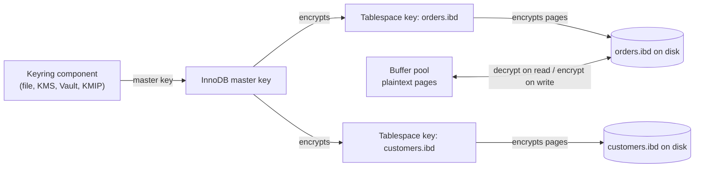

## Introduction

Authentication and authorization decide *who* may access *what*. They say nothing about who can **observe** the data on its way: the network between the application and the server, the disks and backups where the data rests, the log files that record statements, the memory dump attached to a support ticket. This lesson is about **confidentiality and integrity outside the SQL layer**:

- **Data in transit** — TLS between clients, servers and replicas: how MySQL configures it, how an account can *require* it, and why "encrypted" is not the same as "safe from a man in the middle" unless the client **verifies** the server's certificate.
- **Data at rest** — InnoDB tablespace encryption, redo/undo log encryption, binary-log encryption, the **keyring** that holds the master keys, and when encrypting individual columns in the application is the better tool.
- **Secrets** — the passwords, private keys and encryption keys all of this depends on, and where they must (and must not) live.

These controls are mandatory in most regulated environments (PCI DSS, HIPAA, GDPR "appropriate technical measures", SOC 2) and are increasingly the default in cloud deployments.

:::note[What you can observe from the lab]
The platform's backend connects to MySQL **over TLS**, so your lab session is itself an encrypted connection and its session status shows the negotiated protocol and cipher. You can read the server's TLS variables, see that table encryption fails without a keyring, and use MySQL's encryption and hashing functions. Server configuration (`my.cnf`, `ALTER INSTANCE`, `SET PERSIST`), account TLS requirements (`ALTER USER … REQUIRE`) and client options are display-only. All server values shown are **capture-server values** — your production servers will differ.
:::

## DBMS Theory

:::theory[Security properties and where they come from]
- **Confidentiality** — only authorized parties can read data. In transit: encryption with a session key negotiated per connection. At rest: encryption with keys held outside the data files.
- **Integrity** — data cannot be modified undetected. TLS cipher suites with AEAD modes (AES-GCM, ChaCha20-Poly1305) authenticate every record.
- **Authenticity** — you are talking to the party you think you are. TLS achieves it with **X.509 certificates** signed by a **certificate authority (CA)** that the client trusts, plus a check that the certificate's name matches the host the client meant to reach.
- **Forward secrecy** — compromise of the server's long-term private key does not reveal past sessions, because each session key comes from an ephemeral (EC)DHE exchange. TLS 1.3 mandates it.

**Envelope encryption** is the standard pattern for data at rest: data is encrypted with a **data encryption key (DEK)**; the DEK is itself encrypted with a **key encryption key (KEK, master key)** held in a separate system (a keyring, KMS or HSM). Rotating the master key re-encrypts only the small DEKs, not the data; destroying the master key makes the data unreadable (*crypto-shredding*).
:::

The **threat model** decides which control matters:

| Threat | Control | Does *not* protect against |
|---|---|---|
| Sniffing the network between app and DB | TLS (any mode that encrypts) | A MITM who presents their own certificate, unless the client verifies |
| Man-in-the-middle, DNS spoofing | TLS with `VERIFY_CA` / `VERIFY_IDENTITY` | A compromised CA or stolen server key |
| Stolen disk, snapshot or decommissioned drive | Tablespace + log encryption (TDE) | Anyone who can log in to MySQL — the server decrypts for them |
| Stolen backup files | Encrypted backups (tool-level) or TDE-aware physical backups | Restoring with access to the keys |
| A DBA or an attacker with SQL access reading sensitive columns | Column-level (application-side) encryption, tokenization, masking views | The application that holds the key |
| Secrets in Git, CI logs, process lists | Secrets manager, short-lived credentials, `RANDOM PASSWORD` | Compromise of the secrets manager itself |

The key insight: **transparent data encryption is transparent to every authorized SQL user**. It defends against people who get the *files*, not against people who get a *login*.

## Why It Exists

Before TLS became standard on internal networks, many organizations assumed the data-centre network was trusted. That assumption keeps failing — compromised hosts inside the perimeter, shared cloud networks, cross-region replication over the internet, service meshes spanning clusters. Without TLS:

- every query and result, including personal data, crosses the network in clear text;
- passwords are exposed during `caching_sha2_password` *full* authentication unless RSA is used, and RSA key fetching itself can be intercepted ([Users and Authentication](/lessons/m11-users-authentication));
- replication streams (the entire change history of the database) are readable by anyone on the path.

Without encryption at rest, a database is only as safe as every place its files go: disks sent for repair, cloud volume snapshots shared by mistake, backup buckets with a public ACL, a developer laptop with a production dump. Many publicized breaches were not SQL attacks at all, but exposed backups.

And without disciplined **secrets management**, all of these controls collapse: a TLS private key in a public repository, a database password hard-coded in a container image, an encryption key typed into a SQL statement that is then written to the slow query log.

## Internal Working

:::internals[TLS in the MySQL protocol]
1. The server sends its initial **handshake packet** in clear text; it advertises the `CLIENT_SSL` capability if TLS is configured.
2. A client that wants TLS replies with a short **SSL request** packet and then starts the TLS handshake on the same TCP connection (MySQL does not use a separate TLS port, unlike HTTPS).
3. Client and server negotiate the protocol version (`tls_version`, TLS 1.2 or 1.3 in current releases) and a cipher suite (`tls_ciphersuites` for 1.3, `ssl_cipher` for 1.2). The server presents its certificate chain.
4. **Verification is the client's job**: with `--ssl-mode=VERIFY_CA` it checks the chain against its trusted CA file; with `VERIFY_IDENTITY` it also checks that the certificate's subject alternative name (or CN) matches the host name it connected to. With `PREFERRED` or `REQUIRED` it accepts **any** certificate — the connection is encrypted, but possibly to an attacker.
5. Only after the TLS handshake does the client send the authentication response. Everything that follows — credentials, queries, results — is inside TLS.
6. If the server is configured to request client certificates and the account has `REQUIRE X509`, the client presents a certificate, the server verifies it against `ssl_ca`, and the account's `ISSUER`/`SUBJECT` conditions are checked.

Server-side TLS material is loaded at start-up (or with `ALTER INSTANCE RELOAD TLS`, without restart). If no certificate files exist, the server **auto-generates** a self-signed CA, server and client certificates in the data directory (`auto_generate_certs`, ON by default) — convenient, but clients cannot meaningfully verify them unless you distribute that CA.
:::

:::internals[InnoDB data-at-rest encryption]
- Each encrypted **tablespace** has its own tablespace key, stored *encrypted by the master key* in the tablespace header. Pages are encrypted when written to disk and decrypted when read into the buffer pool — the buffer pool holds plaintext pages.
- The **master key** lives in the **keyring** — a component (`component_keyring_file`, `component_keyring_encrypted_file`, or Enterprise components for KMIP, AWS KMS, Oracle Cloud Vault, HashiCorp Vault). The server fetches it at start-up. `ALTER INSTANCE ROTATE INNODB MASTER KEY` generates a new master key and re-encrypts the tablespace keys only.
- Separate switches cover the other files that contain data: `innodb_redo_log_encrypt`, `innodb_undo_log_encrypt`, `binlog_encryption` (binary and relay logs, with their own key hierarchy), `default_table_encryption` (default for new schemas/tables), and the doublewrite files follow the tablespaces they protect.
- Without a keyring, `ENCRYPTION='Y'` fails — you will see that error below.
:::



## MySQL Implementation

Start by looking at **your own connection**. The session status variables describe the TLS session between the platform's backend and the capture server:

```sql run
SHOW SESSION STATUS WHERE Variable_name IN ('Ssl_version', 'Ssl_cipher');
```

The lab connection uses TLS 1.3 with an AES-256-GCM cipher suite (capture-server values; an empty `Ssl_cipher` would mean the session is **not** encrypted — the first thing to check when auditing a client). The server's TLS configuration is visible as system variables:

```sql run
SELECT @@tls_version              AS tls_versions_enabled,
       @@require_secure_transport AS require_secure_transport,
       @@ssl_ca                   AS ca_file,
       @@ssl_cert                 AS cert_file,
       @@ssl_key                  AS key_file;
```

TLS 1.2 and 1.3 are enabled; the file names are relative to the data directory — the auto-generated files described above. `require_secure_transport = 0` means this server still **accepts** unencrypted TCP connections from clients that do not ask for TLS; in production you would turn it ON. The certificate's validity period is reported in status variables:

```sql run
SHOW SESSION STATUS WHERE Variable_name IN ('Ssl_server_not_before', 'Ssl_server_not_after');
```

A ten-year validity window is typical of MySQL's auto-generated certificates. Certificates issued by a real CA are usually valid for months, which is why certificate **expiry monitoring** is part of database operations (an expired server certificate makes every `VERIFY_CA` client fail at once).

The older `have_ssl` variable still answers on the 8.0 capture server, but with a deprecation warning that points to its replacement, `performance_schema.tls_channel_status` (not readable from the lab):

```sql run
SELECT @@have_ssl AS have_ssl;
```

**Encryption at rest** needs a keyring. The capture server has none, so an encrypted table cannot be created:

```sql run error
CREATE TABLE card_vault (card_id INT PRIMARY KEY, pan VARBINARY(64)) ENCRYPTION = 'Y';
```

The server-wide encryption switches are all off on the capture server:

```sql run
SELECT @@default_table_encryption AS default_table_encryption,
       @@innodb_redo_log_encrypt  AS redo_log_encrypt,
       @@innodb_undo_log_encrypt  AS undo_log_encrypt,
       @@binlog_encryption        AS binlog_encryption;
```

On a properly configured production server the same query would show `ON` for the logs and (often) `default_table_encryption`.

## Syntax Breakdown

**Server configuration** (option file, display-only):

```ini
[mysqld]
ssl_ca   = /etc/mysql/tls/ca.pem
ssl_cert = /etc/mysql/tls/server-cert.pem      # SAN must contain the DNS name clients use
ssl_key  = /etc/mysql/tls/server-key.pem
tls_version = TLSv1.2,TLSv1.3
require_secure_transport = ON                  # reject non-TLS TCP connections (sockets still allowed)
# data at rest (keyring component configured via mysqld.my manifest + component config file)
default_table_encryption = ON
innodb_redo_log_encrypt  = ON
innodb_undo_log_encrypt  = ON
binlog_encryption        = ON
```

**Account requirements and operations** (display-only):

```sql
ALTER USER 'orders_app'@'10.0.1.%' REQUIRE SSL;                     -- TLS mandatory
ALTER USER 'repl'@'10.0.2.%'       REQUIRE X509;                    -- valid client certificate
ALTER USER 'pay_svc'@'10.0.4.%'    REQUIRE SUBJECT '/CN=pay-svc/O=Example'
                                   AND ISSUER  '/CN=Example Internal CA';
ALTER INSTANCE RELOAD TLS;                                          -- pick up renewed certificates
ALTER INSTANCE ROTATE INNODB MASTER KEY;
ALTER INSTANCE ROTATE BINLOG MASTER KEY;
CREATE TABLE payments_secure (...) ENCRYPTION = 'Y';
ALTER TABLE customers ENCRYPTION = 'Y';                             -- rebuilds the table (COPY)
ALTER SCHEMA shop DEFAULT ENCRYPTION = 'Y';
```

**Client side** — the `--ssl-mode` values (and their equivalents in connectors):

| `--ssl-mode` | Encrypts? | Verifies server cert? | Checks host name? | Use |
|---|---|---|---|---|
| `DISABLED` | No | — | — | Never in production |
| `PREFERRED` (default) | If the server supports it | No | No | Opportunistic; silently falls back to clear text |
| `REQUIRED` | Yes, or fail | No | No | Stops passive sniffing; not MITM |
| `VERIFY_CA` | Yes | Yes — chain to `--ssl-ca` | No | Private CA, IP-based connections |
| `VERIFY_IDENTITY` | Yes | Yes | Yes — SAN/CN = host | **Recommended**: full protection |

| Server/account element | Meaning |
|---|---|
| `REQUIRE NONE` | Default: the account may connect without TLS (unless `require_secure_transport=ON`) |
| `REQUIRE SSL` | The account's connections must be encrypted |
| `REQUIRE X509` | Must present a client certificate signed by a CA in `ssl_ca` |
| `REQUIRE ISSUER '…'` / `SUBJECT '…'` / `CIPHER '…'` | Pin the client certificate's issuer, subject, or the cipher |
| `require_secure_transport` | Server-wide: TCP connections must use TLS (Unix socket and shared memory count as secure) |
| `tls_version`, `tls_ciphersuites`, `ssl_cipher` | Allowed protocol versions and ciphers |
| `admin_tls_*` | Separate TLS settings for the administrative interface (`admin_address`) |

:::version[TLS and keyring changes up to 8.4]
- **TLS 1.0 and 1.1 were removed in 8.0.28**; MySQL 8.4 speaks TLS 1.2 and 1.3 only, as the captured `tls_version` shows.
- `have_ssl`/`have_openssl` and `ssl_fips_mode` are deprecated; inspect `performance_schema.tls_channel_status` instead.
- In **8.4 the keyring plugins `keyring_file` and `keyring_encrypted_file` are removed**; use the components `component_keyring_file` / `component_keyring_encrypted_file` (or Enterprise KMS components). Plan this migration before upgrading a server that uses TDE with the old plugins.
- The `mysql_ssl_rsa_setup` utility is deprecated (since 8.0.34) because the server generates missing TLS and RSA files itself.
:::

## Practical Examples

**1. Column-level encryption with MySQL functions — and its trap.** `AES_ENCRYPT`/`AES_DECRYPT` encrypt individual values. The default `block_encryption_mode` is `aes-128-ecb`, which is deterministic and leaks patterns; use a CBC (or other IV-based) mode with a random initialization vector per value:

```sql run
SET SESSION block_encryption_mode = 'aes-256-cbc';
SET @key = UNHEX(SHA2('demo key - never hard-code a real key', 256));
SET @iv  = UNHEX('000102030405060708090a0b0c0d0e0f');   -- fixed only to make the capture reproducible
SELECT HEX(AES_ENCRYPT('4111111111111111', @key, @iv))                         AS ciphertext_hex,
       CAST(AES_DECRYPT(AES_ENCRYPT('4111111111111111', @key, @iv), @key, @iv) AS CHAR) AS decrypted,
       AES_DECRYPT(AES_ENCRYPT('4111111111111111', @key, @iv),
                   UNHEX(SHA2('wrong key', 256)), @iv)                         AS with_wrong_key;
```

The correct key recovers the card number; the wrong key yields NULL. In real use the IV must be **random per value** (`RANDOM_BYTES(16)`) and stored next to the ciphertext.

The trap is where the key travels. This statement contains the key (or a value derived from it) in its **text**. Statement text is visible in `SHOW PROCESSLIST` to accounts with `PROCESS`, in the general and slow query logs, in `performance_schema` statement history, and in the binary log if `binlog_format=STATEMENT`. That is why serious column encryption happens **in the application** (or in a driver with client-side field-level encryption): the database only ever receives ciphertext, and a DBA cannot decrypt it.

**2. A searchable encrypted column with a blind index.** Encrypted values with random IVs cannot be searched with `=`. The standard pattern stores a **keyed hash** ("blind index") next to the ciphertext for equality lookups. MySQL has no built-in HMAC function, so the example approximates one with `SHA2` over a secret-prefixed value; an application would compute a real HMAC-SHA-256.

```sql run
CREATE TABLE customer_tax_ids (
  customer_id    INT UNSIGNED PRIMARY KEY,
  tax_id_iv      VARBINARY(16) NOT NULL,
  tax_id_ct      VARBINARY(64) NOT NULL,
  tax_id_index   BINARY(32)    NOT NULL,
  KEY idx_tax_blind (tax_id_index)
);
SET @index_secret = 'separate-blind-index-secret';
SET @iv1 = UNHEX('1f1e1d1c1b1a19181716151413121110'), @iv2 = UNHEX('aaaaaaaaaaaaaaaabbbbbbbbbbbbbbbb');
INSERT INTO customer_tax_ids VALUES
  (1, @iv1, AES_ENCRYPT('123-45-6789', @key, @iv1), UNHEX(SHA2(CONCAT(@index_secret, '123-45-6789'), 256))),
  (2, @iv2, AES_ENCRYPT('987-65-4321', @key, @iv2), UNHEX(SHA2(CONCAT(@index_secret, '987-65-4321'), 256)));
SELECT customer_id,
       HEX(tax_id_ct) AS stored_ciphertext,
       CAST(AES_DECRYPT(tax_id_ct, @key, tax_id_iv) AS CHAR) AS decrypted_by_key_holder
FROM customer_tax_ids
WHERE tax_id_index = UNHEX(SHA2(CONCAT(@index_secret, '987-65-4321'), 256));
```

The lookup used the indexed blind-index column; only a key holder can turn the ciphertext back into the tax ID. Blind indexes leak *equality* (two rows with the same value have the same index), which is usually acceptable for identifiers but not for low-cardinality fields like "diagnosis code".

**3. Masking instead of encryption.** Many consumers need *part* of a value (support agents confirming an e-mail, analysts grouping by domain). A definer view ([Privileges and Roles](/lessons/m11-privileges-roles)) can expose a masked form and hide the raw column:

```sql run
CREATE SQL SECURITY DEFINER VIEW v_customers_masked AS
SELECT customer_id,
       CONCAT(LEFT(email, 1), '***@', SUBSTRING_INDEX(email, '@', -1)) AS email_masked,
       CASE WHEN phone IS NULL THEN NULL ELSE CONCAT('***-***-', RIGHT(phone, 4)) END AS phone_masked,
       city
FROM customers;
SELECT * FROM v_customers_masked ORDER BY customer_id LIMIT 5;
```

Granting `SELECT` on the view but not on `customers` makes the masking enforceable. (MySQL Enterprise Edition also ships masking functions such as `mask_inner()`; the view approach works in every edition.)

## Execution Walkthrough

Follow a password-protected application connection from TCP connect to the first query, and see which protections apply at each step. The TLS and authentication steps happen in the client library and server and cannot be run as SQL; the final step inspects the real session.

```walkthrough
title: An application connects with --ssl-mode=VERIFY_IDENTITY
steps:
  - title: "1. TCP connect and server greeting (clear text)"
    explain: >-
      The server's greeting announces its version, a nonce and that it supports TLS. Nothing secret has been sent.
      An attacker on the path could tamper with this packet — e.g. strip the TLS capability — which is exactly what a
      client in PREFERRED mode would not notice: it would continue without TLS.
  - title: "2. TLS handshake"
    explain: >-
      The client sends the SSL request and starts TLS. The server presents its certificate chain. Because the mode
      is VERIFY_IDENTITY, the client checks the chain against its configured CA file and checks that the
      certificate's subject alternative name matches the host it dialled (for example db-primary.internal). A MITM
      certificate fails either check and the connection is aborted before any credential is sent.
  - title: "3. Authentication inside TLS"
    explain: >-
      With the channel verified, caching_sha2_password can perform full authentication by sending the password
      inside TLS (no RSA key exchange needed). The server checks the account's REQUIRE clause — REQUIRE SSL is
      satisfied by this connection.
  - title: "4. Queries and results are encrypted"
    explain: >-
      Every packet now travels in TLS records with AEAD integrity protection. In the lab, the session status shows
      the protocol and cipher that were negotiated for the platform's own TLS connection.
    sql: |
      SHOW SESSION STATUS WHERE Variable_name IN ('Ssl_version', 'Ssl_cipher');
```

The equivalent client invocation (display-only):

```bash
mysql --host=db-primary.internal --user=orders_app \
      --ssl-mode=VERIFY_IDENTITY --ssl-ca=/etc/ssl/internal-ca.pem -p
```

## Output

From the captured results: the lab connection is encrypted with TLS 1.3 and an AES-256-GCM suite; the server enables TLS 1.2 and 1.3, uses auto-generated certificate files, and does **not** require secure transport; table encryption fails with error 3185 because no keyring is loaded, and every log-encryption switch is off. In other words, the capture server encrypts traffic for clients that ask for it but would not pass a production security review — which is normal for a development box and a useful contrast.

The column-level examples showed the essential behaviour of application-style encryption: ciphertext is unreadable without the key (the wrong key returned NULL), an equality search is possible through a separate keyed hash, and masking views provide partial visibility without any cryptography.

## Alternative Approaches

| Need | Option A | Option B | Notes |
|---|---|---|---|
| Encrypt traffic | Native MySQL TLS | TLS-terminating proxy / service mesh (Envoy, ProxySQL with TLS, Istio mTLS) | Native TLS is end-to-end to mysqld; a mesh centralizes certificate rotation but the last hop may be plaintext on localhost |
| Authenticate services | Password + `REQUIRE SSL` | mTLS client certificates (`REQUIRE X509`/`SUBJECT`) | Certificates remove shared passwords but need a PKI and rotation automation (cert-manager, Vault PKI) |
| Protect stolen disks | InnoDB TDE + log encryption | Volume/disk encryption (LUKS, cloud EBS/PD encryption) | Volume encryption is simpler and covers every file; TDE also protects copied files and backups of individual tablespaces, and separates keys from the OS |
| Protect sensitive columns from SQL users | Application-side field encryption | Tokenization service (vault returns tokens; real values stored elsewhere) | Both remove plaintext from the database; tokenization also reduces PCI scope |
| Partial visibility | Masking views | Enterprise masking functions, or a separate de-identified copy for analytics | Views are free and portable |
| Encrypted backups | Backup tool encryption (MySQL Shell dump + storage encryption, XtraBackup `--encrypt`, MEB) | Encrypt at the storage layer (S3 SSE-KMS) | Do both for off-site copies; keep keys separate from backups |

Managed services make many of these decisions for you: RDS/Aurora, Cloud SQL and Azure Database for MySQL encrypt storage with KMS keys, provide CA bundles for `VERIFY_IDENTITY`, and can enforce TLS with a parameter (`require_secure_transport`).

## Performance Analysis

- **TLS handshake cost** is paid per connection: one or two extra round trips and asymmetric crypto (ECDHE + signature verification). With connection pooling it is amortized to near zero; without pooling, short-lived connections can spend more time handshaking than querying. TLS 1.3 saves a round trip compared with 1.2.
- **Bulk encryption cost** is small on modern CPUs with AES-NI: AES-GCM runs at gigabytes per second per core, so steady-state query traffic rarely notices TLS. Very high-throughput replication or bulk loads may show a few percent of extra CPU; measure on your hardware.
- **TDE** encrypts pages on write to disk and decrypts on read into the buffer pool. Workloads that fit in the buffer pool pay almost nothing; I/O-bound workloads pay a CPU cost per page read/written. Redo/undo/binlog encryption add similar per-write costs.
- **`ALTER TABLE … ENCRYPTION='Y'`** rebuilds the table (a full copy) — plan it like any heavy DDL ([Database Migrations](/lessons/m11-migrations-versioning)).
- **Column encryption** prevents range scans and sorting on ciphertext; blind indexes allow only equality. Model queries around that.

:::performance[Theory vs measurement]
These are qualitative expectations from how the mechanisms work; no benchmark was run for this lesson. Measure TLS and TDE overhead with your own workload (for example with sysbench and your application's connection pattern) before and after enabling them.
:::

## Best Practices

:::best-practice[Transport, rest and secrets]
1. **Require TLS** server-wide (`require_secure_transport=ON`) and per account (`REQUIRE SSL`), including replication channels (`SOURCE_SSL=1`).
2. **Verify the server** from every client: `VERIFY_IDENTITY` with a CA bundle; certificates with the DNS names clients use in the SAN. Do not ship auto-generated self-signed certificates to production.
3. **Automate certificate rotation** and reload without restart (`ALTER INSTANCE RELOAD TLS`); monitor expiry dates (`Ssl_server_not_after`).
4. **Encrypt at rest**: volume encryption at minimum; TDE plus redo/undo/binlog encryption where compliance requires it, with the keyring backed by a KMS/HSM — never a key file on the same disk as the data.
5. **Keep keys out of SQL text**. Prefer application-side encryption for highly sensitive fields; if you must use `AES_ENCRYPT`, use an IV-based mode with random IVs and never with the default `aes-128-ecb`.
6. **Encrypt backups** and store their keys separately; test restores with the keys you would have in a disaster.
7. **Use a secrets manager** (Vault, AWS Secrets Manager, GCP Secret Manager, Azure Key Vault) for passwords, TLS keys and encryption keys; inject at runtime; rotate automatically; never commit them, never bake them into images, never pass them on command lines (visible in `ps`).
8. **Minimize data**: the safest sensitive column is the one you do not store. Tokenize card numbers; store only what you need.
:::

## Common Mistakes

**Mistake 1 — believing `REQUIRED` stops man-in-the-middle attacks.** It encrypts, but accepts any certificate, including the attacker's. Only `VERIFY_CA`/`VERIFY_IDENTITY` authenticate the server.

**Mistake 2 — relying on the default `PREFERRED` mode.** If TLS negotiation fails or is stripped, the client silently continues in clear text. Production clients must use at least `REQUIRED`, and better `VERIFY_IDENTITY`.

**Mistake 3 — using `AES_ENCRYPT` in the default ECB mode.** ECB encrypts identical plaintext blocks to identical ciphertext — patterns survive encryption, and equal values are visibly equal:

```sql run
SET SESSION block_encryption_mode = 'aes-128-ecb';
SELECT HEX(AES_ENCRYPT('same value', 'k')) AS row_1,
       HEX(AES_ENCRYPT('same value', 'k')) AS row_2,
       @@session.block_encryption_mode     AS mode;
```

Switch to an IV-based mode (`aes-256-cbc` or similar) with a fresh random IV per value — and preferably encrypt in the application.

**Mistake 4 — assuming TDE hides data from DBAs or attackers with SQL access.** The server decrypts pages for every authorized query. TDE protects files, not logins; use privileges, column encryption and auditing for the latter.

**Mistake 5 — storing the keyring file next to the data.** A stolen disk or snapshot that includes `keyring` and `*.ibd` files decrypts trivially. Use a remote KMS/Vault keyring, or at least keep the keyring file on a separate, separately protected volume.

**Mistake 6 — keys and passwords in statement text and logs.** `CREATE USER … IDENTIFIED BY 'p'` is rewritten by MySQL so the password does not appear in the general log and binary log, but your own `AES_ENCRYPT(x, 'my-key')` is not. Bind keys as parameters from the application, and keep the general log off in production.

## Industry Application

- **Zero-trust networks.** Large organizations treat every network as hostile: all database connections use TLS with `VERIFY_IDENTITY`, and services authenticate with short-lived certificates issued by an internal PKI (SPIFFE/SPIRE, Vault PKI, cert-manager). The database account may use `REQUIRE SUBJECT` to bind an account to a service identity.
- **Payments (PCI DSS).** Card numbers are tokenized by a dedicated vault service; the main database stores tokens. Where PANs must be stored, they are encrypted with keys in an HSM, access is limited to a few services, and keys are rotated on a schedule. TLS 1.2+ is mandatory in transit.
- **Healthcare and GDPR.** Encryption at rest is a baseline expectation; crypto-shredding (destroying per-tenant keys) is used to implement deletion across backups that cannot be edited.
- **Cloud operations.** Teams enable storage encryption with customer-managed KMS keys, enforce TLS via parameter groups, download the provider's CA bundle into application images for `VERIFY_IDENTITY`, and store credentials in the provider's secrets manager with automatic rotation.
- **Incident prevention.** Secret scanners (GitHub secret scanning, gitleaks, truffleHog) run on every commit to catch database passwords and private keys before they reach a repository; any leaked secret is rotated, not just deleted from history.

## Practice Exercises

```exercise
id: ex1
title: Which sessions are not encrypted?
difficulty: easy
kind: query
setup: |
  CREATE TABLE session_audit (
    session_id INT PRIMARY KEY, account VARCHAR(64) NOT NULL, client_host VARCHAR(64) NOT NULL,
    transport ENUM('tcp','socket') NOT NULL, ssl_version VARCHAR(10) NULL, ssl_cipher VARCHAR(64) NULL);
  INSERT INTO session_audit VALUES
    (101,'orders_app','10.0.1.12','tcp','TLSv1.3','TLS_AES_256_GCM_SHA384'),
    (102,'orders_app','10.0.1.15','tcp','TLSv1.3','TLS_AES_256_GCM_SHA384'),
    (103,'legacy_etl','10.0.7.3','tcp',NULL,NULL),
    (104,'backup','localhost','socket',NULL,NULL),
    (105,'analyst_kim','10.0.9.44','tcp','TLSv1.2','ECDHE-RSA-AES128-GCM-SHA256'),
    (106,'monitor','10.0.8.2','tcp',NULL,NULL);
concepts: [tls, require-ssl]
prompt: |
  `session_audit(session_id, account, client_host, transport, ssl_version, ssl_cipher)` is a snapshot of connected
  sessions (as you could build from `performance_schema.status_by_thread`). Return the **TCP** sessions that are
  **not encrypted** (no cipher). Columns: `session_id`, `account`, `client_host`. Order by `session_id`.
hints:
  - "An unencrypted session has an empty/NULL cipher."
  - "Unix-socket sessions are local and count as secure transport; exclude them."
solution: |
  SELECT session_id, account, client_host
  FROM session_audit
  WHERE transport = 'tcp' AND (ssl_cipher IS NULL OR ssl_cipher = '')
  ORDER BY session_id;
orderMatters: true
explanation: |
  The `backup` session uses the Unix socket, which MySQL treats as secure (as does `require_secure_transport`).
  The two TCP sessions without a cipher would be rejected after `require_secure_transport=ON` — find and fix their
  clients first (`--ssl-mode=VERIFY_IDENTITY`), then switch the server setting, so the change does not cause an outage.
  Testing `= ''` as well as `IS NULL` matters because real status output reports an empty string, not NULL.
```

```exercise
id: ex2
title: Certificates about to expire
difficulty: medium
kind: query
setup: |
  CREATE TABLE tls_inventory (
    host VARCHAR(64) PRIMARY KEY, role VARCHAR(20) NOT NULL, issuer VARCHAR(80) NOT NULL, not_after DATETIME NOT NULL);
  INSERT INTO tls_inventory VALUES
    ('db-primary.internal','primary','Example Internal CA','2026-11-20 00:00:00'),
    ('db-replica-1.internal','replica','Example Internal CA','2027-03-01 00:00:00'),
    ('db-replica-2.internal','replica','Example Internal CA','2026-12-05 12:00:00'),
    ('db-analytics.internal','replica','MySQL_Server_Auto_Generated_CA','2036-11-04 20:19:23'),
    ('db-legacy.internal','primary','Example Internal CA','2026-11-01 00:00:00');
concepts: [tls]
prompt: |
  As of **2026-11-09 00:00:00**, list certificates that are **already expired or expire within the next 30 days**,
  and flag self-signed auto-generated ones separately. Columns: `host`, `days_left` (whole days from
  2026-11-09 to `not_after`, negative if expired), `status` — `'EXPIRED'` if `days_left < 0`, otherwise `'RENEW'`.
  Order by `days_left`.
hints:
  - "DATEDIFF(not_after, '2026-11-09') gives whole days; it is negative for past dates."
  - "Filter with DATEDIFF(...) <= 30; the auto-generated certificate is not in the window anyway."
solution: |
  SELECT host,
         DATEDIFF(not_after, '2026-11-09') AS days_left,
         CASE WHEN DATEDIFF(not_after, '2026-11-09') < 0 THEN 'EXPIRED' ELSE 'RENEW' END AS status
  FROM tls_inventory
  WHERE DATEDIFF(not_after, '2026-11-09') <= 30
  ORDER BY days_left;
orderMatters: true
explanation: |
  The legacy primary's certificate has already expired — every `VERIFY_CA`/`VERIFY_IDENTITY` client is failing
  against it (or, worse, clients were downgraded to `REQUIRED` to "fix" it). The analytics replica's
  auto-generated certificate is not urgent by date but is a finding of its own: clients cannot verify it against a
  real CA. Real monitoring would scrape `Ssl_server_not_after` from each server.
```

```exercise
id: ex3
title: Build an encrypted column with a blind index
difficulty: hard
kind: dml
concepts: [column-encryption, encryption-at-rest]
prompt: |
  Create table **`patient_ids(patient_id INT PRIMARY KEY, ssn_iv VARBINARY(16) NOT NULL, ssn_ct VARBINARY(64) NOT NULL,
  ssn_index BINARY(32) NOT NULL, KEY (ssn_index))`**. In your session use
  `block_encryption_mode = 'aes-256-cbc'`, key `UNHEX(SHA2('k-enc', 256))`, blind-index secret `'k-idx'`, and these
  fixed IVs (fixed only so the result is checkable):

  | patient_id | ssn | IV (hex) |
  |---|---|---|
  | 1 | `111-22-3333` | `00000000000000000000000000000001` |
  | 2 | `444-55-6666` | `00000000000000000000000000000002` |

  Store `ssn_ct = AES_ENCRYPT(ssn, key, iv)` and `ssn_index = UNHEX(SHA2(CONCAT('k-idx', ssn), 256))`.

  The checker decrypts the rows and looks one up through the blind index.
hints:
  - "SET SESSION block_encryption_mode = 'aes-256-cbc'; SET @k = UNHEX(SHA2('k-enc', 256));"
  - "INSERT … VALUES (1, UNHEX('0000…01'), AES_ENCRYPT('111-22-3333', @k, UNHEX('0000…01')), UNHEX(SHA2(CONCAT('k-idx','111-22-3333'),256)))"
solution: |
  SET SESSION block_encryption_mode = 'aes-256-cbc';
  SET @k = UNHEX(SHA2('k-enc', 256));
  CREATE TABLE patient_ids (
    patient_id INT PRIMARY KEY,
    ssn_iv VARBINARY(16) NOT NULL,
    ssn_ct VARBINARY(64) NOT NULL,
    ssn_index BINARY(32) NOT NULL,
    KEY (ssn_index)
  );
  SET @iv1 = UNHEX('00000000000000000000000000000001'), @iv2 = UNHEX('00000000000000000000000000000002');
  INSERT INTO patient_ids VALUES
    (1, @iv1, AES_ENCRYPT('111-22-3333', @k, @iv1), UNHEX(SHA2(CONCAT('k-idx', '111-22-3333'), 256))),
    (2, @iv2, AES_ENCRYPT('444-55-6666', @k, @iv2), UNHEX(SHA2(CONCAT('k-idx', '444-55-6666'), 256)));
check: |
  SET SESSION block_encryption_mode = 'aes-256-cbc';
  SELECT patient_id,
         CAST(AES_DECRYPT(ssn_ct, UNHEX(SHA2('k-enc', 256)), ssn_iv) AS CHAR) AS ssn,
         ssn_index = UNHEX(SHA2(CONCAT('k-idx', '444-55-6666'), 256)) AS matches_lookup
  FROM patient_ids ORDER BY patient_id;
explanation: |
  The table holds only ciphertext and keyed hashes; reading it without the keys reveals nothing but equality of
  SSNs. Using a **separate** secret for the blind index means a leak of the index secret does not decrypt data.
  In production the key and IV generation happen in the application (or a KMS-backed library), the IV is random per
  row (`RANDOM_BYTES(16)` if done in SQL), and the key never appears in SQL text.
```

```exercise
id: ex4
title: Count risky client configurations
difficulty: medium
kind: query
setup: |
  CREATE TABLE client_configs (
    service VARCHAR(40) PRIMARY KEY, ssl_mode VARCHAR(20) NOT NULL, ca_configured BOOLEAN NOT NULL, env VARCHAR(10) NOT NULL);
  INSERT INTO client_configs VALUES
    ('orders-api','VERIFY_IDENTITY',TRUE,'prod'),
    ('billing-worker','REQUIRED',FALSE,'prod'),
    ('reporting','PREFERRED',FALSE,'prod'),
    ('search-indexer','VERIFY_CA',TRUE,'prod'),
    ('legacy-cron','DISABLED',FALSE,'prod'),
    ('orders-api-staging','PREFERRED',FALSE,'staging');
concepts: [ssl-mode, tls]
prompt: |
  Classify the **production** clients in `client_configs(service, ssl_mode, ca_configured, env)` by protection
  level and count them. Levels: `'none'` for `DISABLED` or `PREFERRED` (may run unencrypted), `'encrypt-only'`
  for `REQUIRED`, `'verified'` for `VERIFY_CA` or `VERIFY_IDENTITY`. Columns: `protection`, `clients`.
  Order by `protection`.
hints:
  - "A CASE expression maps ssl_mode to the three levels; GROUP BY that expression."
solution: |
  SELECT CASE
           WHEN ssl_mode IN ('DISABLED', 'PREFERRED') THEN 'none'
           WHEN ssl_mode = 'REQUIRED' THEN 'encrypt-only'
           ELSE 'verified'
         END AS protection,
         COUNT(*) AS clients
  FROM client_configs
  WHERE env = 'prod'
  GROUP BY protection
  ORDER BY protection;
orderMatters: true
explanation: |
  `PREFERRED` is grouped with `DISABLED` because it silently falls back to clear text — it offers no guarantee.
  `REQUIRED` stops passive sniffing but not a man in the middle. Only the two verifying modes give full
  protection; note that a verifying mode is useless without a CA configured, so a real audit would also cross-check
  `ca_configured`.
```

```exercise
id: ex5
title: Plan a TLS and secrets rollout
difficulty: challenge
kind: open
concepts: [tls, require-ssl, secrets-management, encryption-at-rest]
prompt: |
  A self-managed MySQL 8.4 primary with two replicas currently accepts unencrypted connections; the application
  password is in a Kubernetes ConfigMap and in Git; backups are plain mysqldump files in an object-storage bucket.
  Design a rollout that ends with: verified TLS for every client and replication channel, no plaintext secrets,
  encryption at rest for data, logs and backups — **without downtime**. List the steps in order and explain how you
  verify each one.
solution: |
  1. **Inventory**: list accounts, client services and their drivers; capture which sessions are unencrypted
     (`performance_schema.status_by_thread` / session status `Ssl_cipher`). Fix secrets first because they are
     already exposed: rotate the app password (dual passwords: `RETAIN CURRENT PASSWORD` → rollout →
     `DISCARD OLD PASSWORD`) and move it to a secrets manager (Vault / cloud secret store, injected at runtime);
     purge it from the ConfigMap and treat the Git copy as leaked.
  2. **PKI**: issue server certificates from an internal CA with SANs for every DNS name clients use; deploy to
     all three servers; `ALTER INSTANCE RELOAD TLS` (no restart). Verify with `openssl s_client -starttls mysql` or
     `mysql --ssl-mode=VERIFY_IDENTITY` and check `Ssl_server_not_after`.
  3. **Clients**: distribute the CA bundle; switch each service to `VERIFY_IDENTITY` one at a time; verify via
     `Ssl_version`/`Ssl_cipher` per session. Replication: `CHANGE REPLICATION SOURCE TO SOURCE_SSL=1,
     SOURCE_SSL_CA='…', SOURCE_SSL_VERIFY_SERVER_CERT=1` on each replica (`STOP REPLICA`/`START REPLICA` — seconds).
  4. **Enforce**: when no unencrypted sessions remain for a full business cycle, `ALTER USER … REQUIRE SSL` per
     account and `SET PERSIST require_secure_transport = ON`. Verify that a `--ssl-mode=DISABLED` test login fails.
  5. **At rest**: install a keyring component backed by a KMS/Vault on each server (8.4: components, not the removed
     keyring_file plugin); enable `innodb_redo_log_encrypt`, `innodb_undo_log_encrypt`, `binlog_encryption`,
     `default_table_encryption`; encrypt existing tables with `ALTER TABLE … ENCRYPTION='Y'` — a table rebuild,
     so do it on replicas first, then fail over, or table by table off-peak. Verify with
     `information_schema.INNODB_TABLESPACES.ENCRYPTION` (needs PROCESS).
  6. **Backups**: switch to an encrypted pipeline (MySQL Shell dump to a bucket with SSE-KMS, or XtraBackup with
     encryption), remove public access, enable object lock/versioning; **test a restore** using only the keys
     available in the DR account. Delete the old plaintext dumps.
  7. **Operate**: monitor certificate expiry and session encryption, rotate master keys
     (`ALTER INSTANCE ROTATE INNODB MASTER KEY`) and secrets on a schedule, run secret scanning in CI.
```

## Knowledge Assessment

```quiz
- id: q1
  question: "A client connects with `--ssl-mode=REQUIRED`. What does that guarantee?"
  options:
    - "The connection is encrypted and the server's identity is verified"
    - "The connection is encrypted, but any server certificate is accepted (no protection against a man in the middle)"
    - "The connection may fall back to clear text if TLS fails"
    - "The client presents a certificate to the server"
  answer: 1
  explanation: "REQUIRED encrypts or fails, but does not verify the certificate — that needs VERIFY_CA or VERIFY_IDENTITY. Falling back to clear text is PREFERRED's behaviour; client certificates are a separate setting (and REQUIRE X509 on the account)."
  concepts: [ssl-mode]
- id: q2
  question: "Which statements about InnoDB data-at-rest encryption are true? (Select all that apply.)"
  type: multi
  options:
    - "Pages are decrypted when read into the buffer pool"
    - "A user with SELECT on an encrypted table sees ciphertext"
    - "Each tablespace key is encrypted with a master key held in the keyring"
    - "Rotating the master key re-encrypts only the tablespace keys, not all data pages"
  answer: [0, 2, 3]
  explanation: "TDE is transparent: authorized SQL users see plaintext. It uses envelope encryption — data pages under tablespace keys, those keys under the master key — so master-key rotation is cheap."
  concepts: [encryption-at-rest]
- id: q3
  question: "`CREATE TABLE t (…) ENCRYPTION='Y'` fails with error 3185 *Can't find master key from keyring*. What is missing?"
  options:
    - "The PROCESS privilege"
    - "A loaded and initialized keyring component (or plugin)"
    - "TLS on the current connection"
    - "default_table_encryption=ON"
  answer: 1
  explanation: "InnoDB needs a master key from a keyring to encrypt tablespace keys. Privileges and TLS are unrelated; default_table_encryption only sets the default and would fail the same way without a keyring."
  concepts: [encryption-at-rest]
- id: q4
  question: "Why is `AES_ENCRYPT(value, 'key')` with the default `block_encryption_mode` a poor choice?"
  options:
    - "Because AES is broken"
    - "Because the default aes-128-ecb is deterministic and leaks patterns, and the key appears in statement text and logs"
    - "Because AES_ENCRYPT output cannot be stored in VARBINARY"
    - "Because AES_DECRYPT requires the SUPER privilege"
  answer: 1
  explanation: "ECB maps equal plaintext blocks to equal ciphertext, and keys passed in SQL text can surface in processlist, logs and statement history. AES itself is sound, the output fits in VARBINARY, and no special privilege is needed."
  concepts: [column-encryption]
- id: q5
  question: "What does `require_secure_transport = ON` do?"
  options:
    - "Encrypts all data files"
    - "Rejects TCP connections that do not use TLS; Unix-socket and shared-memory connections remain allowed"
    - "Forces every account to present a client certificate"
    - "Disables all non-TLS 1.3 connections"
  answer: 1
  explanation: "It is a server-wide transport requirement. It does not encrypt files, require client certificates (that is REQUIRE X509), or restrict protocol versions (that is tls_version)."
  concepts: [require-ssl, tls]
- id: q6
  question: "Which threat does TDE (tablespace encryption) mitigate?"
  options:
    - "An attacker who exploits SQL injection in the application"
    - "A DBA who runs SELECT on sensitive tables"
    - "Someone who obtains a copy of the data files or a disk snapshot without the keyring"
    - "Network sniffing between application and server"
  answer: 2
  explanation: "TDE protects files at rest. Injection and DBA queries go through the server, which decrypts transparently; network sniffing is addressed by TLS."
  concepts: [encryption-at-rest]
- id: q7
  question: "In MySQL 8.4, a server that used the `keyring_file` plugin on 8.0 is being upgraded. What must change?"
  options:
    - "Nothing; the plugin is still the default"
    - "Migrate to the keyring component (component_keyring_file or a KMS component), because the keyring_file plugin was removed in 8.4"
    - "Disable TDE, since 8.4 does not support it"
    - "Switch to mysql_native_password"
  answer: 1
  explanation: "8.4 removed the keyring_file and keyring_encrypted_file plugins in favour of components. TDE remains supported; authentication plugins are unrelated."
  concepts: [encryption-at-rest]
- id: q8
  question: "Where should a production database password for a Kubernetes service live?"
  options:
    - "In the container image's environment, set at build time"
    - "In the Git repository, encrypted with base64"
    - "In a secrets manager, injected at runtime and rotated automatically"
    - "In a comment in the database schema"
  answer: 2
  explanation: "A secrets manager provides access control, auditing and rotation. Build-time environment variables persist in image layers; base64 is an encoding, not encryption; schema comments are readable by anyone with metadata access."
  concepts: [secrets-management]
```
