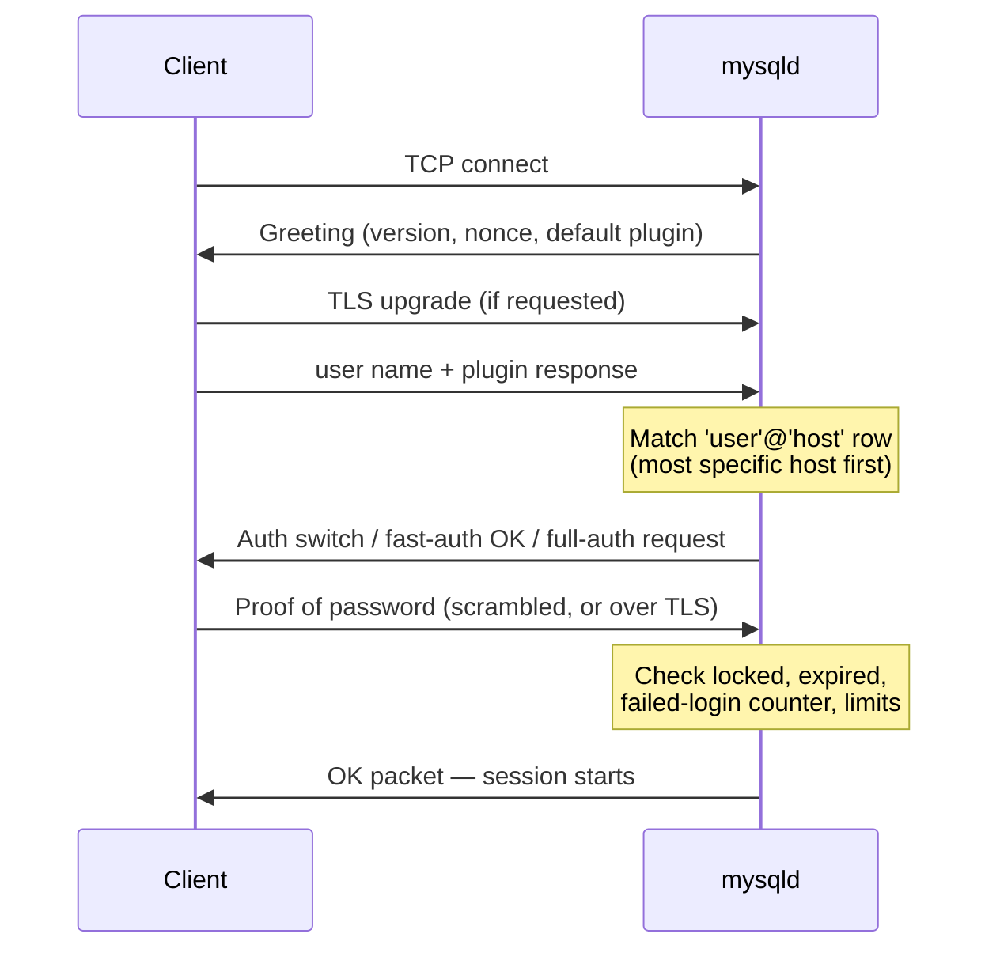

## Introduction

Every interaction with a database server begins with two questions: **who are you?** and **what may you do?** The first is *authentication* — proving an identity. The second is *authorization* — deciding what that identity is allowed to touch. This lesson is about the first question; the next lesson, [Authorization — GRANT, REVOKE, Privileges and Roles](/lessons/m11-privileges-roles), is about the second.

In MySQL an identity is not just a user name. It is an **account**, written `'user_name'@'host_name'`, and the host part is as important as the user part: `'app'@'10.0.1.%'` and `'app'@'%'` are two *different* accounts that can have different passwords, different authentication plugins and different privileges. Getting this wrong is one of the most common ways production systems end up either locked out or wide open.

By the end of this lesson you should be able to answer the questions a database administrator, a security reviewer or an SRE asks in practice:

- When a client connects, **which account row** does the server match, and why might it not be the one you expected?
- What does the server actually store instead of a password, and why is `caching_sha2_password` the default while `mysql_native_password` is **disabled by default in MySQL 8.4**?
- How do you enforce **password lifetime, reuse rules, strength and lockout after failed logins** — and when should you not use passwords at all?
- How do you **rotate** an application's password with zero downtime?
- How do you **audit** a server's accounts for risky configurations?

:::note[What runs in your lab — and what cannot]
Your lab runs as a dedicated MySQL account that has privileges on **one schema only** — the platform itself is built on the principle you are about to study. Account-management statements (`CREATE USER`, `ALTER USER`, `DROP USER`) and reads of the `mysql` system schema are therefore display-only here; you will see the sandbox and the server **refuse** them. Everything that an ordinary account may run does run: `CURRENT_USER()`, `USER()`, `SHOW GRANTS`, `information_schema.USER_ATTRIBUTES`, `information_schema.PLUGINS`, the hashing functions, and queries over account inventories you build yourself. Server output shown for statements that cannot run is marked **illustrative**.
:::

## DBMS Theory

:::theory[Identification, authentication, authorization, accounting]
Security models separate four concerns (often abbreviated AAA, with identification added in front):

1. **Identification** — the subject *claims* an identity ("I am `app`").
2. **Authentication** — the subject *proves* the claim with a **credential**: something it knows (password), has (private key, X.509 certificate, hardware token) or is (biometrics — not used for databases). Strong systems combine factors (*multi-factor authentication*).
3. **Authorization** — the system decides which operations the authenticated **principal** may perform on which objects (access control lists, privileges, roles).
4. **Accounting / auditing** — the system records who did what, so that misuse can be detected and attributed.

A DBMS is a **reference monitor**: every request passes through it, so it can enforce the policy uniformly. That only works if the principal is identified correctly at connection time.
:::

Three principles from security engineering frame everything that follows:

- **Never store a secret you only need to verify.** A server needs to *check* passwords, not *know* them. It should store a one-way, **salted**, deliberately slow **hash** (a *password hashing* scheme), so that a stolen copy of the credential table does not reveal the passwords. The salt makes identical passwords produce different stored values and defeats precomputed ("rainbow") tables; the iteration count makes brute force expensive.
- **Never send a reusable secret in clear text.** Either the channel is encrypted (TLS — see [Secure Connections and Data Protection](/lessons/m11-secure-connections)) or the protocol is a **challenge–response** in which the client proves knowledge of the secret without revealing it.
- **One principal per purpose.** Shared accounts destroy accountability (the log says "app did it", not *which* service) and force the union of everyone's privileges onto one credential. Separate accounts per application, per human and per operational task are the foundation of least privilege.

| Term | Meaning in MySQL |
|---|---|
| Account | A `'user'@'host'` pair — the unit of authentication *and* authorization |
| Authentication plugin | Code that implements one credential scheme (`caching_sha2_password`, `auth_socket`, LDAP, Kerberos, FIDO/WebAuthn…) |
| Authentication string | What the plugin stores for the account — for password plugins, a salted hash, never the password |
| Anonymous user | An account whose user part is the empty string `''` — matches *any* user name |
| Locked account | Exists but cannot connect (`ACCOUNT LOCK`) — used for roles, definers and system accounts |

## Why It Exists

Consider what goes wrong without each mechanism.

**Without host-qualified accounts**, a password stolen from a developer laptop would work from anywhere on the internet. MySQL's `@host` part lets you say "this credential is only valid from the application subnet", so a leaked password is useless from elsewhere. It also lets the same user name have different rights on different networks (for example, `'admin'@'localhost'` reachable only through the server's own socket).

**Without salted slow hashes**, one leaked backup of the grant tables compromises every password. The older `mysql_native_password` scheme stored `SHA1(SHA1(password))` — unsalted and fast — so identical passwords had identical hashes and a GPU could test billions of guesses per second. That weakness is the main reason MySQL 8.0 made `caching_sha2_password` the default and MySQL 8.4 **disables** `mysql_native_password` unless you explicitly turn it back on.

**Without password policy and lockout**, accounts keep the password someone chose in 2017, get re-used across environments, and can be brute-forced online. Without **account locking**, the only way to disable an account temporarily is to drop it — losing its grants and breaking objects that use it as `DEFINER`.

**Without per-purpose accounts**, an injection bug in a reporting page can drop tables, because the page connects as an account that can run migrations. The breach is not caused by authentication, but its *blast radius* is determined by which account was authenticated.

## Internal Working

:::internals[Connection verification step by step]
When a client connects, the server performs **stage 1 of access control** (connection verification) before any statement is accepted:

1. **Handshake.** The server sends a greeting containing its version, a 20-byte random **nonce** (the "scramble") and the name of its default authentication plugin. If TLS is requested and available, the connection is upgraded to TLS here, *before* any credentials are sent.
2. **Account matching.** From the client's claimed user name and the host it connects *from* (an IP address, resolved to a host name unless `skip_name_resolve` is ON), the server searches its **in-memory copy** of the account table. Rows are sorted from most specific to least specific host, and within the same host from most specific to least specific user (the anonymous `''` user last). The **first** matching row wins — there is no fallback to a second match if the password is wrong.
3. **Plugin negotiation.** If the matched account uses a different plugin from the one announced, the server sends an *auth switch request* and the client restarts the exchange with the right plugin.
4. **Credential check.** The plugin verifies the credential (details below). It also checks whether the account is locked, whether its password has expired, and failed-login tracking.
5. **Resource checks.** Per-account limits (`MAX_USER_CONNECTIONS`, `MAX_QUERIES_PER_HOUR`…), `max_connections`, and TLS requirements (`REQUIRE SSL`/`X509`) are enforced.
6. **Session context.** The session gets two identities: `USER()` — what the client *claimed* and where it came from — and `CURRENT_USER()` — the account row that was *matched* and whose privileges apply.
:::



**What `caching_sha2_password` stores.** The authentication string is a SHA-256-based *crypt* hash with a random 20-byte salt and, by default, 5,000 rounds (`caching_sha2_password_digest_rounds`). Its text form starts with `$A$005$` (algorithm A, 005 × 1000 rounds) followed by salt and digest. The password itself is never stored.

**Why "caching".** Computing a 5,000-round hash on every connection would make connection storms expensive, so the plugin keeps an **in-memory cache** of a fast SHA-256 digest for accounts that have successfully authenticated since the server started:

- **Fast authentication** (cache hit): the client sends a scramble — `XOR(SHA256(password), SHA256(SHA256(SHA256(password)), nonce))` — which proves knowledge of the password without revealing it and is useless for replay because the nonce changes every time.
- **Full authentication** (cache miss — first login after restart, after `ALTER USER`, or after `FLUSH PRIVILEGES`): the server needs the password itself to compute the slow salted hash. The client must therefore send it either over a **secure channel** (TLS, Unix socket, shared memory) or **RSA-encrypted** with the server's public key. That is why clients without TLS see errors such as *"Authentication requires secure connection"* unless they enable `--get-server-public-key` (and trusting a public key fetched over an unauthenticated channel is itself a man-in-the-middle risk).

**What `mysql_native_password` stored** was `*` + `HEX(SHA1(SHA1(password)))`: no salt, one cheap round. Anyone who reads the hash can mount an offline dictionary attack, and the challenge–response can be replayed by anyone who obtains the stored hash (the hash is effectively password-equivalent for that protocol).

**Where accounts live.** Since 8.0 the grant tables (`mysql.user`, `mysql.db`, `mysql.tables_priv`, `mysql.role_edges`, …) are InnoDB tables inside the transactional data dictionary, so `CREATE USER` and `GRANT` are **atomic** and crash-safe. The server keeps an in-memory ACL cache built from them; account statements update both. Editing the tables directly with `INSERT`/`UPDATE` bypasses the cache — which is why such edits need `FLUSH PRIVILEGES` and why you should never do it.

## MySQL Implementation

Start with the two identities of your own session. `USER()` reports what the client sent and where it came from; `CURRENT_USER()` reports the account the server matched:

```sql run
SELECT USER()         AS claimed_identity,
       CURRENT_USER() AS matched_account,
       DATABASE()     AS default_schema;
```

In the lab both show `your_lab@localhost` — the platform displays every lab account under this alias. In production they frequently differ: a client that connects as `app` from `10.0.1.7` might have `USER() = 'app@10.0.1.7'` but `CURRENT_USER() = 'app@10.0.1.%'`. When privileges behave unexpectedly, **`CURRENT_USER()` is the first thing to check**, because it names the row whose privileges you actually have.

`SHOW GRANTS` with no `FOR` clause shows the privileges of the current account:

```sql run
SHOW GRANTS;
```

This is the whole security model of the platform in two lines. `USAGE ON *.*` means "an account exists but has no global privileges". `ALL PRIVILEGES ON your_lab.*` covers every schema-level privilege on this one schema (the column header shows the lab's real internal account name, which is randomly generated). Notice what is absent: no `CREATE USER`, no `SUPER`, no access to any other schema. Ask the server to create an account and the request is refused — in the sandbox, its statement filter rejects it before it even reaches MySQL:

```sql run error
CREATE USER 'report_reader'@'10.0.2.%' IDENTIFIED BY 'S3cure-but-example';
```

On a plain MySQL server, the same statement from this account would fail with error 1227 *"Access denied; you need (at least one of) the CREATE USER privilege(s) for this operation"*. You can see the server's own enforcement directly by trying to read the account table — this one does reach MySQL and is refused by its privilege system:

```sql run error
SELECT user, host, plugin FROM mysql.user;
```

Some account metadata is exposed to ordinary users through `information_schema`. `USER_ATTRIBUTES` shows the JSON attributes/comment attached to *your own* account (set with `CREATE USER … ATTRIBUTE '{…}'` or `COMMENT '…'`):

```sql run
SELECT * FROM information_schema.USER_ATTRIBUTES;
```

And `information_schema.PLUGINS` shows which authentication plugins the server has loaded:

```sql run
SELECT PLUGIN_NAME, PLUGIN_STATUS, PLUGIN_TYPE
FROM information_schema.PLUGINS
WHERE PLUGIN_TYPE = 'AUTHENTICATION'
ORDER BY PLUGIN_NAME;
```

:::version[8.0 capture server vs 8.4 LTS]
The capture above comes from the build server, which runs **MySQL 8.0**: `mysql_native_password` is still `ACTIVE` there. On **MySQL 8.4 LTS** the plugin is *deprecated and disabled by default* — it is not loaded unless the server is started with `--mysql-native-password=ON` (or `mysql_native_password=ON` in the option file). Accounts that still use it **cannot log in** after an upgrade until you either re-enable the plugin or, better, convert them with `ALTER USER … IDENTIFIED WITH caching_sha2_password BY '…'`. The plugin is removed entirely in the 9.x innovation series, so re-enabling it only buys time.
:::

The server's choice of default plugin is controlled by `authentication_policy`:

```sql run
SHOW VARIABLES LIKE 'authentication_policy';
```

`*,,` means: the first authentication factor may use any plugin, with the server default (`caching_sha2_password`) when `CREATE USER` names none; a second and third factor are optional. The older variable still exists on the 8.0 capture server but is deprecated — note the warning:

```sql run
SELECT @@default_authentication_plugin AS deprecated_variable;
```

:::version[default_authentication_plugin in 8.4]
`default_authentication_plugin` was deprecated in 8.0.27 and **removed in MySQL 8.4**; selecting it there fails with *Unknown system variable*. Configure `authentication_policy` instead, e.g. `authentication_policy = 'caching_sha2_password,,'` to force the first factor's plugin.
:::

## Syntax Breakdown

The statements below are display-only in the lab. They are the core of every account-management runbook.

```sql
CREATE USER [IF NOT EXISTS] 'user'@'host'
  IDENTIFIED [WITH plugin] BY 'password' | BY RANDOM PASSWORD
  [AND IDENTIFIED WITH plugin2 ...]                -- multifactor (8.0.27+)
  [REQUIRE NONE | SSL | X509 | ISSUER '…' | SUBJECT '…']
  [WITH MAX_QUERIES_PER_HOUR n | MAX_USER_CONNECTIONS n | ...]
  [PASSWORD EXPIRE [DEFAULT | NEVER | INTERVAL n DAY]]
  [PASSWORD HISTORY {DEFAULT | n}]
  [PASSWORD REUSE INTERVAL {DEFAULT | n DAY}]
  [PASSWORD REQUIRE CURRENT [DEFAULT | OPTIONAL]]
  [FAILED_LOGIN_ATTEMPTS n PASSWORD_LOCK_TIME {n | UNBOUNDED}]
  [ACCOUNT LOCK | ACCOUNT UNLOCK]
  [COMMENT 'text' | ATTRIBUTE '{json}'];

ALTER USER 'user'@'host' IDENTIFIED BY 'new' [REPLACE 'old'] [RETAIN CURRENT PASSWORD];
ALTER USER 'user'@'host' DISCARD OLD PASSWORD;
ALTER USER 'user'@'host' ACCOUNT LOCK;
RENAME USER 'old'@'host' TO 'new'@'host';
DROP USER [IF EXISTS] 'user'@'host';
```

| Element | Meaning and professional notes |
|---|---|
| `'user'@'host'` | Account name. Quote each part separately: `'app'@'10.0.1.%'`, never `'app@10.0.1.%'` (that is user `app@10.0.1.%` at host `%`). Omitting `@host` means `@'%'`. User names are up to 32 characters. |
| Host forms | Literal name (`'db1.example.com'`), `'localhost'` (on Unix: socket connections and connections to the host name `localhost`), IPv4/IPv6 literal, pattern with `%`/`_` (`'10.0.1.%'`), netmask (`'10.0.1.0/255.255.255.0'`), CIDR (`'10.0.1.0/24'`, 8.0.23+). `'%'` = any host. |
| `IDENTIFIED WITH plugin` | Choose the plugin; without it the `authentication_policy` default applies (`caching_sha2_password`). `auth_socket` authenticates local OS users without a password. |
| `BY RANDOM PASSWORD` | Server generates a strong password (length `generated_random_password_length`, default 20) and returns it once in the result — useful for automation that stores it straight into a secrets manager. |
| `REQUIRE SSL / X509` | Account may connect only over TLS / only with a valid client certificate. See [Secure Connections](/lessons/m11-secure-connections). |
| `PASSWORD EXPIRE INTERVAL n DAY` | Per-account lifetime; `DEFAULT` follows the global `default_password_lifetime` (0 = never, the default). `NEVER` exempts service accounts rotated by tooling. |
| `PASSWORD HISTORY n` / `REUSE INTERVAL n DAY` | Forbid reuse of the last *n* passwords / of passwords used in the last *n* days (`password_history`, `password_reuse_interval` globally). |
| `PASSWORD REQUIRE CURRENT` | A user changing their own password must supply the current one (stops a hijacked session from changing it). |
| `FAILED_LOGIN_ATTEMPTS n PASSWORD_LOCK_TIME t` | Temporary lockout after *n* consecutive failures, for *t* days or `UNBOUNDED`. Both must be non-zero to take effect. |
| `ACCOUNT LOCK` | Account exists and keeps its grants but cannot connect. Roles and definer-only accounts should always be locked. |
| `RETAIN CURRENT PASSWORD` | **Dual passwords**: the old password stays valid as a secondary until `DISCARD OLD PASSWORD`. Enables zero-downtime rotation. |
| `ATTRIBUTE` / `COMMENT` | JSON metadata (owner, ticket, purpose) visible in `information_schema.USER_ATTRIBUTES`. |

Password **strength** is not a `CREATE USER` clause: it is enforced server-wide by the `validate_password` **component** (`INSTALL COMPONENT 'file://component_validate_password'`), with variables such as `validate_password.policy` (LOW/MEDIUM/STRONG) and `validate_password.length`. On the capture server it is not installed — `SHOW VARIABLES LIKE 'validate_password%'` returns no rows there.

## Practical Examples

The account table cannot be read in the lab, so the examples model it. This is not a toy: auditing and reasoning about account rows is exactly how a DBA reviews a server, usually on an export of `mysql.user` produced by a privileged job.

**1. How the server picks an account.** Create an inventory of account names as they might exist on a misconfigured server, including the infamous anonymous accounts that old installation scripts created:

```sql run
CREATE TABLE account_names (
  user VARCHAR(32)  NOT NULL,
  host VARCHAR(255) NOT NULL,
  PRIMARY KEY (user, host)
);
INSERT INTO account_names VALUES
  ('app',   '%'),
  ('app',   '10.0.1.%'),
  ('app',   '10.0.1.7'),
  ('',      'localhost'),
  ('admin', 'localhost'),
  ('admin', '%'),
  ('',      '%');
SELECT * FROM account_names ORDER BY user, host;
```

MySQL host patterns use the same wildcards as `LIKE` (`%` and `_`), so `LIKE` lets us simulate matching. The query below applies a **simplified** version of the server's sort order — literal hosts before patterns, `'%'` last; a named user before the anonymous user — and keeps the first candidate:

```sql run
SET @client_user = 'app', @client_host = '10.0.1.9';
SELECT user, host,
       CASE WHEN host = '%' THEN 2
            WHEN host LIKE '%\%%' OR host LIKE '%\_%' THEN 1
            ELSE 0 END AS host_specificity,
       user = '' AS is_anonymous
FROM account_names
WHERE @client_host LIKE host
  AND (user = @client_user OR user = '')
ORDER BY host_specificity, is_anonymous, CHAR_LENGTH(host) DESC
LIMIT 1;
```

A client connecting as `app` from `10.0.1.9` is authenticated as `'app'@'10.0.1.%'` — not `'app'@'%'`, and not `'app'@'10.0.1.7'` (that row requires the exact address). The password, plugin and privileges of the matched row are the only ones that matter.

**2. The anonymous-user trap.** Now connect as `admin` from the local machine:

```sql run
SET @client_user = 'admin', @client_host = 'localhost';
SELECT user, host
FROM account_names
WHERE @client_host LIKE host
  AND (user = @client_user OR user = '')
ORDER BY CASE WHEN host = '%' THEN 2
              WHEN host LIKE '%\%%' OR host LIKE '%\_%' THEN 1
              ELSE 0 END,
         user = '',
         CHAR_LENGTH(host) DESC;
```

All four rows match. The literal host `localhost` beats `%`, and within the same host the named user beats the anonymous one, so `'admin'@'localhost'` wins — fine. But try a user that has only a `%` account:

```sql run
SET @client_user = 'app', @client_host = 'localhost';
SELECT user, host
FROM account_names
WHERE @client_host LIKE host
  AND (user = @client_user OR user = '')
ORDER BY CASE WHEN host = '%' THEN 2
              WHEN host LIKE '%\%%' OR host LIKE '%\_%' THEN 1
              ELSE 0 END,
         user = '',
         CHAR_LENGTH(host) DESC
LIMIT 1;
```

The anonymous `''@'localhost'` row wins over `'app'@'%'` because **host specificity is compared before user specificity**. The developer types the correct password for `app` and gets *access denied* — or, if the anonymous account has no password, gets in as the anonymous account with *its* privileges. `USER()` would say `app@localhost`; `CURRENT_USER()` would say `@localhost`. This is the classic reason to **drop all anonymous accounts** (`mysql_secure_installation` offers to do it).

**3. Why salted, slow hashes matter.** MySQL's `SHA2()` function lets you see the problem with unsalted hashing:

```sql run
SELECT SHA2('Summer2024!', 256)                     AS alice_unsalted,
       SHA2('Summer2024!', 256)                     AS bob_unsalted,
       SHA2(CONCAT('k3P9xQ', 'Summer2024!'), 256)   AS alice_salted,
       SHA2(CONCAT('Zr71aL', 'Summer2024!'), 256)   AS bob_salted;
```

Two users with the same password have **identical** unsalted digests: an attacker who cracks one has cracked both, and can look up common passwords in a precomputed table. With per-account salts the stored values differ. Real password schemes add thousands of rounds on top (5,000 for `caching_sha2_password`) so each guess costs thousands of hash computations. Never implement your own password storage with `SHA2()` in application tables — use a dedicated algorithm such as Argon2id, scrypt or bcrypt in the application, as OWASP recommends.

**4. Auditing an account inventory.** A privileged job typically exports account metadata from `mysql.user`. The table below models those columns (the values are invented for teaching):

```sql run
CREATE TABLE account_audit (
  user                  VARCHAR(32)  NOT NULL,
  host                  VARCHAR(255) NOT NULL,
  plugin                VARCHAR(64)  NOT NULL,
  password_last_changed DATETIME     NULL,
  password_lifetime     SMALLINT     NULL,   -- NULL = use global default
  account_locked        ENUM('Y','N') NOT NULL,
  failed_login_attempts INT          NOT NULL DEFAULT 0,
  require_ssl           ENUM('Y','N') NOT NULL,
  PRIMARY KEY (user, host)
);
INSERT INTO account_audit VALUES
  ('app_orders',   '10.0.1.%',  'caching_sha2_password', '2026-09-01 10:00:00', 90,   'N', 5, 'Y'),
  ('app_legacy',   '%',         'mysql_native_password', '2019-03-14 08:30:00', NULL, 'N', 0, 'N'),
  ('analyst_kim',  '10.0.9.%',  'caching_sha2_password', '2026-06-20 16:45:00', 180,  'N', 3, 'Y'),
  ('migrator',     '10.0.5.10', 'caching_sha2_password', '2026-10-02 09:00:00', NULL, 'N', 0, 'Y'),
  ('backup',       'localhost', 'auth_socket',           NULL,                  NULL, 'N', 0, 'N'),
  ('r_read_only',  '%',         'caching_sha2_password', NULL,                  NULL, 'Y', 0, 'N'),
  ('',             'localhost', 'caching_sha2_password', NULL,                  NULL, 'N', 0, 'N'),
  ('old_contractor','%',        'caching_sha2_password', '2022-01-10 12:00:00', NULL, 'N', 0, 'N');
SELECT user, host, plugin,
       CONCAT_WS('; ',
         IF(user = '', 'anonymous account', NULL),
         IF(plugin = 'mysql_native_password', 'native password: fails on 8.4 by default', NULL),
         IF(host = '%' AND account_locked = 'N', 'any-host login', NULL),
         IF(require_ssl = 'N' AND host <> 'localhost' AND account_locked = 'N', 'no TLS requirement', NULL),
         IF(password_last_changed < '2025-11-09' AND account_locked = 'N', 'password older than 1 year', NULL)
       ) AS findings
FROM account_audit
HAVING findings <> ''
ORDER BY user, host;
```

`CONCAT_WS` skips NULL arguments, so each row lists only the findings that apply; the `HAVING` keeps rows with at least one finding. The role-like locked account `r_read_only` and the socket-authenticated `backup` account produce no findings: locking and OS-level authentication are both legitimate controls. The report date (2026-11-09) is hard-coded so the result is reproducible — a real job would use `CURDATE()`.

## Execution Walkthrough

Trace a zero-downtime **password rotation** for an application with many instances — the most common account-management task in production. The account statements are display-only; the walkthrough models the server's state in a table so you can see which passwords are accepted at each moment.

```walkthrough
title: Rotating app_orders' password with dual passwords (RETAIN CURRENT PASSWORD)
steps:
  - title: "1. Starting state — one primary password"
    explain: >-
      Every application instance connects with password P1. The account row holds one authentication string
      (a salted hash of P1). We model the accepted credentials as rows.
    sql: |
      CREATE TABLE credential_state (step INT, slot VARCHAR(10), secret_label VARCHAR(10));
      INSERT INTO credential_state VALUES (1, 'primary', 'P1');
      SELECT slot, secret_label FROM credential_state WHERE step = 1;
  - title: "2. ALTER USER … IDENTIFIED BY 'P2' RETAIN CURRENT PASSWORD"
    explain: >-
      The administrator runs `ALTER USER 'app_orders'@'10.0.1.%' IDENTIFIED BY '<P2>' RETAIN CURRENT PASSWORD;`.
      P2 becomes the primary password and P1 becomes the secondary. Both are accepted, so instances that still use
      P1 keep connecting. No restart, no failed logins.
    sql: |
      INSERT INTO credential_state VALUES (2, 'primary', 'P2'), (2, 'secondary', 'P1');
      SELECT slot, secret_label FROM credential_state WHERE step = 2 ORDER BY slot;
  - title: "3. Roll out P2 to every instance"
    explain: >-
      The new secret is written to the secrets manager; instances pick it up on their next connection-pool refresh
      or rolling restart. During this window some connections authenticate with P1 and some with P2. The
      administrator verifies that no connection still uses the old password — for example by watching for
      authentication failures after a test disconnect, or by checking that every instance reports the new secret
      version.
  - title: "4. ALTER USER … DISCARD OLD PASSWORD"
    explain: >-
      Once all instances use P2, the secondary password is discarded. Only P2 remains valid; a leaked copy of P1
      is now useless.
    sql: |
      INSERT INTO credential_state VALUES (4, 'primary', 'P2');
      SELECT slot, secret_label FROM credential_state WHERE step = 4;
```

The equivalent real statements, for the runbook:

```sql
-- Step 2: add the new primary, keep the old one as secondary
ALTER USER 'app_orders'@'10.0.1.%' IDENTIFIED BY 'P2-from-secrets-manager' RETAIN CURRENT PASSWORD;
-- Step 4: after every instance uses the new secret
ALTER USER 'app_orders'@'10.0.1.%' DISCARD OLD PASSWORD;
```

Without dual passwords, the only safe alternatives are a second account (`app_orders_v2`) with identical grants and a cut-over, or a maintenance window — both more work and more risk.

## Output

The account-matching simulation produced the first, decisive result of this lesson: for the client `app` at `10.0.1.9` the matched account is `'app'@'10.0.1.%'`, and for `app` at `localhost` it is the anonymous `''@'localhost'`. In a real server, the second case shows up as this pair of values in the session — illustrative, not captured:

```text
-- Illustrative (not captured): a session on a server that still has ''@'localhost'
USER()          -> app@localhost
CURRENT_USER()  -> @localhost
```

The audit query is the second: three accounts with findings — the anonymous account, the legacy native-password account (which collects four findings at once: it will stop working on 8.4, accepts logins from any host without TLS, and has a password from 2019), and an old contractor account that can log in from anywhere with a years-old password. Each finding maps to an action: drop the anonymous account, migrate the legacy account's plugin, restrict its host, require TLS and rotate its password, and lock or drop the contractor. The analysts' and the application's accounts pass every check. Notice what is *not* flagged even though it looks unusual: `backup` has no password at all, because `auth_socket` delegates authentication to the operating system — only the local OS user `backup` can log in as that account, through the Unix socket.

## Alternative Approaches

Passwords are not the only — or always the best — credential for a database account.

| Mechanism | How it works | When it fits | Trade-offs |
|---|---|---|---|
| `caching_sha2_password` (default) | Salted SHA-256 crypt hash, cached fast path | General-purpose password accounts | Needs TLS or RSA for full auth; password must be distributed and rotated |
| `auth_socket` | Server checks the OS user of the Unix-socket peer | Local administration, backup jobs on the DB host | Local connections only; trust moves to OS account security |
| X.509 client certificates (`REQUIRE X509` / `SUBJECT`) | Mutual TLS; certificate proves identity, often *with* a password | Service-to-service in zero-trust networks | Needs a PKI, certificate rotation |
| LDAP / Kerberos (Enterprise) | Central directory authenticates the user | Humans in large organizations — one identity, central deprovisioning | Enterprise edition plugins; directory availability becomes a dependency |
| Cloud IAM tokens (RDS IAM auth, Cloud SQL IAM) | Short-lived signed token instead of a password | Managed MySQL in AWS/GCP/Azure | Provider-specific; token lifetime and connection rate limits |
| Multifactor (`AND IDENTIFIED WITH authentication_webauthn`) | Password plus hardware key (8.2+ WebAuthn, Enterprise) | Privileged human accounts | Interactive only — unsuitable for services |
| Secrets manager with dynamic credentials (e.g. HashiCorp Vault database engine) | Vault creates a short-lived account per lease and drops it on expiry | Large fleets; strong rotation requirements | Vault needs a privileged MySQL account; many short-lived accounts to monitor |

The trend in industry is clear: **humans** authenticate through a central identity provider (SSO, LDAP, IAM) so that leaving the company revokes access everywhere, and **services** use short-lived or automatically rotated credentials so that a leaked secret expires on its own.

## Performance Analysis

Authentication is not free, and its cost matters for applications that open many connections.

- **Hash cost is deliberate.** A full `caching_sha2_password` authentication computes a 5,000-round SHA-256 crypt hash — milliseconds of CPU rather than microseconds. That is the point (it slows brute force), but a connection storm after a restart, when the cache is empty, can produce a CPU spike on the server. Raising `caching_sha2_password_digest_rounds` strengthens stored hashes at the price of slower full authentications.
- **The cache makes reconnects cheap.** After the first successful login, subsequent logins use the fast path: one round trip with a SHA-256 scramble. `ALTER USER`, `RENAME USER` and `FLUSH PRIVILEGES` clear cache entries, so the next login is a full authentication again.
- **TLS handshakes add round trips and CPU.** TLS 1.3 needs fewer round trips than TLS 1.2, and session resumption reduces the cost further. With TLS, full authentication needs no RSA exchange.
- **Reverse DNS can dominate connect time.** Unless `skip_name_resolve` is ON (strongly recommended), the server performs a reverse DNS lookup for every new client IP (with a host cache to soften it). A slow DNS server turns into slow logins. With `skip_name_resolve`, accounts must use IP addresses/patterns, not host names.
- **The fix for all of these is connection pooling.** An application that opens a connection per request pays authentication on every request; a pool pays it once per connection lifetime ([Connections, Threads and Connection Pooling](/lessons/m10-connections-pooling)).

:::performance[Theory vs measurement]
The costs above follow from the protocol design; actual numbers depend on CPU, network latency and TLS configuration. Measure connection setup time from your application host (for example with a client benchmark that opens and closes connections) rather than assuming. The sandbox cannot demonstrate login cost, because your lab's connection is opened once by the platform.
:::

## Best Practices

:::best-practice[Account hygiene for production MySQL]
1. **One account per application, per human and per operational task** (app, migrator, analyst, backup, replication, monitoring). Never share root or a "dba" account between people.
2. **Restrict hosts** to the narrowest network that needs access (`'app_orders'@'10.0.1.%'`), and enable `skip_name_resolve` so host matching is by IP.
3. **Use `caching_sha2_password` everywhere** and migrate any `mysql_native_password` accounts *before* upgrading to 8.4.
4. **Drop anonymous accounts and the test database** (run `mysql_secure_installation` on new self-managed servers).
5. **Require TLS** for every non-local account (`REQUIRE SSL`, or `require_secure_transport=ON` server-wide).
6. **Generate service passwords** (`IDENTIFIED BY RANDOM PASSWORD` or a secrets manager), never type them; store them only in the secrets manager.
7. **Rotate with dual passwords** (`RETAIN CURRENT PASSWORD` → roll out → `DISCARD OLD PASSWORD`).
8. **Enable `FAILED_LOGIN_ATTEMPTS`/`PASSWORD_LOCK_TIME`** for human accounts; install `validate_password` with a MEDIUM or STRONG policy.
9. **Lock instead of drop** when temporarily disabling an account, and lock every role and definer-only account.
10. **Document ownership** with `ATTRIBUTE '{"owner": "...", "ticket": "..."}'` and audit regularly for unused, any-host and plugin-legacy accounts.
:::

## Common Mistakes

**Mistake 1 — writing the account name as one quoted string.** `'app@10.0.1.%'` is a user called `app@10.0.1.%` connecting from any host. Quote the two parts separately:

```sql
CREATE USER 'app@10.0.1.%' IDENTIFIED BY '…';   -- wrong: user 'app@10.0.1.%' at host '%'
CREATE USER 'app'@'10.0.1.%' IDENTIFIED BY '…'; -- right
```

**Mistake 2 — assuming `USER()` tells you whose privileges apply.** It does not; `CURRENT_USER()` does. In stored programs and views with `SQL SECURITY DEFINER`, `CURRENT_USER()` even returns the *definer*, while `USER()` still shows the connected client. Try it in your lab with a definer view:

```sql run
CREATE SQL SECURITY DEFINER VIEW whoami AS
SELECT USER() AS session_user_value, CURRENT_USER() AS privilege_account;
SELECT * FROM whoami;
```

In the lab the definer and the caller are the same account, so the two columns agree; on a real server, a user `kim` selecting from a view defined by `reports_owner` would see `kim@…` in the first column and `reports_owner@…` in the second.

**Mistake 3 — upgrading to 8.4 with `mysql_native_password` accounts.** Applications fail with *"Plugin 'mysql_native_password' is not loaded"* after the upgrade. Find the accounts beforehand with `SELECT user, host FROM mysql.user WHERE plugin = 'mysql_native_password';` (as an administrator) and migrate them; old client libraries that cannot speak `caching_sha2_password` (very old connectors) must be upgraded too.

**Mistake 4 — trying to manage accounts with DML on `mysql.user`.** Direct `UPDATE mysql.user …` bypasses validation, password policy and the ACL cache, and can corrupt the account. Use `ALTER USER`. In your lab the read alone is refused, as you saw above.

**Mistake 5 — relying on `'%'` plus a strong password.** A strong password does not stop credential stuffing, leaked configuration files or a compromised CI runner from logging in from anywhere. Host restrictions, TLS and network controls (security groups, private subnets) are layers that each limit what a single leak can do.

**Mistake 6 — dropping an account that is a `DEFINER`.** Views, procedures, triggers and events defined by a dropped account fail with *"The user specified as a definer does not exist"*. Since 8.0.22, `DROP USER` fails with an error if an account to be dropped is the definer of any stored object; an administrator holding `SET_USER_ID` (8.0) or `ALLOW_NONEXISTENT_DEFINER` (8.2+) can force it, which leaves the objects orphaned with only a warning. Lock the account instead, or change the definers first.

## Industry Application

- **Account taxonomy in a typical service.** A payment service might have `pay_app` (DML only, from the app subnet), `pay_migrator` (DDL, used only by the CI/CD pipeline, password in the deployment vault), `pay_ro` (read-only, used by the reporting replica), a `backup` account (OS-authenticated on the backup host), a `repl` account (`REPLICATION SLAVE` only, TLS required), a `monitor` account for the metrics exporter (`PROCESS`, `REPLICATION CLIENT`, `SELECT` on `performance_schema`), and personal accounts for DBAs authenticated through LDAP. The next lesson turns this taxonomy into grants.
- **Managed cloud databases.** Amazon RDS / Aurora, Google Cloud SQL and Azure Database for MySQL do not give you `SUPER` or the real `root`; the "master user" has a curated set of privileges. They add IAM-based authentication (short-lived tokens) and integrate rotation with their secrets managers. The account model you learned here still applies underneath.
- **Compliance.** PCI DSS, SOC 2 and HIPAA audits ask for unique IDs per user, password lifetime and lockout policies (or a central identity provider that enforces them), removal of default/anonymous accounts, and evidence of regular access reviews. The audit query in Example 4 is a miniature of what such evidence looks like.
- **Upgrades to 8.4.** Teams moving from 8.0 to 8.4 LTS consistently report the authentication change as the first blocker: legacy connectors and `mysql_native_password` accounts. Inventory and migrate them first.
- **Incident response.** When a credential leaks, responders lock the account (`ACCOUNT LOCK`), rotate the secret, review the general/audit log for its activity and only then re-enable or replace it. Having one account per purpose is what makes this possible without stopping unrelated services.

## Practice Exercises

The exercises use account inventories you create, because the real account table is not readable from a lab — just as in many real audits, where the DBA works on an export.

```exercise
id: ex1
title: Accounts reachable from any host
difficulty: easy
kind: query
setup: |
  CREATE TABLE account_audit (
    user VARCHAR(32) NOT NULL, host VARCHAR(255) NOT NULL, plugin VARCHAR(64) NOT NULL,
    password_last_changed DATETIME NULL, account_locked ENUM('Y','N') NOT NULL, require_ssl ENUM('Y','N') NOT NULL,
    PRIMARY KEY (user, host));
  INSERT INTO account_audit VALUES
    ('app_orders','10.0.1.%','caching_sha2_password','2026-09-01 10:00:00','N','Y'),
    ('app_legacy','%','mysql_native_password','2019-03-14 08:30:00','N','N'),
    ('analyst_kim','10.0.9.%','caching_sha2_password','2026-06-20 16:45:00','N','Y'),
    ('r_read_only','%','caching_sha2_password',NULL,'Y','N'),
    ('','localhost','caching_sha2_password',NULL,'N','N'),
    ('old_contractor','%','caching_sha2_password','2022-01-10 12:00:00','N','N'),
    ('ops_bot','%','caching_sha2_password','2026-10-30 07:00:00','N','Y');
concepts: [account-names, least-privilege]
prompt: |
  The table `account_audit(user, host, plugin, password_last_changed, account_locked, require_ssl)` lists the
  accounts of a server. Return the accounts that **can log in from any host**: host is exactly `'%'` and the
  account is **not locked**. Columns: `user`, `host`. Any order.
hints:
  - "Any host means the host part is the single wildcard `'%'` — compare with `=`, not `LIKE`."
  - "Locked accounts (`account_locked = 'Y'`) cannot connect, so they are not a login risk."
solution: |
  SELECT user, host
  FROM account_audit
  WHERE host = '%' AND account_locked = 'N';
explanation: |
  `host LIKE '%'` would match **every** row, because in a `LIKE` pattern `%` is a wildcard — you want the literal
  host value `'%'`, so use `=`. The locked `r_read_only` row is excluded: locked accounts are used for roles and
  cannot authenticate. `ops_bot` is included even though it requires TLS — TLS protects the channel, it does not
  restrict where logins come from.
```

```exercise
id: ex2
title: Who will break on the 8.4 upgrade?
difficulty: medium
kind: query
setup: |
  CREATE TABLE account_audit (
    user VARCHAR(32) NOT NULL, host VARCHAR(255) NOT NULL, plugin VARCHAR(64) NOT NULL,
    password_last_changed DATETIME NULL, account_locked ENUM('Y','N') NOT NULL, require_ssl ENUM('Y','N') NOT NULL,
    PRIMARY KEY (user, host));
  INSERT INTO account_audit VALUES
    ('app_orders','10.0.1.%','caching_sha2_password','2026-09-01 10:00:00','N','Y'),
    ('app_legacy','%','mysql_native_password','2019-03-14 08:30:00','N','N'),
    ('app_legacy','10.0.1.%','mysql_native_password','2021-05-02 11:00:00','N','Y'),
    ('etl','10.0.7.%','mysql_native_password','2024-02-01 09:00:00','Y','Y'),
    ('analyst_kim','10.0.9.%','caching_sha2_password','2026-06-20 16:45:00','N','Y'),
    ('backup','localhost','auth_socket',NULL,'N','N');
concepts: [caching-sha2-password, authentication]
prompt: |
  Using the same `account_audit` structure, produce a per-plugin summary for **unlocked** accounts.
  Columns, in order: `plugin`, `accounts` (number of unlocked accounts using it), and `fails_on_84_default`
  (1 if the plugin is `mysql_native_password`, otherwise 0). Order by `accounts` descending, then `plugin`.
hints:
  - "Filter `account_locked = 'N'`, then `GROUP BY plugin`."
  - "A comparison such as `plugin = 'mysql_native_password'` evaluates to 1 or 0 in MySQL."
solution: |
  SELECT plugin,
         COUNT(*) AS accounts,
         plugin = 'mysql_native_password' AS fails_on_84_default
  FROM account_audit
  WHERE account_locked = 'N'
  GROUP BY plugin
  ORDER BY accounts DESC, plugin;
orderMatters: true
explanation: |
  Two unlocked accounts still use `mysql_native_password`; on a default MySQL 8.4 server the plugin is not loaded,
  so both would fail to log in after an upgrade. The locked `etl` account is excluded here, but note that it
  would also need migrating before anyone unlocks it. Because `plugin` is the grouping column,
  `plugin = 'mysql_native_password'` is a valid expression under `ONLY_FULL_GROUP_BY`.
```

```exercise
id: ex3
title: Resolve the matched account
difficulty: hard
kind: query
setup: |
  CREATE TABLE account_names (user VARCHAR(32) NOT NULL, host VARCHAR(255) NOT NULL, PRIMARY KEY (user, host));
  INSERT INTO account_names VALUES
    ('app','%'), ('app','10.0.%'), ('app','10.0.1.7'), ('','10.0.1.%'), ('report','%'), ('','localhost');
  CREATE TABLE connection_attempts (attempt_id INT PRIMARY KEY, client_user VARCHAR(32) NOT NULL, client_host VARCHAR(255) NOT NULL);
  INSERT INTO connection_attempts VALUES
    (1,'app','10.0.1.7'), (2,'app','10.0.1.8'), (3,'app','10.0.2.4'), (4,'report','10.0.1.9'), (5,'report','192.168.0.5');
concepts: [account-names, authentication]
prompt: |
  `account_names(user, host)` holds the accounts; `connection_attempts(attempt_id, client_user, client_host)` holds
  incoming connections. Using this **simplified matching rule**, return the account each attempt is matched to:

  - a row matches if `client_host LIKE host` and (`user = client_user` or `user = ''`);
  - rank candidates by host specificity — **0** if the host contains no `%` or `_`, **1** if it contains a wildcard
    but is not exactly `'%'`, **2** if it is exactly `'%'`; then named users before the anonymous user `''`; then
    longer host strings first;
  - the first candidate wins.

  Columns: `attempt_id`, `matched_user`, `matched_host`. Order by `attempt_id`.
hints:
  - "Join each attempt to all candidate rows, compute the ranking expressions, then keep rank 1 per attempt."
  - "ROW_NUMBER() OVER (PARTITION BY attempt_id ORDER BY specificity, user = '', CHAR_LENGTH(host) DESC) does the ranking."
  - "Wildcard test: host LIKE '%\\%%' OR host LIKE '%\\_%' (the backslash escapes the wildcard)."
solution: |
  WITH candidates AS (
    SELECT c.attempt_id, a.user, a.host,
           ROW_NUMBER() OVER (
             PARTITION BY c.attempt_id
             ORDER BY CASE WHEN a.host = '%' THEN 2
                           WHEN a.host LIKE '%\%%' OR a.host LIKE '%\_%' THEN 1
                           ELSE 0 END,
                      a.user = '',
                      CHAR_LENGTH(a.host) DESC) AS rn
    FROM connection_attempts c
    JOIN account_names a
      ON c.client_host LIKE a.host
     AND (a.user = c.client_user OR a.user = '')
  )
  SELECT attempt_id, user AS matched_user, host AS matched_host
  FROM candidates
  WHERE rn = 1
  ORDER BY attempt_id;
orderMatters: true
explanation: |
  Attempt 1 matches the literal `'app'@'10.0.1.7'`. Attempt 2 (`app` from 10.0.1.8) has three candidates:
  `'app'@'%'` (specificity 2) and two wildcard hosts of specificity 1, `'app'@'10.0.%'` and the anonymous
  `''@'10.0.1.%'`. Because the rule compares "named before anonymous" *before* host length, `'app'@'10.0.%'`
  wins; had host length been the second key, the anonymous account would have won. The order of the sort keys
  *is* the policy. Attempt 4 (`report` from 10.0.1.9) shows why anonymous accounts are dangerous: the
  anonymous `''@'10.0.1.%'` (specificity 1) beats `'report'@'%'` (specificity 2), because host specificity is
  compared before the user. Attempt 5 falls through to `'report'@'%'`. Remember this is a simplified model of
  the server's sort; the manual's connection-verification page describes the exact rules.
```

```exercise
id: ex4
title: Stale credentials report
difficulty: medium
kind: query
setup: |
  CREATE TABLE account_audit (
    user VARCHAR(32) NOT NULL, host VARCHAR(255) NOT NULL, plugin VARCHAR(64) NOT NULL,
    password_last_changed DATETIME NULL, password_lifetime SMALLINT NULL, account_locked ENUM('Y','N') NOT NULL,
    PRIMARY KEY (user, host));
  INSERT INTO account_audit VALUES
    ('app_orders','10.0.1.%','caching_sha2_password','2026-09-01 10:00:00',90,'N'),
    ('app_billing','10.0.1.%','caching_sha2_password','2026-04-01 10:00:00',90,'N'),
    ('analyst_kim','10.0.9.%','caching_sha2_password','2026-06-20 16:45:00',180,'N'),
    ('analyst_raj','10.0.9.%','caching_sha2_password','2026-03-01 08:00:00',180,'N'),
    ('migrator','10.0.5.10','caching_sha2_password','2025-01-15 09:00:00',NULL,'N'),
    ('backup','localhost','auth_socket',NULL,NULL,'N'),
    ('r_app','%','caching_sha2_password',NULL,NULL,'Y');
concepts: [password-policy]
prompt: |
  As of **2026-11-09**, list unlocked password accounts whose password has exceeded its lifetime. An account's
  lifetime is `password_lifetime` days; when it is NULL, apply the organization's default of **365** days.
  Ignore accounts whose `password_last_changed` is NULL (they do not use passwords). Columns: `user`, `host`,
  `days_since_change` (whole days between `password_last_changed` and 2026-11-09), `lifetime_days`.
  Order by `days_since_change` descending.
hints:
  - "DATEDIFF('2026-11-09', password_last_changed) gives whole days."
  - "COALESCE(password_lifetime, 365) applies the default."
solution: |
  SELECT user, host,
         DATEDIFF('2026-11-09', password_last_changed) AS days_since_change,
         COALESCE(password_lifetime, 365)              AS lifetime_days
  FROM account_audit
  WHERE account_locked = 'N'
    AND password_last_changed IS NOT NULL
    AND DATEDIFF('2026-11-09', password_last_changed) > COALESCE(password_lifetime, 365)
  ORDER BY days_since_change DESC;
orderMatters: true
explanation: |
  The NULL lifetime must be resolved with `COALESCE` before comparing — `x > NULL` is UNKNOWN, so without it the
  migrator account (no explicit lifetime) would silently disappear from the report, which is exactly the kind of
  account that tends to have the oldest password. In MySQL itself the same rule is expressed by
  `PASSWORD EXPIRE DEFAULT` plus the global `default_password_lifetime`.
```

```exercise
id: ex5
title: Design the authentication setup for a new service
difficulty: challenge
kind: open
concepts: [authentication, password-policy, account-locking, least-privilege]
prompt: |
  A new *orders* service runs on 12 Kubernetes pods in subnet 10.0.1.0/24 and connects to a self-managed
  MySQL 8.4 server. A CI/CD pipeline (runner at 10.0.5.10) applies schema migrations; two data analysts query a
  replica from the office VPN (10.0.9.0/24); a nightly backup job runs on the database host itself.

  Write the `CREATE USER` statements (authentication only — privileges come in the next lesson) and explain
  for each account: host restriction, plugin, TLS requirement, password policy, and how the credential is
  stored and rotated. Finally, describe how you would rotate the orders service's password without downtime.
solution: |
  ~~~sql
  CREATE USER 'orders_app'@'10.0.1.0/24'
    IDENTIFIED WITH caching_sha2_password BY RANDOM PASSWORD
    REQUIRE SSL
    PASSWORD EXPIRE NEVER                      -- rotated by automation, not by expiry
    ATTRIBUTE '{"owner":"orders-team","purpose":"runtime DML"}';

  CREATE USER 'orders_migrator'@'10.0.5.10'
    IDENTIFIED WITH caching_sha2_password BY RANDOM PASSWORD
    REQUIRE SSL
    PASSWORD EXPIRE NEVER
    ATTRIBUTE '{"owner":"platform-team","purpose":"schema migrations via CI"}';

  CREATE USER 'analyst_kim'@'10.0.9.0/24', 'analyst_raj'@'10.0.9.0/24'
    IDENTIFIED WITH caching_sha2_password BY RANDOM PASSWORD
    REQUIRE SSL
    PASSWORD EXPIRE INTERVAL 180 DAY PASSWORD HISTORY 5 PASSWORD REQUIRE CURRENT
    FAILED_LOGIN_ATTEMPTS 5 PASSWORD_LOCK_TIME 1;

  CREATE USER 'backup'@'localhost' IDENTIFIED WITH auth_socket;   -- OS user 'backup' only
  ~~~

  - **Host restrictions** follow the network design: the pod subnet, the single CI runner address, the VPN range,
    and `localhost` for the job on the database host. With `skip_name_resolve=ON`, IP/CIDR forms are required.
  - **Plugin**: `caching_sha2_password` for password accounts (the 8.4 default; `mysql_native_password` is
    disabled by default), `auth_socket` for the local backup job so no password exists to leak.
  - **TLS**: required for all network accounts — it protects the full-authentication exchange and all data. The
    socket account does not need it.
  - **Policies**: humans get lifetime, history, require-current and lockout; service accounts get
    `PASSWORD EXPIRE NEVER` because an unattended expiry would cause an outage — they are rotated on a schedule
    by automation instead. `validate_password` (MEDIUM/STRONG) is installed server-wide. Better still, analysts
    authenticate through LDAP/SSO so offboarding is central.
  - **Storage**: the random passwords returned by `CREATE USER` go straight into a secrets manager (Vault,
    AWS Secrets Manager, Kubernetes secrets backed by a KMS); they never appear in Git or CI logs.
  - **Zero-downtime rotation**: `ALTER USER 'orders_app'@'10.0.1.0/24' IDENTIFIED BY '<new>' RETAIN CURRENT
    PASSWORD;` → update the secret → rolling restart or pool refresh of the 12 pods → confirm no logins use the
    old secret → `ALTER USER … DISCARD OLD PASSWORD;`.
```

## Knowledge Assessment

```quiz
- id: q1
  question: "Which statement creates an account that may connect **only from the 10.0.1.x network**?"
  options:
    - "CREATE USER 'app@10.0.1.%' IDENTIFIED BY '…';"
    - "CREATE USER 'app'@'10.0.1.%' IDENTIFIED BY '…';"
    - "CREATE USER app IDENTIFIED BY '…' FROM '10.0.1.%';"
    - "CREATE USER 'app'@'%' IDENTIFIED BY '…' REQUIRE SSL;"
  answer: 1
  explanation: "User and host must be quoted separately. Option A creates user `app@10.0.1.%` at host `%` (any host). There is no FROM clause in CREATE USER. REQUIRE SSL encrypts the channel but does not restrict the network."
  concepts: [account-names]
- id: q2
  question: "A client connects as `app` from 10.0.1.9. The server has `'app'@'%'` and `'app'@'10.0.1.%'`. The password typed is correct only for `'app'@'%'`. What happens?"
  options:
    - "The server tries '10.0.1.%' first, fails, then succeeds with '%'"
    - "Access is denied: the more specific '10.0.1.%' row is matched and there is no fallback"
    - "The server picks whichever row's password matches"
    - "The server picks '%' because it was created first"
  answer: 1
  explanation: "MySQL matches exactly one account row — the most specific host first — and then checks the credential for that row only. There is no fallback to another row and creation order is irrelevant."
  concepts: [account-names, authentication]
- id: q3
  question: "Inside a `SQL SECURITY DEFINER` stored procedure owned by `reports`, user `kim` calls the procedure. What do `USER()` and `CURRENT_USER()` return?"
  options:
    - "Both return kim's account"
    - "Both return the reports account"
    - "USER() returns kim@host; CURRENT_USER() returns the reports account"
    - "USER() returns the reports account; CURRENT_USER() returns kim"
  answer: 2
  explanation: "USER() always reports the connected client. CURRENT_USER() reports the account whose privileges are in effect — inside a definer-security routine, that is the definer."
  concepts: [authentication]
- id: q4
  question: "Why is `mysql_native_password` considered weak? (Select all that apply.)"
  type: multi
  options:
    - "Its stored hash is unsalted, so identical passwords have identical hashes"
    - "It uses a single fast SHA-1 based computation, making offline guessing cheap"
    - "It sends the password in clear text on every login"
    - "Knowing the stored hash is enough to complete its challenge–response login"
  answer: [0, 1, 3]
  explanation: "The stored value is SHA1(SHA1(password)) without salt — fast and identical for identical passwords — and that stored value is password-equivalent for the protocol. It does not send the clear-text password; it uses a nonce-based scramble."
  concepts: [caching-sha2-password, authentication]
- id: q5
  question: "After upgrading from 8.0 to MySQL 8.4 with default settings, an application fails with \"Plugin 'mysql_native_password' is not loaded\". What is the best long-term fix?"
  options:
    - "Start the server with --mysql-native-password=ON permanently"
    - "Convert the account with ALTER USER … IDENTIFIED WITH caching_sha2_password BY '…' and upgrade the client library if needed"
    - "Set default_authentication_plugin=mysql_native_password"
    - "Run FLUSH PRIVILEGES"
  answer: 1
  explanation: "Re-enabling the deprecated plugin only buys time (it is removed in 9.x). default_authentication_plugin was removed in 8.4 and would not change existing accounts anyway. FLUSH PRIVILEGES reloads grant tables; it does not load plugins."
  concepts: [caching-sha2-password]
- id: q6
  question: "What does `ALTER USER 'app'@'10.0.1.%' IDENTIFIED BY 'new' RETAIN CURRENT PASSWORD` achieve?"
  options:
    - "It keeps the old password and ignores the new one until restart"
    - "The new password becomes primary and the old one stays valid as secondary until DISCARD OLD PASSWORD"
    - "It stores both passwords in clear text for audit"
    - "It forces the user to supply the current password when changing it"
  answer: 1
  explanation: "Dual passwords allow zero-downtime rotation. Nothing is stored in clear text, and the require-current behaviour is a different clause (PASSWORD REQUIRE CURRENT)."
  concepts: [password-policy]
- id: q7
  question: "Why does `caching_sha2_password` sometimes require TLS or RSA key exchange at login?"
  options:
    - "Because every login must send the password in clear text"
    - "On a cache miss (full authentication) the server needs the password to verify the salted hash, so it must travel over a secure channel or RSA-encrypted"
    - "Because SHA-256 cannot be computed by clients"
    - "Because the plugin stores passwords encrypted with the server's RSA key"
  answer: 1
  explanation: "Fast authentication (cache hit) uses a nonce-based scramble. Full authentication needs the actual password to recompute the slow salted hash — so it must be protected by TLS/socket or RSA. The server stores a hash, not an RSA-encrypted password."
  concepts: [caching-sha2-password]
- id: q8
  question: "A role-like account `r_read_only` exists only to hold privileges. How should it be created?"
  options:
    - "With a strong password and REQUIRE X509"
    - "With ACCOUNT LOCK (as CREATE ROLE does automatically) so nobody can log in as it"
    - "With host '%' so every user can use it"
    - "As an anonymous account"
  answer: 1
  explanation: "Roles created by CREATE ROLE are locked accounts without passwords; a manually created privilege-holder should be locked too. A password, any-host access or anonymity would create a login path that should not exist."
  concepts: [account-locking]
```
