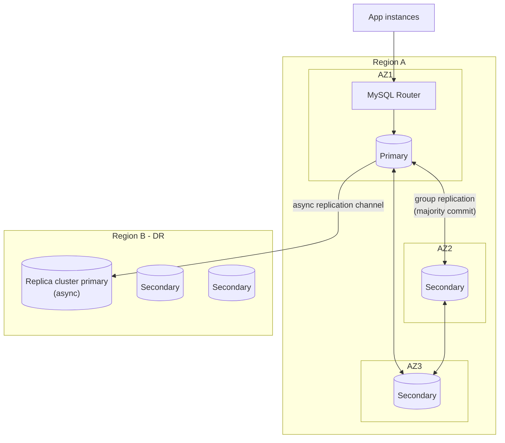

## Introduction

Two questions decide how a database platform is built:

1. **How much downtime is acceptable?** If the primary's server dies at 3 a.m., how long may writes be unavailable — 30 seconds, 30 minutes, 30 hours?
2. **How much data loss is acceptable?** When it dies, may the last second of committed orders be lost? The last hour? Nothing at all?

The first is about **high availability (HA)** — surviving the failure of components (a disk, a server, a rack, an availability zone) with little or no interruption. The second, together with recovering from catastrophic events (a region outage, a ransomware attack, an engineer's `DROP TABLE`), is about **disaster recovery (DR)**. They are quantified by two numbers that every architecture review must state explicitly: the **recovery time objective (RTO)** and the **recovery point objective (RPO)**.

[Replication and High Availability](/lessons/m11-replication-ha) and [Restore and Point-in-Time Recovery](/lessons/m11-restore-pitr) cover the mechanisms. This lesson is about **design**: turning availability targets into architectures, computing what each design actually delivers, understanding what happens during a failover (and how split brain is prevented), and writing DR plans that hold up under test. The sandbox cannot kill servers, so the lab works with what *can* be computed rigorously — availability arithmetic, error budgets, RPO from replication watermarks and backup schedules, incident timelines, and a fencing protocol — while the topologies are shown as diagrams and display-only commands.

## DBMS Theory

:::theory[Availability, RPO and RTO]
**Availability** is the fraction of time a service is usable: A = uptime / (uptime + downtime), or in reliability terms A = MTBF / (MTBF + MTTR), where MTBF is the mean time between failures and MTTR the mean time to recovery. It is usually stated in "nines": 99.9% ("three nines") allows about 43.8 minutes of downtime per 30-day month.

**Composition.** If a request needs components X **and** Y (serial dependency), A = A_X × A_Y — every dependency lowers availability. If either of n independent redundant copies suffices (parallel redundancy), A = 1 − (1 − A_copy)ⁿ — redundancy raises it, **provided failover works and failures are independent**.

**RPO** (recovery point objective) is the maximum acceptable amount of data loss, measured in time: "RPO = 5 minutes" means at most the last 5 minutes of committed transactions may be lost.

**RTO** (recovery time objective) is the maximum acceptable time from failure to restored service.

Both are *objectives* (requirements); what a design actually achieves in an incident is the recovery point/time *actual*. The gap between them is what DR testing measures.
:::

The fundamental trade-off is between **durability across failure domains** and **write latency**. A transaction is safe from the loss of a server only if its changes exist on another server *before* the commit is acknowledged; it is safe from the loss of a region only if they exist in another region. Getting the data there synchronously costs at least one network round trip per commit — sub-millisecond within a zone, ~1–2 ms across zones in a region, tens of milliseconds across regions. Asynchronous shipping costs nothing at commit time but accepts losing whatever had not been shipped. This is the **RPO–latency trade-off**, and every option in this lesson sits somewhere on it.

The second fundamental issue is **split brain**. Failover means deciding that the old primary is dead and promoting another server. If the old primary is only *unreachable* (a network partition), both servers may accept writes and the data diverges. Distributed systems prevent this with **quorums** (a majority of members must agree on the primary, so at most one side of a partition can have one) and **fencing** (the old primary is cut off, or every write carries a monotonically increasing epoch that storage rejects when stale).

## Why It Exists

Failures are not rare events at scale; they are a steady background rate. Disks, memory, power supplies, kernels and hypervisors fail; availability zones lose power or network; operators run the wrong command; software bugs corrupt data; regions occasionally have major outages. A single MySQL server, however reliable, has an RTO equal to "time to repair or rebuild it" and an RPO equal to "everything since the last backup" if its storage is lost.

Without an explicit HA/DR design, organisations discover their real RTO and RPO during the incident — typically: hours to restore a multi-terabyte backup no one has tested, data loss back to last night's backup because binary logs were stored on the same disk, and a failover that promoted a lagging replica and silently dropped transactions. Explicit objectives turn these into engineering requirements with costs attached: each additional nine and each reduction of RPO towards zero costs money, latency and operational complexity, and the business must decide what it is worth.

## Internal Working

:::internals[What happens during a MySQL failover]
**Asynchronous replication with an external manager** (Orchestrator, MySQL Shell for InnoDB ReplicaSet, a cloud control plane):

1. **Detection.** Health checks fail for a configured interval (e.g. 3 checks × 5 s). Too short and transient blips cause failovers; too long and RTO grows.
2. **Decision.** The manager confirms from several vantage points that the primary is down (not just unreachable from the manager), then picks the replica with the most complete data — with GTIDs, the one whose `gtid_executed` (plus relay log, `Retrieved_Gtid_Set`) is a superset of the others.
3. **Catch-up.** The candidate applies its remaining relay log. Transactions the old primary committed but no replica received are **lost** (the RPO of async replication).
4. **Promotion.** The candidate is made writable (`super_read_only = OFF`); the other replicas are re-pointed to it (`CHANGE REPLICATION SOURCE TO … SOURCE_AUTO_POSITION = 1`).
5. **Fencing.** The old primary must be prevented from accepting writes if it comes back (set read-only, stop it, revoke its network route, or STONITH — "shoot the other node in the head").
6. **Traffic switch.** Proxies (MySQL Router, ProxySQL), DNS or a virtual IP direct writes to the new primary. Clients reconnect; in-flight transactions fail and must be retried by the application.

**Group Replication / InnoDB Cluster.** Members exchange transactions through a group communication system based on a Paxos variant before commit. A transaction commits on the primary only after a **majority** of members has received it and certification has passed, so the loss of a minority of members loses no committed data (RPO ≈ 0 within the group). If the primary fails, the remaining majority elects a new primary automatically; MySQL Router learns the new topology from the cluster's metadata and redirects connections. A partitioned minority cannot form a quorum and blocks writes, which prevents split brain. A 3-member group tolerates 1 failure; 5 members tolerate 2.

**Semi-synchronous replication.** The primary's commit waits (with `rpl_semi_sync_source_wait_point = AFTER_SYNC`, the default) until at least `rpl_semi_sync_source_wait_for_replica_count` replicas acknowledge *receipt* of the transaction into their relay logs. Failover to an acknowledging replica then loses no acknowledged commit. But if no acknowledgement arrives within `rpl_semi_sync_source_timeout` (10,000 ms by default), the primary **falls back to asynchronous replication** and keeps committing — RPO silently stops being zero unless you monitor for it (or set a very large timeout and accept that writes stop instead).
:::



The diagram is an **InnoDB ClusterSet**: a primary InnoDB Cluster (three Group Replication members across three availability zones, RPO ≈ 0 and automatic failover inside the region) plus a replica cluster in another region fed by an asynchronous channel (RPO = replication lag, failover by an explicit, usually human-approved, command).

## MySQL Implementation

Availability targets come first, because every later decision follows from them. Compute what each number of nines allows:

```sql run
SELECT nines, slo_pct,
       ROUND((1 - slo_pct / 100) * 365 * 24 * 60, 1)  AS downtime_min_per_year,
       ROUND((1 - slo_pct / 100) * 30 * 24 * 60, 1)   AS downtime_min_per_30_days,
       ROUND((1 - slo_pct / 100) * 7 * 24 * 3600, 0)  AS downtime_s_per_week
FROM (SELECT 'two' AS nines, 99.0 AS slo_pct UNION ALL SELECT 'three', 99.9 UNION ALL
      SELECT 'three and a half', 99.95 UNION ALL SELECT 'four', 99.99 UNION ALL SELECT 'five', 99.999) t
ORDER BY slo_pct;
```

At four nines the whole month's budget is about 4.3 minutes — less than a single manual failover typically takes. Five nines (about 26 seconds a month) is only reachable with fully automatic failover and redundancy at every layer.

**Composition** shows why redundancy is needed everywhere. A request path that depends serially on a load balancer, three redundant app instances and the database:

```sql run
SET @lb = 0.9999, @app_instance = 0.995, @db_single = 0.999, @db_failover_success = 0.99;
SELECT ROUND(100 * @lb * @db_single, 4)                                  AS lb_and_single_db_pct,
       ROUND(100 * (1 - POW(1 - @app_instance, 3)), 6)                   AS app_tier_3_instances_pct,
       ROUND(100 * (1 - (1 - @db_single) * ((1 - @db_single) + (1 - @db_failover_success) * @db_single)), 5)
                                                                         AS db_pair_with_failover_pct,
       ROUND(100 * @lb * (1 - POW(1 - @app_instance, 3))
                 * (1 - (1 - @db_single) * ((1 - @db_single) + (1 - @db_failover_success) * @db_single)), 4)
                                                                         AS end_to_end_pct;
```

The figures are *inputs you choose* (assumed per-component availabilities), and the model is simplified: a database pair is unavailable when the primary is down **and** either the standby is also down or the failover fails. Three app instances at 99.5% each give a tier far better than any single instance; the database pair with a 99%-reliable failover improves on a single server by roughly two orders of magnitude of unavailability; and the end-to-end availability is dominated by the weakest serial component. The arithmetic makes one point unavoidable: **a failover that does not work reliably is worth little** — failover success probability multiplies straight into the result, which is why failovers must be exercised regularly.

## Syntax Breakdown

The MySQL-side building blocks (display only — they require administrative privileges and real topologies):

```sql
-- Semi-synchronous replication on the source (plugin names are the 8.0.26+/8.4 ones)
INSTALL PLUGIN rpl_semi_sync_source SONAME 'semisync_source.so';
SET PERSIST rpl_semi_sync_source_enabled = ON;
SET PERSIST rpl_semi_sync_source_wait_point = AFTER_SYNC;       -- lossless (default)
SET PERSIST rpl_semi_sync_source_timeout = 10000;               -- ms before falling back to async
-- A delayed replica for protection against logical errors (here: 1 hour behind)
CHANGE REPLICATION SOURCE TO SOURCE_DELAY = 3600;
-- Promote a replica (manual failover with GTIDs)
STOP REPLICA;
SET PERSIST super_read_only = OFF, read_only = OFF;
-- Re-point another replica to the new primary
CHANGE REPLICATION SOURCE TO SOURCE_HOST = 'db-b.internal', SOURCE_AUTO_POSITION = 1;
START REPLICA;
-- Fence the old primary when it comes back
SET PERSIST super_read_only = ON;
```

```js
// MySQL Shell (JavaScript mode) — InnoDB Cluster and ClusterSet administration (display only)
var cluster = dba.createCluster('prod');            // on the first instance
cluster.addInstance('db2.internal:3306');           // clone-based provisioning of members
cluster.addInstance('db3.internal:3306');
cluster.status();                                    // members, roles, replication lag, quorum
cluster.setPrimaryInstance('db2.internal:3306');    // planned switchover
var cs = cluster.createClusterSet('global');
cs.createReplicaCluster('dr1.internal:3306', 'prod-dr');   // async replica cluster in the DR region
cs.setPrimaryCluster('prod-dr');                     // planned regional switchover
cs.forcePrimaryCluster('prod-dr');                   // emergency failover (may lose unreplicated data)
```

| Mechanism | Protects against | RPO | RTO (typical order of magnitude) | Cost |
|---|---|---|---|---|
| Async replica + manual failover | Server loss | Replication lag (seconds; unbounded under lag) | Minutes to hours (human) | Low |
| Async replica + automated manager (Orchestrator, ReplicaSet) | Server/AZ loss | Lag at failure time | 10 s – a few minutes | Medium; split-brain care |
| Semi-sync (AFTER_SYNC) | Server loss | 0 for acknowledged commits — unless it fell back to async | As above | +1 intra-region RTT per commit |
| Group Replication / InnoDB Cluster (3+ members) | Loss of a minority of members/AZs | ≈ 0 within the group | Seconds (automatic election) | Commit latency, flow control, 3+ servers |
| Managed Multi-AZ (e.g. RDS Multi-AZ, Cloud SQL HA) | Instance/AZ loss | ≈ 0 (synchronous standby/storage) | Provider-documented, typically ~1–2 minutes for instance-level standbys | Provider cost |
| Cross-region async (ClusterSet, replica in another region) | Region loss | Cross-region lag (seconds) | Minutes (usually a human decision) | Second region |
| Delayed replica | Logical errors (bad DELETE, DROP) | The delay is a *window to stop before applying* | Time to find the error point and promote/extract | One server |
| Backups + binlog archiving (PITR) | Everything, incl. corruption and ransomware (if immutable/off-site) | Binlog shipping interval | Restore time (hours for TBs) | Storage |

## Practical Examples

### 1. What does an async failover lose?

Model a primary's committed transactions and what each replica had **received** (relay log) and **applied** when the primary crashed. The best promotion candidate is the one that received the most; anything beyond its received position is lost.

```sql run
CREATE TABLE primary_commits (seq INT PRIMARY KEY, committed_at DATETIME(3) NOT NULL);
INSERT INTO primary_commits
WITH RECURSIVE s(n) AS (SELECT 1 UNION ALL SELECT n + 1 FROM s WHERE n < 600)
SELECT n, '2024-12-01 03:00:00' + INTERVAL n * 100000 MICROSECOND FROM s;  -- one commit every 100 ms
CREATE TABLE replica_positions (replica VARCHAR(10) PRIMARY KEY, received_seq INT NOT NULL, applied_seq INT NOT NULL, az VARCHAR(4) NOT NULL);
INSERT INTO replica_positions VALUES ('db-b', 596, 590, 'az2'), ('db-c', 571, 571, 'az3'), ('db-dr', 540, 538, 'eu-1');
SET @crash_at = (SELECT MAX(committed_at) FROM primary_commits);
SELECT r.replica, r.az, r.received_seq, r.applied_seq,
       (SELECT COUNT(*) FROM primary_commits WHERE seq > r.received_seq) AS lost_if_promoted,
       ROUND(TIMESTAMPDIFF(MICROSECOND,
             (SELECT committed_at FROM primary_commits WHERE seq = r.received_seq), @crash_at) / 1e6, 1) AS rpo_seconds
FROM replica_positions r
ORDER BY r.received_seq DESC;
```

Promoting `db-b` loses the last 4 transactions (0.4 s of commits); promoting `db-c` would lose 29, and the DR replica 60. This is why failover managers choose the most advanced replica — and why, with GTIDs, they can prove it by comparing GTID sets instead of guessing from lag metrics. `db-b` must first apply the 6 transactions it received but had not applied; that apply time adds to RTO.

Under semi-synchronous replication with one required acknowledgement, the primary could not have acknowledged commits 597–600 to clients until some replica had received them, so either they reached a replica (RPO 0) or the clients never got a success — *unless* semi-sync had timed out and silently degraded to async. Monitoring `Rpl_semi_sync_source_status` (ON/OFF) and `Rpl_semi_sync_source_no_tx` is therefore part of any "RPO = 0" claim.

### 2. RPO and RTO of backup-based recovery

When everything in a region is lost — or the data is logically destroyed — recovery comes from backups plus archived binary logs ([Restore and PITR](/lessons/m11-restore-pitr)). The achievable recovery point is the end of the last binlog file that reached off-site storage:

```sql run
CREATE TABLE backup_catalog (kind VARCHAR(10) NOT NULL, finished_at DATETIME NOT NULL, covers_until DATETIME NOT NULL, size_gb INT NOT NULL);
INSERT INTO backup_catalog VALUES
  ('full',   '2024-12-01 01:40:00', '2024-12-01 01:00:00', 1800),
  ('binlog', '2024-12-01 02:05:00', '2024-12-01 02:00:00', 4),
  ('binlog', '2024-12-01 03:05:00', '2024-12-01 03:00:00', 5),
  ('binlog', '2024-12-01 04:05:00', '2024-12-01 04:00:00', 5),
  ('binlog', '2024-12-01 05:05:00', '2024-12-01 05:00:00', 6);
SET @disaster_at = '2024-12-01 05:47:00', @restore_gb_per_hour = 600, @binlog_apply_min_per_hour = 9;
SELECT MAX(covers_until) AS recoverable_until,
       TIMESTAMPDIFF(MINUTE, MAX(covers_until), @disaster_at) AS rpo_minutes,
       ROUND((SELECT size_gb FROM backup_catalog WHERE kind = 'full') / @restore_gb_per_hour * 60
             + TIMESTAMPDIFF(HOUR, (SELECT covers_until FROM backup_catalog WHERE kind = 'full'), MAX(covers_until))
               * @binlog_apply_min_per_hour) AS estimated_restore_minutes
FROM backup_catalog
WHERE finished_at <= @disaster_at;
```

With hourly binlog uploads, a disaster at 05:47 can be recovered to 05:00 — 47 minutes of lost transactions — and restoring 1.8 TB at the assumed 600 GB/h plus replaying four hours of binlogs takes over three hours. Both numbers are often a shock in a design review, and both have direct fixes: stream binlogs continuously off-site (`mysqlbinlog --read-from-remote-server --stop-never`, or a managed service's continuous backup) to bring RPO down to seconds; keep a warm standby in the DR region so recovery is a promotion, not a restore. The rate parameters are assumptions you must replace with **measured** restore throughput from your own drills.

### 3. Error budgets from an SLO

An SLO of 99.95% monthly availability for the write path gives a budget of about 21.6 minutes per 30 days. An incident log turns that into a running balance — the basis for decisions like "freeze risky changes, we have spent the budget":

```sql run
CREATE TABLE incidents (incident_id INT PRIMARY KEY, started_at DATETIME NOT NULL, detected_at DATETIME NOT NULL,
                        mitigated_at DATETIME NOT NULL, cause VARCHAR(60) NOT NULL);
INSERT INTO incidents VALUES
  (1, '2024-11-03 02:10:00', '2024-11-03 02:12:30', '2024-11-03 02:14:00', 'primary host failure, automatic failover'),
  (2, '2024-11-12 14:00:00', '2024-11-12 14:06:00', '2024-11-12 14:11:00', 'MDL pile-up during migration'),
  (3, '2024-11-20 09:30:00', '2024-11-20 09:31:00', '2024-11-20 09:33:30', 'connection pool exhaustion'),
  (4, '2024-11-27 22:00:00', '2024-11-27 22:04:00', '2024-11-27 22:09:00', 'replica promoted with lag, writes paused');
SET @slo = 99.95, @window_min = 30 * 24 * 60;
SELECT incident_id, cause,
       TIMESTAMPDIFF(SECOND, started_at, detected_at) / 60   AS time_to_detect_min,
       TIMESTAMPDIFF(SECOND, detected_at, mitigated_at) / 60 AS time_to_mitigate_min,
       TIMESTAMPDIFF(SECOND, started_at, mitigated_at) / 60  AS downtime_min,
       ROUND((1 - @slo / 100) * @window_min
             - SUM(TIMESTAMPDIFF(SECOND, started_at, mitigated_at) / 60) OVER (ORDER BY started_at), 1) AS budget_left_min
FROM incidents ORDER BY started_at;
```

The budget of 21.6 minutes was exhausted by the fourth incident. The breakdown also shows where to invest: in incidents 2 and 4, **detection** took about as long as mitigation (6 vs 5 minutes and 4 vs 5 minutes) — better alerting would have saved more downtime than faster failover. Time to detect plus time to mitigate is the *actual* RTO for each incident; compare it with the objective.

### 4. Fencing a stale primary with an epoch

After a failover, the old primary may come back and accept writes from clients that still point at it. One robust protection is a **fencing token**: every promotion increments a cluster **epoch**, and writes are only accepted when they carry the current epoch. In real deployments this is enforced by the cluster manager, by `super_read_only` on the demoted server, by the proxy routing table, or by the storage layer; the lab shows the principle with a conditional write.

```sql run
CREATE TABLE cluster_epoch (id TINYINT PRIMARY KEY, epoch INT NOT NULL, primary_node VARCHAR(10) NOT NULL);
INSERT INTO cluster_epoch VALUES (1, 7, 'db-a');
CREATE TABLE ledger (entry_id INT AUTO_INCREMENT PRIMARY KEY, written_by VARCHAR(10) NOT NULL, epoch INT NOT NULL, amount DECIMAL(10,2) NOT NULL);
-- Failover: db-b is promoted, epoch 7 → 8
UPDATE cluster_epoch SET epoch = epoch + 1, primary_node = 'db-b' WHERE id = 1;
-- The new primary writes with epoch 8
INSERT INTO ledger (written_by, epoch, amount)
  SELECT 'db-b', 8, 100.00 FROM cluster_epoch WHERE id = 1 AND epoch = 8;
SELECT ROW_COUNT() AS accepted_from_db_b;
-- The old primary db-a comes back and still believes it is primary with epoch 7
INSERT INTO ledger (written_by, epoch, amount)
  SELECT 'db-a', 7, 250.00 FROM cluster_epoch WHERE id = 1 AND epoch = 7;
SELECT ROW_COUNT() AS accepted_from_db_a;
SELECT * FROM ledger;
```

The write from the stale primary was rejected because its epoch was out of date. Group Replication achieves the same effect structurally: a member that has lost contact with the majority cannot commit, and when it rejoins it must first catch up with the group's view. In asynchronous topologies, forgetting fencing is the classic cause of **errant transactions** — writes that exist only on the old primary and later break replication or are silently lost.

## Execution Walkthrough

```walkthrough
title: Reconstructing an automated failover from its timeline
steps:
  - title: "1. The event timeline"
    explain: An HA manager logs each phase of a failover. This is the kind of table a post-incident review builds from logs (manager, proxy, application).
    sql: |
      CREATE TABLE failover_timeline (step_no INT PRIMARY KEY, at DATETIME(3) NOT NULL, phase VARCHAR(20) NOT NULL, detail VARCHAR(80) NOT NULL);
      INSERT INTO failover_timeline VALUES
        (1, '2024-11-03 02:10:00.000', 'failure',   'db-a kernel panic'),
        (2, '2024-11-03 02:10:15.400', 'detection', '3 failed health checks (5 s interval)'),
        (3, '2024-11-03 02:10:21.900', 'decision',  'quorum of observers agrees db-a is down; db-b most advanced'),
        (4, '2024-11-03 02:10:24.300', 'catch-up',  'db-b applied remaining relay log'),
        (5, '2024-11-03 02:10:25.100', 'promotion', 'db-b read-write, epoch 7 -> 8, replicas re-pointed'),
        (6, '2024-11-03 02:10:31.000', 'routing',   'proxies updated; new connections go to db-b'),
        (7, '2024-11-03 02:14:00.000', 'recovered', 'error rate back to baseline after client retries');
      SELECT * FROM failover_timeline ORDER BY step_no;
  - title: "2. Duration of each phase"
    explain: LAG() gives the time spent between consecutive events — the anatomy of RTO.
    sql: |
      SELECT phase, detail,
             ROUND(TIMESTAMPDIFF(MICROSECOND, LAG(at) OVER (ORDER BY step_no), at) / 1e6, 1) AS seconds_since_previous,
             ROUND(TIMESTAMPDIFF(MICROSECOND, FIRST_VALUE(at) OVER (ORDER BY step_no), at) / 1e6, 1) AS seconds_since_failure
      FROM failover_timeline ORDER BY step_no;
  - title: "3. Where the time went"
    explain: The database-level failover (failure to routing) took about 31 seconds, dominated by detection. But user-visible recovery took about 4 minutes, because clients held broken connections and retried slowly. The fix for the long tail is in the application (connection validation, short timeouts, retries with backoff), not in MySQL.
    sql: |
      SELECT ROUND(TIMESTAMPDIFF(MICROSECOND, MIN(at), MAX(CASE WHEN phase = 'routing' THEN at END)) / 1e6, 1) AS db_failover_seconds,
             ROUND(TIMESTAMPDIFF(MICROSECOND, MIN(at), MAX(at)) / 1e6, 1) AS user_visible_seconds
      FROM failover_timeline;
```

Post-incident reviews of failovers almost always find the same pattern: the database switched in tens of seconds, and the remaining minutes were spent in detection tuning, DNS TTLs, connection pools holding dead connections, or application retries without backoff. HA is an end-to-end property.

## Output

- Four nines allows about 4.3 minutes of downtime per 30 days; five nines about 26 seconds.
- In the composition model, three redundant app instances and a database pair with a 99%-reliable failover gave a much higher availability than single components, with the failover success rate a direct multiplier.
- Promoting the most advanced replica (`db-b`) lost 4 transactions (0.4 s); promoting `db-c` would have lost 29; the DR replica 60.
- Backup-based recovery from hourly binlog uploads gave an RPO of 47 minutes and an estimated restore time of over three hours under the stated throughput assumptions.
- The 21.6-minute monthly error budget was exhausted by the fourth incident; detection time was a major contributor.
- The epoch check accepted the new primary's write and rejected the stale primary's.
- The reconstructed failover took about 31 s at the database level and about 4 minutes end to end.

## Alternative Approaches

| Design | RPO | RTO | Complexity | When it fits |
|---|---|---|---|---|
| Single server + backups | Hours (to last binlog upload) | Hours | Low | Internal tools, dev/test |
| Primary + async replica, manual failover | Seconds–minutes | 15–60 min (human) | Low | Small teams, modest SLOs (≤ 99.9%) |
| InnoDB ReplicaSet / Orchestrator automated async failover | Seconds (lag at failure) | ~30 s – few min | Medium (split-brain care) | Read-heavy, can tolerate rare small loss |
| Semi-sync + automated failover | 0 while semi-sync active | ~30 s – few min | Medium | Small loss unacceptable; intra-region RTT acceptable |
| InnoDB Cluster (Group Replication, 3 or 5 members across AZs) | ≈ 0 in region | Seconds | Medium–high (quorum, flow control, write conflicts in multi-primary) | ≥ 99.95% in one region |
| Managed Multi-AZ (RDS, Aurora, Cloud SQL HA, Azure) | ≈ 0 in region | Provider-dependent (tens of seconds to minutes) | Low (operated by provider) | Teams that prefer to buy HA |
| + Cross-region async replica / ClusterSet | Seconds (cross-region lag) | Minutes (decision + promotion + routing) | High | Regional DR |
| Synchronous multi-region (Group Replication across regions, distributed SQL) | 0 across regions | Seconds | High; every commit pays cross-region latency | Very strict RPO, latency-tolerant writes |
| Active-active multi-region (multi-primary, conflict resolution) | Varies | Seconds | Very high (conflicts, ordering) | Rare; usually avoided or sharded by region instead |

**Multi-region choices.** Most organisations run **active-passive** across regions: writes in one region, an asynchronous replica cluster in another, promotion on regional disaster. Writes in both regions require either synchronous consensus across regions (every commit pays tens of milliseconds) or **partitioning writes by region** (each user's or tenant's data has a home region — a form of sharding), which avoids write conflicts altogether. True multi-primary writes to the same rows in two regions need conflict resolution and are rarely a good idea for relational data.

## Performance Analysis

HA and DR have a direct performance cost on the write path, which is why they must be designed together with capacity:

- **Semi-sync** adds one round trip to a replica per commit (group commit amortises it across concurrent transactions). Within an AZ this is sub-millisecond; across AZs ~1 ms or more.
- **Group Replication** adds a consensus round per commit (to a majority) and certification; under heavy write load, **flow control** throttles the primary so slow members can keep up — throughput is bounded by the slowest member that is part of the majority. Large transactions are especially costly (they must be shipped and certified as a unit; `group_replication_transaction_size_limit` caps them).
- **Cross-region synchronous replication** puts the inter-region round trip (tens of ms) into every commit; a workload that commits 5,000 small transactions per second serially on one connection cannot survive that, which is why such designs batch commits or accept async.
- **Failover reserve capacity**: after losing a server or an AZ, the survivors must carry the full load. A three-AZ design where each AZ runs at 70% utilisation cannot absorb an AZ loss; size for N−1 ([Observability and Capacity Planning](/lessons/m12-observability-capacity)).
- **Backups and restores** consume I/O and network; restore throughput (GB/h) is the number that determines backup-based RTO and must be measured in drills, not assumed.

## Best Practices

:::best-practice[HA/DR that works when it is needed]
1. **Write down RPO and RTO per service** (and per data class), agreed with the business, and derive the architecture from them — not the other way round.
2. **Use GTIDs everywhere**; they make failover, re-pointing and "who is most advanced" provable.
3. **Prefer quorum-based HA** (InnoDB Cluster/Group Replication, managed Multi-AZ) for automatic failover; with async topologies, implement fencing and errant-transaction checks.
4. **Monitor that the protection is active**: semi-sync status, Group Replication member states and quorum, replica lag, backup success and binlog upload freshness. A silent fallback to async is an RPO incident.
5. **Keep backups off-site and immutable** (object lock / separate account), and ship binlogs continuously; replication protects against hardware failure, not against `DROP TABLE` or ransomware.
6. **Consider a delayed replica** for fast recovery from logical errors on large datasets.
7. **Design the application for failover**: connection validation, short timeouts, idempotent retries ([Database Architecture for Web Applications](/lessons/m12-web-app-architecture)), and no assumptions that a connection survives.
8. **Test regularly**: scheduled switchovers, region failover drills, and full restores with measured RTO/RPO. An untested DR plan is a hypothesis.
9. **Size for N−1** so the remaining capacity after a failure can carry peak load.
:::

## Common Mistakes

**Mistake 1 — treating replication as backup.** Replicas faithfully replay a `DELETE` without `WHERE` within milliseconds. Only backups (and delayed replicas, within their delay) protect against logical errors.

**Mistake 2 — counting nines for components, not for the user path.** Five servers at 99.99% in series give about 99.95%. Compute end-to-end availability, including DNS, proxies, the cache and the application.

**Mistake 3 — even-sized quorums.** A 2-member or 4-member group tolerates no more failures than one with one member fewer, and a 2-way network split leaves neither side with a majority. Use 3 or 5 members, spread across 3 failure domains (two AZs cannot host a majority-surviving 3-member group if the AZ with two members fails).

**Mistake 4 — "RPO = 0" with semi-sync and the default timeout.** After 10 seconds without acknowledgement the primary continues asynchronously. Either monitor and alert on the fallback, or configure the trade-off deliberately.

**Mistake 5 — failover without fencing.** The old primary returns after a network partition and accepts writes from clients with cached DNS: divergent data and errant GTIDs.

**Mistake 6 — never testing the restore.** Backups that cannot be restored within the RTO — because of missing binlogs, wrong credentials, untested tooling or throughput far below assumptions — are discovered during the disaster.

## Industry Application

- **MySQL InnoDB Cluster / ClusterSet** (Group Replication + MySQL Router + MySQL Shell) is Oracle's integrated HA/DR stack for self-managed MySQL; InnoDB ReplicaSet covers asynchronous topologies with managed switchover.
- **Orchestrator** (originally from GitHub/Booking.com) is widely used to manage and fail over asynchronous MySQL topologies; Vitess integrates its own failover (VTOrc). **Percona XtraDB Cluster** (Galera) offers synchronous multi-primary clustering.
- **Managed services** dominate new deployments: Amazon RDS Multi-AZ (synchronous standby in another AZ, provider-managed failover), Aurora MySQL (storage replicated six ways across three AZs, fast replica promotion, Global Database for cross-region DR), Google Cloud SQL HA (regional disks), Azure Database for MySQL zone-redundant HA.
- **SRE practice** uses SLOs and error budgets to decide between reliability work and feature work, runs game days and chaos experiments (killing primaries deliberately), and tracks time-to-detect and time-to-mitigate as first-class metrics.
- **Regulated industries** (banking, payments) document RPO/RTO per system, often require RPO = 0 within a region and minutes across regions, and must evidence DR tests to auditors.

## Practice Exercises

```exercise
id: ex1
title: Downtime budget per SLO
difficulty: easy
setup: |
  CREATE TABLE slos (service VARCHAR(20) PRIMARY KEY, slo_pct DECIMAL(6,3) NOT NULL);
  INSERT INTO slos VALUES ('checkout', 99.95), ('search', 99.9), ('admin', 99.5), ('payments-api', 99.99);
concepts: [high-availability]
prompt: |
  For each service return `service` and `budget_minutes` — the allowed downtime per **30-day** window,
  rounded to 1 decimal.
hints:
  - "Allowed downtime = (1 − slo_pct / 100) × 30 × 24 × 60 minutes."
solution: |
  SELECT service, ROUND((1 - slo_pct / 100) * 30 * 24 * 60, 1) AS budget_minutes FROM slos;
explanation: |
  payments-api at 99.99% gets 4.3 minutes, checkout 21.6, search 43.2, admin 216.0. A budget of 4.3
  minutes per month rules out any design whose failover involves a human.
```

```exercise
id: ex2
title: Choose the promotion candidate
difficulty: medium
setup: |
  CREATE TABLE replicas (replica VARCHAR(10) PRIMARY KEY, healthy BOOLEAN NOT NULL, received_seq INT NOT NULL, applied_seq INT NOT NULL, region VARCHAR(10) NOT NULL, promotable BOOLEAN NOT NULL);
  INSERT INTO replicas VALUES
    ('r1', TRUE,  9812, 9790, 'us-east', TRUE),
    ('r2', TRUE,  9840, 9801, 'us-east', TRUE),
    ('r3', FALSE, 9851, 9851, 'us-east', TRUE),
    ('r4', TRUE,  9845, 9845, 'us-west', FALSE),
    ('r5', TRUE,  9840, 9839, 'us-east', TRUE);
concepts: [failover]
prompt: |
  Pick the replica to promote: it must be **healthy** and **promotable**; among those choose the highest
  `received_seq`; break ties by the highest `applied_seq` (less catch-up). Return one row: `replica`,
  `received_seq`, `to_apply` (= received_seq − applied_seq).
hints:
  - "Filter, then ORDER BY received_seq DESC, applied_seq DESC LIMIT 1."
solution: |
  SELECT replica, received_seq, received_seq - applied_seq AS to_apply
  FROM replicas
  WHERE healthy AND promotable
  ORDER BY received_seq DESC, applied_seq DESC
  LIMIT 1;
explanation: |
  r3 has the most data but is unhealthy; r4 is marked not promotable (e.g. a reporting replica in another
  region, or smaller hardware). r2 and r5 tie on received_seq 9840; r5 has applied more (only 1
  transaction to apply versus 39), so it can be promoted faster with the same data — the choice that
  minimises both RPO and RTO. Real managers compare GTID sets rather than integers, because GTID sets can
  have gaps.
```

```exercise
id: ex3
title: Quarterly availability from incidents
difficulty: medium
setup: |
  CREATE TABLE incidents (incident_id INT PRIMARY KEY, started_at DATETIME NOT NULL, mitigated_at DATETIME NOT NULL, sev TINYINT NOT NULL);
  INSERT INTO incidents VALUES
    (1,'2024-10-02 10:00:00','2024-10-02 10:07:00',1),(2,'2024-10-19 01:30:00','2024-10-19 01:31:30',2),
    (3,'2024-11-05 16:00:00','2024-11-05 16:40:00',1),(4,'2024-12-12 08:15:00','2024-12-12 08:18:00',1),
    (5,'2024-12-31 22:50:00','2025-01-01 00:20:00',1);
concepts: [high-availability, rto]
prompt: |
  Compute the availability of Q4 2024 (`2024-10-01` inclusive to `2025-01-01` exclusive) caused by
  **severity-1** incidents only. Count only the part of each incident that falls inside the quarter. Return
  `downtime_minutes` and `availability_pct` (rounded to 4 decimals).
hints:
  - "Clip each incident to the window: GREATEST(started_at, window_start) and LEAST(mitigated_at, window_end)."
  - "The quarter has TIMESTAMPDIFF(MINUTE, '2024-10-01', '2025-01-01') minutes."
solution: |
  SELECT SUM(TIMESTAMPDIFF(SECOND, GREATEST(started_at, '2024-10-01'), LEAST(mitigated_at, '2025-01-01'))) / 60 AS downtime_minutes,
         ROUND(100 * (1 - SUM(TIMESTAMPDIFF(SECOND, GREATEST(started_at, '2024-10-01'), LEAST(mitigated_at, '2025-01-01')))
                        / TIMESTAMPDIFF(SECOND, '2024-10-01', '2025-01-01')), 4) AS availability_pct
  FROM incidents
  WHERE sev = 1 AND started_at < '2025-01-01' AND mitigated_at > '2024-10-01';
explanation: |
  Incident 5 runs past midnight on 31 December; only its 70 minutes inside Q4 count (7 + 40 + 3 + 70 = 120
  minutes). Over a 92-day quarter (132,480 minutes) that is about 99.9094% — below a 99.95% SLO. Forgetting
  to clip intervals to the reporting window is a common error in SLO reports.
```

```exercise
id: ex4
title: Design HA/DR for a payments service
difficulty: hard
kind: open
concepts: [rpo, rto, multi-region, group-replication, failover]
prompt: |
  A payments service requires: RPO = 0 and RTO < 60 s for the loss of any single server or availability
  zone; RPO < 1 minute and RTO < 30 minutes for the loss of the whole primary region; recovery from an
  accidental destructive statement within 2 hours with no more than 5 minutes of data loss. Write load:
  2,000 transactions/s, p99 commit latency budget 20 ms. Propose the architecture and justify each choice;
  state what you would monitor and how you would test it.
solution: |
  **In-region (RPO 0, RTO < 60 s):** InnoDB Cluster with 3 Group Replication members in 3 AZs (or a managed
  Multi-AZ service with synchronous standby). Commits require a majority, so an AZ loss loses no committed
  transaction; automatic primary election plus MySQL Router gives seconds-level failover. Intra-region
  consensus adds ~1–2 ms to commits, inside the 20 ms budget. Applications: connection validation, retries
  with idempotency keys (a payment retried after a failover must not double-charge).

  **Cross-region (RPO < 1 min, RTO < 30 min):** InnoDB ClusterSet replica cluster in a second region via
  async replication; monitor lag with an alert well below 60 s (e.g. 10 s). Regional failover is a
  documented, rehearsed, human-approved `forcePrimaryCluster` plus DNS/router switch; RTO is dominated by
  the decision and traffic switch, so practise it. Synchronous cross-region replication is rejected: tens of
  ms per commit would break the latency budget.

  **Logical errors (≤ 5 min loss, ≤ 2 h):** continuous binlog streaming to immutable off-site storage plus
  regular full backups → PITR to just before the bad statement; restore time must be measured to fit 2 h
  (for large datasets, add a delayed replica, e.g. 1 h, from which data can be extracted or promoted after
  stopping it before the bad event).

  **Monitor:** quorum and member states, primary changes, transaction size limits/flow control, replica
  cluster lag, binlog upload freshness (alert if > 2 min), backup success and restore-drill results.
  **Test:** monthly in-region switchover and failure injection; quarterly regional failover drill;
  restore drill to measure PITR time against the 2 h objective.
explanation: |
  The answer maps each failure class to a mechanism with a matching RPO/RTO, checks the latency budget,
  includes the application's role (idempotent retries) and treats DR testing as part of the design.
```

```exercise
id: ex5
title: Review a DR plan
difficulty: challenge
kind: open
concepts: [disaster-recovery, rpo, rto, fencing]
prompt: |
  Review this DR plan and list its weaknesses with fixes:

  "Our MySQL primary replicates asynchronously to a replica in another region. Nightly mysqldump backups are
  stored on the replica's disk. If the primary region fails, an engineer runs `STOP REPLICA; SET GLOBAL
  read_only = OFF;` on the replica and updates DNS (TTL 1 hour). Our RPO is zero because replication is
  usually under a second behind, and our RTO is 5 minutes."
solution: |
  - **RPO claim is wrong.** Async replication loses whatever had not been received at failure time; "usually
    under a second" is not zero and can be minutes during lag spikes. State RPO as "lag at failure",
    monitor it, or use synchronous/quorum replication where 0 is required.
  - **Backups on the replica's disk** are lost with the replica and do not protect against logical errors
    replicated to it. Store backups off-site, immutable, in a third location; add continuous binlog
    archiving for PITR; use physical backups (MySQL Enterprise Backup, Percona XtraBackup, or MySQL Shell
    dump utilities) for faster restores of large data.
  - **RTO of 5 minutes is not credible.** A human must notice, decide and act; DNS TTL of 1 hour means
    clients may keep resolving the old primary for up to an hour. Use low TTLs or a proxy/router layer,
    automate the runbook, and measure RTO in drills.
  - **No fencing.** If the old primary returns (partition, not destruction), clients with cached DNS write to
    it — split brain and errant transactions. Fence it (`super_read_only`, stop it, block traffic) as step 1.
  - **`read_only = OFF` alone** leaves `super_read_only` possibly ON; use the manager or the full promotion
    procedure, check GTID sets, apply the relay log first.
  - **No tests.** There is no mention of drills, restore tests or measured restore throughput.
  - **No re-protection.** After failover there is no replica — plan to rebuild a new replica/backup chain
    immediately.
explanation: |
  DR plans fail on unstated assumptions: RPO measured on a good day, backups in the same failure domain,
  DNS TTLs, missing fencing and untested procedures. A reviewer checks each claimed number against the
  mechanism that would have to deliver it.
```

## Knowledge Assessment

```quiz
- id: q1
  question: "A service has an SLO of 99.9% per 30 days. How much downtime does it allow?"
  options: ["About 4.3 minutes", "About 21.6 minutes", "About 43.2 minutes", "About 8.8 hours"]
  answer: 2
  explanation: "0.1% of 43,200 minutes is 43.2 minutes. 4.3 minutes is 99.99%, 21.6 is 99.95%, and 8.8 hours is roughly 99.9% of a year, not a month."
  concepts: [high-availability]
- id: q2
  question: "What is the difference between RPO and RTO?"
  options:
    - "RPO is the time to restore service; RTO is the acceptable data loss"
    - "RPO is the maximum acceptable data loss (measured in time); RTO is the maximum acceptable time to restore service"
    - "They are the same thing measured in different units"
    - "RPO applies to replicas and RTO to backups"
  answer: 1
  explanation: "Recovery Point Objective = how much data (how far back in time) may be lost; Recovery Time Objective = how long recovery may take. Both apply to every recovery mechanism."
  concepts: [rpo, rto]
- id: q3
  question: "Semi-synchronous replication with AFTER_SYNC and the default timeout is enabled. Which statements are true? (Select all that apply.)"
  type: multi
  options:
    - "A commit is acknowledged to the client only after at least one replica has received the transaction, while semi-sync is active"
    - "If no replica acknowledges within rpl_semi_sync_source_timeout, the primary falls back to asynchronous replication"
    - "Replicas have always applied every acknowledged transaction"
    - "Failover to an acknowledging replica loses no acknowledged commit while semi-sync was active"
  answer: [0, 1, 3]
  explanation: "Semi-sync waits for receipt into the relay log, not for apply, and it degrades to async after the timeout (10 s by default). Promotion requires applying the remaining relay log, but no acknowledged commit is missing."
  concepts: [rpo, failover]
- id: q4
  question: "Why does a Group Replication cluster use an odd number of members spread over three failure domains?"
  options:
    - "Because MySQL licenses require it"
    - "Because commits and elections need a majority; with 3 or 5 members spread over 3 domains, losing any one domain still leaves a majority"
    - "Because even numbers of members cause deadlocks"
    - "Because each member stores a third of the data"
  answer: 1
  explanation: "Quorum requires a strict majority. Four members tolerate only one failure, like three; two domains cannot guarantee a surviving majority. Members hold full copies of the data, not shards."
  concepts: [group-replication, split-brain]
- id: q5
  question: "In the lab, promoting replica db-b would lose 4 transactions and db-c 29. Why do failover managers prefer db-b?"
  options:
    - "Because it is in the same availability zone as the application"
    - "Because it received the most transactions from the failed primary, minimising data loss"
    - "Because it has applied every transaction it received"
    - "Because its name sorts first"
  answer: 1
  explanation: "The most advanced replica (largest received GTID set) minimises RPO. db-c had applied everything it received, but it received less; applied-but-incomplete data is worse than complete data that still needs a few seconds of apply."
  concepts: [failover, rpo]
- id: q6
  question: "An engineer accidentally runs `DELETE FROM orders` on the primary. Which mechanism lets you recover the data?"
  options:
    - "The synchronous Group Replication secondaries"
    - "A point-in-time restore from backups plus archived binlogs, or a delayed replica stopped before it applies the DELETE"
    - "Semi-synchronous replication"
    - "Failing over to the DR region"
  answer: 1
  explanation: "All forms of live replication replay the DELETE within seconds. Only backups + binlogs (PITR) or a delayed replica preserve the pre-error state."
  concepts: [disaster-recovery]
- id: q7
  question: "After a network partition, the old primary rejoins and accepts writes from clients with cached DNS. What is missing from the design?"
  options:
    - "A larger buffer pool"
    - "Fencing of the old primary (read-only, isolation, or epoch-checked writes) as part of failover"
    - "More replicas"
    - "Semi-synchronous replication"
  answer: 1
  explanation: "Split brain is prevented by fencing and quorum, not by capacity, replica count or acknowledgement mode. The lab's epoch check is one form of fencing."
  concepts: [fencing, split-brain]
- id: q8
  question: "A post-incident timeline shows 31 s from failure to routing switch but 4 minutes until user errors stopped. Where is the most likely improvement?"
  options:
    - "Faster disks on the new primary"
    - "Application-side behaviour: connection validation, shorter timeouts, retry with backoff, low DNS/proxy caching"
    - "A bigger InnoDB log"
    - "Disabling health checks"
  answer: 1
  explanation: "Once the database switched, the remaining time was spent in clients reconnecting and retrying. HA is end-to-end; storage and log size do not affect it, and disabling health checks would slow detection."
  concepts: [failover, rto]
```
