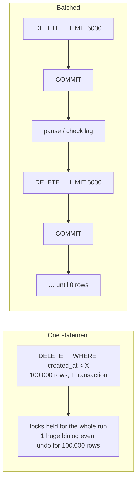

## Introduction

Every technique in this course works on small tables. The difference between a junior and a senior database engineer shows when the table has 500 million rows and the statement is `DELETE FROM events WHERE created_at < '2023-01-01'`. On a laptop it is an ordinary statement. In production it is:

- **one transaction** that locks every row it deletes until it commits — possibly for an hour;
- an **undo log** that must retain the old version of every deleted row (and that purge cannot clean while it runs);
- a single **binary log** transaction that every replica must replay after the primary finishes — an hour of replication lag;
- and, if it is killed or fails halfway, a **rollback** that can take as long as the work already done.

Handling millions of records is mostly about one idea: **turn one huge operation into many small, independent, restartable ones**, each short enough that it never holds locks for long, never builds a huge undo log, never produces a giant replication event, and can be paused, throttled or resumed. This lesson applies that idea to the five operations that matter: **batched deletes and updates**, **chunked backfills** with checkpoints, **archiving**, **deep pagination** (keyset instead of OFFSET), and **bulk loading**. Each is run for real on a 300,000-row table, with costs measured on the build machine.

:::note[Dataset and timings]
The lab starts empty and generates its own data. `measured` blocks show timings from the build machine; read them as *ratios between approaches*, not as absolute performance. Keyset pagination is covered in depth in [Optimizing Aggregation, Sorting and Pagination](/lessons/m07-optimizing-aggregation-sorting); here it is applied to batch processing.
:::

## DBMS Theory

:::theory[Why transaction size matters]
Three mechanisms make the cost of a transaction grow with its size, independently of the total amount of work:

1. **Lock duration (strict two-phase locking).** InnoDB holds row locks until commit. A transaction that modifies N rows holds N locks for its entire duration; every concurrent transaction that needs one of those rows waits ([Locking](/lessons/m08-locking)).
2. **Undo retention (MVCC).** Old versions must be kept while any active transaction might read them, and the modifying transaction's own undo must be kept until it commits, so that it can roll back ([MVCC](/lessons/m08-mvcc)). A large transaction creates a large undo log, and a long one delays purge for everybody.
3. **Atomic replication units.** The binary log records a transaction as one unit at commit time; replicas apply it as one unit. Replication lag after a large transaction ≈ its execution time.

Splitting the work into k batches of size N/k keeps the **total** work roughly the same (often slightly more, because of per-batch overhead) but divides lock duration, undo size and replication unit size by k. The price is that the operation is no longer atomic as a whole — it must be designed to be **idempotent and restartable**, and readers can observe the intermediate state.
:::

A second theoretical idea is the difference between **position-based** and **value-based** iteration:

- **OFFSET-based** iteration ("skip the first 250,000 rows, return the next 1,000") must walk past every skipped row: cost O(offset + page) per page, O(N²/page) for a full pass.
- **Keyset** (seek) iteration ("rows with id > last_seen, in id order, next 1,000") descends the index to the last seen key and continues: cost O(log N + page) per page, O(N) for a full pass. It is also stable under concurrent inserts and deletes, which shift OFFSET positions.

Batch jobs on large tables should always iterate by key.

## Why It Exists

Large-table techniques exist because the naive statements fail in characteristic ways:

- **A giant DELETE/UPDATE** blocks application writes on the affected rows, lags replicas by its full duration, inflates undo tablespaces and the history list, and — if cancelled — rolls back for a similar time. Killing a three-hour DELETE after two hours means waiting for up to two more hours of rollback.
- **A giant INSERT … SELECT** for archiving holds shared locks on the source rows under REPEATABLE READ ([OLTP vs OLAP](/lessons/m12-oltp-olap)) and creates one huge transaction.
- **OFFSET pagination in batch jobs** gets slower with every page; a job that processes 100 million rows in pages of 1,000 with OFFSET performs on the order of 5 × 10¹² row skips.
- **Row-by-row inserts with autocommit** pay one commit (one redo log flush with `innodb_flush_log_at_trx_commit = 1`) per row.
- **"SELECT COUNT(*)" progress checks** on huge tables are themselves full index scans.

## Internal Working

:::internals[What InnoDB does for one row of a DELETE]
For each row a DELETE removes, InnoDB:

1. Locates it through the access path (ideally an index range scan on the predicate column).
2. Takes an exclusive record lock (next-key lock under REPEATABLE READ on a range).
3. Writes an **undo record** (so the delete can be rolled back and older snapshots can still see the row).
4. **Delete-marks** the record in the clustered index and in every secondary index (the physical removal happens later, in the **purge** thread).
5. Writes **redo** for all of those page changes.
6. At commit, the whole transaction's row events go to the **binary log** (with row-based logging: one event per row, containing the full before-image by default, `binlog_row_image = FULL`).

The cost per row is therefore proportional to the number of indexes, and the cost per *transaction* includes a group commit (redo flush and binlog flush). Batching changes how many rows share one commit and how long locks and undo are held; it does not change the per-row work.

**`DELETE … ORDER BY pk LIMIT n`** makes each batch read the next n rows in primary-key order that match the predicate. If the predicate is served by an index (e.g. `created_at` with the primary key appended internally), each batch is a short range scan starting at the beginning of the remaining range. Without such an index, each batch scans from the start of the table past rows that no longer qualify — later batches become slower and slower.
:::



## MySQL Implementation

Generate a 300,000-row event table with an index on `created_at`, and an exact copy so that the two delete strategies can be compared on identical data.

```sql run
SET SESSION cte_max_recursion_depth = 300000;
CREATE TABLE events (
  event_id   INT UNSIGNED NOT NULL PRIMARY KEY,
  user_id    INT UNSIGNED NOT NULL,
  created_at DATETIME     NOT NULL,
  kind       VARCHAR(12)  NOT NULL,
  payload    VARCHAR(60)  NOT NULL,
  KEY idx_events_created (created_at),
  KEY idx_events_user (user_id)
);
INSERT INTO events
WITH RECURSIVE seq(n) AS (SELECT 1 UNION ALL SELECT n + 1 FROM seq WHERE n < 300000)
SELECT n, (n * 7919) % 50000 + 1, '2022-01-01' + INTERVAL (n * 5) MINUTE,
       ELT(1 + n % 3, 'view', 'click', 'purchase'), CONCAT('payload-', n)
FROM seq;
CREATE TABLE events_copy LIKE events;
INSERT INTO events_copy SELECT * FROM events;
ANALYZE TABLE events, events_copy;
SELECT COUNT(*) AS total_rows, MIN(created_at) AS oldest, MAX(created_at) AS newest,
       SUM(created_at < '2023-01-01') AS older_than_2023
FROM events;
```

One event every five minutes from 1 January 2022 gives data up to November 2024, of which 105,119 rows are older than 2023 and must be purged by a retention policy.

### One statement

```sql run measured
DELETE FROM events_copy WHERE created_at < '2023-01-01';
```

One transaction deleted all old rows. For its whole duration, every one of those rows was exclusively locked, and the binary log received them as one transaction.

### Batches in a LIMIT loop

The same purge as a stored procedure: delete at most `batch_size` rows per statement, each statement its own transaction (autocommit), until a statement deletes nothing. `ROW_COUNT()` returns the number of rows the previous statement deleted.

```sql run
DELIMITER //
CREATE PROCEDURE purge_events(IN cutoff DATETIME, IN batch_size INT)
BEGIN
  DECLARE deleted INT DEFAULT 1;
  DECLARE batches INT DEFAULT 0;
  DECLARE total INT DEFAULT 0;
  WHILE deleted > 0 DO
    DELETE FROM events WHERE created_at < cutoff ORDER BY created_at, event_id LIMIT batch_size;
    SET deleted = ROW_COUNT();
    SET total = total + deleted;
    SET batches = batches + 1;
    -- production: DO SLEEP(0.1); and/or stop if replica lag > threshold
  END WHILE;
  SELECT batches AS statements_run, total AS rows_deleted;
END //
DELIMITER ;
```

```sql run measured
CALL purge_events('2023-01-01', 5000);
```

The procedure ran 23 statements — 21 full batches of 5,000, one partial batch and a final one that deleted nothing — and removed the same 105,119 rows. Compare the two measured timings: on the build machine the batched purge took noticeably *longer* in total (roughly 1.5 s against 0.9 s), because it does the same per-row work plus per-batch overhead: 23 commits instead of one, and 23 index descents to the start of the remaining range. What changed is everything *around* the work: no row stayed locked for longer than one batch, each binlog transaction contains at most 5,000 rows, undo per transaction is bounded, and the job can be paused or killed between batches with nothing to roll back but the current batch.

Check that each batch is an efficient range scan on the index rather than a table scan:

```sql run
EXPLAIN DELETE FROM events WHERE created_at < '2023-06-01' ORDER BY created_at, event_id LIMIT 5000;
```

`type: range` on `idx_events_created`. Each batch starts at the low end of the remaining range and reads only the rows it deletes.

## Syntax Breakdown

| Construct | Role in large-table work |
|---|---|
| `DELETE … WHERE … ORDER BY k LIMIT n` | One batch of a purge; `ORDER BY` makes the rows chosen deterministic (required for safe statement-based replication, good practice anyway) |
| `UPDATE … WHERE … ORDER BY k LIMIT n` | One batch of a bulk update (single-table UPDATE only; multi-table UPDATE does not allow LIMIT) |
| `ROW_COUNT()` | Rows affected by the previous statement — the loop's termination test |
| `WHERE pk > @last ORDER BY pk LIMIT n` | Keyset iteration: the next chunk after the last processed key |
| `WHERE pk > @lo AND pk <= @hi` | Range chunk by key boundaries (may contain fewer than n rows if keys have gaps) |
| `INSERT INTO archive SELECT … WHERE pk BETWEEN …` + `DELETE … WHERE pk BETWEEN …` | One archiving chunk; both statements in one transaction so a row is never in both or neither |
| Checkpoint table (`job_progress(job, last_key)`) | Makes a job restartable after a crash or a deliberate stop |
| `INSERT … VALUES (…), (…), …` | Multi-row insert: one statement, one round trip, one commit for many rows |
| `LOAD DATA [LOCAL] INFILE` | Fastest bulk load from a file (disabled in the sandbox; display only below) |
| `SET SESSION unique_checks = 0`, `foreign_key_checks = 0` | Bulk-load speed-ups for trusted data; dangerous if the data is not actually valid |
| `DO SLEEP(s)` | Throttle between batches |

```sql
-- Bulk load from a CSV file (display only: LOAD DATA is disabled in the sandbox)
LOAD DATA LOCAL INFILE '/data/events_2024_12.csv'
INTO TABLE events
FIELDS TERMINATED BY ',' OPTIONALLY ENCLOSED BY '"'
LINES TERMINATED BY '\n'
IGNORE 1 LINES
(event_id, user_id, created_at, kind, payload);
```

:::version[LOAD DATA LOCAL and bulk-load options]
`LOAD DATA LOCAL` requires `local_infile` to be enabled on both client and server (it is OFF by default on the server since 8.0). MySQL 8.4 additionally offers `LOAD DATA … ALGORITHM=BULK` in some editions/services (HeatWave) for faster parallel loading; it is not part of the 8.0 community server, so check the 8.4 manual for your edition before relying on it. The MySQL Shell utilities `util.importTable()` (parallel chunked import) and `util.loadDump()` are the standard community tools for multi-gigabyte loads.
:::

## Practical Examples

### 1. A chunked backfill with a checkpoint

A new column `kind_code TINYINT` must be filled for the 194,881 rows that survived the purge. The job walks the primary key in chunks of 20,000, records its progress after each chunk in a checkpoint table, and can therefore be stopped and resumed at any point.

```sql run
ALTER TABLE events ADD COLUMN kind_code TINYINT NULL, ALGORITHM=INSTANT;
CREATE TABLE job_progress (job VARCHAR(40) PRIMARY KEY, last_key INT UNSIGNED NOT NULL, chunks INT NOT NULL DEFAULT 0);
DELIMITER //
CREATE PROCEDURE backfill_kind_code(IN chunk_size INT, IN max_chunks INT)
BEGIN
  DECLARE lo INT UNSIGNED;
  DECLARE hi INT UNSIGNED;
  DECLARE done_chunks INT DEFAULT 0;
  INSERT IGNORE INTO job_progress (job, last_key) VALUES ('backfill_kind_code', 0);
  chunk_loop: LOOP
    SELECT last_key INTO lo FROM job_progress WHERE job = 'backfill_kind_code';
    -- upper bound of the next chunk: the chunk_size-th key after lo (keyset, robust to gaps)
    SET hi = (SELECT MAX(event_id) FROM (SELECT event_id FROM events WHERE event_id > lo
                                         ORDER BY event_id LIMIT chunk_size) AS nxt);
    IF hi IS NULL OR done_chunks >= max_chunks THEN LEAVE chunk_loop; END IF;
    START TRANSACTION;
    UPDATE events SET kind_code = ELT(FIELD(kind, 'view', 'click', 'purchase'), 1, 2, 3)
     WHERE event_id > lo AND event_id <= hi;
    UPDATE job_progress SET last_key = hi, chunks = chunks + 1 WHERE job = 'backfill_kind_code';
    COMMIT;
    SET done_chunks = done_chunks + 1;
  END LOOP;
END //
DELIMITER ;
```

Run it with a limit of 4 chunks — as if the job were stopped by an operator, or crashed — and look at the state:

```sql run
CALL backfill_kind_code(20000, 4);
SELECT * FROM job_progress;
SELECT SUM(kind_code IS NOT NULL) AS filled, SUM(kind_code IS NULL) AS remaining FROM events;
```

Four chunks of 20,000 rows (80,000 rows) were committed, and the checkpoint records the last key processed, 185,119 — the purge removed ids up to 105,119, so the first chunk started right after that gap. 114,881 rows are still NULL. Resume: the procedure continues from the checkpoint, not from the beginning.

```sql run measured
CALL backfill_kind_code(20000, 1000);
```

```sql run
SELECT * FROM job_progress;
SELECT SUM(kind_code IS NOT NULL) AS filled, SUM(kind_code IS NULL) AS remaining,
       SUM(kind_code <> ELT(FIELD(kind, 'view', 'click', 'purchase'), 1, 2, 3)) AS wrong
FROM events;
```

The resumed run finished the remaining six chunks (10 in total, the last one partial), leaving no NULLs and no wrong values. Three design choices make the job safe: **(1)** the chunk boundary is found by keyset (`event_id > lo ORDER BY event_id LIMIT n`), so gaps in the key space (here, the ids deleted by the purge) never produce empty or giant chunks; **(2)** the data update and the checkpoint update commit **together**, so after a crash the checkpoint never claims more than was done; **(3)** each chunk is a primary-key range, which locks only that range.

### 2. Archiving in chunks

Rows older than 2024 must move to an archive table: copied, then deleted from the hot table, chunk by chunk. Each chunk's `INSERT … SELECT` and `DELETE` run in **one transaction**, so a row is always in exactly one of the two tables.

```sql run
CREATE TABLE events_archive LIKE events;
DELIMITER //
CREATE PROCEDURE archive_events(IN cutoff DATETIME, IN chunk_size INT)
BEGIN
  DECLARE lo INT UNSIGNED DEFAULT 0;
  DECLARE hi INT UNSIGNED;
  DECLARE moved INT DEFAULT 0;
  archive_loop: LOOP
    SET hi = (SELECT MAX(event_id) FROM (SELECT event_id FROM events
                                         WHERE event_id > lo AND created_at < cutoff
                                         ORDER BY event_id LIMIT chunk_size) AS nxt);
    IF hi IS NULL THEN LEAVE archive_loop; END IF;
    START TRANSACTION;
    INSERT INTO events_archive SELECT * FROM events WHERE event_id > lo AND event_id <= hi AND created_at < cutoff;
    DELETE FROM events WHERE event_id > lo AND event_id <= hi AND created_at < cutoff;
    SET moved = moved + ROW_COUNT();
    COMMIT;
    SET lo = hi;
  END LOOP;
  SELECT moved AS rows_archived;
END //
DELIMITER ;
```

```sql run measured
CALL archive_events('2024-01-01', 10000);
```

Verify the invariant every archiving job must check — nothing lost, nothing duplicated:

```sql run
SELECT (SELECT COUNT(*) FROM events)         AS hot_rows,
       (SELECT COUNT(*) FROM events_archive) AS archived_rows,
       (SELECT COUNT(*) FROM events) + (SELECT COUNT(*) FROM events_archive) AS total,
       (SELECT MIN(created_at) FROM events)  AS hot_oldest,
       (SELECT MAX(created_at) FROM events_archive) AS archive_newest,
       (SELECT COUNT(*) FROM events e JOIN events_archive a USING (event_id)) AS in_both;
```

The 105,120 events of 2023 moved to the archive: the hot table (89,761 rows) now starts on 1 January 2024, the archive ends five minutes before it, the totals add up to the post-purge row count of 194,881, and no row is in both. Because the events are in `event_id` order by time here, the chunk boundaries are found by an index range; on real data where the archiving predicate does not follow the key order, find candidates through the `created_at` index instead (`WHERE created_at < cutoff ORDER BY created_at, event_id LIMIT n`) and delete by the collected keys.

Percona's **pt-archiver** implements exactly this pattern as a tool — chunked `SELECT` + `INSERT` into the destination (or a file) + `DELETE`, with commit sizes, sleep between chunks and replica-lag checks.

### 3. Deep pagination: OFFSET vs keyset

A batch export reads the remaining table in pages of 1,000. Compare the engine work for one deep page, using session handler counters:

```sql run
SHOW SESSION STATUS LIKE 'Handler_read_next';
SELECT event_id, created_at FROM events ORDER BY event_id LIMIT 1000 OFFSET 50000;
SHOW SESSION STATUS LIKE 'Handler_read_next';
```

```sql run
SET @last_seen = (SELECT MAX(event_id) FROM (SELECT event_id FROM events ORDER BY event_id LIMIT 50000) AS x);
SHOW SESSION STATUS LIKE 'Handler_read_next';
SELECT event_id, created_at FROM events WHERE event_id > @last_seen ORDER BY event_id LIMIT 1000;
SHOW SESSION STATUS LIKE 'Handler_read_next';
```

The OFFSET query advanced `Handler_read_next` by about 51,000 — it read and discarded 50,000 rows to return 1,000. The keyset query advanced it by about 1,000: one index dive to `@last_seen`, then 1,000 steps. (Computing `@last_seen` here also costs ~50,000 reads, but a real export carries the last key from the previous page instead of recomputing it.) A full export of N rows in pages of p costs ~N²/(2p) row reads with OFFSET and ~N with keyset.

### 4. Bulk loading: per-row commits vs one transaction vs set-based

The same 3,000 rows inserted three ways into empty tables:

```sql run
CREATE TABLE load_a (id INT PRIMARY KEY, v VARCHAR(20) NOT NULL);
CREATE TABLE load_b LIKE load_a;
CREATE TABLE load_c LIKE load_a;
DELIMITER //
CREATE PROCEDURE load_rows_autocommit(IN n INT)
BEGIN
  DECLARE i INT DEFAULT 1;
  WHILE i <= n DO
    INSERT INTO load_a VALUES (i, CONCAT('row ', i));   -- autocommit: one commit per row
    SET i = i + 1;
  END WHILE;
END //
CREATE PROCEDURE load_rows_one_trx(IN n INT)
BEGIN
  DECLARE i INT DEFAULT 1;
  START TRANSACTION;
  WHILE i <= n DO
    INSERT INTO load_b VALUES (i, CONCAT('row ', i));
    SET i = i + 1;
  END WHILE;
  COMMIT;                                              -- one commit for all rows
END //
DELIMITER ;
```

```sql run measured
CALL load_rows_autocommit(3000);
```

```sql run measured
CALL load_rows_one_trx(3000);
```

```sql run measured
INSERT INTO load_c
WITH RECURSIVE s(i) AS (SELECT 1 UNION ALL SELECT i + 1 FROM s WHERE i < 3000)
SELECT i, CONCAT('row ', i) FROM s;
```

On the build machine, one commit per row took about 1.9 s, one transaction about 55 ms and the set-based statement about 17 ms. One commit per row was clearly the slowest — each commit waits for the redo log (and binary log) to be flushed to disk with the durable default settings — while one transaction and the single set-based statement were much faster. The set-based form also saves the per-statement overhead and, from an application, the per-statement network round trip. (The numbers depend heavily on the storage's fsync latency, which is why they differ so much between laptops, cloud volumes and servers with battery-backed write caches.)

The same ranking holds for application code: batch rows into multi-row `INSERT … VALUES (…), (…)` statements of a few hundred to a few thousand rows (or `executemany`, which Connector/Python and PyMySQL rewrite into multi-row inserts), commit every batch, and never commit per row in a bulk job.

## Execution Walkthrough

### Why the single big DELETE hurts other sessions

A purge deletes old rows in one transaction. An application request needs to update one of those old rows (say, a GDPR export marking it) — and waits for the whole purge. With batches, it would wait at most for one batch.

```concurrency
title: A large DELETE transaction blocks an unrelated single-row update
description: Session A purges 600 old events in one transaction; session B is an application request touching one of them.
setup: |
  CREATE TABLE ev (event_id INT PRIMARY KEY, created_at DATETIME NOT NULL, flag TINYINT NOT NULL DEFAULT 0, KEY (created_at));
  INSERT INTO ev (event_id, created_at)
  WITH RECURSIVE s(n) AS (SELECT 1 UNION ALL SELECT n + 1 FROM s WHERE n < 900)
  SELECT n, '2022-01-01' + INTERVAL n HOUR FROM s;
steps:
  - session: A
    sql: START TRANSACTION; DELETE FROM ev WHERE created_at < '2022-01-26 01:00:00';
    note: The purge has deleted 600 rows but not committed (a real purge of millions of rows would still be running).
  - session: B
    sql: SET SESSION innodb_lock_wait_timeout = 3;
    note: The application uses a short lock wait timeout.
  - session: B
    sql: UPDATE ev SET flag = 1 WHERE event_id = 42;
    expect: blocks
    note: Event 42 is one of the deleted rows; B waits for A's exclusive lock on it.
  - session: A
    sql: COMMIT;
    note: Only when the whole purge commits does B proceed — and find the row gone (0 rows updated).
  - session: B
    sql: SELECT COUNT(*) AS remaining FROM ev;
```

The same principle explains replication lag (each replica replays the purge as one transaction) and undo growth. With 5,000-row batches, B's worst-case wait is the duration of one batch — milliseconds instead of minutes.

### A batched update, traced

```walkthrough
title: One iteration of a keyset-driven batch UPDATE
steps:
  - title: "1. Read the checkpoint"
    explain: The job resumes from the last key it committed. After the backfill above, the checkpoint points at the end of the table.
    sql: SELECT job, last_key, chunks FROM job_progress;
  - title: "2. Find the next chunk's upper bound by keyset"
    explain: The n-th key after the lower bound — here from the beginning (lo = 0) with n = 20,000 — defines a chunk of exactly 20,000 existing rows, regardless of gaps in the id sequence. After the purge and the archiving, the lowest remaining ids are far above 0, and the keyset query simply skips the gap.
    sql: |
      SET @hi = (SELECT MAX(event_id) FROM (SELECT event_id FROM events WHERE event_id > 0 ORDER BY event_id LIMIT 20000) AS nxt);
      SELECT @hi AS hi, (SELECT COUNT(*) FROM events WHERE event_id > 0 AND event_id <= @hi) AS rows_in_chunk;
  - title: "3. The chunk's access path"
    explain: The UPDATE for the chunk is a primary-key range — it reads, locks and modifies only those rows.
    sql: EXPLAIN UPDATE events SET kind_code = kind_code WHERE event_id > 0 AND event_id <= @hi;
  - title: "4. Commit data and checkpoint together"
    explain: In the procedure, the UPDATE of the chunk and the UPDATE of job_progress are in one transaction. If the job dies between chunks, the checkpoint is exactly the last committed chunk, so a restart neither skips nor repeats work (and the UPDATE is idempotent anyway).
```

## Output

- The one-statement purge and the batched purge removed the same rows; the batched one ran one short transaction per 5,000 rows, and each batch was an index range scan (`type: range` on `idx_events_created`).
- The checkpointed backfill stopped after 4 chunks, recorded its position, and resumed to completion with zero rows left NULL and zero wrong values.
- The archiving procedure moved every pre-2024 row to the archive in 10,000-row chunks; the totals matched and no row was in both tables.
- A deep OFFSET page (offset 50,000) cost about 51,000 index steps; the keyset page cost about 1,000.
- Per-row autocommit inserts were the slowest way to load 3,000 rows; one transaction or one set-based INSERT was much faster.
- In the concurrency scenario a single-row update waited for the whole uncommitted purge.

## Alternative Approaches

| Task | Batched DML (this lesson) | Alternative | When the alternative wins |
|---|---|---|---|
| Retention purge | Chunked `DELETE … LIMIT` | `DROP PARTITION` on a time-partitioned table ([Partitioning](/lessons/m12-partitioning)) | Retention aligned with time ranges; table already partitioned |
| Purge most of a table | Chunked delete of 90% | Copy the 10% to keep into a new table, swap with `RENAME TABLE`, drop the old one | Keeping far fewer rows than deleting (watch writes during the copy — needs a short write freeze or a sync mechanism) |
| Archiving | INSERT…SELECT + DELETE chunks | `EXCHANGE PARTITION`; or export to object storage (`mysqldump --where`, MySQL Shell `util.exportTable()`, pt-archiver to file) | Partitioned tables; archive outside MySQL |
| Backfill a column | Chunked UPDATE | Compute at read time with a generated column; or gh-ost/pt-osc migration that fills the new column during the copy | Value derivable from the row; a migration is happening anyway |
| Bulk load | Multi-row INSERT in batches | `LOAD DATA`, MySQL Shell `util.importTable()` (parallel), loading into an empty table and adding secondary indexes afterwards | Very large initial loads |
| Deep pagination | Keyset | Snapshot export from a replica or a backup | One-off full exports |

## Performance Analysis

**Choosing a batch size.** Per-batch overhead (a commit with a log flush, statement parsing, a loop iteration) argues for larger batches; lock duration, replication event size and the latency impact on concurrent requests argue for smaller ones. Typical production batch sizes are 1,000–10,000 rows, tuned so each batch takes on the order of 50–500 ms. Better than a fixed size: **adaptive batching** — measure each batch's duration and grow or shrink the size towards a target time (pt-archiver's and gh-ost's `chunk-time` style options).

**Throttling.** Between batches, check replica lag (heartbeat or `Seconds_Behind_Source`), `Threads_running`, and the history list length; sleep or pause when they exceed thresholds. A purge that finishes in 6 hours without anyone noticing is better than one that finishes in 1 hour and pages the on-call engineer.

**Index support is non-negotiable.** Each batch must find its rows through an index (the purge predicate column, or the primary key range). Without it, every batch scans past already-processed rows — the total cost becomes quadratic.

**Hidden costs.** Every deleted or updated row is also work in every secondary index, in redo, in undo, in the binlog and on every replica. Deleting rows does not shrink the `.ibd` file: freed pages are reused for new data, but returning space to the file system needs a rebuild (`OPTIMIZE TABLE` / `ALTER TABLE … FORCE`, online but expensive). Mass deletes can also leave many delete-marked records for purge to clean; a large history list after a purge is normal and should drain.

**Measuring.** Track rows/second of the job, duration per batch, replica lag and p99 latency of the affected application endpoints during the job. These measurements, not the job's total runtime, decide whether it is safe.

## Best Practices

:::best-practice[Working safely with millions of rows]
1. **Never run an unbounded DELETE/UPDATE on a large production table.** Batch it, with each batch a short transaction located by an index.
2. **Iterate by key, not by OFFSET**, and compute chunk boundaries by keyset so gaps never create giant or empty chunks.
3. **Make jobs idempotent and restartable**: guard conditions (`… AND new_col IS NULL`), checkpoints committed with the data, and safe re-runs.
4. **Throttle on replica lag and load**, and make the job pausable. Run during low traffic when possible, but design it to be safe at any time.
5. **Archive transactionally per chunk** (copy + delete in one transaction) and verify counts and boundaries afterwards.
6. **Bulk-load in batches of multi-row inserts with one commit per batch**; for initial loads, load into a table without secondary indexes and add them afterwards (one sorted index build is cheaper than N random inserts).
7. **Prefer metadata operations** (`DROP/TRUNCATE/EXCHANGE PARTITION`, table swap) to row-by-row DML when the data layout allows.
8. **Estimate before running**: count candidate rows on a replica, time one batch, and extrapolate.
:::

## Common Mistakes

**Mistake 1 — `DELETE … LIMIT` without an index on the predicate.** Each batch scans from the start of the table past rows that no longer match, so the job slows down quadratically. Compare the plan with the predicate on an unindexed column:

```sql run
EXPLAIN DELETE FROM events WHERE payload LIKE 'payload-2%' ORDER BY event_id LIMIT 5000;
```

The plan walks the primary key and filters every row (`type: index` with a `Using where`, or a full scan) — fine for the first batch, terrible for the hundredth. Add an index on the predicate column, or iterate by primary-key ranges and filter within each range.

**Mistake 2 — LIMIT on a multi-table DELETE or UPDATE.** MySQL does not allow it:

```sql run error
DELETE e FROM events e JOIN events_archive a ON a.event_id = e.event_id LIMIT 1000;
```

Batch the driving keys instead (select a chunk of keys into a temporary table or use a primary-key range) and join against that.

**Mistake 3 — committing per row in a bulk job.** As the measurements showed, one commit per row is the slowest way to load or modify data with durable settings.

**Mistake 4 — killing a huge statement and expecting the problem to go away.** A cancelled large transaction rolls back, which takes time proportional to the work done; the locks are held during the rollback. Batching makes cancellation cheap.

**Mistake 5 — OFFSET in a batch job.** Each page gets slower; rows inserted or deleted concurrently shift positions, so rows are skipped or processed twice. Keyset iteration fixes both.

**Mistake 6 — deleting first, archiving second.** If the job fails between the two, data is lost. Copy and delete in one transaction per chunk (or copy, verify, then delete).

## Industry Application

- **Retention jobs** (logs, sessions, notifications, soft-deleted rows) run continuously as throttled batch deleters, often built on pt-archiver or an in-house job framework with lag-aware throttling; on very large time-series tables they are replaced by partition drops.
- **Backfills** after schema changes ([Schema Evolution](/lessons/m12-schema-evolution)) run as separate, checkpointed, restartable jobs, sometimes for days on billion-row tables, with dashboards for rows/s and replica lag.
- **GDPR / data-subject deletion** deletes one user's data across many tables in bounded batches; its keys (user_id) need indexes on every table involved.
- **Bulk ingestion** pipelines batch rows into multi-row inserts (or `LOAD DATA` from staged files) and commit per batch; initial migrations use MySQL Shell's parallel dump and load utilities.
- **Exports** for analytics use keyset pagination against a replica, or snapshot-based dumps, never OFFSET.

## Practice Exercises

```exercise
id: ex1
title: Keyset pagination on a composite key
difficulty: easy
setup: |
  CREATE TABLE feed (post_id INT PRIMARY KEY, posted_at DATETIME NOT NULL, title VARCHAR(40) NOT NULL, KEY (posted_at, post_id));
  INSERT INTO feed VALUES
    (1,'2024-12-01 10:00:00','a'),(2,'2024-12-01 10:00:00','b'),(3,'2024-12-01 10:05:00','c'),(4,'2024-12-01 10:05:00','d'),
    (5,'2024-12-01 10:05:00','e'),(6,'2024-12-01 10:10:00','f'),(7,'2024-12-01 10:15:00','g'),(8,'2024-12-01 10:15:00','h');
concepts: [keyset-pagination]
prompt: |
  The feed is ordered by `posted_at`, then `post_id`. The previous page ended with the post
  `(posted_at = '2024-12-01 10:05:00', post_id = 4)`. Return the **next 3 posts** (`post_id`, `posted_at`,
  `title`) in feed order, using keyset pagination (no OFFSET).
hints:
  - "Rows after (t, id) in (posted_at, post_id) order satisfy posted_at > t OR (posted_at = t AND post_id > id)."
  - "MySQL also accepts the row constructor form (posted_at, post_id) > ('2024-12-01 10:05:00', 4)."
solution: |
  SELECT post_id, posted_at, title
  FROM feed
  WHERE posted_at > '2024-12-01 10:05:00'
     OR (posted_at = '2024-12-01 10:05:00' AND post_id > 4)
  ORDER BY posted_at, post_id
  LIMIT 3;
orderMatters: true
explanation: |
  The tie-breaker `post_id` is essential: with `WHERE posted_at > '2024-12-01 10:05:00'` alone, post 5 (same
  timestamp as the last row of the previous page) would be skipped forever. The expected page is 5, 6, 7.
  See the m07 pagination lesson for the index requirements of both predicate forms.
```

```exercise
id: ex2
title: A batched purge procedure
difficulty: medium
kind: dml
setup: |
  SET SESSION cte_max_recursion_depth = 20000;
  CREATE TABLE sessions (session_id INT PRIMARY KEY, expires_at DATETIME NOT NULL, KEY (expires_at));
  INSERT INTO sessions WITH RECURSIVE s(n) AS (SELECT 1 UNION ALL SELECT n + 1 FROM s WHERE n < 12000)
  SELECT n, '2024-11-01' + INTERVAL n * 5 MINUTE FROM s;
concepts: [batching, chunked-deletes]
prompt: |
  Write a stored procedure `purge_sessions(IN cutoff DATETIME, IN batch_size INT)` that deletes all sessions
  with `expires_at < cutoff` in batches of at most `batch_size` rows (one DELETE statement per batch, in
  `expires_at` order), stopping when a batch deletes nothing. Then call it with cutoff `'2024-12-01'` and
  batch size 1000.
hints:
  - "A WHILE loop with DELETE … WHERE expires_at < cutoff ORDER BY expires_at LIMIT batch_size; SET n = ROW_COUNT();"
  - "Initialise the loop variable to a positive value so the first iteration runs."
solution: |
  CREATE PROCEDURE purge_sessions(IN cutoff DATETIME, IN batch_size INT)
  BEGIN
    DECLARE n INT DEFAULT 1;
    WHILE n > 0 DO
      DELETE FROM sessions WHERE expires_at < cutoff ORDER BY expires_at, session_id LIMIT batch_size;
      SET n = ROW_COUNT();
    END WHILE;
  END;
  CALL purge_sessions('2024-12-01', 1000);
check: |
  SELECT COUNT(*) AS remaining, MIN(expires_at) AS oldest_remaining FROM sessions;
explanation: |
  The index on `expires_at` makes each batch a short range scan from the oldest remaining row. A version that
  uses `REPEAT … UNTIL ROW_COUNT() = 0` works too — but note that ROW_COUNT() must be read immediately after
  the DELETE, because any other statement in between (even SET in some forms) resets it.
```

```exercise
id: ex3
title: Archive without losing a row
difficulty: hard
kind: dml
setup: |
  CREATE TABLE invoices (invoice_id INT PRIMARY KEY, issued_on DATE NOT NULL, amount DECIMAL(10,2) NOT NULL);
  CREATE TABLE invoices_archive LIKE invoices;
  INSERT INTO invoices VALUES (1,'2022-03-01',10.00),(2,'2022-07-15',20.00),(3,'2023-01-01',30.00),(4,'2022-12-31',40.00),
    (5,'2023-06-30',50.00),(6,'2021-11-11',60.00),(7,'2024-02-02',70.00);
  INSERT INTO invoices_archive VALUES (6,'2021-11-11',60.00);
concepts: [archiving]
prompt: |
  Move every invoice issued **before 2023** from `invoices` into `invoices_archive`, in a way that is safe to
  run again: invoice 6 was already copied to the archive by a previous run that crashed before its DELETE.
  Copy and delete in **one transaction**. No invoice may end up in both tables or in neither.
hints:
  - "INSERT IGNORE (or INSERT … ON DUPLICATE KEY UPDATE) tolerates rows already archived by the crashed run."
  - "START TRANSACTION; INSERT IGNORE INTO invoices_archive SELECT … WHERE issued_on < '2023-01-01'; DELETE FROM invoices WHERE issued_on < '2023-01-01'; COMMIT;"
solution: |
  START TRANSACTION;
  INSERT IGNORE INTO invoices_archive SELECT * FROM invoices WHERE issued_on < '2023-01-01';
  DELETE FROM invoices WHERE issued_on < '2023-01-01';
  COMMIT;
check: |
  SELECT 'archive' AS t, invoice_id, issued_on FROM invoices_archive
  UNION ALL SELECT 'hot', invoice_id, issued_on FROM invoices
  ORDER BY t, invoice_id;
explanation: |
  A plain INSERT fails with error 1062 on invoice 6 and — inside a transaction that the script then does not
  roll back properly — can leave the job half done. INSERT IGNORE skips the duplicate; in production prefer
  `INSERT … ON DUPLICATE KEY UPDATE invoice_id = invoice_id` or an anti-join, because IGNORE also silences
  other errors (such as data truncation). Invoice 4 (31 December 2022) is archived; invoice 3 (1 January
  2023) stays. On a large table the same transaction would be repeated per key-range chunk.
```

```exercise
id: ex4
title: Compute chunk boundaries for a backfill
difficulty: challenge
setup: |
  SET SESSION cte_max_recursion_depth = 10000;
  CREATE TABLE orders_big (order_id INT PRIMARY KEY, note VARCHAR(10));
  INSERT INTO orders_big WITH RECURSIVE s(n) AS (SELECT 1 UNION ALL SELECT n + 1 FROM s WHERE n < 5000)
  SELECT n * 3 + IF(n > 2500, 100000, 0), NULL FROM s;
concepts: [backfill, keyset-pagination]
prompt: |
  A backfill will process `orders_big` in chunks of exactly **1,000 rows** each (the last chunk may be
  smaller). The ids have gaps and a large jump, so fixed id ranges would be very uneven. Return one row per
  chunk with `chunk_no` (1, 2, …), `lo_id` (the first id in the chunk), `hi_id` (the last id) and `n_rows`.
hints:
  - "Number the rows in id order with ROW_NUMBER() OVER (ORDER BY order_id)."
  - "chunk_no = CEIL(row_number / 1000); then GROUP BY chunk_no with MIN, MAX and COUNT."
solution: |
  SELECT chunk_no, MIN(order_id) AS lo_id, MAX(order_id) AS hi_id, COUNT(*) AS n_rows
  FROM (SELECT order_id, CEIL(ROW_NUMBER() OVER (ORDER BY order_id) / 1000) AS chunk_no FROM orders_big) AS t
  GROUP BY chunk_no;
explanation: |
  Five chunks of 1,000 rows each, with boundaries that follow the actual data rather than the id arithmetic
  (chunk 3 spans the jump from 7,500 to 107,503). Pre-computing boundaries this way scans the whole primary
  key once; on billion-row tables, jobs instead compute each next boundary on the fly with the keyset query
  `SELECT MAX(id) FROM (SELECT id FROM t WHERE id > ? ORDER BY id LIMIT 1000) x`, as the lesson's procedures do.
```

```exercise
id: ex5
title: Plan a billion-row purge
difficulty: hard
kind: open
concepts: [batching, chunked-deletes, archiving]
prompt: |
  `audit_log` has 1.8 billion rows (900 GB), receives 3,000 inserts/s, has a primary key `id` (BIGINT
  AUTO_INCREMENT) and an index on `created_at`, and is replicated to 3 replicas used for reads. Compliance
  requires deleting everything older than 400 days (about 1.1 billion rows) and from then on keeping exactly
  400 days. Propose a plan: the immediate purge, the steady state, verification, and what you monitor.
solution: |
  **Immediate purge (weeks, not hours).** Because ids are AUTO_INCREMENT and rows are appended in time order,
  find the id boundary once (`SELECT MAX(id) FROM audit_log WHERE created_at < cutoff` via the index) and
  delete by primary-key ranges below it: `DELETE FROM audit_log WHERE id > ? AND id <= ? ` in chunks of
  5,000–20,000 rows, each its own transaction, throttled on replica lag (< 2 s), `Threads_running` and
  history list length, with a checkpoint table. At e.g. 20,000 rows/s it takes ~15 hours of pure work; with
  throttling plan for days. Alternative: since 1.1 of 1.8 billion rows go, copying the 0.7 billion to keep
  into a new **partitioned** table (gh-ost-style, or a dual-write + backfill) and swapping may be cheaper and
  produces the steady-state layout at the same time.

  **Steady state.** Partition by day or month on `created_at` (PK becomes `(id, created_at)`); a daily job
  pre-creates future partitions and drops the one that fell out of the window — a metadata operation with a
  tiny binlog event and no replica lag. If partitioning is impossible (e.g. FKs), run the batched delete
  continuously for the one day of rows that expire each day.

  **Space.** Deleting rows does not shrink the tablespace; after the purge, the reclaimed pages are reused by
  new inserts. Rebuild (online, with gh-ost) only if the disk space is needed back.

  **Verification.** `MIN(created_at)` within tolerance of the cutoff; counts per day before/after; no
  deletion of rows newer than the cutoff (the id boundary must be computed from the index, not guessed).

  **Monitoring.** Rows deleted/s, batch duration, replica lag, history list length, p99 of the audit insert
  path, disk usage, and an alert if the partition job fails to create tomorrow's partition.
explanation: |
  Good plans exploit the append-only key order (delete by PK ranges), bound every transaction, throttle on
  replica lag, and convert the recurring problem into a metadata operation (partition drops).
```

## Knowledge Assessment

```quiz
- id: q1
  question: "Why is `DELETE FROM events WHERE created_at < '2023-01-01'` (100 million rows, one statement) dangerous on a replicated production primary, even if it is efficient per row?"
  options:
    - "Because DELETE cannot use indexes"
    - "Because it is one transaction: all rows stay locked until commit, undo grows, and replicas replay it as one unit after it commits, lagging by its whole duration"
    - "Because MySQL limits DELETE to 1 million rows"
    - "Because it deletes rows from replicas first"
  answer: 1
  explanation: "Transaction size drives lock duration, undo retention and replication unit size. DELETE can use indexes, there is no row limit, and replicas apply the change only after the primary commits."
  concepts: [batching]
- id: q2
  question: "A batch job uses `DELETE FROM t WHERE status = 'expired' ORDER BY id LIMIT 5000` in a loop, and there is no index on status. What happens as the job progresses?"
  options:
    - "Each batch is equally fast"
    - "Each batch gets slower, because it scans from the start of the table past rows that no longer qualify"
    - "MySQL rejects the statement"
    - "It deletes rows twice"
  answer: 1
  explanation: "Without an index on the predicate, each batch walks the primary key from the beginning and filters; the already-cleared prefix grows, so total cost becomes quadratic. The statement is legal and does not delete rows twice."
  concepts: [chunked-deletes]
- id: q3
  question: "In the lab, the OFFSET 50000 page advanced Handler_read_next by about 51,000 and the keyset page by about 1,000. What explains the difference?"
  options:
    - "The keyset query used the query cache"
    - "OFFSET must read and discard the skipped rows; keyset seeks directly to the last seen key and reads only the page"
    - "OFFSET does not use the primary key"
    - "The keyset query returned fewer rows"
  answer: 1
  explanation: "Both return 1,000 rows via the primary key; OFFSET walks past 50,000 entries first. There is no query cache in MySQL 8."
  concepts: [keyset-pagination]
- id: q4
  question: "Why does the checkpointed backfill update the data chunk and the checkpoint row in the same transaction?"
  options:
    - "To make the job faster"
    - "So that after a crash the checkpoint never records progress that was not committed (and never lags behind committed work)"
    - "Because procedures require one transaction"
    - "To avoid deadlocks with the application"
  answer: 1
  explanation: "Atomically committing both keeps the checkpoint consistent with the data, so a restart neither skips nor redoes chunks. Speed and procedure rules are not the reason."
  concepts: [checkpointing, backfill]
- id: q5
  question: "Which practices make a large archiving job safe? (Select all that apply.)"
  type: multi
  options:
    - "Copy and delete each chunk in one transaction"
    - "Delete first, then copy, to free space sooner"
    - "Make the copy tolerate rows already archived by a previous crashed run"
    - "Verify afterwards that no row is in both tables and the totals match"
  answer: [0, 2, 3]
  explanation: "Per-chunk atomicity, idempotent re-runs and verification protect against loss and duplication. Deleting before copying risks losing data if the job fails in between."
  concepts: [archiving]
- id: q6
  question: "Loading 1 million rows with one INSERT and one COMMIT per row is slow with default durable settings mainly because…"
  options:
    - "INSERT statements are parsed slowly"
    - "Each commit waits for the redo log (and binlog) to be flushed to durable storage"
    - "InnoDB rebuilds the table after every insert"
    - "AUTO_INCREMENT locks the whole table"
  answer: 1
  explanation: "With innodb_flush_log_at_trx_commit = 1 (and sync_binlog = 1), every commit is a flush to disk; batching many rows per commit amortises it. Parsing is cheap by comparison, InnoDB does not rebuild tables on insert, and AUTO_INCREMENT locking is not table-wide for simple inserts."
  concepts: [bulk-loading]
- id: q7
  question: "After deleting 60% of a table's rows in batches, the .ibd file is the same size. Why?"
  options:
    - "The delete failed"
    - "InnoDB reuses the freed pages for future inserts but does not return space to the file system without a rebuild (OPTIMIZE TABLE / ALTER TABLE … FORCE)"
    - "The rows were only hidden by MVCC forever"
    - "The binary log stores the rows in the table file"
  answer: 1
  explanation: "Space inside the tablespace is reused; shrinking the file requires rebuilding the table. Purge physically removes delete-marked records, and binlogs are separate files."
  concepts: [chunked-deletes]
- id: q8
  question: "A single-table UPDATE needs to be batched, but the developer writes `UPDATE orders o JOIN customers c ON … SET … LIMIT 1000`. What happens?"
  options:
    - "It updates 1,000 rows of each table"
    - "MySQL rejects it: LIMIT is not allowed in multi-table UPDATE (or DELETE)"
    - "LIMIT applies to the customers table only"
    - "It runs but ignores LIMIT"
  answer: 1
  explanation: "ORDER BY and LIMIT are only permitted in single-table UPDATE/DELETE. Batch the driving keys instead (a primary-key range or a temporary table of keys) and join against them."
  concepts: [batching]
```
