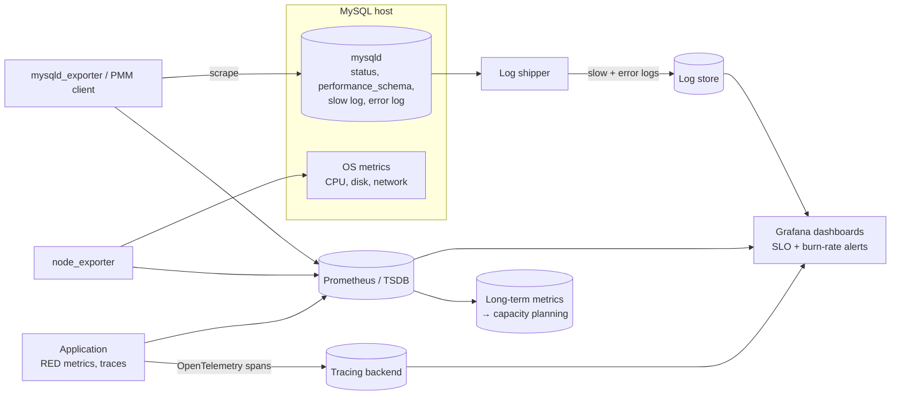

## Introduction

The two previous lessons were about reacting: diagnosing a slow system ([Performance Troubleshooting](/lessons/m12-performance-troubleshooting)) and surviving failures ([HA and DR](/lessons/m12-ha-dr)). This lesson is about the work that makes reaction rare:

- **Observability** — instrumenting the database and the application so that any question about the system's behaviour ("why was checkout slow at 14:05 for customers in Europe?") can be answered from collected data, without shipping new code.
- **Service level objectives** — stating precisely what "working" means, measuring it, and alerting when the error budget is burning too fast rather than on every noisy metric.
- **Production deployment discipline** — the checklist that a MySQL instance must pass before it carries production traffic.
- **Capacity planning** — projecting growth from historical metrics and sizing CPU, memory, storage and IOPS so that the system has enough headroom *before* it is needed, including after the loss of a server.

[Monitoring](/lessons/m11-monitoring) introduced the MySQL metrics and tools. Here they are combined into a practice. The lab works with a provided year of daily metrics and a minute-level SLI table: you will compute moving averages, growth rates and a log-linear trend with window functions and aggregates, project when disk and CPU limits will be reached, compute SLO compliance and burn rates, and do the sizing arithmetic in SQL so every number is traceable.

:::note[Dataset]
The lab starts empty and generates a **synthetic** year of daily production metrics (database size, peak queries per second, peak writes, p99 latency, CPU) with a growth trend and a weekly pattern, plus a day of per-minute SLI data. The numbers are illustrative inputs, not measurements of a real system; the methods are what matter.
:::

## DBMS Theory

:::theory[Observability signals and service levels]
**Three signal types** answer different questions:

| Signal | What it is | Answers | MySQL sources |
|---|---|---|---|
| **Metrics** | Numeric time series, aggregated (counters, gauges, histograms) | *Is* something wrong? How much, since when? | `SHOW GLOBAL STATUS`, `performance_schema` summaries, OS metrics, exporters |
| **Logs** | Discrete timestamped events with detail | *What* happened? | Error log, slow query log, audit log, general log (rarely in production) |
| **Traces** | The path of one request across services, as nested spans with timings | *Where* in the request did the time go? | Application spans around each query (OpenTelemetry `db.*` attributes), linked by trace id |

**Service levels.** An **SLI** (service level indicator) is a measured ratio of good events to valid events — e.g. the fraction of checkout requests that succeeded in under 300 ms. An **SLO** (objective) is a target for the SLI over a window — 99.9% over 28 days. The **error budget** is 1 − SLO: the fraction of events allowed to be bad. The **burn rate** is the observed bad fraction divided by the budget fraction; a burn rate of 1 spends exactly the budget over the window, a burn rate of 14.4 spends 2% of a 30-day budget in one hour.

**Capacity planning** rests on three ideas: **demand forecasting** (fit a trend to historical load — growth is often closer to exponential than linear, so fitting a line to log(value) is the usual first model), **resource models** (how much CPU, memory, storage and I/O one unit of demand consumes) and **headroom** (operate below the knee of the queueing curve, and keep enough spare capacity to survive the loss of a component — "N−1").
:::

Utilisation targets come from queueing theory ([Performance Troubleshooting](/lessons/m12-performance-troubleshooting) showed wait time growing like ρ / (1 − ρ)): sustained peak utilisation of 60–70% leaves room for bursts, failures and growth; above ~80% small increases in load produce large increases in latency. Capacity plans therefore target *peak*, not average, utilisation — and peaks in user-facing systems are often 2–4× the daily average.

## Why It Exists

Without observability, incidents are diagnosed by guesswork and the same problem recurs because no one can prove its cause. Without SLOs, teams either alert on everything (alert fatigue, ignored pages) or on nothing useful (CPU > 90% fires while users are fine, and stays silent while users suffer from lock waits). Without capacity planning, the database runs out of disk on a Saturday, or Black Friday traffic hits a primary that was already at 75% CPU, and the "fix" is an emergency migration to bigger hardware — which, for a multi-terabyte MySQL instance, takes hours to days (provisioning, restoring, catching up replication).

Databases make planning especially important because they scale slowly: adding stateless app servers takes minutes; adding database capacity (bigger instances, more replicas, sharding) takes hours to months. Lead time must be planned, and the plan needs data.

## Internal Working

:::internals[Where MySQL observability data comes from]
- **Status counters** (`SHOW GLOBAL STATUS`) are monotonically increasing counters (`Questions`, `Com_select`, `Innodb_rows_read`, `Innodb_data_fsyncs`, `Innodb_row_lock_time`, `Bytes_sent`) and gauges (`Threads_running`, `Threads_connected`). Exporters scrape them periodically (e.g. every 15 s); rates come from differences between scrapes. The Prometheus **mysqld_exporter** exposes them as `mysql_global_status_*` series (e.g. `mysql_global_status_threads_running`, and `rate(mysql_global_status_questions[1m])` for QPS).
- **performance_schema** instruments waits, stages, statements and transactions in memory with configurable consumers. Statement digests (`events_statements_summary_by_digest`) aggregate by normalised statement text, including latency quantiles; `sys` views present them readably. Overhead is modest with the default instrumentation and is a standard production setting.
- **Logs.** The error log (startup, crashes, replication errors, deadlocks if `innodb_print_all_deadlocks = ON`), the slow query log (`long_query_time`, `log_slow_extra`), and audit plugins. Since 8.0 the error log can be written in JSON (`log_error_services` with `log_sink_json`) for log pipelines.
- **Data size** from `information_schema.TABLES` (`DATA_LENGTH`, `INDEX_LENGTH`, `DATA_FREE`) — estimates refreshed by `ANALYZE TABLE` and cached for `information_schema_stats_expiry` seconds (24 h by default) — and from the file system.
- **Application-side** metrics and traces: request rate, errors and latency per endpoint (RED), connection pool utilisation and wait time, and a span per query with the statement digest, so a slow request can be followed to the exact query and the database server it ran on.

Capacity data is the same data viewed over months: daily peaks of QPS, write rate, CPU, IOPS, data size and connections, stored in a long-retention time series store or — as in this lab — a metrics table.
:::



## MySQL Implementation

### A year of daily metrics

Generate 366 days of synthetic daily peaks for 2024. Database size grows by about 0.28% per day (compounding), peak QPS by about 0.15% per day with lower weekends, and write volume is a fixed share of QPS:

```sql run
SET SESSION cte_max_recursion_depth = 2000;
CREATE TABLE metrics_daily (
  day          DATE PRIMARY KEY,
  db_size_gb   DECIMAL(8,1) NOT NULL,
  peak_qps     INT NOT NULL,
  peak_writes  INT NOT NULL,
  p99_ms       DECIMAL(6,1) NOT NULL,
  cpu_peak_pct DECIMAL(5,1) NOT NULL
);
INSERT INTO metrics_daily
WITH RECURSIVE d(n) AS (SELECT 0 UNION ALL SELECT n + 1 FROM d WHERE n < 365)
SELECT '2024-01-01' + INTERVAL n DAY,
       ROUND(420 * POW(1.0028, n) + (n % 7) * 0.4, 1),
       ROUND(5200 * POW(1.0015, n) * IF(DAYOFWEEK('2024-01-01' + INTERVAL n DAY) IN (1, 7), 0.72, 1.0) + (n * 37) % 300),
       ROUND(0.18 * 5200 * POW(1.0015, n) * IF(DAYOFWEEK('2024-01-01' + INTERVAL n DAY) IN (1, 7), 0.72, 1.0)),
       ROUND(38 + n * 0.035 + (n * 13) % 9, 1),
       ROUND(LEAST(97, 5200 * POW(1.0015, n) * IF(DAYOFWEEK('2024-01-01' + INTERVAL n DAY) IN (1, 7), 0.72, 1.0) / 190), 1)
FROM d;
SELECT MIN(day) AS first_day, MAX(day) AS last_day, COUNT(*) AS days,
       MIN(db_size_gb) AS size_start_gb, MAX(db_size_gb) AS size_end_gb,
       MAX(peak_qps) AS max_peak_qps, MAX(cpu_peak_pct) AS max_cpu_pct
FROM metrics_daily;
```

Daily values are noisy and weekly-seasonal. A 7-day moving average (a window frame of the current and six preceding rows) shows the trend; comparing with the same weekday a week earlier removes the weekly pattern:

```sql run
SELECT day, DAYNAME(day) AS dow, peak_qps,
       ROUND(AVG(peak_qps) OVER (ORDER BY day ROWS BETWEEN 6 PRECEDING AND CURRENT ROW)) AS qps_7d_avg,
       peak_qps - LAG(peak_qps, 7) OVER (ORDER BY day) AS change_vs_same_day_last_week
FROM metrics_daily
WHERE day >= '2024-12-18'
ORDER BY day;
```

### Growth per month

Month-end database size and month-over-month growth with `LAG()`:

```sql run
WITH month_end AS (
  SELECT DATE_FORMAT(day, '%Y-%m') AS month, db_size_gb,
         ROW_NUMBER() OVER (PARTITION BY DATE_FORMAT(day, '%Y-%m') ORDER BY day DESC) AS rn
  FROM metrics_daily
)
SELECT month, db_size_gb,
       ROUND(db_size_gb - LAG(db_size_gb) OVER (ORDER BY month), 1) AS growth_gb,
       ROUND(100 * (db_size_gb / LAG(db_size_gb) OVER (ORDER BY month) - 1), 2) AS growth_pct
FROM month_end WHERE rn = 1 ORDER BY month;
```

The absolute monthly growth (in GB) increases every month while the percentage stays roughly constant — the signature of **compound** (exponential) growth. A plan that extrapolates "we grew 45 GB last month" linearly will underestimate the future; one that uses the percentage will not.

## Syntax Breakdown

The SQL tools used for capacity analysis:

| Construct | Use |
|---|---|
| `AVG(x) OVER (ORDER BY day ROWS BETWEEN 6 PRECEDING AND CURRENT ROW)` | Moving average — smooths daily noise |
| `LAG(x, k) OVER (ORDER BY day)` | Value k periods earlier — growth rates, week-over-week comparisons |
| `ROW_NUMBER() OVER (PARTITION BY month ORDER BY day DESC)` | Pick the last value of each month |
| `MAX(x) OVER (PARTITION BY …)` | Peak per period (capacity is planned for peaks) |
| `PERCENT_RANK()` / ordered `ROW_NUMBER()` | Percentiles (p95 of daily peaks) |
| `LN(x)`, `EXP(x)`, `POW(b, e)` | Log-linear trend fitting and compound projections |
| `SUM(x*y)`, `SUM(x*x)` aggregates | Least-squares slope and intercept computed in one pass |
| `CEIL(LN(limit / now) / LN(1 + g))` | Periods until a limit is reached under compound growth g |

Least-squares fit of y = a + b·x over n points:

- b = (n·Σxy − Σx·Σy) / (n·Σx² − (Σx)²)
- a = (Σy − b·Σx) / n

Fitting y = ln(size) gives ln(size) = a + b·t, i.e. size = eᵃ · e^(b·t): a daily growth factor of e^b.

## Practical Examples

### 1. Fit the trend and project database size

Fit a log-linear trend to the last 90 days of database size and project it forward:

```sql run
WITH recent AS (
  SELECT DATEDIFF(day, '2024-01-01') AS t, LN(db_size_gb) AS y
  FROM metrics_daily WHERE day > '2024-12-31' - INTERVAL 90 DAY
), fit AS (
  SELECT COUNT(*) AS n, SUM(t) AS sx, SUM(y) AS sy, SUM(t * y) AS sxy, SUM(t * t) AS sxx FROM recent
), coef AS (
  SELECT (n * sxy - sx * sy) / (n * sxx - sx * sx) AS b,
         (sy - (n * sxy - sx * sy) / (n * sxx - sx * sx) * sx) / n AS a
  FROM fit
)
SELECT ROUND(100 * (EXP(b) - 1), 3)                          AS daily_growth_pct,
       ROUND(100 * (EXP(30 * b) - 1), 2)                     AS monthly_growth_pct,
       ROUND(EXP(a + b * DATEDIFF('2024-12-31', '2024-01-01')), 1) AS fitted_size_today_gb,
       ROUND(EXP(a + b * DATEDIFF('2025-06-30', '2024-01-01')), 1) AS projected_2025_06_30_gb,
       ROUND(EXP(a + b * DATEDIFF('2025-12-31', '2024-01-01')), 1) AS projected_2025_12_31_gb
FROM coef;
```

The fit recovers the growth rate built into the synthetic data (about 0.28% per day, roughly 8.7% per month) and projects the size at mid-year and year-end 2025. In real planning, always state the fitting window, compare several models (linear, log-linear, a seasonal model), and watch for regime changes (a new product, a retention policy, an archiving job) that invalidate the history.

### 2. When does the disk fill?

The primary has a 3,000 GB volume. Operational policy says data must stay below **80%** of the volume, because rebuilds, temporary tables, binary logs and online DDL need free space ([Schema Evolution](/lessons/m12-schema-evolution) — a rebuild needs room for a second copy). How many days until the threshold, under the fitted growth?

```sql run
WITH recent AS (
  SELECT DATEDIFF(day, '2024-01-01') AS t, LN(db_size_gb) AS y
  FROM metrics_daily WHERE day > '2024-12-31' - INTERVAL 90 DAY
), coef AS (
  SELECT (COUNT(*) * SUM(t * y) - SUM(t) * SUM(y)) / (COUNT(*) * SUM(t * t) - SUM(t) * SUM(t)) AS b
  FROM recent
)
SELECT (SELECT db_size_gb FROM metrics_daily WHERE day = '2024-12-31') AS size_now_gb,
       3000 * 0.80 AS threshold_gb,
       CEIL(LN(3000 * 0.80 / (SELECT db_size_gb FROM metrics_daily WHERE day = '2024-12-31')) / b) AS days_until_threshold,
       '2024-12-31' + INTERVAL CEIL(LN(3000 * 0.80 / (SELECT db_size_gb FROM metrics_daily WHERE day = '2024-12-31')) / b) DAY AS threshold_date
FROM coef;
```

With the threshold date known, the plan works backwards from **lead time**: if migrating to a larger volume (or archiving, or sharding) takes 8 weeks including testing, the decision must be made at least 8 weeks before that date — and the alert "projected days until 80% < 120" belongs on a capacity dashboard.

### 3. CPU headroom and the N−1 rule

Peak CPU tracks peak QPS. From the last 30 days, estimate CPU-percent per 1,000 QPS, then project when peak CPU would cross a 70% target on the current primary — and what happens if the load of a failed replica has to move to the remaining servers:

```sql run
WITH last30 AS (
  SELECT peak_qps, cpu_peak_pct FROM metrics_daily WHERE day > '2024-12-31' - INTERVAL 30 DAY
), ratio AS (
  SELECT SUM(cpu_peak_pct) / SUM(peak_qps) * 1000 AS cpu_pct_per_kqps,
         MAX(peak_qps) AS max_qps_30d, MAX(cpu_peak_pct) AS max_cpu_30d
  FROM last30
)
SELECT ROUND(cpu_pct_per_kqps, 2)                            AS cpu_pct_per_1000_qps,
       max_qps_30d, max_cpu_30d,
       ROUND(70 / cpu_pct_per_kqps * 1000)                   AS qps_at_70pct_cpu,
       CEIL(LN(70 / max_cpu_30d) / LN(1.0015))               AS days_until_70pct_at_current_growth,
       ROUND(max_cpu_30d * 3 / 2, 1)                         AS read_replica_cpu_if_1_of_3_fails
FROM ratio;
```

Read the result in three steps. Peak CPU is 47.3% today — comfortable on its own — and at 0.15% daily QPS growth it reaches the 70% target in about 262 days, so a decision is needed within the year (and earlier, given lead times). The N−1 view is less comfortable: if reads are spread over three equal replicas each running at that peak utilisation, losing one pushes the other two to 1.5× — about 71%, already at the ceiling **today**. The N−1 rule requires each of N servers to run at no more than (N−1)/N of the maximum acceptable utilisation, i.e. about 47% for three replicas with a 70% ceiling, so the replica tier has no failure headroom left. The remedies — query optimisation (the cheapest capacity), a fourth replica, or larger instances — must be scheduled with their lead time.

### 4. SLOs and burn rates from minute-level SLIs

An SLI table records, per minute, how many checkout requests were valid and how many were "good" (succeeded within 300 ms). Compute the day's SLI, the error budget consumption against a 99.9% SLO, and the burn rate over sliding 60-minute windows:

```sql run
CREATE TABLE sli_minute (minute_ts DATETIME PRIMARY KEY, valid INT NOT NULL, good INT NOT NULL);
INSERT INTO sli_minute
WITH RECURSIVE m(n) AS (SELECT 0 UNION ALL SELECT n + 1 FROM m WHERE n < 1439)
SELECT '2024-12-02 00:00:00' + INTERVAL n MINUTE,
       400 + (n * 17) % 120,
       400 + (n * 17) % 120 - CASE WHEN n BETWEEN 840 AND 869 THEN 60 + (n % 5) * 10   -- a 30-minute incident at 14:00
                                   ELSE (n % 97 = 0) END
FROM m;
SELECT SUM(good) AS good, SUM(valid) AS valid,
       ROUND(100 * SUM(good) / SUM(valid), 4) AS sli_pct,
       ROUND((SUM(valid) - SUM(good)) / (0.001 * SUM(valid)), 2) AS budget_used_x_daily_allowance
FROM sli_minute;
```

The day's SLI is below 99.9%: the incident alone spent several days' worth of error budget. Burn rate per sliding hour shows *when* an alert should have fired:

```sql run
SELECT minute_ts,
       ROUND(SUM(valid - good) OVER w / (0.001 * SUM(valid) OVER w), 1) AS burn_rate_1h
FROM sli_minute
WINDOW w AS (ORDER BY minute_ts ROWS BETWEEN 59 PRECEDING AND CURRENT ROW)
ORDER BY burn_rate_1h DESC, minute_ts
LIMIT 5;
```

The Google SRE Workbook recommends multi-window, multi-burn-rate alerts — for a 30-day 99.9% SLO, for example, page when the 1-hour burn rate exceeds 14.4 (2% of the monthly budget in an hour) and the 5-minute burn rate confirms it is still happening. The peak burn rate here is far above 14.4, so a page would have fired during the incident — while the occasional single bad request in quiet minutes keeps the burn rate in the low single digits and rightly pages no one. Alerting on burn rate instead of on raw metrics like CPU is what keeps pages actionable.

### 5. Sizing arithmetic for a new primary

A capacity review sizes the next primary from the projections. Every input is explicit, so the review can challenge each one:

```sql run
SET @data_gb_in_12m      = 1400;   -- projected data + indexes (from the fit, rounded up)
SET @hot_fraction        = 0.25;   -- share of data touched daily (working set), measured from buffer pool stats
SET @peak_qps_in_12m     = 14000;  -- projected peak QPS
SET @cpu_ms_per_query    = 0.35;   -- average CPU time per query, from performance_schema / profiling
SET @target_cpu_util     = 0.60;   -- peak utilisation target
SET @writes_per_s        = 2600;   -- projected peak write statements per second
SET @pages_per_write     = 2.5;    -- dirty pages per write statement (clustered + secondary indexes), measured
SET @flush_batching      = 0.2;    -- fraction of dirty-page writes not absorbed by repeated changes to the same page
SET @binlog_gb_per_day   = 60;     -- binary log volume
SET @binlog_retention_d  = 7;
SELECT CEIL(@peak_qps_in_12m * @cpu_ms_per_query / 1000 / @target_cpu_util)               AS cores_needed,
       CEIL(@data_gb_in_12m * @hot_fraction * 1.1)                                          AS buffer_pool_gb,
       CEIL(@data_gb_in_12m * @hot_fraction * 1.1 / 0.75)                                   AS ram_gb_if_pool_is_75pct,
       CEIL(@writes_per_s * @pages_per_write * @flush_batching)                             AS data_write_iops_estimate,
       CEIL((@data_gb_in_12m + @binlog_gb_per_day * @binlog_retention_d) / 0.80)            AS volume_gb_at_80pct_fill;
```

The result is a starting point for a decision, not an answer: cores from QPS × CPU time per query at the target utilisation; a buffer pool sized to the working set with 10% slack (`innodb_buffer_pool_size` is commonly set to 50–75% of RAM on a dedicated server, leaving room for connections, sort buffers and the OS); write IOPS from dirty-page production after write combining (plus redo log and binary log fsyncs, and read IOPS from buffer pool misses); storage from data plus binary log retention at the 80% fill policy. Each input should come from measurement on the current system — and the result must be validated with a load test on the proposed instance.

## Execution Walkthrough

```walkthrough
title: From raw daily metrics to a capacity decision
steps:
  - title: "1. Look at the peaks, not the averages"
    explain: Capacity is consumed at peak. The weekly maximum of daily peak QPS for the last weeks of the year — and how it compares to the weekly average.
    sql: |
      SELECT YEARWEEK(day, 3) AS iso_week, MAX(peak_qps) AS weekly_peak, ROUND(AVG(peak_qps)) AS weekly_avg,
             ROUND(MAX(peak_qps) / AVG(peak_qps), 2) AS peak_to_avg
      FROM metrics_daily WHERE day >= '2024-12-02' GROUP BY iso_week ORDER BY iso_week;
  - title: "2. Quantify growth"
    explain: The week-over-week growth of the weekly peak, using LAG over the weekly series. With ~0.15% daily growth, about 1% per week is expected, plus noise.
    sql: |
      WITH w AS (SELECT YEARWEEK(day, 3) AS iso_week, MAX(peak_qps) AS weekly_peak FROM metrics_daily GROUP BY iso_week)
      SELECT iso_week, weekly_peak,
             ROUND(100 * (weekly_peak / LAG(weekly_peak) OVER (ORDER BY iso_week) - 1), 2) AS wow_growth_pct
      FROM w ORDER BY iso_week DESC LIMIT 6;
  - title: "3. Check the latency trend"
    explain: p99 latency drifting upward with load is an early warning that the system is approaching the knee of the curve. Compare the 30-day average p99 at the start and end of the year.
    sql: |
      SELECT ROUND(AVG(CASE WHEN day < '2024-01-31' THEN p99_ms END), 1) AS p99_january,
             ROUND(AVG(CASE WHEN day > '2024-12-01' THEN p99_ms END), 1) AS p99_december
      FROM metrics_daily;
  - title: "4. Decide with lead time"
    explain: Combine the projections — the disk threshold date from Example 2, the CPU target date and the exhausted N−1 headroom from Example 3, and p99 drifting up (from about 42 ms in January to about 54 ms in December) — into a decision with dates. Here — optimise the top digests now (cheapest capacity), order a larger primary and an extra replica within the quarter, and schedule archiving before the disk threshold. Record the assumptions so the next review can check them against reality.
```

## Output

- The synthetic year runs from 420 GB to about 1,170 GB of data and from roughly 5,200 to about 9,000 peak QPS on weekdays.
- Month-end sizes grew by a roughly constant percentage, so the absolute growth increased every month — compound growth.
- The log-linear fit over the last 90 days recovered about 0.28% daily (about 8.7% monthly) growth and projected about 1,930 GB at mid-2025 and about 3,230 GB at year-end 2025 — more than the 3,000 GB volume; the 80% threshold is reached in about 259 days (mid-September 2025).
- Peak CPU (47.3%) reaches a 70% target in about 262 days; with three read replicas at that utilisation, losing one would push the others to about 71% — no N−1 headroom left.
- The day's SLI was below a 99.9% SLO because of a 30-minute incident whose 1-hour burn rate far exceeded a 14.4 paging threshold.
- The sizing query turned explicit assumptions into cores, buffer pool, RAM, IOPS and volume size.

## Alternative Approaches

| Concern | Approach in this lesson | Alternatives | When to prefer them |
|---|---|---|---|
| Metrics collection | Exporter → Prometheus → Grafana | Percona Monitoring and Management (PMM: exporters + Query Analytics), MySQL Enterprise Monitor, Datadog / New Relic, cloud tools (RDS Performance Insights, CloudWatch, Cloud SQL Insights) | Managed services or a commercial stack already in use; PMM for MySQL-specific query analytics out of the box |
| Query-level visibility | `performance_schema` digests, slow log | pt-query-digest offline analysis; APM traces with SQL spans | Deep dives; correlating with application requests |
| Growth model | Log-linear least squares in SQL | Seasonal models (Holt-Winters, Prophet) in Python/R; linear for short horizons | Strong seasonality, holidays, many series |
| Capacity validation | Arithmetic from measured per-unit costs | Load testing (sysbench, replayed production traffic), shadow traffic | Before hardware changes, major releases, peak events |
| Alerting | SLO burn-rate alerts + a few cause-based alerts (disk projection, replication broken, backup failed) | Static thresholds on resource metrics only | Rarely better; resource alerts complement, not replace, SLO alerts |

## Performance Analysis

This lesson's subject *is* performance over time, so the analysis concerns the cost and accuracy of the observability itself:

- **Instrumentation overhead.** `performance_schema` with default instruments costs a few percent at most in typical workloads and is enabled by default; enabling every instrument and consumer (all wait events, statement history long) costs more and is used temporarily. The slow log at `long_query_time = 0` on a busy server writes enormous volumes — sample or enable it briefly. The general log is not for production.
- **Scrape intervals.** 10–30 s scrapes are standard; shorter intervals catch short spikes at higher storage cost. Counters must be converted to rates; gauges sampled at intervals can miss sub-interval spikes (a `Threads_running` spike of 2 seconds may never be seen at 15 s scrapes — histograms and performance_schema quantiles help).
- **Cardinality.** Per-digest or per-table metrics multiply series count; keep the top-N digests and aggregate the rest.
- **Forecast accuracy.** A trend fitted over 90 days is reliable for weeks to a few months; beyond that, business changes dominate. Re-run the projection monthly and compare past projections with actuals (forecast error) to calibrate trust.
- **Sizing inputs.** CPU time per query, pages per write and working-set fraction vary with the workload mix; measure them per release, and validate the result with a load test before buying hardware.

## Best Practices

:::best-practice[Observability and capacity as a routine]
1. **Instrument all three signals**: database metrics (status, performance_schema digests), logs (error and slow logs, shipped and searchable) and application traces with a span per query.
2. **Define SLIs from the user's perspective** (success and latency of key endpoints), set SLOs with the business, and alert on **multi-window burn rates**; keep a short list of cause-based alerts (replication stopped, backup failed, disk projected full, certificate expiry).
3. **Dashboards per question**: service health (RED + SLO), database health (USE resources, replication, locks), and capacity (peaks and projections).
4. **Keep long-term daily peaks** of QPS, writes, CPU, IOPS, connections and data size for capacity planning.
5. **Plan for peaks with headroom**: target ≤ 60–70% peak utilisation, size for N−1, and re-forecast monthly with lead times in mind.
6. **Make sizing assumptions explicit and measured**, then validate with load tests.
7. **Use a production-readiness checklist** before any MySQL instance takes traffic (below), and review it after every incident.
:::

**Production deployment checklist for a MySQL 8.4 primary** (a starting point; each item is a question a reviewer asks):

| Area | Check |
|---|---|
| Version and config | 8.4 LTS minor version current; configuration in version control; `innodb_buffer_pool_size` sized to working set; `innodb_redo_log_capacity` sized for write rate; `max_connections` aligned with pool sizes; `sql_mode` strict (default) |
| Durability | `innodb_flush_log_at_trx_commit = 1` and `sync_binlog = 1` (defaults) unless a documented decision says otherwise; binary logging ON with `binlog_format = ROW`; GTIDs enabled |
| HA / DR | Replicas or cluster members in separate failure domains; failover tested; backups scheduled, off-site and **restore-tested**; binlogs archived continuously; RPO/RTO documented ([HA and DR](/lessons/m12-ha-dr)) |
| Security | TLS required; no shared root; least-privilege application accounts; secrets in a vault; audit logging where required ([Privileges and Roles](/lessons/m11-privileges-roles)) |
| Observability | Exporter + dashboards; slow log and error log shipped; performance_schema digests collected; SLO and burn-rate alerts; replication lag and backup alerts |
| Capacity | Peak utilisation and growth projection reviewed; disk threshold date known; N−1 headroom |
| Operations | Online schema change procedure and `lock_wait_timeout` policy ([Schema Evolution](/lessons/m12-schema-evolution)); batch job throttling ([Large Tables](/lessons/m12-large-tables)); runbooks for failover, restore, lag and slowdowns; on-call ownership |
| Application | Connection pool settings and timeouts; retries with backoff and idempotency; read/write routing and consistency rules ([Read Replicas](/lessons/m12-read-replicas)) |

## Common Mistakes

**Mistake 1 — planning from averages.** Daily averages hide the peaks that saturate the system. Compare:

```sql run
SELECT ROUND(AVG(peak_qps)) AS avg_of_daily_peaks_december,
       MAX(peak_qps)        AS max_daily_peak_december,
       ROUND(AVG(peak_qps) * 0.5) AS what_a_daily_average_might_look_like
FROM metrics_daily WHERE day >= '2024-12-01';
```

The last column is a rough stand-in for a 24-hour average (user-facing traffic is often around half of the daily peak, with large variation between systems) — sizing from it would under-provision by a factor of two or more.

**Mistake 2 — linear extrapolation of compound growth.** Projecting "+95 GB per month" (December's absolute growth) when growth is "+8.9% per month" underestimates more every month; fit the right model and re-check it.

**Mistake 3 — forgetting the N−1 case.** Utilisation that is comfortable with all servers up can be unsurvivable after a failover.

**Mistake 4 — alerting on causes instead of symptoms.** CPU at 85% is not an outage; users being unable to check out is. Page on SLO burn rate; route resource alerts to dashboards and tickets.

**Mistake 5 — trusting `information_schema.TABLES` sizes blindly.** They are estimates, cached for `information_schema_stats_expiry` seconds (24 h by default) and refreshed by `ANALYZE TABLE`; for capacity use file-system sizes or refreshed statistics, and remember `DATA_FREE` (allocated but unused space).

**Mistake 6 — no lead time.** A projection that says "disk full in 30 days" is an emergency if procurement or migration takes 60.

## Industry Application

- **Prometheus + Grafana** with mysqld_exporter and node_exporter is the most common open-source stack for MySQL monitoring; **PMM** packages it with Query Analytics; **managed services** expose equivalent metrics (Performance Insights, CloudWatch, Cloud Monitoring).
- **SRE practices** — SLOs, error budgets, burn-rate alerting, blameless postmortems — are standard at large technology companies and increasingly elsewhere; database teams publish SLOs for their platforms (e.g. "p99 write latency < 20 ms, availability 99.95%").
- **Capacity reviews** run monthly or quarterly: daily-peak series, growth fits, threshold dates, N−1 checks, and a list of decisions with owners and dates. Large retailers run dedicated peak-readiness programmes (load tests at 2–3× forecast) before seasonal events.
- **Distributed tracing** (OpenTelemetry) attaches the database system, statement digest and server address to each span, so a slow request can be followed into the exact query and correlated with database metrics.
- **FinOps** links capacity to cost: right-sizing instances, storage tiers and replica counts based on the same projections.

## Practice Exercises

```exercise
id: ex1
title: Seven-day moving average of peak QPS
difficulty: easy
setup: |
  CREATE TABLE metrics_daily (day DATE PRIMARY KEY, peak_qps INT NOT NULL);
  INSERT INTO metrics_daily VALUES
    ('2024-12-01',7000),('2024-12-02',9100),('2024-12-03',9300),('2024-12-04',9200),('2024-12-05',9400),
    ('2024-12-06',9600),('2024-12-07',7100),('2024-12-08',7200),('2024-12-09',9500),('2024-12-10',9700);
concepts: [capacity-planning, growth-projection]
prompt: |
  Return `day`, `peak_qps` and `avg_7d` — the average of the current day and the six preceding days
  (fewer at the start), rounded to the nearest integer — for every day, ordered by day.
hints:
  - "AVG(peak_qps) OVER (ORDER BY day ROWS BETWEEN 6 PRECEDING AND CURRENT ROW)"
solution: |
  SELECT day, peak_qps,
         ROUND(AVG(peak_qps) OVER (ORDER BY day ROWS BETWEEN 6 PRECEDING AND CURRENT ROW)) AS avg_7d
  FROM metrics_daily ORDER BY day;
orderMatters: true
explanation: |
  The 7-day window always contains one full weekly cycle once it is full (from 7 December), so the moving
  average removes the weekend dips. `ROWS` counts physical rows; with missing days, `RANGE BETWEEN INTERVAL 6
  DAY PRECEDING AND CURRENT ROW` would be the calendar-correct alternative.
```

```exercise
id: ex2
title: Month-over-month growth
difficulty: medium
setup: |
  CREATE TABLE size_samples (day DATE PRIMARY KEY, db_size_gb DECIMAL(8,1) NOT NULL);
  INSERT INTO size_samples VALUES
    ('2024-09-15',600.0),('2024-09-30',612.0),('2024-10-15',640.5),('2024-10-31',661.0),
    ('2024-11-14',690.0),('2024-11-30',714.0),('2024-12-16',745.0),('2024-12-31',771.0);
concepts: [growth-projection]
prompt: |
  Using the **last sample of each month**, return `month` (`YYYY-MM`), `size_gb` and `growth_pct` — the
  percentage growth versus the previous month's last sample, rounded to 2 decimals (NULL for the first month).
hints:
  - "ROW_NUMBER() OVER (PARTITION BY DATE_FORMAT(day, '%Y-%m') ORDER BY day DESC) = 1 picks the last sample."
  - "LAG(size) OVER (ORDER BY month) gives the previous month's value."
solution: |
  WITH last_of_month AS (
    SELECT DATE_FORMAT(day, '%Y-%m') AS month, db_size_gb,
           ROW_NUMBER() OVER (PARTITION BY DATE_FORMAT(day, '%Y-%m') ORDER BY day DESC) AS rn
    FROM size_samples
  )
  SELECT month, db_size_gb AS size_gb,
         ROUND(100 * (db_size_gb / LAG(db_size_gb) OVER (ORDER BY month) - 1), 2) AS growth_pct
  FROM last_of_month WHERE rn = 1;
explanation: |
  612 → 661 → 714 → 771 GB is about +8.0% each month: absolute growth rises (49, 53, 57 GB) while the rate is
  steady — compound growth. Using `MAX(db_size_gb)` per month gives the same answer here only because size
  never shrinks; after an archiving job it would not.
```

```exercise
id: ex3
title: Days until the disk threshold
difficulty: hard
setup: |
  CREATE TABLE size_daily (day DATE PRIMARY KEY, db_size_gb DECIMAL(8,1) NOT NULL);
  INSERT INTO size_daily
  WITH RECURSIVE d(n) AS (SELECT 0 UNION ALL SELECT n + 1 FROM d WHERE n < 59)
  SELECT '2024-11-02' + INTERVAL n DAY, ROUND(800 * POW(1.003, n), 1) FROM d;
concepts: [growth-projection, capacity-planning]
prompt: |
  `size_daily` holds 60 days of database size. Assume compound growth at the **average daily growth factor**
  of this period, i.e. (last / first)^(1 / (days − 1)). The volume is 2,000 GB and the policy limit is 80%.
  Return one row with `daily_growth_pct` (rounded to 3 decimals), `size_now_gb` (the last value) and
  `days_until_limit` (rounded **up** to whole days).
hints:
  - "Growth factor g = POW(last / first, 1 / 59)."
  - "Days until limit = CEIL(LN(limit / now) / LN(g))."
solution: |
  WITH ends AS (
    SELECT (SELECT db_size_gb FROM size_daily ORDER BY day LIMIT 1) AS first_gb,
           (SELECT db_size_gb FROM size_daily ORDER BY day DESC LIMIT 1) AS last_gb,
           (SELECT COUNT(*) FROM size_daily) AS n
  )
  SELECT ROUND(100 * (POW(last_gb / first_gb, 1 / (n - 1)) - 1), 3) AS daily_growth_pct,
         last_gb AS size_now_gb,
         CEIL(LN(2000 * 0.8 / last_gb) / LN(POW(last_gb / first_gb, 1 / (n - 1)))) AS days_until_limit
  FROM ends;
explanation: |
  The data grows about 0.3% per day from 800 GB to about 955 GB; reaching 1,600 GB takes roughly half a year
  more under compound growth (ln(1600/955) / ln(1.003)). A linear extrapolation of the average absolute
  growth (≈ 2.6 GB/day) would predict a later date — and be wrong in the dangerous direction. The endpoint
  method is sensitive to noise in the first and last samples; a least-squares fit on LN(size), as in the
  lesson, is more robust.
```

```exercise
id: ex4
title: SLO compliance for the month
difficulty: medium
setup: |
  CREATE TABLE sli_daily (day DATE PRIMARY KEY, valid BIGINT NOT NULL, good BIGINT NOT NULL);
  INSERT INTO sli_daily
  WITH RECURSIVE d(n) AS (SELECT 0 UNION ALL SELECT n + 1 FROM d WHERE n < 29)
  SELECT '2024-11-01' + INTERVAL n DAY, 500000, 500000 - CASE n WHEN 11 THEN 4200 WHEN 19 THEN 900 ELSE 120 + (n % 4) * 15 END FROM d;
concepts: [slo, burn-rate]
prompt: |
  For a 99.9% SLO over the 30 days in `sli_daily`, return one row with `sli_pct` (rounded to 4 decimals),
  `budget_events` (the number of bad events the SLO allows = 0.1% of valid events), `bad_events`, and
  `budget_remaining_pct` (percentage of the budget still unspent, rounded to 1 decimal; negative if overspent).
hints:
  - "bad = SUM(valid - good); budget = 0.001 * SUM(valid)."
  - "remaining % = 100 * (budget - bad) / budget."
solution: |
  SELECT ROUND(100 * SUM(good) / SUM(valid), 4) AS sli_pct,
         0.001 * SUM(valid) AS budget_events,
         SUM(valid - good) AS bad_events,
         ROUND(100 * (0.001 * SUM(valid) - SUM(valid - good)) / (0.001 * SUM(valid)), 1) AS budget_remaining_pct
  FROM sli_daily;
explanation: |
  The month allows 15,000 bad events. The two bad days (4,200 and 900) plus the background errors (3,915)
  consume 9,015 of them, leaving about 39.9% of the budget — within the SLO, but one more incident like
  the 4,200-error day would leave little margin, a signal to prioritise reliability work.
  Computing SLIs from event counts (not from averaging daily percentages) weights every request equally.
```

```exercise
id: ex5
title: Capacity plan for a peak event
difficulty: challenge
kind: open
concepts: [capacity-planning, sizing, slo]
prompt: |
  An online retailer expects Black Friday traffic of **3.5×** a normal weekday peak for about 6 hours. Today:
  MySQL primary with 32 vCPUs at 55% CPU at the weekday peak; three read replicas (same size) at 50%; buffer
  pool hit ratio 99.6%; disk 61% full, growing 6% per month; p99 checkout latency 120 ms against an SLO of
  300 ms; 30% of primary CPU is consumed by two reporting queries. The event is 10 weeks away.
  Write the capacity plan: what you measure first, what you change (in order of cost), how you validate,
  and what you monitor during the event.
solution: |
  **Measure first.** Separate read and write load on the primary (digest analysis: share of CPU by digest;
  writes per second at peak), the read/write mix of the Black Friday traffic (checkout-heavy → write share
  rises), working-set growth under the event's product mix, and the latency curve under load (load test at
  1×, 2×, 3.5× and 4×).

  **Arithmetic.** Primary: 55% × 3.5 ≈ 190% of today's capacity if nothing changes — impossible. Removing the
  two reporting queries (30% of CPU) leaves ~38.5% × 3.5 ≈ 135% — still too high, so writes and remaining
  reads must also be reduced or the primary scaled. Replicas: 50% × 3.5 = 175% across three; even with a
  fourth and fifth replica (×3/5) that is ~105% — and N−1 must still hold during the event.

  **Changes, cheapest first.** (1) Move the reporting queries to a dedicated replica or the warehouse, and
  freeze non-essential batch jobs and migrations for the event window. (2) Optimise the top digests found in
  the analysis (indexes, N+1 fixes) and add caching for catalogue and product pages (hit ratio target
  > 95%) with stampede protection. (3) Scale the primary vertically (e.g. 64 vCPUs, larger buffer pool) —
  a planned switchover weeks before the event, tested. (4) Add replicas (e.g. to 6) so that at 3.5× load each
  runs at ≤ 60% even with one failed. (5) Check disk: at 6%/month, 61% becomes ~70% in 10 weeks — fine, but
  verify binlog retention and temporary space for the event's write volume.

  **Validate.** Replay or synthesise event traffic at 4× in a staging environment of production size; verify
  p99 checkout < 300 ms with headroom, replication lag on replicas < 1 s, and failover behaviour under load.

  **During the event.** SLO burn-rate dashboard for checkout; Threads_running, CPU, buffer pool misses,
  replication lag, lock waits, connection pool waits; pre-agreed load-shedding switches (disable
  recommendations, reviews widget); on-call staffed with the runbooks.
explanation: |
  A credible plan does the arithmetic explicitly (and discovers that the current setup cannot survive 3.5×),
  orders remedies by cost and lead time, keeps N−1 headroom during the peak, and validates by load testing.
```

```exercise
id: ex6
title: Review a production-readiness checklist
difficulty: hard
kind: open
concepts: [deployment-checklist, observability]
prompt: |
  A team's "go-live" checklist for a new MySQL 8.4 service reads: "Server provisioned; application can
  connect; nightly mysqldump configured; CPU and disk alerts at 90%; DBA has root password." List what is
  missing or wrong, grouped by area, and rewrite the checklist as concrete, verifiable items.
solution: |
  **Wrong or weak:** nightly mysqldump alone gives RPO up to 24 h and slow restores, and nobody has tested a
  restore; alerts at 90% CPU/disk page on causes, too late for disk (online DDL and rebuilds need free
  space) and not tied to user impact; a shared root password is a security and audit problem.

  **Missing, as verifiable items:**
  - *Durability/HA:* GTIDs on; `binlog_format = ROW`; `innodb_flush_log_at_trx_commit = 1`, `sync_binlog = 1`;
    at least one replica (or cluster) in another failure domain; failover tested on <date>; RPO/RTO documented.
  - *Backups:* physical backups + continuous binlog archiving to off-site immutable storage; a restore drill
    completed with measured duration within the RTO.
  - *Security:* TLS required; per-application least-privilege accounts; no shared root; secrets in a vault.
  - *Observability:* exporter and dashboards; slow and error logs shipped; performance_schema digests
    collected; SLOs defined for the service's key endpoints with burn-rate alerts; replication-lag,
    replication-stopped and backup-failure alerts; disk *projection* alert (days until 80%).
  - *Capacity:* load test at 2× expected peak; peak CPU ≤ 60–70%; N−1 headroom; growth forecast recorded.
  - *Configuration:* config in version control; buffer pool and redo capacity sized; `max_connections`
    consistent with pool sizes.
  - *Operations:* runbooks (failover, restore, slow queries, lag); schema-change procedure with
    `lock_wait_timeout`; on-call owner.
explanation: |
  Good checklist items are verifiable (a date, a measured number, a link to a dashboard) and cover
  durability, recoverability, security, observability, capacity and operations — not just "it connects".
```

## Knowledge Assessment

```quiz
- id: q1
  question: "Which signal best answers 'in which part of this slow request did the time go?'"
  options: ["A CPU metric", "A distributed trace with spans per service call and query", "The error log", "A daily capacity report"]
  answer: 1
  explanation: "Traces show the timing of each step of one request, including database spans. Metrics show aggregate behaviour, logs record discrete events, and capacity reports describe long-term trends."
  concepts: [metrics-logs-traces]
- id: q2
  question: "An SLO is 99.9% of checkout requests good over 30 days. Over one hour, 2% of requests are bad. What is the 1-hour burn rate?"
  options: ["0.02", "2", "20", "200"]
  answer: 2
  explanation: "Burn rate = bad fraction / budget fraction = 0.02 / 0.001 = 20. At that rate the 30-day budget would be gone in 1.5 days; it exceeds the commonly used 14.4 paging threshold."
  concepts: [burn-rate, slo]
- id: q3
  question: "Monthly database growth in GB increases every month while the percentage growth stays constant. Which projection is appropriate?"
  options:
    - "Linear extrapolation of last month's GB growth"
    - "Compound (exponential) projection, e.g. a linear fit of ln(size) over time"
    - "The average size over the year"
    - "No projection is possible"
  answer: 1
  explanation: "Constant percentage growth is exponential; fitting a line to the logarithm captures it. Linear extrapolation underestimates future size, and averages ignore the trend."
  concepts: [growth-projection]
- id: q4
  question: "Three read replicas each run at 55% CPU at peak. One fails and its traffic is spread over the other two. Roughly what utilisation do they reach?"
  options: ["55%", "~73%", "~83%", "110%"]
  answer: 2
  explanation: "Total load 3 × 55% = 165% is spread over 2 servers: ~82.5% each — well into the region where latency rises steeply. For a 70% ceiling with N−1, each of three servers should run at ≤ ~47%."
  concepts: [capacity-planning, sizing]
- id: q5
  question: "Which of these are good pageable alerts for a MySQL-backed service? (Select all that apply.)"
  type: multi
  options:
    - "Checkout SLO 1-hour burn rate above 14.4, confirmed by the 5-minute window"
    - "CPU above 80% for 5 minutes"
    - "Replication stopped on the replica that is the failover candidate"
    - "Disk projected to reach 80% within 7 days"
  answer: [0, 2, 3]
  explanation: "SLO burn rate reflects user impact; a stopped replica breaks failover (and the RPO/RTO promise); an imminent disk threshold needs action. High CPU alone is a dashboard or ticket signal unless users are affected."
  concepts: [slo, observability]
- id: q6
  question: "Why is the buffer pool sized from the working set rather than from the total data size?"
  options:
    - "Because InnoDB cannot use more memory than the working set"
    - "Because performance depends on the frequently accessed pages fitting in memory; rarely touched data can stay on disk"
    - "Because the buffer pool stores only indexes"
    - "Because the working set is always 25% of the data"
  answer: 1
  explanation: "Hit ratio and latency depend on the hot pages being cached. InnoDB can use more memory, the pool caches data and index pages, and the working-set fraction must be measured for each system."
  concepts: [sizing]
- id: q7
  question: "A capacity query reports 'days until 80% disk' = 45. Migrating to a larger volume takes 8 weeks including testing. What is the situation?"
  options:
    - "Fine — 45 days is plenty"
    - "Already late — the lead time exceeds the remaining time, so interim measures (archiving, purging binlogs, a quicker expansion) are needed now"
    - "Irrelevant — the 80% policy can always be ignored"
    - "Run OPTIMIZE TABLE to free space"
  answer: 1
  explanation: "Lead time (56 days) exceeds the time to threshold (45 days). The 80% policy exists because rebuilds and DDL need free space, and OPTIMIZE TABLE itself needs space for a copy of the table."
  concepts: [capacity-planning]
- id: q8
  question: "Why should SLIs be computed from event counts (good / valid) rather than by averaging per-minute success percentages?"
  options:
    - "Event counts are easier to store"
    - "Averaging percentages gives a quiet minute the same weight as a busy one; counts weight every request equally"
    - "Percentages cannot be computed in SQL"
    - "There is no difference"
  answer: 1
  explanation: "This is the averaging-averages error from earlier modules, applied to SLOs: a 50%-success minute with 10 requests and a 100% minute with 10,000 do not average to 75%."
  concepts: [slo]
```
