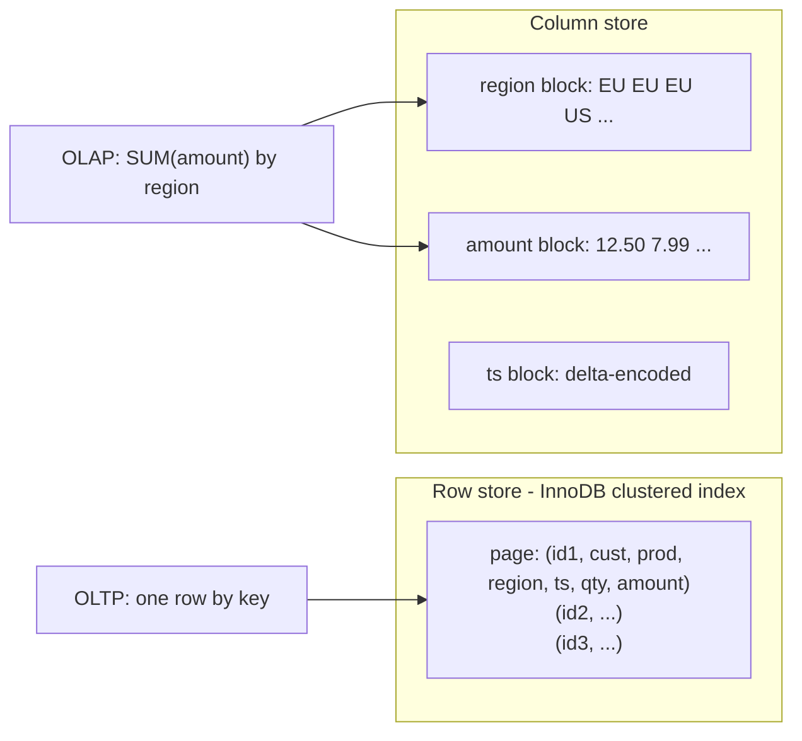

## Introduction

The same MySQL server can be asked two very different kinds of question:

- *"Show customer 4,217 their last five purchases."* — touches a handful of rows, must answer in milliseconds, runs thousands of times per second, and often writes as well (place an order, update a balance).
- *"Revenue per region per month for the last year, compared with the previous year."* — touches *every* row of a large table, may take seconds or minutes, runs a few times per hour, and only reads.

The first is **OLTP** (online transaction processing); the second is **OLAP** (online analytical processing). They differ in almost every dimension that matters to a database — rows touched per query, read/write mix, concurrency, latency target, data freshness, and the physical layout that serves them best. The classic engineering conclusion is that a system optimised for one is mediocre at the other, and that running heavy analytics on the primary OLTP database is a frequent cause of production incidents.

This lesson makes the difference concrete. You will build a 200,000-row sales table, run an OLTP point query and an OLAP scan against it, compare their plans and engine counters, speed up the analytical side with a covering index and a summary table, and watch an innocent-looking ETL statement block transactional writes. Then we look at what changes when the analytical side moves to a different engine: column stores, data warehouses, HTAP systems, and MySQL HeatWave.

:::note[Dataset]
This lesson starts from an empty lab schema and generates its own data so the numbers are large enough to matter. Every output below was captured from a real server.
:::

## DBMS Theory

:::theory[Two workload classes]
| Characteristic | OLTP | OLAP |
|---|---|---|
| Typical query | Point lookup or short range by key | Scan + filter + aggregate over a large fraction of a table |
| Rows touched per query | 1 – 100 | 10⁵ – 10¹⁰ |
| Read/write mix | Mixed; many small writes | Read-mostly; bulk loads |
| Concurrency | Thousands of concurrent short transactions | Few concurrent long queries |
| Latency target | Milliseconds (p99 matters) | Seconds to minutes (throughput matters) |
| Schema | Normalised (3NF/BCNF) to keep writes correct | Denormalised star/snowflake schemas for fast reads |
| Data freshness | Current, transactional | Often minutes to hours behind |
| Bottleneck | Lock contention, random I/O, commit latency (fsync) | Sequential bandwidth, CPU per row, memory for joins/aggregates |
| Best physical layout | **Row store** with B+ tree indexes | **Column store** with compression and vectorised execution |
:::

The physical-layout row is the heart of the matter.

**A row store** (InnoDB, PostgreSQL heap, SQL Server rowstore) keeps all columns of a row together. InnoDB stores rows inside the leaves of the clustered primary-key B+ tree ([Clustered and Secondary Indexes](/lessons/m07-clustered-secondary)). Fetching *one whole row* by key costs a few page reads — ideal for OLTP. But a query that needs two columns of every row still reads every page of the table, carrying all the other columns along.

**A column store** (ClickHouse, Amazon Redshift, Snowflake, BigQuery, DuckDB, MySQL HeatWave's in-memory engine) stores each column separately, usually in compressed blocks of tens of thousands of values with per-block min/max metadata. A query that reads `region` and `amount` reads only those two columns; similar values next to each other compress extremely well (run-length, dictionary, delta encoding); and the executor processes vectors of values with tight CPU loops (vectorised execution). Reconstructing one whole row, or updating one row in place, is expensive — exactly the opposite trade-off.

Abadi, Madden and Hachem (SIGMOD 2008) showed that the advantage of column stores is not just "reading fewer columns" but the combination of column layout, compression, late materialisation and block iteration — and that emulating a column store inside a row store (vertical partitioning, index-only plans) recovers only part of the benefit. That result frames the techniques you can use inside MySQL: they help, but they do not turn InnoDB into a warehouse.

**HTAP** (hybrid transactional/analytical processing) is the attempt to serve both from one system, usually by keeping a row-format copy for transactions and a continuously maintained columnar replica for analytics — TiDB (TiKV + TiFlash), SingleStore, SQL Server's columnstore indexes on rowstore tables, Oracle's in-memory column store, and MySQL HeatWave.

## Why It Exists

The distinction exists because mixing the workloads on one server hurts both:

- **Resource contention.** A 30-second scan of a 50 GB table reads pages through the same buffer pool OLTP depends on. InnoDB's midpoint-insertion LRU ([The Buffer Pool](/lessons/m10-buffer-pool)) protects the hot set from a single scan, but repeated large scans, sorts and temporary tables still consume CPU, I/O bandwidth and memory that customer-facing queries need.
- **MVCC history.** A long analytical transaction under REPEATABLE READ keeps its read view open; InnoDB cannot purge undo records newer than the oldest active read view, so the history list grows and every OLTP read of a hot row walks longer version chains ([MVCC](/lessons/m08-mvcc)).
- **Locks.** Plain SELECTs do not lock in InnoDB, but analytical *writes* do: `INSERT … SELECT` and `CREATE TABLE … SELECT` under REPEATABLE READ take shared next-key locks on every source row they read. A nightly rollup can block the application's updates — you will reproduce this below.
- **Schema conflict.** OLTP wants normalised tables so updates are correct; analytics wants wide denormalised tables so reads need few joins ([Denormalization](/lessons/m06-denormalization)). One schema cannot be optimal for both.
- **Index conflict.** Every index that speeds up an analytical query slows every insert and update on the OLTP side and consumes buffer pool memory.

Hence the standard architecture: OLTP on the primary, analytics on a replica, a summary layer, or a separate analytical store fed by ETL/ELT or change data capture.

## Internal Working

:::internals[What each workload does inside InnoDB]
**OLTP point query** (`WHERE customer_id = ? ORDER BY sold_at DESC LIMIT 5` with an index on `(customer_id, sold_at)`):

1. Descend the secondary index B+ tree: 2–4 page reads (usually all in the buffer pool).
2. Read up to five index entries backwards in key order (`Handler_read_key` once, `Handler_read_prev`/`next` a few times).
3. For each entry, look up the full row in the clustered index by primary key (another 2–4 pages each, typically cached).
4. Return five rows. Total work: tens of page accesses, independent of table size (logarithmic).

**OLAP scan** (`SUM(amount) GROUP BY region, month` with no useful index):

1. Read every leaf page of the clustered index in order (`Handler_read_rnd_next` once per row) — every column of every row passes through the executor even though only three are used.
2. Evaluate the grouping expressions per row and update an in-memory hash table or temporary table of groups.
3. Return a few dozen rows. Total work: proportional to table size.

A **covering secondary index** on `(region, sold_at, amount)` turns step 1 into a scan of a much narrower B+ tree that contains only the needed columns — the closest a row store gets to "reading only some columns". A **summary table** removes the scan from the query path altogether by computing the aggregate once, ahead of time.
:::



## MySQL Implementation

Build a fact table of 200,000 sales with a realistic OLTP index: the application looks up a customer's history by `(customer_id, sold_at)`.

```sql run
SET SESSION cte_max_recursion_depth = 200000;
CREATE TABLE sales (
  sale_id     INT UNSIGNED  NOT NULL PRIMARY KEY,
  customer_id INT UNSIGNED  NOT NULL,
  product_id  INT UNSIGNED  NOT NULL,
  region      VARCHAR(8)    NOT NULL,
  sold_at     DATETIME      NOT NULL,
  qty         SMALLINT UNSIGNED NOT NULL,
  amount      DECIMAL(10,2) NOT NULL,
  note        VARCHAR(100)  NULL,   -- a wide column OLTP screens show and analytics never reads
  KEY idx_sales_customer_time (customer_id, sold_at)
);
INSERT INTO sales
WITH RECURSIVE seq(n) AS (SELECT 1 UNION ALL SELECT n + 1 FROM seq WHERE n < 200000)
SELECT n,
       (n * 7919) % 5000 + 1,
       (n * 31) % 300 + 1,
       ELT(1 + (n * 13) % 4, 'NA', 'EU', 'APAC', 'LATAM'),
       '2024-01-01' + INTERVAL ((n * 2654435761) % 525600) MINUTE,
       1 + n % 5,
       ROUND(5 + ((n * 37) % 20000) / 100, 2),
       RPAD(CONCAT('delivery instructions for order ', n, ': '), 100, '.')
FROM seq;
ANALYZE TABLE sales;
SELECT COUNT(*) AS sales_rows, MIN(sold_at) AS first_sale, MAX(sold_at) AS last_sale,
       COUNT(DISTINCT customer_id) AS customers
FROM sales;
```

`ANALYZE TABLE` refreshes the index statistics after the bulk load so the optimizer's estimates (and the EXPLAIN output below) reflect the real data.

**The OLTP query** — one customer's five most recent purchases:

```sql run
EXPLAIN SELECT sale_id, sold_at, product_id, amount
FROM sales WHERE customer_id = 4217 ORDER BY sold_at DESC LIMIT 5;
```

`type: ref` on `idx_sales_customer_time`, an estimate of about 40 rows for this customer, `Backward index scan` and no filesort: the index delivers the customer's rows already ordered by `sold_at`, so MySQL reads it backwards and stops after five.

**The OLAP query** — revenue by region and month:

```sql run
EXPLAIN SELECT region, DATE_FORMAT(sold_at, '%Y-%m') AS month, SUM(amount) AS revenue
FROM sales GROUP BY region, month;
```

`type: ALL` — a full scan with an estimate of about 190,000 rows (statistics are sampled, so the estimate is close to but not exactly 200,000) followed by `Using temporary` for the grouping. No index on the table can avoid reading every row, because every row contributes to the answer.

## Syntax Breakdown

The SQL is ordinary; what differs is the structure each workload needs.

| Element | OLTP use | OLAP use |
|---|---|---|
| `WHERE key = ?` / short range | The defining access pattern; must hit an index (`type` const/eq_ref/ref/range) | Rare; filters are usually broad (a year, a region) |
| `ORDER BY … LIMIT n` | Served by index order, stops early | Usually on aggregated results (top-N after GROUP BY) |
| `GROUP BY` / aggregates | Small groups, if any | The core of the workload |
| Secondary indexes | One per access path the application uses | Covering indexes emulate column projection; too many hurt OLTP |
| `START TRANSACTION READ ONLY` / `WITH CONSISTENT SNAPSHOT` | — | Gives a report one consistent snapshot of many tables |
| `SET SESSION TRANSACTION ISOLATION LEVEL READ COMMITTED` | Sometimes for less locking | ETL statements (`INSERT … SELECT`) read without shared locks |
| Summary (rollup) table + `INSERT … SELECT … ON DUPLICATE KEY UPDATE` | — | Pre-aggregated data refreshed incrementally |
| `/*+ MAX_EXECUTION_TIME(ms) */` | Protects latency budgets | Caps runaway ad-hoc queries on shared servers |
| `SECONDARY_ENGINE = RAPID` (HeatWave only) | — | Offloads eligible queries to the in-memory column store |

## Practical Examples

### 1. Measure the difference in engine work

Session status counters show how much InnoDB work each query does. Take a snapshot, run the OLTP query, snapshot again:

```sql run
SHOW SESSION STATUS WHERE Variable_name IN ('Handler_read_key', 'Handler_read_next', 'Handler_read_prev', 'Handler_read_rnd_next');
SELECT sale_id, sold_at, product_id, amount
FROM sales WHERE customer_id = 4217 ORDER BY sold_at DESC LIMIT 5;
SHOW SESSION STATUS WHERE Variable_name IN ('Handler_read_key', 'Handler_read_next', 'Handler_read_prev', 'Handler_read_rnd_next');
```

The OLTP query moved the counters by a handful: one key lookup plus a few backward steps (`Handler_read_prev`). Now the OLAP query:

```sql run
SELECT region, DATE_FORMAT(sold_at, '%Y-%m') AS month, SUM(amount) AS revenue
FROM sales GROUP BY region, month ORDER BY region, month LIMIT 6;
SHOW SESSION STATUS WHERE Variable_name IN ('Handler_read_key', 'Handler_read_next', 'Handler_read_prev', 'Handler_read_rnd_next');
```

`Handler_read_rnd_next` jumped by about 200,050 — one call per row of the table scan (200,000 rows plus the end-of-scan call) plus a read of each of the 48 groups from the internal temporary table at the end. `Handler_read_key` also rose by about 200,000: the "aggregate using temporary table" strategy looks up each input row's group in the temporary table by key. That is the ratio between the workloads in one number: **single digits versus the size of the table**.

### 2. Time both with EXPLAIN ANALYZE

```sql run measured
EXPLAIN ANALYZE SELECT sale_id, sold_at, product_id, amount
FROM sales WHERE customer_id = 4217 ORDER BY sold_at DESC LIMIT 5;
```

```sql run measured
EXPLAIN ANALYZE SELECT region, DATE_FORMAT(sold_at, '%Y-%m') AS month, SUM(amount) AS revenue
FROM sales GROUP BY region, month;
```

On the build machine the point query completed in well under a millisecond and the scan-and-aggregate in well over a hundred milliseconds (read the `actual time` values in the captured trees). Notice where the scan's time goes: the `Table scan on sales` line finishes much earlier than the `Aggregate using temporary table` line above it — grouping 200,000 rows by an expression costs more CPU than reading them from memory. The absolute numbers are irrelevant; the scaling is not. Multiply the table by 1,000 — a realistic 200 million rows — and the point query stays roughly constant while the scan grows a thousandfold.

### 3. A covering index: the row store's version of "read fewer columns"

An index on `(region, sold_at, amount)` contains everything the analytical query needs, so the optimizer can scan the index instead of the table:

```sql run
SELECT ROUND(DATA_LENGTH / 1048576, 1)  AS clustered_index_mb,
       ROUND(INDEX_LENGTH / 1048576, 1) AS secondary_indexes_mb
FROM information_schema.TABLES
WHERE TABLE_SCHEMA = DATABASE() AND TABLE_NAME = 'sales';
ALTER TABLE sales ADD INDEX idx_sales_region_time_amount (region, sold_at, amount);
ANALYZE TABLE sales;
EXPLAIN SELECT region, DATE_FORMAT(sold_at, '%Y-%m') AS month, SUM(amount) AS revenue
FROM sales GROUP BY region, month;
SELECT ROUND(DATA_LENGTH / 1048576, 1)  AS clustered_index_mb,
       ROUND(INDEX_LENGTH / 1048576, 1) AS secondary_indexes_mb
FROM information_schema.TABLES
WHERE TABLE_SCHEMA = DATABASE() AND TABLE_NAME = 'sales';
```

`type: index` with `Extra: Using index; Using temporary`: the query now scans the covering index instead of the table. The two size queries (before and after the `ALTER`) show why that can help — the clustered index carries every column, including the 100-character `note`, while the new secondary index carries only `(region, sold_at, amount)` plus the primary key: secondary-index space grew from 5.5 MB to 11.0 MB, so the new index is about 5.5 MB against 31.6 MB for the clustered index — roughly a sixth of the bytes to scan. (Sizes come from `information_schema.TABLES`, which `ANALYZE TABLE` refreshes; `INDEX_LENGTH` is the total of all secondary indexes.) The price is paid by OLTP: every insert into `sales` now maintains one more B+ tree, and every update of `amount` or `region` must change it. On a write-heavy table, analytical covering indexes are a cost the transactional side pays on every statement.

```sql run measured
EXPLAIN ANALYZE SELECT region, DATE_FORMAT(sold_at, '%Y-%m') AS month, SUM(amount) AS revenue
FROM sales GROUP BY region, month;
```

Compare this tree with the previous one honestly. The `Covering index scan` line reads fewer bytes than the `Table scan` did, but the total time is still dominated by the aggregation above it, which is unchanged. In the sandbox the whole table fits in the buffer pool, so reading a smaller structure saves little; on a production table that does not fit in memory, where the scan is I/O-bound, reading a structure several times smaller matters much more. This is the general lesson about row stores: covering indexes shrink I/O, but they do nothing for per-row CPU cost — which is precisely what vectorised columnar engines attack.

### 4. A summary table: compute once, read many times

Most dashboards ask the same aggregate questions repeatedly. A **summary (rollup) table** stores the answer at a useful grain — here, one row per region per day — and is refreshed incrementally:

```sql run
CREATE TABLE sales_daily (
  region    VARCHAR(8)    NOT NULL,
  sale_date DATE          NOT NULL,
  orders    INT UNSIGNED  NOT NULL,
  units     INT UNSIGNED  NOT NULL,
  revenue   DECIMAL(14,2) NOT NULL,
  PRIMARY KEY (sale_date, region)
);
INSERT INTO sales_daily (region, sale_date, orders, units, revenue)
SELECT region, DATE(sold_at), COUNT(*), SUM(qty), SUM(amount)
FROM sales
GROUP BY region, DATE(sold_at);
SELECT COUNT(*) AS summary_rows FROM sales_daily;
SELECT region, DATE_FORMAT(sale_date, '%Y-%m') AS month, SUM(revenue) AS revenue
FROM sales_daily GROUP BY region, month ORDER BY region, month LIMIT 6;
```

The summary has 1,460 rows (4 regions × 365 days — the generated data has sales for every region on every day of 2024 except 31 December) and the monthly report aggregates those instead of 200,000 base rows. The first six rows are identical to the ones computed from the base table in Example 1 — the reason to always keep summary tables at an *additive* grain (sums and counts, never pre-computed averages or distinct counts) so they can be rolled up further correctly. An incremental refresh re-aggregates only the days that changed and upserts them. A late sale arrives for 31 December; the refresh recomputes that day, then a second sale arrives and the same refresh runs again:

```sql run
INSERT INTO sales VALUES (200001, 4217, 12, 'EU', '2024-12-31 23:00:00', 2, 99.90, NULL);
INSERT INTO sales_daily (region, sale_date, orders, units, revenue)
SELECT * FROM (
  SELECT region, DATE(sold_at) AS d, COUNT(*) AS n, SUM(qty) AS u, SUM(amount) AS r
  FROM sales
  WHERE sold_at >= '2024-12-31' AND sold_at < '2025-01-01'
  GROUP BY region, DATE(sold_at)
) AS fresh
ON DUPLICATE KEY UPDATE orders = fresh.n, units = fresh.u, revenue = fresh.r;
INSERT INTO sales VALUES (200002, 17, 40, 'EU', '2024-12-31 23:30:00', 1, 10.10, NULL);
INSERT INTO sales_daily (region, sale_date, orders, units, revenue)
SELECT * FROM (
  SELECT region, DATE(sold_at) AS d, COUNT(*) AS n, SUM(qty) AS u, SUM(amount) AS r
  FROM sales
  WHERE sold_at >= '2024-12-31' AND sold_at < '2025-01-01'
  GROUP BY region, DATE(sold_at)
) AS fresh
ON DUPLICATE KEY UPDATE orders = fresh.n, units = fresh.u, revenue = fresh.r;
SELECT * FROM sales_daily WHERE sale_date = '2024-12-31' ORDER BY region;
```

The first refresh inserted the EU row for 31 December; the second found it by primary key and **replaced** its values with the recomputed totals (two orders, 110.00). Recomputing a whole day and overwriting is idempotent — running the job twice gives the same answer — which is why it is preferred over `revenue = revenue + new_amount` style increments that double-count when a job is retried.

:::version[VALUES() in ON DUPLICATE KEY UPDATE]
Older code writes `ON DUPLICATE KEY UPDATE orders = VALUES(orders)`. The `VALUES()` function in this position is deprecated since MySQL 8.0.20: it still works in 8.0 and 8.4 but raises warning 1287 (*'VALUES function' is deprecated and will be removed in a future release*). The replacements are a row alias for `INSERT … VALUES (…) AS new … c = new.c` and, for `INSERT … SELECT`, a derived table whose columns are referenced by name, as in the block above.
:::

## Execution Walkthrough

### An ETL statement that blocks OLTP writes

A nightly job rolls yesterday's sales into a summary table with `INSERT … SELECT`. At the default REPEATABLE READ isolation level, InnoDB must make the statement's result consistent with the binary log order, so it sets **shared next-key locks** on the source rows it reads. Watch an application update wait for it.

```concurrency
title: INSERT … SELECT under REPEATABLE READ locks the rows it reads
description: Session A is an ETL job populating a summary table; session B is the application updating a recent sale.
setup: |
  CREATE TABLE sales (sale_id INT PRIMARY KEY, region VARCHAR(8) NOT NULL, amount DECIMAL(10,2) NOT NULL);
  INSERT INTO sales VALUES (1, 'EU', 10.00), (2, 'NA', 20.00), (3, 'EU', 30.00), (4, 'APAC', 40.00);
  CREATE TABLE region_totals (region VARCHAR(8) PRIMARY KEY, revenue DECIMAL(12,2) NOT NULL);
steps:
  - session: A
    sql: START TRANSACTION; INSERT INTO region_totals SELECT region, SUM(amount) FROM sales GROUP BY region;
    note: The ETL statement has read every row of sales and inserted three summary rows; its transaction is still open (a long ETL job does more work before committing).
  - session: B
    sql: UPDATE sales SET amount = amount + 1 WHERE sale_id = 3;
    expect: blocks
    note: The application's single-row update waits — A holds a shared lock on that row.
  - observe: locks
  - session: A
    sql: COMMIT;
    note: Only when the ETL transaction commits does the application's update proceed.
  - session: A
    sql: SET SESSION TRANSACTION ISOLATION LEVEL READ COMMITTED; START TRANSACTION; DELETE FROM region_totals; INSERT INTO region_totals SELECT region, SUM(amount) FROM sales GROUP BY region;
    note: The same job under READ COMMITTED reads the source table with a consistent (non-locking) read.
  - session: B
    sql: UPDATE sales SET amount = amount + 1 WHERE sale_id = 1;
    note: Now the application's update does not wait at all.
  - session: A
    sql: COMMIT; SELECT * FROM region_totals ORDER BY region;
```

The lock snapshot shows A holding `S` locks (shared next-key locks) on the `PRIMARY` records of `sales` — one per row read, plus the supremum pseudo-record — while B's `X,REC_NOT_GAP` request on record 3 is `WAITING`. On a real 50-million-row table, that ETL transaction would hold shared locks on every row it scanned for its whole duration. Running ETL statements under READ COMMITTED (supported with row-based binary logging, the default since 8.0) or reading from a replica avoids it.

### Consistent analytics without blocking

A report that runs several queries should see *one* snapshot, or its numbers will not add up. A read-only transaction with a consistent snapshot does that without taking locks:

```walkthrough
title: A multi-query report on one consistent snapshot
steps:
  - title: "1. Open the snapshot"
    explain: START TRANSACTION WITH CONSISTENT SNAPSHOT creates the read view immediately. Every following SELECT in this transaction sees the database as of this moment.
    sql: START TRANSACTION READ ONLY, WITH CONSISTENT SNAPSHOT;
  - title: "2. First report query"
    explain: Total revenue from the base table.
    sql: SELECT SUM(amount) AS total_revenue FROM sales;
  - title: "3. Second report query"
    explain: Revenue by region from the same snapshot. Its rows sum to exactly the total above, even if the application is inserting sales concurrently, because both queries read the same read view.
    sql: SELECT region, SUM(amount) AS revenue FROM sales GROUP BY region ORDER BY region;
  - title: "4. Close the snapshot promptly"
    explain: COMMIT ends the read view. Keeping it open for hours would prevent InnoDB from purging undo history created after it — the hidden cost of long analytical transactions on an OLTP primary.
    sql: COMMIT;
```

## Output

The measurements tell the whole story of the lesson:

- The OLTP query used the `(customer_id, sold_at)` index (`type: ref`), moved the handler counters by single digits and ran in a fraction of a millisecond; its cost does not depend on table size.
- The OLAP query scanned the whole table (`type: ALL`, `Handler_read_rnd_next` +~200,000 plus temporary-table reads); its cost is proportional to table size.
- A covering index (`Using index`) let the analytical query scan a narrower structure, at a permanent write cost to OLTP.
- The summary table answered the monthly report from ~1,460 rows, gave the same numbers, and was refreshed incrementally for one day.
- `INSERT … SELECT` under REPEATABLE READ blocked an application update; under READ COMMITTED it did not.

## Alternative Approaches

Where should analytics run? Each option moves the trade-off somewhere else.

| Option | How | Freshness | Impact on OLTP | Limits |
|---|---|---|---|---|
| Same primary, careful queries | Covering indexes, `MAX_EXECUTION_TIME`, off-peak schedules | Real time | Direct: CPU, I/O, buffer pool, undo history | Only for light analytics |
| Summary tables on the primary | Incremental rollups (job, trigger or event) | Minutes | Small, predictable | Only pre-defined questions; must be maintained |
| Read replica for reporting | Analysts query a replica ([Read Replicas](/lessons/m12-read-replicas)) | Seconds (replication lag) | None on the primary's CPU; long queries can delay replica apply | Still a row store; the replica needs the same indexes |
| Columnar warehouse via ETL/ELT | Batch export to BigQuery, Snowflake, Redshift, ClickHouse, DuckDB | Hours (batch) | Extraction load only | Pipelines to build and monitor ([ETL and ELT](/lessons/m13-etl-elt)) |
| Warehouse via CDC | Debezium (reads the binary log) → Kafka → warehouse | Seconds to minutes | Reading the binlog is cheap | Operating Kafka/Connect; schema changes must be handled |
| HTAP / HeatWave | Columnar replica maintained by the database itself | Near real time | Managed by the system | Vendor/service specific; cost |

:::mysql[MySQL HeatWave (display only)]
MySQL HeatWave is Oracle's managed MySQL service (on OCI, AWS and Azure) with an in-memory, columnar, massively parallel query accelerator. Tables are marked for the accelerator with the **secondary engine** table option and loaded into it; the optimizer then offloads eligible analytical queries automatically while OLTP continues on InnoDB, and changes are propagated to the columnar copy.

```sql
ALTER TABLE sales SECONDARY_ENGINE = RAPID;   -- RAPID is HeatWave's secondary engine
ALTER TABLE sales SECONDARY_LOAD;             -- load the columnar copy into the HeatWave cluster
EXPLAIN SELECT region, SUM(amount) FROM sales GROUP BY region;
-- On HeatWave, Extra shows "Using secondary engine RAPID" when the query is offloaded
```

The `SECONDARY_ENGINE` option exists in the community server's grammar, but the RAPID engine is only available in the HeatWave service, so these statements cannot run in the sandbox. Consult the HeatWave User Guide for which queries are eligible.
:::

## Performance Analysis

**Cost models.** An OLTP indexed lookup costs O(log N) page accesses — for a 200-million-row table that is still 3–4 levels of B+ tree. An OLAP scan costs O(N × row width): with InnoDB at, say, 100 bytes per row, 200 million rows are ~20 GB of pages, and a scan is limited by how fast those pages come from memory or storage. A columnar engine reading 2 compressed columns of 8 bytes each at 5–10× compression touches a few hundred MB instead. Those are order-of-magnitude estimates, not benchmarks, but they explain why warehouse engines answer such questions in seconds where a row store takes minutes.

**What helps inside MySQL, in decreasing order of impact:**

1. **Do not scan at query time** — summary tables at an additive grain (or a materialised result refreshed on a schedule).
2. **Scan less** — partition by time so a "last month" query prunes old partitions ([Partitioning](/lessons/m12-partitioning)).
3. **Scan narrower** — a covering index on the few columns the report needs (`Using index`).
4. **Scan elsewhere** — run the query on a replica or in a warehouse.
5. **Scan faster** — more memory (whole working set in the buffer pool), faster storage; MySQL 8.0 can use parallel threads for some operations (e.g. `innodb_parallel_read_threads` for clustered-index `COUNT(*)` and `CHECK TABLE`), but ordinary queries execute on one thread per connection.

**Measuring OLTP impact.** When analytics shares a server, watch p99 latency of the OLTP endpoints, `Threads_running`, buffer pool hit ratio, and the history list length (`information_schema.INNODB_METRICS` `trx_rseg_history_len`, which requires the PROCESS privilege) during report runs. Those are the signals that the workloads should be separated.

## Best Practices

:::best-practice[Keeping transactions and analytics apart]
1. **Classify every query** in a new feature as OLTP or OLAP and decide where it runs before writing it.
2. **Keep OLTP indexes for OLTP access paths.** Add analytical covering indexes only when the write cost is measured and acceptable.
3. **Build summary tables at an additive grain** (counts and sums per day/region), refresh incrementally, and reconcile them periodically against the base data.
4. **Run ETL statements under READ COMMITTED** or against a replica, in bounded batches, so they neither block application writes nor hold read views open for hours.
5. **Put a time limit on ad-hoc queries** on shared servers (`MAX_EXECUTION_TIME`, separate accounts with resource limits, or a proxy rule).
6. **Move heavy analytics off the primary** — replica first, then a columnar store via CDC or batch ELT once questions outgrow pre-aggregation.
7. **Document freshness.** Every dashboard should state how old its data may be (replica lag, batch schedule).
:::

## Common Mistakes

**Mistake 1 — pre-computing averages in a summary table.** Averaging daily averages does not give the monthly average when days have different volumes. Store sums and counts; divide at read time:

```sql run
-- Wrong: average of daily averages
SELECT region, ROUND(AVG(revenue / orders), 4) AS avg_of_daily_avgs
FROM sales_daily WHERE sale_date >= '2024-12-01' AND sale_date < '2025-01-01' AND region = 'EU'
GROUP BY region;
```

```sql run
-- Right: total revenue / total orders, from the additive columns
SELECT region, ROUND(SUM(revenue) / SUM(orders), 4) AS true_avg_order_value
FROM sales_daily WHERE sale_date >= '2024-12-01' AND sale_date < '2025-01-01' AND region = 'EU'
GROUP BY region;
```

The two numbers differ; only the second equals what you would compute from the base table.

**Mistake 2 — wrapping the column in a function in an analytical filter.** `WHERE YEAR(sold_at) = 2024 AND MONTH(sold_at) = 12` cannot use a range on `sold_at` ([Sargable Queries](/lessons/m07-sargable-queries)); use `sold_at >= '2024-12-01' AND sold_at < '2025-01-01'`.

**Mistake 3 — counting distinct values from a summary table.** "Distinct customers per month" cannot be derived by summing daily distinct counts — a customer who buys on two days is counted twice. Distinct counts are not additive; compute them from base data (or use approximate sketches in a warehouse).

**Mistake 4 — trusting that "reports don't lock".** Plain SELECTs don't, but `INSERT … SELECT`, `CREATE TABLE … SELECT` and `SELECT … FOR SHARE` do, as the concurrency scenario showed.

**Mistake 5 — `SELECT *` in analytics on a row store.** It forces every column through the executor and prevents covering-index plans. Name the columns you aggregate.

## Industry Application

- **The standard split.** An e-commerce company runs orders, payments and inventory on a MySQL primary; product analytics, finance reporting and ML feature generation run in a warehouse (BigQuery, Snowflake, Redshift, ClickHouse) fed by CDC (Debezium on the binlog) or nightly ELT (Fivetran/Airbyte-style connectors, then dbt models).
- **Operational dashboards** that need fresh data (orders in the last hour) use summary tables or a replica; strategic dashboards use the warehouse.
- **Customer-facing analytics** ("your spending this year") is OLTP-shaped from the user's perspective — it must answer in milliseconds — so it is served from pre-aggregated tables keyed by customer, not from ad-hoc scans.
- **HTAP adoption** is growing for workloads that need analytics on seconds-fresh data without pipelines: HeatWave for MySQL users on Oracle's service, TiDB for MySQL-compatible distributed HTAP, SingleStore. Teams evaluate them against the operational cost of a CDC pipeline.
- **The data engineer's checklist** for a new report: grain, freshness requirement, which system answers it, how it is backfilled, and how it is reconciled with the source of truth.

## Practice Exercises

```exercise
id: ex1
title: Monthly revenue by region
difficulty: easy
setup: |
  CREATE TABLE sales (sale_id INT PRIMARY KEY, region VARCHAR(8) NOT NULL, sold_at DATETIME NOT NULL, qty INT NOT NULL, amount DECIMAL(10,2) NOT NULL);
  INSERT INTO sales VALUES
    (1,'EU','2024-11-03 10:00:00',1,20.00),(2,'EU','2024-11-20 11:00:00',2,35.50),(3,'NA','2024-11-21 09:30:00',1,12.00),
    (4,'EU','2024-12-01 08:00:00',3,60.00),(5,'NA','2024-12-02 18:00:00',1,15.25),(6,'NA','2024-12-24 20:00:00',4,80.00),
    (7,'APAC','2024-12-31 23:59:00',1,9.99),(8,'APAC','2025-01-01 00:00:00',2,19.98);
concepts: [olap, aggregation]
prompt: |
  Return revenue per region per calendar month **for 2024 only**, with columns `region`, `month` (formatted
  `YYYY-MM`) and `revenue` (sum of `amount`). Use a sargable date filter.
hints:
  - "Filter with sold_at >= '2024-01-01' AND sold_at < '2025-01-01'."
  - "GROUP BY region, DATE_FORMAT(sold_at, '%Y-%m')."
solution: |
  SELECT region, DATE_FORMAT(sold_at, '%Y-%m') AS month, SUM(amount) AS revenue
  FROM sales
  WHERE sold_at >= '2024-01-01' AND sold_at < '2025-01-01'
  GROUP BY region, month;
explanation: |
  The half-open range keeps the filter sargable and includes the sale at 23:59 on 31 December while
  excluding the one at midnight on 1 January. `WHERE YEAR(sold_at) = 2024` returns the same rows here but
  cannot use an index range on `sold_at`; `BETWEEN '2024-01-01' AND '2024-12-31'` silently drops everything
  after midnight on 31 December.
```

```exercise
id: ex2
title: Build an additive daily summary
difficulty: medium
kind: dml
setup: |
  CREATE TABLE sales (sale_id INT PRIMARY KEY, region VARCHAR(8) NOT NULL, sold_at DATETIME NOT NULL, qty INT NOT NULL, amount DECIMAL(10,2) NOT NULL);
  INSERT INTO sales VALUES
    (1,'EU','2024-12-01 10:00:00',1,20.00),(2,'EU','2024-12-01 11:00:00',2,35.50),(3,'NA','2024-12-01 09:30:00',1,12.00),
    (4,'EU','2024-12-02 08:00:00',3,60.00),(5,'NA','2024-12-02 18:00:00',1,15.25),(6,'NA','2024-12-02 20:00:00',4,80.00);
  CREATE TABLE sales_daily (sale_date DATE NOT NULL, region VARCHAR(8) NOT NULL, orders INT NOT NULL, units INT NOT NULL, revenue DECIMAL(12,2) NOT NULL, PRIMARY KEY (sale_date, region));
concepts: [summary-tables, olap]
prompt: |
  Populate `sales_daily` from `sales`: one row per (`sale_date`, `region`) with `orders` = number of sales,
  `units` = total `qty` and `revenue` = total `amount`.
hints:
  - "INSERT INTO sales_daily (sale_date, region, orders, units, revenue) SELECT …"
  - "Group by DATE(sold_at) and region."
solution: |
  INSERT INTO sales_daily (sale_date, region, orders, units, revenue)
  SELECT DATE(sold_at), region, COUNT(*), SUM(qty), SUM(amount)
  FROM sales
  GROUP BY DATE(sold_at), region;
check: |
  SELECT sale_date, region, orders, units, revenue FROM sales_daily ORDER BY sale_date, region;
explanation: |
  Counts and sums are additive: monthly or yearly figures can be rolled up from this table exactly, and the
  average order value is `SUM(revenue) / SUM(orders)`. Storing an `avg_amount` column instead would make
  correct roll-ups impossible. In production this statement should run under READ COMMITTED (or on a
  replica) to avoid shared locks on `sales`.
```

```exercise
id: ex3
title: Correct average order value from the summary
difficulty: medium
setup: |
  CREATE TABLE sales_daily (sale_date DATE NOT NULL, region VARCHAR(8) NOT NULL, orders INT NOT NULL, units INT NOT NULL, revenue DECIMAL(12,2) NOT NULL, PRIMARY KEY (sale_date, region));
  INSERT INTO sales_daily VALUES
    ('2024-12-01','EU',2,3,55.50),('2024-12-01','NA',1,1,12.00),('2024-12-02','EU',10,14,300.00),
    ('2024-12-02','NA',2,5,95.25),('2024-12-03','EU',1,1,500.00),('2024-12-03','NA',4,4,40.00);
concepts: [summary-tables, aggregation]
prompt: |
  From `sales_daily` only, return for each region the columns `region`, `orders` (total orders),
  `revenue` (total revenue) and `avg_order_value` = total revenue ÷ total orders, rounded to 2 decimals.
hints:
  - "Aggregate the additive columns with SUM, then divide."
  - "Do not average a per-day ratio: AVG(revenue / orders) weights a 1-order day like a 10-order day."
solution: |
  SELECT region, SUM(orders) AS orders, SUM(revenue) AS revenue,
         ROUND(SUM(revenue) / SUM(orders), 2) AS avg_order_value
  FROM sales_daily
  GROUP BY region;
explanation: |
  For EU the correct value is 855.50 / 13 = 65.81, whereas the average of the three daily averages
  (27.75, 30.00, 500.00) is 185.92 — the single 500.00 order on a quiet day dominates. This is the summary
  table version of "averaging averages", the most common analytics bug.
```

```exercise
id: ex4
title: Classify and place the workload
difficulty: hard
kind: open
concepts: [oltp, olap]
prompt: |
  An online learning platform has these queries. For each, say whether it is OLTP or OLAP, and where it
  should run (primary, replica, summary table, or warehouse), with one sentence of justification.

  1. Show a student their enrolled courses on the dashboard.
  2. Record a quiz submission and update the student's progress.
  3. Weekly report: completion rate per course per cohort over two years of data.
  4. Instructor page: number of students currently enrolled in each of *my* courses, refreshed on page load.
  5. Data science team: train a dropout-prediction model on all clickstream events.
  6. Finance: monthly revenue by country for the board, must match the payment provider's settlement files.
solution: |
  1. **OLTP**, primary (or a replica with read-your-writes care right after enrolment) — indexed lookup by student.
  2. **OLTP write**, primary — must be transactional and durable.
  3. **OLAP**, warehouse (or a replica if data is modest) — scans two years; freshness of a day is fine.
  4. **OLTP-shaped read of an aggregate** — serve from a small summary/counter table per course, maintained
     on enrol/unenrol (or a short cache), not by counting enrolments on every page load.
  5. **OLAP / batch**, warehouse or data lake — full history scans, columnar formats, no impact on production.
  6. **OLAP with strict correctness**, warehouse fed by CDC/ELT plus a **reconciliation** job against the
     provider's files; numbers must be computed from base facts at an additive grain.
explanation: |
  The deciding questions are rows touched, latency target, freshness requirement and whether it writes.
  Item 4 is the interesting one: the user expects OLTP latency for an aggregate, which is exactly what a
  maintained summary or counter provides.
```

```exercise
id: ex5
title: Design the analytics path
difficulty: challenge
kind: open
concepts: [olap, htap, summary-tables, etl-locking]
prompt: |
  A marketplace runs on a single MySQL 8.4 primary (64 vCPU, 512 GB RAM, 4 TB data) with two replicas.
  Analysts currently run ad-hoc queries on the primary, and every Monday morning p99 checkout latency rises
  from 80 ms to 900 ms. A nightly job uses `INSERT INTO daily_kpis SELECT … FROM orders JOIN order_items …`.

  Propose a target architecture for the next 12 months. Cover: immediate mitigations, where ad-hoc analytics
  should run, how the nightly KPIs should be produced, freshness guarantees, and the risks of your design.
solution: |
  **Immediate (this week).** Move analyst accounts to a dedicated replica (or a delayed-apply-tolerant
  reporting replica) and revoke their access to the primary; add `MAX_EXECUTION_TIME` defaults for those
  accounts. Change the nightly job to run under `READ COMMITTED`, in date-bounded batches, ideally on a
  replica, writing results back via the application path or a small upsert on the primary — this removes
  the shared next-key locks on `orders`/`order_items`. Verify by comparing Monday p99 and lock waits.

  **Reporting replica.** Give it indexes the primary does not need only if you accept that replicas must
  then be rebuilt differently (indexes on replicas are possible with row-based replication, but complicate
  failover — a promoted replica must have the primary's indexes). Monitor replication lag; long queries on
  the replica can slow apply.

  **Warehouse (3–12 months).** Stream changes with Debezium from the binlog into Kafka and land them in a
  columnar warehouse (BigQuery/Snowflake/ClickHouse); model facts and dimensions with dbt. Analysts move
  there; freshness target "< 15 minutes" documented per dataset. KPIs are computed in the warehouse at an
  additive grain and reconciled daily against the primary (row counts, sums per day).

  **Operational KPIs on the product** (seller dashboards) come from summary tables maintained on the
  primary or served by the warehouse through a cache, never from ad-hoc scans.

  **Risks.** CDC pipeline operations (schema changes break consumers — coordinate with migrations), data
  freshness surprises, cost of the warehouse, duplicated business logic between SQL in MySQL and dbt models,
  and PII governance in a second system. An HTAP option (HeatWave if on Oracle's service, or TiDB) trades
  the pipeline for vendor dependence; evaluate it with a proof of concept on real queries.
explanation: |
  A strong answer separates the immediate fix (stop analytics and locking ETL on the primary) from the
  structural one (a columnar store fed by CDC), states freshness explicitly, and names operational risks
  rather than presenting any option as free.
```

## Knowledge Assessment

```quiz
- id: q1
  question: "Which characteristic most clearly identifies a query as OLAP rather than OLTP?"
  options:
    - "It uses a JOIN"
    - "It reads a large fraction of a table to compute aggregates, with a latency target of seconds"
    - "It runs inside a transaction"
    - "It uses an index"
  answer: 1
  explanation: "OLAP is defined by scanning and aggregating many rows with throughput-oriented latency. OLTP queries also join, run in transactions and use indexes — those are not distinguishing features."
  concepts: [oltp, olap]
- id: q2
  question: "Why does a column store answer `SELECT region, SUM(amount) FROM sales GROUP BY region` faster than a row store with no suitable index?"
  options:
    - "It keeps an exact pre-computed sum for every column"
    - "It reads only the region and amount columns, compressed, and processes them in vectorised batches"
    - "It locks fewer rows"
    - "It has a better B+ tree implementation"
  answer: 1
  explanation: "Reading only the needed columns, compression of similar adjacent values and vectorised execution are the main advantages. Column stores do not keep running sums of every column, locking is irrelevant to a read-only scan, and column stores do not rely on B+ trees for scans."
  concepts: [column-store]
- id: q3
  question: "In the lab, adding an index on `(region, sold_at, amount)` changed the analytical query's EXPLAIN Extra to `Using index`. What is the trade-off?"
  options:
    - "None — covering indexes are free"
    - "Every insert and every update of those columns must now also maintain this B+ tree, and it uses buffer pool memory"
    - "The query results become approximate"
    - "The OLTP query on customer_id can no longer use its index"
  answer: 1
  explanation: "Secondary indexes cost writes and memory. Results stay exact, and the OLTP index is unaffected; the optimizer can still choose it."
  concepts: [row-store, oltp]
- id: q4
  question: "A nightly job runs `INSERT INTO kpis SELECT … FROM orders …` at REPEATABLE READ and application UPDATEs on `orders` start waiting. Why?"
  options:
    - "INSERT … SELECT takes shared next-key locks on the source rows it reads at REPEATABLE READ"
    - "Plain SELECTs always lock rows in InnoDB"
    - "The kpis table has a foreign key to orders"
    - "The binary log is full"
  answer: 0
  explanation: "InnoDB sets shared next-key locks on the rows read by INSERT … SELECT (and CREATE TABLE … SELECT) unless the isolation level is READ COMMITTED, where it uses a consistent read. Plain SELECTs are non-locking consistent reads."
  concepts: [etl-locking]
- id: q5
  question: "Which measures are statistically safe to store in a daily summary table and roll up to months? (Select all that apply.)"
  type: multi
  options:
    - "COUNT(*) of orders"
    - "SUM(amount)"
    - "AVG(amount)"
    - "COUNT(DISTINCT customer_id)"
  answer: [0, 1]
  explanation: "Counts and sums are additive and roll up exactly. Averages must be recomputed as SUM/COUNT, and distinct counts are not additive (a customer active on two days would be counted twice)."
  concepts: [summary-tables]
- id: q6
  question: "What does MySQL HeatWave add to MySQL?"
  options:
    - "A query result cache that replaces the removed query cache"
    - "An in-memory, columnar, parallel secondary engine (RAPID) to which eligible analytical queries are offloaded, available in Oracle's managed service"
    - "Multi-primary sharding for OLTP writes"
    - "A new isolation level for analytics"
  answer: 1
  explanation: "HeatWave is a columnar accelerator attached through the SECONDARY_ENGINE table option in Oracle's MySQL HeatWave service. It is not a result cache, not a sharding layer and not an isolation level."
  concepts: [heatwave, htap]
- id: q7
  question: "An analyst keeps a REPEATABLE READ transaction open on the primary for six hours while exploring data. What is the main harm, even though the analyst only reads?"
  options:
    - "Their reads lock every row"
    - "InnoDB cannot purge undo history newer than their read view, so version chains and the history list grow and OLTP reads slow down"
    - "Other sessions cannot commit"
    - "The binary log stops"
  answer: 1
  explanation: "Consistent reads do not lock, and commits proceed. But purge cannot remove undo records still visible to the oldest read view, which degrades performance and grows the undo tablespaces."
  concepts: [oltp, olap]
- id: q8
  question: "Which statement about HTAP is accurate?"
  options:
    - "HTAP means running analytics directly on the row store with no extra structures"
    - "HTAP systems typically maintain a columnar copy alongside the transactional row store so both workloads can be served with fresh data"
    - "HTAP eliminates any trade-off between workloads"
    - "HTAP is a MySQL-only feature"
  answer: 1
  explanation: "HTAP systems such as TiDB (TiFlash), SingleStore and HeatWave keep both representations. They reduce pipeline work but still involve trade-offs (cost, consistency lag, vendor dependence), and they are not MySQL-specific."
  concepts: [htap]
```
