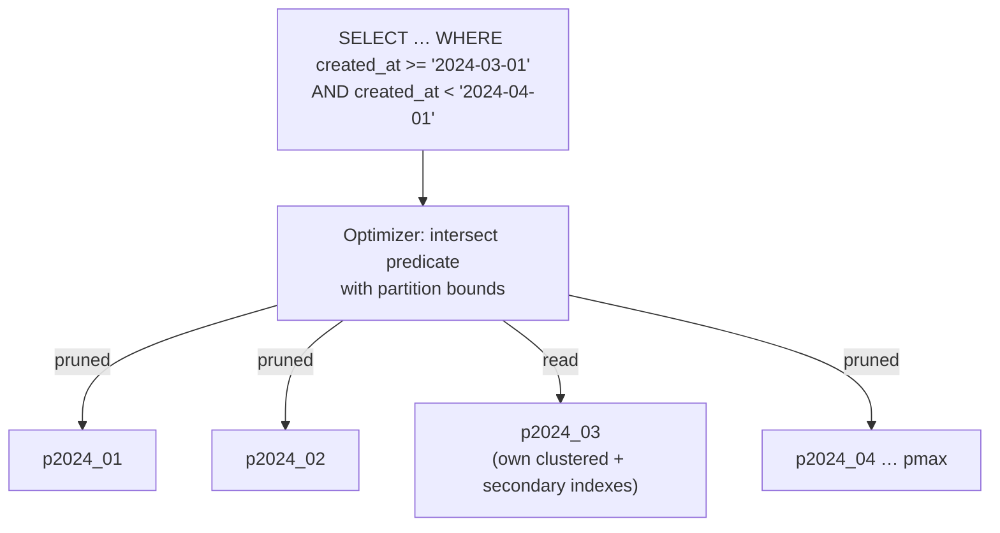

## Introduction

A table that receives a million events a day reaches a billion rows in three years. Most queries only care about the last few weeks; the business must keep 13 months; the rest must be deleted, and deleting old data with `DELETE … WHERE created_at < ?` from a billion-row table is a multi-hour, replication-lagging, undo-log-filling operation. **Partitioning** solves exactly this kind of problem: it splits one logical table into several physical pieces — **partitions** — according to a rule on one or more columns, so that:

- queries that filter on the partitioning column read only the relevant partitions (**partition pruning**), and
- whole partitions can be added, emptied, dropped or swapped out as **metadata operations**, instead of row-by-row DML.

To the application the table is still one table: the same `SELECT`, `INSERT`, `UPDATE`, `DELETE`. To InnoDB each partition is a separate B+ tree (and a separate `.ibd` file with `innodb_file_per_table`).

This lesson builds partitioned tables with all four partitioning types MySQL supports — **RANGE, LIST, HASH and KEY** — shows pruning in EXPLAIN's `partitions` column, measures partition maintenance against equivalent DML, and runs into the restrictions that decide whether partitioning is possible at all: unique keys must contain the partitioning columns, and partitioned InnoDB tables cannot have foreign keys. It ends with the most important judgement call: partitioning is *not* a faster index.

:::note[Dataset]
The lab starts empty and generates its own tables (240,000 events and two 100,000-row tables). Timings are `measured` blocks from the build machine.
:::

## DBMS Theory

:::theory[Horizontal partitioning]
**Horizontal partitioning** divides a relation R into disjoint subsets R₁ … Rₙ of *rows* such that R = R₁ ∪ R₂ ∪ … ∪ Rₙ and Rᵢ ∩ Rⱼ = ∅. Membership is decided by a **partitioning function** f over a **partitioning key**: row t belongs to partition f(t). (Vertical partitioning — splitting *columns* into separate tables — is a schema design technique, see [Denormalization](/lessons/m06-denormalization).)

The classic partitioning functions are:

| Type | Function | Good for |
|---|---|---|
| **Range** | t → i such that boundᵢ₋₁ ≤ key(t) < boundᵢ | Time series, data lifecycle, range queries on the key |
| **List** | t → the partition whose value list contains key(t) | Categorical keys with few values (region, tenant tier) |
| **Hash** | t → h(key(t)) mod n | Spreading rows evenly when there is no natural range |

A query predicate P on the key lets the optimizer compute the set of partitions that *can* contain matching rows and skip the others — **partition elimination** (MySQL: *pruning*). This is a logical deduction from the partitioning function, made before any data is read.
:::

Two consequences follow from the theory and drive everything in practice:

1. **Pruning needs predicates on the partitioning key** that the optimizer can map through f. `created_at >= '2024-03-01' AND created_at < '2024-04-01'` maps to one range partition; `customer_id = 42` maps to no particular range partition, so every partition must be searched.
2. **Per-partition uniqueness is all a partitioned table can enforce cheaply.** Each partition has its own indexes. A unique index that does not include the partitioning key could be violated by two rows in *different* partitions, which no single partition's index can detect — so MySQL forbids it (error 1503).

Partitioning within one server is also the conceptual parent of **sharding**, which places partitions on *different* servers ([Sharding](/lessons/m12-sharding)).

## Why It Exists

Partitioning exists mainly for **data lifecycle management** and secondarily for **query performance on the partitioning key**:

- **Retention.** Dropping a month of data with `ALTER TABLE … DROP PARTITION` removes a tablespace — it takes about as long whatever the partition's size and writes a tiny binary log event. The equivalent `DELETE` touches every row, writes undo and redo for each, locks them, and replicates as millions of row events ([Read Replicas](/lessons/m12-read-replicas) shows what that does to lag).
- **Archiving.** `EXCHANGE PARTITION` swaps a partition with an ordinary table in a metadata operation, moving a month of data out of the hot table instantly.
- **Bulk loading.** A new partition can be prepared, loaded and swapped in without touching existing data.
- **Bounded maintenance.** `OPTIMIZE`, `ANALYZE`, `CHECK` and `REBUILD` can run per partition, so maintenance on a huge table can proceed piece by piece.
- **Pruning.** Queries constrained on the partitioning key skip irrelevant partitions — on a time-partitioned table, "last 7 days" touches one or two partitions instead of the entire history.
- **Hot/cold separation.** Recent partitions stay in the buffer pool; old ones are rarely read and do not evict hot pages when they are not touched.

Without partitioning, teams resort to "a new table per month" (`events_2024_03`, …) and application code that unions them — partitioning gives the same physical layout behind one table name.

## Internal Working

:::internals[How MySQL implements partitioning]
Since MySQL 8.0, partitioning is implemented **natively by the storage engine** (InnoDB, NDB); the old generic partitioning handler was removed, so MyISAM tables cannot be partitioned. Internally:

- Each partition is a separate InnoDB **index tree set**: its own clustered index and its own copy of every secondary index. With `innodb_file_per_table=ON` (default), each partition is a separate tablespace file named like `events#p#p2024_03.ibd`.
- The data dictionary stores the partitioning function and the bounds. On **INSERT**, the server evaluates the function for the new row and routes it to one partition; a row that fits no partition is rejected (error 1526).
- On **SELECT**, the optimizer performs **pruning** during optimisation: it analyses the WHERE clause, intersects the predicate ranges on the partitioning columns with the partition bounds, and marks only the surviving partitions as used. The `partitions` column of EXPLAIN lists them. For RANGE, pruning works on ranges; for LIST it works on equality and IN lists; for HASH/KEY it works on equality (and on very short integer ranges, which the optimizer can enumerate value by value).
- Pruning also happens for INSERT, UPDATE and DELETE, and **lock pruning** means statements only lock partitions they actually touch.
- When a query cannot be pruned, the executor opens every partition and runs the access path (index lookup or scan) **once per partition**, merging results — an index lookup on a non-partitioning column therefore costs one index dive per partition.

Partition maintenance operations work on whole tablespaces: `DROP PARTITION` deletes a partition's tablespace; `TRUNCATE PARTITION` recreates it empty; `ADD PARTITION` creates a new empty one; `REORGANIZE PARTITION` rewrites the rows of only the partitions named; `EXCHANGE PARTITION` swaps tablespace identities between a partition and a non-partitioned table after validating that the table's rows fit the partition's bounds.
:::



## MySQL Implementation

### RANGE partitioning by month

The partitioning key must be part of **every unique key**, including the primary key, so the primary key becomes `(event_id, created_at)`. The expression `TO_DAYS(created_at)` gives an integer that MySQL can prune on (`RANGE COLUMNS(created_at)` with date literals is an equivalent alternative).

```sql run
SET SESSION cte_max_recursion_depth = 240000;
CREATE TABLE events (
  event_id    INT UNSIGNED NOT NULL,
  created_at  DATETIME     NOT NULL,
  customer_id INT UNSIGNED NOT NULL,
  event_type  VARCHAR(16)  NOT NULL,
  amount      DECIMAL(10,2) NOT NULL,
  PRIMARY KEY (event_id, created_at),
  KEY idx_events_customer (customer_id)
)
PARTITION BY RANGE (TO_DAYS(created_at)) (
  PARTITION p2024_01 VALUES LESS THAN (TO_DAYS('2024-02-01')),
  PARTITION p2024_02 VALUES LESS THAN (TO_DAYS('2024-03-01')),
  PARTITION p2024_03 VALUES LESS THAN (TO_DAYS('2024-04-01')),
  PARTITION p2024_04 VALUES LESS THAN (TO_DAYS('2024-05-01')),
  PARTITION p2024_05 VALUES LESS THAN (TO_DAYS('2024-06-01')),
  PARTITION p2024_06 VALUES LESS THAN (TO_DAYS('2024-07-01')),
  PARTITION p2024_07 VALUES LESS THAN (TO_DAYS('2024-08-01')),
  PARTITION p2024_08 VALUES LESS THAN (TO_DAYS('2024-09-01')),
  PARTITION p2024_09 VALUES LESS THAN (TO_DAYS('2024-10-01')),
  PARTITION p2024_10 VALUES LESS THAN (TO_DAYS('2024-11-01')),
  PARTITION p2024_11 VALUES LESS THAN (TO_DAYS('2024-12-01')),
  PARTITION p2024_12 VALUES LESS THAN (TO_DAYS('2025-01-01')),
  PARTITION pmax     VALUES LESS THAN MAXVALUE
);
INSERT INTO events
WITH RECURSIVE seq(n) AS (SELECT 1 UNION ALL SELECT n + 1 FROM seq WHERE n < 240000)
SELECT n,
       '2024-01-01' + INTERVAL ((n - 1) * 131) SECOND,
       (n * 7919) % 20000 + 1,
       ELT(1 + n % 4, 'view', 'click', 'cart', 'purchase'),
       ROUND(((n * 37) % 10000) / 100, 2)
FROM seq;
ANALYZE TABLE events;
SELECT MIN(created_at) AS first_event, MAX(created_at) AS last_event, COUNT(*) AS events_rows FROM events;
```

Events are spaced 131 seconds apart, so 240,000 of them cover the whole of 2024. `information_schema.PARTITIONS` shows how the rows were distributed (`TABLE_ROWS` is the statistics estimate refreshed by `ANALYZE TABLE`, not an exact count):

```sql run
SELECT PARTITION_NAME, PARTITION_ORDINAL_POSITION AS pos, PARTITION_DESCRIPTION AS less_than_to_days, TABLE_ROWS
FROM information_schema.PARTITIONS
WHERE TABLE_SCHEMA = DATABASE() AND TABLE_NAME = 'events'
ORDER BY PARTITION_ORDINAL_POSITION;
```

### Partition pruning in EXPLAIN

A query for March touches one partition:

```sql run
EXPLAIN SELECT COUNT(*), SUM(amount) FROM events
WHERE created_at >= '2024-03-01' AND created_at < '2024-04-01';
```

The `partitions` column reads `p2024_03` — the other twelve partitions are never opened. A range that spans a month boundary touches exactly the partitions it overlaps:

```sql run
EXPLAIN SELECT COUNT(*) FROM events
WHERE created_at BETWEEN '2024-06-25' AND '2024-07-05 23:59:59';
```

A query that does not constrain the partitioning column cannot be pruned:

```sql run
EXPLAIN SELECT COUNT(*) FROM events WHERE customer_id = 4217;
```

Every partition is listed. The `idx_events_customer` index is still used — but there are 13 copies of it, one per partition, and MySQL must probe each.

## Syntax Breakdown

```sql
CREATE TABLE t (...)
PARTITION BY { RANGE (expr) | RANGE COLUMNS (col, ...)
             | LIST (expr)  | LIST COLUMNS (col, ...)
             | HASH (expr)  | LINEAR HASH (expr)
             | KEY [ALGORITHM={1|2}] (col, ...) | LINEAR KEY (col, ...) }
[PARTITIONS n]                                   -- HASH / KEY
[SUBPARTITION BY HASH (expr) | KEY (col, ...) [SUBPARTITIONS m]]
(
  PARTITION p0 VALUES LESS THAN (value | MAXVALUE),   -- RANGE
  PARTITION p1 VALUES IN (v1, v2, ...),               -- LIST
  ...
);
```

| Element | Meaning |
|---|---|
| `RANGE (expr)` | `expr` must return an integer (e.g. `TO_DAYS(d)`, `YEAR(d)`, `UNIX_TIMESTAMP(ts)` for TIMESTAMP). Partitions are ordered; `VALUES LESS THAN` bounds must strictly increase. |
| `RANGE COLUMNS (c1, …)` | Bounds are column values (dates, strings, multi-column tuples) — no expression; often more readable. |
| `MAXVALUE` | Catch-all upper bound. Convenient, but a non-empty `pmax` makes adding the next month a `REORGANIZE` instead of an `ADD`. |
| `LIST (expr)` / `LIST COLUMNS` | Each partition lists the values it accepts. A value in no list is rejected (error 1526) — there is no "default" partition in MySQL. |
| `HASH (expr) PARTITIONS n` | Partition = `expr MOD n`; `expr` must be an integer expression. |
| `LINEAR HASH` | Powers-of-two algorithm: faster to add/remove/merge partitions, less even distribution. |
| `KEY (cols) PARTITIONS n` | Like HASH but MySQL hashes the column values itself (any type, e.g. `CHAR`, `BINARY(16)`); empty `KEY()` uses the primary key. |
| `SUBPARTITION BY` | Composite partitioning: each RANGE/LIST partition is further split by HASH/KEY. |
| `SELECT … FROM t PARTITION (p1, p2)` | Explicit partition selection — restricts a statement to named partitions. |
| `ALTER TABLE … ADD / DROP / TRUNCATE / REORGANIZE / EXCHANGE / REBUILD / OPTIMIZE / ANALYZE / CHECK PARTITION` | Partition maintenance. |
| `ALTER TABLE … REMOVE PARTITIONING` | Turns the table back into an ordinary table (rewrites it). |

Allowed functions in partitioning expressions are restricted (deterministic, and for pruning on ranges only "monotonic" functions such as `TO_DAYS()`, `YEAR()`, `TO_SECONDS()`, `UNIX_TIMESTAMP()` are recognised). The maximum number of partitions per table is 8,192, including subpartitions.

## Practical Examples

### 1. Partition maintenance: the monthly rotation

The standard operation on a time-partitioned table is a monthly job: add next month, drop the month that fell out of the retention window. Because `pmax` (MAXVALUE) exists, a new partition is created by **splitting** `pmax` with `REORGANIZE PARTITION`; this is cheap as long as `pmax` is empty:

```sql run
ALTER TABLE events REORGANIZE PARTITION pmax INTO (
  PARTITION p2025_01 VALUES LESS THAN (TO_DAYS('2025-02-01')),
  PARTITION pmax     VALUES LESS THAN MAXVALUE
);
INSERT INTO events VALUES (240001, '2025-01-15 08:00:00', 42, 'purchase', 19.99);
EXPLAIN SELECT * FROM events WHERE created_at >= '2025-01-01' AND created_at < '2025-02-01';
```

The new event landed in `p2025_01`, and a January 2025 query prunes to it.

Now retire the oldest month. First, the slow way for comparison — on a copy of February, `DELETE` removes rows one by one:

```sql run
CREATE TABLE events_feb_copy LIKE events;
ALTER TABLE events_feb_copy REMOVE PARTITIONING;
INSERT INTO events_feb_copy SELECT * FROM events PARTITION (p2024_02);
SELECT COUNT(*) AS rows_to_delete FROM events_feb_copy;
```

```sql run measured
DELETE FROM events_feb_copy WHERE created_at >= '2024-02-01' AND created_at < '2024-03-01';
```

```sql run measured
ALTER TABLE events DROP PARTITION p2024_01;
```

The `DELETE` reported every row as affected; each was locked, undo-logged and (in production) written to the binary log as a row event for replicas to replay. `DROP PARTITION` reported 0 rows: it removed January's tablespace in one dictionary operation and writes a single DDL statement to the binary log. On the build machine the two timings differ by an order of magnitude for ~20,000 rows; on a partition of 50 million rows, the `DELETE` takes hours while `DROP PARTITION` stays roughly constant.

**TRUNCATE PARTITION** empties a partition but keeps its definition (useful for reloading a month):

```sql run
ALTER TABLE events TRUNCATE PARTITION p2024_02;
SELECT PARTITION_NAME, TABLE_ROWS FROM information_schema.PARTITIONS
WHERE TABLE_SCHEMA = DATABASE() AND TABLE_NAME = 'events' AND PARTITION_NAME IN ('p2024_02', 'p2024_03')
ORDER BY PARTITION_NAME;
SELECT COUNT(*) AS feb_rows_left FROM events PARTITION (p2024_02);
```

### 2. Archiving with EXCHANGE PARTITION

`EXCHANGE PARTITION` swaps a partition with an empty (or matching) non-partitioned table of identical structure. The month's rows move to the archive table without being copied:

```sql run
CREATE TABLE events_archive_2024_03 LIKE events;
ALTER TABLE events_archive_2024_03 REMOVE PARTITIONING;
ALTER TABLE events EXCHANGE PARTITION p2024_03 WITH TABLE events_archive_2024_03;
SELECT (SELECT COUNT(*) FROM events PARTITION (p2024_03)) AS left_in_partition,
       (SELECT COUNT(*) FROM events_archive_2024_03)      AS now_in_archive_table;
```

The partition is now empty and the archive table holds March. From there the archive table can be dumped, moved to cheaper storage, or kept for occasional queries; finally `DROP PARTITION p2024_03` removes the empty partition. (By default the exchange verifies that every row of the incoming table fits the partition's bounds; `WITHOUT VALIDATION` skips the check for speed when you are certain.)

### 3. LIST partitioning by region

```sql run
CREATE TABLE customers_by_region (
  customer_id INT UNSIGNED NOT NULL,
  region      VARCHAR(8)   NOT NULL,
  name        VARCHAR(40)  NOT NULL,
  PRIMARY KEY (customer_id, region)
)
PARTITION BY LIST COLUMNS (region) (
  PARTITION p_americas VALUES IN ('NA', 'LATAM'),
  PARTITION p_europe   VALUES IN ('EU', 'UK'),
  PARTITION p_asia     VALUES IN ('APAC', 'IN')
);
INSERT INTO customers_by_region
WITH RECURSIVE seq(n) AS (SELECT 1 UNION ALL SELECT n + 1 FROM seq WHERE n < 100000)
SELECT n, ELT(1 + n % 6, 'NA', 'LATAM', 'EU', 'UK', 'APAC', 'IN'), CONCAT('customer ', n) FROM seq;
ANALYZE TABLE customers_by_region;
EXPLAIN SELECT COUNT(*) FROM customers_by_region WHERE region IN ('EU', 'UK');
```

Only `p_europe` is read. A value that belongs to no list is rejected — MySQL has no default partition for LIST:

```sql run error
INSERT INTO customers_by_region VALUES (100001, 'MEA', 'new market customer');
```

Error 1526 is a feature: it forces someone to decide where a new region's data lives (for example, a data-residency requirement that EU customers stay in a specific partition or, at larger scale, a specific shard).

### 4. HASH and KEY partitioning

HASH spreads rows evenly when there is no useful range — here by `customer_id` over 8 partitions:

```sql run
CREATE TABLE carts (
  customer_id INT UNSIGNED NOT NULL,
  product_id  INT UNSIGNED NOT NULL,
  qty         INT UNSIGNED NOT NULL,
  PRIMARY KEY (customer_id, product_id)
)
PARTITION BY HASH (customer_id) PARTITIONS 8;
INSERT INTO carts
WITH RECURSIVE seq(n) AS (SELECT 1 UNION ALL SELECT n + 1 FROM seq WHERE n < 100000)
SELECT n DIV 5 + 1, n % 5 + 1, 1 + n % 3 FROM seq;
ANALYZE TABLE carts;
SELECT PARTITION_NAME, TABLE_ROWS FROM information_schema.PARTITIONS
WHERE TABLE_SCHEMA = DATABASE() AND TABLE_NAME = 'carts' ORDER BY PARTITION_ORDINAL_POSITION;
EXPLAIN SELECT * FROM carts WHERE customer_id = 4242;
EXPLAIN SELECT * FROM carts WHERE customer_id BETWEEN 4242 AND 4243;
EXPLAIN SELECT * FROM carts WHERE customer_id BETWEEN 1000 AND 9000;
```

Equality prunes to exactly one partition (4242 mod 8 = 2, so `p2`). A very short integer range can still be pruned — the optimizer enumerates the two values and maps each to a partition — but a wide range spans every partition, because hashing destroys order. That is the fundamental trade-off: HASH gives even distribution and cheap equality routing, RANGE gives ordered ranges and lifecycle operations.

KEY partitioning lets MySQL hash any column type, such as a textual or binary identifier:

```sql run
CREATE TABLE api_tokens (
  token_hash CHAR(32)     NOT NULL PRIMARY KEY,
  user_id    INT UNSIGNED NOT NULL,
  expires_at DATETIME     NOT NULL
)
PARTITION BY KEY (token_hash) PARTITIONS 4;
INSERT INTO api_tokens
WITH RECURSIVE seq(n) AS (SELECT 1 UNION ALL SELECT n + 1 FROM seq WHERE n < 20000)
SELECT MD5(n), n, '2025-01-01' + INTERVAL n MINUTE FROM seq;
ANALYZE TABLE api_tokens;
EXPLAIN SELECT user_id FROM api_tokens WHERE token_hash = MD5(777);
```

## Execution Walkthrough

```walkthrough
title: How pruning turns a query into work on one partition
steps:
  - title: "1. The partition definitions"
    explain: The optimizer knows each partition's bounds from the data dictionary. For RANGE on TO_DAYS(created_at), each partition holds the days below its bound and at or above the previous one.
    sql: |
      SELECT PARTITION_NAME, PARTITION_DESCRIPTION AS less_than_to_days,
             FROM_DAYS(PARTITION_DESCRIPTION) AS less_than_date
      FROM information_schema.PARTITIONS
      WHERE TABLE_SCHEMA = DATABASE() AND TABLE_NAME = 'events' AND PARTITION_DESCRIPTION <> 'MAXVALUE'
      ORDER BY PARTITION_ORDINAL_POSITION;
  - title: "2. Map the predicate through the partitioning function"
    explain: "created_at in [2024-05-10, 2024-05-20) becomes TO_DAYS in [TO_DAYS('2024-05-10'), TO_DAYS('2024-05-20')). That interval lies entirely below p2024_05's bound and above p2024_04's, so only p2024_05 survives."
    sql: SELECT TO_DAYS('2024-05-10') AS low, TO_DAYS('2024-05-20') AS high;
  - title: "3. EXPLAIN confirms the surviving partition"
    explain: The partitions column shows p2024_05 only. The access path within the partition is a scan of that one partition's clustered index (the primary key starts with event_id, so there is no index on created_at to range-scan).
    sql: EXPLAIN SELECT COUNT(*) FROM events WHERE created_at >= '2024-05-10' AND created_at < '2024-05-20';
  - title: "4. Execute and measure"
    explain: EXPLAIN ANALYZE shows the scan reading only about one month of rows (roughly 20,000) before the filter keeps the ten days requested — not the whole table.
    sql: EXPLAIN ANALYZE SELECT COUNT(*) FROM events WHERE created_at >= '2024-05-10' AND created_at < '2024-05-20';
```

Pruning is a **compile-time** decision when the predicate uses constants. With a prepared statement or a join, MySQL can also prune at execution time for some cases, but the safe rule is: compare the bare partitioning column with constants or parameters.

## Output

What the captured outputs established:

- The 240,000 events were spread across the twelve 2024 partitions (about 20,000 each), with `pmax` empty.
- Queries constrained on `created_at` listed only the overlapping partitions in EXPLAIN's `partitions` column; the query on `customer_id` listed all partitions.
- `REORGANIZE PARTITION pmax` created `p2025_01`, and a new January 2025 row was routed there.
- `DELETE` of a month affected every row; `DROP PARTITION` affected none and was far faster; `TRUNCATE PARTITION` emptied February; `EXCHANGE PARTITION` moved March into an ordinary table.
- LIST pruned `IN ('EU','UK')` to `p_europe` and rejected an unlisted region with error 1526.
- HASH pruned equality to one partition and short integer ranges to a few, but not wide ranges.

## Alternative Approaches

| Need | Partitioning | Alternative | Choose the alternative when |
|---|---|---|---|
| Fast lookups by a non-time column | No help (one dive per partition) | A **secondary index** | Almost always — indexes are the tool for selective lookups |
| Fast "recent data" queries | Pruning by time | A secondary index on `created_at` (or a PK that starts with time) | The table is not huge, or retention is not an issue |
| Removing old data | `DROP PARTITION` | Batched `DELETE` in chunks ([Handling Millions of Records](/lessons/m12-large-tables)) | Retention is irregular (per-customer deletion, GDPR erasure), or FKs are needed |
| Archiving | `EXCHANGE PARTITION` | `INSERT … SELECT` + chunked `DELETE` to an archive table | Rows to archive are not aligned with partition boundaries |
| Spread write load | HASH partitions on one server | **Sharding** across servers | One server's CPU/IO/storage is the limit — partitions on one server share it |
| Per-tenant isolation | LIST by tenant | Database (schema) per tenant, or shard per tenant | Tenants need independent backup/restore or very different sizes |
| Manual "table per month" | Native partitioning | `events_2024_03` tables + a view or app-side union | You need FKs, or very different structures per period |

## Performance Analysis

**Pruned queries.** When the predicate constrains the partitioning key, the cost is the cost of the same query against a table containing only the surviving partitions. For a time-range scan this is a large win if no index on `created_at` exists, and a modest one if it does — an index range scan on a non-partitioned table already reads only the matching rows. Partition pruning is **coarse-grained indexing**: it narrows to a partition, not to rows.

**Non-pruned queries.** A lookup by a non-partitioning column costs one index dive per partition. Let us measure it with session counters on the `customer_id` index:

```sql run
SHOW SESSION STATUS LIKE 'Handler_read_key';
SELECT COUNT(*) FROM events WHERE customer_id = 4217;
SHOW SESSION STATUS LIKE 'Handler_read_key';
```

`Handler_read_key` grows by one per partition that was probed (the table now has 13 partitions after the maintenance above) instead of one — compared with a single dive on an unpartitioned table. At 13 partitions this is cheap; at 1,000 daily partitions, every such lookup does 1,000 B+ tree descents, and opening that many partitions also costs table-cache entries and file handles. **This is the number-one partitioning anti-pattern**: partitioning a table to "make it faster" and then querying it by something other than the partitioning key.

**DML routing.** INSERT computes the partition per row (cheap). UPDATE that changes the partitioning key moves the row between partitions (a delete plus an insert). Lock pruning keeps locks to touched partitions.

**Partition count.** Too few partitions and lifecycle operations are coarse; too many and planning, opening and metadata costs grow (and `information_schema` queries over partitions slow down). Monthly or daily partitions for 1–3 years of retention (12–1,000 partitions) is the common range; thousands of partitions require testing.

**Maintenance cost.** `ADD`/`DROP`/`TRUNCATE`/`EXCHANGE` are metadata operations (fast, brief exclusive metadata lock — use a short `lock_wait_timeout`, as in [Schema Evolution](/lessons/m12-schema-evolution)). `REORGANIZE` rewrites the rows of the partitions named — splitting an *empty* `pmax` is free, splitting a full one is a copy. Changing the partitioning scheme of a whole table rewrites the whole table.

## Best Practices

:::best-practice[Partitioning that pays for itself]
1. **Partition for lifecycle first.** The strongest reason is cheap retention and archiving on large time-series tables; pruning is a bonus.
2. **Choose a key that (almost) every important query filters on** — usually the time column for event/log/fact tables.
3. **Keep an empty `pmax` (or none at all) and pre-create partitions ahead of time** with a scheduled job, so `REORGANIZE` never has to split a populated partition; monitor that next month's partition exists.
4. **Put the partitioning column into the primary key deliberately** and decide how uniqueness of the business key (e.g. `event_id` alone) will be guaranteed — by an ID generator, by a separate non-partitioned lookup table, or by accepting per-partition uniqueness.
5. **Write sargable predicates on the bare partitioning column** (`created_at >= ? AND created_at < ?`), never `YEAR(created_at) = 2024`.
6. **Verify pruning with EXPLAIN** (`partitions` column) for every important query when designing the scheme.
7. **Don't use partitioning as an index.** If queries are by `customer_id`, index `customer_id`; partitioning by it with HASH helps only special cases.
8. **Run partition DDL with a short `lock_wait_timeout`** and from a job with alerting — a forgotten "add next month" job eventually routes every insert into `pmax` (or fails with error 1526 if there is no `pmax`).
:::

## Common Mistakes

**Mistake 1 — a primary key that does not include the partitioning column.** Every unique key must contain every column used in the partitioning expression:

```sql run error
CREATE TABLE orders_p (
  order_id   INT UNSIGNED NOT NULL PRIMARY KEY,
  order_date DATE NOT NULL
)
PARTITION BY RANGE COLUMNS (order_date) (
  PARTITION p2024 VALUES LESS THAN ('2025-01-01'),
  PARTITION pmax  VALUES LESS THAN (MAXVALUE)
);
```

The same applies to secondary UNIQUE keys — a `UNIQUE (email)` on a table partitioned by `created_at` is impossible. The fix is `PRIMARY KEY (order_id, order_date)`, which means MySQL now guarantees uniqueness of the *pair*: two rows with the same `order_id` in different years would be accepted.

**Mistake 2 — foreign keys on partitioned InnoDB tables.** Partitioned InnoDB tables can neither have foreign keys nor be referenced by them:

```sql run error
CREATE TABLE customers_fk (customer_id INT UNSIGNED PRIMARY KEY);
CREATE TABLE orders_fk (
  order_id    INT UNSIGNED NOT NULL,
  order_date  DATE NOT NULL,
  customer_id INT UNSIGNED NOT NULL,
  PRIMARY KEY (order_id, order_date),
  FOREIGN KEY (customer_id) REFERENCES customers_fk (customer_id)
)
PARTITION BY RANGE COLUMNS (order_date) (
  PARTITION p2024 VALUES LESS THAN ('2025-01-01'),
  PARTITION pmax  VALUES LESS THAN (MAXVALUE)
);
```

Error 1506 *Foreign keys are not yet supported in conjunction with partitioning*. Referential integrity must then be enforced by the application or by periodic reconciliation queries — a real cost to weigh before partitioning a table in the middle of a schema.

**Mistake 3 — wrapping the partitioning column in a function.** `WHERE DATE_FORMAT(created_at, '%Y-%m') = '2024-03'` cannot be mapped through `TO_DAYS`, so nothing is pruned:

```sql run
EXPLAIN SELECT COUNT(*) FROM events WHERE DATE_FORMAT(created_at, '%Y-%m') = '2024-05';
```

**Mistake 4 — forgetting to create future partitions.** Without `pmax`, the first insert after the last bound fails with error 1526; with `pmax`, data piles into it and the "cheap split" becomes an expensive copy.

**Mistake 5 — partitioning small tables.** A 2-million-row table gains nothing from partitioning that a good index would not give, and loses FKs and global unique keys.

**Mistake 6 — expecting `TABLE_ROWS` to be exact.** It is an estimate from statistics. Use `SELECT COUNT(*) FROM t PARTITION (p)` when you need the exact number.

## Industry Application

- **Event, log and metrics tables** in MySQL are partitioned by day or month with a scheduled job (often a MySQL event, a cron job, or a tool such as Percona's `pt-archiver` alongside) that pre-creates partitions and drops expired ones; this is the dominant real-world use.
- **Financial ledgers and audit trails** partition by month for retention policies and archive closed periods with `EXCHANGE PARTITION` to read-only storage.
- **Data-residency and tiering** uses LIST partitioning per region or customer tier within one server — and, beyond one server's capacity, the same key becomes a shard key.
- **Managed services** (RDS, Aurora, Cloud SQL) support native partitioning unchanged; analytics engines (BigQuery, Snowflake micro-partitions, ClickHouse) rely on the same idea — partition/segment elimination on time — at much larger scale.
- **Teams frequently un-partition tables** that were partitioned for speed by a non-filtering key, after discovering that every lookup fans out to every partition. Partitioning decisions are reviewed against the actual query mix (from the slow log or `performance_schema` digests).

## Practice Exercises

```exercise
id: ex1
title: Which partitions does a query read?
difficulty: easy
setup: |
  CREATE TABLE logs (id INT NOT NULL, logged_on DATE NOT NULL, msg VARCHAR(40) NOT NULL, PRIMARY KEY (id, logged_on))
  PARTITION BY RANGE COLUMNS (logged_on) (
    PARTITION q1 VALUES LESS THAN ('2024-04-01'),
    PARTITION q2 VALUES LESS THAN ('2024-07-01'),
    PARTITION q3 VALUES LESS THAN ('2024-10-01'),
    PARTITION q4 VALUES LESS THAN ('2025-01-01')
  );
  INSERT INTO logs VALUES (1,'2024-01-15','a'),(2,'2024-03-31','b'),(3,'2024-04-01','c'),(4,'2024-06-30','d'),(5,'2024-08-08','e'),(6,'2024-12-31','f');
concepts: [partition-pruning, range-partitioning]
prompt: |
  Return one row per partition of `logs` with `partition_name` and `rows_exact` — the **exact** number of
  rows stored in it (not the `TABLE_ROWS` statistics estimate). Every partition must appear, even an empty one.
hints:
  - "TABLE_ROWS in information_schema.PARTITIONS is an estimate. Count the rows yourself."
  - "Map each row to its quarter: CASE WHEN logged_on < '2024-04-01' THEN 'q1' WHEN … END, then GROUP BY it. Or LEFT JOIN information_schema.PARTITIONS to that count to include empty partitions."
solution: |
  SELECT p.PARTITION_NAME AS partition_name, COALESCE(c.n, 0) AS rows_exact
  FROM information_schema.PARTITIONS p
  LEFT JOIN (
    SELECT CASE WHEN logged_on < '2024-04-01' THEN 'q1'
                WHEN logged_on < '2024-07-01' THEN 'q2'
                WHEN logged_on < '2024-10-01' THEN 'q3'
                ELSE 'q4' END AS part, COUNT(*) AS n
    FROM logs GROUP BY part
  ) c ON c.part = p.PARTITION_NAME
  WHERE p.TABLE_SCHEMA = DATABASE() AND p.TABLE_NAME = 'logs';
explanation: |
  Each partition holds rows below its bound and at or above the previous bound, so '2024-03-31' is in q1 and
  '2024-04-01' in q2 (2 rows each; q3 and q4 have 1). Another correct approach is four
  `SELECT COUNT(*) FROM logs PARTITION (qN)` queries combined with UNION ALL. `TABLE_ROWS` would give
  estimates (here, on a freshly loaded table without ANALYZE, possibly 0).
```

```exercise
id: ex2
title: Retire and add a month
difficulty: medium
kind: dml
setup: |
  CREATE TABLE metrics (id INT NOT NULL, ts DATETIME NOT NULL, v INT NOT NULL, PRIMARY KEY (id, ts))
  PARTITION BY RANGE (TO_DAYS(ts)) (
    PARTITION m2024_10 VALUES LESS THAN (TO_DAYS('2024-11-01')),
    PARTITION m2024_11 VALUES LESS THAN (TO_DAYS('2024-12-01')),
    PARTITION m2024_12 VALUES LESS THAN (TO_DAYS('2025-01-01')),
    PARTITION pmax     VALUES LESS THAN MAXVALUE
  );
  INSERT INTO metrics VALUES (1,'2024-10-05',1),(2,'2024-10-20',2),(3,'2024-11-11',3),(4,'2024-12-24',4);
concepts: [partition-maintenance]
prompt: |
  Run the monthly rotation on `metrics`:

  1. remove all October 2024 data **using a partition operation** (not DELETE) so that the October partition
     no longer exists;
  2. create a partition `m2025_01` for January 2025 (bound `TO_DAYS('2025-02-01')`), keeping `pmax` as the
     last partition.
hints:
  - "ALTER TABLE metrics DROP PARTITION m2024_10;"
  - "With MAXVALUE present you cannot ADD after it — split pmax with REORGANIZE PARTITION pmax INTO (…)."
solution: |
  ALTER TABLE metrics DROP PARTITION m2024_10;
  ALTER TABLE metrics REORGANIZE PARTITION pmax INTO (
    PARTITION m2025_01 VALUES LESS THAN (TO_DAYS('2025-02-01')),
    PARTITION pmax     VALUES LESS THAN MAXVALUE
  );
check: |
  SELECT PARTITION_NAME, PARTITION_ORDINAL_POSITION, PARTITION_DESCRIPTION
  FROM information_schema.PARTITIONS
  WHERE TABLE_SCHEMA = DATABASE() AND TABLE_NAME = 'metrics'
  ORDER BY PARTITION_ORDINAL_POSITION;
explanation: |
  `ALTER TABLE … ADD PARTITION (PARTITION m2025_01 VALUES LESS THAN (…))` fails here with error 1481
  (*MAXVALUE can only be used in last partition definition*) because new RANGE partitions can only be added
  at the end and `pmax` already covers everything. Splitting an **empty** `pmax` is cheap; if `pmax` already
  contained rows, REORGANIZE would have to copy them.
```

```exercise
id: ex3
title: Design a LIST-partitioned table
difficulty: medium
kind: dml
concepts: [list-partitioning, partitioning]
prompt: |
  Create a table `tickets` with columns `ticket_id INT NOT NULL`, `region VARCHAR(8) NOT NULL`,
  `subject VARCHAR(80) NOT NULL`, partitioned by **LIST COLUMNS(region)** into three partitions:
  `p_amer` for `'NA'` and `'LATAM'`, `p_emea` for `'EU'` and `'MEA'`, `p_apac` for `'APAC'`.
  The primary key must be valid for this partitioning (use the smallest valid key containing `ticket_id`).
  Then insert ticket `(1, 'MEA', 'Login issue')`.
hints:
  - "The primary key must include region: PRIMARY KEY (ticket_id, region)."
  - "PARTITION BY LIST COLUMNS (region) (PARTITION p_amer VALUES IN ('NA','LATAM'), …)"
solution: |
  CREATE TABLE tickets (
    ticket_id INT NOT NULL,
    region    VARCHAR(8) NOT NULL,
    subject   VARCHAR(80) NOT NULL,
    PRIMARY KEY (ticket_id, region)
  )
  PARTITION BY LIST COLUMNS (region) (
    PARTITION p_amer VALUES IN ('NA', 'LATAM'),
    PARTITION p_emea VALUES IN ('EU', 'MEA'),
    PARTITION p_apac VALUES IN ('APAC')
  );
  INSERT INTO tickets VALUES (1, 'MEA', 'Login issue');
check: |
  SELECT 'partition' AS kind, PARTITION_NAME AS a, PARTITION_DESCRIPTION AS b
  FROM information_schema.PARTITIONS WHERE TABLE_SCHEMA = DATABASE() AND TABLE_NAME = 'tickets'
  UNION ALL
  SELECT 'pk', COLUMN_NAME, SEQ_IN_INDEX
  FROM information_schema.STATISTICS WHERE TABLE_SCHEMA = DATABASE() AND TABLE_NAME = 'tickets' AND INDEX_NAME = 'PRIMARY'
  UNION ALL
  SELECT 'row in p_emea', ticket_id, region FROM tickets PARTITION (p_emea)
  ORDER BY kind, a;
explanation: |
  `PRIMARY KEY (ticket_id)` alone fails with error 1503. With `(ticket_id, region)` the database guarantees
  only that the pair is unique — the same ticket id could exist in two regions — so the application's ID
  generator must guarantee global uniqueness of `ticket_id`.
```

```exercise
id: ex4
title: Should this table be partitioned?
difficulty: hard
kind: open
concepts: [partitioning, partition-pruning]
prompt: |
  Evaluate each proposal and say yes/no with reasons and, where "no", the better alternative:

  1. `orders` (30M rows, growing 1M/month), queried by `order_id`, by `customer_id`, and by date range for
     reports; FKs from `order_items` and `payments`. Proposal: RANGE by month on `order_date`.
  2. `page_views` (4B rows, 20M/day), queried for the last 7 days and aggregated nightly; retention 90 days;
     no FKs. Proposal: RANGE by day on `viewed_at`.
  3. `users` (5M rows), queried by `user_id` and `email`. Proposal: HASH by `user_id` into 32 partitions "to
     spread the load".
solution: |
  1. **Probably no.** `orders` is referenced by FKs (`order_items`, `payments`) — partitioned InnoDB tables
     cannot be referenced by foreign keys (error 1506), and `order_id` would no longer be enforceable as
     unique on its own. Lookups by `order_id`/`customer_id` would fan out to every partition. Better: indexes
     on `customer_id` and `order_date`, reports on a replica or warehouse, and archiving of old orders by
     chunked INSERT…SELECT/DELETE if size becomes a problem.
  2. **Yes.** Classic time series: every important query filters on `viewed_at` (pruning), retention is a
     daily `DROP PARTITION` instead of deleting 20M rows/day, no FKs. ~90–100 daily partitions is a
     manageable count. Pre-create partitions with a job and alert if tomorrow's partition is missing.
  3. **No.** 5M rows fit comfortably in one B+ tree; HASH partitioning does not spread load across hardware
     (all partitions share one server), lookups by `email` would probe all 32 partitions, and `email` could
     no longer have a UNIQUE index. Better: keep it unpartitioned with `UNIQUE (email)`; if load is the
     problem, add replicas or shard.
explanation: |
  The decision criteria: does (almost) every important query filter on the partitioning key; is there a
  lifecycle operation that partitions make cheap; can you live without FKs and global unique keys; and is
  the table large enough to matter.
```

```exercise
id: ex5
title: Archive a month and prove it
difficulty: challenge
kind: dml
setup: |
  CREATE TABLE audit (id INT NOT NULL, at DATETIME NOT NULL, actor VARCHAR(20) NOT NULL, PRIMARY KEY (id, at))
  PARTITION BY RANGE (TO_DAYS(at)) (
    PARTITION a2024_11 VALUES LESS THAN (TO_DAYS('2024-12-01')),
    PARTITION a2024_12 VALUES LESS THAN (TO_DAYS('2025-01-01')),
    PARTITION pmax     VALUES LESS THAN MAXVALUE
  );
  INSERT INTO audit VALUES (1,'2024-11-02 10:00:00','ana'),(2,'2024-11-30 23:59:59','bo'),(3,'2024-12-01 00:00:00','cy'),(4,'2024-12-15 12:00:00','di');
concepts: [partition-maintenance]
prompt: |
  Move November 2024 out of `audit` into a new **non-partitioned** table `audit_2024_11` with the same
  columns and primary key, using `EXCHANGE PARTITION` (no row-by-row copy), and then drop the now-empty
  November partition from `audit`.
hints:
  - "CREATE TABLE audit_2024_11 LIKE audit; then ALTER TABLE audit_2024_11 REMOVE PARTITIONING;"
  - "ALTER TABLE audit EXCHANGE PARTITION a2024_11 WITH TABLE audit_2024_11; then ALTER TABLE audit DROP PARTITION a2024_11;"
solution: |
  CREATE TABLE audit_2024_11 LIKE audit;
  ALTER TABLE audit_2024_11 REMOVE PARTITIONING;
  ALTER TABLE audit EXCHANGE PARTITION a2024_11 WITH TABLE audit_2024_11;
  ALTER TABLE audit DROP PARTITION a2024_11;
check: |
  SELECT 'archive' AS t, id, actor FROM audit_2024_11
  UNION ALL
  SELECT 'live', id, actor FROM audit
  UNION ALL
  SELECT 'partitions', COUNT(*), GROUP_CONCAT(PARTITION_NAME ORDER BY PARTITION_ORDINAL_POSITION)
  FROM information_schema.PARTITIONS WHERE TABLE_SCHEMA = DATABASE() AND TABLE_NAME = 'audit'
  ORDER BY t, id;
explanation: |
  `CREATE TABLE … LIKE` copies the partitioning too, which EXCHANGE does not accept (the target must be
  non-partitioned) — hence `REMOVE PARTITIONING` on the empty copy. The exchange swaps tablespaces, so its
  cost does not depend on the month's size, and validation guarantees every exchanged row belongs to
  November. Rows at 23:59:59 on 30 November and 00:00:00 on 1 December land on the correct sides of the
  boundary.
```

## Knowledge Assessment

```quiz
- id: q1
  question: "A table is partitioned `BY RANGE (TO_DAYS(created_at))` by month. Which query is pruned to a single partition?"
  options:
    - "WHERE YEAR(created_at) = 2024 AND MONTH(created_at) = 3"
    - "WHERE created_at >= '2024-03-01' AND created_at < '2024-04-01'"
    - "WHERE customer_id = 42"
    - "WHERE DATE_FORMAT(created_at, '%Y-%m') = '2024-03'"
  answer: 1
  explanation: "Pruning maps predicates on the bare partitioning column through the partitioning function. Wrapping the column in YEAR/MONTH/DATE_FORMAT hides it, and customer_id is not the partitioning key."
  concepts: [partition-pruning]
- id: q2
  question: "`CREATE TABLE t (id INT PRIMARY KEY, d DATE NOT NULL) PARTITION BY RANGE COLUMNS(d) (...)` fails with error 1503. Why?"
  options:
    - "RANGE COLUMNS does not support DATE"
    - "Every unique key, including the primary key, must include all columns of the partitioning expression"
    - "Partitioned tables cannot have primary keys"
    - "The table needs at least one secondary index"
  answer: 1
  explanation: "Each partition has its own indexes, so uniqueness can only be enforced per partition; MySQL therefore requires unique keys to contain the partitioning columns. DATE is supported by RANGE COLUMNS, and partitioned tables do have primary keys."
  concepts: [partitioning]
- id: q3
  question: "Why is `ALTER TABLE events DROP PARTITION p2023_01` so much cheaper than `DELETE FROM events WHERE created_at < '2023-02-01'`?"
  options:
    - "DROP PARTITION deletes the rows in parallel"
    - "DROP PARTITION removes the partition's tablespace as a metadata operation, without per-row locking, undo/redo or row events in the binary log"
    - "DELETE does not use indexes on partitioned tables"
    - "DROP PARTITION defers the deletion to a background thread that runs later"
  answer: 1
  explanation: "Dropping a partition is a dictionary/tablespace operation logged as one DDL statement; DELETE processes every row. It is not parallel row deletion, and DELETE can use indexes."
  concepts: [partition-maintenance]
- id: q4
  question: "A table is `PARTITION BY HASH(customer_id) PARTITIONS 16`. Which statements are true? (Select all that apply.)"
  type: multi
  options:
    - "WHERE customer_id = 1234 reads one partition"
    - "WHERE customer_id BETWEEN 1 AND 100000 can typically be pruned to one partition"
    - "Rows are spread roughly evenly if customer_id values are well distributed"
    - "HASH partitioning makes it cheap to drop the oldest customers' data"
  answer: [0, 2]
  explanation: "Equality maps to exactly one partition and hashing spreads values evenly. Wide ranges span all partitions because hashing destroys order, and there is no lifecycle benefit since 'old' data is not in its own partition."
  concepts: [hash-partitioning]
- id: q5
  question: "An application looks up rows by `customer_id` on a table partitioned by day with 365 partitions and an index on customer_id. What happens?"
  options:
    - "One index dive, as on an unpartitioned table"
    - "One index dive per partition — 365 B+ tree descents — because the lookup cannot be pruned"
    - "A full table scan, because indexes do not work on partitioned tables"
    - "An error, because partitioned tables cannot have secondary indexes"
  answer: 1
  explanation: "Each partition has its own copy of the index, and without a predicate on the partitioning key every partition must be probed (visible in Handler_read_key). Indexes do work and are allowed."
  concepts: [partitioning, partition-pruning]
- id: q6
  question: "You insert a row with region 'MEA' into a table `PARTITION BY LIST COLUMNS(region)` whose lists contain only 'NA', 'EU' and 'APAC'. What happens?"
  options:
    - "The row goes to a default partition"
    - "The row goes to the last partition"
    - "The INSERT fails with error 1526 (Table has no partition for value)"
    - "MySQL creates a new partition automatically"
  answer: 2
  explanation: "MySQL LIST partitioning has no DEFAULT partition (unlike PostgreSQL); unlisted values are rejected. Partitions are never created automatically."
  concepts: [list-partitioning]
- id: q7
  question: "Which statement about foreign keys and partitioning in MySQL 8.4 is correct?"
  options:
    - "Partitioned InnoDB tables support foreign keys only to other partitioned tables"
    - "Partitioned InnoDB tables can neither have foreign keys nor be referenced by them (error 1506)"
    - "Foreign keys are supported if the partitioning key is the foreign key column"
    - "Only MyISAM partitioned tables support foreign keys"
  answer: 1
  explanation: "Foreign keys are not supported with partitioning in either direction. MyISAM cannot be partitioned at all in 8.0+, and MyISAM never supported foreign keys."
  concepts: [partitioning]
- id: q8
  question: "A RANGE-partitioned table has `PARTITION pmax VALUES LESS THAN MAXVALUE` and you need a partition for next month. What should you do?"
  options:
    - "ALTER TABLE … ADD PARTITION after pmax"
    - "ALTER TABLE … REORGANIZE PARTITION pmax INTO (PARTITION next_month …, PARTITION pmax VALUES LESS THAN MAXVALUE) — cheap while pmax is empty"
    - "DROP pmax first, losing its data"
    - "Nothing; MySQL splits pmax automatically"
  answer: 1
  explanation: "New RANGE partitions can only be added after the highest bound, and MAXVALUE is already the highest. Splitting pmax works and is a cheap metadata operation when it holds no rows; MySQL never splits partitions automatically."
  concepts: [partition-maintenance, range-partitioning]
```
