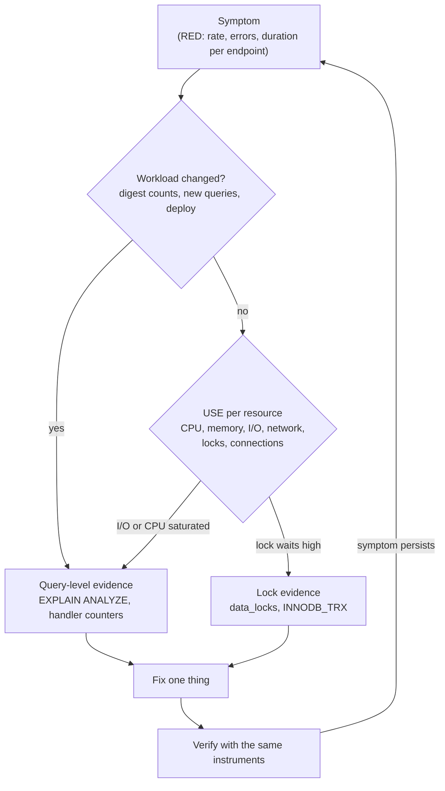

## Introduction

"The database is slow" is the most common sentence in production incident channels, and the least useful. It is a **symptom** reported by someone who sees latency or errors; it says nothing about the cause. The cause might be one query that lost its index, a hot row that every request locks, a long transaction holding locks, a disk that is saturated by a backup, a connection pool that is too small, a replica that is lagging, or an application that started issuing ten times more queries after a deploy. Each needs a different fix, and the wrong fix — adding memory, raising `max_connections`, restarting the server — often makes the next incident worse.

Professionals therefore troubleshoot with a **method**, not with intuition:

1. **Symptom** — state precisely what is wrong, for whom, since when (p99 latency of `/checkout` rose from 80 ms to 2 s at 14:05; error 1205 in payments).
2. **Hypothesis** — propose specific, falsifiable causes.
3. **Evidence** — collect data that confirms or refutes each hypothesis: plans, counters, lock snapshots, resource metrics.
4. **Fix** — change one thing, ideally the cause rather than the symptom.
5. **Verify** — measure again with the same instruments, and confirm the symptom is gone.

This lesson teaches that method with tools you can run: `EXPLAIN ANALYZE`, session status counters, InnoDB lock snapshots, and workload analysis by query **digest** in SQL. It works through three case studies in the lab, then gives a system-level checklist — Brendan Gregg's **USE method** (Utilization, Saturation, Errors) mapped to MySQL — for problems that are about resources rather than individual queries. Diagnosing a single slow query in depth is covered in [Slow Query Diagnostics](/lessons/m07-slow-query-diagnostics) and [EXPLAIN ANALYZE](/lessons/m07-explain-analyze); this lesson is about the whole investigation.

:::note[Dataset and evidence]
The lab starts empty and generates a 200,000-row `orders` table. Timings come from `measured` blocks on the build machine; counter values and lock snapshots are exact. Server-wide tools (`performance_schema`, `sys`, `SHOW GLOBAL STATUS`, OS metrics) are shown display-only with their real names; any sample output is labelled illustrative.
:::

## DBMS Theory

:::theory[Response time, throughput and queueing]
Every request's response time decomposes into **service time** (the work: CPU, page reads, network transfer) and **wait time** (queueing for a resource: a CPU core, a disk, a row lock, a mutex, a pool connection). Queueing theory explains why latency explodes rather than grows gently: for a resource with utilisation ρ, the expected waiting time in a simple M/M/1 queue grows like ρ / (1 − ρ) — at 50% utilisation waits are about one service time, at 90% about nine, at 95% about nineteen. Two consequences drive troubleshooting:

- A resource that is **saturated** (requests queue for it) dominates latency even if each operation is fast.
- Reducing the **demand** on the bottleneck (fewer rows read, fewer lock holders, fewer statements) is usually far more effective than speeding up everything else.

**Little's law** (L = λ × W) links them: if the arrival rate stays the same and each request holds a resource longer (W grows), the number of concurrent holders (L) grows — more threads running, more connections in use, more locks held.
:::

Two well-established methods structure the search:

- **The USE method** (Brendan Gregg): for every *resource* (CPU, memory, storage I/O, network, and — for databases — locks, connections, threads), check **U**tilization (how busy), **S**aturation (how much work is queued) and **E**rrors. It finds resource bottlenecks quickly and systematically.
- **The RED method** (Tom Wilkie) for *services*: **R**ate (requests/s), **E**rrors, **D**uration (latency distribution). It tells you *which* endpoint is affected and when it started; USE then tells you *which resource* is responsible.

At the database level, the equivalent of RED is **workload analysis by query digest**: normalise statements into templates (`SELECT … WHERE customer_id = ?`), and aggregate count, total time, rows examined and errors per template. The query that matters is rarely the slowest single execution; it is the one with the largest **total** time (count × mean), or the one whose plan changed.

## Why It Exists

Without a method, teams fall into well-known traps:

- **Tuning by folklore** — raising `innodb_buffer_pool_size`, `max_connections` or `sort_buffer_size` because a blog post said so, without evidence that memory or connections are the bottleneck. Many such changes are neutral; some (huge per-session buffers, thousands of connections) make things worse.
- **Fixing the symptom** — killing the long query, restarting the server, failing over — which restores service but guarantees a repeat.
- **Changing several things at once**, so nobody knows which change helped (or which one caused the next problem).
- **Optimising the wrong query** — the slowest single query in the slow log runs twice a day; the query that costs 40% of the server's time runs in 3 ms, 5,000 times per second.
- **Ignoring waits** — looking only at CPU and I/O while requests are actually queued behind one row lock.

A method makes investigations faster, repeatable and teachable, and produces a post-incident record of evidence instead of a story.

## Internal Working

:::internals[Where the evidence comes from in MySQL]
**Per statement**
- `EXPLAIN` — the chosen plan and the optimizer's estimates; `EXPLAIN ANALYZE` — the plan executed with **actual** rows, loops and time per iterator (it runs the query).
- Session status counters (`SHOW SESSION STATUS`): `Handler_read_*` (rows read by access type), `Select_scan`, `Select_full_join`, `Sort_merge_passes`, `Created_tmp_disk_tables`, `Innodb_rows_read` — exact counts of work for this connection.
- The slow query log with `long_query_time` (and `log_slow_extra = ON` in 8.0.14+ for rows examined, temp tables, bytes sent).

**Per workload** (server-wide; need `performance_schema` access)
- `performance_schema.events_statements_summary_by_digest` — per normalised statement: `COUNT_STAR`, `SUM_TIMER_WAIT`, `SUM_ROWS_EXAMINED`, `SUM_ROWS_SENT`, `SUM_NO_INDEX_USED`, `SUM_CREATED_TMP_DISK_TABLES`, errors, first/last seen, and (8.0) `QUANTILE_95`/`QUANTILE_99` latency.
- `sys.statement_analysis`, `sys.statements_with_full_table_scans`, `sys.schema_unused_indexes`, `sys.schema_table_statistics` — readable views over performance_schema.

**Locks and transactions**
- `performance_schema.data_locks` / `data_lock_waits` (8.0+) — every InnoDB lock held or requested, and who waits for whom; `sys.innodb_lock_waits` joins them into "blocker / waiter" rows.
- `information_schema.INNODB_TRX` — open transactions, their age, rows locked and modified.
- `performance_schema.metadata_locks` — metadata locks (DDL pile-ups, see [Schema Evolution](/lessons/m12-schema-evolution)).
- `SHOW ENGINE INNODB STATUS` — latest deadlock, semaphore waits, history list length, I/O state.

**Resources** (`SHOW GLOBAL STATUS` plus OS tools)
- CPU: `Threads_running` (concurrently executing statements), OS CPU utilisation and run queue.
- Memory/buffer pool: `Innodb_buffer_pool_reads` (reads that missed the buffer pool) vs `Innodb_buffer_pool_read_requests`, `Innodb_buffer_pool_wait_free`.
- Storage: `Innodb_data_reads/writes`, `Innodb_data_fsyncs`, `Innodb_os_log_written`, checkpoint age; OS `iostat` utilisation, queue depth and await.
- Locks: `Innodb_row_lock_waits`, `Innodb_row_lock_time`, `Innodb_row_lock_current_waits`.
- Connections: `Threads_connected` vs `max_connections`, `Connection_errors_max_connections`, `Aborted_clients`.
:::



## MySQL Implementation

Build the case-study data: 200,000 orders for 20,000 customers, with the indexes an early version of the application created (primary key and `created_at` only).

```sql run
SET SESSION cte_max_recursion_depth = 200000;
CREATE TABLE orders (
  order_id     INT UNSIGNED NOT NULL PRIMARY KEY,
  customer_id  INT UNSIGNED NOT NULL,
  status       VARCHAR(10)  NOT NULL,
  created_at   DATETIME     NOT NULL,
  total        DECIMAL(10,2) NOT NULL,
  external_ref CHAR(12)     NOT NULL,
  KEY idx_orders_created (created_at)
);
INSERT INTO orders
WITH RECURSIVE seq(n) AS (SELECT 1 UNION ALL SELECT n + 1 FROM seq WHERE n < 200000)
SELECT n, (n * 7919) % 20000 + 1, ELT(1 + n % 4, 'paid', 'shipped', 'delivered', 'refunded'),
       '2023-01-01' + INTERVAL (n * 4) MINUTE, ROUND(5 + (n * 37) % 20000 / 100, 2),
       CONCAT('EXT', LPAD(n, 9, '0'))
FROM seq;
ANALYZE TABLE orders;
SELECT COUNT(*) AS orders, COUNT(DISTINCT customer_id) AS customers FROM orders;
```

### Case study 1 — "The order history page got slow"

**Symptom.** p99 of `GET /customers/{id}/orders` rose from 15 ms to 900 ms as the table grew; CPU on the database is elevated; no errors.

**Hypothesis.** The page's query does not have a suitable index and reads far more rows than it returns.

**Evidence.** First the plan, then the actual execution, then the exact work in handler counters:

```sql run
EXPLAIN SELECT order_id, created_at, total FROM orders
WHERE customer_id = 4217 ORDER BY created_at DESC LIMIT 10;
```

```sql run measured
EXPLAIN ANALYZE SELECT order_id, created_at, total FROM orders
WHERE customer_id = 4217 ORDER BY created_at DESC LIMIT 10;
```

```sql run
SHOW SESSION STATUS WHERE Variable_name IN ('Handler_read_key', 'Handler_read_next', 'Handler_read_prev', 'Handler_read_rnd_next');
SELECT order_id, created_at, total FROM orders WHERE customer_id = 4217 ORDER BY created_at DESC LIMIT 10;
SHOW SESSION STATUS WHERE Variable_name IN ('Handler_read_key', 'Handler_read_next', 'Handler_read_prev', 'Handler_read_rnd_next');
```

The evidence is unambiguous — and instructive. There is no index on `customer_id`, so the optimizer chose to read the `created_at` index **backwards** (`Backward index scan`, avoiding a sort for `ORDER BY … LIMIT 10`) and check each row's `customer_id`, *estimating* that it would find 10 matching rows almost immediately (`rows: 10`). `EXPLAIN ANALYZE` shows what actually happened: the reverse index scan read **185,337** entries before it had found this customer's 10 orders (they are spread over the whole history), taking about 190 ms on the build machine. The handler counters agree exactly: `Handler_read_prev` grew by 185,336. An estimate of 10 against an actual of 185,337 is itself a finding — the optimizer's `ORDER BY … LIMIT` heuristic assumed matching rows are spread evenly and plentiful. The hypothesis is confirmed: the cost is proportional to the table size, which explains why the page degraded gradually as the table grew.

**Fix.** An index that matches the access path — equality on `customer_id`, then order by `created_at`:

```sql run
ALTER TABLE orders ADD INDEX idx_orders_customer_created (customer_id, created_at), ALGORITHM=INPLACE, LOCK=NONE;
ANALYZE TABLE orders;
```

**Verify** with the same instruments:

```sql run measured
EXPLAIN ANALYZE SELECT order_id, created_at, total FROM orders
WHERE customer_id = 4217 ORDER BY created_at DESC LIMIT 10;
```

```sql run
SHOW SESSION STATUS WHERE Variable_name IN ('Handler_read_key', 'Handler_read_next', 'Handler_read_prev', 'Handler_read_rnd_next');
SELECT order_id, created_at, total FROM orders WHERE customer_id = 4217 ORDER BY created_at DESC LIMIT 10;
SHOW SESSION STATUS WHERE Variable_name IN ('Handler_read_key', 'Handler_read_next', 'Handler_read_prev', 'Handler_read_rnd_next');
```

One index lookup (`Handler_read_key` +1) and about ten backward steps (`Handler_read_prev`) — the cost no longer depends on the table size. In production, verification also means watching the endpoint's p99 return to normal and the digest's rows-examined-per-call drop, and confirming that the new index did not slow the insert path noticeably.

## Syntax Breakdown

The evidence-gathering toolkit, by question:

| Question | Sandbox-runnable | Production (display only) |
|---|---|---|
| What plan does this query use? | `EXPLAIN`, `EXPLAIN FORMAT=TREE`, `EXPLAIN FORMAT=JSON` | Same; `EXPLAIN FOR CONNECTION <id>` for a running statement |
| How much work does it actually do? | `EXPLAIN ANALYZE`; `SHOW SESSION STATUS LIKE 'Handler%'` before/after | Slow log with `log_slow_extra`; digest `SUM_ROWS_EXAMINED / COUNT_STAR` |
| Which queries cost the most overall? | Digest analysis over a query log table (Example 1 below) | `sys.statement_analysis`, `events_statements_summary_by_digest` ordered by `SUM_TIMER_WAIT` |
| Who is waiting for which lock? | `observe: locks` scenarios in this course | `sys.innodb_lock_waits`, `performance_schema.data_lock_waits` |
| Are there old transactions? | — | `information_schema.INNODB_TRX` ordered by `trx_started` |
| Is a resource saturated? | — | `SHOW GLOBAL STATUS` deltas, OS metrics (CPU run queue, `iostat`, network) |
| Did the optimizer's estimate go wrong? | `EXPLAIN ANALYZE` (estimated vs actual rows), `ANALYZE TABLE` | Same, plus histogram statistics (`ANALYZE TABLE … UPDATE HISTOGRAM`) |

```sql
-- Top statements by total latency (requires performance_schema access) — display only
SELECT DIGEST_TEXT, COUNT_STAR,
       ROUND(SUM_TIMER_WAIT / 1e12, 1)               AS total_s,      -- timers are in picoseconds
       ROUND(AVG_TIMER_WAIT / 1e9, 2)                AS avg_ms,
       ROUND(QUANTILE_95 / 1e9, 2)                   AS p95_ms,
       ROUND(SUM_ROWS_EXAMINED / COUNT_STAR)         AS rows_examined_per_call,
       SUM_NO_INDEX_USED
FROM performance_schema.events_statements_summary_by_digest
ORDER BY SUM_TIMER_WAIT DESC LIMIT 10;

-- Who blocks whom right now
SELECT waiting_pid, waiting_query, blocking_pid, blocking_query, wait_age, sql_kill_blocking_query
FROM sys.innodb_lock_waits;

-- Oldest open transactions
SELECT trx_mysql_thread_id, trx_started, TIMESTAMPDIFF(SECOND, trx_started, NOW()) AS age_s,
       trx_rows_locked, trx_rows_modified, trx_query
FROM information_schema.INNODB_TRX ORDER BY trx_started LIMIT 5;
```

## Practical Examples

### 1. Workload analysis by digest

Before optimising anything, find out *where the time goes*. A query log (here a table with one row per execution, as you would export from the slow log at `long_query_time = 0` or from an APM) is normalised into digests and ranked by **total** time:

```sql run
CREATE TABLE query_log (id INT AUTO_INCREMENT PRIMARY KEY, digest VARCHAR(80) NOT NULL, duration_ms DECIMAL(10,3) NOT NULL, rows_examined INT NOT NULL);
INSERT INTO query_log (digest, duration_ms, rows_examined)
WITH RECURSIVE s(n) AS (SELECT 1 UNION ALL SELECT n + 1 FROM s WHERE n < 3000)
SELECT CASE WHEN n % 100 = 0 THEN 'SELECT … FROM orders WHERE created_at BETWEEN ? AND ? (report)'
            WHEN n % 3 = 0  THEN 'SELECT … FROM orders WHERE customer_id = ? ORDER BY created_at DESC LIMIT ?'
            WHEN n % 3 = 1  THEN 'SELECT … FROM products WHERE product_id = ?'
            ELSE                 'UPDATE carts SET … WHERE cart_id = ?' END,
       CASE WHEN n % 100 = 0 THEN 1800 + (n % 7) * 100
            WHEN n % 3 = 0  THEN 60 + (n % 11) * 4 + IF(n % 37 = 0, 400, 0)
            WHEN n % 3 = 1  THEN 0.300 + (n % 5) * 0.05
            ELSE                 1.2 + (n % 9) * 0.3 END,
       CASE WHEN n % 100 = 0 THEN 190000 WHEN n % 3 = 0 THEN 200000 WHEN n % 3 = 1 THEN 1 ELSE 1 END
FROM s;
SELECT digest, COUNT(*) AS calls,
       ROUND(SUM(duration_ms) / 1000, 2) AS total_s,
       ROUND(100 * SUM(duration_ms) / SUM(SUM(duration_ms)) OVER (), 1) AS pct_of_total,
       ROUND(AVG(duration_ms), 2) AS avg_ms,
       MAX(duration_ms) AS max_ms,
       ROUND(AVG(rows_examined)) AS rows_examined_per_call
FROM query_log GROUP BY digest ORDER BY total_s DESC;
```

The report query is the slowest single statement (about 2 seconds per call) and is the one people complain about. But the customer-history query — the one from Case study 1, before its fix — consumes the largest share of total time, because it runs 33 times as often (990 calls against 30). The rows-examined-per-call column says *why*: 200,000 rows examined for a 10-row page. Ranking by total time and rows examined per call points directly at the highest-value fix.

Tail latency per digest needs percentiles, not averages:

```sql run
SELECT digest, COUNT(*) AS calls,
       ROUND(AVG(duration_ms), 2) AS avg_ms,
       MAX(CASE WHEN pr <= 0.50 THEN duration_ms END) AS p50_ms,
       MAX(CASE WHEN pr <= 0.95 THEN duration_ms END) AS p95_ms,
       MAX(CASE WHEN pr <= 0.99 THEN duration_ms END) AS p99_ms
FROM (SELECT digest, duration_ms,
             PERCENT_RANK() OVER (PARTITION BY digest ORDER BY duration_ms) AS pr
      FROM query_log) t
GROUP BY digest ORDER BY p99_ms DESC;
```

For the customer-history digest, p99 is far above the average because of the occasional 400 ms outliers in the log — exactly the kind of tail that an average hides and users notice.

### 2. Case study 2 — "Checkout errors with 1205 under load"

**Symptom.** At peak, some `POST /checkout` requests fail with error 1205 (*Lock wait timeout exceeded*); p99 rises sharply with concurrency, while CPU and I/O are moderate.

**Hypothesis.** Lock contention: many transactions wait for the same lock. Candidates: a hot row updated by every checkout, or a long transaction holding locks.

**Evidence.** Reproduce two concurrent checkouts and take a lock snapshot. Every checkout inserts its order and increments a per-day counter row in the same transaction:

```concurrency
title: Every checkout transaction updates the same counter row
description: daily_stats has one row per day. Sessions A and B are two concurrent checkouts.
setup: |
  CREATE TABLE checkout_orders (order_id INT AUTO_INCREMENT PRIMARY KEY, customer_id INT NOT NULL, total DECIMAL(10,2) NOT NULL);
  CREATE TABLE daily_stats (day DATE PRIMARY KEY, orders INT NOT NULL, revenue DECIMAL(12,2) NOT NULL);
  INSERT INTO daily_stats VALUES ('2024-12-01', 0, 0.00);
steps:
  - session: A
    sql: START TRANSACTION; INSERT INTO checkout_orders (customer_id, total) VALUES (1, 50.00); UPDATE daily_stats SET orders = orders + 1, revenue = revenue + 50.00 WHERE day = '2024-12-01';
    note: Checkout A has inserted its order and incremented the counter; it still has to call other services (or simply has more statements) before COMMIT.
  - session: B
    sql: START TRANSACTION; INSERT INTO checkout_orders (customer_id, total) VALUES (2, 30.00);
    note: Checkout B's order insert does not conflict with A — different rows.
  - session: B
    sql: UPDATE daily_stats SET orders = orders + 1, revenue = revenue + 30.00 WHERE day = '2024-12-01';
    expect: blocks
    note: B waits for A's exclusive lock on the single counter row. Every concurrent checkout queues here.
  - observe: locks
  - session: A
    sql: COMMIT;
    note: A commits; B's counter update proceeds.
  - session: B
    sql: COMMIT; SELECT * FROM daily_stats;
```

The lock snapshot is the evidence: A holds `X,REC_NOT_GAP` on the `daily_stats` PRIMARY record for 2024-12-01 (shown as `1036673`, InnoDB's internal integer encoding of the DATE key), B requests the identical lock and is `WAITING`, while the two order inserts coexist without conflict (each transaction holds only an `IX` intention lock on `checkout_orders`). Every checkout is serialised on one row for the remainder of its transaction — throughput is capped at 1 / (time from counter update to commit), and with a 50-second default `innodb_lock_wait_timeout` the queue turns into 1205 errors.

**Fix.** Two options, often combined: (a) move the counter update to the **end** of the transaction, just before COMMIT, so the lock is held as briefly as possible; (b) remove the single hot row by **splitting the counter** into N slot rows — each transaction increments one slot (chosen at random or by connection), and readers sum the slots:

```concurrency
title: A split counter removes the hot row
setup: |
  CREATE TABLE checkout_orders (order_id INT AUTO_INCREMENT PRIMARY KEY, customer_id INT NOT NULL, total DECIMAL(10,2) NOT NULL);
  CREATE TABLE daily_stats_slots (day DATE NOT NULL, slot TINYINT NOT NULL, orders INT NOT NULL, revenue DECIMAL(12,2) NOT NULL, PRIMARY KEY (day, slot));
  INSERT INTO daily_stats_slots VALUES ('2024-12-01', 0, 0, 0), ('2024-12-01', 1, 0, 0), ('2024-12-01', 2, 0, 0), ('2024-12-01', 3, 0, 0);
steps:
  - session: A
    sql: START TRANSACTION; INSERT INTO checkout_orders (customer_id, total) VALUES (1, 50.00); UPDATE daily_stats_slots SET orders = orders + 1, revenue = revenue + 50.00 WHERE day = '2024-12-01' AND slot = 1;
    note: A increments slot 1 (in the application, slot = random value in 0..3).
  - session: B
    sql: START TRANSACTION; INSERT INTO checkout_orders (customer_id, total) VALUES (2, 30.00); UPDATE daily_stats_slots SET orders = orders + 1, revenue = revenue + 30.00 WHERE day = '2024-12-01' AND slot = 2;
    note: B increments slot 2 — a different row, so it does not wait.
  - observe: locks
  - session: A
    sql: COMMIT;
  - session: B
    sql: COMMIT; SELECT day, SUM(orders) AS orders, SUM(revenue) AS revenue FROM daily_stats_slots GROUP BY day;
    note: Readers sum the slots; the total is exact.
```

**Verify.** In the second snapshot both transactions hold their own `X,REC_NOT_GAP` lock on different slot records and nothing is waiting. In production, verification means `Innodb_row_lock_waits` and `Innodb_row_lock_time` deltas dropping at peak, `sys.innodb_lock_waits` empty, 1205 errors gone, and checkout throughput no longer flattening with concurrency. With N slots, two random transactions collide with probability 1/N — choose N from the concurrency you need. (An even simpler fix is often to drop the synchronous counter altogether and compute daily stats asynchronously from the orders table or an outbox.)

### 3. Case study 3 — "A nightly job blocks unrelated updates"

**Symptom.** During a reconciliation job, customer-service agents cannot update orders; their requests hang and time out. The job updates a *handful* of orders by their external reference.

**Hypothesis.** The job's UPDATE has no index on its predicate column, so under REPEATABLE READ InnoDB locks every row it **scans**, not just the rows it changes.

**Evidence.**

```sql run
EXPLAIN UPDATE orders SET status = 'refunded' WHERE external_ref = 'EXT000123456';
```

`type: index` or `ALL` with `key: PRIMARY` and ~200,000 rows: a full scan of the clustered index. A locking scan sets a next-key lock on every record it examines, and for an UPDATE InnoDB keeps those locks on rows that do not match. A small reproduction makes the lock footprint visible:

```concurrency
title: An UPDATE without an index locks every row it scans
setup: |
  CREATE TABLE small_orders (order_id INT PRIMARY KEY, external_ref CHAR(12) NOT NULL, status VARCHAR(10) NOT NULL);
  INSERT INTO small_orders VALUES (1,'EXT000000001','paid'),(2,'EXT000000002','paid'),(3,'EXT000000003','paid'),(4,'EXT000000004','paid'),(5,'EXT000000005','paid');
steps:
  - session: A
    sql: START TRANSACTION; UPDATE small_orders SET status = 'refunded' WHERE external_ref = 'EXT000000002';
    note: The job changes one row — but there is no index on external_ref, so it scans the whole clustered index.
  - observe: locks
  - session: B
    sql: UPDATE small_orders SET status = 'shipped' WHERE order_id = 5;
    expect: blocks
    note: An agent updates an unrelated order (5) and waits — the job holds a lock on that record too.
  - session: A
    sql: COMMIT;
  - session: A
    sql: ALTER TABLE small_orders ADD INDEX idx_ext (external_ref);
    note: The fix — an index on the predicate column.
  - session: A
    sql: START TRANSACTION; UPDATE small_orders SET status = 'paid' WHERE external_ref = 'EXT000000003';
    note: Same job statement, now located through the index.
  - observe: locks
  - session: B
    sql: UPDATE small_orders SET status = 'delivered' WHERE order_id = 4;
    note: The agent's update of another order no longer waits.
  - session: A
    sql: COMMIT; SELECT order_id, status FROM small_orders ORDER BY order_id;
```

The first lock snapshot shows A holding `X` (next-key) locks on **every** PRIMARY record — 1 to 5 plus the supremum pseudo-record, six locked "rows" — after changing a single row, which is why B's update of order 5 waits. After the index is added, the second snapshot shows a next-key lock on the matching `idx_ext` entry (`'EXT000000003', 3`), a gap lock before the next entry (`'EXT000000004', 4`, the REPEATABLE READ protection against phantoms) and `X,REC_NOT_GAP` on the single PRIMARY record 3; B's update of order 4 does not wait. Verify in production with the job's runtime, `Innodb_row_lock_waits` during the job window, and the absence of agent timeouts.

## Execution Walkthrough

The full method on Case study 1, as a post-incident record:

```walkthrough
title: From symptom to verified fix — the order-history regression
steps:
  - title: "1. Symptom"
    explain: The endpoint's p99 grew from 15 ms to 900 ms over weeks; the digest analysis ranks its query first by total time with ~200,000 rows examined per call. The workload (call rate) has not changed; the cost per call has.
    sql: |
      SELECT digest, COUNT(*) AS calls, ROUND(SUM(duration_ms) / 1000, 2) AS total_s, ROUND(AVG(rows_examined)) AS rows_examined_per_call
      FROM query_log WHERE digest LIKE '%customer_id = ?%' GROUP BY digest;
  - title: "2. Hypothesis"
    explain: The statement lacks an index for its access path (equality on customer_id, order by created_at), so its cost grows with table size. Falsifiable prediction — rows examined ≈ table size, and an index on (customer_id, created_at) reduces it to ≈ 10.
  - title: "3. Evidence after the fix is in place"
    explain: The current plan uses the new composite index with type ref and a backward index scan; the estimate is a handful of rows. (Before the fix, the captured EXPLAIN ANALYZE above showed about 200,000 rows read.)
    sql: EXPLAIN SELECT order_id, created_at, total FROM orders WHERE customer_id = 4217 ORDER BY created_at DESC LIMIT 10;
  - title: "4. Side effects checked"
    explain: A new index costs write work on every insert and space. Check the indexes and keep the change only if the write path's latency budget allows it. The table now has two secondary indexes besides the primary key.
    sql: |
      SELECT INDEX_NAME, GROUP_CONCAT(COLUMN_NAME ORDER BY SEQ_IN_INDEX) AS columns
      FROM information_schema.STATISTICS
      WHERE TABLE_SCHEMA = DATABASE() AND TABLE_NAME = 'orders'
      GROUP BY INDEX_NAME ORDER BY INDEX_NAME;
  - title: "5. Verified and recorded"
    explain: Handler counters show one key lookup and about ten row reads per call. The post-incident record lists the symptom, the evidence before and after, the single change made, and a follow-up (a CI check that EXPLAINs the top digests against production-sized data).
```

## Output

- **Case 1:** without a suitable index the order-history query read 185,337 index entries (estimated: 10) to return 10 rows; with `(customer_id, created_at)` it did one index lookup and about ten backward reads.
- **Digest analysis:** the report query was the slowest per call, but the customer-history query had the largest share of total time and 200,000 rows examined per call; percentiles exposed its tail.
- **Case 2:** two checkouts serialised on one `daily_stats` row (`X,REC_NOT_GAP` granted to A, the same lock `WAITING` for B); with four counter slots they proceeded in parallel and the summed totals were exact.
- **Case 3:** an UPDATE without an index on `external_ref` held next-key locks on every row it scanned and blocked an unrelated update; with the index, the lock footprint shrank to the matching row and the unrelated update ran immediately.

## Alternative Approaches

| Problem class | Evidence | Typical fixes (in rough order of preference) |
|---|---|---|
| One query got slower | Digest rows examined per call; EXPLAIN ANALYZE; plan change after statistics update | Index for the access path; rewrite (sargable predicates, keyset pagination); refresh statistics or histograms; optimizer hints as a last resort |
| Many more queries | Digest `COUNT_STAR` jumped after a deploy; `Questions` rate | Fix N+1 or chatty code ([Web App Architecture](/lessons/m12-web-app-architecture)); cache; batch |
| Lock contention | `Innodb_row_lock_waits`, `sys.innodb_lock_waits`, 1205/1213 errors | Shorter transactions; lock in consistent order; index the locking predicate; split hot rows; asynchronous aggregates; READ COMMITTED for specific jobs |
| Long transactions | `INNODB_TRX` age; history list length | Fix the code path (missing commit, external calls inside); timeouts; kill and alert |
| CPU saturation | `Threads_running` ≫ cores; OS CPU at 100% | Reduce rows examined (indexes); cap concurrency (pool sizes, `MAX_EXECUTION_TIME`); scale up/out |
| I/O saturation | Buffer pool miss rate up; OS await and queue depth up; `Innodb_data_reads` rate | Working set exceeds memory → more RAM or less data touched; faster storage; move scans/backups off the primary |
| Connection exhaustion | `Threads_connected` near `max_connections`, error 1040 | Smaller pools / a proxy; find what holds connections (slow queries, leaks) |
| Replica lag | Lag metrics; large transactions in binlog | Batch large writes; multi-threaded apply; move heavy reads ([Read Replicas](/lessons/m12-read-replicas)) |

Tuning server variables belongs **after** these: it is the right fix when evidence points at a configured limit (a buffer pool far smaller than the working set, a redo log so small that checkpoints throttle writes), not as a first resort.

## Performance Analysis

**The USE method for MySQL** — a checklist to run in the first minutes of a resource-level incident (all display-only; values below are not captured):

| Resource | Utilization | Saturation | Errors |
|---|---|---|---|
| CPU | OS CPU %, per-core | OS run queue; `Threads_running` far above core count | — |
| Memory / buffer pool | Buffer pool pages in use | `Innodb_buffer_pool_reads` rate rising (misses); `Innodb_buffer_pool_wait_free` > 0; OS swapping | OOM kills in the OS log |
| Storage I/O | OS `%util`, IOPS and MB/s vs provisioned | OS queue depth and await; checkpoint age near its limit; `Innodb_os_log_pending_fsyncs` | I/O errors in the error log |
| Network | NIC throughput | Retransmits, drops | `Aborted_clients`, `Aborted_connects` |
| Row locks | `Innodb_row_lock_current_waits` | `Innodb_row_lock_time` growth, `sys.innodb_lock_waits` rows | 1205, 1213 counts |
| Metadata locks | — | Sessions in "Waiting for table metadata lock" | 1205 from DDL |
| Connections | `Threads_connected` / `max_connections` | Pool wait time in the app | 1040, `Connection_errors_max_connections` |
| Replication | Applier busy | Lag | Applier errors |

```sql
-- Rates from two snapshots of global counters, N seconds apart (display only; requires access to global status)
SHOW GLOBAL STATUS WHERE Variable_name IN
  ('Questions', 'Threads_running', 'Innodb_buffer_pool_read_requests', 'Innodb_buffer_pool_reads',
   'Innodb_row_lock_waits', 'Innodb_row_lock_time', 'Innodb_data_fsyncs', 'Created_tmp_disk_tables');
-- buffer pool miss ratio ≈ Δ Innodb_buffer_pool_reads / Δ Innodb_buffer_pool_read_requests
```

**Theory versus measurement.** Each hypothesis predicts something measurable; prefer evidence that can *refute* it. "The disk is slow" predicts high await and queue depth during the latency spike; if await is normal, the hypothesis is wrong regardless of how plausible it sounded. Correlation in time is weak evidence (a backup and a spike at 02:00 may both be caused by a cron job); a controlled reproduction — as in the three case studies — is strong evidence.

**Plan regressions** deserve special mention: a query whose plan changes (after statistics are recomputed, data distribution shifts, or an upgrade) can go from milliseconds to seconds with no code change. Digest-level `SUM_ROWS_EXAMINED / COUNT_STAR` over time, and stored `EXPLAIN` output for critical queries, catch them.

## Best Practices

:::best-practice[Troubleshooting like an engineer]
1. **Write the symptom down precisely** — which endpoint, which metric, since when, how much — before touching anything.
2. **Check what changed** (deploys, schema migrations, traffic, data volume, configuration, statistics) — most incidents follow a change.
3. **Rank queries by total time and rows examined per call**, not by the slowest single execution.
4. **Look for waits as well as work**: lock waits, metadata locks, pool waits, I/O queues.
5. **Prefer reproductions and before/after counters** to correlations on dashboards.
6. **Change one thing at a time**, keep the evidence, and verify with the same instrument that showed the problem.
7. **Fix causes, not symptoms**: an index or a shorter transaction rather than a bigger server or a higher timeout.
8. **Record the investigation** (symptom, hypotheses, evidence, fix, verification, follow-ups) — it becomes the runbook for the next one.
9. **Build the instruments before the incident**: digest collection, slow log with `log_slow_extra`, lock-wait and long-transaction alerts, per-endpoint RED metrics ([Observability and Capacity Planning](/lessons/m12-observability-capacity)).
:::

## Common Mistakes

**Mistake 1 — trusting estimates instead of measurements.** `EXPLAIN` rows are estimates from statistics; `EXPLAIN ANALYZE` reports what happened. When they disagree by orders of magnitude, the optimizer is working with wrong statistics — that disagreement is itself evidence.

**Mistake 2 — assuming `EXPLAIN ANALYZE` is harmless.** It **executes** the statement to measure it. On a production primary, `EXPLAIN ANALYZE` of a 30-second report costs 30 seconds of load; run expensive investigations on a replica or a restored copy. For data-changing statements, support is limited — on the capture server, a single-table UPDATE is not measured at all:

```sql run
EXPLAIN ANALYZE UPDATE orders SET total = total WHERE order_id = 1;
```

The output is `<not executable by iterator executor>`. To analyse a slow UPDATE or DELETE, measure the equivalent `SELECT` with the same `WHERE` clause (that is the part that finds the rows), check the plan with plain `EXPLAIN UPDATE …`, and consult the `EXPLAIN` page of the manual for the forms your exact version supports.

**Mistake 3 — raising timeouts to make lock errors disappear.** A higher `innodb_lock_wait_timeout` turns 1205 errors into longer hangs; the contention remains, and more connections pile up.

**Mistake 4 — adding indexes without checking the write path.** Every index slows inserts and updates of its columns. Check the table's write rate and the endpoint budgets before and after.

**Mistake 5 — restarting MySQL as a fix.** A restart empties the buffer pool (unless dump/load at startup is enabled, which is the default since 5.7 for a percentage of pages), kills transactions, and destroys the evidence in `performance_schema`. Capture evidence first.

**Mistake 6 — optimising averages.** Users experience the tail. Use p95/p99 per digest and per endpoint, as the percentile query above did.

## Industry Application

- **Incident response** in mature organisations follows exactly this loop, with an incident commander, a timeline, and a post-incident review that records evidence and follow-ups (blameless postmortems).
- **Percona Monitoring and Management (PMM)**, **MySQL Enterprise Monitor**, Datadog/New Relic database monitoring and cloud tools (Amazon RDS Performance Insights, Cloud SQL Query Insights) are built on `performance_schema` digests and wait events — "top SQL by load" is the digest analysis of Example 1.
- **pt-query-digest** (Percona Toolkit) produces the same ranking from slow logs, packet captures or the processlist, and remains a standard tool for offline workload analysis.
- **Continuous query review**: teams store the plans of their top digests, alert on plan changes or rows-examined regressions, and run EXPLAIN checks against production-sized data in CI.
- **Lock contention fixes** — split counters, asynchronous aggregates, shorter transactions, consistent lock order — are standard patterns in high-write systems (ticketing, inventory, payments).

## Practice Exercises

```exercise
id: ex1
title: Rank digests by total time
difficulty: easy
setup: |
  CREATE TABLE query_log (id INT AUTO_INCREMENT PRIMARY KEY, digest VARCHAR(60) NOT NULL, duration_ms DECIMAL(10,3) NOT NULL);
  INSERT INTO query_log (digest, duration_ms) VALUES
    ('report_monthly', 2400), ('report_monthly', 2600),
    ('get_cart', 2.0), ('get_cart', 2.5), ('get_cart', 3.0), ('get_cart', 2.0), ('get_cart', 2.5),
    ('order_history', 120), ('order_history', 150), ('order_history', 110), ('order_history', 130), ('order_history', 140),
    ('order_history', 125), ('order_history', 135), ('order_history', 145), ('order_history', 115), ('order_history', 130),
    ('order_history', 120), ('order_history', 150), ('order_history', 110), ('order_history', 130), ('order_history', 140),
    ('order_history', 125), ('order_history', 135), ('order_history', 145), ('order_history', 115), ('order_history', 130),
    ('order_history', 120), ('order_history', 150), ('order_history', 110), ('order_history', 130), ('order_history', 140),
    ('order_history', 125), ('order_history', 135), ('order_history', 145), ('order_history', 115), ('order_history', 130),
    ('order_history', 120), ('order_history', 150), ('order_history', 110), ('order_history', 130), ('order_history', 140),
    ('order_history', 125), ('order_history', 135), ('order_history', 145), ('order_history', 115), ('order_history', 130);
concepts: [workload-analysis, query-digests]
prompt: |
  Return one row per `digest` with `digest`, `calls`, `total_ms` (sum of durations) and `avg_ms` (rounded to
  1 decimal), ordered by `total_ms` descending.
hints:
  - "GROUP BY digest with COUNT(*), SUM(duration_ms), AVG(duration_ms)."
solution: |
  SELECT digest, COUNT(*) AS calls, SUM(duration_ms) AS total_ms, ROUND(AVG(duration_ms), 1) AS avg_ms
  FROM query_log GROUP BY digest ORDER BY total_ms DESC;
orderMatters: true
explanation: |
  `order_history` (40 calls × 130 ms = 5.2 s) costs more in total than `report_monthly` (2 calls, 5.0 s),
  although each report call (2.5 s on average) is about 19 times slower. Optimising by "slowest query" would have picked the
  wrong target.
```

```exercise
id: ex2
title: p95 per digest
difficulty: medium
setup: |
  CREATE TABLE query_log (id INT AUTO_INCREMENT PRIMARY KEY, digest VARCHAR(60) NOT NULL, duration_ms INT NOT NULL);
  INSERT INTO query_log (digest, duration_ms) VALUES
    ('a', 10), ('a', 12), ('a', 11), ('a', 13), ('a', 10), ('a', 12), ('a', 11), ('a', 10), ('a', 14), ('a', 400),
    ('b', 50), ('b', 52), ('b', 55), ('b', 51), ('b', 53), ('b', 54), ('b', 50), ('b', 52), ('b', 56), ('b', 58);
concepts: [workload-analysis]
prompt: |
  For each digest return `digest`, `avg_ms` (rounded to 1 decimal) and `p90_ms`, defined as the largest
  duration whose `PERCENT_RANK()` within the digest (ordered by duration) is **≤ 0.9**.
hints:
  - "Compute PERCENT_RANK() OVER (PARTITION BY digest ORDER BY duration_ms) in a derived table."
  - "Then MAX(CASE WHEN pr <= 0.9 THEN duration_ms END) per digest."
solution: |
  SELECT digest, ROUND(AVG(duration_ms), 1) AS avg_ms,
         MAX(CASE WHEN pr <= 0.9 THEN duration_ms END) AS p90_ms
  FROM (SELECT digest, duration_ms,
               PERCENT_RANK() OVER (PARTITION BY digest ORDER BY duration_ms) AS pr
        FROM query_log) t
  GROUP BY digest;
explanation: |
  Digest `a` has an average of 50.3 ms — inflated by one 400 ms outlier — while its p90 is 14 ms; digest `b`
  is consistently around 53 ms. Averages mix the typical case with the tail; percentiles separate them. With
  10 rows per digest, PERCENT_RANK values are 0, 1/9, …, 1, so "≤ 0.9" selects the ninth value.
```

```exercise
id: ex3
title: Fix the access path
difficulty: medium
kind: dml
setup: |
  CREATE TABLE tickets (ticket_id INT PRIMARY KEY, account_id INT NOT NULL, state VARCHAR(10) NOT NULL, opened_at DATETIME NOT NULL, KEY (opened_at));
  INSERT INTO tickets VALUES (1, 10, 'open', '2024-12-01 10:00:00'), (2, 11, 'closed', '2024-12-01 11:00:00'), (3, 10, 'open', '2024-12-02 09:00:00');
concepts: [evidence-based-tuning, troubleshooting-methodology]
prompt: |
  The support dashboard runs
  `SELECT ticket_id, opened_at FROM tickets WHERE account_id = ? AND state = 'open' ORDER BY opened_at DESC LIMIT 20`
  and examines far too many rows. Add **one** secondary index that lets MySQL find the rows by both equality
  predicates and return them already in `opened_at` order. (Any index name.)
hints:
  - "Equality columns first, then the ORDER BY column."
  - "ALTER TABLE tickets ADD INDEX idx_x (account_id, state, opened_at);"
solution: |
  ALTER TABLE tickets ADD INDEX idx_tickets_account_state_opened (account_id, state, opened_at);
check: |
  SELECT COUNT(*) AS matching_indexes
  FROM (SELECT INDEX_NAME, GROUP_CONCAT(COLUMN_NAME ORDER BY SEQ_IN_INDEX) AS cols
        FROM information_schema.STATISTICS
        WHERE TABLE_SCHEMA = DATABASE() AND TABLE_NAME = 'tickets'
        GROUP BY INDEX_NAME) i
  WHERE cols IN ('account_id,state,opened_at', 'state,account_id,opened_at');
explanation: |
  With both equality columns leading (in either order) and `opened_at` last, the index delivers the matching
  rows in `opened_at` order, so `ORDER BY … DESC LIMIT 20` reads 20 index entries backwards and stops — no
  filesort, no scan. `(opened_at, account_id, state)` would still have to walk the time index and filter.
  Verify with EXPLAIN (type ref, no "Using filesort") and with handler counters, as in Case study 1.
```

```exercise
id: ex4
title: Read the evidence
difficulty: hard
kind: open
concepts: [use-method, troubleshooting-methodology, io-saturation]
prompt: |
  At 02:00 p99 latency of every endpoint rises from 40 ms to 1.5 s for 25 minutes. Evidence collected:

  - Digest analysis: no new statements; call rates unchanged; rows examined per call unchanged; average
    latency of *all* digests rose by a similar factor.
  - `Threads_running` rose from ~8 to ~60 (16-core server); OS CPU 35%.
  - Buffer pool miss reads (`Innodb_buffer_pool_reads` rate) rose 20×; OS disk `%util` 100%, await from 1 ms
    to 40 ms.
  - `Innodb_row_lock_waits` rate unchanged.
  - A `mysqldump --single-transaction` of the 900 GB database is scheduled at 02:00 on the primary.

  State the most likely cause, the evidence for and against it, what you would check to confirm it, and the fix.
solution: |
  **Most likely cause:** I/O saturation from the logical backup running on the primary. The dump reads the
  whole database through the buffer pool, evicting the hot working set and saturating the disk; every query
  then misses the buffer pool more often and waits for I/O.

  **For:** timing matches the backup; workload unchanged (same digests, rates, rows examined), so this is a
  resource problem, not a query problem; buffer pool misses ×20 and disk at 100% util with await ×40
  (saturation); `Threads_running` up while CPU is only 35% — threads are waiting, not computing; lock waits
  unchanged (rules out contention).

  **Against / to confirm:** check the processlist or performance_schema threads for the dump's SELECTs at
  that time, its I/O in `sys.io_global_by_file_by_bytes` / `performance_schema.file_summary_by_instance`,
  and that latency recovers exactly when the dump finishes. Check that no other job (e.g. an OS-level
  backup) runs at 02:00.

  **Fix:** take backups from a replica (or use a physical backup tool with I/O throttling such as Percona
  XtraBackup `--throttle` or MySQL Enterprise Backup); if it must run on the primary, throttle it and run
  it at the lowest-traffic time. Longer-term: ensure the buffer pool can hold the working set and that
  storage IOPS headroom exists for maintenance work.
explanation: |
  The USE method localises the bottleneck (storage saturation), the digest analysis rules out a query or
  workload change, and the unchanged lock metrics rule out contention. The fix removes the cause rather
  than adding hardware for a self-inflicted load.
```

```exercise
id: ex5
title: Write the first-15-minutes runbook
difficulty: challenge
kind: open
concepts: [use-method, workload-analysis, lock-contention, troubleshooting-methodology]
prompt: |
  Write a concise runbook that an on-call engineer follows during the first 15 minutes of a "database is
  slow" page for a MySQL 8.4 primary with replicas. It must cover: confirming and scoping the symptom, what
  changed, resource checks (USE), workload checks, lock checks, safe mitigations, and what evidence to
  preserve. Name the concrete MySQL views/commands for each step.
solution: |
  1. **Confirm and scope (2 min).** Which endpoints (RED dashboards)? Primary or replicas? Since when? Errors
     (1040, 1205, 1213, timeouts) or only latency?
  2. **What changed (2 min).** Deploys, migrations (look for DDL in progress / MDL waits), config changes,
     traffic spikes, batch jobs, backups, failovers.
  3. **USE on the server (3 min).** `SHOW GLOBAL STATUS` deltas: `Threads_running` vs cores,
     `Threads_connected` vs `max_connections`, buffer pool miss rate, `Innodb_row_lock_waits`/`_time`,
     `Innodb_data_fsyncs`; OS CPU, run queue, disk util/await, network. Replication lag on replicas.
  4. **Workload (3 min).** `sys.statement_analysis` / `events_statements_summary_by_digest` ordered by total
     latency — compare with a baseline: new digest? higher COUNT_STAR? higher rows examined per call
     (plan change)? `sys.statements_with_full_table_scans`.
  5. **Locks and transactions (2 min).** `sys.innodb_lock_waits` (blocker → waiters),
     `information_schema.INNODB_TRX` ordered by `trx_started` (long or idle transactions),
     `performance_schema.metadata_locks` / processlist states "Waiting for table metadata lock".
  6. **Mitigate safely (as needed).** Kill the blocking idle transaction or runaway query (after capturing
     it); pause the batch job or backup; roll back the deploy; reduce pool sizes or shed non-critical traffic;
     move reads to replicas. Avoid restarts and blind configuration changes.
  7. **Preserve evidence.** Save digest snapshots, `SHOW ENGINE INNODB STATUS`, processlist, lock waits,
     `INNODB_TRX`, EXPLAIN of suspect queries, and OS metrics with timestamps, for the post-incident review.
explanation: |
  A runbook encodes the method so it works at 3 a.m.: scope, change, resources, workload, locks, mitigation,
  evidence. Each step names the exact view to read, and mitigations are reversible and evidence-preserving.
```

## Knowledge Assessment

```quiz
- id: q1
  question: "Which order reflects the troubleshooting method taught in this lesson?"
  options:
    - "Fix → verify → symptom → evidence"
    - "Symptom → hypothesis → evidence → fix → verify"
    - "Hypothesis → fix → symptom → evidence"
    - "Evidence → fix → hypothesis → verify"
  answer: 1
  explanation: "Start from a precise symptom, propose falsifiable hypotheses, collect evidence, make one change, then verify with the same instruments. Fixing first, or without a hypothesis, is tuning by guesswork."
  concepts: [troubleshooting-methodology]
- id: q2
  question: "In the USE method, what does 'saturation' mean for a resource?"
  options:
    - "The resource is 100% utilised for an instant"
    - "Work is queued waiting for the resource (e.g. run queue, disk queue depth, lock waiters)"
    - "The resource has failed"
    - "The resource is over-provisioned"
  answer: 1
  explanation: "Saturation is queued demand beyond what the resource can serve; it is what makes latency explode. Utilisation is how busy it is, errors are failures, and over-provisioning is the opposite problem."
  concepts: [use-method]
- id: q3
  question: "A digest report shows query A: 2 calls/hour, 3 s each; query B: 50,000 calls/hour, 4 ms each. Which matters more for server load?"
  options:
    - "A, because it is the slowest query"
    - "B, because its total time (≈ 200 s/hour) far exceeds A's (6 s/hour)"
    - "Neither; both are fast enough"
    - "They are equal"
  answer: 1
  explanation: "Total time = calls × mean. B consumes ~33× more server time. A may still matter for its own users, but B is the bigger lever for overall load."
  concepts: [workload-analysis]
- id: q4
  question: "In Case study 2, what did the lock snapshot show?"
  options:
    - "A deadlock between the two order inserts"
    - "A holding an X,REC_NOT_GAP lock on the daily_stats row, and B waiting for the same lock"
    - "A table lock on checkout_orders"
    - "No locks, because the counter update was autocommitted"
  answer: 1
  explanation: "The two order inserts did not conflict; both transactions needed the single counter row, and B queued behind A. There was no deadlock (only one wait) and no table lock."
  concepts: [lock-contention]
- id: q5
  question: "Why did the UPDATE in Case study 3 block an update of an unrelated order?"
  options:
    - "Because UPDATE always takes a table lock"
    - "Because without an index on external_ref the UPDATE scanned the clustered index and held next-key locks on every row it examined"
    - "Because the agent's update used a different isolation level"
    - "Because of a foreign key"
  answer: 1
  explanation: "InnoDB locks the index records a locking statement scans; a full scan locks everything. An index on the predicate column limits the locks to the matching entries. UPDATE does not take table-level X locks in InnoDB, and there was no FK."
  concepts: [lock-contention]
- id: q6
  question: "Which observations point to I/O saturation rather than a query regression? (Select all that apply.)"
  type: multi
  options:
    - "All digests slow down by a similar factor while their rows examined per call are unchanged"
    - "Disk await and queue depth rise sharply; buffer pool miss reads rise"
    - "One digest's rows examined per call jumped from 10 to 200,000"
    - "Threads_running rises while CPU utilisation stays moderate"
  answer: [0, 1, 3]
  explanation: "Uniform slowdown with unchanged work, storage saturation signals and threads waiting (not computing) indicate an I/O bottleneck. A single digest's jump in rows examined indicates a plan regression for that query."
  concepts: [io-saturation, use-method]
- id: q7
  question: "Why is raising innodb_lock_wait_timeout a poor fix for frequent error 1205?"
  options:
    - "It is a global-only variable"
    - "It turns errors into longer waits without removing the contention, so more requests and connections pile up"
    - "It disables deadlock detection"
    - "It has no effect on InnoDB"
  answer: 1
  explanation: "The timeout only decides how long a waiter waits; the hot lock or long transaction remains. The variable is also settable per session, does not affect deadlock detection, and does apply to InnoDB row locks."
  concepts: [lock-contention, evidence-based-tuning]
- id: q8
  question: "What is the main risk of running EXPLAIN ANALYZE on a heavy query on the production primary?"
  options:
    - "It changes the query's plan permanently"
    - "It actually executes the query, consuming the same resources as a real run"
    - "It locks the table exclusively"
    - "It writes the plan to the binary log"
  answer: 1
  explanation: "EXPLAIN ANALYZE runs the statement to measure it. It does not store plans, does not take exclusive table locks for a SELECT, and is not written to the binary log."
  concepts: [evidence-based-tuning]
```
