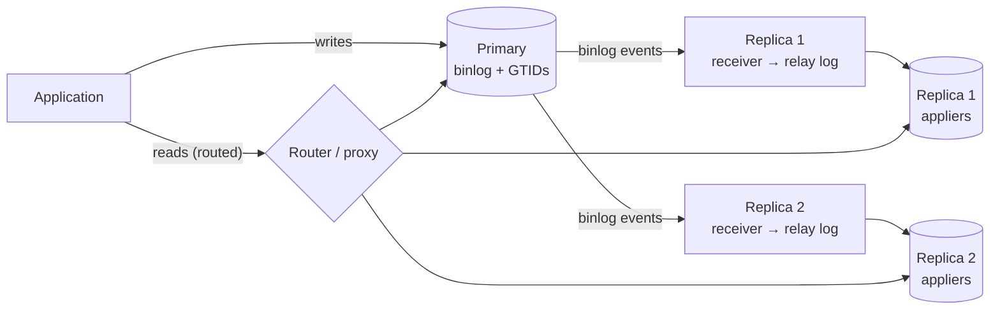

## Introduction

Most web applications read far more than they write — ratios of 10:1 to 100:1 are common for product catalogues, social feeds and dashboards. MySQL replication makes a natural scaling move available: keep one **primary** that accepts writes, add **replicas** that receive a copy of every change, and send reads to the replicas. Read capacity grows with the number of replicas, the primary's CPU is reserved for writes, and the replicas double as hot standbys for failover ([Replication and High Availability](/lessons/m11-replication-ha)).

The price is **consistency**. MySQL's default replication is asynchronous: the primary commits, returns success to the client, and ships the change to replicas *afterwards*. For a window that is usually milliseconds and occasionally minutes, a replica does not yet have the latest data. That window is **replication lag**, and every application that reads from replicas must decide what to do about it. The bugs it causes are well known and embarrassing:

- A user changes their display name, the page reloads, and the **old name** comes back (*read-your-writes* violated).
- A user refreshes twice and sees a comment appear, then **disappear**, then reappear (*monotonic reads* violated — two replicas with different lag).
- A checkout reads stock from a replica, sees 3 units that were sold a second ago, and oversells.

This lesson reproduces those bugs with a simulated primary, binary log and two replicas — tables with a **"replicated up to" watermark** — and then implements the fixes: routing rules, consistency tokens (the GTID approach), lag thresholds and sticky sessions. The real MySQL mechanisms are shown alongside, display-only, because the sandbox is a single server.

## DBMS Theory

:::theory[Consistency models for replicated reads]
With a single copy of the data, every read sees the latest committed write. With asynchronous replicas, the system provides only **eventual consistency**: if writes stop, all replicas converge to the same state, but a read may return any past state. Between "latest" and "anything eventually" lie the **session guarantees** defined by Terry et al. (1994), which are exactly the properties applications need:

| Guarantee | Definition | Violated when |
|---|---|---|
| **Read-your-writes** | A session's reads reflect all of that session's own earlier writes | The read goes to a replica that has not applied the write yet |
| **Monotonic reads** | Successive reads in a session never go back in time | Consecutive reads hit replicas with different lag |
| **Monotonic writes** | A session's writes are applied in the order issued | (MySQL replication preserves source commit order, so this holds) |
| **Writes-follow-reads** | A write that depends on a read is ordered after the write that produced the read | A decision is made on stale replica data and then written to the primary |

**Strong consistency** (linearizability) for reads means every read sees the latest committed write in real time — achievable only by reading from the primary or by making replicas acknowledge writes synchronously before commit, which costs write latency.
:::

**Replication lag** is the difference between the state of the primary and the state of a replica. It can be measured in two units, and you need both:

- **Transactions behind** — how many committed transactions the replica has not applied (GTID set difference, or binlog position difference).
- **Time behind** — how long ago the oldest unapplied transaction committed on the primary. This is what users experience.

**The causes of lag** follow from how replication works: the primary's binary log is shipped by a receiver thread into the replica's relay log and applied by applier threads. Lag grows when the replica cannot apply as fast as the primary commits (single-threaded apply of a parallel workload, a weaker replica, long-running queries on the replica competing for resources), when one huge transaction must be applied as a unit (a `DELETE` of 10 million rows commits once on the primary and then takes as long again on each replica), when DDL blocks the applier, or when the network is slow.

## Why It Exists

Read replicas exist because vertical scaling of one server ends, and because a database's write path and read path have different scaling properties:

- **Writes must be serialised** somewhere to keep one consistent order of changes. With single-primary replication, that place is the primary. Adding replicas does not increase write capacity at all.
- **Reads can be served from any up-to-date copy.** Each replica adds roughly one server's worth of read capacity.
- **Isolation of workloads.** Reporting, exports, search indexing and analytics can be pointed at dedicated replicas so they never compete with checkout traffic ([OLTP vs OLAP](/lessons/m12-oltp-olap)).
- **Geography.** A replica in another region serves local reads with local latency.

Without an explicit consistency strategy, read/write splitting turns into a stream of "phantom" bugs that are impossible to reproduce on a developer machine (where lag is zero) and only appear under production load (when lag is largest). That is why the consistency strategy must be designed, not discovered.

## Internal Working

:::internals[The replication pipeline and where lag comes from]
1. **Commit on the primary.** The transaction's changes are written to the binary log as a group of events (with row-based logging, the before/after images of each changed row), tagged with a **GTID** (`source_uuid:transaction_number`), and the commit returns to the client.
2. **Receiver (I/O) thread** on the replica reads events from the primary's binlog dump thread and appends them to the **relay log**. Semi-synchronous replication (`rpl_semi_sync_source_wait_point = AFTER_SYNC`) makes the primary's commit wait until at least one replica has *received* (not applied) the transaction.
3. **Applier (SQL) threads** read the relay log and apply the events. Since MySQL 8.0.27 replicas are multi-threaded by default (`replica_parallel_workers = 4`, dependency tracking with `WRITESET`), and `replica_preserve_commit_order = ON` makes them commit in the primary's order, so a replica always shows a state that existed on the primary — never half a transaction, never transactions in a different order.
4. **`gtid_executed`** on the replica grows as transactions commit. Comparing it with the primary's `gtid_executed` gives "transactions behind"; the commit timestamps carried in each transaction's GTID event (`original_commit_timestamp`, 8.0.1+) give an accurate "time behind" in `performance_schema.replication_applier_status_by_worker`.

`Seconds_Behind_Source` in `SHOW REPLICA STATUS` is a cruder estimate: the replica's current time minus the primary's timestamp of the event currently being applied. It reads 0 when the applier has caught up with the relay log even if the receiver is behind, it is NULL when the applier is stopped, and it jumps while a long transaction is applied. Production systems usually measure lag with a **heartbeat table** instead (pt-heartbeat): the primary updates a row with the current time every second; the replica's lag is `now − replicated timestamp`.
:::



## MySQL Implementation

The sandbox is one server, so we simulate the moving parts with tables. The simulation keeps the essential properties of MySQL replication: a single ordered log of committed changes, replicas that apply a **prefix** of that log in order, and a per-replica **watermark** recording how far each has applied.

```sql run
-- The primary's table
CREATE TABLE p_profiles (
  user_id      INT PRIMARY KEY,
  display_name VARCHAR(40) NOT NULL,
  updated_at   DATETIME(3) NOT NULL
);
-- The binary log: one ordered event per committed change (seq plays the role of the GTID transaction number)
CREATE TABLE binlog_events (
  seq          BIGINT AUTO_INCREMENT PRIMARY KEY,
  user_id      INT NOT NULL,
  display_name VARCHAR(40) NOT NULL,
  committed_at DATETIME(3) NOT NULL
);
CREATE TRIGGER p_profiles_ai AFTER INSERT ON p_profiles FOR EACH ROW
  INSERT INTO binlog_events (user_id, display_name, committed_at) VALUES (NEW.user_id, NEW.display_name, NEW.updated_at);
CREATE TRIGGER p_profiles_au AFTER UPDATE ON p_profiles FOR EACH ROW
  INSERT INTO binlog_events (user_id, display_name, committed_at) VALUES (NEW.user_id, NEW.display_name, NEW.updated_at);
-- Two replicas' copies of the table, and each replica's "replicated up to" watermark
CREATE TABLE r_profiles (
  replica      VARCHAR(10) NOT NULL,
  user_id      INT NOT NULL,
  display_name VARCHAR(40) NOT NULL,
  updated_at   DATETIME(3) NOT NULL,
  PRIMARY KEY (replica, user_id)
);
CREATE TABLE replica_state (
  replica      VARCHAR(10) PRIMARY KEY,
  applied_seq  BIGINT NOT NULL,          -- replicated up to this event (like gtid_executed)
  applied_commit_ts DATETIME(3) NULL     -- primary commit time of the last applied event
);
INSERT INTO replica_state VALUES ('r1', 0, NULL), ('r2', 0, NULL);
-- The applier: apply events (last_applied, upto] to one replica, in order, atomically
DELIMITER //
CREATE PROCEDURE apply_events(IN r VARCHAR(10), IN upto BIGINT)
BEGIN
  DECLARE done_seq BIGINT;
  START TRANSACTION;
  SELECT applied_seq INTO done_seq FROM replica_state WHERE replica = r FOR UPDATE;
  REPLACE INTO r_profiles (replica, user_id, display_name, updated_at)
    SELECT r, user_id, display_name, committed_at FROM binlog_events
    WHERE seq > done_seq AND seq <= upto ORDER BY seq;
  UPDATE replica_state
     SET applied_seq = GREATEST(applied_seq, LEAST(upto, (SELECT COALESCE(MAX(seq), 0) FROM binlog_events))),
         applied_commit_ts = (SELECT committed_at FROM binlog_events WHERE seq = LEAST(upto, (SELECT MAX(seq) FROM binlog_events)))
   WHERE replica = r;
  COMMIT;
END //
DELIMITER ;
```

Load some users on the primary and let both replicas catch up:

```sql run
INSERT INTO p_profiles VALUES
  (1, 'ada',    '2024-12-01 09:00:00.000'),
  (2, 'grace',  '2024-12-01 09:00:01.000'),
  (3, 'edsger', '2024-12-01 09:00:02.000');
CALL apply_events('r1', 3);
CALL apply_events('r2', 3);
SELECT * FROM replica_state ORDER BY replica;
```

Both replicas are "replicated up to" event 3. Now user 2 renames herself on the primary. Replica r1 applies the change promptly; replica r2 is busy (a long report is running on it) and stays behind:

```sql run
UPDATE p_profiles SET display_name = 'Grace Hopper', updated_at = '2024-12-01 10:15:00.250' WHERE user_id = 2;
CALL apply_events('r1', 4);
SELECT 'primary' AS source, display_name FROM p_profiles WHERE user_id = 2
UNION ALL
SELECT CONCAT('replica ', replica), display_name FROM r_profiles WHERE user_id = 2
ORDER BY source;
```

Three answers to one question. The primary and r1 return the new name; r2 still returns `grace`. If the profile page that loads right after the rename is routed to r2, the user sees their change "lost" — a **read-your-writes** violation. If one refresh goes to r1 and the next to r2, the name changes back — a **monotonic reads** violation.

**Measuring the lag.** With the watermark, lag in transactions is the difference between the primary's last event and each replica's `applied_seq`. Lag in time is "now" minus the commit time of the **oldest event the replica has not applied** (zero if none). We use a fixed "now" so the output is reproducible:

```sql run
SET @now = '2024-12-01 10:15:03.000';
SELECT s.replica,
       s.applied_seq,
       (SELECT MAX(seq) FROM binlog_events) - s.applied_seq AS transactions_behind,
       COALESCE(TIMESTAMPDIFF(MICROSECOND,
                  (SELECT MIN(e.committed_at) FROM binlog_events e WHERE e.seq > s.applied_seq),
                  @now) / 1e6, 0) AS seconds_behind
FROM replica_state s
ORDER BY s.replica;
```

r2 is one transaction and 2.75 seconds behind. Note the subtlety in the definition: measuring "now minus the commit time of the last *applied* event" would report a large lag for an idle but fully caught-up replica. That is exactly the problem a heartbeat table solves in production — it guarantees there is always a recent event to measure against.

## Syntax Breakdown

The real MySQL tools for observing and controlling replica consistency (display only — they need replication and privileges the sandbox does not have):

```sql
-- On a replica (8.4 names; MASTER/SLAVE forms were removed in 8.4)
SHOW REPLICA STATUS\G                     -- Seconds_Behind_Source, Retrieved/Executed_Gtid_Set, errors
SELECT @@GLOBAL.gtid_executed;            -- every transaction this server has applied
SELECT WAIT_FOR_EXECUTED_GTID_SET('3E11FA47-71CA-11E1-9E33-C80AA9429562:1-5', 1);
                                          -- block until those GTIDs are applied, or 1 s timeout (returns 1)
-- Precise lag per applier worker (8.0+)
SELECT WORKER_ID,
       LAST_APPLIED_TRANSACTION,
       TIMESTAMPDIFF(MICROSECOND, LAST_APPLIED_TRANSACTION_ORIGINAL_COMMIT_TIMESTAMP,
                     LAST_APPLIED_TRANSACTION_END_APPLY_TIMESTAMP) / 1e6 AS apply_lag_s
FROM performance_schema.replication_applier_status_by_worker;
-- On the primary: make the server return the GTID of each commit to the client
SET SESSION session_track_gtids = OWN_GTID;
-- Make a replica refuse writes from applications
SET PERSIST super_read_only = ON;
```

| Mechanism | What it gives you |
|---|---|
| `gtid_executed` | The set of transactions applied — the precise "replicated up to" watermark |
| `session_track_gtids = OWN_GTID` | The primary sends the GTID of the client's own commit in the OK packet; connectors expose it (the *consistency token*) |
| `WAIT_FOR_EXECUTED_GTID_SET(set, timeout)` | Waits on the replica until the token's transactions are applied — read-your-writes on a replica |
| `Seconds_Behind_Source` | Coarse lag estimate from event timestamps; misleading in several cases |
| `replication_applier_status_by_worker` | Accurate per-transaction commit and apply timestamps |
| Heartbeat table (pt-heartbeat) | Lag as "now − replicated heartbeat time", reliable even when idle |
| `read_only` / `super_read_only` | Guard replicas against accidental application writes |
| Semi-sync (`rpl_semi_sync_source_*`) | Commit waits until ≥ 1 replica *received* the transaction — limits data loss on failover, does **not** remove apply lag |
| Group Replication `group_replication_consistency` | `EVENTUAL` (default), `BEFORE_ON_PRIMARY_FAILOVER`, `BEFORE`, `AFTER`, `BEFORE_AND_AFTER` — synchronous read or write consistency at a latency cost |

:::version[Terminology in 8.4]
MySQL 8.4 LTS removed the old `MASTER`/`SLAVE` statement forms and variables: use `SHOW REPLICA STATUS`, `START REPLICA`, `CHANGE REPLICATION SOURCE TO`, `Seconds_Behind_Source`, `replica_parallel_workers`. 8.0.22+ accepts both; 8.4 accepts only the new forms.
:::

## Practical Examples

### 1. A routing rule: writes and "fresh" reads to the primary

The simplest strategy that guarantees read-your-writes: after a user writes, route **that user's** reads to the primary for a window longer than the worst expected lag. The application stores "last write time" in the user's session or a cookie. Here the routing decision is a SQL function so you can test it:

```sql run
CREATE FUNCTION route_read(last_write_at DATETIME(3), now_ts DATETIME(3), sticky_seconds INT)
RETURNS VARCHAR(10) DETERMINISTIC
RETURN IF(last_write_at IS NOT NULL
          AND now_ts < last_write_at + INTERVAL sticky_seconds SECOND, 'primary', 'replica');
SELECT route_read('2024-12-01 10:15:00.250', '2024-12-01 10:15:03.000', 5) AS just_renamed,
       route_read('2024-12-01 10:15:00.250', '2024-12-01 10:15:09.000', 5) AS ten_seconds_later,
       route_read(NULL,                      '2024-12-01 10:15:03.000', 5) AS never_wrote;
```

Simple and widely used, but it is a *time* guess: if lag exceeds the window (5 s here), the guarantee silently breaks.

### 2. Consistency tokens: read-your-writes by watermark, not by time

The robust strategy uses the **position** of the user's write. When the write commits, the application records its sequence number — in real MySQL, the GTID returned via `session_track_gtids`. A replica may serve that user's read only if its watermark has reached the token:

```sql run
SET @token = (SELECT MAX(seq) FROM binlog_events WHERE user_id = 2);  -- what the app stored after the rename
SELECT s.replica, s.applied_seq, @token AS token,
       IF(s.applied_seq >= @token, 'may serve the read', 'too stale: wait or use primary') AS decision
FROM replica_state s ORDER BY s.replica;
```

r1 qualifies; r2 does not. The application (or proxy) then either picks a replica that qualifies, **waits** briefly for the stale one (`WAIT_FOR_EXECUTED_GTID_SET(token, 0.05)` in real MySQL), or falls back to the primary. Unlike the time window, this is exact: it never sends a read to a replica that lacks the write, and it never sends reads to the primary unnecessarily.

The same token gives **monotonic reads** if the application stores the highest watermark it has *read* as well: every later read must go to a replica at least that far along.

### 3. Lag thresholds: keep stale replicas out of rotation

Some reads tolerate staleness but not unbounded staleness — a product page can be 2 seconds old, not 2 hours. Proxies implement this as "remove a replica from the read pool when its lag exceeds N seconds" (ProxySQL `max_replication_lag` per server; MySQL Router with InnoDB Cluster uses group membership state). Applied to our two replicas, with a 2-second threshold:

```sql run
SET @now = '2024-12-01 10:15:03.000';
WITH replica_lag AS (
  SELECT s.replica,
         COALESCE(TIMESTAMPDIFF(MICROSECOND,
                    (SELECT MIN(e.committed_at) FROM binlog_events e WHERE e.seq > s.applied_seq),
                    @now) / 1e6, 0) AS seconds_behind
  FROM replica_state s
)
SELECT replica, seconds_behind, IF(seconds_behind <= 2, 'in pool', 'out of pool') AS state
FROM replica_lag ORDER BY replica;
```

When every replica is out of the pool, the proxy sends reads to the primary — which can overload it exactly during the incident that caused the lag. Capacity planning must assume the primary can absorb that load, or the routing must shed load instead.

### 4. Catching up

Once r2's long report finishes, its applier catches up and the anomaly disappears — eventual consistency in action:

```sql run
CALL apply_events('r2', 4);
SELECT replica, display_name FROM r_profiles WHERE user_id = 2 ORDER BY replica;
SELECT * FROM replica_state ORDER BY replica;
```

### 5. Read/write splitting in the application (display only)

```python
# Two engines: the primary for writes and fresh reads, a replica pool (or a proxy's read port) for the rest
primary = create_engine("mysql+pymysql://app@db-primary/shop", pool_size=10, pool_pre_ping=True)
replica = create_engine("mysql+pymysql://app@db-replicas/shop", pool_size=20, pool_pre_ping=True)

def update_profile(user_id, name, session_state):
    with primary.begin() as conn:
        conn.execute(text("UPDATE profiles SET display_name = :n WHERE user_id = :u"), {"n": name, "u": user_id})
        # With session_track_gtids=OWN_GTID, the connector exposes the commit's GTID; many teams instead
        # read @@gtid_executed right after commit on the same connection.
        session_state["min_gtid"] = conn.execute(text("SELECT @@GLOBAL.gtid_executed")).scalar_one()

def load_profile(user_id, session_state):
    token = session_state.get("min_gtid")
    with replica.connect() as conn:
        if token:
            # 0 = applied within the timeout; 1 = timed out → fall back to the primary
            if conn.execute(text("SELECT WAIT_FOR_EXECUTED_GTID_SET(:g, 0.05)"), {"g": token}).scalar_one() != 0:
                return read_from(primary, user_id)
        return conn.execute(text("SELECT * FROM profiles WHERE user_id = :u"), {"u": user_id}).one()
```

Reading `@@GLOBAL.gtid_executed` after the commit returns *at least* the user's transaction (possibly more), which is a safe, slightly conservative token.

## Execution Walkthrough

### A replica never shows half a transaction

A replica applies each source transaction atomically and (with `replica_preserve_commit_order = ON`) in source commit order, so a reader on the replica sees a state that existed on the primary. Here session A plays the replica's applier, applying a two-row source transaction — a new order and its payment — and session B is an application read on the replica.

```concurrency
title: Replica reads see whole source transactions
description: The applier (A) applies an order and its payment as one transaction; the reader (B) never sees the order without the payment.
setup: |
  CREATE TABLE replica_orders (order_id INT PRIMARY KEY, total DECIMAL(10,2) NOT NULL);
  CREATE TABLE replica_payments (order_id INT PRIMARY KEY, amount DECIMAL(10,2) NOT NULL);
  INSERT INTO replica_orders VALUES (100, 25.00);
  INSERT INTO replica_payments VALUES (100, 25.00);
steps:
  - session: A
    sql: START TRANSACTION; INSERT INTO replica_orders VALUES (101, 80.00);
    note: The applier has applied the first event of source transaction 101 (the order row) but not yet the payment.
  - session: B
    sql: SELECT o.order_id, o.total, p.amount FROM replica_orders o LEFT JOIN replica_payments p ON p.order_id = o.order_id ORDER BY o.order_id;
    note: The reader sees only order 100 — the applier's transaction is uncommitted, so it is invisible (consistent read).
  - session: A
    sql: INSERT INTO replica_payments VALUES (101, 80.00); COMMIT;
    note: The applier commits the whole source transaction.
  - session: B
    sql: SELECT o.order_id, o.total, p.amount FROM replica_orders o LEFT JOIN replica_payments p ON p.order_id = o.order_id ORDER BY o.order_id;
    note: Now order 101 appears together with its payment. There was never a moment where the order existed without the payment.
```

So lag gives **stale** reads, not **inconsistent** ones: a replica's state is always some past state of the primary. That is why the session guarantees above are framed in terms of *which past state* a session may see.

### Tracing a read-your-writes decision

```walkthrough
title: Routing the profile page after a rename
steps:
  - title: "1. The write commits on the primary and returns a token"
    explain: The rename is event 4 in the primary's log. The application stores 4 (in real MySQL, the GTID) in the user's session.
    sql: SELECT seq, user_id, display_name, committed_at FROM binlog_events ORDER BY seq;
  - title: "2. The page load checks replica watermarks"
    explain: After catching up in Example 4, both replicas have applied_seq 4 ≥ token 4. Before that step, only r1 qualified.
    sql: SELECT replica, applied_seq, applied_seq >= 4 AS may_serve_token_4 FROM replica_state ORDER BY replica;
  - title: "3. The read on a qualifying replica returns the new name"
    explain: Any replica whose watermark is at or beyond the token is guaranteed to contain the user's write, because replicas apply the log as an ordered prefix.
    sql: SELECT replica, display_name FROM r_profiles WHERE user_id = 2 ORDER BY replica;
```

## Output

- After the rename, the primary and r1 returned `Grace Hopper` while r2 returned `grace`: one transaction and 2.75 s behind at the chosen "now".
- The time-window router sent the user's reads to the primary for 5 s after their write; the token router allowed r1 (applied 4 ≥ token 4) and rejected r2 (applied 3).
- With a 2-second lag threshold, r2 was taken out of the read pool.
- After r2 caught up, all copies agreed: eventual consistency.
- The concurrency scenario showed that a replica reader sees either none or all of a source transaction.

## Alternative Approaches

| Strategy | Guarantee | Cost | Typical implementation |
|---|---|---|---|
| All reads from the primary | Strong | No read scaling | Small systems; critical paths (checkout, balances) |
| Reads after own write go to primary for N s | Read-your-writes **if** lag < N | Some primary load; breaks during large lag | Rails `connects_to` with role switching, Django routers, custom middleware |
| Consistency token (GTID) + `WAIT_FOR_EXECUTED_GTID_SET` | Read-your-writes (exact) | Short waits on reads; token plumbing | Application code; ProxySQL GTID causal reads (with its binlog reader) |
| Sticky session to one replica | Monotonic reads (not RYW) | Uneven load; breaks on replica failure | Load balancer affinity |
| Lag threshold eviction | Bounded staleness | Primary overload when all replicas lag | ProxySQL `max_replication_lag`, cloud proxies |
| Semi-synchronous replication | Durability on ≥ 1 replica (received), **not** read consistency | Commit latency + 1 RTT | `rpl_semi_sync_source_enabled` |
| Group Replication `group_replication_consistency = BEFORE`/`AFTER` | Strong reads on any member | Read or write latency (synchronisation) | InnoDB Cluster |
| Cache in front of the primary instead of replicas | Depends on invalidation | Cache consistency problems instead | [Caching Strategies](/lessons/m12-caching) |

**Proxies.** ProxySQL routes by **query rules** (regular expressions on the statement digest — e.g. `^SELECT` to the reader hostgroup, `^SELECT .* FOR UPDATE` to the writer), tracks replica lag and can evict lagging replicas. MySQL Router routes per *port* (a read-write port and a read-only port) for InnoDB Cluster/ReplicaSet, and since 8.2 can split reads and writes on a single port (`access_mode=auto`, transactions and writes to the primary). Proxy-side splitting by statement type is convenient but cannot know your consistency requirements: a `SELECT` that must see the user's previous write looks the same as any other `SELECT`. Applications therefore still mark "must be fresh" reads (a hint comment or a separate connection).

## Performance Analysis

**Read capacity.** With R replicas of equal size, read capacity is roughly (R + 1) × one server's read throughput if the primary also serves reads — minus the replicas' own cost of applying every write. Each replica must apply **all** writes, so replicas do not reduce write load anywhere; at high write rates, replicas spend most of their capacity applying changes and read scaling stops paying off. That is the point at which [sharding](/lessons/m12-sharding) becomes necessary.

**Lag budget.** Typical asynchronous lag inside one region is milliseconds; sources of seconds-to-hours lag are large transactions (a 10-million-row `DELETE` replays as one unit), DDL, long queries on the replica that compete for I/O and CPU, and replicas that are smaller than the primary. Engineering rules: batch large writes ([Handling Millions of Records](/lessons/m12-large-tables)), use multi-threaded apply (default since 8.0.27) with WRITESET dependency tracking on the source (set `binlog_transaction_dependency_tracking = WRITESET` on 8.0; 8.4 always tracks dependencies this way), size replicas like the primary, and alert on lag.

**Cost of consistency.** A `WAIT_FOR_EXECUTED_GTID_SET` with a 50 ms timeout adds at most 50 ms to a read and usually ~0 (the replica is already there). Routing post-write reads to the primary for N seconds costs primary capacity proportional to write rate × N × reads-per-write. Group Replication's `BEFORE` consistency adds a round of group communication to each read.

## Best Practices

:::best-practice[Read replicas without phantom bugs]
1. **Classify reads by consistency need** — strong (money, inventory, authorisation), read-your-writes (profile after edit), bounded staleness (catalogue), eventual (analytics) — and route accordingly. Default to the primary for anything you have not classified.
2. **Never make a write decision from a replica read** (writes-follow-reads): read with `FOR UPDATE` on the primary or make the write conditional.
3. **Prefer position-based tokens (GTIDs) to time windows** for read-your-writes.
4. **Measure lag with a heartbeat** or `replication_applier_status_by_worker`, alert on it, and evict replicas beyond a staleness bound.
5. **Plan for "all replicas lagging"** — the primary must survive the fallback load, or the application must degrade gracefully.
6. **Set `super_read_only = ON` on replicas** so a misrouted write fails instead of silently diverging the replica.
7. **Keep transactions on replicas short**; long replica queries can delay apply and hold back purge there.
8. **Keep replicas identical to the primary in size and indexes** if they are failover candidates.
:::

## Common Mistakes

**Mistake 1 — checking stock on a replica.** The checkout reads stock from a lagging replica and decides to sell. The decision must be made on the primary, with a lock or a conditional write ([Database Architecture for Web Applications](/lessons/m12-web-app-architecture)).

**Mistake 2 — measuring lag from the last applied event.** "Now minus the commit time of the last applied event" makes an idle, fully caught-up replica look stale; "now minus the oldest *unapplied* event" (or a heartbeat) is the right definition. Compare both on our replicas:

```sql run
SET @now = '2024-12-01 10:20:00.000';
SELECT replica,
       TIMESTAMPDIFF(SECOND, applied_commit_ts, @now) AS naive_seconds_since_last_applied,
       COALESCE(TIMESTAMPDIFF(SECOND,
                  (SELECT MIN(e.committed_at) FROM binlog_events e WHERE e.seq > s.applied_seq), @now), 0) AS true_lag_seconds
FROM replica_state s ORDER BY replica;
```

Both replicas are fully caught up (true lag 0), yet the naive formula reports minutes, simply because nothing has been written since.

**Mistake 3 — trusting `Seconds_Behind_Source = 0`.** It is 0 when the applier has caught up with the *relay log*, even if the receiver thread is disconnected or far behind. Monitor `Replica_IO_Running`/`Replica_SQL_Running` (or `replication_connection_status`) and the GTID gap as well.

**Mistake 4 — believing semi-sync means replicas are up to date.** Semi-sync waits until a replica has *received* and logged the transaction, not applied it. Reads on that replica can still be stale.

**Mistake 5 — writing to a replica.** Without `super_read_only`, an application misconfigured to write to a replica succeeds, the replica diverges from the primary, and replication may later stop with a duplicate-key error (1062) when the primary's own write for that row arrives.

**Mistake 6 — sticky sessions mistaken for read-your-writes.** Pinning a user to replica r2 makes reads monotonic, but r2 may still not have the user's own write.

## Industry Application

- **Rails, Django, Laravel** have built-in multi-database routing: Rails' `connects_to` with automatic role switching sends reads to replicas except for a configurable delay after a write in the same session (a time window), Django database routers implement the same in application code.
- **Large social platforms** popularised position-based consistency: storing the primary's log position or GTID in the user's session and waiting for replicas to reach it; ProxySQL implements GTID-based "causal reads" by tracking which GTIDs each replica has executed.
- **Managed services** (Amazon RDS/Aurora read replicas, Google Cloud SQL, Azure Database for MySQL) expose reader endpoints that load-balance across replicas; Aurora's replicas share storage and typically lag tens of milliseconds, but the consistency model for the application is still "possibly stale".
- **Geo-distributed reads.** Companies place replicas in each region for local reads and accept seconds of lag for non-critical data, routing critical reads (payments) to the primary region.
- **Runbooks** include "replica lag high": find the long transaction or DDL on the primary, the long query on the replica, or the applier error; evict the replica from rotation while it catches up.

## Practice Exercises

```exercise
id: ex1
title: Heartbeat lag per replica
difficulty: easy
setup: |
  CREATE TABLE heartbeat (server VARCHAR(10) PRIMARY KEY, ts DATETIME(3) NOT NULL);
  INSERT INTO heartbeat VALUES
    ('primary', '2024-12-01 12:00:10.000'),
    ('r1',      '2024-12-01 12:00:09.800'),
    ('r2',      '2024-12-01 12:00:04.500'),
    ('r3',      '2024-12-01 12:00:10.000');
concepts: [replication-lag]
prompt: |
  The primary writes its current time into `heartbeat` every second, and each replica's row holds the latest
  heartbeat value that has been replicated to it. Return `server` and `lag_seconds` (primary heartbeat minus
  the replica's heartbeat, in seconds with fractions) for every **replica** (exclude the primary).
hints:
  - "Join heartbeat to itself: the primary row and each replica row."
  - "TIMESTAMPDIFF(MICROSECOND, r.ts, p.ts) / 1e6 gives fractional seconds."
solution: |
  SELECT r.server, TIMESTAMPDIFF(MICROSECOND, r.ts, p.ts) / 1e6 AS lag_seconds
  FROM heartbeat r
  JOIN heartbeat p ON p.server = 'primary'
  WHERE r.server <> 'primary';
explanation: |
  r1 is 0.2 s behind, r2 5.5 s, r3 0. Because the primary writes a heartbeat every second even when idle,
  this measure never confuses "idle" with "lagging". In production you compare against the current time on
  the replica (with synchronised clocks) or, as here, against the primary's latest heartbeat.
```

```exercise
id: ex2
title: Route each request
difficulty: medium
setup: |
  CREATE TABLE replica_state (replica VARCHAR(10) PRIMARY KEY, applied_seq BIGINT NOT NULL);
  INSERT INTO replica_state VALUES ('r1', 1040), ('r2', 1012);
  CREATE TABLE requests (request_id INT PRIMARY KEY, user_id INT NOT NULL, is_write BOOLEAN NOT NULL, user_token BIGINT NULL);
  INSERT INTO requests VALUES (1, 7, FALSE, NULL), (2, 8, FALSE, 1030), (3, 9, FALSE, 1050), (4, 7, TRUE, NULL), (5, 10, FALSE, 1012);
concepts: [read-your-writes, read-write-splitting]
prompt: |
  Implement token-based routing. For every request return `request_id` and `target`:

  - writes go to `'primary'`;
  - a read with no token goes to `'any-replica'`;
  - a read with a token goes to `'r2'` if r2's `applied_seq` ≥ token, else `'r1'` if r1's is, else `'primary'`
    (prefer the more-lagging replica when it qualifies, to keep the fresher one free for strict reads).
hints:
  - "Use scalar subqueries for each replica's applied_seq, or variables."
  - "A CASE expression with the conditions in the stated order."
solution: |
  SELECT request_id,
         CASE
           WHEN is_write THEN 'primary'
           WHEN user_token IS NULL THEN 'any-replica'
           WHEN (SELECT applied_seq FROM replica_state WHERE replica = 'r2') >= user_token THEN 'r2'
           WHEN (SELECT applied_seq FROM replica_state WHERE replica = 'r1') >= user_token THEN 'r1'
           ELSE 'primary'
         END AS target
  FROM requests;
explanation: |
  Request 2 (token 1030) cannot use r2 (1012) but can use r1 (1040); request 3 (1050) is ahead of both
  replicas and must go to the primary (or wait); request 5 (1012) is exactly at r2's watermark — `>=` is
  correct because the replica has applied that transaction. Using `>` is a classic off-by-one that sends
  reads to the primary unnecessarily.
```

```exercise
id: ex3
title: Apply the log up to a watermark
difficulty: hard
kind: dml
setup: |
  CREATE TABLE binlog_events (seq INT PRIMARY KEY, user_id INT NOT NULL, display_name VARCHAR(40) NOT NULL);
  INSERT INTO binlog_events VALUES (1, 1, 'ada'), (2, 2, 'grace'), (3, 1, 'Ada L.'), (4, 3, 'edsger'), (5, 2, 'Grace H.'), (6, 1, 'Ada Lovelace');
  CREATE TABLE r_profiles (user_id INT PRIMARY KEY, display_name VARCHAR(40) NOT NULL);
  INSERT INTO r_profiles VALUES (1, 'ada'), (2, 'grace');
  CREATE TABLE replica_state (replica VARCHAR(10) PRIMARY KEY, applied_seq INT NOT NULL);
  INSERT INTO replica_state VALUES ('r1', 2);
concepts: [replication-lag, read-replicas]
prompt: |
  Replica r1 has applied events up to seq 2. Apply events **3 to 5** (not 6) to `r_profiles`, so that each
  user ends with the value of their latest event in that range, and advance r1's `applied_seq` to 5 — all in
  one transaction.
hints:
  - "Events must be applied in seq order; a later event for the same user overwrites an earlier one."
  - "REPLACE INTO r_profiles SELECT user_id, display_name FROM binlog_events WHERE seq BETWEEN 3 AND 5 ORDER BY seq — or pick the latest event per user with a window function and upsert it."
solution: |
  START TRANSACTION;
  REPLACE INTO r_profiles (user_id, display_name)
    SELECT user_id, display_name FROM binlog_events WHERE seq > 2 AND seq <= 5 ORDER BY seq;
  UPDATE replica_state SET applied_seq = 5 WHERE replica = 'r1';
  COMMIT;
check: |
  SELECT 'profile' AS kind, user_id AS k, display_name AS v FROM r_profiles
  UNION ALL
  SELECT 'state', replica, applied_seq FROM replica_state
  ORDER BY kind, k;
explanation: |
  The replica's state must equal the primary's state after event 5: user 1 'Ada L.', user 2 'Grace H.',
  user 3 'edsger' — and not 'Ada Lovelace', which is event 6. Advancing the watermark in the same
  transaction as the data is essential: a crash between them would make the replica either re-apply or skip
  events. Real MySQL replicas store their applier position transactionally in InnoDB
  (`mysql.slave_relay_log_info` / GTIDs in `mysql.gtid_executed`) for the same reason.
```

```exercise
id: ex4
title: Choose a consistency strategy per endpoint
difficulty: hard
kind: open
concepts: [read-your-writes, monotonic-reads, read-write-splitting]
prompt: |
  A ticketing site has a primary and three async replicas (normal lag < 200 ms, occasionally 30 s during
  bulk imports). For each endpoint choose where reads go and which guarantee you need, and justify:

  1. Event listing page (public, cached 60 s at the CDN)
  2. "My tickets" page right after purchase
  3. Seat map during checkout (seats must not be double sold)
  4. Admin sales dashboard (totals per event)
  5. Comment thread under an event that users post to and refresh
solution: |
  1. **Replica, bounded staleness** (lag-threshold eviction at a few seconds). It is already cached for 60 s,
     so replica lag is irrelevant.
  2. **Read-your-writes**: token-based (GTID from the purchase commit; `WAIT_FOR_EXECUTED_GTID_SET` with a short
     timeout, fall back to the primary). A time window would break during 30 s import lag.
  3. **Primary, strong**: availability may be *displayed* from a replica, but the reservation must be a
     locking or conditional write on the primary (`UPDATE seats … WHERE seat_id = ? AND status = 'free'`),
     so stale display can at worst cause a "seat just taken" message, never a double sale.
  4. **Dedicated reporting replica** (or warehouse), eventual consistency; label the freshness.
  5. **Read-your-writes + monotonic reads**: token for the poster's own comment; for everyone else, sticky
     routing or a "max watermark seen" token so the thread never goes backward between refreshes.
explanation: |
  The skill being tested is classifying each read by the anomaly that would hurt, and choosing the cheapest
  mechanism that prevents it. Note item 3: the fix for correctness is on the write path, not the read path.
```

```exercise
id: ex5
title: Diagnose a lag incident
difficulty: challenge
kind: open
concepts: [replication-lag, read-replicas]
prompt: |
  At 02:00 a nightly job runs `DELETE FROM sessions WHERE expires_at < NOW() - INTERVAL 30 DAY` (40 million
  rows) on the primary; it takes 25 minutes. From 02:25 until 03:00 users report that new comments "vanish"
  after posting, and the proxy shows all three replicas evicted for lag > 10 s, with the primary at 95% CPU.
  Explain the chain of events and propose fixes at three levels: the job, replication, and routing.
solution: |
  **Chain.** The DELETE is one transaction; it commits at 02:25 and is written to the binlog as one huge
  transaction (40M row events). Each replica can only apply it as a unit after receiving it, taking roughly
  as long as on the primary, and with `replica_preserve_commit_order` every later transaction waits behind
  it. Lag climbs to ~25–35 minutes. The proxy evicts all replicas, so all reads go to the primary, which
  saturates. Some reads that the application sends to a replica directly (or that are routed before
  eviction) see data from before 02:25 — comments posted since then appear to vanish (read-your-writes
  violation).

  **Job.** Delete in primary-key or `expires_at`-index chunks of a few thousand rows per transaction, with a
  pause and a replica-lag check between chunks; or partition `sessions` by day and `DROP PARTITION`
  (metadata operation, tiny binlog event) — see the partitioning lesson.

  **Replication.** Ensure multi-threaded apply with WRITESET dependency tracking (it helps many small
  transactions, not one huge one); alert on lag and on transactions larger than N rows; size replicas like
  the primary.

  **Routing.** Use GTID tokens for read-your-writes so a user's own comment is always read from a replica that
  has it or from the primary; when all replicas are evicted, shed or degrade non-critical reads (serve cached
  pages, disable expensive widgets) instead of moving everything to the primary.
explanation: |
  Large transactions are the most common source of extreme lag. A good answer fixes the cause (chunking or
  partition drops), not just the symptom (eviction thresholds).
```

## Knowledge Assessment

```quiz
- id: q1
  question: "A user updates their profile and the next page load, served by a replica, shows the old value. Which guarantee is violated?"
  options: ["Monotonic writes", "Read-your-writes", "Atomicity", "Durability"]
  answer: 1
  explanation: "The session did not see its own earlier write. Monotonic writes concerns the order of a session's writes; atomicity and durability are properties of the transaction on the primary, which committed correctly."
  concepts: [read-your-writes]
- id: q2
  question: "Why is a GTID-based consistency token more reliable than 'send the user's reads to the primary for 5 seconds after a write'?"
  options:
    - "Because GTIDs make replication synchronous"
    - "Because the token checks whether the replica has actually applied the write, whereas the time window fails whenever lag exceeds 5 seconds"
    - "Because time windows cause deadlocks"
    - "Because tokens remove the need for a primary"
  answer: 1
  explanation: "Position-based checks are exact; time windows are guesses about lag. GTIDs do not make replication synchronous and do not remove the primary."
  concepts: [read-your-writes, gtid]
- id: q3
  question: "Semi-synchronous replication with AFTER_SYNC is enabled. Which statement is true?"
  options:
    - "Reads on any replica always see the latest commit"
    - "The primary's commit waits until at least one replica has received and logged the transaction, which limits data loss on failover but does not guarantee replicas have applied it"
    - "Replication lag becomes impossible"
    - "Replicas apply transactions before the primary commits them"
  answer: 1
  explanation: "Semi-sync acknowledges receipt into the relay log, not apply. Replicas can still lag in applying, so stale reads are still possible."
  concepts: [replication-lag]
- id: q4
  question: "`SHOW REPLICA STATUS` shows `Seconds_Behind_Source: 0`. Which situations are still possible? (Select all that apply.)"
  type: multi
  options:
    - "The receiver (I/O) thread is disconnected and the replica is missing recent transactions"
    - "The applier has caught up with everything in the relay log"
    - "The replica is applying a large transaction right now and is far behind"
    - "The replica is up to date"
  answer: [0, 1, 3]
  explanation: "0 means the applier has caught up with the relay log — the replica may be up to date, or the receiver may be behind/disconnected. During a long transaction's apply, the value grows rather than reading 0."
  concepts: [replication-lag]
- id: q5
  question: "In the lab, why did the naive formula 'now − commit time of the last applied event' report minutes of lag for fully caught-up replicas?"
  options:
    - "Because the replicas' clocks were wrong"
    - "Because nothing had been written since, so the last applied event was old even though nothing was pending"
    - "Because REPLACE INTO is slow"
    - "Because the watermark was not updated"
  answer: 1
  explanation: "Lag is the age of the oldest unapplied event (zero if none). An idle primary makes the last event old; heartbeat tables exist to make the naive measure work by guaranteeing a fresh event every second."
  concepts: [replication-lag]
- id: q6
  question: "Adding more read replicas increases which capacity?"
  options:
    - "Write throughput, because writes are spread over replicas"
    - "Read throughput, while every replica still has to apply all writes"
    - "Both reads and writes linearly"
    - "Neither"
  answer: 1
  explanation: "All writes go through the primary and are applied on every replica. Replicas scale reads only; scaling writes needs sharding."
  concepts: [read-replicas]
- id: q7
  question: "A checkout service reads stock from a replica, sees 2 units, and then runs `UPDATE stock SET qty = qty - 1 WHERE sku = ?` on the primary. What is the correct fix?"
  options:
    - "Read from a replica with lower lag"
    - "Make the decision on the primary: a locking read or a conditional UPDATE … WHERE qty >= 1 and check the affected rows"
    - "Enable semi-sync replication"
    - "Use a sticky session"
  answer: 1
  explanation: "Writes-follow-reads must not depend on stale data. Any replica can be stale; semi-sync and stickiness do not make replica reads current. The conditional write on the primary is correct regardless of lag."
  concepts: [read-write-splitting]
- id: q8
  question: "Why can a replica never show an order row without the payment row that was inserted in the same source transaction?"
  options:
    - "Because replicas use the READ UNCOMMITTED isolation level"
    - "Because each source transaction is applied as one transaction on the replica, in commit order, so readers see it all or not at all"
    - "Because foreign keys force it"
    - "Because the binlog stores only committed rows of the orders table"
  answer: 1
  explanation: "Replica appliers apply whole transactions (and preserve commit order by default), and readers use consistent reads that do not see uncommitted changes. Foreign keys are not involved, and READ UNCOMMITTED would make things worse, not better."
  concepts: [read-replicas]
```
