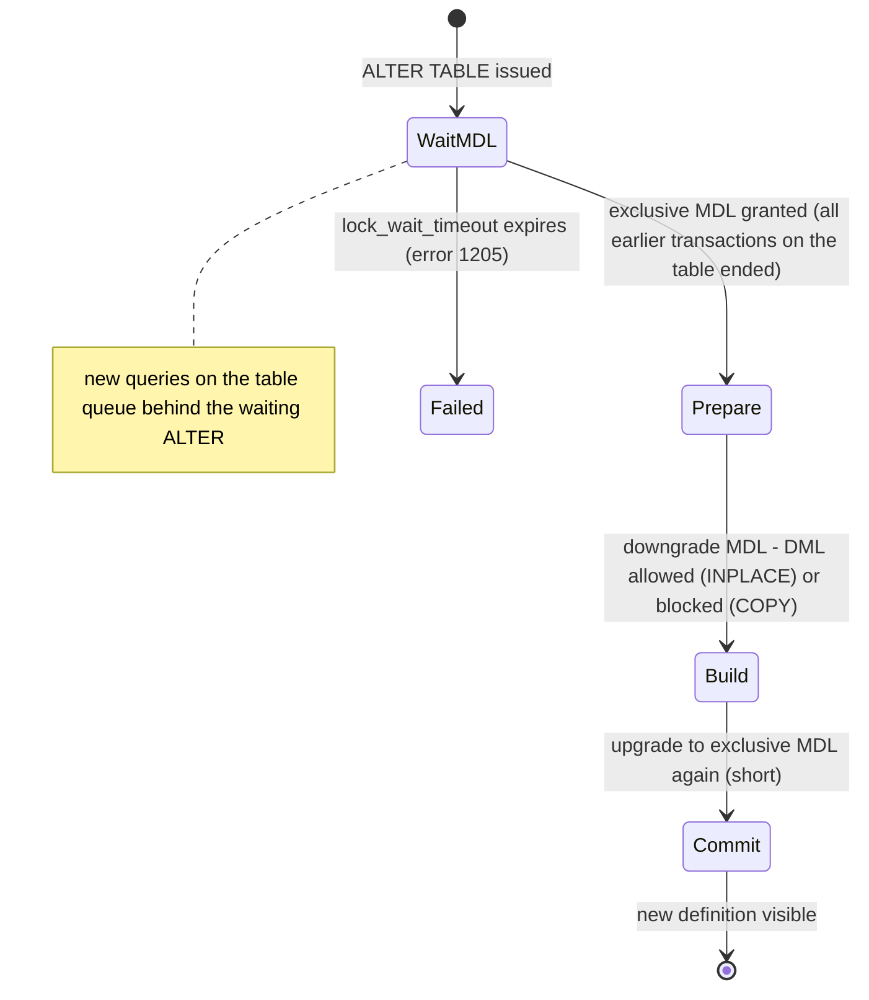

## Introduction

A schema that never changes belongs to a product that never changes. Real applications add columns every sprint, add indexes when a new query appears, widen a `VARCHAR` when a customer has a longer name than anyone expected, split a table when a feature grows up, and drop columns that nobody reads any more. On a development laptop each of these is a one-line `ALTER TABLE` that finishes instantly. On a production table with 400 million rows, 5,000 queries per second and three replicas, the same line can:

- finish in milliseconds (an **instant** metadata change),
- run for hours while the application keeps working (an **in-place online** rebuild),
- run for hours while every write to the table is blocked (a **table copy**),
- or — the classic outage — wait behind one idle transaction while every new query on the table queues up behind *it*, taking the application down in seconds.

[Migrations and Schema Versioning](/lessons/m11-migrations-versioning) covers how changes are written, versioned and reviewed. This lesson is about **executing** them safely on live systems: how InnoDB performs each kind of change, how to *know in advance* which kind you will get, the metadata-locking behaviour that makes even instant changes dangerous, the **expand–contract** pattern that lets old and new application versions coexist, chunked backfills, and the external tools (gh-ost, pt-online-schema-change) that large MySQL shops use instead of plain `ALTER TABLE`.

:::note[Dataset]
The lab starts empty and generates a 200,000-row `accounts` table. DDL timings are shown as `measured` blocks from the build machine; your numbers will differ, but the ratios between algorithms are the point.
:::

## DBMS Theory

:::theory[Schema change as a concurrency problem]
In the relational model a schema change is just a new relation schema. In a running DBMS it is a concurrency-control problem with three parties:

1. **The data dictionary** — the authoritative table definition. Every statement compiles against a version of it.
2. **Concurrent transactions** — which must see a consistent definition for their whole duration. A transaction that read three columns must not find the table restructured under it.
3. **The physical data** — rows on pages, which may or may not need to be rewritten to match the new definition.

MySQL protects (1) and (2) with **metadata locks (MDL)**, a lock manager separate from InnoDB's row locks: every statement that uses a table takes a shared MDL on it **and keeps it until the end of its transaction**; a DDL statement needs an **exclusive** MDL, at least briefly. How much of (3) must be rewritten decides the **algorithm**: no rows (INSTANT), rows rebuilt inside the storage engine while DML continues (INPLACE), or a full copy into a new table while writes are blocked (COPY).
:::

The second theoretical idea is **compatibility between versions**. During a rolling deployment, old and new application versions run at the same time against the same database. A schema change is safe only if every application version that can be running at that moment works with the schema at that moment. This leads to the **expand–contract** (also called *parallel change*) pattern:

| Phase | Schema | Application |
|---|---|---|
| 1. Expand | Add the new structure (column, table, index); keep the old one | Old version ignores it |
| 2. Dual write | Both structures exist | New version writes both (or a trigger keeps them in sync) |
| 3. Backfill | Copy historical data into the new structure in batches | — |
| 4. Switch reads | — | Read from the new structure; verify |
| 5. Contract | Drop the old structure | Old version no longer deployed anywhere |

Each phase is individually backward compatible, so each can be deployed — and rolled back — independently. A destructive change (rename, type change, drop) is never applied in one step.

## Why It Exists

Before MySQL 5.6, almost every `ALTER TABLE` copied the table and blocked writes for the duration. Large MySQL users (Facebook, GitHub, Shopify, Booking.com, Percona's customers) built external tools to avoid this, and MySQL progressively added online DDL (5.6), then INSTANT ADD COLUMN (8.0.12) and INSTANT ADD/DROP COLUMN at any position (8.0.29). Without these techniques:

- **Writes stop.** A COPY-algorithm change on a 200 GB table blocks INSERT/UPDATE/DELETE for hours.
- **Replicas fall behind.** Even an online ALTER on the primary is replayed on each replica *after* it completes there (statement order in the binary log), and the replica's applier is busy with it for the same duration — replication lag of hours ([Replication and High Availability](/lessons/m11-replication-ha)).
- **Disk fills.** A rebuild needs space for a second copy of the table plus a log of concurrent changes (`innodb_online_alter_log_max_size`).
- **The application breaks.** Renaming a column in one step breaks every running instance of the old code the moment it commits.
- **MDL pile-ups take sites down.** A DDL waiting for an exclusive MDL blocks every *later* statement on the table — so one forgotten open transaction plus one `ALTER` equals a full outage of that table.

## Internal Working

:::internals[How InnoDB executes each algorithm]
**INSTANT** — only the data dictionary changes. For `ADD COLUMN`, InnoDB records the column and its default in the dictionary and tags the table with a new **row version**; existing rows are not touched. When a row written under an older version is read, InnoDB supplies the default for columns that did not exist yet. Since 8.0.29, `DROP COLUMN` is also instant (the column is hidden and its data ignored). A table can accumulate at most **64 row versions** from instant ADD/DROP COLUMN; after that, the next such change needs a rebuild (INPLACE or COPY), which resets the count.

**INPLACE** — InnoDB builds the new structure inside the storage engine without going through the SQL layer row by row. Two sub-cases:
- *No rebuild* — e.g. `ADD INDEX`: InnoDB scans the clustered index, sorts the keys (using `innodb_sort_buffer_size` and temporary files) and bulk-loads the new B+ tree bottom-up. Concurrent DML is recorded in an **online alter log** and applied at the end.
- *Rebuild* — e.g. adding a primary key, changing `NULL` to `NOT NULL`, `OPTIMIZE TABLE`, `ADD COLUMN` with `ALGORITHM=INPLACE`: InnoDB writes a complete new copy of the clustered index (and secondary indexes), again logging concurrent DML and replaying it at the end. Needs disk space for the copy.

**COPY** — the SQL layer creates a new table with the new definition, copies every row through the handler interface (`INSERT … SELECT`-style, with type conversion), then swaps names. Concurrent writes are **blocked** (LOCK=SHARED at best) for the whole copy. Required for changes InnoDB cannot do in place, notably changing a column's data type.

**Metadata locks across the operation.** An online ALTER takes an exclusive MDL briefly at the start (to prepare), downgrades to a shared-upgradable lock that permits DML during the long middle phase, and upgrades to exclusive again briefly at the end (to commit the new definition). Even INSTANT needs that short exclusive lock. MDL requests are queued in order: while the ALTER **waits** for its exclusive lock, every later request for a conflicting MDL — including plain SELECTs — waits behind it.
:::



## MySQL Implementation

Generate the table. Each account has a free-form `phone` that a new feature will replace with a normalised E.164 number.

```sql run
SET SESSION cte_max_recursion_depth = 200000;
CREATE TABLE accounts (
  account_id INT UNSIGNED NOT NULL PRIMARY KEY,
  email      VARCHAR(50)  NOT NULL,
  phone      VARCHAR(20)  NOT NULL,
  country    CHAR(2)      NOT NULL,
  status     ENUM('active', 'closed') NOT NULL,
  created_at DATETIME     NOT NULL
);
INSERT INTO accounts
WITH RECURSIVE seq(n) AS (SELECT 1 UNION ALL SELECT n + 1 FROM seq WHERE n < 200000)
SELECT n,
       CONCAT('user', n, '@example.com'),
       CONCAT('(', 200 + n % 800, ') 555-', LPAD(n % 10000, 4, '0')),
       ELT(1 + n % 3, 'US', 'CA', 'US'),
       IF(n % 17 = 0, 'closed', 'active'),
       '2020-01-01' + INTERVAL (n * 7) MINUTE
FROM seq;
ANALYZE TABLE accounts;
SELECT COUNT(*) AS accounts_rows FROM accounts;
```

The `ALTER TABLE` options `ALGORITHM` and `LOCK` are **assertions**: you state what you are willing to accept, and MySQL refuses the statement instead of silently falling back to something slower. An instant column addition:

```sql run measured
ALTER TABLE accounts ADD COLUMN marketing_opt_in TINYINT NOT NULL DEFAULT 0, ALGORITHM=INSTANT;
```

Zero rows affected: only the dictionary changed. Existing rows return the default:

```sql run
SELECT account_id, marketing_opt_in FROM accounts WHERE account_id IN (1, 200000) ORDER BY account_id;
```

A secondary index cannot be instant — the B+ tree must be built — but it can be built in place while DML continues:

```sql run measured
ALTER TABLE accounts ADD INDEX idx_accounts_created (created_at), ALGORITHM=INPLACE, LOCK=NONE;
```

Changing a column's data type requires a copy, and MySQL tells you so if you ask for anything better:

```sql run error
ALTER TABLE accounts MODIFY country VARCHAR(3) NOT NULL, ALGORITHM=INPLACE;
```

```sql run error
ALTER TABLE accounts MODIFY country VARCHAR(3) NOT NULL, ALGORITHM=COPY, LOCK=NONE;
```

```sql run measured
ALTER TABLE accounts MODIFY country VARCHAR(3) NOT NULL, ALGORITHM=COPY;
```

Compare the three measured blocks. On the build machine the instant change took about 16 ms (the cost of any trivial statement), the index build about 230 ms, and the copy about 660 ms — and the copy reported **200,000 rows affected**: every row went through the SQL layer. Note also the wording of the two refusals: error 1846 names the reason (*Cannot change column type INPLACE*, *COPY algorithm requires a lock*) and suggests the next-best option. On a 400-million-row table, the same three statements would take milliseconds, tens of minutes, and hours (with writes blocked) respectively.

## Syntax Breakdown

| Clause / setting | Meaning |
|---|---|
| `ALGORITHM=INSTANT` | Dictionary-only change; fails with error 1846 if the operation cannot be instant. The default choice when supported. |
| `ALGORITHM=INPLACE` | Storage-engine operation, with or without rebuild; usually permits concurrent DML. |
| `ALGORITHM=COPY` | Copy through the SQL layer into a new table; concurrent writes blocked. |
| `ALGORITHM=DEFAULT` (or omitted) | MySQL picks the best supported algorithm (INSTANT > INPLACE > COPY) — convenient, but it will silently pick COPY. |
| `LOCK=NONE` | Concurrent reads and writes allowed during the operation; fails if impossible. |
| `LOCK=SHARED` | Concurrent reads allowed, writes blocked. |
| `LOCK=EXCLUSIVE` | Neither reads nor writes. |
| `lock_wait_timeout` (session) | Seconds to wait for a **metadata** lock before error 1205. Default 31,536,000 (one year). Set it to a few seconds before any DDL on a busy server. |
| `innodb_online_alter_log_max_size` | Maximum size of the log of concurrent DML during an online rebuild; if exceeded, the ALTER fails (error 1799) and rolls back. |
| `innodb_ddl_threads`, `innodb_ddl_buffer_size` (8.0.27+) | Parallelism and memory for index builds during INPLACE DDL. |
| `RENAME TABLE a TO b, c TO a` | Atomic multi-table rename — the cut-over step used by online schema change tools. |

**Which algorithm does each common change get?** (InnoDB, MySQL 8.0.29+ / 8.4; check the "Online DDL Operations" manual page for the full matrix.)

| Change | INSTANT | INPLACE | Rebuilds table | Concurrent DML |
|---|---|---|---|---|
| Add column (any position) | Yes | Yes | Only with INPLACE | Yes |
| Drop column | Yes | Yes | Only with INPLACE | Yes |
| Rename column | Yes | Yes | No | Yes |
| Set / drop column default | Yes | Yes | No | Yes |
| Add ENUM/SET member at the end | Yes | Yes | No | Yes |
| Add secondary index | No | Yes | No | Yes |
| Drop secondary index | No | Yes | No | Yes |
| Extend VARCHAR within the same length-byte size | No | Yes | No | Yes |
| Extend VARCHAR across 255 bytes (1 → 2 length bytes) | No | No | (COPY) | No |
| Change column data type | No | No | (COPY) | No |
| Make column NOT NULL | No | Yes | Yes | Yes |
| Add / change primary key | No | Yes | Yes | Yes |
| `OPTIMIZE TABLE` | No | Yes | Yes | Yes |

:::version[Instant DDL across versions]
INSTANT `ADD COLUMN` (last position only) arrived in 8.0.12; ADD/DROP COLUMN at any position in 8.0.29, together with the 64-row-version limit. MySQL 8.4 LTS has the same behaviour. Tables with `ROW_FORMAT=COMPRESSED` or a `FULLTEXT` index cannot use instant ADD COLUMN. On 8.0.29+ the `information_schema.INNODB_TABLES.TOTAL_ROW_VERSIONS` column shows how many instant versions a table has used (it requires the PROCESS privilege, so it is not readable in the sandbox).
:::

## Practical Examples

### 1. The VARCHAR boundary

Widening a `VARCHAR` is in place only if the number of **length bytes** does not change. With `utf8mb4` (up to 4 bytes per character), `VARCHAR(50)` can hold at most 200 bytes and uses a 1-byte length prefix; anything that can exceed 255 bytes needs 2. So widening `email` from 50 to 60 characters (240 bytes) stays in place, but 50 → 100 (400 bytes) does not:

```sql run
ALTER TABLE accounts MODIFY email VARCHAR(60) NOT NULL, ALGORITHM=INPLACE, LOCK=NONE;
```

```sql run error
ALTER TABLE accounts MODIFY email VARCHAR(100) NOT NULL, ALGORITHM=INPLACE, LOCK=NONE;
```

The refusal reads *Cannot change column type INPLACE*: for InnoDB, crossing the length-byte boundary changes the column's physical format, so it is treated like a type change.

A migration that "just widens a column" can therefore be an instant-feeling metadata change or a multi-hour write-blocking copy, depending on a byte boundary. Writing `ALGORITHM=INPLACE, LOCK=NONE` in the migration turns that surprise into an immediate, harmless error.

### 2. Expand–contract: replacing `phone` with `phone_e164`

**Phase 1 — expand.** Add the new column, nullable, instantly:

```sql run
ALTER TABLE accounts ADD COLUMN phone_e164 VARCHAR(16) NULL, ALGORITHM=INSTANT;
```

**Phase 2 — dual write.** The new application version will write both columns. Until every writer is upgraded, a trigger keeps the new column correct for writes from old code (an alternative to application dual-writes; gh-ost-style tools avoid triggers, see below):

```sql run
CREATE TRIGGER accounts_phone_bi BEFORE INSERT ON accounts FOR EACH ROW
  SET NEW.phone_e164 = COALESCE(NEW.phone_e164, CONCAT('+1', REPLACE(REPLACE(REPLACE(REPLACE(NEW.phone, '(', ''), ')', ''), ' ', ''), '-', '')));
CREATE TRIGGER accounts_phone_bu BEFORE UPDATE ON accounts FOR EACH ROW
  SET NEW.phone_e164 = IF(NEW.phone <> OLD.phone,
                          CONCAT('+1', REPLACE(REPLACE(REPLACE(REPLACE(NEW.phone, '(', ''), ')', ''), ' ', ''), '-', '')),
                          NEW.phone_e164);
INSERT INTO accounts (account_id, email, phone, country, status, created_at)
VALUES (200001, 'late@example.com', '(415) 555-0101', 'US', 'active', '2024-12-30 10:00:00');
SELECT account_id, phone, phone_e164 FROM accounts WHERE account_id IN (1, 200001) ORDER BY account_id;
```

New rows are correct; old rows (account 1) are still NULL.

**Phase 3 — backfill in batches.** One `UPDATE accounts SET phone_e164 = …` over 200,000 rows would be a single long transaction: it locks every row it touches until commit, generates a large undo log, and reaches replicas as one big event that delays everything behind it. A backfill walks the primary key in fixed-size chunks, each its own short transaction:

```sql run
CREATE PROCEDURE backfill_phone_e164(IN batch_size INT)
BEGIN
  DECLARE lo INT UNSIGNED DEFAULT 0;
  DECLARE max_id INT UNSIGNED;
  SELECT MAX(account_id) INTO max_id FROM accounts;
  WHILE lo < max_id DO
    UPDATE accounts
       SET phone_e164 = CONCAT('+1', REPLACE(REPLACE(REPLACE(REPLACE(phone, '(', ''), ')', ''), ' ', ''), '-', ''))
     WHERE account_id > lo AND account_id <= lo + batch_size
       AND phone_e164 IS NULL;
    SET lo = lo + batch_size;
    -- production: pause here (DO SLEEP(0.05)) or check replica lag before the next chunk
  END WHILE;
END;
```

```sql run measured
CALL backfill_phone_e164(20000);
```

Each chunk is an autocommitted `UPDATE` of at most 20,000 rows located by a primary-key range, so it locks only those rows and commits before the next one begins. The `phone_e164 IS NULL` guard makes the procedure **restartable**: if it dies halfway, running it again skips finished rows. Batch sizing and throttling are covered in depth in [Handling Millions of Records](/lessons/m12-large-tables).

**Phase 4 — verify, then switch reads.** Never switch reads on faith. Both mismatch counts must be zero (on a very large table, run the check per primary-key range, like the backfill):

```sql run
SELECT COUNT(*) AS rows_checked,
       SUM(phone_e164 IS NULL) AS rows_missing,
       SUM(phone_e164 <> CONCAT('+1', REPLACE(REPLACE(REPLACE(REPLACE(phone, '(', ''), ')', ''), ' ', ''), '-', ''))) AS rows_wrong
FROM accounts;
```

**Phase 5 — contract.** Once no deployed code reads `phone` (and after a cooling-off period long enough to roll back), drop the triggers, enforce `NOT NULL`, and drop the old column — instantly:

```sql run
DROP TRIGGER accounts_phone_bi;
DROP TRIGGER accounts_phone_bu;
ALTER TABLE accounts MODIFY phone_e164 VARCHAR(16) NOT NULL, ALGORITHM=INPLACE, LOCK=NONE;
ALTER TABLE accounts DROP COLUMN phone, ALGORITHM=INSTANT;
SELECT account_id, phone_e164 FROM accounts ORDER BY account_id LIMIT 3;
```

Making the column `NOT NULL` is an in-place **rebuild** (it rewrites the table, permitting DML), so on a large table that step is the expensive one; the drop is instant.

### 3. How online schema change tools work — a runnable simulation

Tools such as **pt-online-schema-change** (Percona Toolkit) and **gh-ost** (GitHub) perform any change — including type changes that would need COPY — without blocking writes, by building a *shadow table* and swapping it in. pt-online-schema-change works like this (simulated here on a small table so you can see every step):

```sql run
CREATE TABLE orders_osc (order_id INT PRIMARY KEY, status VARCHAR(10) NOT NULL, amount INT NOT NULL);
INSERT INTO orders_osc VALUES (1, 'paid', 100), (2, 'paid', 250), (3, 'new', 80), (4, 'new', 40);
-- 1. Create the shadow table with the NEW definition (amount becomes DECIMAL)
CREATE TABLE _orders_osc_new (order_id INT PRIMARY KEY, status VARCHAR(10) NOT NULL, amount DECIMAL(10,2) NOT NULL);
-- 2. Triggers mirror every change on the original into the shadow table
CREATE TRIGGER osc_ai AFTER INSERT ON orders_osc FOR EACH ROW
  REPLACE INTO _orders_osc_new VALUES (NEW.order_id, NEW.status, NEW.amount);
CREATE TRIGGER osc_au AFTER UPDATE ON orders_osc FOR EACH ROW
  REPLACE INTO _orders_osc_new VALUES (NEW.order_id, NEW.status, NEW.amount);
CREATE TRIGGER osc_ad AFTER DELETE ON orders_osc FOR EACH ROW
  DELETE FROM _orders_osc_new WHERE order_id = OLD.order_id;
-- 3. Copy existing rows in primary-key chunks (INSERT IGNORE: rows already copied by a trigger win)
INSERT IGNORE INTO _orders_osc_new SELECT order_id, status, amount FROM orders_osc WHERE order_id BETWEEN 1 AND 2;
-- ... meanwhile the application keeps writing to the original table:
UPDATE orders_osc SET status = 'shipped' WHERE order_id = 1;
INSERT INTO orders_osc VALUES (5, 'new', 999);
DELETE FROM orders_osc WHERE order_id = 4;
INSERT IGNORE INTO _orders_osc_new SELECT order_id, status, amount FROM orders_osc WHERE order_id BETWEEN 3 AND 4;
-- 4. Verify, then cut over with one atomic RENAME
SELECT (SELECT COUNT(*) FROM orders_osc) AS original_rows, (SELECT COUNT(*) FROM _orders_osc_new) AS shadow_rows;
RENAME TABLE orders_osc TO _orders_osc_old, _orders_osc_new TO orders_osc;
DROP TABLE _orders_osc_old;
SELECT * FROM orders_osc ORDER BY order_id;
```

The application's update, insert and delete during the copy all reached the new table through the triggers; the chunked copy filled in the rest; the atomic `RENAME TABLE` swapped the tables in one step (it needs a brief exclusive MDL on both). The triggers on the old table disappeared with it when it was dropped.

## Execution Walkthrough

### The metadata-lock pile-up

This is the most common schema-change outage. A request (or an engineer's SQL console) has an open transaction that touched the table and then went idle. A migration runs `ALTER TABLE` — even an INSTANT one. The ALTER waits for its exclusive metadata lock; and because MDL requests queue in order, every new SELECT on the table now waits behind the ALTER.

```concurrency
title: An idle transaction blocks an INSTANT ALTER, and new SELECTs queue behind it
description: A holds a shared metadata lock through an open transaction. B runs an instant ALTER. C is ordinary application traffic.
setup: |
  CREATE TABLE profiles (id INT PRIMARY KEY, name VARCHAR(40) NOT NULL);
  INSERT INTO profiles VALUES (1, 'Ada'), (2, 'Grace'), (3, 'Edsger');
steps:
  - session: A
    sql: START TRANSACTION; SELECT name FROM profiles WHERE id = 1;
    note: A request read one row and then went idle without committing. Its shared metadata lock on profiles lasts until the transaction ends.
  - session: B
    sql: ALTER TABLE profiles ADD COLUMN bio VARCHAR(200) NULL, ALGORITHM=INSTANT;
    expect: blocks
    note: The migration needs an exclusive metadata lock, even though the change itself is instant. It waits for A.
  - session: C
    sql: SELECT name FROM profiles WHERE id = 2;
    expect: blocks
    note: An ordinary read of a different row — and it waits too, queued behind B's pending exclusive request. Every request for this table now hangs.
  - session: A
    sql: SELECT ID IS NOT NULL AS conn, COMMAND, STATE, INFO FROM information_schema.PROCESSLIST WHERE DB = DATABASE() AND INFO IS NOT NULL AND INFO NOT LIKE '%PROCESSLIST%' ORDER BY INFO;
    note: The processlist shows the ALTER and the SELECT both in state 'Waiting for table metadata lock'. A itself does not appear as running anything — it is idle, which is what makes this hard to spot. (information_schema.PROCESSLIST is deprecated in favour of performance_schema.processlist, hence the warning; the sandbox cannot read performance_schema.)
  - session: A
    sql: COMMIT;
    note: A's transaction ends and releases its metadata lock. B's ALTER gets the exclusive lock, completes instantly, and then C's SELECT runs.
  - session: C
    sql: SELECT * FROM profiles ORDER BY id;
```

The same scenario with the protective setting every migration should use: a short `lock_wait_timeout`. The ALTER gives up after two seconds with error 1205 instead of holding the queue indefinitely, and traffic flows again; the migration tool can retry later.

```concurrency
title: lock_wait_timeout makes the migration fail fast instead of stalling the table
setup: |
  CREATE TABLE profiles (id INT PRIMARY KEY, name VARCHAR(40) NOT NULL);
  INSERT INTO profiles VALUES (1, 'Ada'), (2, 'Grace'), (3, 'Edsger');
steps:
  - session: A
    sql: START TRANSACTION; SELECT name FROM profiles WHERE id = 1;
    note: The same idle transaction holding a shared metadata lock.
  - session: B
    sql: SET SESSION lock_wait_timeout = 2;
    note: The migration session limits how long it will wait for a metadata lock.
  - session: B
    sql: ALTER TABLE profiles ADD COLUMN bio VARCHAR(200) NULL, ALGORITHM=INSTANT;
    expect: error
    errorCode: 1205
    note: After two seconds the ALTER fails with 'Lock wait timeout exceeded; try restarting transaction'. Its place in the MDL queue is gone.
  - session: C
    sql: SELECT name FROM profiles WHERE id = 2;
    note: Application reads proceed normally again, even though A is still idle.
  - session: A
    sql: COMMIT;
```

With a timeout of two seconds, the worst case for application traffic is a two-second stall per attempt — instead of an outage that lasts as long as the idle transaction (which, for a leaked pooled connection, can be hours).

## Output

The evidence from this lesson, in one place:

- `ADD COLUMN … ALGORITHM=INSTANT` affected **0 rows** and existing rows immediately returned the column's default.
- `ADD INDEX … ALGORITHM=INPLACE, LOCK=NONE` built the index while permitting DML.
- Changing `country` from `CHAR(2)` to `VARCHAR(3)` was refused for INPLACE (error 1846) and for COPY with `LOCK=NONE`; with `ALGORITHM=COPY` it rewrote **200,000 rows**.
- Widening `VARCHAR(50)` to `VARCHAR(60)` was allowed in place; to `VARCHAR(100)` it was refused because the length prefix would grow from 1 to 2 bytes.
- The expand–contract sequence ended with every row converted, zero verification mismatches and the old column dropped instantly.
- In the first concurrency scenario the INSTANT ALTER **and** an unrelated SELECT both waited for one idle transaction; in the second, `lock_wait_timeout = 2` turned the pile-up into error 1205 and normal traffic.

## Alternative Approaches

| Approach | How it works | Blocks writes? | Replica impact | Use when |
|---|---|---|---|---|
| Native INSTANT | Dictionary change | No (brief MDL) | Negligible | Add/drop/rename column, defaults, ENUM members |
| Native INPLACE online | Engine-level build/rebuild with DML log | No (brief MDL at start/end) | Replica applies the same long ALTER afterwards → lag | Indexes; rebuilds on tables small enough that replica lag is acceptable |
| Native COPY | SQL-layer copy | Yes | Same, plus blocked writes | Small tables, maintenance windows |
| pt-online-schema-change | Shadow table + **triggers** + chunked copy + atomic rename | No | Chunks replicate as small transactions (lag-aware throttling) | Any change, including type changes; tables without existing triggers conflicts handled |
| gh-ost | Shadow table + **binary log stream** (no triggers) + chunked copy + coordinated cut-over | No | Throttles on replica lag; pausable | Large, busy tables; when trigger overhead on the hot path is unacceptable |
| Blue/green schema (new table + dual write in app) | Application writes both tables, backfill, switch | No | Normal | Large restructurings (split a table, change a key) |
| Rolling schema change on replicas | Alter replicas one by one, then fail over | No on primary | Requires failover | Changes that must not run on the primary at all |

**pt-online-schema-change** (display only):

```sql
-- shell, not SQL:
-- pt-online-schema-change --alter "MODIFY amount DECIMAL(10,2) NOT NULL" \
--   --max-lag=1 --chunk-time=0.5 --critical-load Threads_running=100 \
--   --execute D=shop,t=orders
```

**gh-ost** (display only):

```sql
-- shell, not SQL:
-- gh-ost --database=shop --table=orders --alter="MODIFY amount DECIMAL(10,2) NOT NULL" \
--   --max-lag-millis=1500 --chunk-size=1000 --cut-over=default \
--   --postpone-cut-over-flag-file=/tmp/ghost.postpone --execute
```

The design difference matters: pt-osc's triggers run *inside every application write transaction*, adding latency and lock contention to the hot path, and a table may not already have conflicting triggers. gh-ost reads changes from the binary log (row-based format required) asynchronously, so the application's writes are untouched; it can be paused, throttled and its cut-over postponed by an operator. Both need ~2× the table's disk space during the operation, both do an atomic rename at the end (which still needs a brief exclusive MDL — so a short lock-wait timeout still matters), and neither works with tables that are the parent side of foreign keys without special options (`--alter-foreign-keys-method` in pt-osc; gh-ost does not support foreign keys at all).

## Performance Analysis

**Cost by algorithm.** INSTANT is O(1) in table size. INPLACE without rebuild (index build) is O(N log N): a scan plus an external sort of N keys plus a bottom-up B+ tree load. INPLACE with rebuild and COPY are O(N) writes of the whole table plus all indexes — COPY additionally through the SQL layer row by row, which is why it is the slowest even on the same data. The measured blocks above show this ordering on 200,000 rows.

**Hidden costs that dominate in production:**

- **Replica lag.** With native DDL, each replica starts the ALTER only after the primary finishes and then runs it for about as long (single-threaded for that table). Replication lag ≈ ALTER duration. This alone is why companies with large tables use gh-ost/pt-osc even for changes MySQL can do online.
- **Online alter log.** Heavy DML during a long INPLACE rebuild accumulates in a log replayed at the end — under an exclusive MDL. If writes are heavy, the final phase can be long, or the log can exceed `innodb_online_alter_log_max_size` and the whole ALTER fails.
- **Buffer pool and I/O.** A rebuild reads the whole table and writes a new copy, competing with production I/O and evicting hot pages.
- **Disk space.** Rebuilds and shadow tables need free space for a full copy.
- **Backfill write amplification.** Each backfilled row is written to the clustered index, every affected secondary index, the redo log, the undo log and the binary log. Throttle backfills on replica lag and on `Threads_running`.

**Estimating before running.** Run the ALTER on a production-sized copy (a restored backup) and time it; check `ALGORITHM=INSTANT` support by stating it explicitly (it fails fast if unsupported); for rebuilds, ensure free disk ≥ table + indexes size (`information_schema.TABLES.DATA_LENGTH + INDEX_LENGTH`).

## Best Practices

:::best-practice[A safe schema change, step by step]
1. **State the algorithm and lock** in every migration (`ALGORITHM=INSTANT` or `ALGORITHM=INPLACE, LOCK=NONE`) so an unexpected COPY fails in CI or staging instead of blocking production.
2. **Set `lock_wait_timeout` to a few seconds** in the migration session, and retry with backoff. Never run DDL with the one-year default on a busy table.
3. **Check for long-running and idle-in-transaction sessions** before starting (`information_schema.PROCESSLIST`, `INNODB_TRX` with PROCESS privilege); kill or wait for them.
4. **Use expand–contract** for anything destructive: rename, type change, split, drop. Never combine expand and contract in one deploy.
5. **Backfill in primary-key chunks**, each a short transaction, idempotent and restartable, throttled on replica lag.
6. **Verify with a query** that counts mismatches before switching reads, and keep the old structure until rollback is no longer needed.
7. **For big tables, prefer gh-ost or pt-osc** (or a managed equivalent) to avoid replica lag; rehearse on a production-sized copy.
8. **Make `NOT NULL` and uniqueness the last step** — they validate all existing data and (for NOT NULL) rebuild the table.
:::

## Common Mistakes

**Mistake 1 — letting MySQL choose the algorithm.** `ALTER TABLE accounts MODIFY status VARCHAR(10) NOT NULL;` looks harmless and silently runs a full COPY with writes blocked. Adding the assertion turns it into an error you see before production:

```sql run error
ALTER TABLE accounts MODIFY status VARCHAR(10) NOT NULL, ALGORITHM=INPLACE, LOCK=NONE;
```

**Mistake 2 — one giant backfill UPDATE.** `UPDATE accounts SET phone_e164 = …;` over a big table is one transaction: all rows locked until commit, a huge undo log, and a binary log event that replicas must apply in one go. Use chunks.

**Mistake 3 — renaming a column in one deploy.** `ALTER TABLE … RENAME COLUMN phone TO phone_e164` is instant for MySQL — and instantly breaks every running instance of the previous application version. Instant for the database does not mean safe for the application; use expand–contract.

**Mistake 4 — adding `NOT NULL` before the backfill finishes.** The rebuild fails (or, in non-strict mode, silently converts NULLs to the type's implicit default). Verify zero NULLs first:

```sql run error
ALTER TABLE accounts ADD COLUMN referral_code VARCHAR(12) NULL, ALGORITHM=INSTANT;
UPDATE accounts SET referral_code = 'R1' WHERE account_id = 1;
ALTER TABLE accounts MODIFY referral_code VARCHAR(12) NOT NULL, ALGORITHM=INPLACE, LOCK=NONE;
```

The `ALTER` fails with error 1138 (*Invalid use of NULL value*) because 199,999 rows (all but account 1) still have NULL — the strict-mode behaviour you want. Before the new column is used anywhere, contract by dropping it again:

```sql run
ALTER TABLE accounts DROP COLUMN referral_code, ALGORITHM=INSTANT;
```

**Mistake 5 — running DDL from a session that has an open transaction.** DDL causes an implicit commit of the current transaction first ([The Transaction Lifecycle](/lessons/m08-transaction-lifecycle)); a migration script that mixes DML and DDL inside "a transaction" is not atomic. MySQL 8.0's atomic DDL makes each *single* DDL statement crash-safe, not a sequence of them.

**Mistake 6 — forgetting the replicas.** A 3-hour online ALTER on the primary becomes 3 hours of replication lag; every read routed to replicas sees stale data for that long.

## Industry Application

- **GitHub** built gh-ost (open-sourced 2016) because trigger-based tools caused lock contention on their busiest tables; it is now widely used across the MySQL ecosystem. **Percona Toolkit's** pt-online-schema-change is the long-standing alternative.
- **PlanetScale / Vitess** provide "deploy requests": schema changes are reviewed like pull requests and executed online with a gh-ost-like mechanism (Vitess's VReplication), with the ability to revert.
- **Managed services** (Amazon Aurora, RDS) document which operations are instant on their engines; Aurora MySQL added its own "fast DDL" before upstream INSTANT existed.
- **Migration tooling** (Flyway, Liquibase, Alembic, Rails migrations, Django migrations) writes the DDL; production teams add a policy layer — linters that reject DDL without `ALGORITHM`/`LOCK`, automatic `lock_wait_timeout`, routing of large-table changes to gh-ost — and run backfills as separate, throttled jobs rather than inside the migration.
- **Release engineering** treats expand and contract as separate releases, often weeks apart, with feature flags controlling the read switch.

## Practice Exercises

```exercise
id: ex1
title: An instant column with a default
difficulty: easy
kind: dml
setup: |
  CREATE TABLE members (member_id INT PRIMARY KEY, name VARCHAR(40) NOT NULL);
  INSERT INTO members VALUES (1, 'Ada'), (2, 'Grace'), (3, 'Edsger');
concepts: [online-ddl, algorithm-instant]
prompt: |
  Add a column `points INT NOT NULL DEFAULT 0` to `members` **after `member_id`**, asserting that the change
  must be instant (the statement must fail rather than fall back to another algorithm).
hints:
  - "ALTER TABLE … ADD COLUMN … AFTER member_id, ALGORITHM=INSTANT"
solution: |
  ALTER TABLE members ADD COLUMN points INT NOT NULL DEFAULT 0 AFTER member_id, ALGORITHM=INSTANT;
check: |
  SELECT COLUMN_NAME, ORDINAL_POSITION, COLUMN_DEFAULT, IS_NULLABLE
  FROM information_schema.COLUMNS
  WHERE TABLE_SCHEMA = DATABASE() AND TABLE_NAME = 'members'
  ORDER BY ORDINAL_POSITION;
explanation: |
  Since MySQL 8.0.29 an instant ADD COLUMN can be placed at any position. Writing `ALGORITHM=INSTANT`
  explicitly is the safety net: if the table had a FULLTEXT index or `ROW_FORMAT=COMPRESSED`, the statement
  would fail with error 1846 instead of rebuilding the table.
```

```exercise
id: ex2
title: A restartable chunked backfill
difficulty: medium
kind: dml
setup: |
  SET SESSION cte_max_recursion_depth = 10000;
  CREATE TABLE users (user_id INT PRIMARY KEY, email VARCHAR(60) NOT NULL, email_domain VARCHAR(40) NULL);
  INSERT INTO users (user_id, email)
  WITH RECURSIVE s(n) AS (SELECT 1 UNION ALL SELECT n + 1 FROM s WHERE n < 5000)
  SELECT n, CONCAT('u', n, '@', ELT(1 + n % 3, 'gmail.com', 'sjsu.edu', 'example.org')) FROM s;
  UPDATE users SET email_domain = 'sjsu.edu' WHERE user_id <= 100 AND email LIKE '%@sjsu.edu';
concepts: [backfill, expand-contract]
prompt: |
  A backfill of `email_domain` (the part after `@`) was interrupted: only a few rows are filled. Complete it
  so that **every** row has `email_domain` set, without touching rows that are already filled, using
  primary-key chunks of at most **1,000** rows per UPDATE (several UPDATE statements, or a procedure with a
  loop — your choice).
hints:
  - "SUBSTRING_INDEX(email, '@', -1) returns the part after the last @."
  - "WHERE user_id > 0 AND user_id <= 1000 AND email_domain IS NULL, then the next range …"
solution: |
  CREATE PROCEDURE fill_domain()
  BEGIN
    DECLARE lo INT DEFAULT 0;
    DECLARE hi INT;
    SELECT MAX(user_id) INTO hi FROM users;
    WHILE lo < hi DO
      UPDATE users SET email_domain = SUBSTRING_INDEX(email, '@', -1)
      WHERE user_id > lo AND user_id <= lo + 1000 AND email_domain IS NULL;
      SET lo = lo + 1000;
    END WHILE;
  END;
  CALL fill_domain();
check: |
  SELECT email_domain, COUNT(*) AS n, SUM(email_domain IS NULL) AS missing
  FROM users GROUP BY email_domain ORDER BY email_domain;
explanation: |
  Ranges on the primary key make each chunk an efficient range scan that locks only its own rows, and the
  `email_domain IS NULL` guard makes the job idempotent: re-running it after a crash does no extra work and
  cannot overwrite values written meanwhile by the application's dual-write path. A single unbounded UPDATE
  gives the same final data but as one long transaction.
```

```exercise
id: ex3
title: Verify before switching reads
difficulty: medium
setup: |
  CREATE TABLE products (product_id INT PRIMARY KEY, price_cents INT NOT NULL, price DECIMAL(10,2) NULL);
  INSERT INTO products VALUES (1, 1999, 19.99), (2, 500, 5.00), (3, 12000, NULL), (4, 250, 2.05), (5, 99, 0.99), (6, 100000, 1000.00);
concepts: [expand-contract, backfill]
prompt: |
  A migration is replacing `price_cents` with `price` (DECIMAL). Before switching reads you must find every
  row where the new column is missing **or** disagrees with the old one. Return `product_id`, `price_cents`
  and `price` for those rows.
hints:
  - "The expected value is price_cents / 100."
  - "Remember that a comparison with NULL is UNKNOWN — test IS NULL separately (or use the NULL-safe <=> operator)."
solution: |
  SELECT product_id, price_cents, price
  FROM products
  WHERE NOT (price <=> price_cents / 100);
explanation: |
  `price <> price_cents / 100` alone would miss product 3, because `NULL <> 120.00` is UNKNOWN and the row
  is filtered out — the classic three-valued-logic trap in verification queries. The NULL-safe equality
  `<=>` treats NULL as a comparable value, so `NOT (a <=> b)` catches both missing and wrong rows
  (here products 3 and 4).
```

```exercise
id: ex4
title: Plan a column type change on a hot table
difficulty: hard
kind: open
concepts: [expand-contract, gh-ost, online-ddl]
prompt: |
  `payments.amount` is `INT` (cents) on a 900-million-row table receiving 3,000 writes/s, with four replicas
  serving reads. Product wants `amount DECIMAL(12,2)` (currency units). Two application versions will run side
  by side for up to a day during rollout. Write the migration plan: each step, what is deployed, how long
  it takes, how you verify it, and how you roll back at each stage.
solution: |
  1. **Expand (DB):** `ALTER TABLE payments ADD COLUMN amount_dec DECIMAL(12,2) NULL, ALGORITHM=INSTANT;`
     with `lock_wait_timeout = 3` and retries. Milliseconds. Rollback: drop the column (instant).
  2. **Dual write (app v2):** v2 writes both `amount` and `amount_dec` in the same statement. v1 keeps writing
     only `amount`; to cover v1's writes during rollout, either a BEFORE INSERT/UPDATE trigger fills
     `amount_dec` from `amount`, or the backfill's final pass runs after v1 is gone. Rollback: redeploy v1.
  3. **Backfill (job):** chunks of ~5,000 rows by primary key, `WHERE amount_dec IS NULL`, throttled on replica
     lag (< 1 s) and `Threads_running`; idempotent and resumable. At 900M rows and, say, 20k rows/s this is
     ~12.5 hours — schedule and monitor it. Rollback: stop the job; nothing reads the column yet.
  4. **Verify:** `SELECT COUNT(*) FROM payments WHERE NOT (amount_dec <=> amount / 100)` = 0 (run per PK range
     to keep it cheap), plus sampled spot checks.
  5. **Switch reads (app v3, behind a flag):** read `amount_dec`; keep dual writes. Monitor; flip the flag back
     to roll back.
  6. **Contract (later release):** stop writing `amount` (v4), drop triggers, make `amount_dec NOT NULL` — an
     in-place rebuild of a 900M-row table, so run it with gh-ost to avoid hours of replica lag — then drop
     `amount` (instant) and optionally rename `amount_dec` → `amount` via another expand–contract cycle or
     accept the new name.

  Throughout: no single step blocks writes; every step is reversible until the contract; replicas never lag
  more than the throttle allows.
explanation: |
  The key insight is that a type change is never done in place on a hot table: it becomes "add a new
  column, dual write, backfill, verify, switch, drop". The only rebuild (NOT NULL) is delegated to an online
  schema change tool so replicas do not lag for hours.
```

```exercise
id: ex5
title: Post-incident review — the five-minute outage
difficulty: challenge
kind: open
concepts: [metadata-locks, online-ddl]
prompt: |
  At 14:02 a migration ran `ALTER TABLE sessions ADD COLUMN device VARCHAR(40), ALGORITHM=INSTANT`. Within
  seconds the login endpoint's p99 went from 30 ms to 30 s and the connection pools were exhausted. At 14:07
  an engineer killed a connection that had been idle for 3 hours, and everything recovered instantly; the
  ALTER completed at the same moment. Explain the root cause precisely and write the remediation list
  (immediate fixes, process changes, monitoring).
solution: |
  **Root cause.** A connection (likely a leaked pooled connection or an analyst console) had an open
  transaction that had read `sessions` three hours earlier, so it held a shared metadata lock on the table
  until it committed. Even an INSTANT ALTER needs an exclusive MDL. It started waiting at 14:02 with the
  default `lock_wait_timeout` of one year. MDL requests are granted in queue order, so every subsequent
  query on `sessions` — all logins — queued behind the waiting ALTER. Requests piled up, pools ran out of
  connections, and the endpoint timed out. Killing the idle transaction released its MDL; the ALTER got
  its exclusive lock, finished in milliseconds, and the queue drained.

  **Immediate fixes.** Migration runner sets `SET SESSION lock_wait_timeout = 3` (and
  `innodb_lock_wait_timeout` low) and retries with backoff; it pre-checks for transactions older than N
  seconds on the target table and aborts if found.

  **Process changes.** Pools roll back on check-in and enforce maximum transaction duration in the
  application; interactive consoles use autocommit and short `wait_timeout`; DDL on hot tables goes through
  a tool that handles cut-over retries (gh-ost / pt-osc) or at least the timeout wrapper.

  **Monitoring.** Alert on transactions open longer than e.g. 60 s (`information_schema.INNODB_TRX.trx_started`),
  on sessions in state "Waiting for table metadata lock" (`performance_schema.metadata_locks` /
  `sys.schema_table_lock_waits`), and on `Threads_running` spikes.
explanation: |
  The trap is believing "INSTANT means safe". The data change was instant; the lock acquisition was not.
  The fix is to bound the wait (lock_wait_timeout) and to eliminate long idle transactions.
```

## Knowledge Assessment

```quiz
- id: q1
  question: "`ALTER TABLE t ADD COLUMN c INT, ALGORITHM=INSTANT` on a 500-million-row table. Which statement is true?"
  options:
    - "It rewrites every row but without blocking writes"
    - "It changes only the data dictionary; existing rows return the default for c when read"
    - "It builds a new clustered index in the background"
    - "It requires no locks of any kind"
  answer: 1
  explanation: "INSTANT ADD COLUMN records a new row version in the dictionary and leaves rows untouched. It is not a background rebuild, and it still needs a brief exclusive metadata lock — which is why it can still be blocked."
  concepts: [algorithm-instant]
- id: q2
  question: "An INSTANT ALTER is waiting for a metadata lock held by an idle open transaction. What happens to new `SELECT`s on that table?"
  options:
    - "They run normally because SELECTs never take metadata locks"
    - "They wait, queued behind the pending exclusive metadata lock request"
    - "They read the old version through MVCC"
    - "They fail immediately with error 1846"
  answer: 1
  explanation: "Every statement takes a shared MDL, and pending exclusive requests have priority over later shared requests, so new SELECTs queue behind the ALTER. MVCC concerns row versions, not table definitions; 1846 is the 'algorithm not supported' error."
  concepts: [metadata-locks]
- id: q3
  question: "Which changes require ALGORITHM=COPY on InnoDB? (Select all that apply.)"
  type: multi
  options:
    - "Changing a column from INT to BIGINT"
    - "Adding a secondary index"
    - "Widening a utf8mb4 VARCHAR(50) to VARCHAR(100)"
    - "Dropping a column in MySQL 8.0.29+"
  answer: [0, 2]
  explanation: "Data type changes need COPY, and widening a VARCHAR across the 255-byte boundary (1 → 2 length bytes; 50 × 4 = 200, 100 × 4 = 400) also needs COPY. Adding an index is INPLACE; dropping a column is INSTANT since 8.0.29."
  concepts: [online-ddl]
- id: q4
  question: "Why do teams use gh-ost even for changes MySQL can perform with ALGORITHM=INPLACE, LOCK=NONE?"
  options:
    - "Because native online DDL is not crash-safe"
    - "Because native DDL is replayed on replicas only after it finishes on the primary, causing replication lag about as long as the ALTER; gh-ost copies in small throttled chunks"
    - "Because gh-ost does not need any extra disk space"
    - "Because gh-ost avoids the final table swap"
  answer: 1
  explanation: "Replica lag is the main reason. gh-ost needs a full shadow copy (extra disk) and does finish with an atomic rename cut-over; native DDL is atomic and crash-safe in 8.0."
  concepts: [gh-ost, online-ddl]
- id: q5
  question: "What is the purpose of `SET SESSION lock_wait_timeout = 3` before a migration?"
  options:
    - "It limits how long row locks are held"
    - "It makes the DDL give up with error 1205 if it cannot get its metadata lock within 3 seconds, so it cannot stall the table's traffic indefinitely"
    - "It makes the ALTER run in at most 3 seconds"
    - "It changes the default algorithm to INSTANT"
  answer: 1
  explanation: "lock_wait_timeout bounds waits for metadata locks (default one year). It does not limit DDL duration or affect InnoDB row lock waits (that is innodb_lock_wait_timeout)."
  concepts: [metadata-locks]
- id: q6
  question: "In the expand–contract pattern, why is the old column kept until after reads have switched to the new one?"
  options:
    - "Because MySQL cannot drop a column that has data"
    - "So that old application versions still running keep working and the change can be rolled back at each step"
    - "Because dropping columns is always a COPY operation"
    - "To save disk space"
  answer: 1
  explanation: "Each phase must be compatible with every application version that may be running, and reversible. Dropping columns is instant in 8.0.29+, and keeping both columns costs space, not saves it."
  concepts: [expand-contract]
- id: q7
  question: "A backfill job runs `UPDATE t SET new_col = f(old_col) WHERE id > ? AND id <= ? AND new_col IS NULL` in chunks. What does the `new_col IS NULL` condition buy you?"
  options:
    - "It makes the UPDATE use an index on new_col"
    - "Idempotence and restartability — re-running a chunk skips rows already done, including rows written by the application's dual writes"
    - "It prevents deadlocks"
    - "Nothing; it is redundant"
  answer: 1
  explanation: "The guard means a crashed or repeated job never redoes or overwrites finished rows. The primary-key range, not the guard, determines the access path; it does not prevent deadlocks."
  concepts: [backfill]
- id: q8
  question: "pt-online-schema-change and gh-ost both build a shadow table. How do they keep it in sync with ongoing writes?"
  options:
    - "Both use triggers"
    - "Both read the binary log"
    - "pt-osc uses triggers on the original table; gh-ost reads row-based binary log events"
    - "Neither; they block writes during the copy"
  answer: 2
  explanation: "pt-osc's AFTER INSERT/UPDATE/DELETE triggers run inside application transactions; gh-ost is triggerless and tails the binlog (row format required). Neither blocks writes during the copy."
  concepts: [gh-ost, pt-online-schema-change]
```
