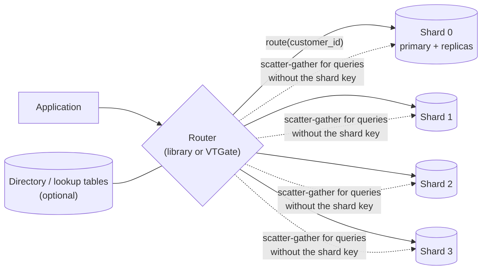

## Introduction

[Read replicas](/lessons/m12-read-replicas) scale reads, but every replica still applies every write, and the primary still accepts all of them. [Partitioning](/lessons/m12-partitioning) splits a table into pieces, but all pieces live on the same server and share its CPU, memory, disks and network. When one server can no longer absorb the **write** volume, hold the **data**, or keep the **working set** in memory, the remaining option is to split the data across several independent servers, each owning a subset of the rows. Each server (with its own replicas) is a **shard**; the technique is **sharding**, also called horizontal scaling out.

Sharding is the most powerful and the most expensive scaling move in this module. It multiplies capacity almost linearly — and it removes, at the boundary between shards, things the earlier modules took for granted: joins, foreign keys, unique constraints, transactions, `AUTO_INCREMENT`, and "just run a query over the whole table". Professional teams therefore shard late, deliberately, and around one decision that is very hard to change later: the **shard key**.

This lesson simulates four shards with four tables in the lab, implements the three classic routing schemes — **hash, range and directory** — as SQL functions and lookup tables, runs single-shard and **cross-shard** (scatter-gather) queries and checks them against the unsharded truth, demonstrates why cross-shard writes are not atomic, measures how much data moves when you add a shard, and generates globally unique IDs. Vitess, the most widely used MySQL sharding system, is described along the way.

:::note[A simulation, honestly labelled]
In production each shard is a separate MySQL server (usually a primary with replicas). Here each shard is a table in one lab schema, so a "cross-shard query" is a `UNION ALL` instead of parallel network calls. The routing logic, the query rewriting and the data-movement arithmetic are exactly what real systems do; latency and failure behaviour are described, not simulated.
:::

## DBMS Theory

:::theory[Sharding as distributed horizontal partitioning]
A sharded database is a horizontally partitioned relation R = R₁ ∪ … ∪ Rₙ whose fragments are placed on different nodes. Three choices define the design:

1. **The shard key** *k* — the attribute(s) used to place each row. All rows with the same key value live on the same shard.
2. **The routing function** *route(k) → shard*:
   - **Hash**: shard = h(k) mod n (or a consistent-hashing ring / fixed bucket space).
   - **Range**: shard = the i with boundᵢ₋₁ ≤ k < boundᵢ.
   - **Directory** (lookup): shard = D[k], an explicit mapping table.
3. **Co-location** — which *other* tables are sharded by the same key so that related rows (a customer's orders, items, payments) live together.

A query whose predicate fixes the shard key is a **single-shard query** and executes with the full power of one SQL engine. A query that does not is a **scatter-gather** (fan-out) query: it runs on every shard and the partial results are merged by a coordinator. Aggregates must be decomposed into **partial and final aggregation**: SUM and COUNT merge by summing, MIN/MAX by taking the min/max, AVG must be carried as (SUM, COUNT), and COUNT(DISTINCT) of a non-key attribute cannot be merged from per-shard counts at all.
:::

Two results from distributed systems theory frame the trade-offs:

- **No free atomicity across nodes.** A transaction touching two shards needs an atomic commitment protocol such as **two-phase commit** (2PC), which blocks if the coordinator fails at the wrong moment, adds round trips, and is rarely used for OLTP across shards. Most sharded systems instead keep transactions **within one shard** by co-locating data, and handle the rare cross-shard business operation with sagas and idempotency ([Data Integrity in Distributed Applications](/lessons/m12-distributed-integrity)).
- **Rebalancing cost depends on the routing function.** With h(k) mod n, changing n to n+1 moves about n/(n+1) of all keys. **Consistent hashing** (Karger et al., 1997) and its practical cousin, a **fixed number of logical buckets** mapped to physical shards by a directory, move only about 1/(n+1) of the keys — only the buckets you reassign.

## Why It Exists

A single MySQL primary has hard ceilings: write throughput (commit rate limited by log flushing and replication), storage (operational pain grows with multi-terabyte instances — backup, restore and replica rebuild times grow linearly), working-set size (once the hot data exceeds the buffer pool, latency jumps), and connection count. Vertical scaling (a bigger machine) postpones the ceilings; read replicas raise only the read ceiling.

Sharding exists to raise all of them at once:

- **Writes** scale with the number of shard primaries.
- **Data size per server** stays bounded, so backups, restores, schema changes and replica rebuilds stay fast.
- **Blast radius** shrinks: an incident on one shard affects only the customers on it.
- **Placement** becomes possible: tenants' data in a specific region for data residency, a huge tenant on dedicated hardware.

What goes wrong without a disciplined design is equally clear from industry experience: a shard key that does not match the access pattern turns every request into a fan-out; a monotonically increasing range key sends all new writes to one "hot" shard; modulo hashing turns adding a shard into moving almost all the data; and code that assumed one database (joins, FKs, auto-increment IDs, global unique constraints) breaks in subtle ways.

## Internal Working

:::internals[How a sharded MySQL deployment routes a query]
A sharded deployment adds a **routing layer** between the application and the MySQL servers. It can be a library in the application (an ORM extension, a custom data-access layer) or a proxy tier such as **Vitess's VTGate**:

1. The router parses the statement (or the application supplies the shard key explicitly).
2. If the WHERE clause fixes the shard key — `WHERE customer_id = 42` — it computes route(42) and sends the statement unchanged to that shard's primary (or a replica for reads).
3. If not, it rewrites the query into per-shard queries (pushing down filters, partial aggregates, `ORDER BY … LIMIT n` per shard), runs them in parallel, and merges results: concatenation for plain rows, re-aggregation for GROUP BY, a merge sort for ORDER BY, and a final LIMIT.
4. For INSERT, it computes the route from the new row's shard-key value. An INSERT without the shard key is rejected.
5. Secondary lookups (find the order with `order_id = 9001` when the shard key is `customer_id`) need either a fan-out or a **lookup index** — a separate table mapping order_id → customer_id (Vitess calls this a *lookup vindex*), itself maintained on every insert.

**Vitess** implements this for MySQL: a *keyspace* is a logical database split into shards; each shard is a normal MySQL primary with replicas managed by a *VTTablet* sidecar; a *VSchema* declares each table's sharding *vindex* (for example `hash` on `customer_id`); VTGate routes queries; and *VReplication* copies and filters data for resharding (`Reshard`, `MoveTables`) with a controlled cut-over (`SwitchTraffic`). Shards are named by **keyspace-ID ranges** (`-40`, `40-80`, `80-c0`, `c0-`), so splitting a shard means splitting a range of the hashed key space — a directory-like scheme on top of a hash.
:::



## MySQL Implementation

### The unsharded starting point

Start from one table of 100,000 orders for 20,000 customers — the "before" state, which we keep as ground truth to verify the sharded answers.

```sql run
SET SESSION cte_max_recursion_depth = 100000;
CREATE TABLE all_orders (
  order_id    INT UNSIGNED NOT NULL PRIMARY KEY,
  customer_id INT UNSIGNED NOT NULL,
  created_at  DATETIME     NOT NULL,
  status      VARCHAR(10)  NOT NULL,
  amount      DECIMAL(10,2) NOT NULL,
  KEY (customer_id)
);
INSERT INTO all_orders
WITH RECURSIVE seq(n) AS (SELECT 1 UNION ALL SELECT n + 1 FROM seq WHERE n < 100000)
SELECT n,
       1 + FLOOR((n - 1) / 5),                    -- customers sign up over time: customer c places orders 5c-4 … 5c
       '2023-01-01' + INTERVAL (n * 9) MINUTE,
       ELT(1 + n % 5, 'paid', 'shipped', 'delivered', 'delivered', 'refunded'),
       ROUND(5 + ((n * 7919) % 99991) / 1000, 2)
FROM seq;
SELECT COUNT(*) AS orders, COUNT(DISTINCT customer_id) AS customers,
       MIN(created_at) AS first_order, MAX(created_at) AS last_order
FROM all_orders;
```

### Hash routing

The routing function hashes the shard key and takes it modulo the number of shards. `CRC32()` is a fast, well-distributed (non-cryptographic) hash available in MySQL:

```sql run
CREATE FUNCTION shard_hash(cid INT UNSIGNED) RETURNS TINYINT DETERMINISTIC
  RETURN CRC32(cid) % 4;
CREATE TABLE shard0_orders LIKE all_orders;
CREATE TABLE shard1_orders LIKE all_orders;
CREATE TABLE shard2_orders LIKE all_orders;
CREATE TABLE shard3_orders LIKE all_orders;
INSERT INTO shard0_orders SELECT * FROM all_orders WHERE shard_hash(customer_id) = 0;
INSERT INTO shard1_orders SELECT * FROM all_orders WHERE shard_hash(customer_id) = 1;
INSERT INTO shard2_orders SELECT * FROM all_orders WHERE shard_hash(customer_id) = 2;
INSERT INTO shard3_orders SELECT * FROM all_orders WHERE shard_hash(customer_id) = 3;
SELECT 0 AS shard, COUNT(*) AS orders, COUNT(DISTINCT customer_id) AS customers FROM shard0_orders
UNION ALL SELECT 1, COUNT(*), COUNT(DISTINCT customer_id) FROM shard1_orders
UNION ALL SELECT 2, COUNT(*), COUNT(DISTINCT customer_id) FROM shard2_orders
UNION ALL SELECT 3, COUNT(*), COUNT(DISTINCT customer_id) FROM shard3_orders;
```

The shards are close to equal, and — because the shard key is `customer_id` — every customer's orders are on exactly one shard (the per-shard distinct customer counts add up to 20,000). That co-location is what makes the common query fast.

### A single-shard query

"Show customer 4,217's orders" fixes the shard key. The router computes the shard and sends the query to it alone:

```sql run
SELECT shard_hash(4217) AS shard_for_customer_4217;
```

```sql run
-- the router sends this to the shard computed above (shown here against all four to prove only one has rows)
SELECT 'shard0' AS shard, COUNT(*) AS orders FROM shard0_orders WHERE customer_id = 4217
UNION ALL SELECT 'shard1', COUNT(*) FROM shard1_orders WHERE customer_id = 4217
UNION ALL SELECT 'shard2', COUNT(*) FROM shard2_orders WHERE customer_id = 4217
UNION ALL SELECT 'shard3', COUNT(*) FROM shard3_orders WHERE customer_id = 4217;
```

All five orders of customer 4,217 are on the shard the function named, and on no other. In production, this query costs exactly what it cost before sharding: one indexed lookup on one server.

## Syntax Breakdown

MySQL has no `SHARD BY` clause — sharding lives outside the server. The building blocks you implement or configure:

| Building block | In MySQL / the application | In Vitess |
|---|---|---|
| Shard key | A column present in every co-located table (`customer_id`, `tenant_id`) | The *primary vindex* column in the VSchema |
| Hash routing | `CRC32(k) % n`, `CONV(LEFT(SHA2(k,256),8),16,10) % n`, or buckets | `hash` vindex (keyspace ID from a hash), shards are keyspace-ID ranges |
| Range routing | A `shard_ranges(lo, hi, shard)` table | Shards are ranges of keyspace ID; `numeric` vindex gives identity mapping |
| Directory routing | A `shard_directory(key, shard)` table, cached by routers | `lookup` vindexes, or a custom vindex |
| Secondary lookups | A lookup table `order_id → customer_id` maintained on insert | `lookup_unique` / `consistent_lookup` vindexes |
| Global IDs | `auto_increment_increment/offset`, a ticket table, Snowflake-style IDs, UUIDv7 | *Sequences* (a special unsharded table that hands out ID blocks) |
| Cross-shard query | Fan-out from the application, merge in code | VTGate scatter queries, merge, `ORDER BY`/`LIMIT` pushdown |
| Cross-shard transaction | XA (`XA START/END/PREPARE/COMMIT`), or sagas | `transaction_mode = SINGLE` (default; reject), `MULTI` (best effort), `TWOPC` |
| Reference tables | Small tables copied to every shard (countries, plans) | `reference` tables replicated to every shard |

```sql
-- MySQL's own two-phase commit primitive (display only; requires XA_RECOVER_ADMIN for recovery)
XA START 'transfer-77';
UPDATE accounts SET balance = balance - 100 WHERE account_id = 1;
XA END 'transfer-77';
XA PREPARE 'transfer-77';     -- the coordinator collects PREPARE results from every shard…
XA COMMIT 'transfer-77';      -- …then tells every shard to COMMIT (or XA ROLLBACK)
```

A Vitess VSchema (display only) declaring `customers` and `orders` co-located by a `hash` vindex on `customer_id`:

```json
{
  "sharded": true,
  "vindexes": { "hash": { "type": "hash" } },
  "tables": {
    "customers": { "column_vindexes": [{ "column": "customer_id", "name": "hash" }] },
    "orders":    { "column_vindexes": [{ "column": "customer_id", "name": "hash" }] }
  }
}
```

## Practical Examples

### 1. A cross-shard (scatter-gather) aggregate

"Revenue and average order value per status, across all customers" does not fix the shard key, so it runs on every shard. The correct rewrite pushes **partial aggregates** (SUM and COUNT) down and combines them at the coordinator:

```sql run
WITH partials AS (
  SELECT status, SUM(amount) AS revenue, COUNT(*) AS n FROM shard0_orders GROUP BY status
  UNION ALL SELECT status, SUM(amount), COUNT(*) FROM shard1_orders GROUP BY status
  UNION ALL SELECT status, SUM(amount), COUNT(*) FROM shard2_orders GROUP BY status
  UNION ALL SELECT status, SUM(amount), COUNT(*) FROM shard3_orders GROUP BY status
)
SELECT status, SUM(revenue) AS revenue, SUM(n) AS orders, ROUND(SUM(revenue) / SUM(n), 4) AS avg_order_value
FROM partials GROUP BY status ORDER BY status;
```

And the ground truth from the unsharded table:

```sql run
SELECT status, SUM(amount) AS revenue, COUNT(*) AS orders, ROUND(AVG(amount), 4) AS avg_order_value
FROM all_orders GROUP BY status ORDER BY status;
```

Identical. Each shard returned one row per status (four); only 16 small rows crossed the "network". If the coordinator had averaged the four per-shard averages instead, the answer would be wrong whenever shards have different numbers of orders — the same "average of averages" error as in [OLTP vs OLAP](/lessons/m12-oltp-olap), now at the distribution layer.

### 2. Cross-shard top-N

"Top 5 customers by lifetime revenue" can be pushed down because each customer lives on one shard: each shard computes its own top 5, and the coordinator merges 4 × 5 candidates:

```sql run
WITH per_shard AS (
  (SELECT customer_id, SUM(amount) AS revenue FROM shard0_orders GROUP BY customer_id ORDER BY revenue DESC, customer_id LIMIT 5)
  UNION ALL
  (SELECT customer_id, SUM(amount) FROM shard1_orders GROUP BY customer_id ORDER BY 2 DESC, customer_id LIMIT 5)
  UNION ALL
  (SELECT customer_id, SUM(amount) FROM shard2_orders GROUP BY customer_id ORDER BY 2 DESC, customer_id LIMIT 5)
  UNION ALL
  (SELECT customer_id, SUM(amount) FROM shard3_orders GROUP BY customer_id ORDER BY 2 DESC, customer_id LIMIT 5)
)
SELECT customer_id, revenue FROM per_shard ORDER BY revenue DESC, customer_id LIMIT 5;
```

```sql run
SELECT customer_id, SUM(amount) AS revenue FROM all_orders
GROUP BY customer_id ORDER BY revenue DESC, customer_id LIMIT 5;
```

Again identical. The pushdown is correct **only because** the grouping key is the shard key (each group is complete on one shard). Top-N by a non-shard-key group (top products, when products' orders are spread over all shards) cannot be pushed down this way: a product that is 6th on every shard can be 1st overall. That query must aggregate fully per shard and merge everything, or run in a warehouse.

### 3. A query that cannot be merged from partials

Count distinct *active days* across all orders. Per-shard distinct counts overlap — the same day appears on every shard:

```sql run
SELECT (SELECT COUNT(DISTINCT DATE(created_at)) FROM shard0_orders)
     + (SELECT COUNT(DISTINCT DATE(created_at)) FROM shard1_orders)
     + (SELECT COUNT(DISTINCT DATE(created_at)) FROM shard2_orders)
     + (SELECT COUNT(DISTINCT DATE(created_at)) FROM shard3_orders) AS wrong_sum_of_distincts,
       (SELECT COUNT(DISTINCT d) FROM (
          SELECT DISTINCT DATE(created_at) AS d FROM shard0_orders
          UNION SELECT DISTINCT DATE(created_at) FROM shard1_orders
          UNION SELECT DISTINCT DATE(created_at) FROM shard2_orders
          UNION SELECT DISTINCT DATE(created_at) FROM shard3_orders) x) AS correct_distinct_days,
       (SELECT COUNT(DISTINCT DATE(created_at)) FROM all_orders) AS ground_truth;
```

The naive sum reports 2,501 "distinct days" for a dataset that spans only 626 calendar days. The correct version ships every shard's distinct values to the coordinator and deduplicates there — cost proportional to the number of distinct values, not to four small numbers. For high-cardinality distinct counts across shards, systems use approximate sketches (HyperLogLog) or a warehouse.

### 4. Range routing and the hot shard

Range sharding on `customer_id` puts customers 1–5,000 on shard 0, 5,001–10,000 on shard 1, and so on. Ranges are easy to understand and allow efficient range scans on the key — but customer IDs are assigned in sign-up order, so **all recent activity lands on the newest range**:

```sql run
CREATE TABLE shard_ranges (lo INT UNSIGNED NOT NULL, hi INT UNSIGNED NOT NULL, shard TINYINT NOT NULL, PRIMARY KEY (lo));
INSERT INTO shard_ranges VALUES (1, 5000, 0), (5001, 10000, 1), (10001, 15000, 2), (15001, 20000, 3);
SELECT r.shard AS range_shard,
       SUM(o.created_at >= '2024-06-01') AS orders_since_june_2024,
       COUNT(*) AS orders_all_time
FROM all_orders o JOIN shard_ranges r ON o.customer_id BETWEEN r.lo AND r.hi
GROUP BY r.shard ORDER BY r.shard;
SELECT shard_hash(customer_id) AS hash_shard,
       SUM(created_at >= '2024-06-01') AS orders_since_june_2024,
       COUNT(*) AS orders_all_time
FROM all_orders GROUP BY hash_shard ORDER BY hash_shard;
```

All-time totals are balanced under both schemes (25,000 orders per range shard), but the **recent** write load is not: under range routing all 17,281 orders since June 2024 went to range shard 3 and the other three shards received none, while hash routing spread them almost exactly evenly (about 4,300 per shard). Range sharding on a monotonic key (sign-up order, time, AUTO_INCREMENT) creates a hot shard; it suits keys without temporal skew, or deliberately time-sharded data where old shards become read-only archives.

### 5. Directory routing for tenants

A **directory** maps each key to a shard explicitly. It costs a lookup (cached by routers), but it allows any placement — for example moving one very large tenant to a dedicated shard:

```sql run
CREATE TABLE shard_directory (tenant_id INT UNSIGNED PRIMARY KEY, shard TINYINT NOT NULL, note VARCHAR(40) NULL);
INSERT INTO shard_directory VALUES (1, 0, NULL), (2, 1, NULL), (3, 2, NULL), (4, 3, NULL),
                                   (5, 0, NULL), (6, 1, NULL), (7, 4, 'enterprise tenant: dedicated shard');
CREATE FUNCTION shard_dir(t INT UNSIGNED) RETURNS TINYINT READS SQL DATA
  RETURN (SELECT shard FROM shard_directory WHERE tenant_id = t);
SELECT shard_dir(3) AS tenant3, shard_dir(7) AS tenant7, shard_dir(99) AS unknown_tenant;
```

The unknown tenant returns NULL — the router must treat that as an error (or a "new tenant placement" decision), never as shard 0. The directory itself becomes critical infrastructure: it must be highly available, cached, and changed with a careful protocol during moves.

## Execution Walkthrough

### Cross-shard writes are not atomic

A transfer of 100.00 between customers on different shards is two transactions on two servers. Between them, a reader can observe money that has left one account and not arrived at the other. Session A is the transfer service, session B a balance-audit query; each `UPDATE` is its own autocommitted transaction, as it would be on separate servers.

```concurrency
title: A cross-shard transfer is visible half-done
description: shard0_wallets and shard1_wallets stand for tables on two different servers. Session A moves 100.00 from wallet 1 (shard 0) to wallet 2 (shard 1).
setup: |
  CREATE TABLE shard0_wallets (wallet_id INT PRIMARY KEY, balance DECIMAL(10,2) NOT NULL);
  CREATE TABLE shard1_wallets (wallet_id INT PRIMARY KEY, balance DECIMAL(10,2) NOT NULL);
  INSERT INTO shard0_wallets VALUES (1, 500.00);
  INSERT INTO shard1_wallets VALUES (2, 300.00);
steps:
  - session: B
    sql: SELECT (SELECT SUM(balance) FROM shard0_wallets) + (SELECT SUM(balance) FROM shard1_wallets) AS total_money;
    note: The audit sees 800.00 in the system.
  - session: A
    sql: UPDATE shard0_wallets SET balance = balance - 100.00 WHERE wallet_id = 1;
    note: Step 1 of the transfer commits on shard 0.
  - session: B
    sql: SELECT (SELECT SUM(balance) FROM shard0_wallets) + (SELECT SUM(balance) FROM shard1_wallets) AS total_money;
    note: The audit now sees 700.00 — 100.00 is "in flight". If the transfer service crashed here, it would stay missing until a recovery process completes or compensates the transfer.
  - session: A
    sql: UPDATE shard1_wallets SET balance = balance + 100.00 WHERE wallet_id = 2;
    note: Step 2 commits on shard 1.
  - session: B
    sql: SELECT (SELECT SUM(balance) FROM shard0_wallets) + (SELECT SUM(balance) FROM shard1_wallets) AS total_money;
    note: Back to 800.00.
```

Real systems handle this in one of three ways: **avoid it** by choosing a shard key that keeps each business transaction on one shard (most common); use **2PC** (XA, or Vitess `TWOPC` mode) and accept its latency and blocking failure modes; or design the operation as a **saga** with a durable record of progress and compensating actions, plus reconciliation jobs that detect stuck transfers ([Data Integrity in Distributed Applications](/lessons/m12-distributed-integrity)).

### Resharding: how much data moves?

```walkthrough
title: Adding a fifth shard — modulo hashing vs fixed buckets
steps:
  - title: "1. Modulo hashing: shard = CRC32(k) % n"
    explain: Going from 4 to 5 shards changes the shard of every key whose CRC32 % 4 differs from CRC32 % 5. Count how many of the 20,000 customers would have to move.
    sql: |
      SELECT SUM(CRC32(customer_id) % 4 <> CRC32(customer_id) % 5) AS customers_moving,
             COUNT(*) AS customers,
             ROUND(100 * AVG(CRC32(customer_id) % 4 <> CRC32(customer_id) % 5), 1) AS pct_moving
      FROM (SELECT DISTINCT customer_id FROM all_orders) c;
  - title: "2. Fixed buckets: bucket = CRC32(k) % 64, shard = directory[bucket]"
    explain: Hash keys into a fixed number of logical buckets (64 here, often 256–4096 in practice) and map buckets to shards with a small directory. Initially 16 buckets per shard.
    sql: |
      CREATE TABLE bucket_map (bucket TINYINT UNSIGNED PRIMARY KEY, shard TINYINT NOT NULL);
      INSERT INTO bucket_map
      WITH RECURSIVE b(n) AS (SELECT 0 UNION ALL SELECT n + 1 FROM b WHERE n < 63)
      SELECT n, n % 4 FROM b;
      SELECT shard, COUNT(*) AS buckets FROM bucket_map GROUP BY shard ORDER BY shard;
  - title: "3. Add shard 4 by reassigning a few buckets"
    explain: Move 3 buckets from each existing shard to the new shard 4 (12 of 64 buckets, so each shard ends with 12 or 13). Only keys in those buckets move.
    sql: |
      CREATE TABLE bucket_map_v2 AS SELECT * FROM bucket_map;
      UPDATE bucket_map_v2 SET shard = 4 WHERE bucket IN (0, 1, 2, 3, 4, 5, 6, 7, 8, 9, 10, 11);
      SELECT shard, COUNT(*) AS buckets FROM bucket_map_v2 GROUP BY shard ORDER BY shard;
  - title: "4. Measure the movement"
    explain: Compare each customer's shard under the old and new bucket maps.
    sql: |
      SELECT SUM(m1.shard <> m2.shard) AS customers_moving, COUNT(*) AS customers,
             ROUND(100 * AVG(m1.shard <> m2.shard), 1) AS pct_moving
      FROM (SELECT DISTINCT customer_id FROM all_orders) c
      JOIN bucket_map    m1 ON m1.bucket = CRC32(c.customer_id) % 64
      JOIN bucket_map_v2 m2 ON m2.bucket = CRC32(c.customer_id) % 64;
```

Modulo rehashing moves the large majority of customers (about four out of five, as the theory n/(n+1) = 80% predicts), which means copying most of the data between servers. With fixed buckets only the reassigned buckets move — about 12/64 ≈ 19% here, the minimum needed to give the new shard its share. This is why production systems never route with a bare `% number_of_servers`: Vitess uses ranges of a 64-bit keyspace ID, Cassandra and DynamoDB use token rings, and hand-built MySQL sharding usually uses a bucket directory.

## Output

- Hash routing spread 100,000 orders over four shards nearly evenly, with each customer's orders on exactly one shard.
- The single-shard query found customer 4,217's five orders on the shard the routing function named and nowhere else.
- Scatter-gather revenue and average order value per status matched the unsharded ground truth when partial SUM and COUNT were merged; the top-5 customers matched because the grouping key was the shard key.
- The sum of per-shard distinct day counts overcounted; deduplicating the per-shard value sets at the coordinator matched the ground truth.
- Range routing concentrated all recent orders on the newest range shard; hash routing spread them.
- The cross-shard transfer was visible half-done (700.00 instead of 800.00) between the two commits.
- Going from 4 to 5 shards moved about 80% of customers under modulo hashing and about 19% with a 64-bucket directory.

## Alternative Approaches

Sharding is the last resort on a ladder; each rung is cheaper:

| Step | Raises | Costs |
|---|---|---|
| Query and index optimisation | Everything | Engineering time only |
| Vertical scaling (bigger instance) | Everything, up to the largest instance | Money; one failure domain |
| Caching ([Caching Strategies](/lessons/m12-caching)) | Read capacity, latency | Consistency/invalidation logic |
| Read replicas | Read capacity | Replica lag handling |
| Partitioning and archiving | Manageability of big tables | No FKs on partitioned tables |
| **Functional partitioning** (separate databases per service/domain: users, orders, search) | Write capacity per domain | Cross-domain joins move to the application |
| **Sharding** by key | Writes, storage, working set | Routing, cross-shard queries/transactions, resharding, IDs |
| Distributed SQL (Vitess, TiDB, CockroachDB, Spanner, Aurora Limitless) | Same as sharding, automated | Product/operational dependency; distributed-transaction latency |

**Choosing the routing scheme:**

| Scheme | Strengths | Weaknesses | Use when |
|---|---|---|---|
| Hash | Even spread; no hot shard for monotonic keys; no lookup | Range queries on the key fan out; modulo resharding moves everything (use buckets or ranges of hash space) | Default for user/customer/tenant keys |
| Range | Range scans on the key stay local; easy to split a range | Hot spots on monotonic keys; uneven growth | Keys without temporal skew; time-based archival tiers |
| Directory | Arbitrary placement; easy moves of single keys; supports giant tenants | Extra lookup; the directory is a critical dependency | Multi-tenant SaaS with very different tenant sizes |

## Performance Analysis

**Single-shard operations** cost what they cost on one server, plus the router hop (sub-millisecond in a proxy like VTGate in the same zone). This is the case to optimise for: in a well-sharded OLTP system, the vast majority of queries — often well above 95% — should be single-shard.

**Scatter-gather** latency is the *maximum* of the shards' latencies plus merge time, and its cost is the *sum* of the work on all shards. With 64 shards, a query whose p99 per shard is 20 ms has a much higher p99 overall, because the probability that *some* shard is slow grows with the fan-out (tail-latency amplification). Fan-out queries also consume capacity on every shard, so a popular one erodes the benefit of sharding.

**Resharding cost** is proportional to the data moved (copy + catch-up replication + verification + cut-over), which the walkthrough quantified: ~80% of the data with modulo routing versus the minimum necessary with buckets or hash ranges. Tools like Vitess VReplication copy online, then switch reads and writes with a brief pause.

**ID generation** must not need a cross-shard round trip on every insert. Options, with their costs:

```sql run
-- Option A: interleaved AUTO_INCREMENT per shard (session-settable here; in production set globally per shard)
CREATE TABLE ids_shard_a (id INT UNSIGNED AUTO_INCREMENT PRIMARY KEY, v CHAR(1));
CREATE TABLE ids_shard_b (id INT UNSIGNED AUTO_INCREMENT PRIMARY KEY, v CHAR(1));
SET SESSION auto_increment_increment = 4, auto_increment_offset = 1;
INSERT INTO ids_shard_a (v) VALUES ('a'), ('a'), ('a');
SET SESSION auto_increment_increment = 4, auto_increment_offset = 2;
INSERT INTO ids_shard_b (v) VALUES ('b'), ('b'), ('b');
SET SESSION auto_increment_increment = 1, auto_increment_offset = 1;
SELECT 'shard a' AS shard, GROUP_CONCAT(id ORDER BY id) AS ids FROM ids_shard_a
UNION ALL SELECT 'shard b', GROUP_CONCAT(id ORDER BY id) FROM ids_shard_b;
```

Shard a generated 1, 5, 9 and shard b 2, 6, 10 — never colliding, but the scheme bakes the maximum shard count (4) into every ID. A **Snowflake-style** 64-bit ID packs a millisecond timestamp, a shard/worker number and a per-millisecond sequence, so IDs are unique, roughly time-ordered (good for InnoDB's clustered index, which prefers increasing keys) and generated without coordination:

```sql run
SET @epoch_ms = 1704067200000;                                   -- 2024-01-01T00:00:00Z, the system's custom epoch
SET @ts_ms = 1733055000123;                                      -- a fixed example timestamp (in code: current time)
SELECT ((@ts_ms - @epoch_ms) << 22) | (3 << 12) | 17                  AS snowflake_id,   -- shard 3, sequence 17
       (((@ts_ms - @epoch_ms) << 22) | (3 << 12) | 17) >> 22          AS ms_since_epoch,
       ((((@ts_ms - @epoch_ms) << 22) | (3 << 12) | 17) >> 12) & 1023 AS shard_bits,
       (((@ts_ms - @epoch_ms) << 22) | (3 << 12) | 17) & 4095         AS sequence_bits;
```

The ID decodes back to its timestamp, shard (3) and sequence (17). Random UUIDv4 values avoid coordination too, but as InnoDB primary keys they insert at random positions in the B+ tree (page splits, poor locality); `UUID_TO_BIN(UUID(), 1)` reorders MySQL's time-based UUIDv1 to be roughly increasing, and UUIDv7 (time-ordered, generated in the application) has the same benefit.

## Best Practices

:::best-practice[Sharding without regret]
1. **Exhaust the cheaper rungs first** (optimisation, vertical scaling, caching, replicas, archiving, functional partitioning). Sharding is a one-way door for application complexity.
2. **Choose the shard key from the access pattern**: the entity most requests are scoped to (tenant, customer, user). Co-locate everything a business transaction touches under that key.
3. **Make the shard key part of every primary key and every query** on sharded tables; reject queries without it in code review (or in the router).
4. **Route via buckets or hash ranges, never `% number_of_servers`**, so resharding moves only what it must.
5. **Use globally unique, roughly ordered IDs** that do not need a central round trip (Snowflake-style, UUIDv7, or ID blocks from a sequence service).
6. **Keep reference data small and replicated** to every shard; keep truly global data (the directory, sequences) in a small, highly available unsharded database.
7. **Design cross-shard operations as sagas with idempotency**; reserve 2PC for rare, low-volume cases.
8. **Push analytics out of the shards** into a warehouse fed by CDC from every shard; do not build reporting on scatter-gather.
9. **Automate everything per shard**: schema changes, backups, failover, monitoring. With 64 shards, any manual procedure is 64 incidents waiting to happen.
:::

## Common Mistakes

**Mistake 1 — a shard key that does not match the queries.** Sharding orders by `order_id` spreads data perfectly and turns "show customer 42's orders" into a 64-way fan-out. Shard by the entity requests are scoped to.

**Mistake 2 — per-shard AUTO_INCREMENT without coordination.** Each shard happily generates 1, 2, 3 … and the IDs collide as soon as data from two shards meets (in a warehouse, a cache key, a merge):

```sql run
CREATE TABLE s0_invoices (invoice_id INT UNSIGNED AUTO_INCREMENT PRIMARY KEY, customer_id INT UNSIGNED NOT NULL);
CREATE TABLE s1_invoices (invoice_id INT UNSIGNED AUTO_INCREMENT PRIMARY KEY, customer_id INT UNSIGNED NOT NULL);
INSERT INTO s0_invoices (customer_id) VALUES (4), (8);
INSERT INTO s1_invoices (customer_id) VALUES (1), (5);
CREATE TABLE warehouse_invoices (invoice_id INT UNSIGNED PRIMARY KEY, customer_id INT UNSIGNED NOT NULL);
INSERT INTO warehouse_invoices SELECT * FROM s0_invoices;
```

```sql run error
INSERT INTO warehouse_invoices SELECT * FROM s1_invoices;
```

Error 1062: invoice 1 exists on both shards. Use one of the ID schemes above from day one — retrofitting IDs on a sharded system is a migration of every table.

**Mistake 3 — averaging averages (or summing distinct counts) in scatter-gather.** Merge (SUM, COUNT) pairs; deduplicate distinct values at the coordinator.

**Mistake 4 — global unique constraints that no longer exist.** `UNIQUE (email)` is enforced per shard only. Two sign-ups with the same email on different shards both succeed. Keep a small unsharded (or email-sharded) uniqueness table and insert into it first, or shard users by a hash of the email.

**Mistake 5 — range sharding on a monotonic key** without planning for the hot newest range (see Example 4).

**Mistake 6 — assuming cross-shard reads are a consistent snapshot.** Each shard answers from its own snapshot at a slightly different moment; a scatter-gather report over a moving dataset is not a point-in-time view.

## Industry Application

- **Vitess** originated at YouTube to shard MySQL and is a CNCF graduated project; it is used by companies such as Slack, GitHub, HubSpot and Square/Block, and is the basis of PlanetScale's managed service. It provides routing (VTGate), resharding and table moves (VReplication), and online schema changes.
- **Custom sharding layers** remain common: many large MySQL deployments (historically Facebook, Pinterest, Etsy, Shopify's "pods") built application-level sharding by user or shop, with a directory service mapping IDs to shards and bucket-based resharding.
- **Multi-tenant SaaS** typically shards by `tenant_id` with a directory, placing the largest tenants on dedicated shards and many small tenants together — and moving tenants between shards as they grow.
- **Snowflake-style IDs** (Twitter's original design; Instagram's variant computed in PostgreSQL; Discord's) and **ticket servers** (Flickr's MySQL `REPLACE INTO … LAST_INSERT_ID()` design) are the standard ID strategies in sharded systems.
- **Distributed SQL** systems (TiDB with MySQL compatibility, CockroachDB, Spanner, Amazon Aurora Limitless Database) automate sharding and distributed transactions; teams evaluate them against the operational and performance cost of managing shards themselves ([Distributed Databases](/lessons/m13-distributed-databases)).

## Practice Exercises

```exercise
id: ex1
title: Route a batch of customers
difficulty: easy
setup: |
  CREATE FUNCTION shard_hash(cid INT UNSIGNED) RETURNS TINYINT DETERMINISTIC RETURN CRC32(cid) % 4;
  CREATE TABLE signups (customer_id INT UNSIGNED PRIMARY KEY, email VARCHAR(60) NOT NULL);
  INSERT INTO signups VALUES (101, 'a@x.io'), (102, 'b@x.io'), (103, 'c@x.io'), (104, 'd@x.io'), (105, 'e@x.io'), (106, 'f@x.io');
concepts: [hash-sharding]
prompt: |
  The router places customers with `shard_hash(customer_id)` (already created). Return `shard` and
  `customers` — the number of the new sign-ups routed to each shard — for every shard that receives at
  least one.
hints:
  - "Group the sign-ups by shard_hash(customer_id)."
solution: |
  SELECT shard_hash(customer_id) AS shard, COUNT(*) AS customers
  FROM signups GROUP BY shard;
explanation: |
  Six keys rarely spread perfectly over four shards; hashing evens out only over many keys. That is also
  why load tests of a sharded system must use realistic key volumes and distributions.
```

```exercise
id: ex2
title: Correct scatter-gather average
difficulty: medium
setup: |
  CREATE TABLE s0_orders (order_id INT PRIMARY KEY, region VARCHAR(8) NOT NULL, amount DECIMAL(10,2) NOT NULL);
  CREATE TABLE s1_orders LIKE s0_orders;
  CREATE TABLE s2_orders LIKE s0_orders;
  INSERT INTO s0_orders VALUES (1,'EU',10.00),(2,'EU',20.00),(3,'NA',30.00);
  INSERT INTO s1_orders VALUES (4,'EU',100.00);
  INSERT INTO s2_orders VALUES (5,'NA',5.00),(6,'NA',15.00),(7,'EU',30.00),(8,'NA',40.00);
concepts: [cross-shard-queries]
prompt: |
  Orders are spread over three shards (`s0_orders`, `s1_orders`, `s2_orders`). Return, per `region`, the
  columns `region`, `orders` and `avg_amount` (rounded to 2 decimals) **as if computed over all orders**,
  by combining per-shard partial aggregates.
hints:
  - "Each shard returns region, SUM(amount) and COUNT(*); the coordinator sums both."
  - "avg = SUM of sums / SUM of counts — never AVG of per-shard AVGs."
solution: |
  SELECT region, SUM(n) AS orders, ROUND(SUM(s) / SUM(n), 2) AS avg_amount
  FROM (
    SELECT region, SUM(amount) AS s, COUNT(*) AS n FROM s0_orders GROUP BY region
    UNION ALL SELECT region, SUM(amount), COUNT(*) FROM s1_orders GROUP BY region
    UNION ALL SELECT region, SUM(amount), COUNT(*) FROM s2_orders GROUP BY region
  ) p
  GROUP BY region;
explanation: |
  EU: (10 + 20 + 100 + 30) / 4 = 40.00, whereas the average of the per-shard averages (15, 100, 30) is
  48.33. NA: (30 + 5 + 15 + 40) / 4 = 22.50. Routers such as Vitess VTGate rewrite AVG into SUM and COUNT
  for exactly this reason.
```

```exercise
id: ex3
title: Find a customer's shard through a lookup table
difficulty: hard
setup: |
  CREATE TABLE order_lookup (order_id INT UNSIGNED PRIMARY KEY, customer_id INT UNSIGNED NOT NULL);
  CREATE TABLE shard_directory (customer_id INT UNSIGNED PRIMARY KEY, shard TINYINT NOT NULL);
  INSERT INTO shard_directory VALUES (10, 0), (11, 1), (12, 2), (13, 0);
  INSERT INTO order_lookup VALUES (9001, 10), (9002, 12), (9003, 13), (9004, 11), (9005, 12);
  CREATE TABLE support_tickets (ticket_id INT PRIMARY KEY, order_id INT UNSIGNED NOT NULL);
  INSERT INTO support_tickets VALUES (1, 9002), (2, 9004), (3, 9003), (4, 9999);
concepts: [directory-sharding, cross-shard-queries]
prompt: |
  Support tickets reference orders by `order_id`, but orders are sharded by `customer_id`. Using the lookup
  table `order_lookup` (order → customer) and `shard_directory` (customer → shard), return for every ticket
  `ticket_id`, `order_id`, `customer_id` and `shard`. Tickets whose order is unknown must still appear, with
  NULLs.
hints:
  - "Two LEFT JOINs: tickets → order_lookup → shard_directory."
solution: |
  SELECT t.ticket_id, t.order_id, l.customer_id, d.shard
  FROM support_tickets t
  LEFT JOIN order_lookup l ON l.order_id = t.order_id
  LEFT JOIN shard_directory d ON d.customer_id = l.customer_id;
explanation: |
  This is what a secondary lookup (a Vitess *lookup vindex*) does: it turns a query by a non-shard-key
  column into a single-shard query at the cost of maintaining the lookup table on every insert. Ticket 4's
  order 9999 is unknown — the router must report "not found" rather than guess a shard; an inner join would
  silently hide the broken reference.
```

```exercise
id: ex4
title: How much moves when adding shards?
difficulty: hard
setup: |
  SET SESSION cte_max_recursion_depth = 20000;
  CREATE TABLE customer_keys (customer_id INT UNSIGNED PRIMARY KEY);
  INSERT INTO customer_keys WITH RECURSIVE s(n) AS (SELECT 1 UNION ALL SELECT n + 1 FROM s WHERE n < 10000) SELECT n FROM s;
concepts: [resharding, hash-sharding]
prompt: |
  For the 10,000 customers in `customer_keys`, compute the percentage of keys whose shard changes when a
  modulo router `CRC32(customer_id) % n` grows from **n = 8 to n = 10**. Return one row with columns
  `moving` (count) and `pct_moving` (rounded to 1 decimal).
hints:
  - "Compare CRC32(customer_id) % 8 with CRC32(customer_id) % 10 for each key."
  - "SUM(condition) counts keys; 100 * AVG(condition) is the percentage."
solution: |
  SELECT SUM(CRC32(customer_id) % 8 <> CRC32(customer_id) % 10) AS moving,
         ROUND(100 * AVG(CRC32(customer_id) % 8 <> CRC32(customer_id) % 10), 1) AS pct_moving
  FROM customer_keys;
explanation: |
  Most keys move — far more than the 20% minimum needed to fill two new shards (2 of 10). A key keeps its
  shard only when h mod 8 = h mod 10, which happens for a small fraction of hash values. With fixed buckets
  (e.g. 1,024 buckets mapped to shards), adding two shards moves only the reassigned buckets.
```

```exercise
id: ex5
title: Design the sharding scheme for a SaaS product
difficulty: challenge
kind: open
concepts: [shard-key, directory-sharding, id-generation, cross-shard-queries, vitess]
prompt: |
  A project-management SaaS has 40,000 tenant organisations. 95% of tenants have < 50 users; the largest 20
  have 20,000–100,000 users each and generate 40% of all writes. Data: organisations, users, projects,
  tasks, comments, attachments metadata, audit log. Users can belong to several organisations. There is
  a global login (email + password), a cross-tenant admin console for staff, and per-tenant analytics.
  The single MySQL primary is at 70% CPU on writes with 12 TB of data.

  Propose: the shard key; routing scheme; how to handle users in several organisations and global login;
  ID generation; how analytics and the admin console work; how you will migrate from one database to
  shards; and the main risks.
solution: |
  **Shard key: `org_id` (tenant).** Nearly every request is scoped to one organisation, so projects, tasks,
  comments, attachments and the tenant's audit log are co-located by `org_id`, and business transactions
  stay single-shard. Every sharded table gets `org_id` in its primary key (e.g. `PRIMARY KEY (org_id, task_id)`).

  **Routing: directory over buckets.** Hash `org_id` into, say, 4,096 buckets mapped to shards by a
  directory; additionally allow per-tenant overrides so each of the 20 largest tenants can be placed on its
  own shard (or a small group of shards). Routers cache the directory; tenant moves use copy + catch-up +
  brief write freeze (or Vitess `MoveTables`/`Reshard`).

  **Users and login.** Identity (users, credentials, email uniqueness, org memberships) lives in a small,
  unsharded, highly available **global identity database** (or is sharded by user id separately). Login
  resolves email → user → memberships → org → shard. Per-tenant user profiles that tasks join to can be
  copied into the tenant's shard (denormalised, updated via events).

  **IDs.** Snowflake-style 64-bit IDs (timestamp, generator id, sequence) or UUIDv7 — no coordination and
  roughly ordered for InnoDB.

  **Analytics and admin.** CDC (Debezium) from every shard into a warehouse for per-tenant and cross-tenant
  analytics and for the staff console's searches; the console uses the directory for single-tenant
  operations and the warehouse for cross-tenant views, never scatter-gather on OLTP shards.

  **Migration.** (1) add `org_id` to every table and every query (enforced in the data layer); (2) introduce
  the router with a directory that maps everything to the existing database ("shard 0"); (3) build new
  shards as replicas/filtered copies, move buckets or tenants one at a time with verification; (4) move the
  biggest tenants to dedicated shards early, since they drive 40% of writes.

  **Risks.** Cross-tenant features (shared projects between orgs) become cross-shard — restrict or model
  explicitly; the directory and identity DB become critical dependencies; operational load multiplies
  (schema changes, backups, failover per shard — consider Vitess or a managed distributed SQL service);
  hot tenants can still outgrow one shard, which would require sharding within a tenant (e.g. by project).
explanation: |
  Strong answers derive the shard key from the access pattern, handle the global entities (identity,
  login) explicitly, plan for skewed tenant sizes with a directory, choose coordination-free IDs, move
  analytics out of the shards, and present an incremental migration with verification at each step.
```

## Knowledge Assessment

```quiz
- id: q1
  question: "Which problem does sharding solve that read replicas cannot?"
  options:
    - "Stale reads"
    - "Write throughput and data size beyond one primary server"
    - "The need for indexes"
    - "Cross-table joins"
  answer: 1
  explanation: "Every replica applies every write, so replicas do not add write capacity or reduce data per server. Sharding does both — and it makes stale reads, indexing and joins no easier (cross-shard joins become harder)."
  concepts: [sharding]
- id: q2
  question: "An application shards `orders` by `order_id` using a hash. The most frequent query is `SELECT … FROM orders WHERE customer_id = ?`. What is the consequence?"
  options:
    - "The query is single-shard because the hash is stable"
    - "The query must be sent to every shard (scatter-gather), so its cost grows with the number of shards"
    - "The query fails because customer_id is not the shard key"
    - "No consequence if customer_id is indexed"
  answer: 1
  explanation: "Without the shard key in the predicate, the router cannot know which shard holds the rows. An index on each shard makes each fan-out leg cheap, but every shard still does the work. The query does not fail; it fans out."
  concepts: [shard-key]
- id: q3
  question: "A coordinator computes a global average by averaging the per-shard `AVG(amount)` results. When is this correct?"
  options:
    - "Always"
    - "Only when every shard has the same number of rows in each group"
    - "Never, even with equal row counts"
    - "Only for DECIMAL columns"
  answer: 1
  explanation: "The average of averages equals the overall average only when the groups have equal sizes. The general method is to push down SUM and COUNT and divide at the coordinator."
  concepts: [cross-shard-queries]
- id: q4
  question: "Which statements about resharding are true? (Select all that apply.)"
  type: multi
  options:
    - "With shard = hash(k) % n, going from 4 to 5 shards moves about 80% of keys"
    - "With a fixed number of buckets mapped to shards by a directory, only the reassigned buckets move"
    - "Range sharding never requires moving data"
    - "Vitess names shards by ranges of a hashed keyspace ID, so a shard is split by splitting its range"
  answer: [0, 1, 3]
  explanation: "Modulo hashing moves about n/(n+1) of keys; buckets and hash ranges move only what is reassigned. Range sharding also needs data movement when a range is split or rebalanced."
  concepts: [resharding, vitess]
- id: q5
  question: "Range sharding on an AUTO_INCREMENT customer_id (1–5,000 on shard 0, 5,001–10,000 on shard 1, …). What is the typical operational problem?"
  options:
    - "Customers' orders are split across shards"
    - "New customers — and therefore most recent writes — all land on the newest range shard (a hot shard)"
    - "Range queries on customer_id fan out to every shard"
    - "IDs collide between shards"
  answer: 1
  explanation: "Monotonic keys concentrate new activity in the last range, as the lab's recent-orders count showed. Co-location still works, range queries on the key stay local, and ID collisions are a separate issue."
  concepts: [range-sharding]
- id: q6
  question: "Why are per-shard AUTO_INCREMENT primary keys a problem?"
  options:
    - "AUTO_INCREMENT is not supported on InnoDB"
    - "Each shard generates the same values, so IDs collide when data from several shards is combined or when rows move between shards"
    - "They make inserts slower than UUIDs"
    - "They prevent secondary indexes"
  answer: 1
  explanation: "Independent counters overlap (error 1062 in the lab's warehouse load). Solutions are interleaved increments/offsets, Snowflake-style IDs, UUIDv7 or a sequence service. Sequential keys are actually faster for InnoDB inserts than random UUIDs."
  concepts: [id-generation]
- id: q7
  question: "A business operation must update rows on two shards. Which approach is most common in large OLTP systems?"
  options:
    - "Wrap both updates in one MySQL transaction"
    - "Choose the shard key so the operation stays on one shard; when unavoidable, use a saga with idempotent steps and compensation (2PC is rare)"
    - "Use LOCK TABLES on both shards"
    - "Rely on replication to make it atomic"
  answer: 1
  explanation: "A MySQL transaction cannot span servers; LOCK TABLES is per server; replication does not provide atomicity across shards. XA/2PC exists but is rarely used for high-volume OLTP because of latency and blocking failure modes."
  concepts: [sharding, cross-shard-queries]
- id: q8
  question: "In Vitess, what is a lookup vindex used for?"
  options:
    - "Caching query results"
    - "Mapping a non-shard-key column (e.g. order_id) to its keyspace ID so queries by that column can be routed to one shard"
    - "Creating MySQL secondary indexes automatically"
    - "Choosing the primary in failover"
  answer: 1
  explanation: "A lookup vindex is a Vitess-maintained mapping table that turns lookups by a secondary column into single-shard queries. It is not a cache, a MySQL index or a failover mechanism."
  concepts: [vitess]
```
