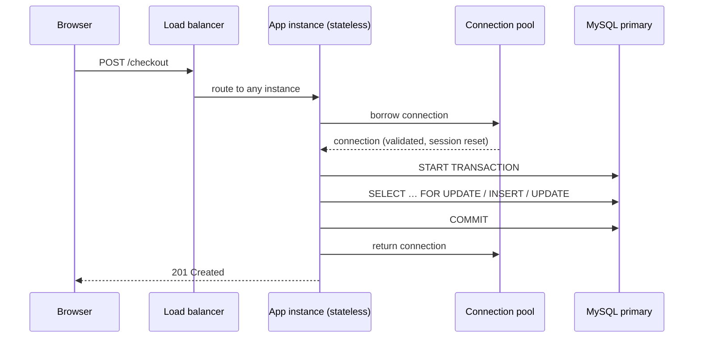

## Introduction

Almost every MySQL server in industry sits behind an application: a web or mobile backend written in Python, Java, Go, Node.js, Ruby or PHP that receives HTTP requests, runs business logic, and reads and writes the database. The database lessons so far treated SQL as something a human types. In production, **SQL is generated by code**, executed thousands of times per second, over pooled network connections, inside transactions whose boundaries are decided by application developers. Most real database incidents are not caused by MySQL doing something wrong — they are caused by the *way the application uses it*.

This lesson is about that boundary. It answers the questions an engineer must be able to answer about any backend:

- **Where does state live?** Which tier is stateless and horizontally scalable, and which tier (the database) is not?
- **How many connections does the application open, and why?** What does a connection pool actually do, and how do you size it?
- **Where does a transaction start and end?** What belongs inside one request's transaction, and what must never be inside it (an HTTP call to a payment provider, for example)?
- **What does the ORM actually send?** How many statements does rendering one page cost — and how do you *measure* it?
- **What happens when MySQL says no?** How should code react to deadlock (1213), lock wait timeout (1205), duplicate key (1062) or a dropped connection?

You will see display-only backend code (Python) for the parts that live in the application, and you will run the database half for real: a checkout transaction, an N+1 query pattern measured with MySQL's own session counters, and two concurrent "requests" competing for the last unit of stock.

:::note[Dataset and prerequisites]
The examples use the **shop** dataset (25 customers, 80 orders, 182 order lines, 30 products). The connection-level mechanics — the protocol, the thread per connection, `max_connections`, ProxySQL and MySQL Router — are covered in [Connections, Threads and Connection Pooling](/lessons/m10-connections-pooling); transaction semantics in [The Transaction Lifecycle](/lessons/m08-transaction-lifecycle). This lesson builds on both.
:::

## DBMS Theory

:::theory[The three-tier architecture and the unit of work]
A classic web system is a **three-tier architecture**:

1. **Presentation tier** — browsers and mobile apps; they never talk to the database directly.
2. **Application (logic) tier** — stateless processes that receive requests, enforce business rules and translate them into database operations.
3. **Data tier** — the DBMS, which owns durable state and enforces integrity (keys, constraints, transactions).

The key architectural property is that the application tier is **stateless**: any instance can serve any request, so you scale it by adding instances behind a load balancer. All shared mutable state is pushed down to the data tier, which is therefore the component that is hardest to scale and the one whose correctness guarantees (ACID) the whole system relies on.

Inside the application, Martin Fowler's **Unit of Work** pattern describes the right granularity for a transaction: one *business operation* ("place order", "transfer money", "accept invitation") is one database transaction. It either happens completely or not at all, and its boundaries are chosen so the database can check every invariant that matters.
:::

Several theoretical ideas from earlier modules become engineering rules at this boundary:

| Idea | Where it came from | What it means for a backend |
|---|---|---|
| **Atomicity** | [ACID in InnoDB](/lessons/m08-acid-in-innodb) | A request handler must commit or roll back; it must never return with a half-done transaction. |
| **Isolation and locking** | [Locking](/lessons/m08-locking) | Checking a condition in one statement and acting on it in another is a race unless the row is locked or the action is conditional. |
| **Declarative constraints** | [Constraints](/lessons/m02-constraints-mysql) | Uniqueness and referential integrity must be enforced by the database; application checks are advisory and race-prone. |
| **Set-based processing** | [Inner Joins](/lessons/m04-inner-join) | One join that returns 100 rows is cheaper than 101 statements that return the same rows — the database is built for sets. |
| **Little's law** (queueing theory) | operations research | Connections in use = arrival rate × time each request holds a connection. |

**Little's law** is worth stating precisely because it governs pool sizing: in a stable system, the average number of items in the system **L** equals the arrival rate **λ** times the average time each item spends in the system **W** (L = λ × W). If an API receives 400 requests per second and each request holds a database connection for 15 ms, the pool has on average 400 × 0.015 = **6 connections busy**. A pool of 200 does not make it faster; it only allows 200 concurrent queries to fight over the same CPU cores and buffer pool when something slows down.

**The object-relational impedance mismatch** is the last theoretical idea. Objects form graphs navigated by pointers (`order.customer.orders[0].items`); relations are sets combined by joins. ORMs bridge the two by *lazily* loading related objects when code touches them — which is convenient, and is exactly what produces the **N+1 query pattern**: one query for the parent list, then one query per parent for its children.

## Why It Exists

Each architectural element exists because a simpler design failed in production:

- **Without a stateless application tier**, a web server that keeps user state in memory cannot be restarted or scaled without losing sessions. Pushing state to the database (or a cache) makes app servers disposable.
- **Without connection pooling**, every request pays for a TCP handshake, TLS negotiation and MySQL authentication (several round trips; with `caching_sha2_password` and TLS this is noticeable), and the server creates or reuses a thread for it. Under a traffic spike, thousands of new connections can exhaust `max_connections` (error 1040, *Too many connections*) exactly when capacity is needed most.
- **Without explicit transactions in handlers**, autocommit makes every statement its own transaction. A "place order" that inserts the order, then the items, then decrements stock can fail halfway, leaving an order without items or stock that was never decremented.
- **Without parameterised queries**, string-concatenated SQL is injectable. SQL injection is still among the most exploited web vulnerabilities (OWASP Top 10, category A03 "Injection" in the 2021 list).
- **Without awareness of N+1**, a page that looks cheap in development (10 rows, a database on localhost with ~0.1 ms round trips) costs hundreds of statements in production (1,000 rows, a database across a network with ~0.5–1 ms round trips).
- **Without retry logic**, a deadlock — which InnoDB resolves *by design* by rolling back one transaction — becomes a user-visible HTTP 500 even though simply re-running the transaction would have succeeded.

## Internal Working

:::internals[What one request costs the database]
For each statement an application sends, MySQL does roughly the following (see [The Life of a Query](/lessons/m10-query-lifecycle)):

1. The client library serialises the statement into a `COM_QUERY` packet (or `COM_STMT_EXECUTE` for a server-side prepared statement) and sends it over the connection's socket.
2. The connection's server thread reads the packet, parses the SQL, resolves names and privileges, optimises the statement and builds an iterator tree.
3. The executor calls the storage engine (InnoDB) through the **handler API** — `index_read`, `index_next`, `rnd_next`, `write_row`, … — and every call increments a **`Handler_*` status counter** for the session.
4. Result rows are written to the network buffer; the client reads them, and only then can it send the next statement.

Steps 1 and 4 involve a network **round trip**. Steps 2 and 3 involve per-statement CPU work that does not depend on how many rows are returned. A design that issues many small statements therefore pays the fixed costs many times. MySQL exposes counters for all of this per session: `Questions` (statements sent by the client), `Com_select` (SELECT statements executed), `Handler_read_key` (index lookups by key), `Handler_read_next` (next row in index order), `Handler_read_rnd_next` (next row in a table scan), and `Bytes_sent` / `Bytes_received`.
:::



**What a pool does internally.** A pool (in-process like HikariCP, SQLAlchemy's `QueuePool`, Connector/Python's `MySQLConnectionPool`, or an external proxy like ProxySQL) keeps a set of open, authenticated connections. On **checkout** it hands one to the caller, optionally validating it first (a ping, or SQLAlchemy's `pool_pre_ping`). On **check-in** it must clean session state left by the previous borrower: roll back any open transaction and, ideally, reset session variables, temporary tables and user variables (`COM_RESET_CONNECTION`, which Connector/Python's pool issues by default via `pool_reset_session=True`). A pool also enforces a **maximum lifetime** so connections are replaced before the server's `wait_timeout` (28,800 s by default) or a firewall's idle timeout silently kills them. When all connections are busy, new callers **wait in a queue** for a bounded time and then fail fast — which is the behaviour you want: back-pressure instead of overload.

**What an ORM does internally.** An ORM keeps an **identity map** (one object per primary key per session) and a **unit of work** that records dirty objects and flushes them as INSERT/UPDATE statements at commit. Lazy relationships are proxies: the first time code reads `order.items`, the proxy runs `SELECT … FROM order_items WHERE order_id = ?`. In a loop over 50 orders, that is 50 extra statements. *Eager loading* strategies replace them with one join (`joinedload`, Django `select_related`) or one extra `IN (…)` query (`selectinload`, Django `prefetch_related`, Rails `includes`).

## MySQL Implementation

The database side of a request handler is ordinary SQL — what matters is **which statements are grouped into one transaction and which rows are locked**. Here is the core of a "place order" handler, run for real. The handler must not oversell stock, so it locks the product rows it is about to decrement (`SELECT … FOR UPDATE`) before checking them.

```sql run
START TRANSACTION;
SELECT product_id, price, stock_qty
FROM products
WHERE product_id IN (5, 9)
ORDER BY product_id
FOR UPDATE;
INSERT INTO orders (customer_id, order_date, status) VALUES (3, '2024-12-30 10:00:00', 'pending');
SET @order_id = LAST_INSERT_ID();
INSERT INTO order_items (order_id, product_id, quantity, unit_price)
SELECT @order_id, product_id, CASE product_id WHEN 5 THEN 2 ELSE 1 END, price
FROM products WHERE product_id IN (5, 9);
UPDATE products SET stock_qty = stock_qty - 2 WHERE product_id = 5;
UPDATE products SET stock_qty = stock_qty - 1 WHERE product_id = 9;
COMMIT;
SELECT o.order_id, o.status, oi.product_id, oi.quantity, oi.unit_price, p.stock_qty AS stock_after
FROM orders o JOIN order_items oi ON oi.order_id = o.order_id JOIN products p ON p.product_id = oi.product_id
WHERE o.order_id = @order_id
ORDER BY oi.product_id;
```

Four details are deliberate:

1. **Rows are locked in a fixed order** (`ORDER BY product_id`). If every handler locks products in ascending id order, two checkouts can block each other but cannot deadlock on those rows.
2. **`LAST_INSERT_ID()` is per connection.** It returns the AUTO_INCREMENT value generated by *this* session's last insert, regardless of what other sessions do — which is why it is safe under concurrency, and why it is wrong to compute "the new id" with `SELECT MAX(order_id)`.
3. **Prices are copied into `order_items.unit_price`** from the locked rows, so the order records the price the customer actually paid even if the catalogue changes later.
4. **Everything between `START TRANSACTION` and `COMMIT` is local work.** No HTTP call, no email, no message publish happens inside the transaction — those come after the commit (or through an outbox, see [Data Integrity in Distributed Applications](/lessons/m12-distributed-integrity)).

A handler that only reads can declare it, which lets InnoDB skip some bookkeeping for the transaction and makes intent explicit (and lets a proxy route it to a replica, see [Read Replicas](/lessons/m12-read-replicas)):

```sql run
START TRANSACTION READ ONLY;
SELECT COUNT(*) AS orders_of_customer_14, MAX(order_date) AS last_order
FROM orders WHERE customer_id = 14;
COMMIT;
```

Writing inside a read-only transaction is refused by the server:

```sql run error
START TRANSACTION READ ONLY;
UPDATE products SET stock_qty = stock_qty + 1 WHERE product_id = 5;
```

```sql run
ROLLBACK;
```

## Syntax Breakdown

The SQL a backend relies on is small; the semantics are what matter.

| Statement / feature | Role in a request handler |
|---|---|
| `START TRANSACTION` (or `BEGIN`) | Opens the unit of work. Most drivers instead turn autocommit off and start a transaction implicitly on the first statement. |
| `START TRANSACTION READ ONLY` | Declares a read-only transaction; writes fail with error 1792. Useful for reporting endpoints and for routing. |
| `START TRANSACTION WITH CONSISTENT SNAPSHOT` | Takes the REPEATABLE READ snapshot immediately instead of at the first read. |
| `COMMIT` / `ROLLBACK` | End the unit of work. A pool must roll back anything left open on check-in. |
| `SELECT … FOR UPDATE` | Locks the rows read (exclusive). The pessimistic way to "check then act" ([Optimistic vs Pessimistic Locking](/lessons/m08-optimistic-pessimistic)). |
| `SELECT … FOR SHARE` | Shared lock: others can read-lock but not modify. |
| `… FOR UPDATE NOWAIT` / `SKIP LOCKED` | Fail immediately (error 3572) or skip locked rows instead of waiting — job queues, "grab next ticket". |
| `UPDATE … WHERE condition` + affected rows | The optimistic way: make the write conditional and check the driver's `rowcount` (or `ROW_COUNT()` in SQL). |
| `INSERT … ON DUPLICATE KEY UPDATE` | Upsert in one statement; avoids the race of "SELECT, then INSERT if absent". |
| `LAST_INSERT_ID()` | AUTO_INCREMENT value generated by this connection's last insert. Drivers expose it as `cursor.lastrowid`. |
| `SET SESSION innodb_lock_wait_timeout = n` | How long this connection waits for a row lock before error 1205 (default 50 s — far longer than any HTTP timeout). |
| `SET SESSION lock_wait_timeout = n` | How long to wait for a **metadata** lock (default 31,536,000 s = one year). |
| `SET SESSION max_execution_time = ms` / `/*+ MAX_EXECUTION_TIME(ms) */` | Server-side time limit for read-only SELECTs. |
| Placeholders `?` / `%s` | Parameterised queries: values travel separately from SQL text (client-side escaping or server-side prepared statements). |

:::warning[Driver placeholders are not SQL]
`%s` (PyMySQL, mysqlclient, Connector/Python), `?` (JDBC, Go's `database/sql`) and `:name` (SQLAlchemy `text()`) are client-library syntax. With most Python drivers the library escapes the values and substitutes them client-side; with server-side prepared statements (`cursor(prepared=True)` in Connector/Python, JDBC with `useServerPrepStmts=true`) the server receives a `COM_STMT_PREPARE` and binds values separately. Either way the value can never change the structure of the statement — which is the whole point. Placeholders cannot stand for identifiers (table or column names); those must come from an allow-list in code.
:::

## Practical Examples

### 1. A production-style Python data-access layer (display only)

The sandbox cannot run application code, so the backend half is shown as code you would deploy. It uses MySQL Connector/Python's built-in pool; the same structure applies to SQLAlchemy, HikariCP (Java) or `database/sql` (Go).

```python
# db.py — one pool per process, created at start-up, shared by all request handlers
import random, time
import mysql.connector
from mysql.connector import pooling, errorcode

POOL = pooling.MySQLConnectionPool(
    pool_name="web",
    pool_size=10,               # sized from Little's law, not "as many as possible"
    pool_reset_session=True,    # COM_RESET_CONNECTION on check-in: no leaked session state
    host="db-primary.internal", user="shop_app", password=SECRET, database="shop",
    autocommit=False,           # transactions are explicit in handlers
    connection_timeout=5,
)

RETRYABLE = {errorcode.ER_LOCK_DEADLOCK,        # 1213: InnoDB rolled the transaction back
             errorcode.ER_LOCK_WAIT_TIMEOUT}    # 1205: only the statement was rolled back by default

def run_in_transaction(work, attempts=4):
    """Run work(cursor) in one transaction; retry the WHOLE transaction on deadlock."""
    for attempt in range(1, attempts + 1):
        cnx = POOL.get_connection()
        try:
            cur = cnx.cursor(dictionary=True)
            cur.execute("SET SESSION innodb_lock_wait_timeout = 5")
            cnx.start_transaction()
            result = work(cur)
            cnx.commit()
            return result
        except mysql.connector.Error as e:
            cnx.rollback()                   # always end the transaction before returning the connection
            if e.errno in RETRYABLE and attempt < attempts:
                time.sleep(min(0.05 * 2 ** attempt, 1.0) * random.uniform(0.5, 1.5))  # backoff + jitter
                continue
            raise
        finally:
            cnx.close()                      # returns it to the pool (does not disconnect)
```

```python
# handlers.py — the business operation is one call to run_in_transaction
class OutOfStock(Exception): ...

def place_order(customer_id: int, lines: dict[int, int]) -> int:
    def work(cur):
        ids = sorted(lines)                                   # fixed lock order prevents deadlocks
        marks = ", ".join(["%s"] * len(ids))                  # placeholders, never values, in the SQL text
        cur.execute(f"SELECT product_id, price, stock_qty FROM products "
                    f"WHERE product_id IN ({marks}) ORDER BY product_id FOR UPDATE", ids)
        rows = {r["product_id"]: r for r in cur.fetchall()}
        for pid, qty in lines.items():
            if pid not in rows or rows[pid]["stock_qty"] < qty:
                raise OutOfStock(pid)                         # rollback happens in run_in_transaction
        cur.execute("INSERT INTO orders (customer_id, order_date, status) VALUES (%s, NOW(), 'pending')",
                    (customer_id,))
        order_id = cur.lastrowid                              # LAST_INSERT_ID() of this connection
        cur.executemany("INSERT INTO order_items (order_id, product_id, quantity, unit_price) "
                        "VALUES (%s, %s, %s, %s)",
                        [(order_id, pid, qty, rows[pid]["price"]) for pid, qty in lines.items()])
        cur.executemany("UPDATE products SET stock_qty = stock_qty - %s WHERE product_id = %s",
                        [(qty, pid) for pid, qty in lines.items()])
        return order_id
    return run_in_transaction(work)
```

Points a reviewer checks in such code: the transaction covers exactly the business operation; retry re-runs the **whole** function (a deadlock rolls back the whole transaction, so re-running only the failed statement would be wrong); the retry has exponential backoff with jitter so that two retried transactions do not collide again in lockstep; the connection always goes back to the pool in `finally`; `innodb_lock_wait_timeout` is shorter than the HTTP timeout; and every value is a placeholder. Note that `OutOfStock` is *not* retried — a business rule failure is not transient.

:::warning[Retrying 1205 is different from retrying 1213]
A deadlock (1213) rolls back the **entire transaction**. A lock wait timeout (1205) by default rolls back only the **statement** (`innodb_rollback_on_timeout=OFF`), leaving earlier statements of the transaction in place. The helper above calls `rollback()` before retrying, so both cases restart cleanly — never "just re-execute the statement" after 1205 without deciding what happens to the rest of the transaction.
:::

### 2. N+1 queries vs one join — measured with session counters

The page "latest 10 orders with their items" is a classic N+1 in ORM code:

```python
# N+1: one query for the orders, then one lazy query per order
orders = session.scalars(select(Order).order_by(Order.order_date.desc()).limit(10)).all()
for o in orders:
    render(o, o.items)          # each o.items access issues SELECT … FROM order_items WHERE order_id = ?

# Fixed: eager loading — one extra IN (…) query, or a single JOIN
orders = session.scalars(select(Order).options(selectinload(Order.items))
                         .order_by(Order.order_date.desc()).limit(10)).all()
```

Let us reproduce exactly what the database receives in both cases and measure it with MySQL's **session status counters**. `SHOW SESSION STATUS` reports counters for this connection only; we read them before and after each approach and compare the deltas. First, the baseline:

```sql run
SHOW SESSION STATUS WHERE Variable_name IN
  ('Questions', 'Com_select', 'Handler_read_key', 'Handler_read_next', 'Handler_read_rnd_next', 'Bytes_sent');
```

Now the N+1 pattern — one parent query, then one child query per order, exactly as a lazy-loading ORM would send them:

```sql run
SELECT order_id, customer_id, order_date, status FROM orders ORDER BY order_date DESC LIMIT 10;
SELECT product_id, quantity, unit_price FROM order_items WHERE order_id = 81;
SELECT product_id, quantity, unit_price FROM order_items WHERE order_id = 61;
SELECT product_id, quantity, unit_price FROM order_items WHERE order_id = 17;
SELECT product_id, quantity, unit_price FROM order_items WHERE order_id = 53;
SELECT product_id, quantity, unit_price FROM order_items WHERE order_id = 51;
SELECT product_id, quantity, unit_price FROM order_items WHERE order_id = 9;
SELECT product_id, quantity, unit_price FROM order_items WHERE order_id = 28;
SELECT product_id, quantity, unit_price FROM order_items WHERE order_id = 48;
SELECT product_id, quantity, unit_price FROM order_items WHERE order_id = 69;
SELECT product_id, quantity, unit_price FROM order_items WHERE order_id = 29;
SHOW SESSION STATUS WHERE Variable_name IN
  ('Questions', 'Com_select', 'Handler_read_key', 'Handler_read_next', 'Handler_read_rnd_next', 'Bytes_sent');
```

And the same data with one join:

```sql run
SELECT o.order_id, o.order_date, o.status, oi.product_id, oi.quantity, oi.unit_price
FROM (SELECT order_id, order_date, status FROM orders ORDER BY order_date DESC LIMIT 10) AS o
JOIN order_items oi ON oi.order_id = o.order_id
ORDER BY o.order_date DESC, oi.product_id;
SHOW SESSION STATUS WHERE Variable_name IN
  ('Questions', 'Com_select', 'Handler_read_key', 'Handler_read_next', 'Handler_read_rnd_next', 'Bytes_sent');
```

(The newest order is 81 — the one the checkout transaction above just created — so the child queries start with it, exactly as an ORM would iterate over the parent list.)

Read the three snapshots as deltas. Between the first and second snapshot, `Questions` grew by **12** (the 11 SELECTs plus the second `SHOW STATUS` itself) and `Com_select` by **11**. Between the second and third, `Questions` grew by **2** (the join plus the `SHOW`) and `Com_select` by **1**. The join returned the same 19 order lines in one result set. The `Handler_*` deltas show that the storage-engine work is almost identical: `Handler_read_key` grew by 11 and `Handler_read_next` by 19 in both cases (one index dive per order, one step per order line), and `Handler_read_rnd_next` by 82 for the N+1 version (the optimizer scanned the small `orders` table for `ORDER BY … LIMIT 10`) versus 93 for the join (the same scan plus reading the 10-row derived table). `Bytes_sent` grew by about 4.3 KB for N+1 and 1.7 KB for the join, because every result set carries its own column metadata and status packets. The difference is in **statements**: eleven parse–optimise–execute cycles and eleven network round trips instead of one. On a database 0.5 ms away, the N+1 version spends at least ~5.5 ms in round-trip latency alone before doing any work; with 100 orders per page it is ~50 ms, and the latency grows linearly with page size while the join's stays roughly flat.

:::performance[Theory vs measurement]
The status counters are exact (they count events); the latency numbers above are **arithmetic on an assumed round-trip time**, not measurements. In the sandbox the server is on the same machine, so the network cost is close to zero and timings would hide the effect. In production, measure with your APM's database spans, with the slow query log at `long_query_time = 0` on a staging copy, or with `performance_schema.events_statements_summary_by_digest`, where an N+1 shows up as one digest with a huge `COUNT_STAR` and tiny per-call latency.
:::

### 3. The conditional write: optimistic "check and act" in one statement

The locking version above is right when the handler must read several rows and decide. When the decision is a single condition, a **conditional UPDATE** is simpler and holds the lock only for the statement:

```sql run
UPDATE products SET stock_qty = stock_qty - 1 WHERE product_id = 13 AND stock_qty >= 1;
SELECT ROW_COUNT() AS rows_changed;
UPDATE products SET stock_qty = stock_qty - 1 WHERE product_id = 9 AND stock_qty >= 1;
SELECT ROW_COUNT() AS rows_changed;
```

Product 13 has zero stock, so the first UPDATE changes 0 rows and the handler answers "out of stock"; product 9 had stock, so the second changes 1 row. In application code this is `cursor.rowcount` — no SELECT, no race window. This is the same idea as version-column optimistic locking in [Optimistic vs Pessimistic Locking](/lessons/m08-optimistic-pessimistic).

### 4. Upserts instead of "SELECT then INSERT"

A "remember the user's cart" endpoint that does `SELECT` and then `INSERT` if nothing was found is racy: two concurrent requests both see nothing and the second INSERT fails with 1062. One statement removes the race:

```sql run
CREATE TABLE cart_lines (
  customer_id INT UNSIGNED NOT NULL,
  product_id  INT UNSIGNED NOT NULL,
  quantity    INT UNSIGNED NOT NULL,
  updated_at  DATETIME NOT NULL,
  PRIMARY KEY (customer_id, product_id)
);
INSERT INTO cart_lines VALUES (7, 5, 1, '2024-12-30 09:00:00') AS new
  ON DUPLICATE KEY UPDATE quantity = cart_lines.quantity + new.quantity, updated_at = new.updated_at;
INSERT INTO cart_lines VALUES (7, 5, 2, '2024-12-30 09:05:00') AS new
  ON DUPLICATE KEY UPDATE quantity = cart_lines.quantity + new.quantity, updated_at = new.updated_at;
SELECT * FROM cart_lines;
```

The row alias syntax (`AS new … new.quantity`) replaces the deprecated `VALUES(quantity)` function in upserts since MySQL 8.0.19; it is valid in 8.4.

## Execution Walkthrough

### Two requests compete for the last unit

Product 9 (*Laptop Stand*) is set to exactly one unit in stock. Two customers press "Buy" at the same moment. Each request handler runs the locking pattern from above in its own pooled connection — sessions A and B are two app instances.

```concurrency
title: Two checkout handlers, one unit of stock
description: Both handlers lock the product row before checking stock. The second handler waits, then sees the committed decrement.
setup: |
  UPDATE products SET stock_qty = 1 WHERE product_id = 9;
steps:
  - session: A
    sql: START TRANSACTION; SELECT product_id, stock_qty FROM products WHERE product_id = 9 FOR UPDATE;
    note: Request A locks the row and sees stock_qty = 1, so it may sell.
  - session: B
    sql: START TRANSACTION;
    note: Request B starts its transaction on another pooled connection.
  - session: B
    sql: SELECT product_id, stock_qty FROM products WHERE product_id = 9 FOR UPDATE;
    expect: blocks
    note: B asks for the same exclusive row lock and has to wait — it cannot read a value that is about to be stale.
  - observe: locks
  - session: A
    sql: UPDATE products SET stock_qty = stock_qty - 1 WHERE product_id = 9; INSERT INTO orders (customer_id, order_date, status) VALUES (5, '2024-12-30 12:00:00', 'pending'); COMMIT;
    note: A decrements, records its order and commits, releasing the lock. B's locking read completes now.
  - session: B
    sql: SELECT stock_qty FROM products WHERE product_id = 9; ROLLBACK;
    note: B's locking read returned the committed value 0, so its handler rejects the purchase and rolls back.
```

The lock snapshot shows the mechanics: A holds `IX` on the table and an `X,REC_NOT_GAP` lock on the primary-key record of product 9; B has an identical `X,REC_NOT_GAP` request on the same record in `WAITING` status. When A commits, B's `FOR UPDATE` returns `stock_qty = 0` — a locking read always reads the latest committed version, not B's snapshot. Without `FOR UPDATE`, B's plain `SELECT` would have read 1 from its consistent snapshot and both handlers would have sold the last unit.

### The deadlock that retry logic exists for

If two handlers lock the same rows in *different* orders, InnoDB detects the cycle and rolls one back. This is what `run_in_transaction` retries:

```concurrency
title: Two handlers update two products in opposite order
description: A adjusts product 1 then 2; B adjusts product 2 then 1. InnoDB detects the cycle and chooses a victim.
steps:
  - session: A
    sql: START TRANSACTION; UPDATE products SET stock_qty = stock_qty - 1 WHERE product_id = 1;
    note: A holds the lock on product 1.
  - session: B
    sql: START TRANSACTION; UPDATE products SET stock_qty = stock_qty - 1 WHERE product_id = 2;
    note: B holds the lock on product 2.
  - session: A
    sql: UPDATE products SET stock_qty = stock_qty - 1 WHERE product_id = 2;
    expect: blocks
    note: A waits for B's lock on product 2.
  - session: B
    sql: UPDATE products SET stock_qty = stock_qty - 1 WHERE product_id = 1;
    expect: error
    errorCode: 1213
    note: B would wait for A, which waits for B — a cycle. InnoDB rolls back B's whole transaction (error 1213) and A's waiting UPDATE proceeds.
  - session: A
    sql: COMMIT;
  - session: B
    sql: SELECT product_id, stock_qty FROM products WHERE product_id IN (1, 2) ORDER BY product_id;
    note: Only A's decrements are present. B's application code would now back off and re-run its whole transaction.
```

The victim received error 1213 *"Deadlock found when trying to get lock; try restarting transaction"* — the message itself tells the application what to do. The structural fix is the one used in `place_order`: lock rows in a deterministic order (sorted ids). Retry is the safety net for deadlocks you cannot design away (for example gap-lock deadlocks between inserts, see [Deadlocks](/lessons/m08-deadlocks)).

## Output

The measurable outputs of this lesson are worth restating because they are the numbers you will look for in production:

- The checkout transaction produced one order with two lines; the stock of products 5 and 9 decreased by exactly the ordered quantities, and the prices in `order_items` were copied from the locked rows.
- The N+1 pattern cost **11 SELECT statements** (`Com_select` +11) for one page; the join cost **1** for the same 19 rows. Every extra statement is a network round trip plus a parse–optimise–execute cycle.
- In the concurrency scenario the second handler waited for the first and then read `stock_qty = 0`; exactly one unit was sold.
- In the deadlock scenario one transaction was rolled back with error 1213 and the other committed; the final stock reflects only the survivor's changes, which is why the victim must re-run its *entire* transaction.

## Alternative Approaches

How the application produces SQL is a real design decision, not a matter of taste:

| Approach | Examples | Strengths | Weaknesses | Fits |
|---|---|---|---|---|
| Full ORM | SQLAlchemy ORM, Django ORM, Hibernate/JPA, ActiveRecord, Entity Framework | Productivity, identity map, unit of work, migrations tooling, safe parameterisation by default | Hidden queries (N+1), awkward for set-based updates and reporting SQL, generated SQL can be inefficient | CRUD-heavy product code with a disciplined team that reviews generated SQL |
| Query builder | SQLAlchemy Core, jOOQ, Knex, sqlc (generates code from SQL) | SQL-shaped, composable, type-checked; what you write is what runs | More code than an ORM for simple CRUD | Data-heavy services, reporting endpoints |
| Raw parameterised SQL | DB-API cursors, JDBC, `database/sql` | Full control, every MySQL feature, easy to EXPLAIN | Mapping code, easy to make injection mistakes if discipline slips | Hot paths, bulk operations, complex queries |
| Stored procedures | `CALL place_order(…)` | One round trip for a multi-statement operation; logic next to data | Harder to version, test and deploy; scales with the database tier, not the app tier | Narrow cases; see [Logic in the Database vs the Application](/lessons/m09-db-vs-app-logic) |

Most mature codebases mix them: an ORM for ordinary CRUD, raw SQL or a query builder for hot paths and reports, and code review rules that require eager loading on list endpoints.

For **N+1** specifically there are three fixes, each with a different shape:

- **One JOIN** (`joinedload`, `select_related`): one statement, but parent columns are repeated for every child row and LIMIT applies to the joined rows — paginate the parents in a derived table, as the lab query did.
- **Two queries with `IN (…)`** (`selectinload`, `prefetch_related`): one for parents, one for all children of those parents. Two round trips regardless of N, no row duplication; the usual ORM default recommendation for collections.
- **Aggregate in SQL** when the page needs only counts or totals (`COUNT(*)`, `SUM(quantity)` per order), or `JSON_ARRAYAGG` to return children as one JSON document per parent.

## Performance Analysis

**Round-trip arithmetic.** Let *RTT* be the client–server round-trip time and *s* the per-statement server overhead (parse, optimise, small execution). A page with *N* parents costs roughly (N + 1) × (RTT + s) with lazy loading, 2 × (RTT + s) with `IN (…)` prefetching, and 1 × (RTT + s) plus somewhat more transferred bytes with a join. Within one availability zone RTT is typically a few hundred microseconds; across zones ~1 ms; across regions tens of milliseconds — which is why an application server must be placed next to its primary database, and why N+1 that is invisible on a laptop becomes the dominant cost in the cloud.

**Pool sizing.** Apply Little's law with *peak* numbers: connections busy = peak requests per second × average connection-holding time per request. Add headroom (×1.5–2) and multiply by the number of app instances to get the total the database must accept. Then check the other direction: the database has a finite number of cores, and InnoDB throughput stops increasing (and latency rises) once concurrently *running* queries exceed a small multiple of cores. The HikariCP project's widely cited guideline — a pool of roughly *cores × 2 + effective spindles* per database — is a starting point to measure from, not a law. 50 instances × 20 connections = 1,000 connections against a 16-core server is a design smell; a proxy such as ProxySQL multiplexes many client connections onto fewer server connections ([Connections and Pooling](/lessons/m10-connections-pooling)).

**Transaction duration is the hidden variable.** Holding a connection *and* row locks while calling an external API (100–2,000 ms) multiplies W in Little's law by 10–100 and turns lock waits into timeouts. The single most effective performance fix in many backends is moving slow non-database work out of the transaction.

**What to measure**: per-endpoint statement count (APM, or `Questions` deltas in a test), pool wait time and pool utilisation, transaction duration percentiles, `Threads_running` on the server, and error rates for 1205/1213/1040.

## Best Practices

:::best-practice[Professional habits at the application–database boundary]
1. **One pool per process, created at start-up**, sized from Little's law and the database's core count; bounded checkout wait so the app fails fast under overload.
2. **Reset session state on check-in** (`COM_RESET_CONNECTION` / `pool_reset_session`) and **always roll back** an unfinished transaction before a connection returns to the pool.
3. **One business operation = one transaction**, opened as late and committed as early as possible, with no network calls to other services inside it.
4. **Lock in a deterministic order** (sorted primary keys) when a transaction locks several rows.
5. **Retry the whole transaction on 1213** (and, deliberately, on 1205) with exponential backoff and jitter and a small attempt limit; never retry business-rule failures. Make the operation idempotent so a retry after an ambiguous failure (connection lost during COMMIT) is safe ([Distributed Integrity](/lessons/m12-distributed-integrity)).
6. **Parameterise every value**; allow-list identifiers. Run the application with a least-privilege account ([SQL Injection](/lessons/m11-sql-injection), [Privileges and Roles](/lessons/m11-privileges-roles)).
7. **Detect N+1 in tests**: assert the number of statements per endpoint (SQLAlchemy events, Django's `assertNumQueries`, a `Questions` delta) so regressions fail CI.
8. **Let the database enforce invariants** (UNIQUE, FK, CHECK, conditional updates); treat application-side checks as UX, not as integrity.
9. **Set timeouts at every layer** — HTTP timeout > lock wait timeout > statement timeout, so the database stops work the client has already abandoned.
:::

## Common Mistakes

**Mistake 1 — trusting an application-side "does it exist?" check instead of the constraint.** The handler checks that customer 999 exists in a cache, the cache is stale, and the INSERT runs anyway. The foreign key is what actually protects the data:

```sql run error
INSERT INTO orders (customer_id, order_date, status) VALUES (999, '2024-12-30 12:00:00', 'pending');
```

Handle error 1452 in the application (HTTP 422), but never remove the FK because "the code already checks".

**Mistake 2 — check in one statement, act in another, without a lock.** This looks correct and is a race:

```sql run
-- Request reads stock (no lock), decides "there is enough", then writes unconditionally
SELECT stock_qty FROM products WHERE product_id = 13;
UPDATE products SET stock_qty = stock_qty - 1 WHERE product_id = 13;
SELECT stock_qty FROM products WHERE product_id = 13;
```

Here the application skipped its own check, and stock went to −1 because `stock_qty` is a signed INT with no CHECK constraint. Even with the check, two concurrent requests could both read the same positive value. The fixes are the conditional UPDATE from Example 3, `SELECT … FOR UPDATE`, or a `CHECK (stock_qty >= 0)` constraint as the last line of defence:

```sql run
UPDATE products SET stock_qty = 0 WHERE product_id = 13;
ALTER TABLE products ADD CONSTRAINT chk_products_stock CHECK (stock_qty >= 0);
```

```sql run error
UPDATE products SET stock_qty = stock_qty - 1 WHERE product_id = 13;
```

**Mistake 3 — string-concatenated SQL.** `cur.execute("SELECT * FROM customers WHERE email = '" + email + "'")` with `email = "x' OR '1'='1"` returns every customer. The fix is `cur.execute("SELECT … WHERE email = %s", (email,))`. Escaping by hand is not a fix; placeholders are.

**Mistake 4 — external calls inside the transaction.** `START TRANSACTION; UPDATE orders …; charge_card(); COMMIT;` holds row locks for the duration of the payment provider's latency, and if the COMMIT fails after the card was charged, the two systems disagree. Charge first with an idempotency key, or record intent in an outbox and act after commit.

**Mistake 5 — a pool larger than the database can serve.** Raising pool size when latency rises usually makes it worse: more concurrent queries contend for the same CPU, locks and buffer pool. Look at `Threads_running` and wait events before touching pool size.

**Mistake 6 — retrying only the failed statement after a deadlock.** After 1213 the transaction no longer exists; re-running the last statement in autocommit mode applies half a business operation.

## Industry Application

- **Typical topology.** Stateless app instances (Kubernetes pods, VMs, serverless functions) → in-process pool → optionally a proxy tier (ProxySQL, MySQL Router, or a cloud proxy such as Amazon RDS Proxy) → a primary and read replicas. Caches (Redis/Memcached) sit beside the database, and queues (Kafka, SQS, RabbitMQ) carry work that does not need to finish inside the request.
- **Serverless and connection storms.** Functions that scale to thousands of concurrent instances can each open a connection; managed proxies exist largely to multiplex these onto a bounded number of server connections.
- **N+1 detection in CI.** Teams add query-count assertions to integration tests (Django `assertNumQueries`, the Ruby `bullet` gem, SQLAlchemy event listeners) and track "queries per request" as an APM metric.
- **Deadlock retry as a library concern.** Frameworks provide retry decorators (Spring's `@Retryable`, Django/Rails transaction helpers in libraries); platform teams standardise one helper rather than letting every handler improvise.
- **Code review checklists** for database changes typically ask: what is the transaction boundary, what is locked and in which order, how many statements does the endpoint issue for a page of 100, what is the timeout, and what happens on retry.

## Practice Exercises

```exercise
id: ex1
title: Replace an N+1 with one query
difficulty: easy
concepts: [n-plus-one, joins]
prompt: |
  A "customer orders" page currently runs one query for the orders of customer **14** and then one query per
  order to count its lines. Write **one** query that returns, for every order of customer 14, the columns
  `order_id`, `order_date`, `line_count` (number of rows in `order_items`) and `units` (sum of `quantity`).
  Include orders with no lines (with `line_count = 0` and `units = 0`).
hints:
  - "Join orders to order_items and GROUP BY the order."
  - "Use a LEFT JOIN so orders without lines survive, and COALESCE(SUM(quantity), 0) for units; COUNT(oi.product_id) counts only real lines."
solution: |
  SELECT o.order_id, o.order_date,
         COUNT(oi.product_id) AS line_count,
         COALESCE(SUM(oi.quantity), 0) AS units
  FROM orders o
  LEFT JOIN order_items oi ON oi.order_id = o.order_id
  WHERE o.customer_id = 14
  GROUP BY o.order_id, o.order_date;
explanation: |
  One statement replaces 1 + N. `COUNT(oi.product_id)` (not `COUNT(*)`) is what makes an order with no lines
  report 0 instead of 1 under the LEFT JOIN, because the NULL-extended row has NULL in every `oi` column.
  An inner join would silently drop such orders from the page.
```

```exercise
id: ex2
title: The checkout transaction
difficulty: medium
kind: dml
concepts: [transactions-in-handlers, last-insert-id]
prompt: |
  Implement the database half of "customer **8** buys **3 × product 7** (USB-C Hub)" as one transaction:

  1. lock product 7 with a locking read;
  2. insert an order for customer 8 with `order_date = '2024-12-31 09:00:00'` and status `'paid'`;
  3. insert the order line with the product's **current** price as `unit_price`;
  4. decrement product 7's stock by 3;
  5. commit.

  The checker compares the new order's line and the product's stock.
hints:
  - "START TRANSACTION; SELECT … FROM products WHERE product_id = 7 FOR UPDATE; then the INSERTs and the UPDATE; COMMIT."
  - "Use LAST_INSERT_ID() after inserting the order to get its id; INSERT … SELECT can copy the price from products."
solution: |
  START TRANSACTION;
  SELECT stock_qty, price FROM products WHERE product_id = 7 FOR UPDATE;
  INSERT INTO orders (customer_id, order_date, status) VALUES (8, '2024-12-31 09:00:00', 'paid');
  INSERT INTO order_items (order_id, product_id, quantity, unit_price)
    SELECT LAST_INSERT_ID(), product_id, 3, price FROM products WHERE product_id = 7;
  UPDATE products SET stock_qty = stock_qty - 3 WHERE product_id = 7;
  COMMIT;
check: |
  SELECT o.customer_id, o.status, oi.product_id, oi.quantity, oi.unit_price, p.stock_qty
  FROM orders o JOIN order_items oi ON oi.order_id = o.order_id JOIN products p ON p.product_id = oi.product_id
  WHERE o.order_date = '2024-12-31 09:00:00';
explanation: |
  `LAST_INSERT_ID()` is evaluated once per statement and is per connection, so it is safe under concurrency;
  `SELECT MAX(order_id)` is not. Copying the price with `INSERT … SELECT` from the locked row guarantees the
  line records the price that was checked. Forgetting `COMMIT` leaves the transaction open — in a pooled
  connection that keeps the product row locked until the pool rolls it back.
```

```exercise
id: ex3
title: A guarded decrement
difficulty: medium
kind: dml
concepts: [optimistic-locking, conditional-update]
prompt: |
  Two handlers are about to decrement stock without locking. Write the statements so that, run in this order,
  they decrement product **9** by 5 **only if** at least 5 units are in stock, and then decrement product
  **4** (which has 0 units) by 1 **only if** at least 1 unit is in stock. Neither statement may ever make stock
  negative. Use plain UPDATE statements (no SELECT, no transaction needed).
hints:
  - "Put the stock condition in the UPDATE's WHERE clause."
  - "UPDATE products SET stock_qty = stock_qty - 5 WHERE product_id = 9 AND stock_qty >= 5;"
solution: |
  UPDATE products SET stock_qty = stock_qty - 5 WHERE product_id = 9 AND stock_qty >= 5;
  UPDATE products SET stock_qty = stock_qty - 1 WHERE product_id = 4 AND stock_qty >= 1;
check: |
  SELECT product_id, stock_qty FROM products WHERE product_id IN (4, 9) ORDER BY product_id;
explanation: |
  The condition and the write are one atomic statement: InnoDB locks the row, re-evaluates the WHERE clause
  against the latest committed version, and only then writes. The application reads `rowcount` (0 for
  product 4) to tell the user it is out of stock. Writing `SET stock_qty = GREATEST(stock_qty - 1, 0)` is a
  classic wrong answer: it never goes negative but "sells" a unit that does not exist.
```

```exercise
id: ex4
title: Size the pool
difficulty: hard
kind: open
concepts: [connection-pooling, littles-law]
prompt: |
  An API runs on 12 instances. At peak it serves 3,000 requests/s in total; 70% of requests touch the
  database, and those hold a connection for 8 ms on average (p99 40 ms). The database has 16 vCPUs and
  `max_connections = 1000`.

  1. How many connections are busy on average at peak, and per instance?
  2. Propose a per-instance pool size and justify it.
  3. The team proposes `pool_size = 100` "to be safe". What happens during a slowdown where the database's
     latency triples?
solution: |
  1. Little's law: L = λ × W = (3,000 × 0.7) req/s × 0.008 s = 2,100 × 0.008 = **16.8 connections busy on
     average** across the fleet, i.e. **≈ 1.4 per instance**. At the p99 holding time the instantaneous need
     is higher, but p99 does not apply to every request at once.
  2. A per-instance pool of about **5–8** (12 instances × 8 = 96 server connections) gives several times
     the average need for bursts while keeping concurrently running queries in the range a 16-vCPU server
     handles well (a few × cores). Pair it with a short checkout timeout (e.g. 1–2 s) so requests fail fast
     instead of queueing indefinitely, and alert on pool wait time.
  3. With 100 per instance the fleet may open 1,200 connections — above `max_connections`, so some instances
     get error 1040. Worse, when latency triples, W triples, so the *demand* for connections triples (≈ 50);
     a large pool lets hundreds of queries run concurrently, increasing CPU and lock contention, which
     raises latency further — a feedback loop. A small pool turns overload into bounded queueing and fast
     failures (back-pressure), which protects the database.
explanation: |
  Pool size is a concurrency limit for the database, not a performance knob for the application. Sizing
  from arrival rate × holding time, and capping total connections well below what the database can run
  concurrently, is the defensible approach; measure pool wait time to validate it.
```

```exercise
id: ex5
title: Review a request handler
difficulty: challenge
kind: open
concepts: [transactions-in-handlers, deadlock-retry, parameterised-queries, n-plus-one]
prompt: |
  Review this handler and list every problem, with the fix:

  ~~~python
  def checkout(request):
      cnx = mysql.connector.connect(host=DB, user="root", password=PW, database="shop")
      cur = cnx.cursor()
      cur.execute("START TRANSACTION")
      for item in request.json["items"]:
          cur.execute(f"SELECT stock_qty FROM products WHERE product_id = {item['id']}")
          if cur.fetchone()[0] >= item["qty"]:
              cur.execute(f"UPDATE products SET stock_qty = stock_qty - {item['qty']} "
                          f"WHERE product_id = {item['id']}")
      payment = requests.post(PAYMENT_URL, json=request.json["card"], timeout=30)
      cur.execute("INSERT INTO orders (customer_id, order_date, status) VALUES (%s, NOW(), 'paid')"
                  % request.user.id)
      cnx.commit()
      return {"ok": True}
  ~~~
solution: |
  - **New connection per request, as root.** Use a process-wide pool and a least-privilege application
    account; no `root` from application code.
  - **SQL injection.** Item ids, quantities and the user id are formatted into SQL. Use placeholders for
    every value (`WHERE product_id = %s`, params tuple).
  - **Check-then-act race.** The SELECT has no `FOR UPDATE`, so two requests can both see enough stock and
    oversell. Lock the rows (`FOR UPDATE`, in sorted id order) or use a conditional
    `UPDATE … WHERE stock_qty >= %s` and check `rowcount`.
  - **Unsorted lock order.** Items are processed in request order; two carts with the same products in
    different orders can deadlock. Sort by product id.
  - **Partial success is silently accepted.** If an item is out of stock it is skipped but the order is
    still created as 'paid'. Raise and roll back instead.
  - **No order lines.** The order is inserted without `order_items` and after the stock updates; the
    order id is not used.
  - **External HTTP call inside the transaction** with a 30 s timeout while holding row locks. Do the
    payment outside the transaction (authorise first with an idempotency key, or write an outbox row and
    process it asynchronously).
  - **No error handling.** No rollback on exceptions, no retry on 1213/1205, the connection is never
    closed (leak), and the payment result is ignored.
  - **N+1-style round trips.** One SELECT and one UPDATE per item; a single
    `SELECT … WHERE product_id IN (…) ORDER BY product_id FOR UPDATE` and `executemany` reduce round trips.
  - **No timeouts.** Set `innodb_lock_wait_timeout` (session) below the HTTP timeout.

  A corrected version follows the `place_order` / `run_in_transaction` structure from this lesson.
explanation: |
  A good review groups problems by consequence: security (injection, root), correctness (race, partial
  orders, missing lines, payment/commit inconsistency), reliability (no rollback, no retry, leaked
  connection), and performance (connection per request, round trips, long lock holding).
```

## Knowledge Assessment

```quiz
- id: q1
  question: "An API serves 500 requests/s; each request holds a database connection for 20 ms on average. By Little's law, how many connections are busy on average?"
  options: ["5", "10", "25", "500"]
  answer: 1
  explanation: "L = λ × W = 500/s × 0.020 s = 10. 25 would correspond to 50 ms; 500 confuses the arrival rate with concurrency; 5 halves the holding time."
  concepts: [connection-pooling, littles-law]
- id: q2
  question: "A handler receives error 1213 from MySQL. What is the correct reaction?"
  options:
    - "Re-execute the last statement, because only it was rolled back"
    - "Roll back (if needed), wait a short randomised backoff, and re-run the whole transaction, up to a small limit"
    - "Increase innodb_lock_wait_timeout so the deadlock resolves itself"
    - "Return HTTP 500 immediately; deadlocks indicate data corruption"
  answer: 1
  explanation: "A deadlock rolls back the entire victim transaction, so only re-running the whole unit of work is correct. Lock wait timeouts do not resolve deadlocks (InnoDB detects them immediately), and deadlocks are a normal, expected event in concurrent OLTP — not corruption."
  concepts: [deadlock-retry]
- id: q3
  question: "A page lists 50 orders and, for each, accesses `order.items` through a lazily loaded ORM relationship. How many SELECT statements does the database receive?"
  options: ["1", "2", "50", "51"]
  answer: 3
  explanation: "One query for the orders plus one per order for its items: N + 1 = 51. Eager loading with selectinload/prefetch_related reduces it to 2; a join to 1."
  concepts: [n-plus-one, orm]
- id: q4
  question: "Which statements about connection pools are true? (Select all that apply.)"
  type: multi
  options:
    - "A pool should roll back any open transaction when a connection is returned"
    - "Increasing the pool size always reduces latency under load"
    - "A maximum connection lifetime shorter than the server's wait_timeout avoids handing out dead connections"
    - "Resetting the session on check-in prevents session variables and temporary tables leaking to the next borrower"
  answer: [0, 2, 3]
  explanation: "Rollback and session reset prevent state leaks; a max lifetime below wait_timeout (and firewall idle timeouts) avoids stale connections. Larger pools often increase latency under load by increasing contention on the database."
  concepts: [connection-pooling]
- id: q5
  question: "Why is `cursor.execute(\"SELECT * FROM t WHERE email = %s\", (email,))` safe against SQL injection, while an f-string is not?"
  options:
    - "Because %s is a MySQL operator that validates e-mail addresses"
    - "Because the value is transmitted or escaped separately from the SQL text, so it can never change the statement's structure"
    - "Because the driver removes quotes from the value"
    - "Because MySQL rejects statements containing OR '1'='1'"
  answer: 1
  explanation: "Placeholders separate code from data: client-side escaping or server-side binding ensures the value is always a literal. %s is driver syntax, not a MySQL operator; stripping quotes is incomplete escaping; MySQL has no injection detector."
  concepts: [parameterised-queries]
- id: q6
  question: "Two concurrent checkout handlers each run `SELECT stock_qty FROM products WHERE product_id = 9` (no locking clause) under REPEATABLE READ, see 1, and then decrement. What happens?"
  options:
    - "The second handler's SELECT blocks until the first commits"
    - "Both see 1 and both decrement, so stock can go to −1 (or a CHECK constraint fails)"
    - "InnoDB raises a serialization error for the second handler"
    - "The second decrement is silently ignored"
  answer: 1
  explanation: "Plain SELECTs are non-locking consistent reads, so neither waits and both see 1. InnoDB does not raise serialization errors at REPEATABLE READ. The fix is FOR UPDATE or a conditional UPDATE with a stock condition."
  concepts: [transactions-in-handlers, optimistic-locking]
- id: q7
  question: "In the lab, the N+1 block increased `Com_select` by 11 and the join block by 1, while `Handler_*` deltas were of the same order. What is the main cost difference in production?"
  options:
    - "The join reads far fewer rows from InnoDB"
    - "Eleven statement round trips and parse/optimise cycles versus one"
    - "The N+1 version uses the query cache and is actually faster"
    - "There is no difference; the counters prove they are equivalent"
  answer: 1
  explanation: "The storage-engine work was similar; the difference is per-statement overhead and network latency multiplied by N. The query cache was removed in MySQL 8.0."
  concepts: [n-plus-one]
- id: q8
  question: "Which work should NOT happen inside a request's database transaction?"
  options:
    - "Locking the product rows that will be decremented"
    - "Inserting the order and its lines"
    - "Calling an external payment API with a 30-second timeout"
    - "Writing an outbox row describing the event to publish"
  answer: 2
  explanation: "An external call holds locks and a connection for its whole latency and cannot be rolled back with the transaction. Locking, inserting the order and writing an outbox row are local, atomic database work that belongs inside the transaction."
  concepts: [transactions-in-handlers]
```
