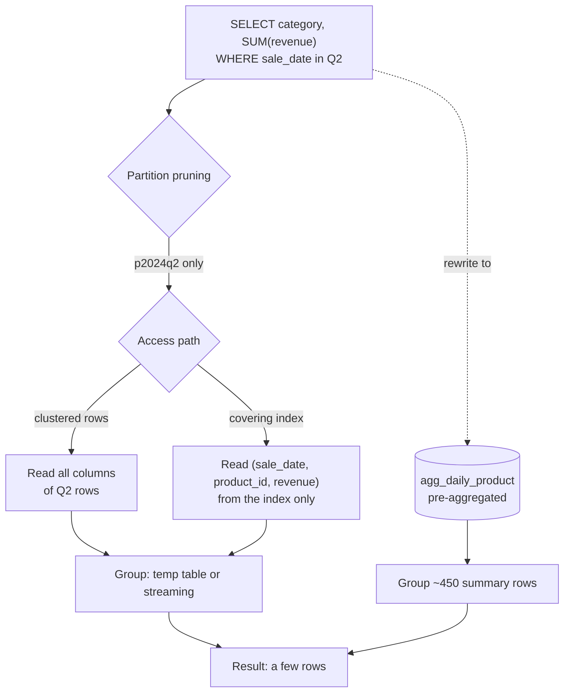

## Introduction

An analytical query reads **many rows to return few**: total revenue per category per quarter reads every sale of the year to produce a few dozen numbers. On a row-store OLTP engine such as InnoDB, the cost of such a query is dominated by **how many rows and bytes must be read and processed**, not by the arithmetic. Optimization therefore means one of four things:

1. **Read fewer rows** — filter early, and let partition pruning skip whole date ranges.
2. **Read fewer bytes per row** — covering indexes that contain only the columns the aggregate needs.
3. **Read pre-computed results** — summary tables (pre-aggregation) maintained at load time.
4. **Use an engine built for scans** — columnar storage and vectorized execution (MySQL HeatWave, external warehouses).

Window functions ([Window Functions](/lessons/m04-window-functions), [Analytical Queries](/lessons/m04-analytical-queries)) deserve their own analysis: they make running totals, moving averages and rankings easy to write, but each distinct window specification can cost a sort of its input.

This lesson builds a 300,000-row, date-partitioned sales fact table and measures each technique with `EXPLAIN ANALYZE` — always distinguishing what the plan shape tells you (portable knowledge) from the milliseconds (build-machine specific).

:::note[Dataset and measurements]
The lab loads the **shop** dataset (for `products` and `categories`) and generates `sales_fact` with 300,000 synthetic sales across 2024. Blocks marked *measured* show timings from the build machine; **your timings will differ**, and the shape of the plan and the row counts are what to compare. The data set is deliberately small enough to load in seconds — real fact tables are thousands of times larger, which amplifies every difference shown here.
:::

## DBMS Theory

:::theory[Cost model of analytical queries]
For an aggregate query over a fact table F, a simple I/O model is:

> cost ≈ (fraction of F read) × (bytes per row read) + (cost of grouping/sorting the rows read)

- **Selection pushdown** reduces the first factor: predicates evaluated as early as possible, ideally by an access path (index range, partition pruning) that never touches non-qualifying rows.
- **Projection pushdown** reduces the second factor: read only needed columns. Row stores read whole rows from the clustered index; a **covering secondary index** is the row store's way to read a narrow projection. Column stores do this natively.
- **Pre-aggregation** replaces F with an aggregate table A at a coarser grain (|A| ≪ |F|). It is valid for any query whose grouping attributes are a subset of A's grain and whose measures are **distributive** (SUM, COUNT, MIN, MAX) or **algebraic** (AVG = SUM/COUNT). **Holistic** aggregates (median, `COUNT(DISTINCT …)`) cannot in general be re-aggregated from partial results.
- **Grouping and window evaluation** cost O(n) with hashing or a pre-sorted input, O(n log n) when a sort is needed — per distinct (PARTITION BY, ORDER BY) specification.
:::

The taxonomy of aggregate functions explains which summary tables are reusable:

| Class | Examples | Re-aggregate from partial results? | Store in a summary table |
|---|---|---|---|
| Distributive | `SUM`, `COUNT`, `MIN`, `MAX` | Yes: SUM of SUMs, SUM of COUNTs | The value itself |
| Algebraic | `AVG`, variance | Yes, from a fixed set of distributive parts | SUM and COUNT (and SUM of squares) — never the average |
| Holistic | `MEDIAN`, percentiles, `COUNT(DISTINCT x)` | No (in general) | The raw values, or approximate sketches (HyperLogLog) in engines that support them |

## Why It Exists

A dashboard with eight tiles, each aggregating a year of sales, refreshed by fifty users every minute, issues 400 full scans per minute. On a small table that is invisible; at hundreds of millions of rows it saturates I/O and CPU and slows every other workload on the server. Analytical optimization exists because:

- **Scans grow with data, while the answer stays small.** A per-quarter revenue report has four rows whether the table has a million or a billion sales.
- **The same aggregates are recomputed again and again.** Most dashboards ask the same few questions with different filters.
- **Row stores are optimized for point access**, not for reading three columns out of thirty across every row.
- **Reporting windows** (month-end close, Monday-morning dashboards) concentrate analytical load exactly when OLTP is busy too.

## Internal Working

:::internals[How MySQL executes aggregation, partitioning and windows]
- **Grouping.** The executor aggregates either with a **temporary table** (hash-like: one row per group, updated as input rows arrive — *Aggregate using temporary table*) or by **streaming** over input already ordered by the GROUP BY columns (*Group aggregate*), e.g. from an index whose leading columns are the grouping columns ([Optimizing Aggregation and Sorting](/lessons/m07-optimizing-aggregation-sorting)).
- **Partitioning.** A partitioned InnoDB table is a set of separate B+ trees (one per partition) behind one table name. During optimization MySQL compares the `WHERE` conditions with the partitioning expression and **prunes** partitions that cannot contain matching rows; `EXPLAIN` lists the surviving partitions in its `partitions` column. Pruning only works when the predicate is on the partitioning column in a form the optimizer can map to partition ranges — `sale_date >= … AND sale_date < …` prunes, `YEAR(sale_date) = 2024 AND MONTH(sale_date) = 5` does not (with `RANGE COLUMNS (sale_date)`).
- **Window functions.** MySQL evaluates windows after `WHERE`, `GROUP BY` and `HAVING`. For each window specification it **sorts** the input by `PARTITION BY, ORDER BY` columns (unless it can reuse the order produced by a previous step), then streams rows through a window iterator. Frames that need neighbouring rows (moving averages, `LEAD`, `RANGE` frames) use a **frame buffer** (*Window aggregate with buffering*) that can spill to a temporary table. Several windows with *different* specifications require several sorts.
- **Columnar engines** (MySQL HeatWave's RAPID secondary engine, ClickHouse, DuckDB, cloud warehouses) store each column separately, compressed; they scan only referenced columns, skip blocks using min/max metadata, and evaluate operators over vectors of values. They change the constants of the cost model by one to three orders of magnitude for scan-heavy queries.
:::



## MySQL Implementation

Create a fact table partitioned by quarter with `RANGE COLUMNS`, and load 300,000 sales. On a partitioned table every unique key (including the primary key) must contain the partitioning column, hence `PRIMARY KEY (sale_id, sale_date)` ([Partitioning](/lessons/m12-partitioning)):

```sql run
CREATE TABLE sales_fact (
  sale_id    INT UNSIGNED      NOT NULL,
  sale_date  DATE              NOT NULL,
  product_id INT UNSIGNED      NOT NULL,
  store_id   TINYINT UNSIGNED  NOT NULL,
  quantity   SMALLINT UNSIGNED NOT NULL,
  revenue    DECIMAL(10,2)     NOT NULL,
  PRIMARY KEY (sale_id, sale_date),
  KEY idx_sf_product_date (product_id, sale_date)
)
PARTITION BY RANGE COLUMNS (sale_date) (
  PARTITION p2024q1 VALUES LESS THAN ('2024-04-01'),
  PARTITION p2024q2 VALUES LESS THAN ('2024-07-01'),
  PARTITION p2024q3 VALUES LESS THAN ('2024-10-01'),
  PARTITION p2024q4 VALUES LESS THAN ('2025-01-01'),
  PARTITION pmax    VALUES LESS THAN (MAXVALUE)
);
SET SESSION cte_max_recursion_depth = 300000;
INSERT INTO sales_fact
WITH RECURSIVE seq(n) AS (SELECT 1 UNION ALL SELECT n + 1 FROM seq WHERE n < 300000)
SELECT n,
       DATE '2024-01-01' + INTERVAL (n % 366) DAY,
       1 + (n * 7) % 30,
       1 + n % 8,
       1 + n % 5,
       (1 + n % 5) * ((n * 13) % 200 + 9.99)
FROM seq;
ANALYZE TABLE sales_fact;
SELECT PARTITION_NAME, TABLE_ROWS
FROM information_schema.PARTITIONS
WHERE TABLE_SCHEMA = DATABASE() AND TABLE_NAME = 'sales_fact'
ORDER BY PARTITION_ORDINAL_POSITION;
```

`ANALYZE TABLE` gives the freshly loaded table accurate statistics (TABLE_ROWS per partition is still an estimate). The baseline question — *revenue by top-level category for Q2* — computed on the fly:

```sql run measured
EXPLAIN ANALYZE
SELECT c.name AS category, SUM(f.revenue) AS revenue
FROM sales_fact f
JOIN products p   ON p.product_id = f.product_id
JOIN categories c ON c.category_id = p.category_id
WHERE f.sale_date >= '2024-04-01' AND f.sale_date < '2024-07-01'
GROUP BY c.name;
```

Read the tree from the innermost iterator outwards: how is `sales_fact` accessed, how many rows (`rows=` in the *actual* part) flow out of it, and where the aggregation happens. That row count — tens of thousands of fact rows for one quarter — is what every technique below attacks.

## Syntax Breakdown

| Technique | MySQL syntax | Notes |
|---|---|---|
| Partition by date | `PARTITION BY RANGE COLUMNS (d) (PARTITION p… VALUES LESS THAN ('…'), …)` | Unique keys must include `d`; no foreign keys on partitioned InnoDB tables |
| Check pruning | `EXPLAIN SELECT …` → `partitions` column | Also `EXPLAIN FORMAT=TREE` |
| Restrict explicitly | `SELECT … FROM t PARTITION (p2024q2)` | Explicit partition selection (useful for maintenance) |
| Covering index | `ALTER TABLE t ADD INDEX (filter_col, group_col, measure)` | EXPLAIN shows *Using index* / *Covering index …* |
| Summary table | `CREATE TABLE agg_… (grain columns PK, SUM/COUNT columns)` + `INSERT … SELECT … GROUP BY` | MySQL has no materialized views; you maintain the table |
| Incremental refresh | `INSERT … SELECT … GROUP BY … ON DUPLICATE KEY UPDATE` or `DELETE` + `INSERT` for the changed date range in one transaction | Recompute whole groups that changed |
| Roll-up totals | `GROUP BY a, b WITH ROLLUP`, `GROUPING(a)` | MySQL has `ROLLUP` but not `CUBE` / `GROUPING SETS` |
| Window functions | `f() OVER (PARTITION BY … ORDER BY … ROWS|RANGE BETWEEN …)`, `WINDOW w AS (…)` | Named windows document shared specifications |
| Measure | `EXPLAIN ANALYZE` | Executes the query; reports actual rows, loops and time per iterator |

## Practical Examples

### 1. Partition pruning — and how a function defeats it

```sql run
EXPLAIN SELECT SUM(revenue) FROM sales_fact
WHERE sale_date >= '2024-05-01' AND sale_date < '2024-06-01';
EXPLAIN SELECT SUM(revenue) FROM sales_fact
WHERE YEAR(sale_date) = 2024 AND MONTH(sale_date) = 5;
```

The range predicate touches only `p2024q2`; the function-wrapped predicate asks the same question but lists every partition, because the optimizer cannot map `MONTH(sale_date)` to partition boundaries. Pruning is the analytical cousin of SARGability ([SARGable Queries](/lessons/m07-sargable-queries)): write predicates on the bare partitioning column.

Pruning also works with `BETWEEN`, `IN` lists of dates and joins to a date dimension **only if** the date range reaches the fact table as constants. A join `JOIN dim_date d ON d.date_key = f.date_key WHERE d.quarter = 2` cannot prune at optimization time, because the matching date values are only known at execution — a reason many warehouse queries filter the fact table's date column directly.

### 2. A covering index for the aggregate

The aggregate needs only `sale_date` (filter), `product_id` (join/group) and `revenue` (measure). An index on exactly those columns lets InnoDB read the narrow index instead of the full rows:

```sql run
ALTER TABLE sales_fact ADD INDEX idx_sf_cover (sale_date, product_id, revenue);
ANALYZE TABLE sales_fact;
```

```sql run measured
EXPLAIN ANALYZE
SELECT c.name AS category, SUM(f.revenue) AS revenue
FROM sales_fact f
JOIN products p   ON p.product_id = f.product_id
JOIN categories c ON c.category_id = p.category_id
WHERE f.sale_date >= '2024-04-01' AND f.sale_date < '2024-07-01'
GROUP BY c.name;
```

Compare with the baseline. The baseline scanned the pruned `p2024q2` partition (about 75,000 rows), joined each row to `products` and `categories`, and aggregated in a temporary table. After `ANALYZE`, the optimizer chose a **different plan altogether** — and not the new index: it now drives from `categories` → `products` and probes `idx_sf_product_date` once per product (29 loops) with the date range as an index condition, streaming into a *Group aggregate*. Statistics and a new index changed the cost estimates, and the optimizer picked the plan it estimated cheapest. To see the covering index itself, force it:

```sql run measured
EXPLAIN ANALYZE
SELECT c.name AS category, SUM(f.revenue) AS revenue
FROM sales_fact f FORCE INDEX (idx_sf_cover)
JOIN products p   ON p.product_id = f.product_id
JOIN categories c ON c.category_id = p.category_id
WHERE f.sale_date >= '2024-04-01' AND f.sale_date < '2024-07-01'
GROUP BY c.name;
```

Now the fact table is read with a *covering index range scan* over the date range — a structure that holds three columns instead of six. In every variant the number of fact rows processed is the same (about 72,000 after the join drops the uncategorized gift card): **covering indexes and better join orders reduce bytes and lookups, not rows**, so their gain is bounded, and every extra index taxes the fact load. Compare the measured times yourself; on a warm buffer pool with 300,000 narrow rows the differences between these three plans are modest.

### 3. A summary table at a coarser grain

Pre-aggregate to **one row per day per product** — the grain most dashboards need:

```sql run
CREATE TABLE agg_daily_product (
  sale_date  DATE         NOT NULL,
  product_id INT UNSIGNED NOT NULL,
  quantity   INT UNSIGNED NOT NULL,
  revenue    DECIMAL(14,2) NOT NULL,
  n_sales    INT UNSIGNED NOT NULL,
  PRIMARY KEY (sale_date, product_id)
);
INSERT INTO agg_daily_product
SELECT sale_date, product_id, SUM(quantity), SUM(revenue), COUNT(*)
FROM sales_fact GROUP BY sale_date, product_id;
ANALYZE TABLE agg_daily_product;
SELECT (SELECT COUNT(*) FROM sales_fact) AS fact_rows, (SELECT COUNT(*) FROM agg_daily_product) AS summary_rows;
```

The summary has a tiny fraction of the fact rows. The same question, answered from it:

```sql run measured
EXPLAIN ANALYZE
SELECT c.name AS category, SUM(a.revenue) AS revenue
FROM agg_daily_product a
JOIN products p   ON p.product_id = a.product_id
JOIN categories c ON c.category_id = p.category_id
WHERE a.sale_date >= '2024-04-01' AND a.sale_date < '2024-07-01'
GROUP BY c.name;
```

The fact-table access is replaced by a primary-key range scan over a few hundred summary rows. And the answers are identical — always verify that:

```sql run
SELECT
  (SELECT SUM(revenue) FROM sales_fact WHERE sale_date >= '2024-04-01' AND sale_date < '2024-07-01')        AS from_fact,
  (SELECT SUM(revenue) FROM agg_daily_product WHERE sale_date >= '2024-04-01' AND sale_date < '2024-07-01') AS from_summary;
```

Because the summary stores `quantity`, `revenue` **and** `n_sales`, it can also answer *average revenue per sale* correctly (`SUM(revenue) / SUM(n_sales)`) — but not "number of distinct stores", which is holistic and was not kept.

### 4. Incremental refresh of the summary

New sales arrive for 31 December. Recompute **only the affected groups** inside one transaction, so readers see either the old or the new totals:

```sql run
INSERT INTO sales_fact VALUES
  (300001, '2024-12-31', 5, 1, 2, 59.98),
  (300002, '2024-12-31', 5, 2, 1, 29.99),
  (300003, '2024-12-31', 12, 3, 1, 129.99);
START TRANSACTION;
INSERT INTO agg_daily_product
SELECT * FROM (
  SELECT sale_date, product_id, SUM(quantity) AS quantity, SUM(revenue) AS revenue, COUNT(*) AS n_sales
  FROM sales_fact
  WHERE sale_date = '2024-12-31'
  GROUP BY sale_date, product_id
) AS fresh
ON DUPLICATE KEY UPDATE quantity = fresh.quantity, revenue = fresh.revenue, n_sales = fresh.n_sales;
COMMIT;
SELECT sale_date, product_id, quantity, revenue, n_sales
FROM agg_daily_product WHERE sale_date = '2024-12-31' AND product_id IN (5, 12) ORDER BY product_id;
```

The refresh recomputes complete groups from the fact table rather than adding deltas (`revenue = revenue + new`), which would double-count if the job were re-run. If facts for a day can also be **deleted or corrected**, delete the day's summary rows and re-insert them in the same transaction instead of upserting.

## Execution Walkthrough

Window functions in practice: a 7-day moving average of daily revenue, a running total, and the best-selling product per month. Trace the plans to see where the sorts are.

```walkthrough
title: Window functions over the daily summary
steps:
  - title: "1. Daily totals — the input to the windows"
    explain: Aggregate the summary to one row per day (366 rows). Windows run after GROUP BY, so this is what they see.
    sql: |
      SELECT sale_date, SUM(revenue) AS revenue
      FROM agg_daily_product GROUP BY sale_date ORDER BY sale_date LIMIT 5;
  - title: "2. Moving average and running total in one query"
    explain: >-
      Both windows share ORDER BY sale_date, so one sort serves both. The ROWS frame for the moving average needs
      the previous 6 rows, hence a buffered window iterator.
    sql: |
      SELECT sale_date, revenue,
             ROUND(AVG(revenue) OVER w7, 2) AS moving_avg_7d,
             SUM(revenue) OVER (ORDER BY sale_date ROWS UNBOUNDED PRECEDING) AS running_total
      FROM (SELECT sale_date, SUM(revenue) AS revenue FROM agg_daily_product GROUP BY sale_date) AS d
      WINDOW w7 AS (ORDER BY sale_date ROWS BETWEEN 6 PRECEDING AND CURRENT ROW)
      ORDER BY sale_date
      LIMIT 10;
  - title: "3. The plan: one sort, a buffered window iterator"
    sql: |
      EXPLAIN FORMAT=TREE
      SELECT sale_date,
             AVG(revenue) OVER (ORDER BY sale_date ROWS BETWEEN 6 PRECEDING AND CURRENT ROW) AS ma7,
             SUM(revenue) OVER (ORDER BY sale_date ROWS UNBOUNDED PRECEDING) AS running_total
      FROM (SELECT sale_date, SUM(revenue) AS revenue FROM agg_daily_product GROUP BY sale_date) AS d;
  - title: "4. Two different window specifications cost two sorts"
    explain: >-
      Adding a ranking with a different PARTITION BY / ORDER BY forces a second sort of the input. Look for two
      Sort iterators below the window iterators.
    sql: |
      EXPLAIN FORMAT=TREE
      SELECT sale_date, product_id, revenue,
             SUM(revenue) OVER (PARTITION BY product_id ORDER BY sale_date) AS product_running,
             RANK() OVER (PARTITION BY sale_date ORDER BY revenue DESC)      AS rank_in_day
      FROM agg_daily_product;
  - title: "5. Top product per month with a window + filter"
    explain: >-
      Aggregate to (month, product), rank within each month, keep rank 1. The window result can only be
      filtered in an outer query (window functions are evaluated after WHERE).
    sql: |
      SELECT month, product_id, revenue
      FROM (
        SELECT DATE_FORMAT(sale_date, '%Y-%m') AS month, product_id, SUM(revenue) AS revenue,
               RANK() OVER (PARTITION BY DATE_FORMAT(sale_date, '%Y-%m') ORDER BY SUM(revenue) DESC) AS rnk
        FROM agg_daily_product
        GROUP BY DATE_FORMAT(sale_date, '%Y-%m'), product_id
      ) AS ranked
      WHERE rnk = 1
      ORDER BY month, product_id
      LIMIT 6;
```

## Output

The walkthrough's step 2 output is the kind of series a dashboard plots: daily revenue, a 7-day moving average that smooths the weekly pattern, and a running total. The first six rows of the moving average average fewer than seven days (the frame is shorter at the start), which a careful report labels or omits.

The measured comparison of the three ways to answer the Q2 category question summarizes the lesson. Re-read the three *measured* blocks above and compare, for the table access on the fact or summary table: **actual rows** (the portable number) and time (the build machine's number). In the capture:

- on-the-fly aggregation processed every Q2 sale (about 72,000 rows reaching the aggregate);
- after adding an index, the optimizer switched to a different join order, and forcing the covering index changed the access path — but in both cases the same ~72,000 rows were aggregated;
- the summary table answered from 455 pre-aggregated rows, with identical totals.

## Alternative Approaches

| Approach | What it optimizes | Cost / risk | Fits |
|---|---|---|---|
| Better predicates (SARGable, prunable) | Rows read | None — always do it | Every query |
| Covering index | Bytes per row | Write amplification, storage | Hot aggregate with few columns |
| Partitioning by date | Rows read for date-bounded queries; cheap data retention (`DROP PARTITION`) | PK must include date; no FKs; queries without date filters touch all partitions | Large, time-ordered fact tables |
| Summary tables | Rows *and* bytes, by orders of magnitude | Staleness, refresh logic, storage; only for queries at or above the grain | Repeated dashboard queries |
| Read replica for analytics | Isolation from OLTP | Replica lag; same row-store limits | Moderate reporting on live data ([Read Replicas](/lessons/m12-read-replicas)) |
| **MySQL HeatWave** (Oracle cloud) | In-memory columnar, vectorized, scale-out execution for queries on InnoDB data | Cloud service; tables loaded into the secondary engine | MySQL-centric shops that want analytics without a separate warehouse |
| External columnar warehouse (BigQuery, Snowflake, Redshift, ClickHouse, DuckDB …) | Scans of billions of rows | ETL/CDC pipeline, second system | Enterprise analytics, data science |

HeatWave is enabled per table with secondary-engine DDL (display-only — it requires an Oracle cloud HeatWave cluster; consult the HeatWave documentation for current syntax and limits):

```sql
ALTER TABLE sales_fact SECONDARY_ENGINE = RAPID;
ALTER TABLE sales_fact SECONDARY_LOAD;
-- Eligible queries are then offloaded automatically; EXPLAIN shows "Using secondary engine RAPID".
```

**Window function vs correlated subquery.** Before MySQL 8.0, running totals were written as correlated subqueries, which re-aggregate a growing prefix for every row — O(n²) work:

```sql run
CREATE TABLE daily_revenue (sale_date DATE PRIMARY KEY, revenue DECIMAL(14,2) NOT NULL);
INSERT INTO daily_revenue SELECT sale_date, SUM(revenue) FROM agg_daily_product GROUP BY sale_date;
ANALYZE TABLE daily_revenue;
```

```sql run measured
EXPLAIN ANALYZE
SELECT d.sale_date, (SELECT SUM(x.revenue) FROM daily_revenue x WHERE x.sale_date <= d.sale_date) AS running_total
FROM daily_revenue d;
EXPLAIN ANALYZE
SELECT sale_date, SUM(revenue) OVER (ORDER BY sale_date ROWS UNBOUNDED PRECEDING) AS running_total
FROM daily_revenue;
```

The correlated version executes its subquery once per day (`loops=366`), each time range-scanning all earlier days (184 rows on average — n²/2 row reads in total); the window version scans the table once, sorts it by date and makes a single pass. With 366 rows both are fast; with ten years of hourly data (87,600 rows ⇒ about 3.8 billion row reads for the correlated form), only one of them is.

## Performance Analysis

Summarizing the cost drivers observed and their scaling:

| Query shape | Work grows with | Main lever |
|---|---|---|
| Aggregate over a date range on the fact table | Rows in the range × row width | Pruning + covering index, or a summary table |
| Same, with a non-SARGable date predicate | **All** rows in **all** partitions | Rewrite the predicate |
| Aggregate on a summary table | Summary rows in the range (≪ fact rows) | Choose the grain that serves most queries |
| Window function, one specification | n log n (sort) + n (window pass) | Pre-aggregate before windowing; reuse one window spec |
| k different window specifications | k sorts | Consolidate specifications; named windows |
| Correlated running total | n² / 2 | Replace with a window function |
| `COUNT(DISTINCT x)` | n plus distinct-value memory | Cannot be re-aggregated; precompute per grain only if the grain matches the query |

Measured timings depend on the buffer pool (a warm cache makes scans look cheap), CPU and concurrency. The robust comparisons are the **actual row counts** in `EXPLAIN ANALYZE` and the **plan shape** (which index, which partitions, how many sorts). A useful habit is to compute "rows read per row returned" for each dashboard query: values in the tens of thousands identify the candidates for a summary table.

## Best Practices

:::best-practice[Optimizing analytics on MySQL]
1. **Filter on bare columns** — especially the partitioning date column — so ranges and pruning work.
2. **Pre-aggregate at the grain dashboards need** (day × product, hour × region), keep only distributive parts (SUM, COUNT, MIN, MAX), and derive averages and ratios at query time.
3. **Refresh summaries idempotently**: recompute whole affected groups in one transaction; reconcile summary totals with the fact table after each refresh.
4. **Aggregate before windowing**: run window functions over the smallest pre-grouped input, and share window specifications (`WINDOW w AS …`).
5. **Use covering indexes sparingly** on fact tables — each one taxes every load.
6. **Measure with `EXPLAIN ANALYZE`** on realistic data volumes, compare actual rows, and repeat runs to account for caching.
7. **Know when to leave the row store**: if scans of hundreds of millions of rows are routine, move analytics to a columnar engine fed by CDC, and keep MySQL for OLTP and small marts.
:::

## Common Mistakes

**Mistake 1 — storing averages in a summary table.** An average of daily averages is not the period average when days have different numbers of sales:

```sql run
SELECT ROUND(AVG(daily_avg), 4) AS avg_of_daily_avgs,
       ROUND(SUM(daily_rev) / SUM(daily_n), 4) AS true_avg_per_sale
FROM (SELECT sale_date, AVG(revenue) AS daily_avg, SUM(revenue) AS daily_rev, COUNT(*) AS daily_n
      FROM sales_fact WHERE sale_date >= '2024-12-01' GROUP BY sale_date) AS d;
```

The two numbers differ only in the fourth decimal here because the synthetic data has almost identical daily volumes (only 31 December is uneven, after Practical Example 4). With real data — weekends, promotions, outages — daily volumes vary widely and the average of averages can be badly wrong. Store SUM and COUNT.

**Mistake 2 — refreshing by adding deltas.** `ON DUPLICATE KEY UPDATE revenue = revenue + VALUES(revenue)` double-counts when the job is retried. Recompute groups.

**Mistake 3 — defeating pruning with functions or implicit conversions.** `WHERE YEAR(sale_date) = 2024`, `DATE_FORMAT(sale_date, '%Y-%m') = '2024-05'`, or comparing a `DATE` column with a differently typed expression scans every partition (Practical Example 1).

**Mistake 4 — filtering a window result in `WHERE`.** Window functions are evaluated after `WHERE`, so `WHERE RANK() OVER (…) = 1` is an error; wrap the query and filter outside (walkthrough step 5):

```sql run error
SELECT product_id, sale_date FROM agg_daily_product
WHERE RANK() OVER (PARTITION BY product_id ORDER BY revenue DESC) = 1;
```

**Mistake 5 — a summary table queried below its grain.** `agg_daily_product` cannot answer "revenue per store" or "sales per hour" — the store and time-of-day were aggregated away. Queries that need them must go to the fact table or to a different summary.

## Industry Application

- **Dashboard back-ends** keep a small set of summary tables (hourly, daily, monthly) refreshed every few minutes by the ETL job; product teams query those, analysts query the fact tables in a warehouse.
- **Time-series retention**: fact tables partitioned by day or month let operations drop old partitions instantly (`ALTER TABLE … DROP PARTITION`) instead of running huge `DELETE`s, while summaries keep long-term history at a coarse grain.
- **Lambda/kappa-style architectures**: recent data is aggregated on the fly from a small, hot table; older data comes from pre-aggregated or columnar storage; a view or the application stitches them together.
- **HeatWave adoption**: MySQL-centric companies on Oracle Cloud offload reporting queries to HeatWave to avoid an ETL pipeline; others replicate MySQL to ClickHouse or a cloud warehouse with CDC for sub-second analytics on billions of events.
- **Analytics engineering**: dbt "incremental models" implement exactly the idempotent group-recompute refresh shown in Practical Example 4, with tests that reconcile models against their sources.

## Practice Exercises

````exercise
id: ex1
title: Prunable monthly revenue
difficulty: easy
concepts: [partition-pruning]
setup: |
  CREATE TABLE sales_fact (sale_id INT UNSIGNED NOT NULL, sale_date DATE NOT NULL, product_id INT UNSIGNED NOT NULL,
    revenue DECIMAL(10,2) NOT NULL, PRIMARY KEY (sale_id, sale_date))
  PARTITION BY RANGE COLUMNS (sale_date) (
    PARTITION p2024q1 VALUES LESS THAN ('2024-04-01'), PARTITION p2024q2 VALUES LESS THAN ('2024-07-01'),
    PARTITION p2024q3 VALUES LESS THAN ('2024-10-01'), PARTITION p2024q4 VALUES LESS THAN ('2025-01-01'));
  SET SESSION cte_max_recursion_depth = 5000;
  INSERT INTO sales_fact
  WITH RECURSIVE seq(n) AS (SELECT 1 UNION ALL SELECT n + 1 FROM seq WHERE n < 5000)
  SELECT n, DATE '2024-01-01' + INTERVAL (n % 366) DAY, 1 + (n * 7) % 30, (1 + n % 5) * ((n * 13) % 200 + 9.99) FROM seq;
prompt: |
  Return total `revenue` of `sales_fact` for **August 2024**, as one column `revenue`, using a predicate that
  allows partition pruning (only partition `p2024q3` should be read — check with EXPLAIN).
hints:
  - "Use a half-open range on the bare column: sale_date >= '2024-08-01' AND sale_date < '2024-09-01'."
  - "MONTH(sale_date) = 8 gives the same answer but reads every partition."
solution: |
  SELECT SUM(revenue) AS revenue
  FROM sales_fact
  WHERE sale_date >= '2024-08-01' AND sale_date < '2024-09-01';
explanation: |
  The grader only compares the number, so `MONTH(sale_date) = 8 AND YEAR(sale_date) = 2024` would also
  pass — but EXPLAIN shows it touching all four partitions. `BETWEEN '2024-08-01' AND '2024-08-31'` is
  correct and prunable for a DATE column; for DATETIME columns the half-open form avoids losing the last day.
````

````exercise
id: ex2
title: Build a monthly summary table
difficulty: medium
kind: dml
concepts: [summary-tables, pre-aggregation]
setup: |
  CREATE TABLE sales_fact (sale_id INT UNSIGNED PRIMARY KEY, sale_date DATE NOT NULL, product_id INT UNSIGNED NOT NULL,
    quantity SMALLINT UNSIGNED NOT NULL, revenue DECIMAL(10,2) NOT NULL);
  SET SESSION cte_max_recursion_depth = 5000;
  INSERT INTO sales_fact
  WITH RECURSIVE seq(n) AS (SELECT 1 UNION ALL SELECT n + 1 FROM seq WHERE n < 5000)
  SELECT n, DATE '2024-01-01' + INTERVAL (n % 366) DAY, 1 + (n * 7) % 30, 1 + n % 5, (1 + n % 5) * ((n * 13) % 200 + 9.99) FROM seq;
prompt: |
  Create a summary table `agg_monthly_product(month CHAR(7), product_id, quantity, revenue, n_sales)` with
  primary key `(month, product_id)`, where `month` has the format `YYYY-MM`, and fill it from `sales_fact`
  (`n_sales` = number of fact rows). The checker reads the whole table.
hints:
  - "DATE_FORMAT(sale_date, '%Y-%m') gives the month string."
  - "Store SUM(quantity), SUM(revenue) and COUNT(*) — never an average."
solution: |
  CREATE TABLE agg_monthly_product (
    month      CHAR(7)       NOT NULL,
    product_id INT UNSIGNED  NOT NULL,
    quantity   INT UNSIGNED  NOT NULL,
    revenue    DECIMAL(14,2) NOT NULL,
    n_sales    INT UNSIGNED  NOT NULL,
    PRIMARY KEY (month, product_id)
  );
  INSERT INTO agg_monthly_product
  SELECT DATE_FORMAT(sale_date, '%Y-%m'), product_id, SUM(quantity), SUM(revenue), COUNT(*)
  FROM sales_fact
  GROUP BY DATE_FORMAT(sale_date, '%Y-%m'), product_id;
check: |
  SELECT month, product_id, quantity, revenue, n_sales FROM agg_monthly_product ORDER BY month, product_id;
explanation: |
  With SUM and COUNT stored, the table answers monthly totals, quarterly roll-ups (SUM of SUMs) and averages
  per sale (SUM(revenue)/SUM(n_sales)) correctly. An `avg_revenue` column would be wrong to re-aggregate
  across months or products. Use `DECIMAL(14,2)` (wider than the fact column) because sums grow.
````

````exercise
id: ex3
title: 7-day moving average
difficulty: hard
concepts: [window-functions]
setup: |
  CREATE TABLE daily_revenue (sale_date DATE PRIMARY KEY, revenue DECIMAL(14,2) NOT NULL);
  INSERT INTO daily_revenue
  WITH RECURSIVE d(n) AS (SELECT 0 UNION ALL SELECT n + 1 FROM d WHERE n < 30)
  SELECT DATE '2024-03-01' + INTERVAL n DAY, 1000 + (n * 37) % 400 + IF(DAYOFWEEK(DATE '2024-03-01' + INTERVAL n DAY) IN (1, 7), 500, 0) FROM d;
prompt: |
  For every day in `daily_revenue`, return `sale_date`, `revenue` and `ma7` — the average revenue of that day
  and the 6 preceding days (fewer at the start of the series), rounded to 2 decimals. Order by `sale_date`.
hints:
  - "AVG(revenue) OVER (ORDER BY sale_date ROWS BETWEEN 6 PRECEDING AND CURRENT ROW)"
  - "ROUND(…, 2) around the window function."
solution: |
  SELECT sale_date, revenue,
         ROUND(AVG(revenue) OVER (ORDER BY sale_date ROWS BETWEEN 6 PRECEDING AND CURRENT ROW), 2) AS ma7
  FROM daily_revenue
  ORDER BY sale_date;
orderMatters: true
explanation: |
  `ROWS` counts physical rows. If days could be missing, `RANGE BETWEEN INTERVAL 6 DAY PRECEDING AND CURRENT
  ROW` would average over calendar days instead — a different, often more correct, definition. A correlated
  subquery (`SELECT AVG(…) FROM daily_revenue x WHERE x.sale_date BETWEEN d.sale_date - INTERVAL 6 DAY AND
  d.sale_date`) is equivalent but re-reads the window for every row.
````

````exercise
id: ex4
title: Best day per product in Q1
difficulty: hard
concepts: [window-functions, summary-tables]
setup: |
  CREATE TABLE agg_daily_product (sale_date DATE NOT NULL, product_id INT UNSIGNED NOT NULL, revenue DECIMAL(14,2) NOT NULL,
    PRIMARY KEY (sale_date, product_id));
  INSERT INTO agg_daily_product
  WITH RECURSIVE d(n) AS (SELECT 0 UNION ALL SELECT n + 1 FROM d WHERE n < 89)
  SELECT DATE '2024-01-01' + INTERVAL d.n DAY, p.product_id, 10 + (d.n * 31 + p.product_id * 17) % 97
  FROM d CROSS JOIN (SELECT product_id FROM products WHERE product_id <= 5) p;
prompt: |
  Using `agg_daily_product` (one row per day and product), return for each product its **highest-revenue
  day** in Q1 2024. If a product has several days with the same top revenue, return all of them. Columns:
  `product_id`, `sale_date`, `revenue`. Order by `product_id`, `sale_date`.
hints:
  - "RANK() OVER (PARTITION BY product_id ORDER BY revenue DESC) gives 1 to every top day."
  - "Window functions cannot be filtered in WHERE — compute them in a derived table and filter outside."
solution: |
  SELECT product_id, sale_date, revenue
  FROM (
    SELECT product_id, sale_date, revenue,
           RANK() OVER (PARTITION BY product_id ORDER BY revenue DESC) AS rnk
    FROM agg_daily_product
    WHERE sale_date >= '2024-01-01' AND sale_date < '2024-04-01'
  ) AS ranked
  WHERE rnk = 1
  ORDER BY product_id, sale_date;
orderMatters: true
explanation: |
  `RANK()` keeps ties; `ROW_NUMBER()` would arbitrarily pick one of several equal days and fail the
  "return all of them" requirement. Filtering `rnk = 1` must happen in the outer query (Common Mistake 4).
  The query runs on the summary table, so it processes 450 rows instead of every sale.
````

````exercise
id: ex5
title: Plan an analytics strategy
difficulty: challenge
kind: open
concepts: [summary-tables, partition-pruning, columnar-storage]
prompt: |
  A MySQL 8.4 OLTP database holds `events` (2 billion rows, 1.5 TB, growing 5 M rows/day). Product managers
  want a dashboard with (a) daily active users per country for the last 90 days, (b) revenue per plan per
  month for 3 years, (c) ad-hoc exploration by analysts. Propose a strategy: what to partition, which summary
  tables (grain and columns), what to refresh how often, what stays in MySQL and what should move to a columnar
  engine. Mention at least one holistic aggregate problem.
solution: |
  - **Partition `events` by day (or month) with RANGE COLUMNS on the event date**; retention by dropping old
    partitions; all dashboard queries filter on the date column so pruning applies.
  - **(a) DAU per country** is `COUNT(DISTINCT user_id)` — holistic: daily counts cannot be summed into
    "90-day active users". Keep `agg_daily_country_users(day, country, dau)` for the daily chart; for multi-day
    distinct counts either recompute from a `daily_active_users(day, user_id, country)` table (one row per user
    per day — much smaller than events) or use approximate sketches (HyperLogLog) in a columnar engine.
  - **(b) Revenue per plan per month**: distributive — `agg_monthly_plan(month, plan_id, revenue, payments)`
    refreshed incrementally (recompute the current and previous month every 15 minutes; idempotent group
    recompute), reconciled daily against the billing ledger.
  - **Refresh**: an orchestrated job reading new partitions or a CDC stream; summary refresh in a transaction
    per group range; freshness check on the dashboard.
  - **Ad-hoc exploration (c)**: does not belong on the OLTP primary. Replicate events to a columnar warehouse
    (HeatWave if on Oracle Cloud, or ClickHouse/BigQuery/Snowflake via Debezium CDC); analysts query there.
  - **What stays in MySQL**: OLTP tables, small summary tables serving the product dashboard (fast PK range
    scans), and the raw events for operational lookups by user. Avoid covering indexes on the 2-billion-row
    table except where a critical query needs them — each one slows 5 M inserts/day.
````

## Knowledge Assessment

```quiz
- id: q1
  question: "A table is partitioned with `RANGE COLUMNS (sale_date)` by quarter. Which predicate lets MySQL prune to a single partition?"
  options:
    - "WHERE YEAR(sale_date) = 2024 AND QUARTER(sale_date) = 2"
    - "WHERE sale_date >= '2024-04-01' AND sale_date < '2024-07-01'"
    - "WHERE DATE_FORMAT(sale_date, '%Y-%m') BETWEEN '2024-04' AND '2024-06'"
    - "WHERE sale_date LIKE '2024-05%'"
  answer: 1
  explanation: "Pruning maps conditions on the bare partitioning column to partition ranges. Functions and string patterns on the column hide the range from the optimizer, so every partition is listed in EXPLAIN (as the lesson's YEAR/MONTH example shows)."
  concepts: [partition-pruning]
- id: q2
  question: "Which aggregates can be computed correctly from a daily summary table that stores SUM(revenue) and COUNT(*) per day and product? (Select all that apply.)"
  type: multi
  options:
    - "Monthly revenue per product"
    - "Average revenue per sale for a quarter"
    - "Number of distinct customers per month"
    - "Total number of sales per product for the year"
  answer: [0, 1, 3]
  explanation: "SUM and COUNT are distributive, and AVG is algebraic (SUM/COUNT), so they roll up. Distinct customers is holistic and the customer was aggregated away — it needs finer data."
  concepts: [summary-tables, pre-aggregation]
- id: q3
  question: "What does a covering index on `(sale_date, product_id, revenue)` reduce for an aggregate over a date range?"
  options:
    - "The number of rows processed"
    - "The bytes read per row, because InnoDB reads the narrow index instead of full clustered rows"
    - "The need for GROUP BY"
    - "Write cost on the fact table"
  answer: 1
  explanation: "The same rows qualify; they are just read from a smaller structure. Grouping still happens, and every additional index increases write cost — the opposite of the last option."
  concepts: [covering-index]
- id: q4
  question: "A query uses `SUM(x) OVER (PARTITION BY a ORDER BY b)` and `RANK() OVER (PARTITION BY c ORDER BY d)`. What does EXPLAIN typically show?"
  options:
    - "No sorts, because windows are computed with hashing"
    - "Two sorts, one per distinct window specification"
    - "One sort for both windows"
    - "A full table scan per row"
  answer: 1
  explanation: "Each window needs its input ordered by its own PARTITION BY/ORDER BY columns; different specifications cannot share one order, so the lesson's walkthrough shows two Sort iterators."
  concepts: [window-functions]
- id: q5
  question: "Why is a correlated subquery for a running total much slower than `SUM() OVER (ORDER BY …)` on large inputs?"
  options:
    - "Correlated subqueries cannot use indexes"
    - "The subquery is executed once per row, re-aggregating a growing prefix — O(n²) — while the window function makes one ordered pass"
    - "Window functions run in parallel"
    - "MySQL caches window function results"
  answer: 1
  explanation: "EXPLAIN ANALYZE in the lesson shows the subquery with loops equal to the number of rows. The subquery can use the primary key, but each execution still reads all earlier rows. MySQL does not parallelize or cache window functions."
  concepts: [window-functions, explain-analyze]
- id: q6
  question: "A summary refresh job runs `ON DUPLICATE KEY UPDATE revenue = revenue + new.revenue` for each batch of new facts. What goes wrong when a batch is retried?"
  options:
    - "Nothing"
    - "The batch is added twice, inflating totals; the refresh should recompute whole affected groups from the fact table"
    - "The upsert fails with a duplicate-key error"
    - "The summary loses the previous totals"
  answer: 1
  explanation: "Delta-adding is not idempotent. Recomputing the full group (or delete + insert of the affected range in one transaction) gives the same result however many times it runs."
  concepts: [summary-tables]
- id: q7
  question: "When is moving analytics to a columnar engine (HeatWave or an external warehouse) the right call?"
  options:
    - "Whenever a query uses GROUP BY"
    - "When scans over very large fact tables are routine and row-store techniques (pruning, covering indexes, summaries) no longer keep latency and load acceptable"
    - "When the table has fewer than one million rows"
    - "Only when the data is stored as JSON"
  answer: 1
  explanation: "Columnar storage and vectorized execution change scan costs by orders of magnitude, at the price of another system or service and a data pipeline. Small tables and ordinary GROUP BYs are well served by InnoDB; JSON is unrelated."
  concepts: [columnar-storage]
```
