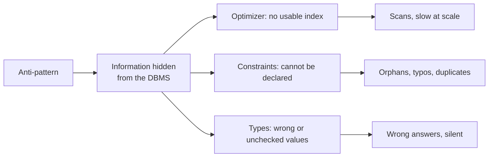

## Introduction

An **anti-pattern** is a solution that looks reasonable, often works in a demo, and then fails in a predictable way under real data, real concurrency or real change. Database anti-patterns are expensive because schemas outlive the code that created them: once millions of rows and dozens of services depend on a design, fixing it is a migration project.

This lesson takes the seven anti-patterns you are most likely to inherit in industry and treats each the same way:

1. **Build it** in the lab, the way it is usually built.
2. **Break it** — show the wrong answer, the missing constraint or the slow plan with real MySQL output.
3. **Fix it** — the design or query that removes the problem, and when the "anti-pattern" is actually acceptable.

| # | Anti-pattern | Root cause | Theory it violates |
|---|---|---|---|
| 1 | Entity-Attribute-Value (EAV) | Schema avoidance | Typed domains, constraints, [1NF](/lessons/m06-1nf) relations with fixed attributes |
| 2 | Polymorphic associations | One FK column pointing at "any table" | Referential integrity |
| 3 | Comma-separated lists | Repeating group in a string | 1NF atomicity |
| 4 | FLOAT for money | Wrong numeric domain | Exact arithmetic |
| 5 | `SELECT *` in production | Implicit contract with the schema | Data independence |
| 6 | ORM-generated N+1 queries | Row-at-a-time access | Set-based processing |
| 7 | God tables | Many concerns in one relation | Normalization, cohesion |

:::note[Dataset]
The lab uses the **shop** dataset. Each anti-pattern builds its own small tables next to the shop tables (`product_eav`, `comments_poly`, `products_csv`, `prices_float`, …) so that you can compare the broken and fixed designs on the same data. Every output was captured on a real server.
:::

## DBMS Theory

:::theory[Why these are anti-patterns, formally]
Most of the seven violate a principle you already know:

- **Domains and typing.** In the relational model, each attribute has a domain. EAV stores every attribute in one generic `value VARCHAR` column, so the DBMS can no longer enforce domains (`ram_gb` must be a positive integer). FLOAT money chooses a domain (binary floating point) that cannot represent decimal fractions exactly.
- **First normal form.** A comma-separated list is a **repeating group** hidden inside a string: the relation is not in 1NF with respect to the DBMS, so set operations (membership, counting, joining) must be done by string parsing.
- **Referential integrity.** A foreign key references **one** relation. A "polymorphic" `(type, id)` pair references a different table depending on a data value, which no declarative FK can express.
- **Data independence.** Applications should depend on the *logical* schema they use, not on every column that exists. `SELECT *` binds code to the full column list and order.
- **Set-based processing.** SQL optimizers work on whole sets (joins, batched lookups). Issuing one query per row (N+1) replaces one optimized plan with N round-trips.
- **Cohesion and normalization.** A God table combines attributes that depend on different keys or change for different reasons — partial and transitive dependencies in normalization terms, plus operational coupling.
:::

An anti-pattern is not "always wrong". Each has a **legitimate niche** (EAV for truly user-defined fields in a metadata layer, `SELECT *` in ad-hoc exploration, a wide table in a read-only analytical extract). The professional skill is to know the failure modes, recognise when they will bite, and choose the alternative deliberately.

## Why It Exists

Anti-patterns exist because each one **optimizes for the first week** of a project:

- **EAV** avoids `ALTER TABLE` when product managers keep adding attributes.
- **Polymorphic associations** let one `comments` table serve products, orders and reviews — one model class in the ORM.
- **Comma-separated lists** avoid creating a junction table and a second query or join.
- **FLOAT** is the default "number with decimals" in many languages and ORMs.
- **`SELECT *`** is the shortest thing to type, and ORMs load whole entities by default.
- **N+1** is what lazy loading produces naturally: `for order in orders: order.customer.name`.
- **God tables** grow one convenient column at a time.

They cost later: wrong answers that nobody notices, integrity violations that are discovered by customers, queries that are fast at 1,000 rows and fatal at 10 million, and schema changes that break unrelated code.

## Internal Working

:::internals[Why the server cannot help you]
The common thread is that each anti-pattern **hides information from the DBMS**:

- **Optimizer.** B+ tree indexes order whole column values. A tag inside `'gift,sale'` or an attribute value inside a generic `val` column is not a key the optimizer can seek; predicates such as `FIND_IN_SET('sale', tags)` or `CAST(val AS UNSIGNED) >= 16` are non-SARGable and fall back to scans ([SARGable Queries](/lessons/m07-sargable-queries)).
- **Constraint checker.** InnoDB checks foreign keys by probing the referenced table's index for the exact value. It can only probe one table per constraint, which is why `(commentable_type, commentable_id)` cannot be declared at all.
- **Type system.** A `FLOAT` column stores a 32-bit IEEE-754 binary fraction. `19.99` is stored as the nearest representable value (19.9899997711…); comparisons with the decimal literal `19.99` fail and sums accumulate representation error.
- **Network and executor.** Each statement costs a client-server round-trip, parsing, optimization and a separate execution. N+1 multiplies those fixed costs by N.
- **Storage engine.** InnoDB rows have a 65,535-byte limit on the sum of declared column sizes (excluding off-page BLOB/TEXT), and every update of a row takes a lock on the whole row — God tables hit both limits.
:::



## MySQL Implementation

The first anti-pattern is built exactly as it usually appears: an EAV table for product specifications.

```sql run
CREATE TABLE product_eav (
  product_id INT UNSIGNED NOT NULL,
  attr       VARCHAR(40)  NOT NULL,
  val        VARCHAR(255) NOT NULL,
  PRIMARY KEY (product_id, attr)
);
INSERT INTO product_eav VALUES
  (1, 'ram_gb', '16'), (1, 'screen_in', '14'),   (1, 'color',  'silver'),
  (2, 'ram_gb', '8'),  (2, 'screen_in', '13.3'),
  (3, 'ram_gb', '32'), (3, 'screen_in', '16'),   (3, 'colour', 'black'),
  (4, 'ram_gb', 'sixteen'), (4, 'screen_in', '11.6');
SELECT product_id, attr, val FROM product_eav ORDER BY product_id, attr;
```

Ask a simple question: *"laptops with at least 16 GB of RAM"*.

```sql run
SELECT product_id FROM product_eav WHERE attr = 'ram_gb' AND val >= '16' ORDER BY product_id;
```

All four products are returned — including the 8 GB laptop — because `val` is text: `'8' >= '16'` is true character by character, and `'sixteen' >= '16'` too. Casting "fixes" the comparison but now silently converts `'sixteen'` to 0 with only a warning:

```sql run
SELECT product_id FROM product_eav WHERE attr = 'ram_gb' AND CAST(val AS UNSIGNED) >= 16 ORDER BY product_id;
SHOW WARNINGS;
```

Note the other two defects already in the data: product 3 has `colour` instead of `color` (no dictionary of attributes), and nothing prevented `'sixteen'` (no domain). Reassembling one row per product needs a pivot with one `MAX(CASE …)` per attribute:

```sql run
SELECT product_id,
       MAX(CASE WHEN attr = 'ram_gb'    THEN val END) AS ram_gb,
       MAX(CASE WHEN attr = 'screen_in' THEN val END) AS screen_in,
       MAX(CASE WHEN attr = 'color'     THEN val END) AS color
FROM product_eav GROUP BY product_id ORDER BY product_id;
```

## Syntax Breakdown

Each anti-pattern has a recognisable signature in DDL or code, and a standard replacement:

| Anti-pattern | Signature to look for | Replacement |
|---|---|---|
| EAV | `(entity_id, attribute, value VARCHAR)`; pivots with `MAX(CASE WHEN attr = …)` | Typed columns; subtype tables; JSON column with `CHECK (JSON_SCHEMA_VALID …)` and generated-column indexes |
| Polymorphic association | `(x_type VARCHAR, x_id INT)` with no FK | Exclusive arcs (one nullable FK per parent + `CHECK` exactly one); one junction table per parent; a common supertype table |
| Comma-separated list | `tags VARCHAR` with `FIND_IN_SET`, `LIKE '%,x,%'`, `SUBSTRING_INDEX` | Junction (many-to-many) table with a composite PK and FKs |
| FLOAT money | `FLOAT`/`DOUBLE` for prices, balances, taxes | `DECIMAL(p, 2)` (or integer minor units, e.g. cents in `BIGINT`) |
| `SELECT *` | `SELECT *` in application code, `INSERT … SELECT *`, views defined with `*` | Explicit column lists; covering indexes for hot queries |
| N+1 | One query per parent row in a loop; ORM lazy loading | `JOIN`; `WHERE id IN (…)` batch (eager loading); a single aggregate query |
| God table | 50–200 columns, many NULL, prefixes like `billing_`, `marketing_`, `shipping_` | Decompose by concern into 1:1 / 1:N tables with the same key |

Two MySQL functions appear constantly in legacy code built on these patterns: `FIND_IN_SET(str, strlist)` returns the 1-based position of `str` in a comma-separated `strlist` (0 if absent, no trimming of spaces), and `SUBSTRING_INDEX(str, delim, n)` cuts a string at the *n*-th delimiter. Both are symptoms, not solutions.

## Practical Examples

### 1. EAV → typed columns (or validated JSON)

The fix for the specification table is a typed table — or, if attributes genuinely vary by category, a JSON column with a schema and a generated column for the attributes you filter on ([Working with JSON in MySQL](/lessons/m13-json)):

```sql run
CREATE TABLE laptop_specs (
  product_id INT UNSIGNED PRIMARY KEY,
  ram_gb     SMALLINT UNSIGNED NOT NULL,
  screen_in  DECIMAL(3,1)      NOT NULL,
  color      VARCHAR(20)       NULL,
  CONSTRAINT fk_laptop_specs_product FOREIGN KEY (product_id) REFERENCES products (product_id),
  CONSTRAINT chk_laptop_ram CHECK (ram_gb BETWEEN 1 AND 512)
);
INSERT INTO laptop_specs VALUES (1, 16, 14.0, 'silver'), (2, 8, 13.3, NULL), (3, 32, 16.0, 'black');
SELECT product_id FROM laptop_specs WHERE ram_gb >= 16 ORDER BY product_id;
```

```sql run error
INSERT INTO laptop_specs VALUES (4, 'sixteen', 11.6, NULL);
```

The typed column answers correctly, can be indexed, and rejects `'sixteen'` at write time.

### 2. Polymorphic association → exclusive arcs

The polymorphic version accepts anything:

```sql run
CREATE TABLE comments_poly (
  comment_id       INT PRIMARY KEY,
  commentable_type VARCHAR(20)  NOT NULL,
  commentable_id   INT UNSIGNED NOT NULL,
  body             VARCHAR(200) NOT NULL
);
INSERT INTO comments_poly VALUES
  (1, 'product', 3,   'Great laptop'),
  (2, 'order',   12,  'Delivery was late'),
  (3, 'product', 999, 'Comment on a product that does not exist'),
  (4, 'prodcut', 5,   'Typo in the type');
SELECT cp.comment_id, cp.commentable_type, cp.commentable_id,
       COALESCE(p.name, CONCAT('order #', o.order_id), '-- orphan --') AS parent
FROM comments_poly cp
LEFT JOIN products p ON cp.commentable_type = 'product' AND p.product_id = cp.commentable_id
LEFT JOIN orders   o ON cp.commentable_type = 'order'   AND o.order_id   = cp.commentable_id
ORDER BY cp.comment_id;
```

Two of four rows are orphans: one points at a missing product, one at a type that does not exist. Every query needs one conditional `LEFT JOIN` per possible type, and deleting a product leaves its comments behind. The **exclusive-arc** design gives each parent its own nullable FK and a `CHECK` that exactly one is set:

```sql run
CREATE TABLE comments_arc (
  comment_id INT PRIMARY KEY,
  product_id INT UNSIGNED NULL,
  order_id   INT UNSIGNED NULL,
  body       VARCHAR(200) NOT NULL,
  CONSTRAINT fk_comments_arc_product FOREIGN KEY (product_id) REFERENCES products (product_id),
  CONSTRAINT fk_comments_arc_order   FOREIGN KEY (order_id)   REFERENCES orders (order_id),
  CONSTRAINT chk_comments_arc_one_parent CHECK ((product_id IS NOT NULL) + (order_id IS NOT NULL) = 1)
);
INSERT INTO comments_arc VALUES (1, 3, NULL, 'Great laptop'), (2, NULL, 12, 'Delivery was late');
SELECT comment_id, product_id, order_id, body FROM comments_arc ORDER BY comment_id;
```

```sql run error
INSERT INTO comments_arc VALUES (3, 999, NULL, 'Comment on a product that does not exist');
```

```sql run error
INSERT INTO comments_arc VALUES (4, 3, 12, 'Attached to two parents');
```

The FK rejects the orphan and the `CHECK` rejects a comment with two parents. (MySQL does not allow `CHECK` constraints on columns used by FK *referential actions* such as `ON DELETE CASCADE`; with the default `RESTRICT` behaviour, as here, the combination is allowed.) When the number of parent types is large, alternatives are one junction table per parent (`product_comments`, `order_comments`) or a **supertype** table (`commentable(id)` referenced by products, orders and comments).

### 3. Comma-separated list → junction table

```sql run
CREATE TABLE products_csv (
  product_id INT UNSIGNED PRIMARY KEY,
  name       VARCHAR(120) NOT NULL,
  tags       VARCHAR(255) NOT NULL DEFAULT ''
);
INSERT INTO products_csv
SELECT product_id, name,
       CASE product_id % 5 WHEN 0 THEN 'gift,sale' WHEN 1 THEN 'new' WHEN 2 THEN 'eco,sale'
                           WHEN 3 THEN 'resale' ELSE 'gift, eco' END
FROM products;
SELECT 'LIKE %sale%'          AS method, COUNT(*) AS products FROM products_csv WHERE tags LIKE '%sale%'
UNION ALL
SELECT 'FIND_IN_SET(sale)',   COUNT(*) FROM products_csv WHERE FIND_IN_SET('sale', tags)
UNION ALL
SELECT 'FIND_IN_SET(eco)',    COUNT(*) FROM products_csv WHERE FIND_IN_SET('eco', tags);
```

`LIKE '%sale%'` also matches *resale*, so it over-counts. `FIND_IN_SET` respects commas but not spaces: the list `'gift, eco'` contains `' eco'`, not `'eco'`, so half of the eco products are missed:

```sql run
SELECT product_id, tags, FIND_IN_SET('eco', tags) AS position FROM products_csv WHERE product_id IN (2, 4) ORDER BY product_id;
```

And no index can serve the predicate. Even with an index on `tags`, the best MySQL can do is read every entry of it:

```sql run
ALTER TABLE products_csv ADD INDEX idx_products_csv_tags (tags);
EXPLAIN SELECT product_id FROM products_csv WHERE FIND_IN_SET('sale', tags);
```

`type = index` means a full index scan. The fix is the many-to-many junction table, one row per (product, tag), with a reverse index for "products with tag X":

```sql run
CREATE TABLE tags (tag_id SMALLINT UNSIGNED PRIMARY KEY, tag VARCHAR(30) NOT NULL UNIQUE);
INSERT INTO tags VALUES (1, 'gift'), (2, 'sale'), (3, 'new'), (4, 'eco'), (5, 'resale');
CREATE TABLE product_tags (
  product_id INT UNSIGNED NOT NULL,
  tag_id     SMALLINT UNSIGNED NOT NULL,
  PRIMARY KEY (product_id, tag_id),
  KEY idx_product_tags_tag (tag_id, product_id),
  CONSTRAINT fk_pt_product FOREIGN KEY (product_id) REFERENCES products (product_id),
  CONSTRAINT fk_pt_tag     FOREIGN KEY (tag_id)     REFERENCES tags (tag_id)
);
INSERT INTO product_tags (product_id, tag_id)
SELECT pc.product_id, t.tag_id
FROM products_csv pc
JOIN tags t ON FIND_IN_SET(t.tag, REPLACE(pc.tags, ' ', ''));
ANALYZE TABLE product_tags;
SELECT t.tag, COUNT(*) AS products FROM product_tags pt JOIN tags t USING (tag_id) GROUP BY t.tag ORDER BY t.tag;
EXPLAIN SELECT product_id FROM product_tags WHERE tag_id = 2;
```

The migration used `FIND_IN_SET` one last time — after stripping spaces — to explode the strings into rows. Now counts are correct, the lookup is a `ref` on `idx_product_tags_tag`, tags are constrained by a foreign key, and adding or removing one tag is a single-row `INSERT`/`DELETE` instead of string surgery.

### 4. FLOAT for money → DECIMAL

```sql run
CREATE TABLE prices_float (id INT PRIMARY KEY, price_f FLOAT NOT NULL, price_d DECIMAL(10,2) NOT NULL);
INSERT INTO prices_float VALUES (1, 19.99, 19.99), (2, 0.10, 0.10);
SELECT (SELECT COUNT(*) FROM prices_float WHERE price_f = 19.99) AS float_matches,
       (SELECT COUNT(*) FROM prices_float WHERE price_d = 19.99) AS decimal_matches;
SELECT id, price_f, CAST(price_f AS DECIMAL(20,10)) AS float_actually_stores, price_d FROM prices_float ORDER BY id;
```

The FLOAT column *displays* 19.99 but stores 19.9899997711…, so an equality search finds nothing. Over real line items the error accumulates:

```sql run
SELECT SUM(CAST(unit_price AS FLOAT) * quantity) AS revenue_float,
       SUM(unit_price * quantity)                AS revenue_decimal
FROM order_items;
```

The DECIMAL sum is exact to the cent; the FLOAT-based sum carries binary noise that must be rounded away — and rounding errors in tax, interest or ledger balances are financial incidents. The shop schema uses `DECIMAL(10,2)` for every money column for this reason ([Numeric Types](/lessons/m02-numeric-types)).

### 5. `SELECT *` in production

Three distinct failures. First, **lost covering indexes**: the narrow query is answered from the secondary index alone; `SELECT *` must visit the clustered index for every row and, past a certain selectivity, the optimizer prefers a full scan:

```sql run
EXPLAIN SELECT order_id, order_date FROM orders WHERE order_date >= '2024-06-01';
EXPLAIN SELECT * FROM orders WHERE order_date >= '2024-06-01';
```

Second, **schema changes break positional code**. `INSERT … SELECT *` between tables works until someone adds a column to one of them:

```sql run
CREATE TABLE orders_archive LIKE orders;
INSERT INTO orders_archive SELECT * FROM orders WHERE order_id <= 3;
ALTER TABLE orders ADD COLUMN channel VARCHAR(10) NOT NULL DEFAULT 'web';
```

```sql run error
INSERT INTO orders_archive SELECT * FROM orders WHERE order_id BETWEEN 4 AND 6;
```

Third, **views freeze `*` at creation time**: MySQL expands the star into a fixed column list when the view is created, so new columns silently do not appear:

```sql run
CREATE VIEW v_customers_all AS SELECT * FROM customers;
ALTER TABLE customers ADD COLUMN marketing_opt_in BOOLEAN NOT NULL DEFAULT FALSE;
SELECT (SELECT COUNT(*) FROM information_schema.COLUMNS
        WHERE TABLE_SCHEMA = DATABASE() AND TABLE_NAME = 'customers')       AS table_columns,
       (SELECT COUNT(*) FROM information_schema.COLUMNS
        WHERE TABLE_SCHEMA = DATABASE() AND TABLE_NAME = 'v_customers_all') AS view_columns;
```

Plus the costs you cannot see in a lab: transferring `TEXT`/`BLOB`/`JSON` columns the screen never shows, and ORM objects that hydrate them. The fix is boring and effective — name the columns:

```sql run
INSERT INTO orders_archive (order_id, customer_id, order_date, status, shipped_at, discount_code)
SELECT order_id, customer_id, order_date, status, shipped_at, discount_code
FROM orders WHERE order_id BETWEEN 4 AND 6;
SELECT COUNT(*) AS archived FROM orders_archive;
```

### 6. God table

A "customer" table that has absorbed billing, shipping, marketing, support and loyalty attributes eventually meets a hard limit. Sixty-five `VARCHAR(255)` columns in `utf8mb4` declare up to 65 × 1,020 bytes, more than InnoDB's 65,535-byte row limit:

```sql run error
CREATE TABLE customer_everything (
  customer_id INT PRIMARY KEY,
  c01 VARCHAR(255), c02 VARCHAR(255), c03 VARCHAR(255), c04 VARCHAR(255), c05 VARCHAR(255),
  c06 VARCHAR(255), c07 VARCHAR(255), c08 VARCHAR(255), c09 VARCHAR(255), c10 VARCHAR(255),
  c11 VARCHAR(255), c12 VARCHAR(255), c13 VARCHAR(255), c14 VARCHAR(255), c15 VARCHAR(255),
  c16 VARCHAR(255), c17 VARCHAR(255), c18 VARCHAR(255), c19 VARCHAR(255), c20 VARCHAR(255),
  c21 VARCHAR(255), c22 VARCHAR(255), c23 VARCHAR(255), c24 VARCHAR(255), c25 VARCHAR(255),
  c26 VARCHAR(255), c27 VARCHAR(255), c28 VARCHAR(255), c29 VARCHAR(255), c30 VARCHAR(255),
  c31 VARCHAR(255), c32 VARCHAR(255), c33 VARCHAR(255), c34 VARCHAR(255), c35 VARCHAR(255),
  c36 VARCHAR(255), c37 VARCHAR(255), c38 VARCHAR(255), c39 VARCHAR(255), c40 VARCHAR(255),
  c41 VARCHAR(255), c42 VARCHAR(255), c43 VARCHAR(255), c44 VARCHAR(255), c45 VARCHAR(255),
  c46 VARCHAR(255), c47 VARCHAR(255), c48 VARCHAR(255), c49 VARCHAR(255), c50 VARCHAR(255),
  c51 VARCHAR(255), c52 VARCHAR(255), c53 VARCHAR(255), c54 VARCHAR(255), c55 VARCHAR(255),
  c56 VARCHAR(255), c57 VARCHAR(255), c58 VARCHAR(255), c59 VARCHAR(255), c60 VARCHAR(255),
  c61 VARCHAR(255), c62 VARCHAR(255), c63 VARCHAR(255), c64 VARCHAR(255), c65 VARCHAR(255)
);
```

The row-size error is the dramatic symptom; the everyday ones are worse: most columns NULL for most rows, every team's `UPDATE` locking the same row (a marketing batch job blocks a checkout updating the billing address), every schema change rebuilding a huge hot table, and no clear owner. The fix is **vertical decomposition by concern**, sharing the primary key:

```sql run
CREATE TABLE customer_billing (
  customer_id INT UNSIGNED PRIMARY KEY,
  billing_line1 VARCHAR(120) NOT NULL, billing_city VARCHAR(60) NOT NULL, billing_postcode VARCHAR(12) NOT NULL,
  CONSTRAINT fk_billing_customer FOREIGN KEY (customer_id) REFERENCES customers (customer_id)
);
CREATE TABLE customer_marketing (
  customer_id INT UNSIGNED PRIMARY KEY,
  email_opt_in BOOLEAN NOT NULL DEFAULT FALSE, sms_opt_in BOOLEAN NOT NULL DEFAULT FALSE,
  segment VARCHAR(30) NULL, consent_updated_at DATETIME NULL,
  CONSTRAINT fk_marketing_customer FOREIGN KEY (customer_id) REFERENCES customers (customer_id)
);
INSERT INTO customer_marketing (customer_id, email_opt_in, segment)
SELECT customer_id, loyalty_tier IS NOT NULL, loyalty_tier FROM customers;
SELECT COUNT(*) AS marketing_rows, SUM(email_opt_in) AS opted_in FROM customer_marketing;
```

Each concern now has its own table, row locks, change cadence and owner, and a query joins only the parts it needs. See [Denormalization](/lessons/m06-denormalization) for the opposite, *deliberate* move (wide tables for read-heavy analytics).

## Execution Walkthrough

The N+1 anti-pattern is invisible in code review because each statement is trivial. Count the statements with the session counter `Com_select` while replaying what a lazily loading ORM sends for "show the five most recent shipped orders with customer names".

```walkthrough
title: N+1 queries versus one join (counting statements with Com_select)
steps:
  - title: "1. Baseline the counter"
    explain: Com_select counts SELECT statements executed by this session.
    sql: SHOW SESSION STATUS LIKE 'Com_select';
  - title: "2. The ORM's first query: the orders"
    explain: The page asks for orders only. This is the "1".
    sql: SELECT order_id, customer_id FROM orders WHERE status = 'shipped' ORDER BY order_id LIMIT 5;
  - title: "3. Then one query per order for its customer: the N"
    explain: >-
      Lazy loading of order.customer issues one primary-key lookup per order. Each is fast, but each costs a
      network round-trip, a parse and an execution. With 5 orders that is 5 extra statements; a page of 50 orders
      is 51 statements, and an API listing 1,000 rows is 1,001.
    sql: |
      SELECT customer_id, first_name, last_name FROM customers WHERE customer_id = 4;
      SELECT customer_id, first_name, last_name FROM customers WHERE customer_id = 22;
      SELECT customer_id, first_name, last_name FROM customers WHERE customer_id = 18;
      SELECT customer_id, first_name, last_name FROM customers WHERE customer_id = 10;
      SELECT customer_id, first_name, last_name FROM customers WHERE customer_id = 7;
  - title: "4. Count what happened"
    explain: The counter rose by 6 for one screen of data (1 + N with N = 5).
    sql: SHOW SESSION STATUS LIKE 'Com_select';
  - title: "5. Fix A — one JOIN"
    explain: The same information in a single statement; the optimizer does the per-order primary-key lookups internally (eq_ref) without round-trips.
    sql: |
      SELECT o.order_id, c.customer_id, c.first_name, c.last_name
      FROM orders o JOIN customers c ON c.customer_id = o.customer_id
      WHERE o.status = 'shipped'
      ORDER BY o.order_id LIMIT 5;
      EXPLAIN SELECT o.order_id, c.first_name FROM orders o JOIN customers c ON c.customer_id = o.customer_id
      WHERE o.status = 'shipped' ORDER BY o.order_id LIMIT 5;
  - title: "6. Fix B — batched eager loading"
    explain: >-
      ORMs' eager-loading options (select_related / prefetch_related, includes, JOIN FETCH, …) issue the parent
      query plus one IN-list query for all children: 2 statements regardless of N.
    sql: SELECT customer_id, first_name, last_name FROM customers WHERE customer_id IN (4, 22, 18, 10, 7) ORDER BY customer_id;
  - title: "7. Count again"
    explain: >-
      The counter rose by 3: the JOIN, the IN-list query and the EXPLAIN (MySQL counts EXPLAIN SELECT under
      Com_select as well). Either fix alone needs one or two statements, independent of N.
    sql: SHOW SESSION STATUS LIKE 'Com_select';
```

## Output

The walkthrough's numbers are the lesson: the N+1 version needed **N + 1** statements for one page, the join needed **one**, and batched eager loading **two** regardless of page size. On a local lab each statement takes well under a millisecond, so the difference looks harmless. In production each statement also pays a network round-trip (often 0.2–1 ms inside a data centre, more across zones), connection-pool time and per-statement parsing — so latency grows linearly with N, and the database's statement throughput is consumed by trivial lookups.

The summary of the other six examples, as observed in this lab:

| Anti-pattern | Observed failure | Observed fix |
|---|---|---|
| EAV | `val >= '16'` returned the 8 GB laptop; `'sixteen'` and `colour` accepted | Typed `laptop_specs` answered correctly and rejected `'sixteen'` |
| Polymorphic | Two orphan comments accepted (missing product, misspelt type) | Exclusive arcs: FK error 1452, CHECK error 3819 |
| CSV list | `LIKE` over-counted (*resale*), `FIND_IN_SET` under-counted (`' eco'`), full index scan | Junction table: correct counts, `ref` access |
| FLOAT money | `price_f = 19.99` matched 0 rows; sum carried binary noise | `DECIMAL(10,2)` exact |
| `SELECT *` | Covering index lost; `INSERT … SELECT *` error 1136; view missing new column | Explicit column lists |
| God table | Row size error 1118 | Decomposition by concern |

## Alternative Approaches

Sometimes the "anti-pattern" is the right call. Know the conditions:

| Pattern | Acceptable when | Mitigations |
|---|---|---|
| EAV | Truly user-defined fields (form builders, CRM custom fields) with low query needs | Typed value columns (`val_int`, `val_dec`, `val_date`), an attribute dictionary table with FKs; or JSON + schema validation |
| Polymorphic association | Audit/activity logs where orphans are tolerable and parents are immutable | Periodic orphan-detection jobs; supertype table if integrity matters |
| Delimited list | Write-once, read-as-a-whole data that is never searched or joined (e.g. an exported snapshot) | Prefer a JSON array with a multi-valued index if membership queries appear |
| FLOAT/DOUBLE | Measurements and scientific values (sensor readings, ML features) where relative error is acceptable | Never for money; compare with tolerances |
| `SELECT *` | Ad-hoc exploration, `EXISTS (SELECT * …)` (the star is ignored), tests | Lint rules for application code |
| Lazy loading | Rarely accessed relations on single-object screens | Query logging and N+1 detectors in tests |
| Wide table | Read-only analytical extracts, ML feature tables, columnar warehouses | Keep OLTP tables normalized and publish wide tables downstream ([Data Warehousing Fundamentals](/lessons/m13-data-warehousing)) |

## Performance Analysis

The comma-separated list is the anti-pattern whose cost scales most visibly. Generate 50,000 products with tag strings and the equivalent junction table, then compare the "products tagged 7" lookup:

```sql run
CREATE TABLE big_products_csv (product_id INT PRIMARY KEY, tags VARCHAR(100) NOT NULL);
CREATE TABLE big_product_tags (product_id INT NOT NULL, tag_id INT NOT NULL, PRIMARY KEY (product_id, tag_id), KEY idx_tag (tag_id, product_id));
SET SESSION cte_max_recursion_depth = 50000;
INSERT INTO big_products_csv
WITH RECURSIVE seq(n) AS (SELECT 1 UNION ALL SELECT n + 1 FROM seq WHERE n < 50000)
SELECT n, CONCAT_WS(',', n % 50, (n * 7) % 50 + 50, (n * 13) % 50 + 100) FROM seq;
INSERT INTO big_product_tags
SELECT product_id, CAST(SUBSTRING_INDEX(tags, ',', 1) AS UNSIGNED) FROM big_products_csv
UNION ALL SELECT product_id, CAST(SUBSTRING_INDEX(SUBSTRING_INDEX(tags, ',', 2), ',', -1) AS UNSIGNED) FROM big_products_csv
UNION ALL SELECT product_id, CAST(SUBSTRING_INDEX(tags, ',', -1) AS UNSIGNED) FROM big_products_csv;
ANALYZE TABLE big_products_csv, big_product_tags;
```

```sql run measured
EXPLAIN ANALYZE SELECT COUNT(*) FROM big_products_csv WHERE FIND_IN_SET('7', tags);
EXPLAIN ANALYZE SELECT COUNT(*) FROM big_product_tags WHERE tag_id = 7;
```

The CSV query scans and parses all 50,000 strings; the junction-table query reads only the index entries for tag 7. The asymptotic difference — O(table) versus O(matches) — holds for EAV filters on `val`, for `LIKE '%…%'` and for every other non-SARGable predicate the anti-patterns force on you. For N+1, the cost model is per-statement: total latency ≈ N × (round-trip + parse + execute), which no index can remove — only fewer statements can.

## Best Practices

:::best-practice[Keeping anti-patterns out of production]
1. **Model what you query.** If a value is filtered, joined, aggregated or constrained, it deserves a typed column or a proper child table.
2. **Declare integrity in the database**: foreign keys, `CHECK`, `NOT NULL`, `UNIQUE`. If a design makes a constraint impossible to declare (polymorphic FKs), treat that as a design smell.
3. **Money is `DECIMAL`** (or integer minor units), everywhere — database, application types, JSON payloads (serialize as strings).
4. **No `SELECT *` in application code or views**; enforce it with a linter or code review checklist.
5. **Watch statement counts per request** — log them in development, fail tests that exceed a budget, and use ORM eager loading deliberately.
6. **Decompose tables by concern and change rate**; give each table an owner.
7. **When you must use a flexible pattern**, bound it: JSON with a schema and indexed generated columns instead of free-form EAV.
:::

## Common Mistakes

These are the mistakes people make while *fixing* anti-patterns:

**Mistake 1 — "fixing" a CSV list with `LIKE '%,x,%'`.** Wrapping the list in commas (`CONCAT(',', tags, ',') LIKE '%,sale,%'`) avoids *resale*, but still scans, still breaks on spaces, and still cannot be indexed or constrained. Migrate to a junction table.

**Mistake 2 — migrating FLOAT to DECIMAL without fixing stored values.** `ALTER TABLE … MODIFY price DECIMAL(10,2)` rounds the stored binary values; check for values that round differently from what users entered, and fix application types too (a `double` in Java/Python reintroduces the error).

**Mistake 3 — replacing N+1 with one huge JOIN that multiplies rows.** Joining orders to items *and* to payments in one query produces items × payments rows per order. Batch-load each child collection separately (Fix B) or aggregate before joining.

**Mistake 4 — exclusive arcs without the CHECK.** Two nullable FKs without `CHECK (… = 1)` allow comments with no parent or two parents:

```sql run
CREATE TABLE comments_no_check (
  comment_id INT PRIMARY KEY, product_id INT UNSIGNED NULL, order_id INT UNSIGNED NULL,
  CONSTRAINT fk_cnc_product FOREIGN KEY (product_id) REFERENCES products (product_id),
  CONSTRAINT fk_cnc_order   FOREIGN KEY (order_id)   REFERENCES orders (order_id));
INSERT INTO comments_no_check VALUES (1, NULL, NULL), (2, 3, 12);
SELECT comment_id, product_id, order_id FROM comments_no_check ORDER BY comment_id;
```

**Mistake 5 — splitting a God table into many tables but keeping the God *object*.** If the ORM still loads all twelve 1:1 tables on every request, you have recreated the cost with joins. Load per use case.

## Industry Application

- **E-commerce platforms** (Magento is the famous example) used EAV for product attributes and spent years adding flat index tables and caches to make category pages fast — a cautionary tale and the reason many modern catalogues use typed columns plus JSON.
- **Rails/Django applications** commonly start with polymorphic associations (`commentable_type`, `taggable_type`); teams that later need integrity add exclusive arcs or supertype tables, and orphan-cleanup jobs in the meantime.
- **Billing and fintech** codebases audit for `FLOAT`/`DOUBLE` money columns and floating-point types in application code; regulators and auditors expect exact, reproducible totals.
- **Observability of N+1**: APM tools (and ORM extensions such as Django Debug Toolbar or Bullet for Rails) flag repeated identical queries per request; mature teams set statement budgets per endpoint.
- **Schema review checklists** in larger organizations explicitly list these seven patterns; database reviews before launch look for them because fixing them after launch requires data migrations ([Schema Evolution and Migrations](/lessons/m12-schema-evolution)).

## Practice Exercises

```exercise
id: ex1
title: Fix the money query
difficulty: easy
concepts: [float-money]
setup: |
  CREATE TABLE invoice_lines (line_id INT PRIMARY KEY, amount FLOAT NOT NULL, amount_exact DECIMAL(10,2) NOT NULL);
  INSERT INTO invoice_lines VALUES (1, 19.99, 19.99), (2, 5.10, 5.10), (3, 19.99, 19.99), (4, 0.30, 0.30);
prompt: |
  The table `invoice_lines` has a legacy `FLOAT` column `amount` and an exact `DECIMAL(10,2)` column
  `amount_exact` holding the same intended values. Return the number of lines whose amount is exactly
  **19.99**, as one column `lines_1999`, using the column that gives the correct answer.
hints:
  - "Try both columns. Which one finds the two 19.99 lines?"
  - "FLOAT stores the nearest binary fraction, which is not equal to the decimal literal 19.99."
solution: |
  SELECT COUNT(*) AS lines_1999 FROM invoice_lines WHERE amount_exact = 19.99;
explanation: |
  `WHERE amount = 19.99` returns 0 because the FLOAT column stores 19.9899997711…. Workarounds such as
  `ABS(amount - 19.99) < 0.005` or `ROUND(amount, 2) = 19.99` give the right count but are non-SARGable and
  treat the symptom; the fix is an exact type.
```

```exercise
id: ex2
title: Explode a comma-separated list
difficulty: medium
concepts: [comma-separated-lists, schema-design]
setup: |
  CREATE TABLE products_csv (product_id INT UNSIGNED PRIMARY KEY, tags VARCHAR(255) NOT NULL);
  INSERT INTO products_csv VALUES (1, 'new'), (2, 'eco,sale'), (3, 'resale'), (4, 'gift, eco'), (5, 'gift,sale');
  CREATE TABLE tags (tag_id SMALLINT UNSIGNED PRIMARY KEY, tag VARCHAR(30) NOT NULL UNIQUE);
  INSERT INTO tags VALUES (1, 'gift'), (2, 'sale'), (3, 'new'), (4, 'eco'), (5, 'resale');
prompt: |
  Return one row per **(product, tag)** pair contained in `products_csv.tags`, using the `tags` dictionary.
  Spaces around tags must be ignored. Columns: `product_id`, `tag_id`.
hints:
  - "Join products_csv to tags with FIND_IN_SET(t.tag, …) as the join condition."
  - "FIND_IN_SET does not trim spaces — remove them first with REPLACE(pc.tags, ' ', '')."
solution: |
  SELECT pc.product_id, t.tag_id
  FROM products_csv pc
  JOIN tags t ON FIND_IN_SET(t.tag, REPLACE(pc.tags, ' ', ''));
explanation: |
  This is the migration query for moving to a `product_tags` junction table (`INSERT INTO product_tags …`).
  Without `REPLACE`, product 4 loses its `eco` tag because the list contains `' eco'`. Using
  `pc.tags LIKE CONCAT('%', t.tag, '%')` would wrongly pair product 3 (*resale*) with *sale*.
```

```exercise
id: ex3
title: Replace a polymorphic association
difficulty: hard
kind: dml
concepts: [polymorphic-associations]
setup: |
  CREATE TABLE comments_poly (comment_id INT PRIMARY KEY, commentable_type VARCHAR(20) NOT NULL,
    commentable_id INT UNSIGNED NOT NULL, body VARCHAR(200) NOT NULL);
  INSERT INTO comments_poly VALUES (1, 'product', 3, 'Great laptop'), (2, 'order', 12, 'Late'),
    (3, 'product', 999, 'Orphan'), (4, 'prodcut', 5, 'Typo'), (5, 'order', 40, 'Thanks');
prompt: |
  Create a table `comments_arc(comment_id, product_id, order_id, body)` that uses **exclusive arcs**: nullable
  foreign keys to `products` and `orders` and a `CHECK` that exactly one of them is set. Then copy every
  comment from `comments_poly` whose parent **actually exists** into it (orphans and unknown types are not
  copied).

  The checker runs `SELECT comment_id, product_id, order_id FROM comments_arc ORDER BY comment_id`.
hints:
  - "CHECK ((product_id IS NOT NULL) + (order_id IS NOT NULL) = 1)"
  - "INSERT … SELECT with IF(commentable_type = 'product', commentable_id, NULL) for each FK column."
  - "Filter to rows whose parent exists: EXISTS (SELECT 1 FROM products …) for products, likewise for orders."
solution: |
  CREATE TABLE comments_arc (
    comment_id INT PRIMARY KEY,
    product_id INT UNSIGNED NULL,
    order_id   INT UNSIGNED NULL,
    body       VARCHAR(200) NOT NULL,
    CONSTRAINT fk_ca_product FOREIGN KEY (product_id) REFERENCES products (product_id),
    CONSTRAINT fk_ca_order   FOREIGN KEY (order_id)   REFERENCES orders (order_id),
    CONSTRAINT chk_ca_one CHECK ((product_id IS NOT NULL) + (order_id IS NOT NULL) = 1)
  );
  INSERT INTO comments_arc (comment_id, product_id, order_id, body)
  SELECT comment_id,
         IF(commentable_type = 'product', commentable_id, NULL),
         IF(commentable_type = 'order',   commentable_id, NULL),
         body
  FROM comments_poly cp
  WHERE (commentable_type = 'product' AND EXISTS (SELECT 1 FROM products p WHERE p.product_id = cp.commentable_id))
     OR (commentable_type = 'order'   AND EXISTS (SELECT 1 FROM orders o   WHERE o.order_id   = cp.commentable_id));
check: |
  SELECT comment_id, product_id, order_id FROM comments_arc ORDER BY comment_id;
explanation: |
  Comments 1, 2 and 5 are migrated; 3 (missing product) and 4 (misspelt type) are left for manual review.
  Without the EXISTS filter, the INSERT fails on the orphan with FK error 1452, and the misspelt type would
  produce a row with both FKs NULL — rejected by the CHECK. In a real migration you would also write the
  rejected rows to a quarantine table and report them.
```

```exercise
id: ex4
title: Remove an N+1 from a report
difficulty: hard
concepts: [n-plus-one]
prompt: |
  A dashboard currently runs one query for the 10 customers with the lowest `customer_id`, then, for each
  customer, `SELECT COUNT(*) FROM orders WHERE customer_id = ?` and
  `SELECT COALESCE(SUM(amount), 0) FROM payments JOIN orders USING (order_id) WHERE customer_id = ? AND payments.status = 'succeeded'`
  (21 statements). Replace it with **one** statement returning `customer_id`, `orders`, `paid_amount` for
  those 10 customers (customers without orders must show 0 and 0.00).
hints:
  - "Aggregate orders and succeeded payments per customer in derived tables, then LEFT JOIN them to customers."
  - "Joining customers → orders → payments directly and then COUNT(*) multiplies rows when an order has several payments."
  - "COALESCE the aggregates for customers that have no rows."
solution: |
  SELECT c.customer_id,
         COALESCE(o.orders, 0)       AS orders,
         COALESCE(p.paid_amount, 0)  AS paid_amount
  FROM customers c
  LEFT JOIN (SELECT customer_id, COUNT(*) AS orders FROM orders GROUP BY customer_id) o
         ON o.customer_id = c.customer_id
  LEFT JOIN (SELECT ord.customer_id, SUM(pay.amount) AS paid_amount
             FROM payments pay JOIN orders ord ON ord.order_id = pay.order_id
             WHERE pay.status = 'succeeded'
             GROUP BY ord.customer_id) p
         ON p.customer_id = c.customer_id
  WHERE c.customer_id <= 10;
explanation: |
  Pre-aggregating each child set before joining avoids the row-multiplication bug (Common Mistake 3): a
  direct `customers ⟕ orders ⟕ payments` join followed by `COUNT(orders)` counts an order once per
  payment. Customer 2 has never ordered and must appear with 0 — hence the LEFT JOINs and COALESCE.
```

```exercise
id: ex5
title: Schema review
difficulty: challenge
kind: open
concepts: [anti-patterns, eav, god-table, select-star]
prompt: |
  Review this table proposed for a SaaS CRM and list every anti-pattern you find, the concrete failure each
  will cause, and your redesign (DDL sketch):

  ~~~sql
  CREATE TABLE crm_records (
    id INT AUTO_INCREMENT PRIMARY KEY,
    record_type VARCHAR(20),          -- 'lead', 'contact', 'deal'
    parent_type VARCHAR(20), parent_id INT,
    field_name VARCHAR(50), field_value TEXT,
    owner_emails VARCHAR(1000),       -- 'a@x.com,b@x.com'
    deal_amount FLOAT,
    created_at DATETIME
  );
  -- application: SELECT * FROM crm_records WHERE parent_id = ? (called once per row on list pages)
  ~~~
solution: |
  - **EAV** (`field_name`, `field_value TEXT`): no types (amounts and dates compared as text), no NOT NULL or
    CHECK per field, pivots for every screen. Redesign: typed tables `leads`, `contacts`, `deals` with real
    columns; tenant-defined custom fields in a `custom_fields JSON` column validated by `JSON_SCHEMA_VALID`
    (schemas stored per tenant) with generated-column indexes for the few filterable fields.
  - **God table / single-table-for-everything** (`record_type`): leads, contacts and deals have different
    attributes and lifecycles; one table mixes them, inflates indexes and locks. Separate tables.
  - **Polymorphic association** (`parent_type`, `parent_id`): orphans and typos. Redesign: explicit FKs —
    `contacts.account_id → accounts`, `deals.account_id`, a `deal_contacts(deal_id, contact_id)` junction.
  - **Comma-separated list** (`owner_emails`): cannot query "deals owned by Ann", no FK to users, emails
    duplicated. Redesign: `record_owners(deal_id, user_id)` junction with FK to `users`.
  - **FLOAT money** (`deal_amount`): `DECIMAL(14,2)` plus a `currency CHAR(3)` column.
  - **SELECT \*** and **N+1** in the application: list pages issue one query per row and fetch the TEXT
    column. Fix: one query with explicit columns joining or batch-loading children (`WHERE parent_id IN (…)`),
    and an index on the FK columns.
  - Also: `record_type`/`created_at` nullable; add `NOT NULL`, a `tenant_id` on every table for multi-tenancy,
    and FK indexes.
```

## Knowledge Assessment

```quiz
- id: q1
  question: "An EAV table stores RAM as text: `('ram_gb', '8')`, `('ram_gb', '16')`. Which products does `WHERE attr = 'ram_gb' AND val >= '16'` return?"
  options: ["Only the 16 GB product", "Both, because '8' >= '16' is true as a string comparison", "Neither, because the types differ", "An error"]
  answer: 1
  explanation: "Both operands are strings, so MySQL compares character by character: '8' > '1'. That is the domain problem of EAV. MySQL does not raise an error, and there is no type mismatch because the literal is also a string."
  concepts: [eav]
- id: q2
  question: "Why can a polymorphic association `(commentable_type, commentable_id)` not be protected by a foreign key?"
  options:
    - "Because foreign keys cannot be declared on INT columns"
    - "Because a foreign key references exactly one parent table, while the target table here depends on a data value"
    - "Because commentable_type is a VARCHAR"
    - "Because InnoDB does not support composite foreign keys"
  answer: 1
  explanation: "Declarative referential integrity names one referenced table. The type column selects the table per row, which no FK can express, so orphans and typos are accepted. InnoDB supports INT and composite FKs."
  concepts: [polymorphic-associations]
- id: q3
  question: "A tags column holds 'gift, eco'. What does `FIND_IN_SET('eco', tags)` return?"
  options: ["2", "1", "0", "NULL"]
  answer: 2
  explanation: "FIND_IN_SET splits on commas without trimming, so the second element is ' eco' (with a leading space), which is not equal to 'eco'. The lesson's under-count was caused by exactly this."
  concepts: [comma-separated-lists]
- id: q4
  question: "Which statements about `SELECT *` in MySQL are true? (Select all that apply.)"
  type: multi
  options:
    - "A view created with SELECT * does not show columns added to the base table later"
    - "SELECT * can prevent the optimizer from using a covering index"
    - "INSERT INTO t2 SELECT * FROM t1 keeps working after t1 gains a column"
    - "In EXISTS (SELECT * …) the star has no performance cost"
  answer: [0, 1, 3]
  explanation: "MySQL expands * into a fixed column list at view creation; * forces clustered-index reads; INSERT … SELECT * fails with error 1136 once column counts differ; inside EXISTS the select list is ignored."
  concepts: [select-star]
- id: q5
  question: "A page lists 50 orders and shows each order's customer name via ORM lazy loading. How many SELECT statements does it issue, and what is the standard fix?"
  options:
    - "1; no fix needed"
    - "51; use a JOIN or batched eager loading (one IN-list query), giving 1 or 2 statements"
    - "50; add an index on customers.customer_id"
    - "2; increase the connection pool size"
  answer: 1
  explanation: "One query for the orders plus one per order for its customer — N + 1. An index cannot remove round-trips; a JOIN (1 statement) or eager loading with WHERE id IN (…) (2 statements) does. Pool size does not change the statement count."
  concepts: [n-plus-one]
- id: q6
  question: "`price FLOAT` holds 19.99. Why does `WHERE price = 19.99` find no rows?"
  options:
    - "Because FLOAT columns cannot be compared with literals"
    - "Because 19.99 is stored as the nearest binary fraction (≈19.9899997711), which is not equal to the decimal literal"
    - "Because the column needs an index"
    - "Because FLOAT rounds to integers"
  answer: 1
  explanation: "Binary floating point cannot represent most decimal fractions exactly; the lesson shows the stored value with CAST(price_f AS DECIMAL(20,10)). Indexes do not change equality semantics, and FLOAT keeps fractional digits (approximately)."
  concepts: [float-money]
- id: q7
  question: "Which is the most important *operational* problem of a God table in an OLTP system, beyond the row-size limit?"
  options:
    - "It cannot have a primary key"
    - "Unrelated workloads update the same rows, so they contend for the same row locks, and every schema change rebuilds one huge hot table"
    - "It cannot be backed up"
    - "MySQL forbids more than 50 columns"
  answer: 1
  explanation: "Coupling concerns in one row couples their locking and change management. God tables can have keys and backups; InnoDB allows up to 1,017 columns (the row-size limit is the binding constraint, as error 1118 showed)."
  concepts: [god-table]
- id: q8
  question: "Replacing an N+1 with a single join of customers → orders → payments, the report's order counts are too high. What happened?"
  options:
    - "The join used the wrong index"
    - "Joining two independent child collections multiplies rows (orders × payments); aggregate each child set separately before joining"
    - "COUNT(*) ignores NULLs"
    - "The optimizer reordered the joins"
  answer: 1
  explanation: "An order with two payments appears twice after the join, so COUNT counts it twice. Pre-aggregation (or COUNT(DISTINCT order_id)) fixes it. Index choice and join order do not change results; COUNT(*) counts rows including NULLs."
  concepts: [n-plus-one]
```
