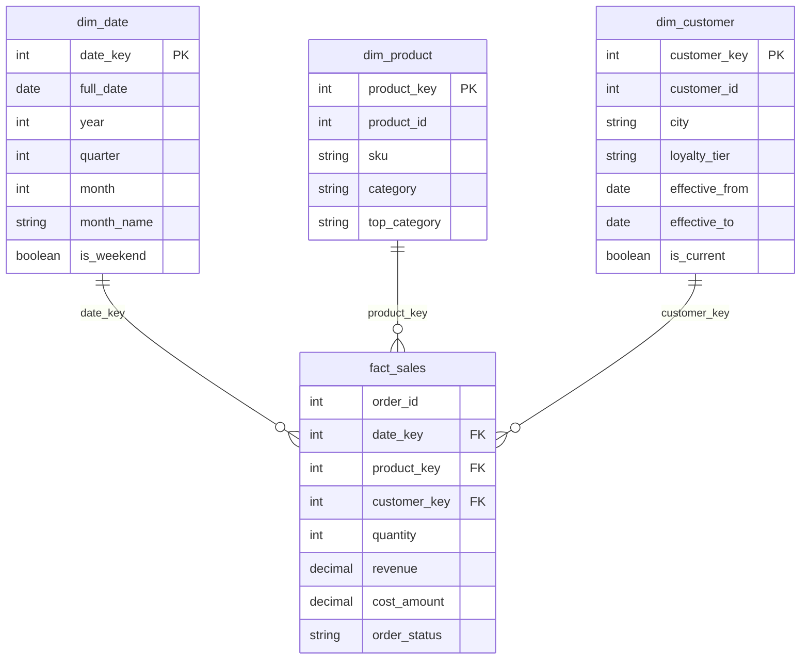

## Introduction

The shop's OLTP schema is designed to **record** business events correctly: one order, its items, its payments, each row written by a transaction and protected by constraints. Analysts ask a different kind of question: *"Revenue by month, category and customer city for 2024"*, *"How did gold-tier customers' basket size change after the price increase?"*, *"Which categories grew quarter over quarter?"* Answering these on the OLTP schema means repeating the same joins, the same business rules (which statuses count as revenue? which category is a product's top-level category?) and the same date arithmetic in every report — and running heavy scans on the database that serves customers ([OLTP vs OLAP Workloads](/lessons/m12-oltp-olap)).

A **data warehouse** is a database designed for that second kind of question. Its dominant design method, **dimensional modelling** (Ralph Kimball), organizes data into:

- **fact tables** — the measurements of a business process at a declared **grain** (one row per order line), with numeric **measures** (quantity, revenue, cost);
- **dimension tables** — the context used to filter and group the facts (date, product, customer), wide and descriptive, with **surrogate keys**;
- arranged as a **star schema** (facts in the centre, denormalized dimensions around them) or a **snowflake** (dimensions normalized into sub-dimensions).

This lesson builds a small star schema from the shop data with `INSERT … SELECT`, handles a customer who moves city with a **type 2 slowly changing dimension** (effective and expiry dates), runs typical star queries, and shows the errors — wrong grain, double counting, inclusive date ranges — that make warehouse numbers silently wrong. Loading it incrementally is the subject of [ETL and ELT Pipelines](/lessons/m13-etl-elt); making the queries fast is [Analytical Query Optimization](/lessons/m13-analytical-optimization).

:::note[Dataset]
The lab loads the **shop** dataset (orders from calendar year 2024). All warehouse tables (`dim_date`, `dim_product`, `dim_customer`, `fact_sales`, …) are built in the same lab schema from the shop tables. In production they would live in a separate warehouse database or system; here they sit side by side so that you can compare the two models on identical data.
:::

## DBMS Theory

:::theory[Dimensional modelling]
- **Business process** — the activity being measured (taking orders, shipping, payments). One fact table per process.
- **Grain** — the exact meaning of one fact row, declared *before* choosing columns: "one row per order line", "one row per product per store per day". Every measure and every dimension must be true at that grain.
- **Facts / measures** — numeric observations. **Additive** measures (quantity, revenue) can be summed across every dimension; **semi-additive** ones (account balance, stock on hand) can be summed across some dimensions but not across time; **non-additive** ones (unit price, margin %, ratios) must be recomputed from additive components, never summed.
- **Dimensions** — descriptive context (who, what, where, when). Dimension rows are identified by **surrogate keys** (meaningless integers), not the source system's natural keys, so the warehouse can keep history and integrate several sources.
- **Star schema** — each dimension is one denormalized table joined directly to the fact table. **Snowflake schema** — dimensions are normalized (product → category → department), adding joins but removing redundancy.
- **Conformed dimensions** — the same dimension (same keys, same attribute meanings) shared by several fact tables, so that measures from different processes can be compared ("drill across").
- **Slowly changing dimensions (SCD)** — policies for attribute changes: **type 0** keep the original, **type 1** overwrite (no history), **type 2** add a new row version with effective/expiry dates (full history), **type 3** keep the previous value in an extra column (limited history).
:::

Two schools structure the whole warehouse differently:

| Approach | Idea | Typical layers |
|---|---|---|
| **Kimball** (bottom-up, dimensional) | Build star schemas per business process with conformed dimensions; the "warehouse" is the union of the marts | staging → star schemas (marts) |
| **Inmon** (top-down, enterprise) | Build a normalized (3NF) enterprise data warehouse first; derive dimensional marts from it | staging → 3NF EDW → marts |
| **Data Vault** (Linstedt) | Model hubs (business keys), links (relationships) and satellites (history) for auditability and agile loading; publish stars on top | staging → raw vault → business vault → marts |

Modern "lakehouse" and ELT stacks mostly follow a layered version of the Kimball idea (raw → cleaned → dimensional/"gold" models). The modelling concepts in this lesson transfer unchanged to any warehouse engine.

## Why It Exists

Why not just query the OLTP schema?

- **Business logic is repeated and drifts.** "Revenue" must exclude cancelled orders, include refunded ones (or not), use the historical line price rather than today's product price, and map products to top-level categories through a recursive hierarchy. In a warehouse, that logic is applied **once**, at load time, and every report inherits it.
- **History is lost in OLTP.** When customer 4 moves from Austin to Seattle, the `customers` row is updated; every past order now appears to come from Seattle. OLTP keeps the *current* state; a warehouse with SCD type 2 keeps *as-was* state.
- **Analytical queries need different shapes.** OLTP is normalized for correct writes; analysts need wide, descriptive dimensions and a narrow, append-mostly fact table that is easy to aggregate. Calendar attributes (quarter, ISO week, weekend, fiscal period, holidays) live in a date dimension instead of being computed with functions in every query.
- **Workload isolation.** Scans over millions of facts should not compete with checkout transactions. The warehouse is loaded from the OLTP system (or its replicas/binlog) and queried separately.
- **Integration.** Data from the shop, the payment provider and the marketing platform share conformed dimensions in the warehouse; in OLTP they live in different systems with different keys.

## Internal Working

:::internals[How a star query executes]
A typical star query filters several dimensions, joins them to the fact table and aggregates:

```
SELECT d.quarter, p.top_category, SUM(f.revenue)
FROM fact_sales f JOIN dim_date d … JOIN dim_product p …
WHERE d.year = 2024 AND p.top_category = 'Electronics'
GROUP BY d.quarter, p.top_category;
```

- **Row-store MySQL** executes it as nested-loop joins (or hash joins for non-indexed equi-joins, 8.0.18+). The optimizer usually starts from the most selective filtered dimension or from the fact table, and uses indexes on the fact table's foreign-key columns to look up matching facts. Aggregation happens in a temporary table or by sorted grouping ([Optimizing Aggregation and Sorting](/lessons/m07-optimizing-aggregation-sorting)).
- **Columnar warehouse engines** (MySQL HeatWave, Amazon Redshift, Google BigQuery, Snowflake, ClickHouse, DuckDB and others) store each column separately and compressed, read only the columns a query touches, and apply **vectorized** execution; some implement *star-join* optimizations that turn dimension filters into compact key sets or bitmaps pushed into the fact scan. The dimensional model is equally valid there — and is often the reason those engines are fast.
- **Surrogate keys** are small integers, so the fact table's foreign keys are compact, joins compare integers, and dimension changes (SCD2) never rewrite facts.
- **Partitioning** the fact table by date ([Partitioning](/lessons/m12-partitioning)) lets the engine skip whole months or years (partition pruning) — covered in [Analytical Query Optimization](/lessons/m13-analytical-optimization).
:::



## MySQL Implementation

**Step 1 — declare the grain.** *One row of `fact_sales` = one order line (an `order_items` row) of a shop order.* Every column below must be true at that grain: the quantity and revenue of that line, the date of its order, its product and its customer.

**Step 2 — the date dimension**, generated with a recursive CTE. Its key is the integer `YYYYMMDD` (a smart surrogate that is readable and sorts correctly — a common, accepted exception to "surrogates are meaningless"):

```sql run
CREATE TABLE dim_date (
  date_key     INT UNSIGNED PRIMARY KEY,      -- YYYYMMDD
  full_date    DATE        NOT NULL UNIQUE,
  year         SMALLINT    NOT NULL,
  quarter      TINYINT     NOT NULL,
  month        TINYINT     NOT NULL,
  month_name   VARCHAR(9)  NOT NULL,
  iso_week     TINYINT     NOT NULL,
  day_of_week  VARCHAR(9)  NOT NULL,
  is_weekend   BOOLEAN     NOT NULL
);
INSERT INTO dim_date
WITH RECURSIVE days(d) AS (
  SELECT DATE '2024-01-01'
  UNION ALL SELECT d + INTERVAL 1 DAY FROM days WHERE d < DATE '2024-12-31'
)
SELECT CAST(DATE_FORMAT(d, '%Y%m%d') AS UNSIGNED), d, YEAR(d), QUARTER(d), MONTH(d), MONTHNAME(d),
       WEEK(d, 3), DAYNAME(d), DAYOFWEEK(d) IN (1, 7)
FROM days;
SELECT COUNT(*) AS days, MIN(full_date) AS first_day, MAX(full_date) AS last_day, SUM(is_weekend) AS weekend_days FROM dim_date;
```

**Step 3 — the product dimension**, flattening the category hierarchy (a recursive CTE walks each category up to its root) into denormalized columns — that is what makes it a *star* dimension:

```sql run
CREATE TABLE dim_product (
  product_key   INT UNSIGNED AUTO_INCREMENT PRIMARY KEY,
  product_id    INT UNSIGNED NOT NULL UNIQUE,     -- natural key from OLTP
  sku           VARCHAR(20)  NOT NULL,
  product_name  VARCHAR(120) NOT NULL,
  category      VARCHAR(60)  NOT NULL,
  top_category  VARCHAR(60)  NOT NULL,
  price_band    VARCHAR(10)  NOT NULL
);
INSERT INTO dim_product (product_id, sku, product_name, category, top_category, price_band)
WITH RECURSIVE cat_path AS (
  SELECT category_id, name, parent_id, name AS top_name
  FROM categories WHERE parent_id IS NULL
  UNION ALL
  SELECT c.category_id, c.name, c.parent_id, cp.top_name
  FROM categories c JOIN cat_path cp ON c.parent_id = cp.category_id
)
SELECT p.product_id, p.sku, p.name,
       COALESCE(cp.name, 'Uncategorized'), COALESCE(cp.top_name, 'Uncategorized'),
       CASE WHEN p.price < 50 THEN 'budget' WHEN p.price < 500 THEN 'mid' ELSE 'premium' END
FROM products p LEFT JOIN cat_path cp ON cp.category_id = p.category_id
ORDER BY p.product_id;
SELECT product_key, product_id, sku, category, top_category, price_band
FROM dim_product ORDER BY product_key LIMIT 6;
```

The gift card has no category in OLTP; the dimension replaces NULL with an explicit `'Uncategorized'` member, so reports show a labelled group instead of a blank one.

## Syntax Breakdown

There is no special "warehouse syntax" in MySQL — dimensional models are built from ordinary DDL and DML. The constructs that do the work:

| Construct | Role in the warehouse |
|---|---|
| `INSERT INTO dim … SELECT …` | Load dimensions and facts set-wise from staging/OLTP tables |
| `WITH RECURSIVE` | Generate calendar rows; flatten hierarchies (category paths, org charts) |
| `AUTO_INCREMENT` surrogate key | Dimension identity independent of source keys; one per SCD2 version |
| `effective_from`, `effective_to`, `is_current` | Type 2 history; half-open validity interval `[from, to)` |
| Point-in-time join `ON d.nk = s.nk AND s.ts >= d.effective_from AND s.ts < d.effective_to` | Attach each fact to the dimension version valid when the event happened |
| Degenerate dimension (`order_id` in the fact) | A transaction identifier with no attributes of its own, kept for drill-down and counting orders |
| `GROUP BY … WITH ROLLUP` | Subtotals and grand totals in one pass |
| Foreign keys fact → dimensions | Optional in a warehouse: guarantee referential integrity, but cost load time; many warehouses enforce it in the ETL instead |

## Practical Examples

### 1. The customer dimension with SCD type 2 columns

```sql run
CREATE TABLE dim_customer (
  customer_key    INT UNSIGNED AUTO_INCREMENT PRIMARY KEY,
  customer_id     INT UNSIGNED NOT NULL,          -- natural key; not unique: one row per version
  full_name       VARCHAR(101) NOT NULL,
  city            VARCHAR(60)  NOT NULL,
  state           CHAR(2)      NOT NULL,
  loyalty_tier    VARCHAR(10)  NOT NULL,
  effective_from  DATE         NOT NULL,
  effective_to    DATE         NOT NULL DEFAULT '9999-12-31',
  is_current      BOOLEAN      NOT NULL DEFAULT TRUE,
  KEY idx_dim_customer_nk (customer_id, effective_from)
);
INSERT INTO dim_customer (customer_id, full_name, city, state, loyalty_tier, effective_from)
SELECT customer_id, CONCAT(first_name, ' ', last_name), city, state,
       COALESCE(loyalty_tier, 'none'), signup_date
FROM customers ORDER BY customer_id;
SELECT customer_key, customer_id, full_name, city, loyalty_tier, effective_from, effective_to, is_current
FROM dim_customer WHERE customer_id IN (4, 7) ORDER BY customer_key;
```

Each customer starts with one version valid from signup to the far-future sentinel `9999-12-31`. The interval is **half-open**: a version is valid for timestamps `t` with `effective_from ≤ t < effective_to`.

### 2. Apply a type 2 change: customer 4 moves on 1 July 2024

In OLTP, the move is a single `UPDATE customers SET city = 'Seattle'`. In the warehouse, the current version is **expired** and a **new version** inserted, in one transaction:

```sql run
START TRANSACTION;
UPDATE dim_customer
   SET effective_to = DATE '2024-07-01', is_current = FALSE
 WHERE customer_id = 4 AND is_current;
INSERT INTO dim_customer (customer_id, full_name, city, state, loyalty_tier, effective_from)
SELECT customer_id, full_name, 'Seattle', 'WA', loyalty_tier, DATE '2024-07-01'
FROM dim_customer WHERE customer_id = 4 AND effective_to = DATE '2024-07-01';
COMMIT;
SELECT customer_key, customer_id, city, state, effective_from, effective_to, is_current
FROM dim_customer WHERE customer_id = 4 ORDER BY effective_from;
```

The old version ends exactly where the new one begins (`effective_to` of version 1 = `effective_from` of version 2) — no gap, no overlap. (The OLTP table is left unchanged in this lab so the two models can be compared.)

### 3. Load the fact table with surrogate-key lookups

```sql run
CREATE TABLE fact_sales (
  order_id      INT UNSIGNED NOT NULL,            -- degenerate dimension
  product_key   INT UNSIGNED NOT NULL,
  date_key      INT UNSIGNED NOT NULL,
  customer_key  INT UNSIGNED NOT NULL,
  order_status  VARCHAR(10)  NOT NULL,
  quantity      INT UNSIGNED NOT NULL,
  revenue       DECIMAL(12,2) NOT NULL,           -- quantity × historical unit price
  cost_amount   DECIMAL(12,2) NOT NULL,           -- quantity × product cost (current cost: see note)
  PRIMARY KEY (order_id, product_key),
  KEY idx_fact_date (date_key),
  KEY idx_fact_customer (customer_key),
  KEY idx_fact_product (product_key),
  CONSTRAINT fk_fact_date     FOREIGN KEY (date_key)     REFERENCES dim_date (date_key),
  CONSTRAINT fk_fact_product  FOREIGN KEY (product_key)  REFERENCES dim_product (product_key),
  CONSTRAINT fk_fact_customer FOREIGN KEY (customer_key) REFERENCES dim_customer (customer_key)
);
INSERT INTO fact_sales
SELECT oi.order_id, dp.product_key,
       CAST(DATE_FORMAT(o.order_date, '%Y%m%d') AS UNSIGNED) AS date_key,
       dc.customer_key, o.status, oi.quantity,
       oi.quantity * oi.unit_price, oi.quantity * p.cost
FROM order_items oi
JOIN orders o        ON o.order_id = oi.order_id
JOIN products p      ON p.product_id = oi.product_id
JOIN dim_product dp  ON dp.product_id = oi.product_id
JOIN dim_customer dc ON dc.customer_id = o.customer_id
                    AND o.order_date >= dc.effective_from
                    AND o.order_date <  dc.effective_to;
SELECT COUNT(*) AS fact_rows, (SELECT COUNT(*) FROM order_items) AS source_lines,
       SUM(revenue) AS revenue, SUM(quantity) AS units FROM fact_sales;
```

The first **reconciliation check** — fact rows against source lines — fails: some order lines were dropped. An inner join to the dimension only keeps facts for which a valid customer version exists, so find the lines that found none:

```sql run
SELECT o.order_id, o.customer_id, o.order_date, c.signup_date
FROM orders o JOIN customers c ON c.customer_id = o.customer_id
WHERE NOT EXISTS (SELECT 1 FROM dim_customer dc
                  WHERE dc.customer_id = o.customer_id
                    AND o.order_date >= dc.effective_from AND o.order_date < dc.effective_to)
ORDER BY o.order_id;
```

The source data contains orders placed **before** the customer's recorded signup date (for example, guest checkouts later attached to an account, or a signup date that was reset). The first dimension version started at `signup_date`, so those orders fell before every version. This is exactly the kind of anomaly warehouses surface: OLTP never needed the two dates to be consistent. The standard fix is to let the **first version of every entity start at a "beginning of time" sentinel** — the attributes we know are the best description of the customer before any recorded change — and to report the anomaly to the data owners. Then reload the facts:

```sql run
UPDATE dim_customer
   SET effective_from = DATE '1900-01-01'
 WHERE customer_key IN (SELECT customer_key FROM
         (SELECT MIN(customer_key) AS customer_key FROM dim_customer GROUP BY customer_id) AS first_versions);
DELETE FROM fact_sales;
INSERT INTO fact_sales
SELECT oi.order_id, dp.product_key,
       CAST(DATE_FORMAT(o.order_date, '%Y%m%d') AS UNSIGNED) AS date_key,
       dc.customer_key, o.status, oi.quantity,
       oi.quantity * oi.unit_price, oi.quantity * p.cost
FROM order_items oi
JOIN orders o        ON o.order_id = oi.order_id
JOIN products p      ON p.product_id = oi.product_id
JOIN dim_product dp  ON dp.product_id = oi.product_id
JOIN dim_customer dc ON dc.customer_id = o.customer_id
                    AND o.order_date >= dc.effective_from
                    AND o.order_date <  dc.effective_to;
SELECT COUNT(*) AS fact_rows, (SELECT COUNT(*) FROM order_items) AS source_lines,
       SUM(revenue) AS revenue, SUM(quantity) AS units FROM fact_sales;
```

Now every source line has exactly one fact row. (The doubly nested derived table in the `UPDATE` forces MySQL to materialize the list of first versions before updating the same table, avoiding error 1093.) The point-in-time join picked, for each order, the customer version valid at its order date. `revenue` uses the **historical** `unit_price` stored on the line, never today's `products.price`. The shop has no cost history, so `cost_amount` uses the current cost — a limitation a real warehouse would document or fix with a cost-history source.

### 4. Typical star queries: slice, dice, roll up

```sql run
SELECT d.quarter, p.top_category,
       SUM(f.revenue) AS revenue,
       COUNT(DISTINCT f.order_id) AS orders
FROM fact_sales f
JOIN dim_date d    ON d.date_key = f.date_key
JOIN dim_product p ON p.product_key = f.product_key
WHERE f.order_status IN ('paid', 'shipped', 'delivered')
GROUP BY d.quarter, p.top_category WITH ROLLUP
ORDER BY GROUPING(d.quarter), d.quarter, GROUPING(p.top_category), p.top_category;
```

`WITH ROLLUP` adds a subtotal row per quarter (category NULL) and a grand total (both NULL). `GROUPING(col)` returns 1 on the rows where ROLLUP aggregated that column away, so ordering by it places each subtotal after its detail rows and the grand total last (ordering by `col IS NULL` does not work reliably here, because it is evaluated on the values before ROLLUP adds its NULLs). `COUNT(DISTINCT f.order_id)` counts orders through the degenerate dimension — `COUNT(*)` would count lines.

### 5. Why the type 2 history matters

Compare revenue by customer city using the **as-was** city (SCD2, via the fact's `customer_key`) with the **as-is** city (type 1 overwrite, via the current version):

```sql run
SELECT 'as-was (type 2)' AS view_of_history, c.city, SUM(f.revenue) AS revenue
FROM fact_sales f JOIN dim_customer c ON c.customer_key = f.customer_key
WHERE c.customer_id = 4
GROUP BY c.city
UNION ALL
SELECT 'as-is (type 1)', cur.city, SUM(f.revenue)
FROM fact_sales f
JOIN dim_customer c   ON c.customer_key = f.customer_key
JOIN dim_customer cur ON cur.customer_id = c.customer_id AND cur.is_current
WHERE c.customer_id = 4
GROUP BY cur.city
ORDER BY view_of_history, city;
```

With type 2, customer 4's spring orders stay in Austin and only the December order counts for Seattle. With type 1 semantics everything is re-attributed to Seattle. Neither is "wrong" — they answer different questions (*"where were sales made?"* vs *"what do our current Seattle customers buy?"*) — which is why many warehouses expose both.

## Execution Walkthrough

Trace a star query from filtered dimensions to the result, looking at intermediate sets.

```walkthrough
title: "Revenue by month for Electronics, delivered orders, Q2 2024"
steps:
  - title: "1. Filter the date dimension"
    explain: The date dimension turns "Q2 2024" into a set of date keys — no date functions on the fact table are needed.
    sql: SELECT MIN(date_key) AS first_key, MAX(date_key) AS last_key, COUNT(*) AS days FROM dim_date WHERE year = 2024 AND quarter = 2;
  - title: "2. Filter the product dimension"
    explain: The flattened hierarchy makes "Electronics" (a top-level category with sub-categories) a simple equality filter.
    sql: SELECT product_key, sku, category FROM dim_product WHERE top_category = 'Electronics' ORDER BY product_key LIMIT 8;
  - title: "3. The plan: how the optimizer joins the star"
    explain: >-
      On this tiny star the optimizer chose an inner hash join between the fact table and the filtered
      dimensions, followed by aggregation in a temporary table. With realistic data volumes and statistics,
      indexes on the fact table's foreign keys (idx_fact_date, idx_fact_product) decide whether the fact table
      is probed by key or scanned.
    sql: |
      EXPLAIN FORMAT=TREE
      SELECT d.month, SUM(f.revenue)
      FROM fact_sales f
      JOIN dim_date d    ON d.date_key = f.date_key
      JOIN dim_product p ON p.product_key = f.product_key
      WHERE d.year = 2024 AND d.quarter = 2 AND p.top_category = 'Electronics' AND f.order_status = 'delivered'
      GROUP BY d.month;
  - title: "4. The qualifying fact rows (before aggregation)"
    explain: Each row is one order line that passed all three filters.
    sql: |
      SELECT f.order_id, f.date_key, p.sku, f.quantity, f.revenue
      FROM fact_sales f
      JOIN dim_date d    ON d.date_key = f.date_key
      JOIN dim_product p ON p.product_key = f.product_key
      WHERE d.year = 2024 AND d.quarter = 2 AND p.top_category = 'Electronics' AND f.order_status = 'delivered'
      ORDER BY f.date_key, f.order_id, p.sku;
  - title: "5. Aggregate by month"
    sql: |
      SELECT d.month, d.month_name, SUM(f.revenue) AS revenue, SUM(f.quantity) AS units
      FROM fact_sales f
      JOIN dim_date d    ON d.date_key = f.date_key
      JOIN dim_product p ON p.product_key = f.product_key
      WHERE d.year = 2024 AND d.quarter = 2 AND p.top_category = 'Electronics' AND f.order_status = 'delivered'
      GROUP BY d.month, d.month_name
      ORDER BY d.month;
```

## Output

The walkthrough's final result is a small monthly series — exactly the shape a BI tool expects. Two checks every warehouse developer runs before trusting such numbers:

```sql run
SELECT
  (SELECT SUM(revenue) FROM fact_sales WHERE order_status = 'delivered')                    AS warehouse_delivered_revenue,
  (SELECT SUM(oi.quantity * oi.unit_price)
     FROM order_items oi JOIN orders o USING (order_id) WHERE o.status = 'delivered')        AS oltp_delivered_revenue,
  (SELECT COUNT(*) FROM fact_sales f LEFT JOIN dim_customer c ON c.customer_key = f.customer_key
    WHERE c.customer_key IS NULL)                                                           AS orphan_facts;
```

The warehouse total equals the OLTP total for the same rule, and no fact points to a missing dimension row. Reconciliation queries like these become automated **data-quality checks** in the pipeline ([ETL and ELT Pipelines](/lessons/m13-etl-elt)).

## Alternative Approaches

| Model | Strengths | Weaknesses | When |
|---|---|---|---|
| **Star schema** | Few joins, intuitive for analysts and BI tools, fast on all engines | Redundant dimension attributes; hierarchy changes rewrite dimension rows | Default for analytics marts |
| **Snowflake schema** | Less redundancy; hierarchies maintained in one place | More joins; harder for business users | Very large dimensions, shared sub-dimensions, strict governance |
| **One Big Table (OBT)** | Zero joins; ideal for columnar engines and ML feature tables | Huge redundancy; SCD and re-attribution are painful | Derived "presentation" tables on columnar warehouses |
| **3NF enterprise warehouse (Inmon)** | Integrated, non-redundant system of record for history | Analysts need marts on top | Large enterprises with many sources |
| **Data Vault** | Auditable, parallel loading, schema-change tolerant | Complex; still needs marts for querying | Regulated industries, many volatile sources |
| **Query OLTP directly / read replica** | No pipeline | No history, logic repeated, load on OLTP | Small data, operational reporting |

A snowflaked version of the product dimension, for comparison, moves categories into their own table:

```sql run
CREATE TABLE dim_category (
  category_key INT UNSIGNED AUTO_INCREMENT PRIMARY KEY,
  category     VARCHAR(60) NOT NULL UNIQUE,
  top_category VARCHAR(60) NOT NULL
);
INSERT INTO dim_category (category, top_category)
SELECT DISTINCT category, top_category FROM dim_product ORDER BY top_category, category;
CREATE TABLE dim_product_sf (
  product_key  INT UNSIGNED PRIMARY KEY,
  sku          VARCHAR(20) NOT NULL,
  category_key INT UNSIGNED NOT NULL,
  CONSTRAINT fk_dps_category FOREIGN KEY (category_key) REFERENCES dim_category (category_key)
);
INSERT INTO dim_product_sf
SELECT p.product_key, p.sku, c.category_key FROM dim_product p JOIN dim_category c ON c.category = p.category;
SELECT c.top_category, SUM(f.revenue) AS revenue
FROM fact_sales f
JOIN dim_product_sf p ON p.product_key = f.product_key
JOIN dim_category c   ON c.category_key = p.category_key
GROUP BY c.top_category ORDER BY revenue DESC;
```

Same answer, one more join. In a row store with small dimensions the difference is negligible; the choice is mostly about maintenance and usability.

## Performance Analysis

On 182 fact rows nothing is slow, so focus on the structural cost drivers that decide performance at warehouse scale:

- **Fact table width and size dominate.** Facts are the largest table by orders of magnitude; keep them narrow (integer surrogate keys, `DECIMAL` measures, short status codes), and move descriptive text to dimensions.
- **Indexes on fact foreign keys** let a row store answer selective dimension filters by probing; for broad aggregations a full fact scan is cheaper than millions of index lookups — the optimizer decides on statistics, so `ANALYZE TABLE` after loads.
- **Date-key range predicates** (`date_key BETWEEN 20240401 AND 20240630`) are SARGable on the fact table directly and enable **partition pruning** when the fact table is partitioned by date key.
- **Pre-aggregation**: when dashboards repeat the same group-bys, summary tables (aggregate facts at a coarser grain, e.g. day × category) reduce work by orders of magnitude — measured in [Analytical Query Optimization](/lessons/m13-analytical-optimization).
- **Columnar engines** change the constants, not the model: reading 3 of 8 columns, compressed, with vectorized aggregation. MySQL HeatWave (an Oracle cloud service, display-only here) adds an in-memory columnar engine to MySQL; external warehouses (BigQuery, Snowflake, Redshift, ClickHouse) load data from MySQL through ETL/CDC.

The current plan for a typical star aggregation — read it to see which table drives the join:

```sql run measured
EXPLAIN ANALYZE
SELECT p.top_category, SUM(f.revenue)
FROM fact_sales f JOIN dim_product p ON p.product_key = f.product_key
JOIN dim_date d ON d.date_key = f.date_key
WHERE d.quarter IN (3, 4)
GROUP BY p.top_category;
```

## Best Practices

:::best-practice[Dimensional modelling habits]
1. **Declare the grain first, in words**, and reject any column that is not true at that grain.
2. **Use surrogate keys** for dimensions; keep the natural key as an attribute for lineage and SCD lookups.
3. **Store additive measures** (quantity, revenue, cost) and derive ratios at query time — never store and sum margin percentages.
4. **Use half-open validity intervals** `[effective_from, effective_to)` with a far-future sentinel and an `is_current` flag; never let versions overlap or leave gaps.
5. **Replace NULL dimension values with explicit members** ("Uncategorized", "Unknown customer") and keep an "unknown" row (key 0 or −1) for late-arriving or missing dimensions.
6. **Conform dimensions** across fact tables — one `dim_date`, one `dim_customer` — so metrics can be combined.
7. **Reconcile every load** against the source (row counts, totals) before publishing; record the rules (which statuses count as revenue) as documentation and as tests.
:::

## Common Mistakes

**Mistake 0 — starting the first SCD version at a business date.** Shown in Practical Example 3: facts older than the first version's `effective_from` silently disappear from an inner join. Start first versions at a sentinel such as `1900-01-01`, and reconcile row counts after every load.

**Mistake 1 — inclusive `BETWEEN` on SCD validity with `DATETIME` events.** If versions are stored as `[from, to]` with `to = '2024-06-30'` (the day before the change) and the join uses `BETWEEN`, an order at `2024-06-30 17:33` falls *outside* both versions, because the `DATE` `'2024-06-30'` compares as midnight:

```sql run
SELECT o.order_id, o.order_date,
       (SELECT COUNT(*) FROM dim_customer c
         WHERE c.customer_id = o.customer_id
           AND o.order_date BETWEEN c.effective_from AND c.effective_to - INTERVAL 1 DAY) AS versions_matched_inclusive,
       (SELECT COUNT(*) FROM dim_customer c
         WHERE c.customer_id = o.customer_id
           AND o.order_date >= c.effective_from AND o.order_date < c.effective_to)      AS versions_matched_half_open
FROM orders o WHERE o.customer_id = 4 ORDER BY o.order_date;
```

The inclusive version loses order 8 (zero matching versions → the fact row would be dropped by an inner join). The half-open version matches exactly one version for every order.

**Mistake 2 — mixing grains in one fact table.** Adding the order's shipping fee to every line row ("order-level measure on a line-level fact") multiplies it by the number of lines when summed. Put order-level measures in an order-grain fact table, or allocate them to lines explicitly.

**Mistake 3 — summing non-additive measures.** Averages, percentages and unit prices cannot be summed or averaged across groups; store numerator and denominator (revenue and cost) and compute the ratio after aggregation.

**Mistake 4 — joining to the current dimension row by natural key.** `JOIN dim_customer c ON c.customer_id = …` without the validity condition (or without `is_current` when you want current values) matches *every* version and duplicates facts:

```sql run
SELECT COUNT(*) AS joined_rows_without_validity, (SELECT COUNT(*) FROM fact_sales f JOIN dim_customer c ON c.customer_key = f.customer_key WHERE c.customer_id = 4) AS correct_rows
FROM fact_sales f
JOIN dim_customer c_any ON c_any.customer_key = f.customer_key
JOIN dim_customer c ON c.customer_id = c_any.customer_id
WHERE c.customer_id = 4;
```

Customer 4 has two versions, so every one of their fact rows appears twice.

**Mistake 5 — using current product prices for historical revenue.** `quantity × products.price` re-prices history whenever a price changes; use the line's stored `unit_price`.

## Industry Application

- **Retail and e-commerce** run sales star schemas exactly like this one, at the grain of order line or receipt line, with conformed product, store, customer and date dimensions shared by inventory snapshots (a periodic-snapshot fact table with semi-additive stock measures) and returns.
- **SaaS companies** model subscriptions as accumulating-snapshot or event facts (trial → paid → churn) with SCD2 on plan and account attributes, to answer "MRR by plan as it was at the time".
- **Finance** uses SCD2 heavily (cost centres, organizational hierarchies) because restating history is an audit issue.
- **Modern data stacks** build these models with SQL transformation tools (dbt "dimensions" and "facts", snapshots for SCD2) inside cloud warehouses, loading raw data from MySQL via CDC or batch extracts. MySQL itself is often the **source**, sometimes the **mart** for small to medium data, and — with HeatWave in Oracle's cloud — an analytics engine too.
- **BI tools** (Power BI, Tableau, Looker, Superset) expect star schemas: their semantic layers map dimensions to filters and facts to measures.

## Practice Exercises

````exercise
id: ex1
title: Weekend versus weekday revenue
difficulty: easy
concepts: [star-schema, dimension-table]
setup: |
  CREATE TABLE dim_date (date_key INT UNSIGNED PRIMARY KEY, full_date DATE NOT NULL, quarter TINYINT NOT NULL, is_weekend BOOLEAN NOT NULL);
  INSERT INTO dim_date
  WITH RECURSIVE days(d) AS (SELECT DATE '2024-01-01' UNION ALL SELECT d + INTERVAL 1 DAY FROM days WHERE d < DATE '2024-12-31')
  SELECT CAST(DATE_FORMAT(d, '%Y%m%d') AS UNSIGNED), d, QUARTER(d), DAYOFWEEK(d) IN (1, 7) FROM days;
  CREATE TABLE fact_sales (order_id INT UNSIGNED, product_id INT UNSIGNED, date_key INT UNSIGNED, order_status VARCHAR(10), quantity INT, revenue DECIMAL(12,2), PRIMARY KEY (order_id, product_id));
  INSERT INTO fact_sales
  SELECT oi.order_id, oi.product_id, CAST(DATE_FORMAT(o.order_date, '%Y%m%d') AS UNSIGNED), o.status, oi.quantity, oi.quantity * oi.unit_price
  FROM order_items oi JOIN orders o USING (order_id);
prompt: |
  Using the star tables `fact_sales` and `dim_date`, return total `revenue` for **non-cancelled** orders split
  by weekend vs weekday. Columns: `is_weekend` (0/1), `revenue`.
hints:
  - "Join fact_sales to dim_date on date_key and group by d.is_weekend."
  - "Exclude order_status = 'cancelled'."
solution: |
  SELECT d.is_weekend, SUM(f.revenue) AS revenue
  FROM fact_sales f JOIN dim_date d ON d.date_key = f.date_key
  WHERE f.order_status <> 'cancelled'
  GROUP BY d.is_weekend;
explanation: |
  The calendar logic (which days are weekends) lives in the date dimension, so the query is a plain join and
  GROUP BY — no `DAYOFWEEK()` on the fact table. Adding a holiday flag or fiscal period later needs no change
  to any report query, only new dimension columns.
````

````exercise
id: ex2
title: Declare the grain
difficulty: medium
kind: open
concepts: [grain, fact-table]
prompt: |
  The shop wants three analyses: (a) revenue by product and day, (b) average shipping delay (shipped_at −
  order_date) by month, (c) payment failure rate by payment method. Propose the fact table(s) needed: state
  the grain of each in one sentence, list the dimensions and measures, and say which measures are additive,
  semi-additive or non-additive. Explain why one fact table for all three would be a mistake.
solution: |
  - **fact_sales** — grain: one row per order line. Dimensions: date, product, customer, (order_id
    degenerate). Measures: quantity, revenue, cost (additive).
  - **fact_shipment** (or an accumulating snapshot **fact_order_fulfilment**) — grain: one row per order.
    Dimensions: order date, ship date, customer, (order_id). Measures: shipping_delay_hours (additive across
    orders for a total, but the business metric "average delay" is non-additive — compute SUM(delay)/COUNT).
    Store the delay and a count, not a precomputed average.
  - **fact_payment_attempt** — grain: one row per payment attempt. Dimensions: date, payment method,
    customer, (order_id, payment_id). Measures: amount (additive), is_failed flag (additive as a count of
    failures); failure rate = SUM(is_failed)/COUNT(*) (non-additive).
  - One table for all three would mix grains: an order with 3 lines and 2 payment attempts would need 6 rows or
    repeated values; summing order-level delay or payment amounts per line row multiplies them. Separate
    facts that share conformed dimensions (date, customer) can still be combined by drilling across.
````

````exercise
id: ex3
title: Apply an SCD type 2 change
difficulty: hard
kind: dml
concepts: [slowly-changing-dimensions]
setup: |
  CREATE TABLE dim_customer (
    customer_key INT UNSIGNED AUTO_INCREMENT PRIMARY KEY, customer_id INT UNSIGNED NOT NULL,
    city VARCHAR(60) NOT NULL, loyalty_tier VARCHAR(10) NOT NULL,
    effective_from DATE NOT NULL, effective_to DATE NOT NULL DEFAULT '9999-12-31', is_current BOOLEAN NOT NULL DEFAULT TRUE);
  INSERT INTO dim_customer (customer_id, city, loyalty_tier, effective_from)
  SELECT customer_id, city, COALESCE(loyalty_tier, 'none'), signup_date FROM customers ORDER BY customer_id;
prompt: |
  Customer **7** is upgraded to loyalty tier **gold** effective **2024-09-01**. Apply this as an SCD type 2
  change to `dim_customer`: expire the current version (half-open interval, so its `effective_to` is
  `2024-09-01` and `is_current` becomes false) and insert a new current version with the new tier and the same
  other attributes.

  The checker returns all versions of customer 7 (`customer_id, city, loyalty_tier, effective_from, effective_to, is_current`).
hints:
  - "First UPDATE the row WHERE customer_id = 7 AND is_current."
  - "Then INSERT … SELECT from the row you just expired (effective_to = '2024-09-01'), overriding loyalty_tier and effective_from."
  - "Leave effective_to and is_current to their defaults for the new row."
solution: |
  UPDATE dim_customer
     SET effective_to = DATE '2024-09-01', is_current = FALSE
   WHERE customer_id = 7 AND is_current;
  INSERT INTO dim_customer (customer_id, city, loyalty_tier, effective_from)
  SELECT customer_id, city, 'gold', DATE '2024-09-01'
  FROM dim_customer
  WHERE customer_id = 7 AND effective_to = DATE '2024-09-01';
check: |
  SELECT customer_id, city, loyalty_tier, effective_from, effective_to, is_current
  FROM dim_customer WHERE customer_id = 7 ORDER BY effective_from;
explanation: |
  The two versions tile time without gaps or overlaps: [signup, 2024-09-01) silver, [2024-09-01, 9999-12-31)
  gold. Doing the INSERT first and the UPDATE second with `WHERE is_current` would expire *both* rows. In a
  real pipeline both statements run in one transaction, and the change is detected by comparing the staged
  source row with the current version (a hash of tracked attributes is common).
````

````exercise
id: ex4
title: Revenue by top-level category and quarter
difficulty: hard
concepts: [star-schema, grain]
setup: |
  CREATE TABLE dim_product (product_key INT UNSIGNED AUTO_INCREMENT PRIMARY KEY, product_id INT UNSIGNED NOT NULL UNIQUE, top_category VARCHAR(60) NOT NULL);
  INSERT INTO dim_product (product_id, top_category)
  WITH RECURSIVE cp AS (SELECT category_id, parent_id, name AS top_name FROM categories WHERE parent_id IS NULL
                        UNION ALL SELECT c.category_id, c.parent_id, cp.top_name FROM categories c JOIN cp ON c.parent_id = cp.category_id)
  SELECT p.product_id, COALESCE(cp.top_name, 'Uncategorized') FROM products p LEFT JOIN cp ON cp.category_id = p.category_id ORDER BY p.product_id;
  CREATE TABLE dim_date (date_key INT UNSIGNED PRIMARY KEY, quarter TINYINT NOT NULL);
  INSERT INTO dim_date
  WITH RECURSIVE days(d) AS (SELECT DATE '2024-01-01' UNION ALL SELECT d + INTERVAL 1 DAY FROM days WHERE d < DATE '2024-12-31')
  SELECT CAST(DATE_FORMAT(d, '%Y%m%d') AS UNSIGNED), QUARTER(d) FROM days;
  CREATE TABLE fact_sales (order_id INT UNSIGNED, product_key INT UNSIGNED, date_key INT UNSIGNED, order_status VARCHAR(10), revenue DECIMAL(12,2), PRIMARY KEY (order_id, product_key));
  INSERT INTO fact_sales
  SELECT oi.order_id, dp.product_key, CAST(DATE_FORMAT(o.order_date, '%Y%m%d') AS UNSIGNED), o.status, oi.quantity * oi.unit_price
  FROM order_items oi JOIN orders o USING (order_id) JOIN dim_product dp ON dp.product_id = oi.product_id;
prompt: |
  Using `fact_sales`, `dim_product` and `dim_date`, return revenue for orders with status `delivered` or
  `shipped`, by `top_category` and `quarter`, **including** a subtotal per top category (quarter NULL) but
  **no** grand total. Columns: `top_category`, `quarter`, `revenue`. Order by `top_category`, then `quarter`
  with the subtotal row last within each category.
hints:
  - "GROUP BY top_category, quarter WITH ROLLUP produces detail rows, per-category subtotals and a grand total."
  - "Remove the grand total with HAVING top_category IS NOT NULL (or GROUPING(top_category) = 0)."
  - "ORDER BY top_category, GROUPING(quarter), quarter puts the subtotal last."
solution: |
  SELECT p.top_category, d.quarter, SUM(f.revenue) AS revenue
  FROM fact_sales f
  JOIN dim_product p ON p.product_key = f.product_key
  JOIN dim_date d    ON d.date_key = f.date_key
  WHERE f.order_status IN ('delivered', 'shipped')
  GROUP BY p.top_category, d.quarter WITH ROLLUP
  HAVING GROUPING(p.top_category) = 0
  ORDER BY p.top_category, GROUPING(d.quarter), d.quarter;
orderMatters: true
explanation: |
  `GROUPING(col)` (8.0+) returns 1 on rows where ROLLUP aggregated that column away, which distinguishes a
  subtotal's NULL from a genuine NULL value. `HAVING p.top_category IS NOT NULL` also works here because the
  dimension has no NULL categories (they were replaced by 'Uncategorized' — one reason that practice matters).
````

````exercise
id: ex5
title: Design a warehouse for a ride-sharing company
difficulty: challenge
kind: open
concepts: [dimensional-modeling, slowly-changing-dimensions, conformed-dimensions]
prompt: |
  Design the core dimensional model for a ride-sharing company's analytics: trips, driver payouts and
  rider ratings. Specify fact tables with grain, the conformed dimensions, which dimension attributes need SCD
  type 2, and two data-quality checks you would automate. Explain how city boundaries changing over time
  affect the model.
solution: |
  - **fact_trip** — grain: one row per completed or cancelled trip request. Dimensions: request date and
    time-of-day, rider, driver, vehicle, pickup zone, dropoff zone, product (pool/standard/xl), payment method;
    degenerate trip_id. Measures (additive): distance_km, duration_min, fare_amount, tip_amount,
    surge_amount, is_cancelled (as a 0/1 count).
  - **fact_driver_payout** — grain: one row per driver per payout period (periodic snapshot) or per payout
    line. Measures: gross earnings, fees, net payout (additive across drivers; balance-like measures are
    semi-additive over time).
  - **fact_rating** — grain: one row per rating given. Measures: rating value and a count; average rating is
    non-additive (sum/count).
  - **Conformed dimensions**: dim_date, dim_time_of_day, dim_driver, dim_rider, dim_zone, dim_city shared by
    all facts.
  - **SCD type 2**: driver vehicle and tier, rider segment/loyalty level, zone-to-city mapping and city
    attributes (pricing region), so that historical trips stay attributed to the zone/city definition at trip
    time. Type 1 for corrections (typos in names).
  - **City boundaries**: zones are the stable spatial unit; the zone → city/market mapping is SCD2 (or a
    bridge with validity dates). Trips reference the zone version at trip time; "as-is" reports join through
    the current mapping.
  - **Checks**: (1) reconciliation — SUM(fare_amount) per day in fact_trip equals the payments ledger per
    day within tolerance; (2) no orphan keys — every fact's driver_key/zone_key exists, and no SCD2 entity has
    overlapping validity intervals (self-join on natural key where intervals intersect returns zero rows).
````

## Knowledge Assessment

```quiz
- id: q1
  question: "What should be decided **first** when designing a fact table?"
  options: ["The list of measures", "The grain — what exactly one row represents", "The indexes", "The partitioning scheme"]
  answer: 1
  explanation: "Kimball's design sequence is business process → grain → dimensions → facts. Measures and dimensions must be true at the declared grain; indexes and partitioning are physical choices made later."
  concepts: [grain]
- id: q2
  question: "Which measures can be summed across all dimensions, including time? (Select all that apply.)"
  type: multi
  options: ["Line revenue", "Units sold", "Stock on hand at end of day", "Margin percentage"]
  answer: [0, 1]
  explanation: "Revenue and units are additive. Stock on hand is semi-additive: it can be summed across products or stores at one point in time but not across days. Margin percentage is non-additive and must be recomputed from revenue and cost."
  concepts: [fact-table]
- id: q3
  question: "Why do dimension tables use surrogate keys instead of the OLTP natural keys?"
  options:
    - "Surrogate keys are required by MySQL for foreign keys"
    - "They allow several versions of the same entity (SCD type 2), integrate keys from multiple sources and keep fact rows compact"
    - "Natural keys cannot be indexed"
    - "They make the data impossible to trace back to the source"
  answer: 1
  explanation: "With SCD2, one customer_id has several dimension rows, so the natural key is not unique; surrogates give each version an identity. They also decouple the warehouse from source-key changes. The natural key is kept as an attribute for lineage."
  concepts: [surrogate-keys]
- id: q4
  question: "A customer moves from Austin to Seattle on 2024-07-01. With SCD **type 1**, what happens to revenue by city for orders placed in April?"
  options:
    - "It stays in Austin"
    - "It is re-attributed to Seattle, because the dimension row is overwritten"
    - "It is split between both cities"
    - "It disappears"
  answer: 1
  explanation: "Type 1 overwrites attributes, so all history is shown with the current value. Type 2 keeps a new row version and preserves the Austin attribution for April orders, as the lesson's comparison query shows."
  concepts: [slowly-changing-dimensions]
- id: q5
  question: "Versions are stored as `[effective_from, effective_to)` with the new version starting on 2024-07-01. Which join condition attaches an order at '2024-06-30 17:33' to the correct version?"
  options:
    - "o.order_date BETWEEN c.effective_from AND c.effective_to"
    - "o.order_date >= c.effective_from AND o.order_date < c.effective_to"
    - "DATE(o.order_date) = c.effective_from"
    - "c.is_current = TRUE"
  answer: 1
  explanation: "The half-open predicate matches exactly one version for any timestamp. BETWEEN would match two versions at the boundary instant (2024-07-01 00:00) — and with inclusive expiry dates set to the previous day, it drops late-day events (the lesson's order 8). is_current only gives today's version."
  concepts: [slowly-changing-dimensions]
- id: q6
  question: "What is the main difference between a star and a snowflake schema?"
  options:
    - "A star has one fact table; a snowflake has many"
    - "In a snowflake, dimension tables are normalized into sub-dimensions (product → category), adding joins; in a star each dimension is one denormalized table"
    - "Snowflake schemas can only be used in the Snowflake product"
    - "Stars cannot have hierarchies"
  answer: 1
  explanation: "Both can have several fact tables. The snowflake name is about normalized dimensions, not the vendor. Stars represent hierarchies as denormalized columns (category, top_category)."
  concepts: [star-schema, snowflake-schema]
- id: q7
  question: "An analyst stores each order's shipping fee on every line row of a line-grain fact table, then reports SUM(shipping_fee) by month. What is wrong?"
  options:
    - "Nothing"
    - "The fee is counted once per line, so orders with several lines are over-counted — a mixed-grain error"
    - "SUM cannot be used on DECIMAL"
    - "The fee should be stored as FLOAT"
  answer: 1
  explanation: "An order-level measure repeated on line rows violates the declared grain. Use an order-grain fact table or allocate the fee across lines explicitly. SUM works on DECIMAL, and money should never be FLOAT."
  concepts: [grain, fact-table]
- id: q8
  question: "Why does the lesson's dim_product replace a NULL category with 'Uncategorized'?"
  options:
    - "Because MySQL forbids NULL in dimension tables"
    - "So that reports show a labelled group, GROUP BY / ROLLUP NULLs are unambiguous, and filters behave predictably"
    - "To save storage"
    - "Because NULL cannot be indexed"
  answer: 1
  explanation: "Explicit members make NULL-related surprises disappear: a NULL in a ROLLUP output could be a subtotal or a missing category, and WHERE category <> 'Books' silently drops NULL rows. MySQL allows and indexes NULLs."
  concepts: [dimension-table]
```
