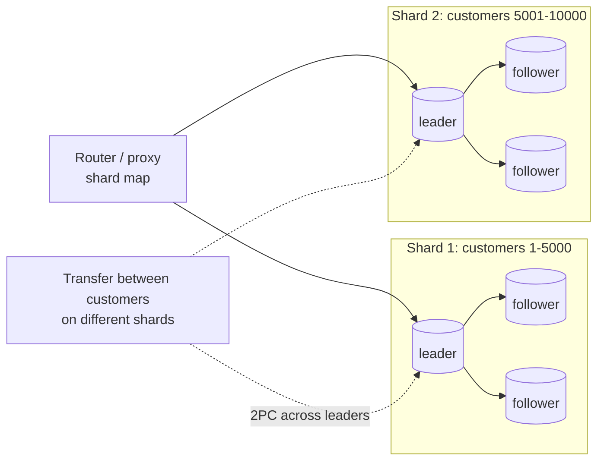

## Introduction

A single MySQL server has limits: one machine's CPU, memory, disk and network, and one machine's failure domain. Every large data platform eventually distributes data across machines for one of three reasons:

- **Availability** — survive the loss of a machine, a rack or a data centre.
- **Read and write scale** — more throughput than one primary can deliver.
- **Data size and locality** — more data than one machine holds, or data that must live near its users (or within a jurisdiction).

The two fundamental tools are **replication** (copies of the same data on several nodes) and **partitioning/sharding** (different data on different nodes). Real systems combine them, and the moment they do, three hard questions appear: *how do replicas agree on the order of writes* (consensus), *how does a transaction touch several partitions atomically* (distributed transactions, two-phase commit), and *what consistency do readers get* ([CAP Theorem](/lessons/m01-cap-theorem)).

This lesson connects those ideas to concrete mechanisms:

- replication × partitioning, quorums, and why naive resharding moves almost all data (computed in SQL);
- consensus with Paxos and Raft, conceptually, and where MySQL uses it (Group Replication);
- **two-phase commit with MySQL XA statements**, run for real — including what happens to other transactions while a branch sits in the *prepared* state;
- NewSQL and distributed SQL systems, described neutrally.

It builds on [Sharding](/lessons/m12-sharding), [Read Replicas](/lessons/m12-read-replicas) and [Data Integrity in Distributed Applications](/lessons/m12-distributed-integrity).

:::note[Dataset]
The lab uses the **bank** dataset (accounts with a `CHECK (balance >= 0)` constraint and an append-only ledger). A single MySQL server cannot be a real cluster, so distribution is simulated: hashing and quorum arithmetic are computed with SQL, and the two "resource managers" of a distributed transaction are played by two concurrent sessions that each own one XA transaction branch.
:::

## DBMS Theory

:::theory[Replication, partitioning, consensus and atomic commitment]
- **Replication** keeps copies of data on several nodes. *Single-leader* (primary/replica) replication funnels writes through one node; *multi-leader* accepts writes on several and must resolve conflicts; *leaderless* (Dynamo-style) writes to and reads from quorums of replicas.
- **Partitioning (sharding)** splits data by key — **range** partitioning (key intervals; good for range scans, risk of hot spots) or **hash** partitioning (uniform spread; range queries hit all partitions). A **directory** or bucket map decouples keys from nodes so that data can be moved.
- **Quorums**: with N replicas, a write acknowledged by W nodes and a read from R nodes overlap in at least one node when **R + W > N**, so a read sees the latest acknowledged write (assuming no concurrent writes and correct failure handling). W > N/2 also prevents two disjoint write quorums.
- **Consensus**: a set of nodes agrees on a sequence of values (a replicated log) despite crashes and message loss, as long as a **majority** is alive and connected. **Paxos** (Lamport) and **Raft** (Ongaro & Ousterhout) are the classic algorithms; consensus is the foundation of leader election and of synchronous, failure-tolerant replication. The FLP result shows that no deterministic algorithm can guarantee consensus in a fully asynchronous system with even one faulty process — practical algorithms rely on timeouts and guarantee *safety* always and *liveness* when the network behaves.
- **Atomic commitment**: a transaction spanning several nodes must commit everywhere or nowhere. **Two-phase commit (2PC)**: a coordinator asks every participant to **prepare** (make the transaction durable and promise to commit if asked); if all vote yes it decides **commit**, otherwise **abort**, and tells everyone. 2PC is *blocking*: a participant that has prepared cannot decide alone and must hold its locks until it learns the coordinator's decision.
:::



Each shard is a **replication group** (availability within the shard), the router maps keys to shards (scale across shards), and only operations that cross shards need distributed commit. Good schema design keeps those rare.

## Why It Exists

Without distribution:

- a single server failure is an outage, and a single data-centre failure is a long one;
- write throughput is capped by one primary's log and I/O; read scaling via replicas helps only reads and introduces replication lag;
- one server's storage caps the data size, and very large tables make every maintenance operation (backups, schema changes) slow.

Without *careful* distribution, the failure modes are subtler and worse: **split brain** (two nodes both believe they are the primary and accept conflicting writes), **lost writes** after failover to a lagging replica, **partial transactions** that debit one shard and never credit the other, and **cross-shard queries** that are slower than the single server ever was. Consensus, quorums and atomic commitment exist precisely to make distribution *correct*, not merely bigger.

## Internal Working

:::internals[Raft in five rules, and 2PC in MySQL]
**Raft** (conceptually; Paxos-family protocols differ in presentation but provide the same guarantees):

1. **Terms and leader election.** Time is divided into numbered *terms*. A follower that hears no heartbeat within a randomized timeout becomes a *candidate*, increments the term and requests votes; a node votes for at most one candidate per term, and only for candidates whose log is at least as up to date as its own. A majority of votes makes a **leader**.
2. **Log replication.** Clients send writes to the leader, which appends them to its log and replicates entries to followers (AppendEntries).
3. **Commitment.** An entry is **committed** once stored on a majority; only then is it applied to the state machine and acknowledged. A committed entry is never lost as long as a majority survives.
4. **Log matching.** Followers reject entries that do not match the leader's previous entry; the leader backs up and overwrites divergent suffixes — uncommitted entries from a failed leader can be discarded.
5. **Safety under partitions.** A minority partition cannot elect a leader or commit, so it cannot diverge — it becomes unavailable for writes instead (the *C* choice of CAP).

**MySQL Group Replication** uses a Paxos-based group communication engine (XCom) to agree on the order of transactions across members before they commit; in single-primary mode it elects a new primary automatically. **InnoDB Cluster** packages Group Replication with MySQL Router and MySQL Shell.

**XA in MySQL** implements the participant (resource manager) side of the X/Open XA standard. A transaction branch is identified by an **xid** = (`gtrid` global transaction id, `bqual` branch qualifier, `formatID`). Its states are ACTIVE (`XA START`) → IDLE (`XA END`) → PREPARED (`XA PREPARE`, written durably to the redo log and binary log) → COMMITTED / ROLLED BACK (`XA COMMIT` / `XA ROLLBACK`). Since 8.0.29 the default `xa_detach_on_prepare = ON` **detaches** a prepared branch from its session: the session can continue with other work, and any session can later finish the branch by xid — which is how a recovering coordinator completes in-doubt transactions. `XA RECOVER` lists prepared branches and requires the `XA_RECOVER_ADMIN` privilege. The transaction manager (coordinator) is **not** part of MySQL: it is the application, an application server, or middleware.
:::

```mermaid
sequenceDiagram
  participant TM as Coordinator (application)
  participant RM1 as MySQL branch 'debit'
  participant RM2 as MySQL branch 'credit'
  TM->>RM1: XA START; UPDATE…; XA END
  TM->>RM2: XA START; UPDATE…; XA END
  Note over TM: Phase 1 — prepare
  TM->>RM1: XA PREPARE
  RM1-->>TM: OK (vote yes, durable, locks held)
  TM->>RM2: XA PREPARE
  RM2-->>TM: OK (vote yes)
  Note over TM: decision logged: COMMIT
  Note over TM: Phase 2 — commit
  TM->>RM1: XA COMMIT
  TM->>RM2: XA COMMIT
  Note over RM1,RM2: if TM crashes between the phases, both branches stay PREPARED (in doubt) and keep their locks
```

## MySQL Implementation

The XA statements, in a single session first. Transfer 100 from account 1 — one branch of a larger, hypothetical distributed transaction:

```sql run
SELECT account_id, balance FROM accounts WHERE account_id IN (1, 2) ORDER BY account_id;
XA START 'transfer-42', 'debit';
UPDATE accounts SET balance = balance - 100 WHERE account_id = 1;
XA END 'transfer-42', 'debit';
XA PREPARE 'transfer-42', 'debit';
XA COMMIT 'transfer-42', 'debit';
SELECT account_id, balance FROM accounts WHERE account_id IN (1, 2) ORDER BY account_id;
```

The XA state machine is strict. Ordinary transaction control is refused while a branch is active, and data access is refused once it is idle:

```sql run error
XA START 'demo-1';
COMMIT;
```

```sql run error
XA END 'demo-1';
UPDATE accounts SET balance = balance + 1 WHERE account_id = 3;
```

```sql run
XA ROLLBACK 'demo-1';
```

An xid that does not exist (already finished, or never started) is rejected with `XAER_NOTA`:

```sql run error
XA COMMIT 'transfer-42', 'debit';
```

`XA RECOVER` lists prepared (in-doubt) branches — the first thing a coordinator runs after a crash. It needs the `XA_RECOVER_ADMIN` privilege, which the lab account does not have, so the server refuses it:

```sql run error
XA RECOVER;
```

On this 8.0 server the refusal surfaces as error 1401 (`XAER_RMERR`), not as a generic "access denied" — the privilege check is described in the manual's XA statement page. An administrator (or the coordinator's dedicated account) would see a result set with `formatID`, `gtrid_length`, `bqual_length` and `data` for each prepared branch, and would then `XA COMMIT` or `XA ROLLBACK` each one according to the coordinator's decision log.

## Syntax Breakdown

| Statement | State transition | Notes |
|---|---|---|
| `XA {START|BEGIN} xid [JOIN|RESUME]` | → ACTIVE | `JOIN`/`RESUME` are accepted but not supported (error) in MySQL |
| `XA END xid [SUSPEND [FOR MIGRATE]]` | ACTIVE → IDLE | No more statements on data |
| `XA PREPARE xid` | IDLE → PREPARED | Durable; locks retained; detached from the session when `xa_detach_on_prepare = ON` (default) |
| `XA COMMIT xid [ONE PHASE]` | PREPARED → committed (or IDLE → committed with `ONE PHASE`) | `ONE PHASE` skips prepare — only correct when this is the sole participant |
| `XA ROLLBACK xid` | IDLE/PREPARED → rolled back | |
| `XA RECOVER [CONVERT XID]` | — | Lists PREPARED branches; requires `XA_RECOVER_ADMIN` |
| `xid` | `'gtrid' [, 'bqual' [, formatID]]` | Strings up to 64 bytes each; `formatID` defaults to 1 |

Group Replication status (display-only — the lab is a single server and cannot read `performance_schema`):

```sql
SELECT MEMBER_HOST, MEMBER_PORT, MEMBER_STATE, MEMBER_ROLE, MEMBER_VERSION
FROM performance_schema.replication_group_members;
```

:::version[MySQL 8.0 vs 8.4]
`xa_detach_on_prepare` (default ON) was added in 8.0.29; with it, prepared XA branches are detached from their session, and temporary tables cannot be used inside XA transactions. In MySQL 8.4 the replication-related terminology uses SOURCE/REPLICA (`SHOW REPLICA STATUS`, `CHANGE REPLICATION SOURCE TO`); the old MASTER/SLAVE forms were removed. Group Replication and InnoDB Cluster are available in both; consult the 8.4 manual for current defaults.
:::

## Practical Examples

### 1. Hash partitioning and the cost of resharding

Assign 10,000 customer ids to 4 shards with `hash mod N`, then grow to 5 shards. How many keys must move?

```sql run
SET SESSION cte_max_recursion_depth = 10000;
WITH RECURSIVE ids(id) AS (SELECT 1 UNION ALL SELECT id + 1 FROM ids WHERE id < 10000)
SELECT COUNT(*) AS keys_total,
       SUM(CRC32(id) % 4 <> CRC32(id) % 5) AS keys_moved_mod,
       ROUND(100 * AVG(CRC32(id) % 4 <> CRC32(id) % 5), 1) AS pct_moved_mod
FROM ids;
```

With modulo placement, most keys change shard when N changes — a massive data migration. Production systems therefore add a level of indirection: keys hash into a fixed number of **buckets** (virtual shards, e.g. 1,024), and a small **bucket map** assigns buckets to physical shards. Growing from 4 to 5 shards moves only the buckets reassigned to the new shard:

```sql run
CREATE TABLE bucket_map (bucket SMALLINT UNSIGNED PRIMARY KEY, shard TINYINT UNSIGNED NOT NULL);
INSERT INTO bucket_map
WITH RECURSIVE b(n) AS (SELECT 0 UNION ALL SELECT n + 1 FROM b WHERE n < 1023)
SELECT n, n % 4 FROM b;
-- add shard 4: move every 5th bucket to it (about 1/5 of the buckets)
CREATE TABLE bucket_map_v2 AS SELECT bucket, IF(bucket % 5 = 0, 4, shard) AS shard FROM bucket_map;
WITH RECURSIVE ids(id) AS (SELECT 1 UNION ALL SELECT id + 1 FROM ids WHERE id < 10000)
SELECT ROUND(100 * AVG(m1.shard <> m2.shard), 1) AS pct_keys_moved_with_buckets,
       COUNT(DISTINCT m2.shard) AS shards_after
FROM ids
JOIN bucket_map    m1 ON m1.bucket = CRC32(ids.id) % 1024
JOIN bucket_map_v2 m2 ON m2.bucket = CRC32(ids.id) % 1024;
SELECT shard, COUNT(*) AS buckets FROM bucket_map_v2 GROUP BY shard ORDER BY shard;
```

About a fifth of the keys move — the minimum possible for balancing onto a fifth shard — and the bucket counts per shard stay balanced (204–205 each). A real rebalancer chooses which buckets to move by measured load rather than by a fixed rule, and copies each bucket's rows before switching its entry in the map. Consistent hashing and Vitess's keyspace ranges solve the same problem in different ways ([Sharding](/lessons/m12-sharding)).

### 2. Quorum arithmetic

Which (N, W, R) settings give read-your-latest-write overlap, and how many node failures can each tolerate?

```sql run
WITH RECURSIVE n(v) AS (SELECT 3 UNION ALL SELECT v + 2 FROM n WHERE v < 5),
     k(v) AS (SELECT 1 UNION ALL SELECT v + 1 FROM k WHERE v < 5)
SELECT n.v AS N, w.v AS W, r.v AS R,
       (r.v + w.v > n.v)      AS reads_see_latest_write,
       (w.v > n.v / 2)        AS no_conflicting_write_quorums,
       n.v - w.v              AS failures_tolerated_for_writes,
       n.v - r.v              AS failures_tolerated_for_reads
FROM n JOIN k w ON w.v <= n.v JOIN k r ON r.v <= n.v
WHERE (n.v, w.v, r.v) IN ((3,2,2), (3,3,1), (3,1,3), (3,1,1), (5,3,3), (5,4,2))
ORDER BY N, W, R;
```

The classic majority configuration (N = 3, W = 2, R = 2) tolerates one failure for both reads and writes; N = 5 with majorities tolerates two. `W = 1, R = 1` is fast and highly available but gives no overlap guarantee — eventual consistency. Consensus protocols such as Raft use majority quorums for both election and commit, which is why clusters have an odd number of voting members.

### 3. Two-phase commit across two participants — the happy path and the blocking

Session **A** is the coordinator and also drives the `debit` branch; session **B** drives the `credit` branch (in a real system, a different MySQL server). Session **C** is an unrelated application transaction that touches account 1 while the transfer is in doubt.

```concurrency
title: 2PC with XA — prepared branches hold their locks until the decision
description: Both branches prepare; an unrelated update on account 1 blocks until the coordinator commits.
setup: |
  UPDATE accounts SET balance = 1000.00 WHERE account_id IN (1, 2);
steps:
  - session: A
    sql: XA START 'transfer-77', 'debit'; UPDATE accounts SET balance = balance - 250 WHERE account_id = 1; XA END 'transfer-77', 'debit';
    note: Branch 'debit' does its work and becomes IDLE.
  - session: B
    sql: XA START 'transfer-77', 'credit'; UPDATE accounts SET balance = balance + 250 WHERE account_id = 2; XA END 'transfer-77', 'credit';
    note: Branch 'credit' does its work on the other participant.
  - session: A
    sql: XA PREPARE 'transfer-77', 'debit';
    note: Phase 1. The debit branch is now durable and has promised to commit if told to. It keeps its row lock on account 1.
  - session: B
    sql: XA PREPARE 'transfer-77', 'credit';
    note: Both participants voted yes. The coordinator would now write its COMMIT decision to its own durable log. (The prepared branches are now detached from sessions A and B, so a per-session lock snapshot would no longer attribute their locks to either session — but the locks are still there, as the next step shows.)
  - session: C
    sql: UPDATE accounts SET balance = balance + 1 WHERE account_id = 1;
    expect: blocks
    note: An unrelated transaction waits on account 1 — a prepared branch cannot release its locks until it learns the outcome. If the coordinator crashed now, C would keep waiting (or time out) until someone resolves the in-doubt branch.
  - session: A
    sql: XA COMMIT 'transfer-77', 'debit';
    note: Phase 2 on the first participant. C's update can proceed now.
  - session: A
    sql: XA COMMIT 'transfer-77', 'credit';
    note: The coordinator commits the second branch too — from its own session, which works because prepared branches are detached from the session that prepared them (xa_detach_on_prepare = ON).
  - session: C
    sql: SELECT account_id, balance FROM accounts WHERE account_id IN (1, 2) ORDER BY account_id;
    note: The transfer is applied on both participants, and C's +1 on account 1 was applied after the commit.
```

### 4. A participant votes no

If any participant cannot prepare — here the debit would violate `CHECK (balance >= 0)` — the coordinator must roll back every branch, including those that already prepared:

```concurrency
title: 2PC abort — one participant cannot prepare
description: The credit branch prepares first; the debit branch fails its CHECK constraint, so the coordinator rolls back both.
setup: |
  UPDATE accounts SET balance = 100.00 WHERE account_id IN (3, 4);
steps:
  - session: B
    sql: XA START 'transfer-78', 'credit'; UPDATE accounts SET balance = balance + 500 WHERE account_id = 4; XA END 'transfer-78', 'credit'; XA PREPARE 'transfer-78', 'credit';
    note: The credit branch is prepared and voted yes.
  - session: A
    sql: XA START 'transfer-78', 'debit'; UPDATE accounts SET balance = balance - 500 WHERE account_id = 3;
    expect: error
    errorCode: 3819
    note: The debit violates CHECK (balance >= 0) — this participant votes no (it cannot prepare a valid change).
  - session: A
    sql: XA END 'transfer-78', 'debit'; XA ROLLBACK 'transfer-78', 'debit';
    note: The failed branch is ended and rolled back.
  - session: A
    sql: XA ROLLBACK 'transfer-78', 'credit';
    note: The coordinator's decision is ABORT, so it rolls back the prepared credit branch as well.
  - session: C
    sql: SELECT account_id, balance FROM accounts WHERE account_id IN (3, 4) ORDER BY account_id;
    note: Neither account changed — atomicity across participants.
```

## Execution Walkthrough

Follow the life of one XA branch through its states, observing what is visible to the session at each step.

```walkthrough
title: The XA state machine, step by step
steps:
  - title: "1. ACTIVE — work is done inside the branch"
    explain: XA START opens the branch. Statements run as in a normal transaction and see their own changes.
    sql: |
      XA START 'walk-1';
      UPDATE accounts SET balance = balance + 5 WHERE account_id = 6;
      SELECT account_id, balance FROM accounts WHERE account_id = 6;
  - title: "2. IDLE — the branch stops accepting work"
    explain: >-
      XA END ends the work phase. The branch is now waiting for the coordinator: it can be prepared, committed in one
      phase, or rolled back.
    sql: XA END 'walk-1';
  - title: "3. PREPARED — durable promise"
    explain: >-
      XA PREPARE writes the branch durably (redo and binary log). From now on, MySQL guarantees it can commit even
      after a crash, and it keeps its locks. With xa_detach_on_prepare = ON the session is free again.
    sql: |
      XA PREPARE 'walk-1';
      SELECT @@xa_detach_on_prepare AS detached_on_prepare;
  - title: "4. Outside the branch, the change is not committed"
    explain: >-
      The session is no longer in the branch. A consistent read of account 6 shows the committed value, without the
      +5 — the prepared change is not yet visible to anyone.
    sql: SELECT account_id, balance FROM accounts WHERE account_id = 6;
  - title: "5. COMMIT — phase 2"
    explain: The coordinator's decision arrives; the change becomes visible and the locks are released.
    sql: |
      XA COMMIT 'walk-1';
      SELECT account_id, balance FROM accounts WHERE account_id = 6;
```

## Output

The final state after both 2PC scenarios is the strongest output of the lesson: in the happy path, both participants changed and the blocked transaction proceeded only after the decision; in the abort path, neither participant changed although one had already prepared. A final check in this session's view of the data, comparing the accounts used in the single-session examples with their ledger:

```sql run
SELECT a.account_id, a.balance,
       (SELECT t.balance_after FROM transactions t WHERE t.account_id = a.account_id
        ORDER BY t.created_at DESC, t.txn_id DESC LIMIT 1) AS last_ledger_balance
FROM accounts a WHERE a.account_id IN (1, 6) ORDER BY a.account_id;
```

The balances no longer match the ledger's last `balance_after` — because the XA examples updated `accounts` without writing ledger rows. In the bank's real design every balance change is paired with a ledger insert **in the same transaction (or the same XA branch)**; a distributed transaction protocol guarantees atomicity only for the operations you actually put inside it.

## Alternative Approaches

Two-phase commit is one way to keep data consistent across nodes. The alternatives trade atomicity for availability or simplicity:

| Approach | Guarantees | Costs | Typical use |
|---|---|---|---|
| **Avoid distribution** (co-locate data that changes together: shard by customer, keep a customer's accounts on one shard) | Local ACID | Requires careful shard-key design | The first choice in every sharded design |
| **2PC / XA** | Atomic commit across participants | Blocking on coordinator failure; extra round-trips; locks held across the network; operational recovery of in-doubt branches | Few, critical cross-shard operations; legacy enterprise integrations (Java EE/JTA) |
| **Consensus-replicated distributed SQL** (Spanner, CockroachDB, TiDB, YugabyteDB) | Serializable or snapshot isolation across shards, with 2PC whose participants are themselves Raft/Paxos groups (no single point of blocking) | Write latency includes consensus round-trips; operational model of a new database | Global or very large OLTP needing distributed transactions |
| **Sagas** (sequence of local transactions with compensations) | Eventual consistency; each step atomic locally | Compensation logic; intermediate states visible | Microservices ([Data Integrity in Distributed Applications](/lessons/m12-distributed-integrity)) |
| **Transactional outbox + idempotent consumers** | Atomic local change + at-least-once event | Asynchronous, eventual | Propagating changes between services ([Event-Driven Database Considerations](/lessons/m13-event-driven)) |
| **Leaderless quorums with conflict resolution** (Cassandra, DynamoDB-style) | Tunable consistency, high availability | Conflicts (last-write-wins, CRDTs), no multi-row transactions or limited ones | High-volume key-value workloads |

**NewSQL / distributed SQL, neutrally.** These systems keep the SQL interface and transactions while distributing storage:

| System | Interface compatibility | Replication / consensus | Transactions | Notes |
|---|---|---|---|---|
| Google Spanner | GoogleSQL and a PostgreSQL interface | Paxos per split | External consistency using TrueTime (bounded clock uncertainty) | Managed Google Cloud service |
| CockroachDB | PostgreSQL wire protocol (largely compatible) | Raft per range | Serializable by default | Self-hosted or managed |
| TiDB | MySQL protocol (largely compatible) | Raft in TiKV regions | Snapshot isolation (Percolator-style 2PC); optimistic or pessimistic modes | Includes TiFlash columnar replicas for analytics |
| YugabyteDB | PostgreSQL-compatible (YSQL) and Cassandra-like (YCQL) APIs | Raft per tablet | Snapshot / serializable | Self-hosted or managed |
| Vitess (PlanetScale) | MySQL protocol; sharding middleware over real MySQL servers | MySQL replication per shard | Single-shard ACID; cross-shard 2PC optional, with caveats | Not a new storage engine — it shards MySQL |
| MySQL InnoDB Cluster / Group Replication | Native MySQL | Paxos-based group communication | Full ACID within one group (no sharding) | High availability, not horizontal write scale |

"Compatible" always means *mostly*: each system documents unsupported features, different isolation defaults and different performance characteristics (for example, secondary indexes and joins that span nodes). Evaluate with your own workload ([Database Technology Selection](/lessons/m13-technology-selection)).

## Performance Analysis

Distributed operations cost **round-trips** and **waiting**, not CPU:

- **2PC latency** ≈ (work) + one prepare round-trip + one durable log write per participant + one commit round-trip. Across data centres (tens of milliseconds per round-trip) that dominates; within a rack it is small but still multiplies with the number of participants.
- **Lock hold time** extends across both phases. The concurrency scenario showed an unrelated update waiting for the coordinator; under load, prepared transactions turn into lock queues, and a coordinator failure turns them into an outage for the affected rows.
- **Consensus writes** need a majority acknowledgement: commit latency ≈ the round-trip to the *second-fastest* replica in a 3-node group. Placing a majority in one region makes writes fast there and slow elsewhere — the PACELC trade-off (else, latency vs consistency).
- **Cross-shard queries** fan out to every shard and are as slow as the slowest; aggregations need a merge step. A shard key aligned with the dominant access path (customer id for a bank) keeps most transactions and queries single-shard.
- **Replication lag** on asynchronous replicas means stale reads; read-your-writes requires routing a user's reads to the primary or waiting for a GTID ([Read Replicas](/lessons/m12-read-replicas)).

In the lab everything runs on one server, so XA statements complete in about a millisecond; the measurements that matter in production are network round-trips, fsync latency on each participant, and the time branches spend prepared.

## Best Practices

:::best-practice[Designing for distribution]
1. **Choose the shard key so that transactions are local** — most of the value of a distributed design comes from *not* needing distributed transactions.
2. **Use indirection for placement** (bucket maps, ranges managed by the system) so that resharding moves the minimum data.
3. **Prefer majority-based replication** (Group Replication, Raft-based systems) when automatic failover without data loss is required; use an odd number of voting members across failure domains.
4. **If you use XA**: keep branches short, log coordinator decisions durably, monitor `XA RECOVER` for in-doubt branches, and have a runbook to resolve them; never use `ONE PHASE` with more than one participant.
5. **Prefer sagas or outbox-based workflows** between services; reserve 2PC for few, critical cross-node invariants.
6. **Design for partitions explicitly**: decide per operation whether to stay available (and reconcile later) or to stay consistent (and fail) — and test failover.
7. **Measure tail latency** of cross-node operations, not averages.
:::

## Common Mistakes

**Mistake 1 — `XA COMMIT … ONE PHASE` in a multi-participant transaction.** It commits one branch without a prepare phase, so if another participant then fails, the transaction is no longer atomic. `ONE PHASE` is an optimization for the single-participant case only.

**Mistake 2 — forgetting in-doubt branches.** A coordinator crash between prepare and commit leaves branches PREPARED, holding locks indefinitely (they survive server restarts). Without monitoring and a recovery procedure, the symptom is "random lock wait timeouts on a few rows".

**Mistake 3 — treating replicas as a consistent scale-out.** Reading from an asynchronous replica right after writing to the primary can return the old value; using replicas does not make a system distributed-consistent.

**Mistake 4 — modulo sharding.** `shard = hash(key) % N` (Practical Example 1) makes adding a shard a near-total data migration.

**Mistake 5 — an even number of voting members.** Four members tolerate only one failure (majority = 3) — the same as three members — and a 2–2 network split leaves no majority at all.

**Mistake 6 — running ordinary transaction control inside an XA branch.** `COMMIT`, `ROLLBACK` or `START TRANSACTION` inside an active branch is refused (error 1399, shown above); application code that mixes local and XA transaction APIs on one connection must be fixed.

## Industry Application

- **Banks and payment processors** usually shard by customer or account so that transfers within a customer are local, use the outbox/saga approach between internal systems, and keep XA for integration with legacy message queues and mainframes where it is still the standard.
- **SaaS platforms** shard by tenant (Vitess at large MySQL users; Citus for PostgreSQL), with tenants occasionally moved between shards using bucket/range maps.
- **Global consumer applications** use distributed SQL (Spanner, CockroachDB, YugabyteDB, TiDB) when they need multi-region writes with strong consistency, paying consensus latency for it.
- **MySQL high availability** in many companies means InnoDB Cluster or Group Replication (consensus-based failover) in one region plus asynchronous replicas in others for disaster recovery.
- **Java/Jakarta EE applications** still use JTA with XA-capable drivers (MySQL Connector/J supports XA) to update a database and a message broker atomically — with the operational responsibility for in-doubt transactions that this lesson demonstrated.

## Practice Exercises

````exercise
id: ex1
title: Quorum check
difficulty: easy
concepts: [quorum]
setup: |
  CREATE TABLE replica_configs (cluster VARCHAR(20) PRIMARY KEY, n TINYINT NOT NULL, w TINYINT NOT NULL, r TINYINT NOT NULL);
  INSERT INTO replica_configs VALUES ('orders', 3, 2, 2), ('sessions', 3, 1, 1), ('ledger', 5, 3, 3), ('cache', 3, 1, 2), ('audit', 5, 5, 1);
prompt: |
  Return the `cluster` names whose configuration guarantees that every read quorum overlaps every write
  quorum (R + W > N). Column: `cluster`.
hints:
  - "Filter with WHERE r + w > n."
solution: |
  SELECT cluster FROM replica_configs WHERE r + w > n;
explanation: |
  orders (2+2 > 3), ledger (3+3 > 5) and audit (5+1 > 5) qualify. cache (1+2 = 3) does not overlap: a read of
  two replicas can miss the single replica that acknowledged the write. Note that audit, with W = N, cannot
  accept writes if any replica is down — overlap is not the only criterion.
````

````exercise
id: ex2
title: Keys moved by resharding
difficulty: medium
concepts: [sharding, partitioning]
prompt: |
  Using `accounts.account_id` from the bank dataset as the shard key, compute how many accounts would change
  shard if placement changed from `CRC32(account_id) % 3` to `CRC32(account_id) % 4`. Return two columns:
  `accounts` (total) and `moved`.
hints:
  - "Compare CRC32(account_id) % 3 with CRC32(account_id) % 4 for each row."
  - "SUM(condition) counts the rows where the condition is true."
solution: |
  SELECT COUNT(*) AS accounts,
         SUM(CRC32(account_id) % 3 <> CRC32(account_id) % 4) AS moved
  FROM accounts;
explanation: |
  With modulo placement, a key stays only if its hash gives the same remainder for both moduli, so in
  expectation about three quarters of the keys move when going from 3 to 4 shards (on 25 accounts the exact
  number depends on the hashes). A bucket map would move only the buckets reassigned to the new shard —
  about one quarter.
````

````exercise
id: ex3
title: Run a two-phase commit
difficulty: hard
kind: dml
concepts: [two-phase-commit, xa-transactions]
prompt: |
  Using XA statements, move **50.00** from account **10** to account **11** as two branches of the global
  transaction `'t-500'`: branch `'debit'` for account 10 and branch `'credit'` for account 11. Run phase 1
  (prepare both branches) and then phase 2 (commit both). The checker returns the balances of accounts 10 and 11.
hints:
  - "A session can hold only one non-prepared XA branch at a time: XA START, UPDATE, XA END and XA PREPARE the debit branch before starting the credit branch."
  - "Prepared branches are detached from the session, so after preparing both you can XA COMMIT both by xid."
solution: |
  XA START 't-500', 'debit';
  UPDATE accounts SET balance = balance - 50.00 WHERE account_id = 10;
  XA END 't-500', 'debit';
  XA PREPARE 't-500', 'debit';
  XA START 't-500', 'credit';
  UPDATE accounts SET balance = balance + 50.00 WHERE account_id = 11;
  XA END 't-500', 'credit';
  XA PREPARE 't-500', 'credit';
  XA COMMIT 't-500', 'debit';
  XA COMMIT 't-500', 'credit';
check: |
  SELECT account_id, balance FROM accounts WHERE account_id IN (10, 11) ORDER BY account_id;
explanation: |
  A session can have only one XA branch that is ACTIVE or IDLE; starting the credit branch while the debit
  branch is merely ended (IDLE) fails with XAER_RMFAIL (error 1399). Once the debit branch is PREPARED it is
  detached from the session (`xa_detach_on_prepare = ON`), so the session can start the next branch and later
  commit both by xid. In production the branches live on different servers and the coordinator logs its
  decision between the two phases; `XA COMMIT … ONE PHASE` on each branch would skip the prepare phase and
  lose atomicity.
````

````exercise
id: ex4
title: Choosing a distribution strategy
difficulty: challenge
kind: open
concepts: [distributed-databases, consensus, newsql, two-phase-commit]
prompt: |
  A fintech app runs on one MySQL 8.4 primary with two async replicas (2 TB, 8,000 writes/s at peak). It
  will expand from the US to the EU, where customer data must stay in the EU, and leadership wants "no data
  loss and automatic failover". Transfers between customers in the same region are frequent; cross-region
  transfers are rare. Propose an architecture: shard key, replication within shards, how cross-region
  transfers are made consistent, and whether you would consider a distributed SQL system. Name the
  trade-offs.
solution: |
  - **Shard key: region + customer** (data residency forces at least one shard set per region; customer id
    within a region). Each customer's accounts and ledger live on one shard, so same-customer and most
    same-region operations are local ACID transactions. Use a bucket/range map for placement within a region.
  - **Within each shard: consensus-based replication** — MySQL InnoDB Cluster / Group Replication with three
    members across availability zones in the region: automatic primary election and no loss of committed
    transactions while a majority survives. Async replicas for reporting and DR in a second zone/region of the
    same jurisdiction.
  - **Cross-shard and cross-region transfers**: rare → use a **saga** with an outbox: debit locally (with a
    pending-transfer record and an outbox event), credit on the other shard via an idempotent consumer,
    compensate on failure, reconcile daily. Alternatively XA/2PC between the two shard primaries for strict
    atomicity — acceptable only because it is rare, and with coordinator decision logging and in-doubt
    monitoring; cross-region 2PC adds ~100 ms+ of lock hold time.
  - **Distributed SQL option**: Spanner/CockroachDB/YugabyteDB/TiDB would provide cross-shard transactions and
    geo-partitioning (pinning EU rows to EU nodes) natively, at the cost of migration effort, consensus write
    latency, compatibility testing, and a new operational skill set. Reasonable to evaluate with a proof of
    concept on the transfer workload; not automatically better.
  - **Trade-offs to state**: write latency vs durability (majority commit), operational complexity
    (routing layer, resharding, two clusters), consistency of cross-region transfers (saga = eventual),
    compliance (keeping EU data and backups in the EU).
````

## Knowledge Assessment

```quiz
- id: q1
  question: "A cluster stores each key on N = 3 replicas. Which settings guarantee that a read quorum overlaps the latest acknowledged write quorum?"
  options: ["W = 1, R = 1", "W = 2, R = 1", "W = 2, R = 2", "W = 1, R = 2"]
  answer: 2
  explanation: "Overlap requires R + W > N: 2 + 2 = 4 > 3. The other options sum to 2 or 3, so a read can miss every replica that has the write."
  concepts: [quorum]
- id: q2
  question: "In Raft, when is a log entry committed?"
  options:
    - "As soon as the leader writes it to its own log"
    - "When a majority of the cluster has stored it"
    - "When every follower has applied it"
    - "When the client acknowledges it"
  answer: 1
  explanation: "Majority storage guarantees the entry survives any failure that leaves a majority alive, because every future leader must have it. Waiting for all followers would make one slow node block the cluster; leader-only storage could be lost on failover."
  concepts: [consensus, raft]
- id: q3
  question: "Why is two-phase commit called a *blocking* protocol?"
  options:
    - "Because it uses table locks"
    - "Because a participant that has voted yes (prepared) cannot decide on its own and must keep its locks until it learns the coordinator's decision"
    - "Because only one distributed transaction can run at a time"
    - "Because XA PREPARE waits for all other sessions to finish"
  answer: 1
  explanation: "The concurrency scenario showed an unrelated UPDATE waiting on a prepared branch. If the coordinator fails after prepare, participants stay in doubt. 2PC uses ordinary row locks and allows many concurrent distributed transactions."
  concepts: [two-phase-commit]
- id: q4
  question: "In MySQL 8.0.29+ with the default `xa_detach_on_prepare = ON`, what happens after `XA PREPARE`?"
  options:
    - "The branch is committed automatically"
    - "The prepared branch is detached from the session; the session can do other work, and any session can later XA COMMIT or XA ROLLBACK it by xid"
    - "The session is disconnected"
    - "The branch's locks are released"
  answer: 1
  explanation: "That is how the lesson's coordinator committed the 'credit' branch prepared by another session. Locks are retained until the decision, nothing is committed automatically, and the session stays connected."
  concepts: [xa-transactions]
- id: q5
  question: "The lab account runs `XA RECOVER` and receives an error. What is the correct interpretation?"
  options:
    - "There are no prepared transactions"
    - "XA is disabled on the server"
    - "The account lacks the XA_RECOVER_ADMIN privilege required to list prepared branches"
    - "The previous XA transaction is still ACTIVE"
  answer: 2
  explanation: "XA RECOVER requires XA_RECOVER_ADMIN; on the capture server the refusal is reported as error 1401. An empty list is returned (not an error) when the privilege exists and nothing is prepared, and the lesson's other XA statements show XA works."
  concepts: [xa-transactions]
- id: q6
  question: "Which statements about distributed SQL / NewSQL systems are accurate? (Select all that apply.)"
  type: multi
  options:
    - "CockroachDB, TiDB and YugabyteDB replicate each data range/region/tablet with Raft"
    - "Spanner uses TrueTime, a clock API with bounded uncertainty, to provide externally consistent transactions"
    - "Vitess replaces InnoDB with a new distributed storage engine"
    - "'MySQL-compatible' or 'PostgreSQL-compatible' means every feature and behaviour is identical"
  answer: [0, 1]
  explanation: "Raft-per-range and TrueTime are documented designs. Vitess is a sharding layer over ordinary MySQL servers, and compatibility claims always come with documented differences."
  concepts: [newsql]
- id: q7
  question: "Why do production sharded systems map keys to a fixed number of buckets instead of using `hash(key) % number_of_shards`?"
  options:
    - "Buckets make hashing faster"
    - "Changing the number of shards with modulo moves most keys, while a bucket map lets you move only the buckets assigned to new shards"
    - "Modulo cannot be computed in SQL"
    - "Buckets guarantee that all transactions are single-shard"
  answer: 1
  explanation: "The lesson's computation showed most keys moving under modulo resharding and about a fifth with buckets. Bucket maps do not change hashing cost and do not, by themselves, make transactions local — that depends on the shard key."
  concepts: [sharding]
- id: q8
  question: "A transfer between two shards uses XA. The coordinator crashes after both branches are prepared. What is the state of the data?"
  options:
    - "Both branches are rolled back automatically after a timeout"
    - "Both branches remain prepared (in doubt), durable across restarts and holding their locks, until a coordinator or administrator commits or rolls them back"
    - "The branch that prepared first is committed"
    - "The data is corrupted"
  answer: 1
  explanation: "Prepared branches cannot decide alone; MySQL keeps them across restarts so they can still be completed. Recovery uses XA RECOVER plus the coordinator's decision log. No automatic timeout resolves them, and nothing is corrupted — but rows are blocked."
  concepts: [two-phase-commit, xa-transactions]
```
