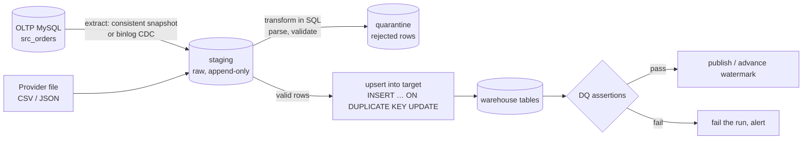

## Introduction

[Data Warehousing Fundamentals](/lessons/m13-data-warehousing) built a star schema in one shot from the shop tables. Real pipelines never get to do that once: new orders arrive every second, statuses change, a payment provider sends a file with amounts formatted as `"1,299.00"` and dates as `03/05/2024`, a job crashes halfway and is restarted, and on Monday morning the CFO asks why the dashboard shows 3% less revenue than the finance system.

**ETL** (extract, transform, load) and **ELT** (extract, load, transform) are the two families of pipelines that keep analytical data in step with operational sources. This lesson implements the core mechanics in MySQL, all of which transfer to any SQL engine and orchestration tool:

- **staging** raw data unchanged, then **transforming in SQL** set-wise, with a **quarantine** for rows that fail parsing;
- **idempotent loads** with `INSERT … ON DUPLICATE KEY UPDATE`, so a re-run never duplicates;
- **incremental loads** driven by a **watermark table**, and the **late-commit trap** that silently loses rows — demonstrated with real concurrent sessions;
- **change data capture (CDC)** from the binary log as the alternative to polling;
- **data-quality checks** as SQL assertions that fail the pipeline.

:::note[Dataset]
The lab uses the **shop** dataset as the "source system". The lesson adds `src_orders` (a copy of `orders` with an `updated_at` column, as most real OLTP tables have), raw staging tables, a target table `dw_orders`, and the pipeline's own bookkeeping tables (`etl_watermark`, `etl_run_log`, `dq_results`). All outputs are captured from a real server.
:::

## DBMS Theory

:::theory[Pipelines as functions over database states]
A pipeline maps a source state S to a target state T = f(S). Three properties make that mapping trustworthy:

- **Correctness**: T equals what a full recomputation from a consistent snapshot of S would produce — no missing, duplicated or stale rows.
- **Idempotency**: applying the same batch twice leaves T unchanged: f(f(T, Δ), Δ) = f(T, Δ). This is what makes retries safe.
- **Incrementality**: processing only the change Δ since the last run, so cost is proportional to change volume rather than total volume.

Incremental extraction needs a way to identify Δ. The options, in increasing order of reliability: a **timestamp/sequence watermark** (`updated_at > last_value`), **trigger-maintained change tables**, and **log-based CDC**, which reads the database's own commit log — in MySQL, the row-based binary log.
:::

| Term | Meaning |
|---|---|
| **ETL** | Transform in a separate engine (an ETL server, Spark, Python) before loading the warehouse |
| **ELT** | Load raw data into the target first, transform with SQL inside the target engine |
| **Staging** | Tables holding extracted data as-is (often all text), with load metadata (batch id, load time, source file) |
| **Watermark** | The highest change marker (timestamp, id, binlog position) already processed |
| **Upsert** | Insert-or-update keyed on a natural/business key (`MERGE` in standard SQL; `INSERT … ON DUPLICATE KEY UPDATE` in MySQL) |
| **CDC** | Capturing committed inserts/updates/deletes as an ordered stream of change events |
| **Data-quality (DQ) check** | An assertion over the data (completeness, uniqueness, validity, referential integrity, freshness, reconciliation) |

:::standard[MERGE vs MySQL]
SQL:2003 defines `MERGE INTO target USING source ON … WHEN MATCHED THEN UPDATE … WHEN NOT MATCHED THEN INSERT …`. **MySQL has no `MERGE`**; the equivalent is `INSERT … ON DUPLICATE KEY UPDATE` (keyed on a PRIMARY KEY or UNIQUE index), plus a separate `DELETE` for rows that should disappear. `REPLACE INTO` also exists but is a delete-then-insert, which fires delete triggers, changes `AUTO_INCREMENT` values and cascades foreign keys — usually not what a pipeline wants.
:::

## Why It Exists

Without a disciplined pipeline:

- **Reports run on the OLTP database** and compete with customers (see [OLTP vs OLAP Workloads](/lessons/m12-oltp-olap)).
- **Full reloads every night** take longer as data grows, until they no longer fit in the night; during the reload, the warehouse is empty or inconsistent.
- **Scripts that are not idempotent** duplicate rows when a job is retried after a timeout — the most common cause of "revenue doubled overnight" incidents.
- **Bad input is either loaded or crashes the job.** One malformed amount in a 2-million-row file should not stop the load, and must not become a zero.
- **Silent loss** — incremental logic that misses late-committing rows or deletes — produces numbers that are wrong by a little, which is worse than wrong by a lot, because nobody notices.

ETL/ELT practice exists to make data movement **repeatable, incremental, idempotent and verified**.

**ETL vs ELT — why ELT became the default.** When warehouses were expensive and limited (on-premise appliances), transformations ran in separate ETL tools to save warehouse capacity. Cloud warehouses separate storage from compute and run SQL at scale, so modern stacks **load raw data first** (keeping it for replay and audit) and transform it **in SQL** inside the warehouse, often with tools such as dbt. In both cases, the mechanics below are the same; only *where* the SQL runs changes.

## Internal Working

:::internals[What MySQL provides to a pipeline]
- **Consistent extraction.** `START TRANSACTION WITH CONSISTENT SNAPSHOT` opens an InnoDB read view immediately; every `SELECT` in that transaction sees the database as of that instant ([MVCC](/lessons/m08-mvcc)), so a multi-table extract is mutually consistent without locking writers. `mysqldump --single-transaction` relies on the same mechanism.
- **Visibility is by commit, not by timestamp.** A row with `updated_at = 10:00` written by a transaction that commits at 10:07 is invisible to any reader until 10:07. A watermark that jumped past 10:00 at 10:05 will never look back — the late-commit trap demonstrated below.
- **Upserts.** `INSERT … ON DUPLICATE KEY UPDATE` attempts the insert; on a duplicate-key conflict on the PRIMARY KEY or a UNIQUE index, it updates the existing row instead. The affected-rows count is 1 per inserted row, 2 per updated row, 0 if the row already had the same values. Since 8.0.19, `INSERT … VALUES (…) AS new` names the incoming row, and for `INSERT … SELECT` a derived table (`SELECT * FROM (…) AS new`) plays that role; the older `VALUES(col)` function is deprecated.
- **Binary log.** With `binlog_format = ROW` (the default) and `binlog_row_image = FULL`, every committed row change is written with before/after images in commit order. CDC tools read it as a replica would — the basis of [Event-Driven Database Considerations](/lessons/m13-event-driven).
- **Errors as control flow.** `SIGNAL SQLSTATE '45000'` raises a user-defined error from a stored procedure, which an orchestrator sees as a failed step.
:::



## MySQL Implementation

Create the source table with an `updated_at` column (maintained automatically by MySQL on every update), the target, and the pipeline's bookkeeping:

```sql run
CREATE TABLE src_orders (
  order_id    INT UNSIGNED PRIMARY KEY,
  customer_id INT UNSIGNED NOT NULL,
  order_date  DATETIME NOT NULL,
  status      VARCHAR(10) NOT NULL,
  updated_at  DATETIME NOT NULL DEFAULT CURRENT_TIMESTAMP ON UPDATE CURRENT_TIMESTAMP,
  KEY idx_src_orders_updated (updated_at, order_id)
);
INSERT INTO src_orders (order_id, customer_id, order_date, status, updated_at)
SELECT order_id, customer_id, order_date, status, COALESCE(shipped_at, order_date) FROM orders;
CREATE TABLE dw_orders (
  order_id    INT UNSIGNED PRIMARY KEY,
  customer_id INT UNSIGNED NOT NULL,
  order_date  DATETIME NOT NULL,
  status      VARCHAR(10) NOT NULL,
  source_updated_at DATETIME NOT NULL,
  loaded_batch INT UNSIGNED NOT NULL
);
CREATE TABLE etl_watermark (
  pipeline       VARCHAR(40) PRIMARY KEY,
  last_updated_at DATETIME NOT NULL,
  last_order_id  INT UNSIGNED NOT NULL
);
CREATE TABLE etl_run_log (
  batch_id     INT UNSIGNED PRIMARY KEY,
  pipeline     VARCHAR(40) NOT NULL,
  rows_read    INT UNSIGNED NOT NULL,
  watermark_to DATETIME NOT NULL,
  status       VARCHAR(10) NOT NULL
);
INSERT INTO etl_watermark VALUES ('orders', '1970-01-01 00:00:00', 0);
SELECT COUNT(*) AS source_rows, MIN(updated_at) AS oldest_change, MAX(updated_at) AS newest_change FROM src_orders;
```

**Run 1 — the initial (full) load** is simply an incremental load from the zero watermark. The extract, the upsert and the watermark advance happen in **one transaction**, so a crash leaves either the old state or the new state, never "rows loaded but watermark not moved" (which a re-run would handle anyway, thanks to idempotency):

```sql run
START TRANSACTION;
SELECT last_updated_at, last_order_id INTO @wm_ts, @wm_id FROM etl_watermark WHERE pipeline = 'orders' FOR UPDATE;
INSERT INTO dw_orders (order_id, customer_id, order_date, status, source_updated_at, loaded_batch)
SELECT * FROM (
  SELECT order_id, customer_id, order_date, status, updated_at AS source_updated_at, 1 AS loaded_batch
  FROM src_orders
  WHERE updated_at > @wm_ts OR (updated_at = @wm_ts AND order_id > @wm_id)
) AS new
ON DUPLICATE KEY UPDATE status = new.status, source_updated_at = new.source_updated_at, loaded_batch = new.loaded_batch;
SELECT MAX(updated_at), MAX(order_id) INTO @new_ts, @dummy FROM src_orders WHERE updated_at > @wm_ts OR (updated_at = @wm_ts AND order_id > @wm_id);
SELECT MAX(order_id) INTO @new_id FROM src_orders WHERE updated_at = @new_ts;
UPDATE etl_watermark SET last_updated_at = @new_ts, last_order_id = @new_id WHERE pipeline = 'orders';
INSERT INTO etl_run_log VALUES (1, 'orders', (SELECT COUNT(*) FROM dw_orders WHERE loaded_batch = 1), @new_ts, 'ok');
COMMIT;
SELECT * FROM etl_watermark;
SELECT batch_id, rows_read, watermark_to, status FROM etl_run_log;
```

The watermark is a **pair** `(updated_at, order_id)`. A timestamp alone is ambiguous when several rows share it; the pair defines a strict total order, so "after the watermark" is unambiguous. Logically the condition is the row-constructor comparison `(updated_at, order_id) > (@wm_ts, @wm_id)`; the statements spell it out as `updated_at > @wm_ts OR (updated_at = @wm_ts AND order_id > @wm_id)` because, as Performance Analysis shows, MySQL's range optimizer handles the expanded form but not the row-constructor inequality. The `SELECT … FOR UPDATE` on the watermark row also serializes two instances of the job that start at the same time.

## Syntax Breakdown

| Construct | Purpose in a pipeline |
|---|---|
| `START TRANSACTION WITH CONSISTENT SNAPSHOT` | Consistent multi-table extract without blocking writers |
| `SELECT … INTO @var` | Read the watermark into session variables |
| `SELECT … FOR UPDATE` on the watermark row | Prevent two concurrent runs of the same pipeline |
| `(a, b) > (x, y)` | Row-constructor comparison: lexicographic order for composite watermarks (logically correct, but not range-optimized for `<`/`>` — expand it to `a > x OR (a = x AND b > y)` on large tables) |
| `INSERT … SELECT * FROM (SELECT …) AS new ON DUPLICATE KEY UPDATE col = new.col` | Idempotent upsert from a query; the derived table names the incoming row (for `VALUES` rows, 8.0.19+ uses `VALUES (…) AS new`) |
| `DEFAULT CURRENT_TIMESTAMP ON UPDATE CURRENT_TIMESTAMP` | Source-side change timestamp maintained by MySQL |
| `STR_TO_DATE(text, format)` | Parse dates from text (returns NULL with a warning if the text does not match) |
| `REGEXP` | Validate text before casting |
| `SIGNAL SQLSTATE '45000' SET MESSAGE_TEXT = …` | Fail a DQ assertion inside a stored procedure |
| `CREATE EVENT … ON SCHEDULE …` | In-database scheduling (the event scheduler is OFF in the lab; production pipelines usually use an external orchestrator such as Airflow, Dagster or cron) |

## Practical Examples

### 1. ELT: stage raw text, transform in SQL, quarantine bad rows

A payment provider delivers a settlement file. Load it **as text** into staging — nothing can fail at this step — and keep the batch id:

```sql run
CREATE TABLE stg_settlements (
  batch_id   INT UNSIGNED NOT NULL,
  line_no    INT UNSIGNED NOT NULL,
  raw_order  VARCHAR(20),
  raw_amount VARCHAR(20),
  raw_date   VARCHAR(30),
  raw_status VARCHAR(20),
  PRIMARY KEY (batch_id, line_no)
);
INSERT INTO stg_settlements VALUES
  (7, 1, '1',   '1,299.00', '2024-12-02 10:00', 'SETTLED'),
  (7, 2, '2',   '394.97',   '12/02/2024',       'settled'),
  (7, 3, '3',   'N/A',      '2024-12-02 10:05', 'SETTLED'),
  (7, 4, 'abc', '10.00',    '2024-12-02 10:06', 'SETTLED'),
  (7, 5, '5',   '89.99',    'yesterday',        'SETTLED'),
  (7, 6, '6',   '-15.00',   '2024-12-02 10:09', 'REVERSED');
SELECT * FROM stg_settlements ORDER BY line_no;
```

Transform set-wise: validate each field with a pattern **before** converting it, so that conversion functions never see bad input (in an `INSERT`, strict SQL mode turns conversion warnings into errors and would abort the whole statement):

```sql run
CREATE TABLE settlements (
  order_id   INT UNSIGNED NOT NULL,
  amount     DECIMAL(10,2) NOT NULL,
  settled_at DATETIME NOT NULL,
  status     VARCHAR(10) NOT NULL,
  batch_id   INT UNSIGNED NOT NULL,
  PRIMARY KEY (order_id, batch_id)
);
CREATE TABLE stg_quarantine (batch_id INT UNSIGNED, line_no INT UNSIGNED, reason VARCHAR(100), PRIMARY KEY (batch_id, line_no));
CREATE VIEW v_settlements_parsed AS
SELECT batch_id, line_no,
       CASE WHEN raw_order REGEXP '^[0-9]+$' THEN CAST(raw_order AS UNSIGNED) END AS order_id,
       CASE WHEN REPLACE(raw_amount, ',', '') REGEXP '^-?[0-9]+(\\.[0-9]{1,2})?$'
            THEN CAST(REPLACE(raw_amount, ',', '') AS DECIMAL(10,2)) END AS amount,
       CASE WHEN raw_date REGEXP '^[0-9]{4}-[0-9]{2}-[0-9]{2} [0-9]{2}:[0-9]{2}$' THEN STR_TO_DATE(raw_date, '%Y-%m-%d %H:%i')
            WHEN raw_date REGEXP '^[0-9]{2}/[0-9]{2}/[0-9]{4}$'                     THEN STR_TO_DATE(raw_date, '%m/%d/%Y')
       END AS settled_at,
       LOWER(raw_status) AS status
FROM stg_settlements;
INSERT INTO stg_quarantine
SELECT batch_id, line_no,
       CONCAT_WS('; ', IF(order_id IS NULL, 'bad order id', NULL), IF(amount IS NULL, 'bad amount', NULL),
                       IF(settled_at IS NULL, 'bad date', NULL))
FROM v_settlements_parsed
WHERE batch_id = 7 AND (order_id IS NULL OR amount IS NULL OR settled_at IS NULL);
INSERT INTO settlements (order_id, amount, settled_at, status, batch_id)
SELECT order_id, amount, settled_at, status, batch_id
FROM v_settlements_parsed
WHERE batch_id = 7 AND order_id IS NOT NULL AND amount IS NOT NULL AND settled_at IS NOT NULL;
SELECT * FROM settlements ORDER BY order_id;
SELECT * FROM stg_quarantine ORDER BY line_no;
```

Three lines were loaded (thousands separator removed, two date formats normalized, status lower-cased), three were quarantined with a reason — none silently became 0 or NULL in the target. The view is the **transformation logic as code**: reviewable, testable, and re-runnable for any batch.

### 2. Idempotency: run the same batch twice

```sql run
INSERT INTO settlements (order_id, amount, settled_at, status, batch_id)
SELECT * FROM (
  SELECT order_id, amount, settled_at, status, batch_id
  FROM v_settlements_parsed
  WHERE batch_id = 7 AND order_id IS NOT NULL AND amount IS NOT NULL AND settled_at IS NOT NULL
) AS new
ON DUPLICATE KEY UPDATE amount = new.amount, settled_at = new.settled_at, status = new.status;
SELECT COUNT(*) AS settlement_rows FROM settlements;
```

The retry reports **0 affected rows** — every row already existed with identical values — and the table still has three rows. Without the key and the upsert, a retry after a network timeout would have doubled the settled amount. (The primary key `(order_id, batch_id)` defines what "the same fact" means; choosing that key is a design decision, not a technicality.)

### 3. Run 2 — an incremental load

Simulate activity in the source since run 1: a new order arrives and an existing order changes status. Explicit timestamps keep the capture deterministic:

```sql run
INSERT INTO src_orders (order_id, customer_id, order_date, status, updated_at)
VALUES (81, 3, '2024-12-30 09:00:00', 'pending', '2024-12-30 09:00:00');
UPDATE src_orders SET status = 'delivered', updated_at = '2024-12-30 09:30:00' WHERE order_id = 69;
SELECT order_id, status, updated_at FROM src_orders
WHERE (updated_at, order_id) > (SELECT last_updated_at, last_order_id FROM etl_watermark WHERE pipeline = 'orders')
ORDER BY updated_at, order_id;
```

Only the two changed rows are after the watermark. The same load statement as run 1 processes exactly them:

```sql run
START TRANSACTION;
SELECT last_updated_at, last_order_id INTO @wm_ts, @wm_id FROM etl_watermark WHERE pipeline = 'orders' FOR UPDATE;
INSERT INTO dw_orders (order_id, customer_id, order_date, status, source_updated_at, loaded_batch)
SELECT * FROM (
  SELECT order_id, customer_id, order_date, status, updated_at AS source_updated_at, 2 AS loaded_batch
  FROM src_orders
  WHERE updated_at > @wm_ts OR (updated_at = @wm_ts AND order_id > @wm_id)
) AS new
ON DUPLICATE KEY UPDATE status = new.status, source_updated_at = new.source_updated_at, loaded_batch = new.loaded_batch;
SELECT MAX(updated_at) INTO @new_ts FROM src_orders WHERE updated_at > @wm_ts OR (updated_at = @wm_ts AND order_id > @wm_id);
SELECT MAX(order_id) INTO @new_id FROM src_orders WHERE updated_at = @new_ts;
UPDATE etl_watermark SET last_updated_at = @new_ts, last_order_id = @new_id WHERE pipeline = 'orders';
INSERT INTO etl_run_log VALUES (2, 'orders', (SELECT COUNT(*) FROM dw_orders WHERE loaded_batch = 2), @new_ts, 'ok');
COMMIT;
SELECT order_id, status, source_updated_at, loaded_batch FROM dw_orders WHERE loaded_batch = 2 ORDER BY order_id;
SELECT batch_id, rows_read, watermark_to, status FROM etl_run_log ORDER BY batch_id;
```

### 4. Data-quality checks as SQL assertions

A DQ check is a query that returns **violations** (ideally zero rows/zero count). Record every result, and stop the pipeline when a blocking check fails:

```sql run
CREATE TABLE dq_results (
  batch_id INT UNSIGNED NOT NULL, check_name VARCHAR(64) NOT NULL, failures INT NOT NULL,
  severity VARCHAR(8) NOT NULL, PRIMARY KEY (batch_id, check_name)
);
INSERT INTO dq_results
SELECT 2, 'dw_rowcount_matches_source',
       ABS((SELECT COUNT(*) FROM dw_orders) - (SELECT COUNT(*) FROM src_orders)), 'block'
UNION ALL
SELECT 2, 'no_unknown_customers',
       (SELECT COUNT(*) FROM dw_orders d LEFT JOIN customers c ON c.customer_id = d.customer_id WHERE c.customer_id IS NULL), 'block'
UNION ALL
SELECT 2, 'status_in_domain',
       (SELECT COUNT(*) FROM dw_orders WHERE status NOT IN ('pending','paid','shipped','delivered','cancelled','refunded')), 'block'
UNION ALL
SELECT 2, 'settlement_amount_nonnegative',
       (SELECT COUNT(*) FROM settlements WHERE amount < 0), 'warn'
UNION ALL
SELECT 2, 'quarantine_rate_under_10pct',
       (SELECT IF(COUNT(*) / (SELECT COUNT(*) FROM stg_settlements WHERE batch_id = 7) > 0.10, COUNT(*), 0)
          FROM stg_quarantine WHERE batch_id = 7), 'warn';
SELECT check_name, failures, severity, IF(failures = 0, 'PASS', 'FAIL') AS result FROM dq_results WHERE batch_id = 2 ORDER BY check_name;
```

Turn a blocking failure into a pipeline failure with `SIGNAL`:

```sql run
CREATE PROCEDURE dq_gate(IN p_batch INT)
BEGIN
  DECLARE n_fail INT;
  SELECT COUNT(*) INTO n_fail FROM dq_results WHERE batch_id = p_batch AND severity = 'block' AND failures > 0;
  IF n_fail > 0 THEN
    SET @dq_msg = CONCAT('Batch ', p_batch, ': ', n_fail, ' blocking data-quality check(s) failed');
    SIGNAL SQLSTATE '45000' SET MESSAGE_TEXT = @dq_msg;
  END IF;
END;
CALL dq_gate(2);
SELECT 'batch 2 passed the gate' AS gate;
```

The gate passed: the blocking checks are clean and the two warnings are recorded but do not block (the negative amount is a legitimate reversal, the high quarantine rate needs a human). Now inject a defect — an order with an unknown customer — and re-check:

```sql run error
INSERT INTO dw_orders VALUES (9001, 999, '2024-12-31 00:00:00', 'paid', '2024-12-31 00:00:00', 3);
INSERT INTO dq_results
SELECT 3, 'no_unknown_customers',
       (SELECT COUNT(*) FROM dw_orders d LEFT JOIN customers c ON c.customer_id = d.customer_id WHERE c.customer_id IS NULL), 'block';
CALL dq_gate(3);
```

The `CALL` fails with error 1644 and a readable message — an orchestrator marks the step failed, does not publish batch 3, and alerts the owner.

## Execution Walkthrough

The most dangerous bug in watermark-based extraction is invisible in single-session tests. A source transaction stamps a row with `updated_at = 10:00` but commits **after** the pipeline has already advanced its watermark past 10:00. Replay it with three real sessions: **A** is the slow application transaction, **B** a fast one, **C** the ETL job.

```concurrency
title: The late-commit trap in timestamp watermarks
description: Session A writes a row stamped 10:00 but commits late; the ETL job (C) advances its watermark to 10:05 in between and never sees A's row — unless it re-reads an overlap window.
setup: |
  CREATE TABLE src_events (event_id INT PRIMARY KEY, updated_at DATETIME NOT NULL, KEY (updated_at));
  CREATE TABLE etl_wm (pipeline VARCHAR(20) PRIMARY KEY, last_ts DATETIME NOT NULL);
  INSERT INTO etl_wm VALUES ('events', '2024-12-31 09:00:00');
steps:
  - session: A
    sql: START TRANSACTION; INSERT INTO src_events VALUES (101, '2024-12-31 10:00:00');
    note: A long-running application transaction stamps its row 10:00 (when it started) but has not committed.
  - session: B
    sql: INSERT INTO src_events VALUES (102, '2024-12-31 10:05:00');
    note: B commits immediately (autocommit).
  - session: C
    sql: SELECT event_id, updated_at FROM src_events WHERE updated_at > (SELECT last_ts FROM etl_wm WHERE pipeline = 'events') ORDER BY event_id;
    note: The ETL job sees only 102 — A's row is uncommitted and therefore invisible (MVCC), even though its timestamp is older.
  - session: C
    sql: UPDATE etl_wm SET last_ts = (SELECT MAX(updated_at) FROM src_events) WHERE pipeline = 'events'; SELECT last_ts FROM etl_wm;
    note: The job advances the watermark to the maximum timestamp it saw, 10:05.
  - session: A
    sql: COMMIT;
    note: A's row (stamped 10:00) becomes visible now — behind the watermark.
  - session: C
    sql: SELECT event_id, updated_at FROM src_events WHERE updated_at > (SELECT last_ts FROM etl_wm WHERE pipeline = 'events') ORDER BY event_id;
    note: The next incremental run finds nothing. Row 101 will never be extracted — silent data loss.
  - session: C
    sql: SELECT event_id, updated_at FROM src_events WHERE updated_at > (SELECT last_ts - INTERVAL 15 MINUTE FROM etl_wm WHERE pipeline = 'events') ORDER BY event_id;
    note: Mitigation — re-read an overlap ("lookback") window larger than the longest expected transaction, and rely on an idempotent upsert to absorb the rows read twice (102 here). Log-based CDC avoids the problem entirely, because the binlog is ordered by commit.
```

## Output

After two runs, the target matches the source and the bookkeeping tells the story of each run:

```sql run
SELECT (SELECT COUNT(*) FROM src_orders)                                       AS source_rows,
       (SELECT COUNT(*) FROM dw_orders WHERE order_id < 9000)                  AS target_rows,
       (SELECT COUNT(*) FROM src_orders s JOIN dw_orders d USING (order_id)
         WHERE s.status <> d.status OR s.updated_at <> d.source_updated_at)    AS mismatched_rows;
SELECT pipeline, last_updated_at, last_order_id FROM etl_watermark;
```

`mismatched_rows = 0` is a **reconciliation** result: the incremental pipeline reproduced what a full reload would have produced. The concurrency scenario shows why that equality must be *checked* periodically rather than assumed: a timestamp watermark can be wrong without any error ever being raised.

## Alternative Approaches

| Change detection | How | Catches deletes? | Late commits? | Source load | Notes |
|---|---|---|---|---|---|
| Full reload | Truncate and reload everything | Yes | Yes | High | Simple and correct; cost grows with total size |
| Timestamp watermark | `updated_at > last` | No (unless soft deletes) | **Misses** them without a lookback window | Low with an index | Requires every writer to maintain `updated_at` |
| Composite watermark `(updated_at, id)` | Row-constructor comparison | No | Same issue | Low | Fixes ties, not late commits |
| Monotonic sequence/version column | `change_seq > last` set from a sequence at commit | No | Still depends on assignment time | Low | Needs a source-side design |
| Trigger-based change table | Triggers write changes to a log table | Yes | Ordered by insert into the log | Extra write per change | Couples pipeline to source schema; trigger overhead |
| **Log-based CDC** (binlog → Debezium → Kafka) | Read row events from the binary log | Yes | **Yes** (commit order) | Very low (reads a log) | Operational complexity; schema-change handling; initial snapshot needed |
| Snapshot diff | Compare full extracts (hash per row) | Yes | Yes | High | Useful for reconciliation, not as the main feed |

Log-based CDC is shown display-only — it needs replication privileges and a running connector. A minimal Debezium MySQL connector configuration looks like this (illustrative; see the Debezium documentation for the full property list):

```json
{
  "name": "shop-orders-cdc",
  "config": {
    "connector.class": "io.debezium.connector.mysql.MySqlConnector",
    "database.hostname": "mysql-primary.internal",
    "database.port": "3306",
    "database.user": "cdc_reader",
    "database.server.id": "5401",
    "topic.prefix": "shop",
    "table.include.list": "shop.orders,shop.order_items",
    "snapshot.mode": "initial"
  }
}
```

The connector account needs `REPLICATION SLAVE`/`REPLICATION CLIENT` (named `REPLICATION REPLICA` in newer terminology) and `SELECT`; the server needs `binlog_format = ROW` and `binlog_row_image = FULL`. Each change event carries the before/after row and the binlog position, which becomes the pipeline's watermark.

## Performance Analysis

- **Index the watermark column(s) — and write the predicate so the index can be ranged.** The composite index `idx_src_orders_updated (updated_at, order_id)` exists, yet the row-constructor form is executed as a full index scan (`type = index`, every entry read), while the logically identical expanded form is a `range` scan that starts at the watermark:

```sql run
EXPLAIN SELECT order_id FROM src_orders WHERE (updated_at, order_id) > ('2024-12-24 00:00:00', 17);
EXPLAIN SELECT order_id FROM src_orders
WHERE updated_at > '2024-12-24 00:00:00' OR (updated_at = '2024-12-24 00:00:00' AND order_id > 17);
```

  On 81 rows the difference is invisible; on a 40-million-row source it is the difference between reading the few thousand changed rows and reading the whole index every 15 minutes — an "incremental" pipeline that costs as much as a full load. (The manual documents range optimization of row constructors for `IN` lists of tuples; as the plan shows, the `>` form is not range-optimized on this server.)

- **Batch size and transaction size.** One giant `INSERT … SELECT` of 50 million rows holds locks, generates huge undo and redo, and replicates as one enormous transaction (replica lag). Load in chunks (by watermark ranges) of thousands to hundreds of thousands of rows, committing each with its watermark advance.
- **Extraction on replicas.** Run extracts against a read replica, but remember that the replica's `updated_at` values are those of the primary while its visibility lags — the late-commit problem gets *worse*, so the lookback window must cover replica lag too.
- **Upsert cost.** `ON DUPLICATE KEY UPDATE` performs an index lookup per row and locks the affected index records; on large loads into an empty target, a plain `INSERT` (or a load into a new table followed by an atomic `RENAME TABLE` swap) is faster.
- **Transform where the compute is.** In ELT the SQL runs in the target warehouse; in MySQL-based marts, heavy transformations compete with report queries, so schedule them or run them on a separate instance.

## Best Practices

:::best-practice[Pipelines that can be trusted]
1. **Stage raw data unchanged** (with batch id, source and load time) so any transformation can be replayed and audited.
2. **Make every load idempotent**: upserts keyed on a business key, or replace-a-partition semantics; a retry must be harmless.
3. **Advance the watermark in the same transaction** as the data it covers; use a composite watermark for ties and an overlap window (or CDC) for late commits.
4. **Validate before converting**; quarantine bad rows with a reason instead of failing the batch or silently coercing values.
5. **Assert data quality in SQL**: completeness (row counts), uniqueness, validity (domains), referential integrity, freshness (`MAX(updated_at)` recent), reconciliation with an independent total. Distinguish blocking checks from warnings and record every result.
6. **Handle deletes explicitly**: soft deletes (`deleted_at`) in the source, CDC, or periodic full-key reconciliation.
7. **Prefer log-based CDC** for high-volume or correctness-critical feeds; prefer simple full reloads for small tables.
:::

## Common Mistakes

**Mistake 1 — a non-idempotent load.** A plain `INSERT … SELECT` without a key re-inserts on retry. With a key but without the upsert, the retry fails instead:

```sql run error
INSERT INTO settlements (order_id, amount, settled_at, status, batch_id)
SELECT order_id, amount, settled_at, status, batch_id FROM v_settlements_parsed
WHERE batch_id = 7 AND order_id IS NOT NULL AND amount IS NOT NULL AND settled_at IS NOT NULL;
```

Failing is better than duplicating, but neither is a retry-safe pipeline. Use the upsert from Practical Example 2.

**Mistake 2 — converting before validating.** Inside an `INSERT`, strict SQL mode turns a conversion warning into an error, so one bad value aborts the whole batch:

```sql run error
INSERT INTO settlements (order_id, amount, settled_at, status, batch_id)
SELECT CAST(raw_order AS UNSIGNED), CAST(REPLACE(raw_amount, ',', '') AS DECIMAL(10,2)),
       STR_TO_DATE(raw_date, '%Y-%m-%d %H:%i'), LOWER(raw_status), 8
FROM stg_settlements WHERE batch_id = 7;
```

Outside strict mode (or in a `SELECT`), the same expressions would silently produce `0` and `NULL` instead — worse.

**Mistake 3 — `updated_at > watermark` with a timestamp-only watermark and `>=` "to be safe".** `>` drops rows that share the watermark timestamp but were committed after the previous run; `>=` re-reads them every time. Use the composite `(updated_at, id)` watermark plus an idempotent upsert.

**Mistake 4 — advancing the watermark to `NOW()`.** Setting the watermark to the job's clock instead of the maximum *extracted* value skips rows stamped between the extract and `NOW()`, and breaks if clocks differ between servers.

**Mistake 5 — trusting `updated_at` maintained by the application.** One code path or a manual `UPDATE` in the console that forgets to set it makes changes invisible to the pipeline. `ON UPDATE CURRENT_TIMESTAMP` in the DDL (as in `src_orders`) or CDC removes the dependency on application discipline.

## Industry Application

- **Modern data stacks**: managed extract-and-load tools (Fivetran, Airbyte, AWS DMS and others) read MySQL via binlog CDC or watermark queries into a cloud warehouse; transformations are SQL models in dbt with tests (`unique`, `not_null`, `relationships`, `accepted_values`) — the same DQ assertions as above, generated from metadata.
- **Orchestration**: Airflow, Dagster or Prefect schedule runs, retry failed steps (which is why idempotency is mandatory), and record lineage; failing DQ checks block downstream tasks.
- **Finance and billing** pipelines reconcile warehouse totals against ledgers every run and alert on any difference; quarantine tables feed operations teams.
- **Streaming ELT**: Debezium streams MySQL changes to Kafka; stream processors (Flink, Kafka Streams) or warehouse ingestion services apply them continuously, with the binlog position as the watermark.
- **Data contracts**: producers publish the schema and semantics of the tables or events they expose, so a source schema change cannot silently break downstream pipelines ([Schema Evolution and Migrations](/lessons/m12-schema-evolution)).

## Practice Exercises

````exercise
id: ex1
title: What is after the watermark?
difficulty: easy
concepts: [watermark, incremental-load]
setup: |
  CREATE TABLE src_orders (order_id INT UNSIGNED PRIMARY KEY, status VARCHAR(10) NOT NULL, updated_at DATETIME NOT NULL);
  INSERT INTO src_orders VALUES (1, 'paid', '2024-12-01 10:00:00'), (2, 'paid', '2024-12-01 10:00:00'),
    (3, 'shipped', '2024-12-01 10:00:00'), (4, 'pending', '2024-12-01 10:02:00'), (5, 'paid', '2024-11-30 23:59:00');
  CREATE TABLE etl_watermark (pipeline VARCHAR(40) PRIMARY KEY, last_updated_at DATETIME NOT NULL, last_order_id INT UNSIGNED NOT NULL);
  INSERT INTO etl_watermark VALUES ('orders', '2024-12-01 10:00:00', 2);
prompt: |
  The composite watermark for pipeline `orders` is `(last_updated_at, last_order_id)`. Return the
  `order_id`s of the rows in `src_orders` that the next incremental run must extract, i.e. strictly after the
  watermark in `(updated_at, order_id)` order. Column: `order_id`.
hints:
  - "Use a row constructor: (updated_at, order_id) > (watermark_ts, watermark_id)."
  - "Rows with the same timestamp but a larger id are after the watermark."
solution: |
  SELECT s.order_id
  FROM src_orders s
  JOIN etl_watermark w ON w.pipeline = 'orders'
  WHERE (s.updated_at, s.order_id) > (w.last_updated_at, w.last_order_id);
explanation: |
  Orders 3 and 4 qualify: order 3 shares the 10:00 timestamp but has a larger id than the watermark's 2.
  On a large table, write the same condition as
  `updated_at > w.last_updated_at OR (updated_at = w.last_updated_at AND order_id > w.last_order_id)` so the
  range optimizer can use an index on `(updated_at, order_id)`.
  A timestamp-only `updated_at > '10:00'` would miss order 3; `updated_at >= '10:00'` would re-read 1 and 2.
  Order 5 is older than the watermark and was processed before.
````

````exercise
id: ex2
title: An idempotent upsert
difficulty: medium
kind: dml
concepts: [upsert, idempotency]
setup: |
  CREATE TABLE dw_orders (order_id INT UNSIGNED PRIMARY KEY, status VARCHAR(10) NOT NULL, source_updated_at DATETIME NOT NULL);
  INSERT INTO dw_orders VALUES (1, 'paid', '2024-12-01 09:00:00'), (2, 'paid', '2024-12-01 09:00:00');
  CREATE TABLE stg_orders (order_id INT UNSIGNED PRIMARY KEY, status VARCHAR(10) NOT NULL, updated_at DATETIME NOT NULL);
  INSERT INTO stg_orders VALUES (2, 'shipped', '2024-12-02 08:00:00'), (3, 'pending', '2024-12-02 08:05:00');
prompt: |
  Apply the staged changes in `stg_orders` to `dw_orders` with **one statement** that inserts new orders
  and updates `status` and `source_updated_at` of existing ones. Running your statement twice must give the
  same result as running it once. The checker returns `dw_orders` ordered by `order_id`.
hints:
  - "INSERT INTO dw_orders (…) SELECT * FROM (SELECT … FROM stg_orders) AS new ON DUPLICATE KEY UPDATE …"
  - "Reference the incoming values as new.status and new.source_updated_at — alias the derived table's columns to those names."
solution: |
  INSERT INTO dw_orders (order_id, status, source_updated_at)
  SELECT * FROM (SELECT order_id, status, updated_at AS source_updated_at FROM stg_orders) AS new
  ON DUPLICATE KEY UPDATE status = new.status, source_updated_at = new.source_updated_at;
check: |
  SELECT order_id, status, source_updated_at FROM dw_orders ORDER BY order_id;
explanation: |
  Order 2 is updated, order 3 inserted, order 1 untouched. A second run finds identical values and changes
  nothing (0 affected rows). `REPLACE INTO` would also produce this table but deletes and re-inserts order 2,
  which fires delete triggers and cascades foreign keys. In MySQL before 8.0.19 you would write
  `VALUES(status)` instead of `new.status` (deprecated now).
````

````exercise
id: ex3
title: Data-quality report
difficulty: hard
concepts: [data-quality]
setup: |
  CREATE TABLE dw_orders (order_id INT UNSIGNED PRIMARY KEY, customer_id INT UNSIGNED, status VARCHAR(10), order_total DECIMAL(10,2));
  INSERT INTO dw_orders VALUES (1, 1, 'paid', 100.00), (2, 999, 'paid', 50.00), (3, 4, 'shiped', 20.00),
    (4, NULL, 'pending', 10.00), (5, 7, 'paid', -5.00), (6, 7, 'delivered', 75.00);
prompt: |
  Produce a data-quality report for `dw_orders` with one row per check and columns `check_name`,
  `failures` (number of violating rows):

  - `customer_not_null` — rows with NULL `customer_id`
  - `customer_exists` — rows whose non-NULL `customer_id` is not in `customers`
  - `status_valid` — rows whose `status` is not one of pending, paid, shipped, delivered, cancelled, refunded
  - `total_nonnegative` — rows with `order_total < 0`
hints:
  - "One SELECT per check, combined with UNION ALL."
  - "For customer_exists, use a LEFT JOIN to customers and count rows where the join found nothing but customer_id is not NULL — or NOT EXISTS."
solution: |
  SELECT 'customer_not_null' AS check_name, COUNT(*) AS failures FROM dw_orders WHERE customer_id IS NULL
  UNION ALL
  SELECT 'customer_exists', COUNT(*) FROM dw_orders d
   WHERE d.customer_id IS NOT NULL AND NOT EXISTS (SELECT 1 FROM customers c WHERE c.customer_id = d.customer_id)
  UNION ALL
  SELECT 'status_valid', COUNT(*) FROM dw_orders
   WHERE status NOT IN ('pending', 'paid', 'shipped', 'delivered', 'cancelled', 'refunded')
  UNION ALL
  SELECT 'total_nonnegative', COUNT(*) FROM dw_orders WHERE order_total < 0;
explanation: |
  Each check has exactly one failing row. Keeping "not null" and "exists" separate matters: a
  `NOT IN (SELECT customer_id FROM customers)` written naively would treat the NULL customer as unknown, not
  as a violation, and the two problems have different owners (ingestion vs. master data). Note that
  `status NOT IN (…)` would *not* count a NULL status — add `OR status IS NULL` if NULL is invalid.
````

````exercise
id: ex4
title: Choose the change-detection strategy
difficulty: challenge
kind: open
concepts: [change-data-capture, incremental-load, watermark]
prompt: |
  You must feed three MySQL tables into a warehouse every 15 minutes:

  1. `orders` (40 M rows, ~50,000 changes/day, has `updated_at` maintained by the application, hard deletes
     happen when fraud is detected);
  2. `countries` (250 rows, changes a few times a year);
  3. `payments_ledger` (append-only, 2 M inserts/day, monotonically increasing `ledger_id`, long-running
     batch transactions of up to 10 minutes from the billing system).

  Choose a change-detection strategy for each, justify it, and describe how you would verify correctness.
solution: |
  - **countries**: full reload each run (or daily) into a new table + atomic swap, or truncate-and-insert in
    one transaction. 250 rows make incremental logic pointless; full reload also catches deletes.
  - **orders**: log-based CDC (Debezium reading the row-based binlog). Reasons: hard deletes must be
    captured (a watermark cannot see them), application-maintained `updated_at` is not trustworthy (any
    path that forgets it hides changes), and CDC orders events by commit so late commits are not lost. If
    CDC is not available: composite `(updated_at, order_id)` watermark with an overlap window, a DDL-level
    `ON UPDATE CURRENT_TIMESTAMP`, plus a nightly key-set reconciliation to detect deletes.
  - **payments_ledger**: an id watermark (`ledger_id > last`) looks perfect for append-only data, but
    `AUTO_INCREMENT` ids are assigned at insert time, not commit time; a 10-minute billing transaction can
    commit low ids after higher ids were extracted. Use CDC, or keep a lookback window of ids/time larger than
    the longest transaction with an idempotent upsert keyed on `ledger_id`.
  - **Verification**: per-run row counts and sums by day compared with the source (reconciliation), freshness
    checks (`MAX(updated_at)` within 30 min), a periodic full-key diff for orders (deleted ids), duplicate checks
    on business keys, and monitoring of CDC lag (binlog position vs current).
````

## Knowledge Assessment

```quiz
- id: q1
  question: "What distinguishes ELT from ETL?"
  options:
    - "ELT does not transform data"
    - "ELT loads raw data into the target first and transforms it with SQL inside the target engine; ETL transforms in a separate engine before loading"
    - "ELT is only for streaming data"
    - "ETL cannot handle incremental loads"
  answer: 1
  explanation: "Both transform data; the difference is where. ELT became common because cloud warehouses can run large SQL transformations and keeping raw data enables replay. Both support batch, streaming and incremental loads."
  concepts: [etl, elt]
- id: q2
  question: "A job loads a batch, then the orchestrator times out and retries it. Which design makes the retry harmless?"
  options:
    - "A plain INSERT … SELECT"
    - "An upsert keyed on the business key (INSERT … ON DUPLICATE KEY UPDATE), with the watermark advanced in the same transaction"
    - "Increasing the orchestrator timeout"
    - "Using REPLACE INTO without a key"
  answer: 1
  explanation: "Idempotency comes from a key that defines 'the same fact' plus upsert semantics; advancing the watermark atomically avoids partial progress. A plain INSERT duplicates; longer timeouts only make retries rarer; REPLACE needs a key too and has delete side effects."
  concepts: [idempotency, upsert]
- id: q3
  question: "In the concurrency scenario, why was row 101 (updated_at 10:00) never extracted?"
  options:
    - "Its timestamp was invalid"
    - "It was uncommitted when the ETL job read the source and advanced the watermark to 10:05; after it committed it was behind the watermark"
    - "The ETL job used READ UNCOMMITTED"
    - "The index on updated_at was missing"
  answer: 1
  explanation: "Visibility depends on commit time, not on the row's timestamp. A watermark that jumps past an uncommitted row's timestamp never looks back. Mitigations: a lookback window with idempotent upserts, or log-based CDC ordered by commit. Isolation READ UNCOMMITTED would be wrong for other reasons; the index affects speed, not correctness."
  concepts: [watermark, incremental-load]
- id: q4
  question: "Why does the lesson use a composite watermark `(updated_at, order_id)` instead of `updated_at` alone?"
  options:
    - "To make the query faster"
    - "Because several rows can share a timestamp; the pair gives a strict total order, so 'after the watermark' neither skips nor re-reads rows with the same timestamp"
    - "Because MySQL cannot compare DATETIME values"
    - "To detect deletes"
  answer: 1
  explanation: "With updated_at alone, > skips same-timestamp rows not yet read and >= re-reads them. The composite order resolves ties. It does not solve late commits or deletes, and speed comes from the index."
  concepts: [watermark]
- id: q5
  question: "Which changes can a timestamp-watermark pipeline miss? (Select all that apply.)"
  type: multi
  options:
    - "Hard deletes"
    - "Rows whose transaction commits after the watermark passed their timestamp"
    - "Updates made by code paths that do not set updated_at"
    - "Inserts committed long before the run"
  answer: [0, 1, 2]
  explanation: "Deleted rows leave nothing to select, late commits fall behind the watermark, and changes without an updated_at bump are invisible. Inserts committed before the run with timestamps after the watermark are extracted normally."
  concepts: [change-data-capture, incremental-load]
- id: q6
  question: "A staging column contains 'N/A' where an amount is expected. What should the transformation do?"
  options:
    - "CAST it to DECIMAL, which yields 0.00"
    - "Validate the text first (e.g. with REGEXP), route the row to a quarantine table with a reason, and load the valid rows"
    - "Fail the whole batch"
    - "Store 'N/A' in the DECIMAL column"
  answer: 1
  explanation: "Coercing to 0 silently falsifies totals (and in an INSERT under strict mode the cast fails the statement). Failing the batch for one bad row stalls the pipeline. Quarantine keeps good data flowing and makes bad data visible. A DECIMAL column cannot hold 'N/A'."
  concepts: [data-quality, staging]
- id: q7
  question: "Which data-quality check detects that a warehouse load lost rows?"
  options:
    - "status_in_domain"
    - "A reconciliation check comparing row counts (and totals) between source and target"
    - "A NOT NULL check on customer_id"
    - "A uniqueness check on order_id"
  answer: 1
  explanation: "Only a comparison with an independent source of truth reveals missing rows. Domain, null and uniqueness checks validate the rows that are present, not the ones that are absent."
  concepts: [data-quality]
- id: q8
  question: "Why is log-based CDC (e.g. Debezium on the MySQL binlog) more reliable than polling with a watermark?"
  options:
    - "It is faster to set up"
    - "It reads committed row changes in commit order, including deletes, independently of application-maintained timestamps"
    - "It does not need any privileges"
    - "It avoids the need for an initial snapshot"
  answer: 1
  explanation: "The binlog records every committed change with before/after images in commit order. CDC needs replication privileges, more infrastructure, and an initial snapshot of existing data — its advantage is correctness, not simplicity."
  concepts: [change-data-capture]
```
