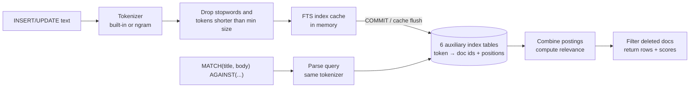

## Introduction

"Find help articles about resetting a password." "Show support tickets that mention *warranty*." "Search products by description." These are **text retrieval** problems, and B+ tree indexes cannot solve them: `WHERE body LIKE '%warranty%'` has a leading wildcard, so no ordered index on `body` helps, and every row must be read and scanned character by character ([SARGable Queries](/lessons/m07-sargable-queries)). It also has no notion of *how well* a document matches.

**Full-text search** answers a different question from `LIKE`: not "does this string contain these characters?" but "which documents are *about* these words, and in what order of relevance?" MySQL implements it with **`FULLTEXT` indexes** and the **`MATCH … AGAINST`** operator, in three modes:

- **Natural language mode** (default): ranks rows by statistical relevance of the search words.
- **Boolean mode**: operators such as `+required`, `-excluded`, `prefix*` and `"exact phrase"`.
- **Query expansion**: a two-pass "blind relevance feedback" search that adds words from the top results.

This lesson builds a small help-centre corpus, searches it in every mode, verifies the relevance formula against real scores, and examines the settings that silently change results: **stopwords**, **minimum token size** and the **ngram parser** for Chinese, Japanese and Korean text. It closes with an honest comparison with dedicated search engines.

:::note[Dataset]
The examples run in the **shop** lab but use their own tables: `help_articles` (16 hand-written help-centre articles) and `tickets` (100,000 generated support tickets for the performance comparison). Relevance numbers are captured from a real server and **depend on this corpus** — the same query over a different set of documents produces different scores.
:::

## DBMS Theory

:::theory[Information retrieval and the inverted index]
Information retrieval (IR) treats each document as a bag of **terms** (tokens). The core data structure is the **inverted index**: for every distinct term, a **postings list** of the documents (and positions) where it occurs.

```
password → {1: [pos 4, 11, 13], 14: [pos 0, 2]}
wireless → {7: [1], 16: [0, 9, 18]}
```

A query is answered by looking up each query term's postings and combining them — intersection for AND, union for OR, difference for NOT — instead of scanning documents. **Ranking** models assign each matching document a score. The classic family is **TF-IDF**: a term matters more when it is frequent *in the document* (term frequency, TF) and rare *in the collection* (inverse document frequency, IDF = log(N / n), where N is the number of documents and n the number containing the term). **BM25** refines TF-IDF with term-frequency saturation and document-length normalization.
:::

Key IR vocabulary used below:

| Term | Meaning |
|---|---|
| **Tokenization** | Splitting text into terms. MySQL's built-in parser splits on whitespace and punctuation; the **ngram** parser splits into fixed-length character sequences. |
| **Stopwords** | Very common words (*the*, *and*) excluded from the index because they carry little meaning. |
| **Stemming / lemmatization** | Reducing *passwords* → *password*, *refunded* → *refund*. **MySQL does not stem**; search engines usually do. |
| **Precision / recall** | Fraction of returned documents that are relevant / fraction of relevant documents that are returned. Query expansion trades precision for recall. |
| **Relevance feedback** | Using the top results to reformulate the query (query expansion). |

Full-text search is not part of core standard SQL (SQL/MM Full-Text exists but is rarely implemented). `MATCH … AGAINST` is MySQL-specific; PostgreSQL uses `tsvector`/`tsquery` with GIN indexes, SQL Server uses `CONTAINS`/`FREETEXT`.

## Why It Exists

Consider what an application without full-text search must do to implement a search box:

- **`LIKE '%word%'` on every text column**: a full scan per search, no ranking, and false positives such as `'%car%'` matching *card* and *scarf*.
- **Searching for several words** turns into `LIKE '%a%' AND LIKE '%b%'` — still scans, still unranked, and order-of-words or phrase logic becomes hand-written string code.
- **Exporting text to the application** and ranking there means moving the whole corpus over the network for each query.

A FULLTEXT index makes word lookup an index operation, supports word-level boolean logic and phrases, and returns a relevance score the database can sort by. For catalogue search, help centres, internal admin tools and moderate-size document stores, that is often enough — without adding a second system to operate.

## Internal Working

:::internals[How an InnoDB FULLTEXT index is built and maintained]
- **Hidden document id.** InnoDB identifies documents by a 64-bit `FTS_DOC_ID` column. If the table does not define one, the **first** `FULLTEXT` index added to an existing table adds a hidden `FTS_DOC_ID` and **rebuilds the table** (you will see warning 124 below). Defining `FTS_DOC_ID BIGINT UNSIGNED NOT NULL AUTO_INCREMENT` with a unique index `FTS_DOC_ID_INDEX` up front avoids that rebuild.
- **Auxiliary index tables.** The inverted index is stored in a set of hidden InnoDB tables, partitioned into **six index tables** by the first character of the token; each row holds a token and an encoded list of document ids and positions. Further auxiliary tables track deleted documents and configuration. (Administrators can inspect them via `INFORMATION_SCHEMA.INNODB_FT_*` tables, which need the `PROCESS` privilege and a global `innodb_ft_aux_table` setting — not available in the lab.)
- **The FTS index cache.** Inserting a document tokenizes it, but the tokens first go to an in-memory **index cache** and are flushed to the auxiliary tables in batches (cache size `innodb_ft_cache_size`) — a write-batching design because one document touches many postings lists.
- **Transactions.** Changes to a FULLTEXT index are processed **at transaction commit**. A full-text search sees only committed documents — even the inserting transaction cannot find its own uncommitted rows with `MATCH`.
- **Deletes.** Deleted or updated documents are marked in a "deleted" auxiliary table and filtered out at query time; their postings stay until `OPTIMIZE TABLE` (with `innodb_optimize_fulltext_only=ON`) or an index rebuild purges them.
- **Ranking.** The manual describes InnoDB relevance as based on TF-IDF and BM25 ideas; for a single-word query it documents the rank as `TF × IDF × IDF` with `IDF = log10(total_records / matching_records)`. Multi-word queries sum the per-word ranks.
:::



Because queries are tokenized with the same parser and the same rules as the documents, a word that was never indexed (a stopword, a too-short token) can never be found, no matter how the query is written.

## MySQL Implementation

Create the corpus with a `FULLTEXT` index over two columns:

```sql run
CREATE TABLE help_articles (
  article_id INT UNSIGNED PRIMARY KEY,
  title      VARCHAR(200) NOT NULL,
  body       TEXT NOT NULL,
  FULLTEXT KEY ft_title_body (title, body)
) ENGINE=InnoDB;
INSERT INTO help_articles VALUES
 (1, 'How to reset your password', 'If you forgot your password, open the login page and choose Forgot password. We email a reset link that expires after one hour.'),
 (2, 'Changing the email on your account', 'You can change the email address used for login and receipts from Account settings. A confirmation link is sent to the new address.'),
 (3, 'Tracking a shipped order', 'Once an order has shipped you receive a tracking number by email. Tracking updates can take up to 24 hours to appear.'),
 (4, 'Returning a damaged item', 'If an item arrived damaged, start a return within 30 days. Attach photos of the damaged packaging and the product.'),
 (5, 'Refund timelines', 'Refunds are issued to the original payment method. Card refunds take 5 to 10 business days; gift card refunds are instant.'),
 (6, 'Laptop battery care', 'Keep the laptop battery between 20 and 80 percent for long battery life. Avoid leaving the laptop in a hot car.'),
 (7, 'Pairing wireless headphones', 'Hold the power button for five seconds to enter pairing mode, then select the headphones in your device Bluetooth menu.'),
 (8, 'Mechanical keyboard switch types', 'Linear, tactile and clicky switches differ in feel and noise. Tactile switches give a bump without the click.'),
 (9, 'Using a discount code', 'Enter the discount code at checkout before payment. Only one discount code can be used per order.'),
 (10, 'Order cancelled by mistake', 'Cancelled orders cannot be restored, but you can place a new order. Any payment for the cancelled order is refunded.'),
 (11, 'Gift card balance', 'Check your gift card balance in Account settings under Payment methods. Gift cards never expire.'),
 (12, 'Monitor calibration basics', 'Calibrate a new monitor by adjusting brightness, contrast and color temperature. A hardware calibrator gives the best color accuracy.'),
 (13, 'Shipping to another state', 'We ship to all US states. Shipping times depend on the destination state and the carrier.'),
 (14, 'Password requirements', 'A password must have at least 12 characters. Passphrases made of several words are easier to remember and hard to guess.'),
 (15, 'Two-factor authentication', 'Turn on two-factor authentication in Account settings to protect your login with a one-time code.'),
 (16, 'Wireless mouse not connecting', 'Replace the battery, then re-pair the wireless mouse. Interference from other wireless devices can cause lag.');
```

A natural-language search returns matching rows; the same `MATCH` expression in the select list returns the relevance score:

```sql run
SELECT article_id, title,
       ROUND(MATCH(title, body) AGAINST ('password reset'), 4) AS score
FROM help_articles
WHERE MATCH(title, body) AGAINST ('password reset')
ORDER BY score DESC, article_id;
```

Article 1 contains both words, several times; article 14 contains only *password*. The optimizer recognizes the identical `MATCH` expression in `SELECT` and `WHERE` and computes it once.

## Syntax Breakdown

```sql
CREATE TABLE t (…, FULLTEXT [INDEX|KEY] name (col1, col2, …) [WITH PARSER ngram]);
ALTER TABLE t ADD FULLTEXT INDEX name (cols) [WITH PARSER ngram];

MATCH (col1, col2, …) AGAINST (expr [search_modifier])
search_modifier:
    IN NATURAL LANGUAGE MODE                      -- default
  | IN NATURAL LANGUAGE MODE WITH QUERY EXPANSION | WITH QUERY EXPANSION
  | IN BOOLEAN MODE
```

| Element | Meaning |
|---|---|
| `FULLTEXT (cols)` | Inverted index over `CHAR`, `VARCHAR` or `TEXT` columns. InnoDB and MyISAM support it. |
| `MATCH (cols)` | The column list must be **exactly** the column list of one FULLTEXT index (InnoDB), in any order. |
| `AGAINST ('words')` | The search string; must be constant during the query. |
| Natural language mode | Words are OR-ed; result is ranked; no operators. |
| `IN BOOLEAN MODE` | Operators below; results are not sorted automatically. |
| `WITH QUERY EXPANSION` | Search, take the top documents, add their words, search again. |
| `WITH PARSER ngram` | Tokenize into n-character grams (`ngram_token_size`, default 2) — for CJK text. |

**Boolean operators** (InnoDB):

| Operator | Meaning | Example |
|---|---|---|
| `+word` | Must be present | `+wireless +mouse` |
| `-word` | Must be absent | `+wireless -mouse` |
| (none) | Optional; raises relevance if present | `refund card` |
| `word*` | Prefix (truncation) | `refund*` → refund, refunds, refunded |
| `"a b"` | Exact phrase (words adjacent, in order) | `"gift card"` |
| `( )` | Grouping | `+(refund refunds) +card` |
| `>word` / `<word` | Increase / decrease the word's contribution | `>password <login` |
| `~word` | Negation of contribution — lowers rank without excluding | `+card ~gift` |
| `"a b" @n` | Proximity: words within *n* words (InnoDB only) | `"reset link" @4` |

**Settings that shape the index** (all server-level; in the lab they are read-only, except the session-scoped stopword switches):

```sql run
SELECT @@innodb_ft_min_token_size AS min_token, @@innodb_ft_max_token_size AS max_token,
       @@ngram_token_size AS ngram_n, @@innodb_ft_enable_stopword AS stopwords_on,
       @@innodb_ft_user_stopword_table AS user_stopword_table;
```

## Practical Examples

### 1. Boolean mode: required, excluded, prefix and phrase

```sql run
SELECT article_id, title FROM help_articles
WHERE MATCH(title, body) AGAINST ('+wireless -mouse' IN BOOLEAN MODE) ORDER BY article_id;
SELECT article_id, title FROM help_articles
WHERE MATCH(title, body) AGAINST ('refund*' IN BOOLEAN MODE) ORDER BY article_id;
SELECT article_id, title FROM help_articles
WHERE MATCH(title, body) AGAINST ('"gift card"' IN BOOLEAN MODE) ORDER BY article_id;
```

`+wireless -mouse` keeps the headphones article and drops the mouse article. `refund*` finds article 10 through *refunded* — the prefix operator is the only way to cover word variants, because MySQL does not stem. The phrase `"gift card"` matches the refund article as well as the balance article, because both contain the two words adjacently.

Weighting operators change the score without changing which rows match (here *password* and *login* are both optional, so any article with either word qualifies):

```sql run
SELECT article_id, title,
       ROUND(MATCH(title, body) AGAINST ('>password <login' IN BOOLEAN MODE), 4) AS score
FROM help_articles
WHERE MATCH(title, body) AGAINST ('password login' IN BOOLEAN MODE)
ORDER BY score DESC, article_id;
```

### 2. No stemming: plural and inflected forms

```sql run
SELECT 'passwords' AS query_word, COUNT(*) AS hits FROM help_articles WHERE MATCH(title, body) AGAINST ('passwords')
UNION ALL
SELECT 'password',  COUNT(*) FROM help_articles WHERE MATCH(title, body) AGAINST ('password')
UNION ALL
SELECT 'password*', COUNT(*) FROM help_articles WHERE MATCH(title, body) AGAINST ('password*' IN BOOLEAN MODE);
```

Users type *passwords*; the documents say *password*. Natural-language mode finds nothing for the plural. Prefix search helps in one direction only (*password\** covers *passwords* but *passwords\** does not cover *password*). Search engines solve this with language-aware analyzers; in MySQL you either normalize queries in the application or accept the limitation.

### 3. Query expansion — recall at the cost of precision

```sql run
SELECT article_id, title, ROUND(MATCH(title, body) AGAINST ('battery' WITH QUERY EXPANSION), 4) AS score
FROM help_articles
WHERE MATCH(title, body) AGAINST ('battery' WITH QUERY EXPANSION)
ORDER BY score DESC, article_id;
```

A plain search for *battery* matches the laptop and mouse articles. With expansion, MySQL took the words of those top documents (*laptop*, *wireless*, *mouse*, *replace*, …) and searched again: the headphones article now ranks third (it shares *wireless*), and a long tail of barely related articles follows with tiny scores — they merely share ordinary, non-stopword words with the two top documents. The manual warns that query expansion "can increase noise significantly"; it is useful for short queries over a focused corpus, and the scores show you where to cut off.

### 4. Stopwords and minimum token size

```sql run
SELECT 'the' AS word, COUNT(*) AS hits FROM help_articles WHERE MATCH(title, body) AGAINST ('the')
UNION ALL SELECT 'US',  COUNT(*) FROM help_articles WHERE MATCH(title, body) AGAINST ('US')
UNION ALL SELECT 'car', COUNT(*) FROM help_articles WHERE MATCH(title, body) AGAINST ('car');
SELECT COUNT(*) AS default_stopwords FROM information_schema.INNODB_FT_DEFAULT_STOPWORD;
SELECT value FROM information_schema.INNODB_FT_DEFAULT_STOPWORD ORDER BY value LIMIT 12;
```

*the* is in InnoDB's default stopword list, so it was never indexed. *US* (article 13, "all US states") is two characters, below `innodb_ft_min_token_size = 3`, so it was not indexed either. *car* (three characters) is found. Changing the minimum token size is a **server** setting followed by rebuilding every FULLTEXT index — the lab can only read it:

```sql run error
SET SESSION innodb_ft_min_token_size = 2;
```

Stopword handling, however, has a **session-scoped** switch that is read when an index is *created*. Build a second index with stopwords disabled and *the* becomes searchable:

```sql run
SET SESSION innodb_ft_enable_stopword = OFF;
CREATE TABLE help_articles_nostop (
  article_id INT UNSIGNED PRIMARY KEY, title VARCHAR(200) NOT NULL, body TEXT NOT NULL,
  FULLTEXT KEY ft_all (title, body));
INSERT INTO help_articles_nostop SELECT * FROM help_articles;
SET SESSION innodb_ft_enable_stopword = ON;
SELECT COUNT(*) AS rows_matching_the FROM help_articles_nostop WHERE MATCH(title, body) AGAINST ('the');
```

A custom stopword list is a table with a single `value VARCHAR` column named in `innodb_ft_server_stopword_table` (global) or `innodb_ft_user_stopword_table` (session) as `'db_name/table_name'` before the index is created. The lab's schema naming does not allow pointing the variable at your lab table, so the pattern is shown display-only:

```sql
CREATE TABLE my_stopwords (value VARCHAR(30)) ENGINE = InnoDB;
INSERT INTO my_stopwords VALUES ('account'), ('order');
SET SESSION innodb_ft_user_stopword_table = 'shopdb/my_stopwords';
ALTER TABLE help_articles DROP INDEX ft_title_body, ADD FULLTEXT INDEX ft_title_body (title, body);
```

### 5. CJK text and the ngram parser

Chinese and Japanese are written without spaces, so the built-in parser sees a whole phrase as one token. The **ngram** parser indexes every *n*-character sequence (bigrams by default):

```sql run
CREATE TABLE docs_ngram (id INT PRIMARY KEY, body VARCHAR(200) NOT NULL, FULLTEXT KEY ft_body (body) WITH PARSER ngram);
CREATE TABLE docs_std   (id INT PRIMARY KEY, body VARCHAR(200) NOT NULL, FULLTEXT KEY ft_body (body));
INSERT INTO docs_ngram VALUES (1, '数据库系统概念'), (2, '分布式数据库'), (3, '机器学习入门'), (4, 'データベース設計の基礎');
INSERT INTO docs_std SELECT * FROM docs_ngram;
SELECT 'ngram' AS parser, id, body FROM docs_ngram WHERE MATCH(body) AGAINST ('数据库')
UNION ALL
SELECT 'built-in', id, body FROM docs_std WHERE MATCH(body) AGAINST ('数据库')
ORDER BY parser, id;
SELECT id, body FROM docs_ngram WHERE MATCH(body) AGAINST ('データ') ORDER BY id;
```

With ngram, *数据库* ("database") is found inside both longer phrases; the built-in branch of the `UNION` contributes no rows at all, because the indexed tokens are the complete strings. The cost is a much larger index (every bigram of every document) and matches that are character-sequence matches, not linguistic words.

`>` raised the contribution of *password*; `<` lowered *login* so much that the login-only articles (2 and 15) end up with **negative** scores — still matches, but ranked last.

## Execution Walkthrough

Two details of execution surprise almost everyone: when index changes become visible, and how the score is computed. Trace both.

```walkthrough
title: FULLTEXT visibility and relevance on the help_articles corpus
steps:
  - title: "1. EXPLAIN shows a fulltext access type"
    explain: >-
      MATCH … AGAINST in WHERE is executed as a full-text index search (type fulltext, key ft_title_body). The
      tree format names the iterator explicitly.
    sql: |
      EXPLAIN SELECT article_id FROM help_articles WHERE MATCH(title, body) AGAINST ('password');
      EXPLAIN FORMAT=TREE SELECT article_id FROM help_articles WHERE MATCH(title, body) AGAINST ('password');
  - title: "2. Insert a document inside an open transaction"
    explain: >-
      The new article contains the word receipt. LIKE (a scan of the table) sees the uncommitted row in this
      transaction — and also matches article 2, whose body says receipts — but MATCH does not see the new row:
      FULLTEXT index changes are applied at commit.
    sql: |
      START TRANSACTION;
      INSERT INTO help_articles VALUES (17, 'Exchanging a gift', 'You can exchange a gift for store credit using the gift receipt.');
      SELECT 'MATCH' AS method, article_id FROM help_articles WHERE MATCH(title, body) AGAINST ('receipt')
      UNION ALL
      SELECT 'LIKE', article_id FROM help_articles WHERE body LIKE '%receipt%';
  - title: "3. Commit — now the index sees it"
    explain: After COMMIT the tokens are part of the index and MATCH finds article 17. Article 2 is still not found by MATCH, because receipts is a different token from receipt.
    sql: |
      COMMIT;
      SELECT article_id FROM help_articles WHERE MATCH(title, body) AGAINST ('receipt');
  - title: "4. Undo the extra row for the scoring steps"
    explain: Deleting marks the document as deleted; it is filtered out of searches immediately after commit (autocommit here).
    sql: DELETE FROM help_articles WHERE article_id = 17;
  - title: "5. Reproduce the documented single-word rank"
    explain: >-
      For one word, the manual documents rank = TF × IDF × IDF with IDF = log10(N / n). Here N = 16 documents and n
      = 2 documents contain wireless. Article 16 contains it 3 times, article 7 once. The computed column matches
      MATCH's score on this corpus. (N counts documents known to the index; deleted-but-unpurged documents can
      influence it on a busy table.)
    sql: |
      SELECT article_id,
             ROUND(MATCH(title, body) AGAINST ('wireless'), 4) AS mysql_score,
             (LENGTH(LOWER(CONCAT(title, ' ', body))) - LENGTH(REPLACE(LOWER(CONCAT(title, ' ', body)), 'wireless', ''))) / LENGTH('wireless') AS tf,
             ROUND(((LENGTH(LOWER(CONCAT(title, ' ', body))) - LENGTH(REPLACE(LOWER(CONCAT(title, ' ', body)), 'wireless', ''))) / LENGTH('wireless'))
                   * POW(LOG10(16 / 2), 2), 4) AS tf_idf_idf
      FROM help_articles
      WHERE MATCH(title, body) AGAINST ('wireless')
      ORDER BY mysql_score DESC;
```

## Output

Natural-language results are a ranked list: read the score as **relative within one query on one corpus**. A score of 5.3 for article 1 and 1.6 for article 14 in the first query says "article 1 is the better match for *password reset* in this collection" — it does not mean anything compared with the score of a different query, and it changes as documents are added (N and n change). Boolean-mode results are a *set*: rows that satisfy the operators, with a score you can sort by when the query has optional words. The final answer for a typical search box combines both:

```sql run
SELECT article_id, title,
       ROUND(MATCH(title, body) AGAINST ('account settings login'), 4) AS score
FROM help_articles
WHERE MATCH(title, body) AGAINST ('+account +settings' IN BOOLEAN MODE)
ORDER BY score DESC, article_id
LIMIT 5;
```

Boolean mode decides *which* rows qualify (both words required); the natural-language score orders them with a third optional word (*login*) as a tie-breaker. This "filter with boolean, rank with natural language" pattern is common in MySQL-backed search pages.

## Alternative Approaches

| Approach | Strengths | Weaknesses | Fits |
|---|---|---|---|
| `LIKE '%x%'` | Substring semantics, no index needed | Full scan; no ranking; matches inside words | Tiny tables, admin tools, exact substring needs |
| `LIKE 'x%'` with B+ tree | Index range scan | Prefix only | Autocomplete on names/SKUs |
| `REGEXP` | Pattern power | Full scan | Validation, ad-hoc analysis |
| **MySQL FULLTEXT** | In-database, transactional, ranked, boolean, phrases, ngram | No stemming/synonyms/typo tolerance; limited ranking control; one index per column list; scaling tied to the primary | Help centres, catalogues, moderate corpora, "good enough" search without new infrastructure |
| Dedicated search engine (Elasticsearch, OpenSearch, Apache Solr, Meilisearch, Typesense …) | Analyzers (stemming, synonyms, language rules), fuzzy matching, BM25 with tunable scoring, facets/aggregations, highlighting, horizontal scaling | A second system: data sync (CDC), eventual consistency, operations | Product search at scale, logs, multi-language, relevance tuning as a product feature |
| Vector / semantic search | Matches meaning, not words | Embedding pipeline, approximate results | "Find similar", natural-language questions (often combined with keyword search) |

A pragmatic path many teams follow: start with MySQL FULLTEXT; move to a search engine when requirements include stemming, typo tolerance, synonyms, faceting at scale or relevance tuning — and feed it from MySQL with change data capture ([Event-Driven Database Considerations](/lessons/m13-event-driven)), keeping MySQL as the source of truth.

## Performance Analysis

Generate 100,000 support tickets; about 1 in 1,000 mentions *warranty*:

```sql run
CREATE TABLE tickets (ticket_id INT PRIMARY KEY, body VARCHAR(300) NOT NULL);
SET SESSION cte_max_recursion_depth = 100000;
INSERT INTO tickets
WITH RECURSIVE seq(n) AS (SELECT 1 UNION ALL SELECT n + 1 FROM seq WHERE n < 100000)
SELECT n, CONCAT_WS(' ',
  ELT(1 + n % 7, 'customer', 'user', 'buyer', 'client', 'shopper', 'member', 'guest'),
  ELT(1 + (n DIV 7) % 11, 'reports', 'says', 'complains', 'asks', 'mentions', 'writes', 'notes', 'claims', 'explains', 'states', 'confirms'),
  ELT(1 + (n DIV 77) % 13, 'late', 'damaged', 'missing', 'wrong', 'broken', 'duplicate', 'delayed', 'lost', 'refunded', 'cancelled', 'incomplete', 'returned', 'opened'),
  ELT(1 + (n DIV 1001) % 9, 'laptop', 'keyboard', 'monitor', 'headphones', 'mouse', 'charger', 'tablet', 'speaker', 'webcam'),
  'order', n,
  IF(n % 997 = 0, 'warranty escalation needed', 'no escalation'))
FROM seq;
ALTER TABLE tickets ADD FULLTEXT INDEX ft_body (body);
ANALYZE TABLE tickets;
```

The `ALTER` produced warning 124 — *InnoDB rebuilding table to add column FTS_DOC_ID* — the hidden document-id column described in Internal Working. Now compare the two access paths:

```sql run measured
EXPLAIN ANALYZE SELECT ticket_id FROM tickets WHERE body LIKE '%warranty%';
EXPLAIN ANALYZE SELECT ticket_id FROM tickets WHERE MATCH(body) AGAINST ('warranty');
```

The `LIKE` plan is a table scan that reads all 100,000 rows and filters them; the `MATCH` plan reads one postings list and fetches only the matching rows. The gap grows linearly with table size for `LIKE` and with the number of *matches* for `MATCH`.

Cost factors to keep in mind:

- **Selectivity still matters.** A full-text search for a word in most documents returns most of the table and is no faster than a scan. Here *order* occurs in every ticket, so IDF ≈ log10(N / N) = 0 and every match scores essentially zero (about 2 × 10⁻⁷ in the capture, identical for every row) — it cannot rank anything (InnoDB has no MyISAM-style "50% threshold"; such rows still match):

```sql run
SELECT COUNT(*) AS tickets_matching_order FROM tickets WHERE MATCH(body) AGAINST ('order');
SELECT ticket_id, MATCH(body) AGAINST ('order') AS score FROM tickets
WHERE MATCH(body) AGAINST ('order') ORDER BY ticket_id LIMIT 3;
```

- **Writes are heavier.** Every insert tokenizes the text and touches one postings list per distinct token; updates of indexed text are a delete plus an insert in the index. Bulk loads are faster if you create the FULLTEXT index **after** loading.
- **Deleted documents accumulate** until `OPTIMIZE TABLE` (with `innodb_optimize_fulltext_only`) — on high-churn tables, scores and index size drift.
- **Combining with other filters**: the optimizer generally evaluates the FULLTEXT search first and then applies other predicates; `MATCH … AND category_id = 3` may still read all text matches before filtering. For "search within category", consider including the category word in the text or filtering in boolean mode.
- **`COUNT(*)` of a `MATCH`** can be answered during optimization (the tree shows *Rows fetched before execution*), so it is not a fair benchmark of search speed.

## Best Practices

:::best-practice[Full-text search in production MySQL]
1. **Index exactly the column list you search** — `MATCH (title, body)` needs a FULLTEXT index on `(title, body)`; separate per-column indexes allow per-column weighting by combining scores (`2 * MATCH(title) … + MATCH(body) …`).
2. **Define `FTS_DOC_ID` up front** on large tables that will get a FULLTEXT index, to avoid a rebuild; create the index after bulk loads.
3. **Decide stopwords and token size before go-live.** Changing them means rebuilding every FULLTEXT index. Check that domain words (SKUs, two-letter codes like *US*, *UI*, *QA*) are indexable.
4. **Use boolean mode for user-facing search boxes** with sanitized input (escape or strip `+ - < > ( ) ~ * " @` from user text, or map them deliberately), and natural-language scores for ordering.
5. **Use the ngram parser for CJK** content (or MeCab for Japanese, a plugin not covered here); keep separate indexes for differently tokenized languages.
6. **Remember commit-time visibility** in tests and in read-your-writes flows: a document inserted in the current transaction is not searchable until commit.
7. **Know the exit criteria**: stemming, synonyms, typo tolerance, facets at scale, multi-language analyzers or relevance tuning → a dedicated search engine fed by CDC.
:::

## Common Mistakes

**Mistake 1 — a `MATCH` column list that does not correspond to an index.**

```sql run error
SELECT article_id FROM help_articles WHERE MATCH(body) AGAINST ('password');
```

InnoDB needs a FULLTEXT index on exactly `(body)` for this; the existing index is on `(title, body)`.

**Mistake 2 — a pure-exclusion boolean query.** `-mouse` alone returns nothing: boolean mode only excludes from a set of matches, and there are no positive terms.

```sql run
SELECT COUNT(*) AS rows_found FROM help_articles WHERE MATCH(title, body) AGAINST ('-mouse' IN BOOLEAN MODE);
```

**Mistake 3 — expecting short words, stopwords or plurals to match.** *US*, *the* and *passwords* all returned 0 above for three different reasons (token size, stopword, no stemming). When a search "doesn't work", check those three first.

**Mistake 4 — testing search inside the same transaction that inserted the data.** Integration tests that insert fixtures and search without committing find nothing (walkthrough step 2). Commit, or run the test data setup in its own transaction.

**Mistake 5 — comparing scores across queries or over time.** Scores are not probabilities or percentages; they depend on N and n. Use them for ordering within one result set only.

**Mistake 6 — putting raw user input into `AGAINST(... IN BOOLEAN MODE)`.** A user who types `C++ -tutorial` or an unbalanced quote changes the query's meaning or produces a syntax error. Always pass the text as a bound parameter **and** sanitize operator characters ([SQL Injection](/lessons/m11-sql-injection)).

## Industry Application

- **Help centres and documentation search** are a natural fit: a few thousand to a few million documents, moderate query rates, and the benefit of transactional consistency with the CMS tables.
- **E-commerce** often starts with FULLTEXT over product names and descriptions, then moves catalogue search to Elasticsearch/OpenSearch when facets, synonyms ("tee" = "t-shirt") and typo tolerance become business requirements — keeping MySQL FULLTEXT for internal admin search.
- **Support tooling**: agents search tickets and macros; boolean mode with required words is predictable and explainable to non-engineers.
- **Asian-language markets** use the ngram parser for Chinese and Korean, and the MeCab parser plugin for Japanese morphological analysis.
- **Architecture pattern**: MySQL is the system of record; a CDC pipeline (Debezium → Kafka → indexer) keeps the search engine in sync, and the application tolerates seconds of lag. The search engine returns ids; the application fetches authoritative rows from MySQL.

## Practice Exercises

````exercise
id: ex1
title: Ranked search results
difficulty: easy
concepts: [full-text-search, relevance-ranking]
setup: |
  CREATE TABLE help_articles (article_id INT UNSIGNED PRIMARY KEY, title VARCHAR(200) NOT NULL, body TEXT NOT NULL,
    FULLTEXT KEY ft_title_body (title, body));
  INSERT INTO help_articles VALUES
   (1, 'How to reset your password', 'If you forgot your password, open the login page and choose Forgot password. We email a reset link that expires after one hour.'),
   (2, 'Changing the email on your account', 'You can change the email address used for login and receipts from Account settings. A confirmation link is sent to the new address.'),
   (3, 'Tracking a shipped order', 'Once an order has shipped you receive a tracking number by email. Tracking updates can take up to 24 hours to appear.'),
   (5, 'Refund timelines', 'Refunds are issued to the original payment method. Card refunds take 5 to 10 business days; gift card refunds are instant.'),
   (11, 'Gift card balance', 'Check your gift card balance in Account settings under Payment methods. Gift cards never expire.'),
   (15, 'Two-factor authentication', 'Turn on two-factor authentication in Account settings to protect your login with a one-time code.');
prompt: |
  Search `help_articles` for **email** in natural language mode over `(title, body)`. Return `article_id`
  and `score` (the relevance rounded to 4 decimals) for matching articles, ordered by `score` descending,
  then `article_id`.
hints:
  - "MATCH(title, body) AGAINST ('email') — the column list must match the FULLTEXT index."
  - "Use the same MATCH expression in WHERE and (rounded) in the SELECT list."
solution: |
  SELECT article_id, ROUND(MATCH(title, body) AGAINST ('email'), 4) AS score
  FROM help_articles
  WHERE MATCH(title, body) AGAINST ('email')
  ORDER BY score DESC, article_id;
orderMatters: true
explanation: |
  Article 2 contains *email* in its title and body, so its term frequency is higher than article 1 or 3,
  which mention it once. Writing `MATCH(body) AGAINST(…)` fails with error 1191 because no index covers
  `(body)` alone. A `LIKE '%email%'` filter would return the same rows here but without a score and with a
  full scan.
````

````exercise
id: ex2
title: Boolean search with exclusion
difficulty: medium
concepts: [boolean-mode]
setup: |
  CREATE TABLE help_articles (article_id INT UNSIGNED PRIMARY KEY, title VARCHAR(200) NOT NULL, body TEXT NOT NULL,
    FULLTEXT KEY ft_title_body (title, body));
  INSERT INTO help_articles VALUES
   (5, 'Refund timelines', 'Refunds are issued to the original payment method. Card refunds take 5 to 10 business days; gift card refunds are instant.'),
   (9, 'Using a discount code', 'Enter the discount code at checkout before payment. Only one discount code can be used per order.'),
   (10, 'Order cancelled by mistake', 'Cancelled orders cannot be restored, but you can place a new order. Any payment for the cancelled order is refunded.'),
   (11, 'Gift card balance', 'Check your gift card balance in Account settings under Payment methods. Gift cards never expire.'),
   (15, 'Two-factor authentication', 'Turn on two-factor authentication in Account settings to protect your login with a one-time code.');
prompt: |
  Return the `article_id` of every article that mentions **payment** and does **not** mention **gift**
  (any word starting with *gift* counts as a mention). Order by `article_id`.
hints:
  - "Boolean mode: + for required words, - for excluded words."
  - "A prefix operator covers gift, gifts, giftcard …: -gift*"
solution: |
  SELECT article_id
  FROM help_articles
  WHERE MATCH(title, body) AGAINST ('+payment -gift*' IN BOOLEAN MODE)
  ORDER BY article_id;
orderMatters: true
explanation: |
  `+payment -gift*` keeps articles 9 and 10. In natural-language mode the `-` would have no meaning, and
  `'payment -gift'` without `+` in boolean mode still works here, but `+` makes the requirement explicit. Note
  that *payment* does not match *payments* — no stemming.
````

````exercise
id: ex3
title: Make two-letter codes searchable — diagnosis
difficulty: medium
kind: open
concepts: [stopwords, fulltext-index]
prompt: |
  Product managers complain that searching the catalogue for **UI**, **4K** and **the north face** does not
  work, while *monitor* works fine. The table has `FULLTEXT (name, description)` on InnoDB with default
  settings. Explain precisely why each of the three searches fails, and describe the changes (with the
  statements an administrator would run) that would fix them, including what must be rebuilt.
solution: |
  - **UI** and **4K** are two characters long, below `innodb_ft_min_token_size` (default 3), so they were
    never written to the index; the query is tokenized with the same rule and finds nothing.
  - **the north face**: *the* is in InnoDB's default stopword list (36 words), so it is not indexed; in
    natural-language mode the other words still match, but a boolean phrase `"the north face"` cannot match a
    phrase containing an unindexed word as expected; brand names that *are* stopwords (e.g. a band named
    "The The") are unsearchable.
  - Fix for short tokens: set `innodb_ft_min_token_size = 2` in the server configuration (it is read-only at
    runtime, so a restart is needed), then rebuild every FULLTEXT index: `ALTER TABLE products DROP INDEX
    ft_name_desc, ADD FULLTEXT INDEX ft_name_desc (name, description);` (or `OPTIMIZE TABLE` with
    `innodb_optimize_fulltext_only=OFF`, which rebuilds the table).
  - Fix for stopwords: create a custom stopword table (`CREATE TABLE shop.ft_stop (value VARCHAR(30)) ENGINE=InnoDB;`
    with only the words you really want to ignore), set `innodb_ft_server_stopword_table = 'shop/ft_stop'`
    (global) or `innodb_ft_user_stopword_table` (session) **before** rebuilding the index, or disable
    stopwords with `innodb_ft_enable_stopword = OFF` before rebuilding.
  - Trade-off: smaller tokens and no stopwords make the index larger and common-word queries slower; test
    index size and query latency. If the real need is synonyms or fuzzy matching, a search engine is the
    better fix.
````

````exercise
id: ex4
title: Escalation tickets per product
difficulty: hard
concepts: [full-text-search, boolean-mode]
setup: |
  CREATE TABLE tickets (ticket_id INT PRIMARY KEY, product VARCHAR(20) NOT NULL, body VARCHAR(300) NOT NULL,
    FULLTEXT KEY ft_body (body));
  INSERT INTO tickets VALUES
   (1, 'laptop', 'Battery drains fast, customer wants warranty replacement'),
   (2, 'laptop', 'Screen flicker reported, warranty claim opened'),
   (3, 'mouse', 'Wireless mouse lag, resolved by new battery'),
   (4, 'monitor', 'Dead pixels, warranty replacement approved'),
   (5, 'laptop', 'Keyboard key stuck, no warranty because of liquid damage'),
   (6, 'monitor', 'Color calibration question answered');
prompt: |
  For each `product`, count the tickets whose body contains **warranty** and also either **replacement**
  or **claim** (at least one of the two). Return `product`, `tickets`, only for products with at least one
  such ticket, ordered by `product`.
hints:
  - "Boolean grouping: +warranty +(replacement claim) requires warranty and at least one word of the group."
  - "Then GROUP BY product."
solution: |
  SELECT product, COUNT(*) AS tickets
  FROM tickets
  WHERE MATCH(body) AGAINST ('+warranty +(replacement claim)' IN BOOLEAN MODE)
  GROUP BY product
  ORDER BY product;
orderMatters: true
explanation: |
  The group `+(replacement claim)` means "at least one of these words must be present". Ticket 5 mentions
  warranty but neither replacement nor claim, so it is excluded; ticket 2 qualifies through *claim*. Writing
  `+warranty replacement claim` would make the other two words optional, returning ticket 5 as well.
````

````exercise
id: ex5
title: MySQL FULLTEXT or a search engine?
difficulty: challenge
kind: open
concepts: [search-engines, full-text-search]
prompt: |
  An online marketplace (8 million listings in MySQL, 300 searches/second at peak, English and Japanese
  listings) asks whether to keep MySQL FULLTEXT or adopt a dedicated search engine. Requirements: typo
  tolerance, "red shoes" must match "shoe, red", facet counts by brand and price band, results updated within
  a few seconds of an edit, and search must not slow down checkout. Give a recommendation with an architecture
  sketch and the main risks.
solution: |
  **Recommendation: a dedicated search engine (e.g. OpenSearch/Elasticsearch or Solr), fed from MySQL, with
  MySQL remaining the source of truth.**

  - Requirements MySQL FULLTEXT does not meet well: typo tolerance (no fuzzy matching), stemming
    (*shoes*/*shoe* — MySQL does not stem), language analyzers for Japanese beyond ngram/MeCab, facet counts
    computed alongside ranked results, and relevance tuning.
  - Load isolation: 300 searches/s of ranked full-text queries on the primary would compete with checkout.
    Even on replicas, FULLTEXT scales only by adding whole MySQL replicas.
  - Architecture: MySQL primary → binlog CDC (Debezium) → Kafka topic per table → indexer service that builds
    listing documents (denormalized: title, brand, price band, category path) → search cluster. The search
    API returns ids and highlights; product pages read authoritative data (price, stock) from MySQL or a cache.
  - Freshness: CDC typically delivers changes within seconds; the UI must tolerate that lag (eventual
    consistency) — e.g. stock is always rechecked at checkout from MySQL.
  - Risks: a second distributed system to operate and secure; reindexing strategy for mapping changes
    (aliases + blue/green indexes); CDC pipeline failures (monitor lag, support full re-sync from a MySQL
    snapshot); data drift (periodic reconciliation counts between MySQL and the index).
  - Keep MySQL FULLTEXT for low-volume internal tools where transactional consistency matters more than
    linguistic quality.
````

## Knowledge Assessment

```quiz
- id: q1
  question: "Why can a B+ tree index on `body` not speed up `WHERE body LIKE '%warranty%'`, while a FULLTEXT index can speed up `MATCH(body) AGAINST ('warranty')`?"
  options:
    - "B+ trees cannot store TEXT columns at all"
    - "A B+ tree orders whole values (or prefixes), so a leading wildcard gives no range to seek; an inverted index maps each word to the documents containing it"
    - "FULLTEXT indexes are kept entirely in memory"
    - "LIKE is evaluated by the client"
  answer: 1
  explanation: "An ordered index can only seek on a known prefix. An inverted index is keyed by token, so a word lookup is an index lookup. B+ trees can index TEXT prefixes, FULLTEXT data lives in on-disk auxiliary tables (with an in-memory cache for new entries), and LIKE runs in the server."
  concepts: [inverted-index, fulltext-index]
- id: q2
  question: "A transaction inserts an article containing 'receipt' and, before committing, runs `MATCH(title, body) AGAINST ('receipt')`. What does it see?"
  options:
    - "Its own new article, because a transaction always sees its own changes"
    - "Nothing new: InnoDB applies FULLTEXT index changes at commit, so the uncommitted document is not searchable even by its own transaction"
    - "An error, because FULLTEXT tables cannot be modified inside transactions"
    - "The article, but with a relevance score of 0"
  answer: 1
  explanation: "The lesson's walkthrough shows MATCH returning no new row before COMMIT while LIKE (a table scan) does see it. Ordinary reads see a transaction's own changes, but FULLTEXT index updates are processed at commit. FULLTEXT tables are fully transactional; there is no zero-score placeholder."
  concepts: [fulltext-index, full-text-search]
- id: q3
  question: "Searching for `US` and for `the` both return no rows with default InnoDB settings. Which explanations are correct? (Select all that apply.)"
  type: multi
  options:
    - "`US` is shorter than innodb_ft_min_token_size (3), so it was never indexed"
    - "`the` is in the default InnoDB stopword list"
    - "MySQL ignores words in capital letters"
    - "Both words appear in more than 50% of rows, which InnoDB excludes"
  answer: [0, 1]
  explanation: "Token size and stopwords are applied at indexing and query time. Case is folded by the collation, not ignored. The 50% threshold belongs to MyISAM natural-language searches; InnoDB has no such rule (a word in every document simply gets IDF ≈ 0)."
  concepts: [stopwords, fulltext-index]
- id: q4
  question: "Which boolean-mode query returns articles that must contain `warranty` and at least one of `replacement` or `claim`?"
  options:
    - "'warranty replacement claim'"
    - "'+warranty replacement claim'"
    - "'+warranty +(replacement claim)'"
    - "'+warranty +replacement +claim'"
  answer: 2
  explanation: "The parenthesized group with + requires at least one of its words. Without +, words are optional (both first options would also return rows with only warranty); +replacement +claim requires both words."
  concepts: [boolean-mode]
- id: q5
  question: "For a single-word natural-language query, the lesson reproduced InnoDB's score as TF × IDF². What happens to the score of a word that appears in every document?"
  options:
    - "It is maximal, because the word is very frequent"
    - "It is (practically) 0 for every row, because IDF = log10(N / N) ≈ 0"
    - "It equals the term frequency"
    - "The query fails with an error"
  answer: 1
  explanation: "IDF measures rarity across the collection. A word in all N documents has IDF ≈ 0 (the lesson's 'order' query scored about 2 × 10⁻⁷ for every ticket), so it contributes nothing to ranking even though the rows match. Frequency within a document (TF) only matters when IDF is positive; there is no error."
  concepts: [relevance-ranking]
- id: q6
  question: "Why is the ngram parser needed for Chinese text such as '分布式数据库'?"
  options:
    - "Because utf8mb4 cannot store Chinese characters in FULLTEXT indexes"
    - "Because the built-in parser splits on spaces and punctuation, so an unspaced phrase becomes one token and substrings such as '数据库' cannot be found"
    - "Because ngram performs Chinese stemming"
    - "Because FULLTEXT indexes are disabled for VARCHAR"
  answer: 1
  explanation: "The built-in tokenizer needs word delimiters. The ngram parser indexes every n-character sequence (bigrams by default), so '数据库' can be matched inside longer strings. It does not stem; utf8mb4 stores CJK fine; VARCHAR is supported."
  concepts: [ngram-parser]
- id: q7
  question: "What does `WITH QUERY EXPANSION` do, and what is its typical downside?"
  options:
    - "It adds stemming; downside: larger index"
    - "It runs the search, adds words from the top-ranked documents and searches again; downside: many loosely related results (lower precision)"
    - "It searches all columns of the table; downside: slower writes"
    - "It switches to boolean mode; downside: no ranking"
  answer: 1
  explanation: "Query expansion is blind relevance feedback. In the lesson, 'battery' with expansion returned most of the corpus with small scores. It does not stem, change the column list or switch modes."
  concepts: [query-expansion]
- id: q8
  question: "Which requirement most clearly calls for a dedicated search engine instead of MySQL FULLTEXT?"
  options:
    - "Search must be transactionally consistent with the orders table"
    - "Typo tolerance and synonyms ('tee' = 't-shirt') with facet counts at high query volume"
    - "Searching 5,000 help articles by keyword"
    - "Boolean operators such as +required and -excluded"
  answer: 1
  explanation: "Fuzzy matching, synonym analysis, faceting and high-volume relevance tuning are search-engine strengths. Transactional consistency favours MySQL; a 5,000-article corpus and boolean operators are well served by FULLTEXT."
  concepts: [search-engines]
```
