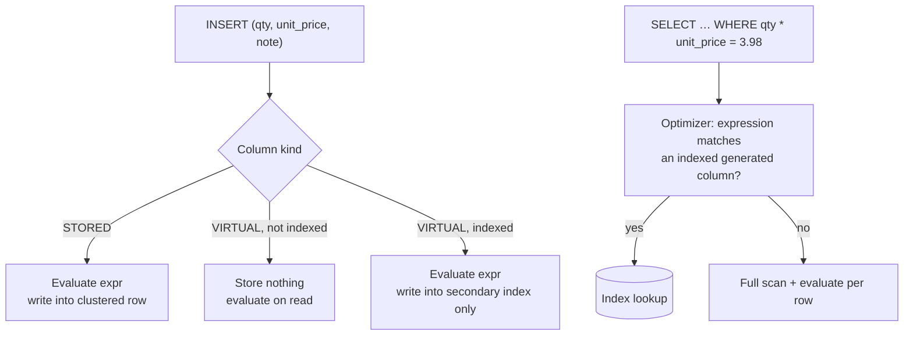

## Introduction

A **generated column** is a column whose value is defined by an expression over other columns of the same row:

```sql
line_total DECIMAL(20,2) AS (qty * unit_price) VIRTUAL
```

You never write to it; MySQL computes it. That simple idea answers several recurring engineering questions:

- *"Every report repeats `qty * unit_price` — can the schema define it once?"*
- *"We filter on `DATE_FORMAT(order_date, '%Y-%m')`, `LOWER(email)` or a JSON path — how do we index an expression?"*
- *"How do we guarantee **one active subscription per customer**, or **case-insensitive unique emails**, when MySQL has no partial or expression `UNIQUE` constraint syntax?"*
- *"Should the derived value be stored, or computed on read — and what does each cost in bytes and DDL time?"*

This lesson builds the answers with real measurements. It relies on [Covering, Prefix and Functional Indexes](/lessons/m07-covering-prefix-functional) for functional key parts and complements [Working with JSON in MySQL](/lessons/m13-json), where generated columns index JSON paths.

:::note[Dataset]
The examples use the **shop** dataset plus two generated 100,000-row tables (`lines_virtual`, `lines_stored`) built for the storage comparison. All outputs are captured from a real server; byte counts are InnoDB's own figures from `information_schema`.
:::

## DBMS Theory

:::theory[Derived attributes]
In ER modelling a **derived attribute** is one whose value can be computed from other attributes (age from birth date, line total from quantity × price). Normalization theory treats storing a derived value as **redundancy**: the functional dependency `{qty, unit_price} → line_total` holds within the row, and if `line_total` is an ordinary column, an update to `qty` that forgets `line_total` creates an **update anomaly** ([Normalization anomalies](/lessons/m06-anomalies)).

A generated column removes the anomaly by making the dependency **declarative**: the DBMS, not the application, maintains the derived value. It is the same idea as a view column, but at the level of a single row and with the option to *materialize* it.
:::

Two materialization policies exist, and they are the classic trade-off between **computing on read** and **computing on write**:

| Policy | SQL keyword | Value lives in | Cost paid | Analogy |
|---|---|---|---|---|
| Compute on read | `VIRTUAL` (MySQL default) | Nowhere in the row; computed when read | CPU on every read of the column | A view column |
| Compute on write | `STORED` | The clustered index row, like a normal column | Bytes on disk and in the buffer pool; CPU on every write | A materialized view column |

Either kind can be **indexed**. An index on a virtual column *does* materialize the value — inside the secondary index only. That combination (virtual column + secondary index) is how MySQL implements expression indexes, and it is why the theory of [indexes](/lessons/m07-why-indexes) applies unchanged: the index stores sorted `(expression value, primary key)` pairs.

The SQL standard defines generated columns (`GENERATED ALWAYS AS (expr)`, SQL:2003). MySQL accepts that syntax and the short form `AS (expr)`, plus the `VIRTUAL` / `STORED` keywords, which are a MySQL extension (PostgreSQL supported only `STORED` until version 18 added virtual generated columns).

## Why It Exists

Without generated columns, teams fall back to one of four imperfect patterns:

1. **Repeat the expression in every query.** Correctness depends on every author writing exactly the same formula; one report uses `qty * unit_price`, another forgets a discount.
2. **Maintain a redundant column in application code.** Every writer (the main app, a batch job, a manual fix in the console) must update it. Sooner or later one does not.
3. **Maintain it with triggers.** Correct, but invisible, harder to test, and slower than a built-in expression ([Triggers](/lessons/m09-triggers)).
4. **Put the expression in a view.** Good for reads, but a view cannot be indexed in MySQL, so filtering on the expression still scans.

Generated columns give the **single definition** of a view with the **indexability** of a column, and the integrity guarantee that the value can never disagree with its inputs. They also unlock constraints that MySQL's DDL cannot state directly: unique-on-expression, partial-unique, and `CHECK` or foreign key rules on a derived value.

## Internal Working

:::internals[How InnoDB handles VIRTUAL and STORED columns]
- **STORED**: the expression is evaluated when the row is inserted or when any base column changes, and the result is written into the clustered index record like any other column. Reads are free; writes and storage pay.
- **VIRTUAL**: the data dictionary records the column and its expression, but the clustered index record has **no field for it**. When a query reads the column, the server evaluates the expression over the base columns it has just fetched.
- **Secondary index on a VIRTUAL column**: InnoDB evaluates the expression during `INSERT`/`UPDATE` and stores the value in the secondary index entry. The value is therefore materialized in the index only. For rollback and MVCC, InnoDB also logs virtual-column values for indexed virtual columns in the undo log. An index-only read (covering) of the virtual column never evaluates the expression.
- **Functional key part** `INDEX ((expr))` (8.0.13+): implemented as a **hidden** virtual generated column plus a secondary index on it — the hidden column does not appear in `SELECT *` or `information_schema.COLUMNS`.
- **Expression substitution**: when a `WHERE` (or `ORDER BY`/`GROUP BY`) expression matches the definition of an *indexed* generated column — same expression and same result type — the optimizer replaces it with the column, so the index becomes usable without rewriting the query.
:::



**DDL consequences.** Because a virtual column occupies no space in the row, `ADD COLUMN … VIRTUAL` is a metadata change (`ALGORITHM=INSTANT` in MySQL 8.0+). Adding a `STORED` column must compute and write the value into every row, which requires a **table rebuild** (`ALGORITHM=COPY`). Changing a column between `VIRTUAL` and `STORED` in place is not supported; you drop and re-add it.

## MySQL Implementation

The full syntax of a generated column definition:

```sql
col_name data_type [GENERATED ALWAYS] AS (expr)
  [VIRTUAL | STORED] [NOT NULL | NULL] [VISIBLE | INVISIBLE]
  [UNIQUE [KEY]] [[PRIMARY] KEY] [COMMENT 'string']
```

A first example on the shop data — the line total of every order item, defined once:

```sql run
CREATE TABLE order_lines (
  order_id    INT UNSIGNED  NOT NULL,
  product_id  INT UNSIGNED  NOT NULL,
  quantity    INT UNSIGNED  NOT NULL,
  unit_price  DECIMAL(10,2) NOT NULL,
  line_total  DECIMAL(20,2) AS (quantity * unit_price) VIRTUAL,
  PRIMARY KEY (order_id, product_id)
);
INSERT INTO order_lines (order_id, product_id, quantity, unit_price)
SELECT order_id, product_id, quantity, unit_price FROM order_items;
SELECT order_id, product_id, quantity, unit_price, line_total
FROM order_lines ORDER BY order_id, product_id LIMIT 5;
```

The `INSERT` lists only base columns. The data dictionary records the expression, which you can inspect:

```sql run
SELECT COLUMN_NAME, COLUMN_TYPE, EXTRA, GENERATION_EXPRESSION
FROM information_schema.COLUMNS
WHERE TABLE_SCHEMA = DATABASE() AND TABLE_NAME = 'order_lines'
ORDER BY ORDINAL_POSITION;
```

Supplying a value for a generated column is an error; the keyword `DEFAULT` is the only value accepted:

```sql run error
INSERT INTO order_lines (order_id, product_id, quantity, unit_price, line_total)
VALUES (1, 30, 1, 10.00, 999.00);
```

## Syntax Breakdown

| Element | Meaning and rules |
|---|---|
| `data_type` | Required. The expression result is **converted to this type** on evaluation, as with assignment to a normal column. Choose it to match the expression's natural type if you want expression substitution to work. |
| `GENERATED ALWAYS` | Optional standard wording; `AS (expr)` alone is equivalent. |
| `AS (expr)` | Any **deterministic** expression over columns of the same row. Not allowed: non-deterministic functions (`NOW()`, `RAND()`, `UUID()`), subqueries, user variables, stored functions, references to `AUTO_INCREMENT` columns. It may reference earlier generated columns. |
| `VIRTUAL` | Default. Not stored in the row; may be indexed (secondary indexes only). |
| `STORED` | Stored in the row. Required for a generated column used as a foreign key child column or in a primary key. |
| `NOT NULL` | Enforced on the computed value — a cheap way to require that a derived value (for example a JSON path) exists. |
| `UNIQUE`, `INDEX` | Allowed on both kinds (on VIRTUAL: secondary indexes only). |
| `CHECK (…)` | A `CHECK` constraint may reference generated columns. |
| `INVISIBLE` | 8.0.23+: hidden from `SELECT *` unless named, useful when adding helper columns without breaking `SELECT *` consumers. |

The restrictions are enforced at DDL time with specific errors:

```sql run error
CREATE TABLE bad_now (id INT PRIMARY KEY, created DATETIME AS (NOW()));
```

```sql run error
CREATE TABLE bad_ai (id INT AUTO_INCREMENT PRIMARY KEY, doubled INT AS (id * 2));
```

## Practical Examples

### 1. Index an expression you filter on

Order reports group and filter by calendar month. A virtual `order_month` with an index serves both:

```sql run
CREATE TABLE orders_by_month (
  order_id    INT UNSIGNED PRIMARY KEY,
  customer_id INT UNSIGNED NOT NULL,
  order_date  DATETIME     NOT NULL,
  status      VARCHAR(10)  NOT NULL,
  order_month CHAR(7) AS (DATE_FORMAT(order_date, '%Y-%m')) VIRTUAL,
  INDEX idx_order_month (order_month)
);
INSERT INTO orders_by_month (order_id, customer_id, order_date, status)
SELECT order_id, customer_id, order_date, status FROM orders;
ANALYZE TABLE orders_by_month;
EXPLAIN SELECT COUNT(*) FROM orders_by_month WHERE DATE_FORMAT(order_date, '%Y-%m') = '2024-03';
SELECT order_month, COUNT(*) AS orders
FROM orders_by_month GROUP BY order_month ORDER BY order_month LIMIT 4;
```

`ANALYZE TABLE` gives the new table statistics. The `EXPLAIN` uses `idx_order_month` even though the query spells out `DATE_FORMAT(…)`: the optimizer substituted the generated column (the EXPLAIN Note shows the rewritten condition). For a whole-month range, the plain predicate `order_date >= '2024-03-01' AND order_date < '2024-04-01'` on an index of `order_date` works just as well — see [SARGable Queries](/lessons/m07-sargable-queries). The generated column wins when the expression has no range equivalent, such as `LOWER(email)` or a JSON path.

### 2. Case-insensitive uniqueness on a case-sensitive column

Suppose `email` must keep the user's original spelling (binary collation), but `Ann@Example.com` and ` ann@example.COM` must count as the same account. A **STORED** normalized column with a `UNIQUE` index and a `CHECK` does it declaratively:

```sql run
CREATE TABLE accounts (
  account_id INT PRIMARY KEY,
  email      VARCHAR(255) COLLATE utf8mb4_bin NOT NULL,
  email_norm VARCHAR(255) AS (LOWER(TRIM(email))) STORED,
  UNIQUE KEY uq_accounts_email_norm (email_norm),
  CONSTRAINT chk_accounts_email CHECK (email_norm LIKE '%_@_%._%')
);
INSERT INTO accounts (account_id, email) VALUES (1, 'Ann@Example.com');
SELECT account_id, email, email_norm FROM accounts;
```

```sql run error
INSERT INTO accounts (account_id, email) VALUES (2, ' ann@example.COM');
```

```sql run error
INSERT INTO accounts (account_id, email) VALUES (3, 'not-an-email');
```

The duplicate is reported against `uq_accounts_email_norm` with the *normalized* value, and the `CHECK` on the generated column rejects a value without an `@`. (A `VIRTUAL` column would also work for the unique index; `STORED` is chosen here because the normalized value is read on every login.)

### 3. A partial unique index: one active subscription per customer

MySQL has no `CREATE UNIQUE INDEX … WHERE status = 'active'` (PostgreSQL's partial index). The standard MySQL idiom exploits the rule that **a `UNIQUE` index allows any number of NULLs**: generate a value only for the rows that must be unique and NULL for the rest.

```sql run
CREATE TABLE subscriptions (
  sub_id          INT PRIMARY KEY,
  customer_id     INT UNSIGNED NOT NULL,
  status          ENUM('active', 'cancelled') NOT NULL,
  active_customer INT UNSIGNED AS (IF(status = 'active', customer_id, NULL)) VIRTUAL,
  UNIQUE KEY uq_one_active (active_customer),
  CONSTRAINT fk_subscriptions_customer FOREIGN KEY (customer_id) REFERENCES customers (customer_id)
);
INSERT INTO subscriptions (sub_id, customer_id, status)
VALUES (1, 1, 'cancelled'), (2, 1, 'cancelled'), (3, 1, 'active'), (4, 3, 'active');
SELECT sub_id, customer_id, status, active_customer FROM subscriptions ORDER BY sub_id;
```

Two cancelled rows for customer 1 coexist because their `active_customer` is NULL. A second **active** row collides:

```sql run error
INSERT INTO subscriptions (sub_id, customer_id, status) VALUES (5, 1, 'active');
```

Because the rule lives in the database, it holds even when two application servers race to activate a subscription concurrently — the second insert waits on the unique-index lock and then fails, which no `SELECT … then INSERT` check in application code can guarantee.

### 4. A foreign key on a derived value

A staging table receives customer ids as text from a CSV feed. A `STORED` generated column can carry a foreign key, so referential integrity is checked on the converted value:

```sql run
CREATE TABLE feed_rows (
  row_id   INT PRIMARY KEY,
  raw_cust VARCHAR(10) NOT NULL,
  cust_id  INT UNSIGNED AS (CAST(raw_cust AS UNSIGNED)) STORED,
  CONSTRAINT fk_feed_customer FOREIGN KEY (cust_id) REFERENCES customers (customer_id)
);
INSERT INTO feed_rows (row_id, raw_cust) VALUES (1, '7');
SELECT row_id, raw_cust, cust_id FROM feed_rows;
```

```sql run error
INSERT INTO feed_rows (row_id, raw_cust) VALUES (2, '999');
```

The same definition with `VIRTUAL` is rejected — InnoDB foreign keys need the value physically in the row:

```sql run error
CREATE TABLE feed_rows_v (
  row_id   INT PRIMARY KEY,
  raw_cust VARCHAR(10) NOT NULL,
  cust_id  INT UNSIGNED AS (CAST(raw_cust AS UNSIGNED)) VIRTUAL,
  CONSTRAINT fk_feed_customer_v FOREIGN KEY (cust_id) REFERENCES customers (customer_id)
);
```

## Execution Walkthrough

How much does `STORED` really cost, and what does each kind cost to add later? Build two tables with identical data and identical generated-column definitions, differing only in `VIRTUAL` vs `STORED`.

```sql run
CREATE TABLE lines_virtual (
  id INT PRIMARY KEY, qty INT NOT NULL, unit_price DECIMAL(10,2) NOT NULL, note VARCHAR(100) NOT NULL,
  line_total DECIMAL(20,2) AS (qty * unit_price)  VIRTUAL,
  note_upper VARCHAR(100)  AS (UPPER(note))        VIRTUAL,
  note_hash  CHAR(64)      AS (SHA2(note, 256))    VIRTUAL
);
CREATE TABLE lines_stored (
  id INT PRIMARY KEY, qty INT NOT NULL, unit_price DECIMAL(10,2) NOT NULL, note VARCHAR(100) NOT NULL,
  line_total DECIMAL(20,2) AS (qty * unit_price)  STORED,
  note_upper VARCHAR(100)  AS (UPPER(note))        STORED,
  note_hash  CHAR(64)      AS (SHA2(note, 256))    STORED
);
SET SESSION cte_max_recursion_depth = 100000;
INSERT INTO lines_virtual (id, qty, unit_price, note)
WITH RECURSIVE seq(n) AS (SELECT 1 UNION ALL SELECT n + 1 FROM seq WHERE n < 100000)
SELECT n, 1 + n % 9, (n % 500) + 0.99, CONCAT('order line ', n) FROM seq;
INSERT INTO lines_stored (id, qty, unit_price, note)
SELECT id, qty, unit_price, note FROM lines_virtual;
```

```walkthrough
title: VIRTUAL vs STORED — storage, DDL cost and index use
steps:
  - title: "1. Same rows, different clustered-index size"
    explain: >-
      After ANALYZE TABLE refreshes the statistics, DATA_LENGTH (the clustered index, i.e. the rows) of the STORED
      table is much larger, because every row physically carries line_total, note_upper and the 64-character
      hash. The virtual table's rows hold only the four base columns. TABLE_ROWS is an estimate; DATA_LENGTH is
      allocated pages × 16 KB.
    sql: |
      ANALYZE TABLE lines_virtual, lines_stored;
      SELECT TABLE_NAME, TABLE_ROWS, DATA_LENGTH, INDEX_LENGTH, AVG_ROW_LENGTH
      FROM information_schema.TABLES
      WHERE TABLE_SCHEMA = DATABASE() AND TABLE_NAME IN ('lines_virtual', 'lines_stored')
      ORDER BY TABLE_NAME;
  - title: "2. Reading gives identical values"
    explain: The virtual values are computed on read; the stored ones are read from the row. A query cannot tell the difference.
    sql: |
      SELECT v.id, v.line_total AS virtual_total, s.line_total AS stored_total, v.note_upper
      FROM lines_virtual v JOIN lines_stored s USING (id)
      WHERE v.id <= 3 ORDER BY v.id;
  - title: "3. Adding a VIRTUAL column is instant"
    explain: >-
      ALGORITHM=INSTANT succeeds and 0 rows are affected: only the data dictionary changes.
    sql: ALTER TABLE lines_virtual ADD COLUMN qty_band TINYINT AS (qty DIV 3) VIRTUAL, ALGORITHM=INSTANT;
  - title: "4. Adding a STORED column rebuilds the table"
    explain: >-
      The same request with ALGORITHM=INPLACE is refused; without an algorithm clause, MySQL copies the table and
      reports 100,000 affected rows — every row was rewritten to hold the new value.
    sql: ALTER TABLE lines_stored ADD COLUMN qty_band TINYINT AS (qty DIV 3) STORED, ALGORITHM=INPLACE;
    expect: error
  - title: "5. ...so let MySQL copy it"
    sql: ALTER TABLE lines_stored ADD COLUMN qty_band TINYINT AS (qty DIV 3) STORED;
  - title: "6. Indexes cost the same for both kinds"
    explain: >-
      An index on the generated column stores (value, primary key) pairs either way, so INDEX_LENGTH is the same
      for both tables. For the virtual table, the index is the only place line_total is materialized.
    sql: |
      ALTER TABLE lines_virtual ADD INDEX idx_total (line_total);
      ALTER TABLE lines_stored  ADD INDEX idx_total (line_total);
      ANALYZE TABLE lines_virtual, lines_stored;
      SELECT TABLE_NAME, DATA_LENGTH, INDEX_LENGTH
      FROM information_schema.TABLES
      WHERE TABLE_SCHEMA = DATABASE() AND TABLE_NAME IN ('lines_virtual', 'lines_stored')
      ORDER BY TABLE_NAME;
  - title: "7. Expression substitution — when it happens"
    explain: >-
      The first two queries spell out qty * unit_price and are rewritten to line_total (see the Note), so they use
      idx_total. The third uses the integer literal 4400 and is not rewritten in this server version; the fourth
      names the column directly and always works. Always confirm substitution with EXPLAIN.
    sql: |
      EXPLAIN SELECT id FROM lines_virtual WHERE qty * unit_price = 3.98;
      EXPLAIN SELECT id FROM lines_virtual WHERE qty * unit_price > 4400.00;
      EXPLAIN SELECT id FROM lines_virtual WHERE qty * unit_price > 4400;
      EXPLAIN SELECT id FROM lines_virtual WHERE line_total > 4400;
```

## Output

The measurement in step 1 is the headline: identical logical content, very different physical size — in the capture, about 15 MB of clustered index for the STORED table against under 6 MB for the VIRTUAL one (average row length 153 vs 57 bytes). Read it as **bytes you pay in every copy of the table** — the buffer pool, backups, replicas — when you choose `STORED`. Step 6 shows that indexing evens the score for the indexed column, because the index materializes the value either way. A compact summary of the final state:

```sql run
SELECT TABLE_NAME,
       ROUND(DATA_LENGTH / 1024 / 1024, 1)  AS data_mb,
       ROUND(INDEX_LENGTH / 1024 / 1024, 1) AS index_mb,
       (SELECT COUNT(*) FROM information_schema.COLUMNS c
        WHERE c.TABLE_SCHEMA = t.TABLE_SCHEMA AND c.TABLE_NAME = t.TABLE_NAME
          AND c.EXTRA LIKE '%GENERATED%') AS generated_columns
FROM information_schema.TABLES t
WHERE TABLE_SCHEMA = DATABASE() AND TABLE_NAME IN ('lines_virtual', 'lines_stored')
ORDER BY TABLE_NAME;
```

The plans in step 7 are the second lesson: substitution is a convenience, not a contract. The two forms that were rewritten show `key = idx_total`; the integer-literal form fell back to a full scan; naming `line_total` directly is the robust choice for application queries.

## Alternative Approaches

| Approach | Indexable | Visible to queries | Storage | Typical use |
|---|---|---|---|---|
| Expression repeated in queries | No | — | None | One-off analysis |
| **VIRTUAL generated column** | Yes (secondary) | Yes (`SELECT col`) | None in row; index only | Derived values used in filters, cheap to compute |
| **STORED generated column** | Yes (incl. PK, FK child) | Yes | In row | Expensive expressions read often; FK on derived value |
| **Functional index** `INDEX ((expr))` | Yes | No (hidden column) | Index only | Index an expression without changing the visible schema |
| Trigger-maintained column | Yes | Yes | In row | Values that depend on *other rows or tables* (generated columns cannot) |
| View column | No | Yes | None | Logic reused across reports, no filtering need |
| Summary table | Yes | Yes | Separate table | Aggregates across rows ([Analytical Query Optimization](/lessons/m13-analytical-optimization)) |

**Generated column + index vs functional index.** They are the same mechanism (a functional index *is* a hidden virtual generated column with an index). Prefer the visible generated column when the value is also **selected, grouped or constrained** (`UNIQUE`, `CHECK`, `NOT NULL`, FK) or when you want queries to name it explicitly — which, as step 7 showed, is the reliable way to hit the index. Prefer a functional index when the expression is purely an access path and you do not want to change the table's visible shape. The functional index created below is invisible in `COLUMNS` but recorded in `STATISTICS`:

```sql run
ALTER TABLE orders_by_month ADD INDEX idx_order_year ((YEAR(order_date)));
SELECT COLUMN_NAME, EXTRA FROM information_schema.COLUMNS
WHERE TABLE_SCHEMA = DATABASE() AND TABLE_NAME = 'orders_by_month' ORDER BY ORDINAL_POSITION;
SELECT INDEX_NAME, COLUMN_NAME, EXPRESSION FROM information_schema.STATISTICS
WHERE TABLE_SCHEMA = DATABASE() AND TABLE_NAME = 'orders_by_month' ORDER BY INDEX_NAME, SEQ_IN_INDEX;
```

## Performance Analysis

- **Read cost of VIRTUAL.** Evaluating `qty * unit_price` is negligible next to reading a page; evaluating `SHA2(note, 256)` or a deep JSON path for millions of rows is not. If an expensive virtual column is read in bulk (reports, exports), either index it (index-only reads avoid evaluation) or make it STORED.
- **Write cost.** STORED columns and *all* indexed generated columns are computed on every insert and on every update that touches a base column. A table with ten indexed expressions pays ten evaluations plus ten index maintenances per write.
- **Space.** STORED columns widen every row: fewer rows per 16 KB page, more pages to scan, more buffer pool needed for the same working set. Step 1 measured this directly.
- **DDL.** Adding a VIRTUAL column is instant; adding an index on it scans the table to build the index; adding a STORED column rebuilds the table — on a 500 GB table, that is hours of I/O and replica lag ([Schema Evolution](/lessons/m12-schema-evolution)).
- **Plans.** An indexed generated column has index statistics, so the optimizer can estimate `WHERE line_total > 4400` accurately; an unindexed expression is estimated by heuristics. Here is the measured index range scan on the virtual column (covering, so no expression is evaluated):

```sql run measured
EXPLAIN ANALYZE SELECT COUNT(*) FROM lines_virtual WHERE line_total > 4400;
```

## Best Practices

:::best-practice[Using generated columns well]
1. **Default to VIRTUAL**; choose STORED only for expensive expressions read in bulk, for foreign keys or primary keys on derived values, or when you plan to promote the column to a regular column later.
2. **Declare the type deliberately.** Match the expression's natural type when you rely on expression substitution, and use explicit `CAST` in the expression for JSON values.
3. **Name the generated column in application queries** instead of relying on substitution; confirm plans with `EXPLAIN`.
4. **Use generated columns to encode rules**: normalized uniqueness (`LOWER(TRIM(email))`), partial uniqueness (`IF(cond, key, NULL)`), required JSON fields (`NOT NULL` on a path), range checks (`CHECK` on the derived value).
5. **Mind DDL on large tables**: add virtual columns instantly, build their indexes with online DDL, and plan STORED additions like any table rebuild.
6. **Keep expressions deterministic and simple.** If the value depends on other rows, time or other tables, it is not a generated column — use a summary table, a trigger or the application.
:::

## Common Mistakes

**Mistake 1 — trying to write the derived value.** Application code that copies all columns of a row (`INSERT … SELECT *` between tables with different generated columns, or an ORM that includes every field) fails with error 3105, as shown above. List base columns explicitly, or use `DEFAULT` for the generated ones.

**Mistake 2 — non-deterministic expressions.** `AS (NOW())` or `AS (RAND())` is rejected (error 3763). A "last modified" timestamp is `DEFAULT CURRENT_TIMESTAMP ON UPDATE CURRENT_TIMESTAMP`, not a generated column.

**Mistake 3 — expecting to flip VIRTUAL to STORED in place.**

```sql run error
ALTER TABLE orders_by_month MODIFY order_month CHAR(7) AS (DATE_FORMAT(order_date, '%Y-%m')) STORED;
```

Drop the column and add it again with the new kind (and budget for the rebuild).

**Mistake 4 — dropping a base column that a generated column depends on.**

```sql run error
ALTER TABLE orders_by_month DROP COLUMN order_date;
```

MySQL protects the dependency; drop or redefine the generated column first.

**Mistake 5 — assuming substitution always happens.** Step 7 of the walkthrough showed the same comparison with an integer literal skipping the index. Treat substitution as a bonus for legacy queries, and write new queries against the column.

**Mistake 6 — a foreign key on a VIRTUAL column.** Rejected with error 3733 (see Practical Example 4). Use `STORED`.

## Industry Application

- **JSON-heavy schemas** expose hot JSON paths as typed virtual columns with indexes — the standard way to make document fields filterable in MySQL ([Working with JSON in MySQL](/lessons/m13-json)).
- **Identity and login**: normalized-email or normalized-username columns with `UNIQUE` indexes prevent duplicate accounts that differ only in case or whitespace.
- **Soft deletes and state machines**: the `IF(status = 'active', key, NULL)` idiom enforces "at most one active X per Y" (one active cart per user, one primary address per customer, one open shift per employee).
- **Search and reporting**: precomputed `order_month`, `fiscal_quarter`, `price_band` or `domain` columns make GROUP BY and filtering cheap and keep business definitions in one place.
- **Data hygiene in ingestion**: staging tables compute typed, validated versions of raw text columns with `CAST`, `NOT NULL` and `CHECK` on the generated value, rejecting bad records at load time.
- **Migrations**: teams sometimes add a STORED generated column, backfill and verify it, then convert it to a regular column the application writes directly — a controlled way to introduce a new field.

## Practice Exercises

```exercise
id: ex1
title: Add a margin column
difficulty: easy
kind: dml
concepts: [generated-columns, virtual-column]
prompt: |
  Add a **virtual** generated column `margin` of type `DECIMAL(10,2)` to `products`, defined as
  `price - cost`. Do not change any data. The checker runs
  `SELECT product_id, margin FROM products ORDER BY product_id`.
hints:
  - "ALTER TABLE … ADD COLUMN name type AS (expression) VIRTUAL"
solution: |
  ALTER TABLE products ADD COLUMN margin DECIMAL(10,2) AS (price - cost) VIRTUAL;
check: |
  SELECT product_id, margin FROM products ORDER BY product_id;
explanation: |
  The column occupies no space in the row and the ALTER is a metadata-only change (instant). A regular column
  plus an `UPDATE products SET margin = price - cost` would produce the same values today but would go stale
  as soon as a price changes — the update anomaly generated columns exist to prevent.
```

```exercise
id: ex2
title: Customers per e-mail domain
difficulty: medium
kind: dml
concepts: [generated-columns, stored-column]
prompt: |
  Add a **stored** generated column `email_domain VARCHAR(100)` to `customers` containing the part of
  `email` after the `@`, and an index named `idx_customers_domain` on it.
  The checker runs `SELECT email_domain, COUNT(*) FROM customers GROUP BY email_domain`.
hints:
  - "SUBSTRING_INDEX(email, '@', -1) returns everything after the last @."
  - "You can add the column and the index in one ALTER TABLE, separated by a comma."
solution: |
  ALTER TABLE customers
    ADD COLUMN email_domain VARCHAR(100) AS (SUBSTRING_INDEX(email, '@', -1)) STORED,
    ADD INDEX idx_customers_domain (email_domain);
check: |
  SELECT email_domain, COUNT(*) AS n FROM customers GROUP BY email_domain;
explanation: |
  `STORED` makes MySQL rebuild the table to write the value into every row; on 25 rows that is instant, on a
  large table it is a planned operation. A `VIRTUAL` column with the same index would answer the GROUP BY from
  the index just as well — STORED is required here only because the exercise asks for it. Note the domain is
  derived with `SUBSTRING_INDEX(…, -1)`; `SUBSTRING(email, LOCATE('@', email) + 1)` is equivalent for valid addresses.
```

```exercise
id: ex3
title: Enforce one primary address per customer
difficulty: hard
kind: dml
concepts: [partial-unique-index, generated-columns]
setup: |
  CREATE TABLE addresses (
    address_id  INT PRIMARY KEY,
    customer_id INT UNSIGNED NOT NULL,
    is_primary  BOOLEAN NOT NULL DEFAULT FALSE,
    city        VARCHAR(60) NOT NULL
  );
  INSERT INTO addresses VALUES (1, 1, TRUE, 'Austin'), (2, 1, FALSE, 'Dallas'), (3, 1, FALSE, 'Houston'),
                               (4, 3, TRUE, 'San Jose'), (5, 4, FALSE, 'Austin');
prompt: |
  The table `addresses(address_id, customer_id, is_primary, city)` must allow **any number** of non-primary
  addresses per customer but **at most one** primary address per customer. Add a generated column and a
  `UNIQUE` index that enforce this rule in the database (existing data already satisfies it).

  The checker counts, for table `addresses`, the generated columns and the non-primary-key unique indexes.
hints:
  - "A UNIQUE index allows many NULLs."
  - "Generate customer_id when is_primary is true and NULL otherwise."
solution: |
  ALTER TABLE addresses
    ADD COLUMN primary_customer INT UNSIGNED AS (IF(is_primary, customer_id, NULL)) VIRTUAL,
    ADD UNIQUE KEY uq_one_primary (primary_customer);
check: |
  SELECT
    (SELECT COUNT(*) FROM information_schema.COLUMNS
      WHERE TABLE_SCHEMA = DATABASE() AND TABLE_NAME = 'addresses' AND EXTRA LIKE '%GENERATED%') AS generated_cols,
    (SELECT COUNT(DISTINCT INDEX_NAME) FROM information_schema.STATISTICS
      WHERE TABLE_SCHEMA = DATABASE() AND TABLE_NAME = 'addresses'
        AND NON_UNIQUE = 0 AND INDEX_NAME <> 'PRIMARY') AS unique_indexes;
explanation: |
  Non-primary addresses map to NULL and never collide; primary addresses map to their customer id, so a
  second primary address for the same customer violates `uq_one_primary` (error 1062). A
  `UNIQUE (customer_id, is_primary)` index is the classic wrong answer: it also forbids two **non-primary**
  addresses for the same customer, because `(1, FALSE)` would repeat. Enforcing the rule with a
  "check-then-insert" in application code is wrong under concurrency — two transactions can both see "no
  primary yet" and both insert.
```

```exercise
id: ex4
title: Monthly revenue through a generated month column
difficulty: hard
concepts: [generated-columns, expression-substitution]
setup: |
  CREATE TABLE orders_by_month (
    order_id INT UNSIGNED PRIMARY KEY, customer_id INT UNSIGNED NOT NULL, order_date DATETIME NOT NULL,
    status VARCHAR(10) NOT NULL,
    order_month CHAR(7) AS (DATE_FORMAT(order_date, '%Y-%m')) VIRTUAL,
    INDEX idx_order_month (order_month));
  INSERT INTO orders_by_month (order_id, customer_id, order_date, status)
  SELECT order_id, customer_id, order_date, status FROM orders;
prompt: |
  Using `orders_by_month` (which has a virtual `order_month` column, format `YYYY-MM`) and `order_items`,
  return, for every month of **Q2 2024** (`2024-04` to `2024-06`), the number of distinct orders that were
  not cancelled and their item revenue (Σ quantity × unit_price). Columns: `order_month`, `orders`,
  `revenue`. Order by `order_month`.
hints:
  - "Filter on order_month BETWEEN '2024-04' AND '2024-06' — the column is indexed."
  - "Join order_items on order_id; COUNT(DISTINCT o.order_id) because each order has several items."
  - "Exclude status = 'cancelled'."
solution: |
  SELECT o.order_month,
         COUNT(DISTINCT o.order_id)        AS orders,
         SUM(oi.quantity * oi.unit_price)  AS revenue
  FROM orders_by_month o
  JOIN order_items oi ON oi.order_id = o.order_id
  WHERE o.order_month BETWEEN '2024-04' AND '2024-06'
    AND o.status <> 'cancelled'
  GROUP BY o.order_month
  ORDER BY o.order_month;
orderMatters: true
explanation: |
  `order_month` is a string in a sortable format, so `BETWEEN` on it is a correct month range and can use
  `idx_order_month`. `COUNT(*)` would count line items, not orders. An equivalent predicate on the base
  column is `order_date >= '2024-04-01' AND order_date < '2024-07-01'`.
```

```exercise
id: ex5
title: VIRTUAL or STORED?
difficulty: challenge
kind: open
concepts: [virtual-column, stored-column, functional-index]
prompt: |
  For each case, choose VIRTUAL generated column, STORED generated column, functional index, or "not a
  generated column", and justify the choice in terms of storage, write cost, read cost, DDL and constraints:

  1. `full_name = CONCAT(first_name, ' ', last_name)`, displayed on every page, never filtered.
  2. `document_hash = SHA2(body, 256)` over a 20 KB `TEXT` column, used to detect duplicates on insert.
  3. `customer_id` extracted from a JSON payload, used in a foreign key to `customers`.
  4. `days_since_signup = DATEDIFF(CURDATE(), signup_date)`, used in a churn report.
  5. A case-insensitive lookup on `sku` that is only ever used in one admin search query.
solution: |
  1. **VIRTUAL** (no index). Cheap expression, no filtering; storing it would duplicate bytes in every row.
  2. **STORED** (or VIRTUAL + UNIQUE index). Uniqueness needs an index, which materializes the hash either way;
     STORED avoids re-hashing 20 KB per read if the hash is also selected, and the 64-byte column is small next
     to the body. VIRTUAL + UNIQUE index is equally valid if the hash is never read outside the index.
  3. **STORED**. InnoDB foreign keys cannot use virtual columns (error 3733). Better long-term: make
     customer_id a regular column populated at ingestion, because it is identity data.
  4. **Not a generated column.** `CURDATE()` is non-deterministic and rejected (error 3763); the value changes
     daily without any row changing. Compute it in the query or in a nightly summary table.
  5. **Functional index** `INDEX ((LOWER(sku)))` (or rely on a case-insensitive collation). The expression is
     an access path only; there is no reason to add a visible column for one query.
```

## Knowledge Assessment

```quiz
- id: q1
  question: "Where is the value of an **indexed VIRTUAL** generated column physically stored in InnoDB?"
  options:
    - "In the clustered index row and in the secondary index"
    - "Only in the secondary index entries (and in undo records when needed); not in the clustered row"
    - "Nowhere — it is recomputed even for index lookups"
    - "In a hidden side table"
  answer: 1
  explanation: "A virtual column has no field in the clustered record. Indexing it materializes the computed value in the secondary index (and InnoDB logs indexed virtual values in undo for rollback/MVCC). Index lookups compare stored index values; nothing is recomputed for them. There is no side table."
  concepts: [virtual-column, generated-columns]
- id: q2
  question: "Which ALTER TABLE operation rebuilds the whole table?"
  options:
    - "ADD COLUMN x INT AS (a + b) VIRTUAL"
    - "ADD COLUMN x INT AS (a + b) STORED"
    - "ADD INDEX (x) on an existing virtual column"
    - "Renaming a generated column"
  answer: 1
  explanation: "A STORED column must be written into every row, so MySQL copies the table (ALGORITHM=INPLACE was refused in the lesson). Adding a VIRTUAL column is instant (dictionary only). Adding an index scans the table to build the index but does not rebuild the clustered index; renaming is metadata only."
  concepts: [stored-column, virtual-column]
- id: q3
  question: "A table has `active_customer INT AS (IF(status = 'active', customer_id, NULL))` with a UNIQUE index. Which rows can coexist?"
  options:
    - "Only one row per customer, whatever its status"
    - "Any number of cancelled rows per customer, but at most one active row per customer"
    - "Any number of active rows, because NULLs are unique"
    - "None — UNIQUE indexes are not allowed on generated columns"
  answer: 1
  explanation: "Non-active rows map to NULL, and a UNIQUE index allows multiple NULLs. Active rows map to the customer id, so two active rows for one customer collide (error 1062). UNIQUE indexes are allowed on both VIRTUAL and STORED generated columns."
  concepts: [partial-unique-index]
- id: q4
  question: "Which expressions are rejected in a generated column definition? (Select all that apply.)"
  type: multi
  options: ["NOW()", "UPPER(note)", "RAND()", "a reference to an AUTO_INCREMENT column", "j->>'$.k'"]
  answer: [0, 2, 3]
  explanation: "Generated column expressions must be deterministic and may not reference AUTO_INCREMENT columns (errors 3763 and 3109 in the lesson). UPPER() and JSON path extraction are deterministic and allowed."
  concepts: [generated-columns]
- id: q5
  question: "An indexed column `line_total DECIMAL(20,2) AS (qty * unit_price)` exists. `EXPLAIN … WHERE qty * unit_price > 4400` shows a full scan, but `WHERE line_total > 4400` uses the index. What is the most robust conclusion?"
  options:
    - "The index is corrupt and should be rebuilt"
    - "Expression substitution did not match this predicate; application queries should reference the generated column directly and be checked with EXPLAIN"
    - "Generated columns cannot be used in range predicates"
    - "The table needs ANALYZE TABLE before any index is used"
  answer: 1
  explanation: "The optimizer only substitutes when it can match the expression and comparison types; in the lesson, the decimal literal 4400.00 was rewritten but the integer literal was not. Range predicates on the column itself use the index, and the index is not corrupt. Statistics affect choices but not substitution."
  concepts: [expression-substitution]
- id: q6
  question: "What is the difference between `INDEX ((LOWER(email)))` and `email_lc VARCHAR(255) AS (LOWER(email)) VIRTUAL` with `INDEX (email_lc)`?"
  options:
    - "The functional index stores data in the clustered row; the generated column does not"
    - "They use the same mechanism (a virtual generated column plus an index); the functional index's column is hidden, so it cannot be selected, constrained with CHECK or referenced by name"
    - "Only the generated column can be used by WHERE LOWER(email) = ?"
    - "Functional indexes are only supported for JSON"
  answer: 1
  explanation: "A functional key part is implemented as a hidden virtual generated column with an index. Both can serve WHERE LOWER(email) = ?. The difference is visibility: a named generated column can be selected, grouped, used in CHECK/UNIQUE definitions and named in queries. Neither stores the value in the clustered row, and functional indexes work for any deterministic expression."
  concepts: [functional-index, generated-columns]
- id: q7
  question: "You need a foreign key from a derived value (`CAST(raw AS UNSIGNED)`) to `customers`. Which definition works?"
  options:
    - "A VIRTUAL generated column with the FOREIGN KEY"
    - "A STORED generated column with the FOREIGN KEY"
    - "A functional index with REFERENCES"
    - "None — foreign keys can never involve generated columns"
  answer: 1
  explanation: "InnoDB supports foreign keys on STORED generated columns (the lesson's feed_rows example). A VIRTUAL column is rejected with error 3733, and a functional index cannot be the child side of a foreign key."
  concepts: [stored-column, check-constraints]
```
