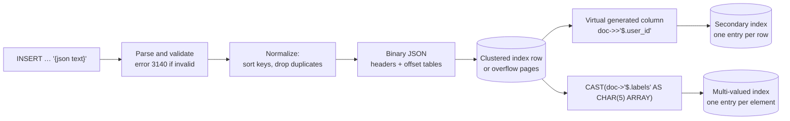

## Introduction

Relational tables assume that every row of a table has the same attributes. Real systems constantly meet data that does not: product attributes that differ per category (a laptop has RAM and screen size, a T-shirt has a size and a fabric), webhook payloads from a payment provider, feature flags, user preferences, API request logs, configuration blobs. **JSON** columns let MySQL store such semi-structured documents in a row next to ordinary relational columns, and a library of SQL functions lets you query, reshape, update, validate and index them.

[JSON and Binary Types](/lessons/m02-json-binary-types) introduced the `JSON` type and its storage. This lesson is the professional toolkit:

- the **path language** (`$.a.b[0]`, `[*]`, `**`, `[last]`) and the difference between `->` (returns JSON) and `->>` (returns unquoted text);
- **`JSON_TABLE`**, which turns arrays inside documents into relational rows you can join, filter and aggregate;
- the modification functions **`JSON_SET` / `JSON_INSERT` / `JSON_REPLACE` / `JSON_REMOVE`** and how they enable **partial in-place updates**;
- the reverse direction — **`JSON_ARRAYAGG` / `JSON_OBJECTAGG`** — for building API-shaped documents from rows;
- **indexing**: a generated column, a functional index, and a **multi-valued index** for arrays, each verified with `EXPLAIN`;
- **`JSON_SCHEMA_VALID`** inside a `CHECK` constraint to stop malformed documents at the door;
- and, most importantly, **when not to use JSON**.

:::note[Dataset]
Examples use the **shop** dataset. The lesson builds `product_docs` (one JSON document per product, derived from `products` and `categories`) and `events_json` (50,000 generated event payloads, large enough for plans to be meaningful). Every output below was captured from a real MySQL server.
:::

## DBMS Theory

:::theory[Semi-structured data inside a relational system]
**Semi-structured data** is self-describing: each value carries its own field names and nesting, so two documents in the same column can have different shapes. JSON is a tree of **objects** (unordered key → value maps), **arrays** (ordered lists), and **scalars** (string, number, boolean, null).

In the relational model a column's **domain** is a set of atomic values, and [first normal form](/lessons/m06-1nf) forbids repeating groups. A JSON column is a deliberate, controlled exception: the DBMS treats the whole document as one value of a complex domain, while functions let queries look *inside* it. SQL:2016 standardized this as **SQL/JSON** (`JSON_VALUE`, `JSON_QUERY`, `JSON_TABLE`, `JSON_EXISTS`, `IS JSON`, the SQL/JSON path language), and SQL:2023 added a native JSON type.
:::

Three ideas from theory explain almost every practical rule in this lesson:

1. **Schema-on-write vs schema-on-read.** A relational column is validated when it is written (type, `NOT NULL`, `CHECK`, foreign key). A JSON field is, by default, only validated as *well-formed JSON*; its meaning is decided by whoever reads it. Flexibility moves the burden of correctness from the database to every consumer — unless you add constraints back (JSON Schema, generated columns with types).
2. **Path expressions are a query language inside a value.** `$.variants[*].color` navigates a tree; the result can be a scalar, an object, an array or nothing. A path that matches nothing yields SQL `NULL`, which is indistinguishable from "the key exists and is JSON null" unless you test with `JSON_CONTAINS_PATH` or `EXISTS PATH`.
3. **Indexes need a scalar key.** A B+ tree orders scalar keys. To index inside a document you must first *derive* a scalar (a generated column or functional key part) or a *set* of scalars (a multi-valued index, one index entry per array element).

| SQL/JSON standard | MySQL |
|---|---|
| `JSON_VALUE(doc, path RETURNING type)` | `JSON_VALUE()` (8.0.21+), `->>`, `JSON_UNQUOTE(JSON_EXTRACT())` |
| `JSON_QUERY(doc, path)` | `JSON_EXTRACT()`, `->` |
| `JSON_TABLE(...)` | `JSON_TABLE()` with `NESTED PATH`, `FOR ORDINALITY`, `EXISTS PATH`, `ON EMPTY` / `ON ERROR` |
| `JSON_EXISTS` | `JSON_CONTAINS_PATH()` |
| `JSON_ARRAYAGG`, `JSON_OBJECTAGG` | Same names (no `ORDER BY` inside the aggregate) |
| — (MySQL extension) | `->`, `->>`, `JSON_SET`/`JSON_INSERT`/`JSON_REPLACE`/`JSON_REMOVE`, `MEMBER OF`, `JSON_OVERLAPS`, `JSON_SCHEMA_VALID` |

## Why It Exists

Before native JSON (MySQL 5.7.8), teams stored documents in `TEXT` columns. That had four costs, and the JSON type removes each:

- **No validation.** A `TEXT` column happily stores `{"price": 10,}`. The `JSON` type rejects invalid text with error 3140 at insert time.
- **Parse on every read.** Extracting one field from text means parsing the whole string. MySQL's JSON is stored in a **binary format** with offset tables, so a path lookup jumps to the member without scanning the document.
- **Whole-document rewrites.** Changing one field in a `TEXT` blob rewrites the entire value — in the row, in the undo log, in the redo log and in the binary log. JSON supports **partial updates** for `JSON_SET`/`JSON_REPLACE`/`JSON_REMOVE`.
- **No indexing.** You cannot index inside text. JSON fields can be indexed through generated columns, functional indexes and multi-valued indexes.

The wider reason is architectural: many applications have a *core* of stable, relational facts (who ordered what, when, for how much) and a *periphery* of variable, fast-changing, rarely-filtered attributes. JSON lets one database serve both, instead of running a relational database *and* a document store and keeping them in sync.

## Internal Working

:::internals[The binary JSON format and how indexes reach inside it]
When a JSON value is written, MySQL parses the text once, **normalizes** it (duplicate keys: last one wins; object keys are sorted) and stores a binary tree. Each object and array has a header with the element count, total size and an array of **offsets** to its members, so `$.dims.w_cm` is resolved by two binary searches/offset jumps, not by re-parsing text. Small scalars are stored inline in the offset table. The binary value is stored like a `LONGBLOB`: in the `DYNAMIC` row format, a large document moves off-page into overflow pages, leaving a 20-byte pointer in the clustered index record.

**Partial updates.** For `UPDATE t SET col = JSON_SET(col, …)` (also `JSON_REPLACE`, `JSON_REMOVE`), when the target column is the same as the source column and the new value fits in the space the old one occupied, InnoDB modifies the binary value in place instead of writing a new document. `JSON_STORAGE_FREE(col)` then reports the bytes freed inside the value. With `binlog_row_value_options = PARTIAL_JSON` (default: empty), row-based replication also logs only the changed paths.

**Indexes.** InnoDB indexes only scalar columns. A **functional key part** `INDEX ((expr))` is implemented as a **hidden virtual generated column** plus an ordinary secondary index on it. A **multi-valued index** `INDEX ((CAST(doc->'$.tags' AS CHAR(20) ARRAY)))` is a secondary index in which one row can produce *many* index records — one per array element — all pointing to the same primary key. The optimizer can use it for `MEMBER OF`, `JSON_CONTAINS` and `JSON_OVERLAPS` in `WHERE`.
:::



## MySQL Implementation

Build a JSON document per product from the relational data. `JSON_OBJECT` and `JSON_ARRAY` construct values from SQL expressions; `NULL` becomes JSON `null`:

```sql run
CREATE TABLE product_docs (
  product_id INT UNSIGNED PRIMARY KEY,
  doc        JSON NOT NULL
);
INSERT INTO product_docs (product_id, doc)
SELECT p.product_id,
       JSON_OBJECT(
         'sku', p.sku, 'name', p.name, 'price', p.price, 'category', c.name,
         'tags', CASE p.product_id % 4 WHEN 0 THEN JSON_ARRAY('gift', 'sale')
                                       WHEN 1 THEN JSON_ARRAY('new')
                                       WHEN 2 THEN JSON_ARRAY('eco', 'sale')
                                       ELSE JSON_ARRAY() END,
         'dims', JSON_OBJECT('w_cm', 10 + p.product_id, 'h_cm', 5 + p.product_id % 7),
         'variants', IF(p.product_id % 3 = 0,
                        JSON_ARRAY(JSON_OBJECT('color', 'black', 'stock', p.stock_qty),
                                   JSON_OBJECT('color', 'white', 'stock', p.stock_qty DIV 2)),
                        JSON_ARRAY()))
FROM products p LEFT JOIN categories c ON c.category_id = p.category_id;
SELECT product_id, doc FROM product_docs ORDER BY product_id LIMIT 3;
```

Look closely at the stored documents: the keys do **not** appear in the order they were written. MySQL normalized each object and stored its keys sorted (in the captured output: shorter keys first, then alphabetically). Object key order is not meaningful in JSON, and you must never depend on it.

Now read values with paths. `->` is `JSON_EXTRACT` and returns **JSON** (strings keep their quotes); `->>` is `JSON_UNQUOTE(JSON_EXTRACT(…))` and returns **text**:

```sql run
SELECT product_id,
       doc->'$.name'                      AS name_json,
       doc->>'$.name'                     AS name_text,
       doc->'$.price'                     AS price,
       doc->'$.tags[0]'                   AS first_tag,
       doc->'$.dims.w_cm'                 AS width,
       JSON_EXTRACT(doc, '$.variants[*].color') AS colors
FROM product_docs
WHERE product_id IN (3, 6)
ORDER BY product_id;
```

Product 3 has an empty `tags` array, so `$.tags[0]` matches nothing and returns SQL `NULL`. A wildcard path (`[*]`) can match several values, so the result is wrapped in a JSON array.

## Syntax Breakdown

**Path syntax** (the MySQL path language, a dialect of SQL/JSON paths):

| Path | Meaning |
|---|---|
| `$` | The whole document (the context item) |
| `$.key`, `$."key with spaces"` | Object member; quote keys that are not valid identifiers |
| `$[0]`, `$[last]`, `$[last-1]`, `$[1 to 3]` | Array element(s), 0-based; `last` and ranges are MySQL 8.0 additions |
| `$[*]`, `$.*` | All array elements / all object member values |
| `$**.key` | `key` at any depth below `$` (prefix `**` must be followed by a member or element) |

**Functions you will use most:**

| Function | Returns | Notes |
|---|---|---|
| `JSON_EXTRACT(doc, path, …)` / `doc->path` | JSON | Several paths or a wildcard → result wrapped in an array |
| `JSON_UNQUOTE(…)` / `doc->>path` | `LONGTEXT` (`utf8mb4_bin`) | Use for display and string comparison |
| `JSON_VALUE(doc, path RETURNING type)` | Typed SQL value | 8.0.21+; standard; `ON EMPTY` / `ON ERROR` handling |
| `JSON_TABLE(doc, path COLUMNS (…)) AS alias` | Rows | `FOR ORDINALITY`, `PATH`, `EXISTS PATH`, `NESTED PATH`, `DEFAULT … ON EMPTY`, `NULL/ERROR ON ERROR` |
| `JSON_SET(doc, path, val, …)` | JSON | Replace if present, insert if absent |
| `JSON_INSERT(…)` / `JSON_REPLACE(…)` | JSON | Insert only if absent / replace only if present |
| `JSON_REMOVE(doc, path, …)` | JSON | Remove members/elements |
| `JSON_ARRAY_APPEND`, `JSON_ARRAY_INSERT` | JSON | Modify arrays |
| `JSON_MERGE_PATCH(a, b)` | JSON | RFC 7396: `b` overrides `a`, `null` in `b` deletes |
| `JSON_ARRAYAGG(expr)`, `JSON_OBJECTAGG(k, v)` | JSON | Aggregates: rows → array / object |
| `value MEMBER OF (array)`, `JSON_CONTAINS(a, b)`, `JSON_OVERLAPS(a, b)` | 0/1 | Membership / containment of all / any; can use multi-valued indexes |
| `JSON_SCHEMA_VALID(schema, doc)` / `JSON_SCHEMA_VALIDATION_REPORT` | 0/1 / JSON | JSON Schema draft 4 subset; usable in `CHECK` |
| `JSON_TYPE`, `JSON_LENGTH`, `JSON_KEYS`, `JSON_DEPTH`, `JSON_STORAGE_SIZE`, `JSON_STORAGE_FREE` | Inspection | `JSON_STORAGE_FREE` shows space freed by partial updates |

Index syntax:

```sql
-- generated column + index
ALTER TABLE t ADD COLUMN user_id INT UNSIGNED AS (doc->>'$.user_id') VIRTUAL, ADD INDEX (user_id);
-- functional index (hidden generated column); cast to a sized type, match the collation of ->>
ALTER TABLE t ADD INDEX ((CAST(doc->>'$.type' AS CHAR(10)) COLLATE utf8mb4_bin));
-- multi-valued index over an array
ALTER TABLE t ADD INDEX ((CAST(doc->'$.labels' AS CHAR(5) ARRAY)));
```

The path-only operators below are shown on literals so that you can see each one in isolation:

```sql run
SELECT JSON_EXTRACT('[10, 20, 30, 40]', '$[last]')   AS last_elem,
       JSON_EXTRACT('[10, 20, 30, 40]', '$[1 to 2]') AS a_range,
       JSON_EXTRACT('{"a b": 1}', '$."a b"')         AS quoted_key,
       JSON_SEARCH('{"a": ["x", "y"]}', 'one', 'y')  AS path_of_y,
       JSON_KEYS('{"a": 1, "b": 2}')                 AS keys_,
       JSON_MERGE_PATCH('{"a": 1, "b": 2}', '{"b": null, "c": 3}') AS patched;
```

## Practical Examples

### 1. JSON_TABLE — from documents to relational rows

`JSON_TABLE` is the most important JSON function for data work: it is a **table function** that evaluates a row path (`'$.variants[*]'`) and emits one relational row per match, with typed columns taken from column paths. It is joined *laterally* to the table it reads from, so it can refer to `pd.doc`:

```sql run
SELECT pd.product_id, v.rn, v.color, v.stock
FROM product_docs AS pd,
     JSON_TABLE(pd.doc, '$.variants[*]'
       COLUMNS (rn    FOR ORDINALITY,
                color VARCHAR(10) PATH '$.color',
                stock INT         PATH '$.stock' DEFAULT '0' ON EMPTY)) AS v
WHERE pd.product_id IN (3, 6)
ORDER BY pd.product_id, v.rn;
```

The comma join behaves like an inner join: a product whose array is empty produces **no** rows. When you need every product, including those with empty arrays, use `LEFT JOIN … ON TRUE`:

```sql run
SELECT pd.product_id, t.tag
FROM product_docs AS pd
LEFT JOIN JSON_TABLE(pd.doc, '$.tags[*]' COLUMNS (tag VARCHAR(20) PATH '$')) AS t ON TRUE
WHERE pd.product_id <= 4
ORDER BY pd.product_id, t.tag;
```

Product 3 (empty `tags`) survives with a NULL tag. Once JSON is rows, ordinary SQL applies — here, tag popularity across the catalogue:

```sql run
SELECT t.tag, COUNT(*) AS products
FROM product_docs AS pd,
     JSON_TABLE(pd.doc, '$.tags[*]' COLUMNS (tag VARCHAR(20) PATH '$')) AS t
GROUP BY t.tag
ORDER BY products DESC, t.tag;
```

`NESTED PATH` flattens nested arrays (orders → lines) in one pass, and `ON EMPTY` / `ON ERROR` decide what happens when a value is missing or cannot be converted:

```sql run
SELECT *
FROM JSON_TABLE(
  '{"o": [{"id": 1, "lines": [{"sku": "A", "q": 2}, {"sku": "B", "q": 1}]},
          {"id": 2, "lines": [{"sku": "C", "q": 5}]}]}',
  '$.o[*]' COLUMNS (
     order_id INT PATH '$.id',
     NESTED PATH '$.lines[*]' COLUMNS (sku VARCHAR(5) PATH '$.sku', qty INT PATH '$.q'))) AS jt;
SELECT *
FROM JSON_TABLE('[{"q": "abc"}, {"q": 7}, {}]', '$[*]'
  COLUMNS (q     INT PATH '$.q' DEFAULT '0' ON EMPTY NULL ON ERROR,
           has_q INT EXISTS PATH '$.q')) AS jt;
```

In the second result, `"abc"` cannot become an `INT`, so `NULL ON ERROR` produced NULL; the empty object has no `q`, so `DEFAULT '0' ON EMPTY` produced 0 and `EXISTS PATH` reports 0. That distinction — *missing* vs *present but invalid* — is exactly what a data pipeline needs when ingesting third-party payloads.

### 2. Modifying documents

The three "set" functions differ only in what they do with existing and missing paths:

```sql run
SELECT JSON_SET(doc,     '$.price', 1.5, '$.color', 'red') AS with_set,
       JSON_INSERT(doc,  '$.price', 1.5, '$.color', 'red') AS with_insert,
       JSON_REPLACE(doc, '$.price', 1.5, '$.color', 'red') AS with_replace
FROM product_docs WHERE product_id = 1;
SELECT JSON_REMOVE(doc, '$.dims', '$.variants') AS slimmed
FROM product_docs WHERE product_id = 1;
```

`JSON_SET` changed `price` **and** added `color`; `JSON_INSERT` added `color` but left `price` alone; `JSON_REPLACE` changed `price` but ignored the missing `color`. Choosing the right one encodes intent: `JSON_INSERT` for "default if absent", `JSON_REPLACE` for "update only known fields", `JSON_SET` for upserts of a field.

### 3. Partial updates you can observe

Update a field with a value that fits in the old space, then inspect the document's binary size and freed space:

```sql run
SELECT JSON_STORAGE_SIZE(doc) AS bytes, JSON_STORAGE_FREE(doc) AS freed
FROM product_docs WHERE product_id = 1;
UPDATE product_docs SET doc = JSON_REPLACE(doc, '$.name', 'UB14') WHERE product_id = 1;
SELECT JSON_STORAGE_SIZE(doc) AS bytes, JSON_STORAGE_FREE(doc) AS freed, doc->>'$.name' AS name
FROM product_docs WHERE product_id = 1;
```

`JSON_STORAGE_SIZE` stayed the same while `JSON_STORAGE_FREE` became non-zero: the shorter name was written **in place** and the leftover bytes are now unused space inside the value — the signature of a partial update. Had the statement been `SET doc = '…whole new text…'`, the document would have been rewritten. (`binlog_row_value_options` controls whether replication benefits too; it is a global setting, shown here read-only.)

```sql run
SELECT @@binlog_row_value_options AS row_value_options, @@binlog_row_image AS row_image;
```

### 4. Rows to JSON — building API payloads

`JSON_ARRAYAGG` and `JSON_OBJECTAGG` are aggregate functions: they fold a group of rows into one array or object, which is how a service can return a nested API response in a single query:

```sql run
SELECT c.name AS category,
       JSON_ARRAYAGG(p.sku)            AS skus,
       JSON_OBJECTAGG(p.sku, p.price)  AS price_by_sku
FROM products p JOIN categories c USING (category_id)
WHERE c.category_id IN (3, 4)
GROUP BY c.name
ORDER BY c.name;
```

`JSON_ARRAYAGG` has no `ORDER BY` clause in MySQL, so the element order is not guaranteed. If order matters, aggregate from an ordered derived table and verify, or sort on the client — and never let a consumer depend on element order you did not specify.

### 5. Schema validation with CHECK

A `CHECK` constraint with `JSON_SCHEMA_VALID` restores schema-on-write for the parts of a document you care about. MySQL supports a subset of JSON Schema draft 4 (`type`, `required`, `properties`, `pattern`, `minimum`, `items`, `additionalProperties`, …):

```sql run
CREATE TABLE product_attrs (
  product_id INT UNSIGNED PRIMARY KEY,
  attrs JSON NOT NULL,
  CONSTRAINT chk_attrs_schema CHECK (JSON_SCHEMA_VALID('{
    "type": "object",
    "required": ["sku", "price"],
    "properties": {
      "sku":   {"type": "string", "pattern": "^SKU-[0-9]{4}$"},
      "price": {"type": "number", "minimum": 0},
      "tags":  {"type": "array", "items": {"type": "string"}}
    },
    "additionalProperties": false}', attrs))
);
INSERT INTO product_attrs VALUES (1, '{"sku": "SKU-1001", "price": 12.5, "tags": ["new"]}');
SELECT product_id, attrs FROM product_attrs;
```

```sql run error
INSERT INTO product_attrs VALUES (2, '{"sku": "SKU-1002", "price": -1}');
```

The error only says *that* the constraint failed. `JSON_SCHEMA_VALIDATION_REPORT` says *why* — useful in an ingestion job that quarantines bad payloads instead of failing:

```sql run
SELECT JSON_PRETTY(JSON_SCHEMA_VALIDATION_REPORT(
  '{"type": "object", "properties": {"price": {"type": "number", "minimum": 0}}}',
  '{"price": -1}')) AS report;
```

## Execution Walkthrough

How does a JSON predicate go from a full scan to an index lookup? Build 50,000 event payloads, then add one index at a time and watch the plan change.

```sql run
CREATE TABLE events_json (
  event_id INT UNSIGNED PRIMARY KEY,
  payload  JSON NOT NULL
);
SET SESSION cte_max_recursion_depth = 50000;
INSERT INTO events_json
WITH RECURSIVE seq(n) AS (SELECT 1 UNION ALL SELECT n + 1 FROM seq WHERE n < 50000)
SELECT n, JSON_OBJECT('type',    ELT(1 + n % 5, 'click', 'view', 'purchase', 'signup', 'refund'),
                      'user_id', 1 + n % 2000,
                      'amount',  IF(n % 5 = 2, ROUND((n % 997) / 3, 2), NULL),
                      'labels',  JSON_ARRAY(CONCAT('L', n % 50), CONCAT('L', (n * 7) % 50)))
FROM seq;
ANALYZE TABLE events_json;
```

`ANALYZE TABLE` refreshes the statistics for the newly loaded table so the plans below reflect its real size.

```walkthrough
title: Making JSON predicates index-friendly
steps:
  - title: "1. No index — every document is parsed"
    explain: >-
      With no index, the optimizer has no access path for a path expression. EXPLAIN shows type ALL: all ~50,000
      documents are read and the path is evaluated for each one.
    sql: EXPLAIN SELECT COUNT(*) FROM events_json WHERE payload->>'$.user_id' = 42;
  - title: "2. Add a typed virtual generated column and index it"
    explain: >-
      The generated column exposes the path as an INT. VIRTUAL means no extra bytes in the clustered row; the
      secondary index does store the computed values.
    sql: |
      ALTER TABLE events_json
        ADD COLUMN user_id INT UNSIGNED AS (payload->>'$.user_id') VIRTUAL,
        ADD INDEX idx_user (user_id);
      ANALYZE TABLE events_json;
  - title: "3. The original predicate now uses the index"
    explain: >-
      The query text did not change. The optimizer recognizes that the WHERE expression matches the generated
      column's definition and substitutes it (see the rewritten query in the Note): the plan becomes a ref lookup
      on idx_user.
    sql: EXPLAIN SELECT COUNT(*) FROM events_json WHERE payload->>'$.user_id' = 42;
  - title: "4. A functional index without a visible column"
    explain: >-
      For a string field, a functional key part does the same job with a hidden generated column. Casting to a
      sized CHAR and adding COLLATE utf8mb4_bin makes the indexed expression match what ->> returns, so the plain
      predicate payload->>'$.type' = 'refund' can use it.
    sql: |
      ALTER TABLE events_json ADD INDEX idx_type ((CAST(payload->>'$.type' AS CHAR(10)) COLLATE utf8mb4_bin));
      ANALYZE TABLE events_json;
      EXPLAIN SELECT COUNT(*) FROM events_json WHERE payload->>'$.type' = 'refund';
  - title: "5. A multi-valued index for the labels array"
    explain: >-
      Each document has two labels, so the multi-valued index holds about two entries per row. MEMBER OF becomes a
      ref lookup; JSON_CONTAINS (all of) and JSON_OVERLAPS (any of) become range scans over several values with a
      residual check.
    sql: |
      ALTER TABLE events_json ADD INDEX idx_labels ((CAST(payload->'$.labels' AS CHAR(5) ARRAY)));
      ANALYZE TABLE events_json;
      EXPLAIN SELECT event_id FROM events_json WHERE 'L7' MEMBER OF (payload->'$.labels');
      EXPLAIN SELECT event_id FROM events_json WHERE JSON_CONTAINS(payload->'$.labels', '["L7", "L49"]');
      EXPLAIN SELECT event_id FROM events_json WHERE JSON_OVERLAPS(payload->'$.labels', '["L7", "L49"]');
  - title: "6. The predicate must match the indexed expression"
    explain: >-
      The three-argument form JSON_CONTAINS(doc, value, path) asks the same question, but its expression is not
      CAST(payload->'$.labels' AS CHAR(5) ARRAY), so the index is not considered and the plan falls back to a full
      scan. Write the predicate in the form the index was built for.
    sql: EXPLAIN SELECT event_id FROM events_json WHERE JSON_CONTAINS(payload, '"L7"', '$.labels');
```

The dictionary records what was actually created. The functional and multi-valued indexes have no visible column (`COLUMN_NAME` is NULL) and store their expression instead:

```sql run
SELECT INDEX_NAME, SEQ_IN_INDEX, COLUMN_NAME, EXPRESSION
FROM information_schema.STATISTICS
WHERE TABLE_SCHEMA = DATABASE() AND TABLE_NAME = 'events_json'
ORDER BY INDEX_NAME, SEQ_IN_INDEX;
```

## Output

The final state is one table with four access paths: the primary key, an index on a visible generated column, a functional index on a string field and a multi-valued index on an array. The answers themselves:

```sql run
SELECT (SELECT COUNT(*) FROM events_json WHERE payload->>'$.user_id' = 42)                          AS user_42_events,
       (SELECT COUNT(*) FROM events_json WHERE 'L7' MEMBER OF (payload->'$.labels'))                AS has_l7,
       (SELECT COUNT(*) FROM events_json WHERE JSON_CONTAINS(payload->'$.labels', '["L7", "L49"]')) AS has_l7_and_l49,
       (SELECT COUNT(*) FROM events_json WHERE JSON_OVERLAPS(payload->'$.labels', '["L7", "L49"]')) AS has_l7_or_l49;
```

Read them as set operations on the label sets: "contains all" is the intersection of the two lookups, "overlaps" is the union, so `has_l7_and_l49 ≤ has_l7 ≤ has_l7_or_l49` must hold. The `rows` estimates in the EXPLAIN output above are *estimates* from index statistics; the counts here are the exact answers.

## Alternative Approaches

| Design | Strengths | Weaknesses | Choose it when |
|---|---|---|---|
| Ordinary typed columns | Types, `NOT NULL`, `CHECK`, FKs, compact, every index type, optimizer statistics | Schema change for each new attribute ([Schema Evolution](/lessons/m12-schema-evolution)) | The attribute is known, used in filters/joins/aggregates, or shared by most rows |
| JSON column | Flexible shape, whole object in one read, partial updates, validation via JSON Schema | Weak typing, no FKs inside, indexing needs extra DDL, statistics only on indexed expressions | Attributes vary per row, are mostly read as a whole, or are external payloads stored verbatim |
| Hybrid: columns + JSON "extras" | Hot fields relational, long tail flexible | Discipline needed to promote fields when they become hot | The usual production answer for catalogues and user profiles |
| EAV table (`entity, attribute, value`) | Fully dynamic attributes in relational form | Pivot queries, no types, poor integrity — see [Common Database Anti-Patterns](/lessons/m13-anti-patterns) | Rarely; JSON has replaced most legitimate uses |
| Child table (1:N) | Real rows, FKs, indexes, aggregation | Join needed to reassemble | The "array" is really a set of entities (order lines, addresses) |
| Document database (MongoDB, etc.) | Document-native operations and tooling | Second system to operate and keep consistent | The *whole* workload is document-shaped and needs that ecosystem |

The decisive question is **"will we filter, join, constrain or aggregate on this field?"** If yes, it wants to be a column (or at least an indexed generated column). JSON is best for the parts you store and return, not the parts you compute over.

## Performance Analysis

- **Unindexed path predicates are full scans with per-row parsing cost.** Binary JSON avoids re-parsing text, but the server still reads every row and navigates every document. Cost grows linearly with rows × document size, plus off-page reads for large documents.
- **Generated-column indexes cost what any secondary index costs**: every insert and every update that changes the path maintains the index. `VIRTUAL` columns cost no row storage; the index stores the values. See [Generated Columns](/lessons/m13-generated-columns).
- **Multi-valued indexes grow with array length**: a row with *k* elements contributes *k* entries. They cannot be covering indexes, so every match still visits the clustered row; they are not used for `ORDER BY`; only one multi-valued key part is allowed per index. When rebuilt on an existing table, the `ALTER` above touched every row (the capture reported 50,000 affected rows).
- **Statistics.** The optimizer only has statistics for indexed expressions. A filter on an unindexed path is estimated with heuristics, which can produce poor join orders — another reason to promote hot fields.
- **Writes.** Partial updates shrink redo, undo and (with `PARTIAL_JSON`) binlog volume for small changes in large documents. A document that grows past its old space must be rewritten, and documents that are frequently rewritten while large are a classic source of write amplification.

Measure rather than assume — here is the same count via the multi-valued index (index lookups plus row visits):

```sql run measured
EXPLAIN ANALYZE SELECT COUNT(*) FROM events_json WHERE 'L7' MEMBER OF (payload->'$.labels');
```

## Best Practices

:::best-practice[Using JSON professionally]
1. **Default to columns; use JSON for genuinely variable or opaque data.** Promote a field to a typed (generated) column as soon as it is filtered, joined, constrained or aggregated regularly.
2. **Validate on write** with `CHECK (JSON_SCHEMA_VALID(…))` for documents with an expected shape, and `JSON_SCHEMA_VALIDATION_REPORT` in ingestion code for diagnostics.
3. **Index through typed expressions**: generated columns with an explicit SQL type, functional indexes with `CAST(… AS CHAR(n)) COLLATE utf8mb4_bin`, multi-valued indexes for arrays — and write predicates in exactly the indexed form; confirm with `EXPLAIN`.
4. **Use `->>` / `JSON_VALUE … RETURNING` for comparisons**, and compare numbers as numbers.
5. **Update with `JSON_SET` / `JSON_REPLACE` / `JSON_REMOVE`**, not by rewriting the whole document from the application, so partial updates are possible.
6. **Keep documents small.** Large documents go off-page, inflate the buffer pool working set and make every update expensive. Store files and big blobs in object storage.
7. **Version your document shapes** (`"schema_version": 3`) when the documents are events or API payloads that live for years.
:::

## Common Mistakes

**Mistake 1 — comparing `->>` text with a string when you mean a number.** `->>` returns text, and text compares character by character:

```sql run
CREATE TABLE price_docs (id INT PRIMARY KEY, doc JSON NOT NULL);
INSERT INTO price_docs VALUES (1, '{"price": 999.00}'), (2, '{"price": 1299.00}'), (3, '{"price": 89.99}');
SELECT id, doc->>'$.price' AS price_text FROM price_docs WHERE doc->>'$.price' > '200' ORDER BY id;
```

"Prices above 200" returned 999 and **89.99** but not 1299 — `'8' > '2'` and `'1' < '2'` as characters. Notice also that `999.00` written as JSON *text* came back as `999.0`: numbers parsed from JSON text are stored as `DOUBLE`, whereas `JSON_OBJECT` built from a `DECIMAL` column earlier preserved `1299.00` as a decimal. Compare numerically — a numeric literal makes MySQL compare as numbers:

```sql run
SELECT id, doc->'$.price' AS price FROM price_docs WHERE doc->'$.price' > 200 ORDER BY id;
SELECT id FROM price_docs ORDER BY JSON_VALUE(doc, '$.price' RETURNING DECIMAL(10,2));
```

**Mistake 2 — `->` where text is needed.** `->` keeps JSON quoting, which leaks into concatenations and reports:

```sql run
SELECT CONCAT('Name: ', doc->'$.name') AS with_arrow, CONCAT('Name: ', doc->>'$.name') AS with_double_arrow
FROM product_docs WHERE product_id = 2;
```

**Mistake 3 — expecting `JSON_SET` to create intermediate objects.** A path whose parent does not exist is silently ignored:

```sql run
SELECT JSON_SET('{"a": 1}', '$.ship.weight', 2)                       AS silently_ignored,
       JSON_SET('{"a": 1}', '$.ship', JSON_OBJECT('weight', 2))        AS creates_object;
```

**Mistake 4 — invalid JSON or invalid paths.** Both are errors, not NULLs — good, but handle them in ingestion code:

```sql run error
INSERT INTO price_docs VALUES (4, '{"price": 10,}');
```

```sql run error
SELECT JSON_EXTRACT('{"a": 1}', '$a');
```

**Mistake 5 — writing the predicate in a different shape from the index.** As step 6 of the walkthrough showed, `JSON_CONTAINS(payload, '"L7"', '$.labels')` cannot use the multi-valued index built on `CAST(payload->'$.labels' AS CHAR(5) ARRAY)`. The same applies to functional indexes: cast type and collation must match.

**Mistake 6 — JSON for relationships.** Storing `"customer_ids": [4, 9, 17]` in an order document gives up foreign keys, joins with statistics, and cascading rules. If the elements are entities, they belong in a child table.

## Industry Application

- **E-commerce catalogues** keep stable product columns (SKU, price, category, stock) relational and put category-specific attributes into JSON, with a handful of generated-column indexes for the attributes used in faceted filters. Multi-valued indexes serve "products tagged X" lookups.
- **Payments and webhooks.** Providers' payloads are stored verbatim in a JSON column (for audit, replay and dispute handling) while the fields the business depends on (amount, currency, status, provider id) are extracted into typed columns at ingestion time — often with `JSON_TABLE` or `JSON_VALUE`.
- **Feature flags and settings** live in small JSON documents updated with `JSON_SET`, read as a whole per request and cached.
- **Event and outbox tables** (see [Event-Driven Database Considerations](/lessons/m13-event-driven)) carry JSON payloads with an explicit `schema_version`.
- **APIs.** Read endpoints build nested responses with `JSON_OBJECT` / `JSON_ARRAYAGG` directly in SQL, removing an ORM mapping layer for hot paths.
- **Data engineering.** ELT pipelines land raw JSON first and shred it into relational staging tables with `JSON_TABLE` in SQL — the pattern used in [ETL and ELT Pipelines](/lessons/m13-etl-elt).

## Practice Exercises

````exercise
id: ex1
title: Sale items with a numeric price filter
difficulty: easy
concepts: [json-path, json]
setup: |
  CREATE TABLE product_docs (product_id INT UNSIGNED PRIMARY KEY, doc JSON NOT NULL);
  INSERT INTO product_docs (product_id, doc)
  SELECT p.product_id,
         JSON_OBJECT('sku', p.sku, 'name', p.name, 'price', p.price, 'category', c.name,
           'tags', CASE p.product_id % 4 WHEN 0 THEN JSON_ARRAY('gift','sale') WHEN 1 THEN JSON_ARRAY('new')
                                         WHEN 2 THEN JSON_ARRAY('eco','sale') ELSE JSON_ARRAY() END)
  FROM products p LEFT JOIN categories c ON c.category_id = p.category_id;
prompt: |
  The table `product_docs(product_id, doc JSON)` holds one document per product with keys `sku`, `name`,
  `price` (a number), `category` and `tags` (an array of strings).

  Return `sku` and `name` (as plain text, without JSON quotes) of every product whose `tags` contain `"sale"`
  and whose price is **at least 100** (numerically). Columns: `sku`, `name`.
hints:
  - "`doc->>'$.name'` returns unquoted text; `doc->'$.name'` keeps the quotes."
  - "`'sale' MEMBER OF (doc->'$.tags')` tests array membership."
  - "Compare the price as a number: `doc->'$.price' >= 100` or `JSON_VALUE(doc, '$.price' RETURNING DECIMAL(10,2)) >= 100` — not `doc->>'$.price' >= '100'`."
solution: |
  SELECT doc->>'$.sku' AS sku, doc->>'$.name' AS name
  FROM product_docs
  WHERE 'sale' MEMBER OF (doc->'$.tags')
    AND JSON_VALUE(doc, '$.price' RETURNING DECIMAL(10,2)) >= 100;
explanation: |
  The classic wrong answer is `doc->>'$.price' >= '100'`, a **string** comparison: `'89.99' >= '100'` is true
  because `'8' > '1'`. Comparing against a numeric literal or using `JSON_VALUE … RETURNING DECIMAL` compares
  numbers. `JSON_CONTAINS(doc->'$.tags', '"sale"')` is an equivalent membership test.
````

````exercise
id: ex2
title: Flatten variants with JSON_TABLE
difficulty: medium
concepts: [json-table]
setup: |
  CREATE TABLE product_docs (product_id INT UNSIGNED PRIMARY KEY, doc JSON NOT NULL);
  INSERT INTO product_docs (product_id, doc)
  SELECT p.product_id,
         JSON_OBJECT('sku', p.sku, 'name', p.name,
           'variants', IF(p.product_id % 3 = 0,
                          JSON_ARRAY(JSON_OBJECT('color','black','stock',p.stock_qty),
                                     JSON_OBJECT('color','white','stock',p.stock_qty DIV 2)),
                          JSON_ARRAY()))
  FROM products p;
prompt: |
  Each document in `product_docs` has a `variants` array of objects `{"color": …, "stock": …}` (often empty).

  Return one row per **colour** with the total stock across all products: columns `color`, `total_stock`.
hints:
  - "`JSON_TABLE(pd.doc, '$.variants[*]' COLUMNS (color VARCHAR(10) PATH '$.color', stock INT PATH '$.stock'))` produces one row per variant."
  - "Join it laterally to product_docs with a comma (or CROSS JOIN), then GROUP BY color."
solution: |
  SELECT v.color, SUM(v.stock) AS total_stock
  FROM product_docs AS pd,
       JSON_TABLE(pd.doc, '$.variants[*]'
         COLUMNS (color VARCHAR(10) PATH '$.color', stock INT PATH '$.stock')) AS v
  GROUP BY v.color;
explanation: |
  `JSON_TABLE` is evaluated once per row of `product_docs` because it references `pd.doc` (an implicit lateral
  join). Products with empty arrays produce no rows, which is what we want here; when you need them to
  appear, use `LEFT JOIN JSON_TABLE(…) ON TRUE`. Summing `doc->'$.variants[*].stock'` directly is not possible
  because a wildcard path returns a JSON array, not rows.
````

````exercise
id: ex3
title: Partial update — price change and a new flag
difficulty: medium
kind: dml
concepts: [json-modification, partial-update]
setup: |
  CREATE TABLE product_docs (product_id INT UNSIGNED PRIMARY KEY, doc JSON NOT NULL);
  INSERT INTO product_docs (product_id, doc)
  SELECT p.product_id, JSON_OBJECT('sku', p.sku, 'price', p.price, 'tags', JSON_ARRAY())
  FROM products p;
prompt: |
  For every product document whose `price` is **greater than 1000**, in one `UPDATE` statement:

  - multiply `price` by 0.9 and round to 2 decimals;
  - add the key `"promo": true` (insert it; do not touch other documents).

  Leave all other keys unchanged. The checker compares `product_id, doc->'$.price', doc->'$.promo'`.
hints:
  - "`JSON_SET(doc, '$.price', …, '$.promo', TRUE)` replaces price and inserts promo."
  - "Read the current price numerically inside the expression: `ROUND(doc->'$.price' * 0.9, 2)`."
  - "Filter rows with `WHERE doc->'$.price' > 1000`."
solution: |
  UPDATE product_docs
  SET doc = JSON_SET(doc, '$.price', ROUND(doc->'$.price' * 0.9, 2), '$.promo', TRUE)
  WHERE doc->'$.price' > 1000;
check: |
  SELECT product_id, doc->'$.price' AS price, doc->'$.promo' AS promo FROM product_docs ORDER BY product_id;
explanation: |
  `JSON_SET` replaces existing paths and inserts missing ones, so one call handles both changes.
  `JSON_REPLACE` would have silently skipped `promo`; `JSON_INSERT` would have skipped `price`. Because the
  statement modifies the column in terms of itself with `JSON_SET`, MySQL can apply it as a partial update
  when the new value fits. A `TRUE` SQL value becomes JSON `true`.
````

````exercise
id: ex4
title: An API payload per category
difficulty: hard
concepts: [json, json-aggregation]
prompt: |
  Build the payload for a "catalogue by category" endpoint from the relational tables. Return one row per
  category that has at least one **active** product, with columns:

  - `category` — the category name;
  - `n_products` — the number of active products in it;
  - `payload` — a JSON **object** mapping each active product's `sku` to its `price`.

  Ignore products without a category.
hints:
  - "Join products to categories, filter `is_active`, GROUP BY the category name."
  - "`JSON_OBJECTAGG(key, value)` aggregates a group into one object."
solution: |
  SELECT c.name AS category,
         COUNT(*) AS n_products,
         JSON_OBJECTAGG(p.sku, p.price) AS payload
  FROM products p
  JOIN categories c ON c.category_id = p.category_id
  WHERE p.is_active
  GROUP BY c.name;
explanation: |
  `JSON_OBJECTAGG` is an aggregate, so it obeys GROUP BY like `SUM`. The result type is JSON, which the grader
  compares as text; JSON objects are normalized (keys sorted), so two correct queries produce identical
  objects even if rows are aggregated in a different order. `JSON_ARRAYAGG` has no ORDER BY in MySQL, which is
  why an *object* keyed by SKU is a more deterministic payload than an array here.
````

````exercise
id: ex5
title: Index review for a JSON-heavy table
difficulty: challenge
kind: open
concepts: [multi-valued-index, functional-index, semi-structured-data]
prompt: |
  A team stores user profiles as `profiles(user_id PK, doc JSON)`. Their three hottest queries are:

  1. `WHERE doc->>'$.email' = ?` (login)
  2. `WHERE ? MEMBER OF (doc->'$.roles')` (admin screens)
  3. `WHERE JSON_CONTAINS(doc, '"beta"', '$.flags')` (feature rollout)

  They also want to guarantee that emails are unique and that `doc->'$.age'` is a non-negative integer.
  Propose concrete DDL (indexes, generated columns, constraints), say which query shapes must change, and
  argue which fields should leave the JSON document entirely.
solution: |
  - **Email**: promote it. `ALTER TABLE profiles ADD COLUMN email VARCHAR(255) AS (doc->>'$.email') STORED,
    ADD UNIQUE KEY uq_email (email);` (a VIRTUAL column also supports a secondary UNIQUE index in InnoDB; STORED
    makes it easy to later convert into a real column). Uniqueness is a relational constraint; it cannot be
    expressed inside JSON. Better still: make email a real column written by the application and drop it
    from the document, because login is the hottest path and an identity attribute is not "variable".
  - **Roles**: `ALTER TABLE profiles ADD INDEX idx_roles ((CAST(doc->'$.roles' AS CHAR(30) ARRAY)));`
    `MEMBER OF` with the identical path then uses it. If roles carry meaning (permissions, audit), a
    `user_roles(user_id, role)` child table with an FK to a `roles` table is the more robust model.
  - **Flags**: query 3 uses the three-argument `JSON_CONTAINS(doc, val, path)`, which cannot use a multi-valued
    index. Add `INDEX idx_flags ((CAST(doc->'$.flags' AS CHAR(30) ARRAY)))` and rewrite as
    `'beta' MEMBER OF (doc->'$.flags')` or `JSON_CONTAINS(doc->'$.flags', '"beta"')`; verify with EXPLAIN.
  - **Age**: `CHECK (JSON_SCHEMA_VALID('{"type":"object","properties":{"age":{"type":"integer","minimum":0}}}', doc))`,
    or a generated column `age INT UNSIGNED AS (doc->'$.age') VIRTUAL` with a CHECK on it.
  - Trade-offs: each index adds write cost; multi-valued entries scale with array length; casting widths
    (`CHAR(30)`) must accommodate the longest value or inserts fail. Fields that are identity, used for
    uniqueness, or joined on (email, tenant_id, country) should be columns; flags and preferences can stay in JSON.
````

## Knowledge Assessment

```quiz
- id: q1
  question: 'For `doc = {"name": "Ann"}`, what do `doc->''$.name''` and `doc->>''$.name''` return?'
  options:
    - 'Both return Ann'
    - 'The first returns the JSON string "Ann" (with quotes); the second returns the text Ann'
    - 'The first returns NULL because -> only works on numbers'
    - 'The first returns text; the second returns a JSON array'
  answer: 1
  explanation: "`->` is JSON_EXTRACT and returns a JSON value, so strings keep their quotes. `->>` is JSON_UNQUOTE(JSON_EXTRACT()) and returns unquoted text. `->` works on any JSON type; neither returns an array for a single scalar path."
  concepts: [json-path]
- id: q2
  question: "A query uses `WHERE doc->>'$.price' > '200'`. Prices are 999.00, 1299.00 and 89.99. Which rows match?"
  options: ["999 and 1299", "Only 1299", "999 and 89.99", "All three"]
  answer: 2
  explanation: "`->>` yields text and the literal is text, so the comparison is character by character: '999.0' > '200' and '89.99' > '200' (because '8' > '2'), but '1299.0' < '200' (because '1' < '2'). Compare numerically with a numeric literal or JSON_VALUE … RETURNING DECIMAL."
  concepts: [json-path, json]
- id: q3
  question: "What does `JSON_TABLE(pd.doc, '$.items[*]' COLUMNS (…))` joined with a comma do for a row whose `items` array is empty?"
  options:
    - "Produces one row of NULLs"
    - "Produces no rows for that document, so the parent row disappears from the result"
    - "Raises an error"
    - "Produces one row with FOR ORDINALITY = 0"
  answer: 1
  explanation: "The comma (inner, lateral) join emits rows only for matches of the row path. To keep parents with empty arrays use LEFT JOIN JSON_TABLE(…) ON TRUE, which NULL-extends them. No error is raised and ordinality starts at 1."
  concepts: [json-table]
- id: q4
  question: "Which statements can be executed as a partial in-place JSON update when the new value fits? (Select all that apply.)"
  type: multi
  options:
    - "UPDATE t SET doc = JSON_SET(doc, '$.qty', 3)"
    - "UPDATE t SET doc = JSON_REMOVE(doc, '$.old')"
    - "UPDATE t SET doc = '{\"qty\": 3}'"
    - "UPDATE t SET doc = JSON_REPLACE(other_doc, '$.qty', 3)"
  answer: [0, 1]
  explanation: "Partial updates apply to JSON_SET, JSON_REPLACE and JSON_REMOVE when the target column is also the source column. Assigning a new literal replaces the whole document, and JSON_REPLACE(other_doc, …) assigns a value derived from a different column."
  concepts: [partial-update, json-modification]
- id: q5
  question: "A multi-valued index exists on `CAST(doc->'$.labels' AS CHAR(5) ARRAY)`. Which predicate can use it?"
  options:
    - "JSON_CONTAINS(doc, '\"L7\"', '$.labels')"
    - "'L7' MEMBER OF (doc->'$.labels')"
    - "doc->>'$.labels' LIKE '%L7%'"
    - "JSON_SEARCH(doc, 'one', 'L7') IS NOT NULL"
  answer: 1
  explanation: "MEMBER OF, JSON_CONTAINS and JSON_OVERLAPS can use a multi-valued index when their JSON argument is the indexed expression (doc->'$.labels'). The three-argument JSON_CONTAINS form has a different expression and falls back to a scan (shown in the lesson), and LIKE / JSON_SEARCH are not supported by the index."
  concepts: [multi-valued-index]
- id: q6
  question: "You add `user_id INT AS (doc->>'$.user_id') VIRTUAL` with an index. The application still runs `WHERE doc->>'$.user_id' = 42`. What happens?"
  options:
    - "A full scan, because the query does not mention user_id"
    - "The optimizer substitutes the matching generated column and can use its index"
    - "An error, because the expression is now ambiguous"
    - "The index is used only if the column is STORED"
  answer: 1
  explanation: "MySQL recognizes WHERE expressions that match a generated column's definition and rewrites them to use the column (visible in the EXPLAIN Note). This works for VIRTUAL and STORED columns alike; the expression must match exactly."
  concepts: [functional-index, json]
- id: q7
  question: "Which requirement most strongly argues for a regular column instead of a JSON field?"
  options:
    - "The value is displayed on the product page"
    - "The value must be unique across rows and is used to join to another table"
    - "Different product categories have different attributes"
    - "The value is part of a third-party webhook payload"
  answer: 1
  explanation: "Uniqueness and joins are relational constraints and access paths: they need a real (or generated) column with an index and, for joins, ideally a foreign key. Display-only values, per-category attributes and verbatim payloads are legitimate uses of JSON."
  concepts: [semi-structured-data, json]
- id: q8
  question: 'A row with `CHECK (JSON_SCHEMA_VALID(schema, attrs))` is rejected with error 3819. How can an ingestion job find out which field failed?'
  options:
    - "Read SHOW WARNINGS after the INSERT"
    - "Call JSON_SCHEMA_VALIDATION_REPORT(schema, doc), which returns the failing keyword and locations"
    - "Query information_schema.CHECK_CONSTRAINTS"
    - "It cannot; MySQL only returns 0 or 1"
  answer: 1
  explanation: "JSON_SCHEMA_VALIDATION_REPORT returns a JSON object with valid, reason, schema-location, document-location and schema-failed-keyword. The CHECK error itself names only the constraint; information_schema shows the constraint definition, not the failure."
  concepts: [json-schema]
```
