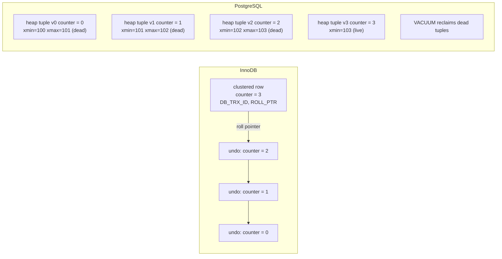

## Introduction

MySQL and PostgreSQL are the two most widely deployed open-source relational databases. Both implement SQL, ACID transactions, MVCC, B-tree indexes, replication, JSON, window functions and CTEs; both run everything from small web applications to some of the largest services on the internet. A professional is regularly asked to choose between them, to migrate from one to the other, or to work on both in the same company.

Comparisons found online are often outdated ("MySQL has no CHECK constraints", "PostgreSQL is slow") or tribal. This lesson compares them **as engineers would**: by architecture, by the consequences of that architecture, and by concrete SQL and operational differences — with every MySQL claim demonstrated on a real server and PostgreSQL equivalents shown display-only (the lab runs MySQL only).

The lesson is organized around six questions:

1. How is a table physically stored (clustered index vs heap)?
2. How is MVCC implemented, and what does each design cost (undo + purge vs tuple versions + VACUUM)?
3. What do the default isolation levels actually guarantee?
4. Which SQL features differ, and how do you work around them in MySQL?
5. How do extensions, replication and day-to-day operations differ?
6. Which of your skills transfer, and which are MySQL-specific?

:::note[Dataset and scope]
Runnable examples use the **shop** dataset on MySQL (the capture server reports its exact version; the platform targets MySQL 8.4 LTS). PostgreSQL code is shown in blocks labelled `pgsql`; it is not executed here and reflects current PostgreSQL releases as documented in the PostgreSQL manual. Version-specific features are marked; when in doubt, check the current documentation of the version you run.
:::

## DBMS Theory

:::theory[Same theory, different implementations]
Both systems implement the same textbook concepts — the relational model, SQL, ACID, write-ahead logging, MVCC with snapshot reads, B-tree indexes and cost-based optimization. Where they differ is in **physical design decisions**, each with consistent consequences:

| Concept | MySQL / InnoDB | PostgreSQL |
|---|---|---|
| Table organization | **Index-organized**: rows stored in the leaves of the primary-key B+ tree (clustered index) | **Heap**: rows stored in unordered pages; every index (including the primary key) is secondary and points to a tuple id (ctid) |
| Secondary index entries | (key, primary-key value) | (key, ctid) |
| MVCC old versions | Row updated **in place**; previous versions reconstructed from **undo log** records; removed by **purge** threads | Each update writes a **new tuple version** in the heap; old versions stay until **VACUUM** reclaims them |
| Write-ahead log | InnoDB **redo log** (physical) + server **binary log** (logical, for replication), coordinated by an internal 2PC | Single **WAL**, used for crash recovery and physical replication; logical decoding derives logical changes from it |
| Default isolation | **REPEATABLE READ** (consistent snapshot for plain reads; locking reads see latest) | **READ COMMITTED**; REPEATABLE READ is snapshot isolation that aborts on write conflicts; SERIALIZABLE uses SSI |
| Process model | One process, **thread per connection** | **Process per connection** (postmaster forks a backend) |
:::

None of these is "better" in the abstract: each choice makes some operations cheaper and others more expensive, and the rest of the lesson traces the consequences.

## Why It Exists

Why compare at all, instead of learning one database well?

- **Selection.** New projects and platform teams choose a default database; the choice shapes years of operational work ([Database Technology Selection](/lessons/m13-technology-selection)).
- **Migration.** Companies migrate in both directions — for licensing, feature or cloud-offering reasons — and the differences in semantics (isolation, type coercion, collation, DDL transactions) are where migrations fail.
- **Polyglot reality.** Many organizations run both; engineers move between teams. Knowing what is general (SQL, indexing, transactions) and what is product-specific prevents wrong assumptions such as "UPDATEs never bloat tables" (true-ish for InnoDB, false for PostgreSQL) or "REPEATABLE READ prevents lost updates" (it does in PostgreSQL by aborting, not in InnoDB for read-then-write patterns).
- **Interviews and design reviews** routinely ask for the trade-offs, not the brand preference.

## Internal Working

:::internals[MVCC in both systems]
**InnoDB.** Every row in the clustered index carries hidden fields: the id of the transaction that last modified it (`DB_TRX_ID`) and a **roll pointer** (`DB_ROLL_PTR`) to an undo record holding the previous version. An `UPDATE` modifies the row in place (when it fits) and writes the old values to the undo log. A consistent read whose read view must not see the change follows the roll-pointer chain to rebuild the version it is allowed to see. When no read view needs an old version any more, **purge threads** discard the undo records (and physically remove delete-marked rows). Long-running transactions keep read views alive, so undo accumulates — visible as a growing *history list length* in `SHOW ENGINE INNODB STATUS` (not available in the lab). Secondary indexes are not versioned the same way: their pages carry a max-transaction id, and a secondary-index lookup may need to visit the clustered row to check visibility ([MVCC](/lessons/m08-mvcc)).

**PostgreSQL.** Every tuple carries `xmin` (creating transaction) and `xmax` (deleting/updating transaction). An `UPDATE` inserts a **new tuple version** and sets `xmax` on the old one; readers test visibility of each tuple against their snapshot. Dead tuples remain in the heap and indexes until **VACUUM** (usually autovacuum) marks the space reusable; **HOT** (heap-only tuple) updates avoid new index entries when no indexed column changes and the new version fits on the same page. Because transaction ids are 32-bit, VACUUM must also **freeze** old tuples to prevent transaction-id wraparound. A **visibility map** records all-visible pages, enabling index-only scans.

Consequences: InnoDB's in-place design keeps tables compact under update-heavy workloads but pays for old versions in undo and for long transactions in purge lag; PostgreSQL's append-style design makes rollback trivial and readers never touch an undo log, but it requires a healthy VACUUM process and can **bloat** tables and indexes when vacuuming falls behind.
:::



## MySQL Implementation

Start with the server defaults that most often surprise people coming from PostgreSQL:

```sql run
SELECT @@transaction_isolation AS isolation, @@autocommit AS autocommit,
       @@default_storage_engine AS engine, @@collation_server AS collation, @@sql_mode AS sql_mode;
```

**Clustered index: secondary indexes contain the primary key.** An index declared only on `city` can answer a query for `id` without touching the table — because every InnoDB secondary index entry stores the primary-key value:

```sql run
CREATE TABLE people (id INT PRIMARY KEY, email VARCHAR(100) NOT NULL, city VARCHAR(30) NOT NULL, KEY idx_people_city (city));
INSERT INTO people SELECT customer_id, email, city FROM customers;
ANALYZE TABLE people;
EXPLAIN SELECT id FROM people WHERE city = 'Austin';
EXPLAIN SELECT id, email FROM people WHERE city = 'Austin';
```

The first plan says *Using index* (covering) even though `id` is not in the index definition; the second must look up each row in the clustered index for `email`. In PostgreSQL, `idx_people_city` would store tuple ids, not `id`; an index-only scan for `id` would need an index that includes `id` (for example `CREATE INDEX … ON people (city) INCLUDE (id)`) and a recently vacuumed table (visibility map).

**Updates in place.** Update every row of a 50,000-row table three times and compare the clustered index size before and after:

```sql run
CREATE TABLE mvcc_probe (id INT PRIMARY KEY, counter INT NOT NULL, pad CHAR(100) NOT NULL);
SET SESSION cte_max_recursion_depth = 50000;
INSERT INTO mvcc_probe
WITH RECURSIVE s(n) AS (SELECT 1 UNION ALL SELECT n + 1 FROM s WHERE n < 50000) SELECT n, 0, 'x' FROM s;
ANALYZE TABLE mvcc_probe;
SELECT DATA_LENGTH AS bytes_before FROM information_schema.TABLES
WHERE TABLE_SCHEMA = DATABASE() AND TABLE_NAME = 'mvcc_probe';
UPDATE mvcc_probe SET counter = counter + 1;
UPDATE mvcc_probe SET counter = counter + 1;
UPDATE mvcc_probe SET counter = counter + 1;
ANALYZE TABLE mvcc_probe;
SELECT DATA_LENGTH AS bytes_after, SUM(counter) AS total_counter FROM information_schema.TABLES, mvcc_probe
WHERE TABLE_SCHEMA = DATABASE() AND TABLE_NAME = 'mvcc_probe' GROUP BY DATA_LENGTH;
```

The table did not grow: 150,000 row versions were written to the undo log, not to the table, and purge discards them once no transaction needs them. The PostgreSQL equivalent (display-only) shows the opposite pattern — dead tuples accumulate until VACUUM:

```pgsql
-- PostgreSQL (display-only; illustrative workflow)
CREATE TABLE mvcc_probe (id int PRIMARY KEY, counter int NOT NULL, pad char(100) NOT NULL);
INSERT INTO mvcc_probe SELECT n, 0, 'x' FROM generate_series(1, 50000) AS n;
SELECT pg_size_pretty(pg_relation_size('mvcc_probe'));      -- size before
UPDATE mvcc_probe SET counter = counter + 1;                -- x3
SELECT n_live_tup, n_dead_tup FROM pg_stat_user_tables WHERE relname = 'mvcc_probe';
SELECT pg_size_pretty(pg_relation_size('mvcc_probe'));      -- larger: new tuple versions were appended
VACUUM mvcc_probe;                                          -- dead tuples become reusable space (file size usually stays)
```

## Syntax Breakdown

The SQL-level differences that matter most in practice:

| Feature | MySQL 8.0/8.4 | PostgreSQL | MySQL workaround |
|---|---|---|---|
| `FULL OUTER JOIN` | **Not supported** | Supported | `LEFT JOIN … UNION … RIGHT JOIN … WHERE left IS NULL` |
| `RETURNING` on INSERT/UPDATE/DELETE | **Not supported** | Supported | `LAST_INSERT_ID()`, re-select by key in the same transaction |
| `MERGE` | Not supported | Since 15 | `INSERT … ON DUPLICATE KEY UPDATE` |
| Upsert | `INSERT … ON DUPLICATE KEY UPDATE` (any unique key) | `INSERT … ON CONFLICT (cols) DO UPDATE SET … = EXCLUDED.…` | — |
| `CHECK` constraints | **Enforced since 8.0.16**; parsed and silently ignored before | Always enforced | Upgrade; validate legacy data before enabling |
| Partial indexes (`WHERE …`) | Not supported | Supported | Generated column `IF(cond, key, NULL)` + index ([Generated Columns](/lessons/m13-generated-columns)) |
| Expression indexes | Functional key parts (8.0.13+) | Supported | — |
| Transactional DDL | **No** — DDL causes an implicit commit (individual DDL statements are atomic since 8.0) | Yes — most DDL can be rolled back | Run migrations as idempotent steps |
| `FETCH FIRST n ROWS ONLY` | Not supported | Supported (and `LIMIT`) | `LIMIT n` |
| `FILTER (WHERE …)` on aggregates | Not supported | Supported | `SUM(CASE WHEN … END)` |
| `DISTINCT ON` | Not supported | Supported | `ROW_NUMBER()` in a derived table |
| `INTERSECT` / `EXCEPT` | Since 8.0.31 | Supported | — |
| Arrays, range types, `uuid`, `inet` | No (JSON arrays; `BINARY(16)` + `UUID_TO_BIN`) | Native types | Junction tables, JSON |
| Unsigned integers, `ENUM`, `SET` | Yes | No unsigned; `ENUM` via `CREATE TYPE` | — |
| Identifier case | Table-name case sensitivity depends on `lower_case_table_names` / OS | Unquoted identifiers folded to lower case | Use lower-case names everywhere |
| String comparison default | Case- and accent-insensitive (`utf8mb4_0900_ai_ci`) | Case-sensitive (collation-dependent; `citext` extension or `ILIKE`) | Choose collations explicitly |

## Practical Examples

### 1. FULL OUTER JOIN

```sql run error
SELECT c.customer_id, o.order_id
FROM customers c FULL OUTER JOIN orders o ON o.customer_id = c.customer_id;
```

MySQL's grammar has no `FULL [OUTER] JOIN`, so the statement is a syntax error (1064). The standard workaround combines a left join with the right-only rows:

```sql run
SELECT c.customer_id, o.order_id
FROM customers c LEFT JOIN orders o ON o.customer_id = c.customer_id
WHERE c.customer_id IN (2, 4)
UNION ALL
SELECT c.customer_id, o.order_id
FROM customers c RIGHT JOIN orders o ON o.customer_id = c.customer_id
WHERE c.customer_id IS NULL
ORDER BY customer_id, order_id;
```

(Every order has a customer here, so the second branch contributes nothing — which is exactly what a referential-integrity check would assert.) In PostgreSQL:

```pgsql
SELECT c.customer_id, o.order_id
FROM customers c FULL JOIN orders o ON o.customer_id = c.customer_id;
```

### 2. RETURNING and generated keys

```sql run error
INSERT INTO categories (name) VALUES ('Garden') RETURNING category_id;
```

```sql run
INSERT INTO categories (name) VALUES ('Garden');
SELECT LAST_INSERT_ID() AS new_category_id;
SELECT category_id, name FROM categories WHERE category_id = LAST_INSERT_ID();
```

`LAST_INSERT_ID()` is per-connection, so it is safe under concurrency; for multi-row inserts it returns the **first** generated id. PostgreSQL returns any columns of the affected rows directly — including from `UPDATE` and `DELETE`, which MySQL has no equivalent for:

```pgsql
INSERT INTO categories (name) VALUES ('Garden') RETURNING category_id;
UPDATE products SET price = price * 1.05 WHERE category_id = 3 RETURNING product_id, price;
INSERT INTO categories (name) VALUES ('Garden')
ON CONFLICT (name) DO UPDATE SET name = EXCLUDED.name RETURNING category_id;
```

### 3. Type strictness and implicit conversion

```sql run
SELECT 'abc' = 'ABC' AS case_insensitive_equal,
       'abc' = 0     AS string_equals_zero,
       '12abc' + 1   AS string_arithmetic,
       1 / 0         AS division_by_zero;
SHOW WARNINGS;
```

In a `SELECT`, MySQL converts `'abc'` to the number 0 and `'12abc'` to 12 with warnings, and `1/0` yields `NULL` with a warning. (In `INSERT`/`UPDATE`, strict SQL mode plus `ERROR_FOR_DIVISION_BY_ZERO` turns such cases into errors.) PostgreSQL rejects the conversions outright:

```pgsql
SELECT 'abc' = 0;        -- ERROR: invalid input syntax for type integer: "abc"
SELECT '12abc'::int + 1; -- ERROR: invalid input syntax for type integer: "12abc"
SELECT 1 / 0;            -- ERROR: division by zero
SELECT 'abc' = 'ABC';    -- false under the default deterministic collations
```

Migrations from MySQL to PostgreSQL routinely uncover application queries that only worked because of implicit conversions and case-insensitive comparisons.

### 4. DDL inside transactions

```sql run
START TRANSACTION;
INSERT INTO categories (name) VALUES ('Outdoor');
CREATE TABLE ddl_probe (id INT);
ROLLBACK;
SELECT (SELECT COUNT(*) FROM categories WHERE name = 'Outdoor') AS outdoor_rows_after_rollback,
       (SELECT COUNT(*) FROM information_schema.TABLES
         WHERE TABLE_SCHEMA = DATABASE() AND TABLE_NAME = 'ddl_probe')  AS ddl_probe_exists;
```

The `CREATE TABLE` caused an **implicit commit** of the pending `INSERT` before it ran; the `ROLLBACK` had nothing left to undo. In PostgreSQL the same sequence rolls back both the row and the table — a major convenience for schema migrations, which can be wrapped in a transaction and either fully applied or not at all.

### 5. CHECK constraints — the history matters for migrations

```sql run error
CREATE TABLE price_list (sku VARCHAR(20) PRIMARY KEY, price DECIMAL(10,2) NOT NULL, CONSTRAINT chk_price_positive CHECK (price > 0));
INSERT INTO price_list VALUES ('A', 10.00), ('B', -1.00);
```

MySQL 8.0.16+ enforces `CHECK` (error 3819). Before 8.0.16 the same DDL was accepted and the constraint **ignored**, so databases upgraded from 5.7 may contain constraint definitions in application migration scripts but never-validated data. When moving such data to PostgreSQL (which always enforces `CHECK`) or re-adding the constraint in MySQL 8, validate first: `SELECT … WHERE NOT (price > 0)`. MySQL also supports `NOT ENFORCED` constraints, which document a rule without checking it.

## Execution Walkthrough

How does each system let a long-running reader see an old version while writers continue? Replay it on InnoDB with two sessions; the PostgreSQL mechanism is described in each note.

```concurrency
title: A consistent snapshot while another session updates (InnoDB)
description: Session A keeps a REPEATABLE READ snapshot open while B updates the same row three times; A keeps seeing the old value, rebuilt from undo.
setup: |
  CREATE TABLE counters (id INT PRIMARY KEY, counter INT NOT NULL);
  INSERT INTO counters VALUES (1, 0);
steps:
  - session: A
    sql: START TRANSACTION; SELECT counter FROM counters WHERE id = 1;
    note: A's first read creates its read view (snapshot). It sees 0. In PostgreSQL at REPEATABLE READ, the snapshot is taken at the first statement too; at the default READ COMMITTED, each statement takes a new snapshot.
  - session: B
    sql: UPDATE counters SET counter = counter + 1 WHERE id = 1; UPDATE counters SET counter = counter + 1 WHERE id = 1; UPDATE counters SET counter = counter + 1 WHERE id = 1;
    note: B (autocommit) changes the row in place three times; each old version goes to the undo log. PostgreSQL would append three new heap tuples instead.
  - session: A
    sql: SELECT counter FROM counters WHERE id = 1;
    note: A still sees 0 — InnoDB follows the roll-pointer chain back through three undo records to the version A's snapshot allows. PostgreSQL would scan to the tuple whose xmin/xmax make it visible to A's snapshot.
  - session: A
    sql: SELECT counter FROM counters WHERE id = 1 FOR UPDATE;
    note: A locking read in InnoDB reads the LATEST committed version (3), not the snapshot — the 'current read' that makes InnoDB's REPEATABLE READ differ from snapshot isolation. PostgreSQL at REPEATABLE READ would raise a serialization failure here if it had to lock a row changed after its snapshot.
  - session: A
    sql: COMMIT; SELECT counter FROM counters WHERE id = 1;
    note: After commit, a new read view sees 3. The undo records for versions 0–2 can now be purged; in PostgreSQL, VACUUM can reclaim the dead tuples once no snapshot needs them.
```

The fourth step is the most important semantic difference between the two systems' REPEATABLE READ levels: InnoDB mixes snapshot reads with current (locking) reads in one transaction, while PostgreSQL's REPEATABLE READ is pure snapshot isolation and resolves conflicts by aborting with `could not serialize access due to concurrent update`. Code ported between them must re-examine every read-modify-write sequence ([Isolation Levels](/lessons/m08-isolation-levels)).

## Output

The demonstrations add up to a compact comparison an architect can defend in a review:

| Dimension | MySQL (InnoDB) — observed or documented | PostgreSQL — documented |
|---|---|---|
| Update-heavy table size | Stable in the lab after 150,000 updates (old versions in undo) | Grows with dead tuples until VACUUM; HOT updates mitigate |
| PK lookups / range scans by PK | Rows are in the PK B+ tree — one index traversal | Index traversal + heap fetch (unless index-only) |
| Secondary index lookups | Index → PK → clustered index (two traversals unless covering) | Index → heap tuple by ctid |
| Wide/random PK (UUIDv4) | Page splits and poor locality in the clustered index | Heap insert order unaffected; index still random |
| Snapshot reads under long transactions | Undo growth and purge lag | Dead tuples cannot be vacuumed; bloat |
| `REPEATABLE READ` read-modify-write | Locking reads see latest; lost-update protection needs `FOR UPDATE` or optimistic checks | Serialization failure → application retries |
| Implicit conversions | Permissive in SELECT (warnings) | Strict (errors) |
| DDL in transactions | Implicit commit | Transactional |

## Alternative Approaches

Neither system has to be chosen wholesale; teams combine them and their ecosystems:

| Need | MySQL ecosystem | PostgreSQL ecosystem |
|---|---|---|
| High availability | Group Replication / InnoDB Cluster, async/semi-sync replication, MySQL Router, Orchestrator | Streaming replication with Patroni/repmgr, synchronous replication |
| Horizontal sharding | Vitess (PlanetScale), application-level sharding | Citus extension, application-level sharding |
| Change data capture | Binary log (row-based) → Debezium | Logical decoding (`pgoutput`) → Debezium, native logical replication |
| Geospatial | Built-in spatial types and functions ([Spatial Data Fundamentals](/lessons/m13-spatial)) | PostGIS (the reference open-source GIS database) |
| Full-text search | InnoDB FULLTEXT ([Full-Text Search](/lessons/m13-full-text-search)) | `tsvector`/`tsquery` with GIN, language dictionaries, `pg_trgm` |
| Vector search | `VECTOR` type in MySQL 9.x Innovation releases; HeatWave vector store (Oracle cloud) | `pgvector` extension |
| Analytics | HeatWave (Oracle cloud), replicas, external warehouses | Parallel query, columnar extensions/forks, external warehouses |
| Managed services | Amazon RDS/Aurora MySQL, Google Cloud SQL, Azure Database for MySQL, Oracle HeatWave, PlanetScale | Amazon RDS/Aurora PostgreSQL, Cloud SQL, AlloyDB, Azure Database for PostgreSQL, Neon, Supabase and others |

**Extensibility** is the largest structural difference. PostgreSQL's `CREATE EXTENSION` lets third parties add data types, operators, index methods (GiST, GIN, BRIN, SP-GiST are built-in frameworks) and procedural languages, which is why PostGIS, TimescaleDB, Citus and pgvector exist as extensions. MySQL is extended through **storage engines**, **plugins** (authentication, full-text parsers, audit) and **components**; it does not offer user-defined index methods or types, so equivalent features arrive in the core server or as separate products.

## Performance Analysis

Performance comparisons between the two are workload-specific; published benchmarks routinely contradict each other because they test different configurations, versions and access patterns. What can be said from the architectures — and what you should measure for your workload:

- **Primary-key point reads and PK-range scans** favour the clustered design (InnoDB): the row is in the index leaf.
- **Secondary-index-heavy reads** cost InnoDB a second B+ tree traversal per row (unless covering); PostgreSQL fetches the heap tuple directly but may need visibility checks.
- **Update-heavy workloads** stress InnoDB's undo/purge and PostgreSQL's VACUUM respectively; both degrade with long-running transactions. PostgreSQL's HOT updates matter: design fillfactor and avoid indexing frequently updated columns.
- **Random primary keys** (UUIDv4) hurt InnoDB more, because they scatter inserts across the clustered index; use ordered keys (auto-increment, UUIDv7, `UUID_TO_BIN(…, 1)`).
- **Complex analytical queries**: PostgreSQL has a broader set of join and scan strategies and **parallel query** across workers; MySQL executes a query mostly on one thread (it does have hash joins since 8.0.18 and parallel scans for a few operations) and offers HeatWave as an analytics engine in Oracle's cloud.
- **Connections**: PostgreSQL's process-per-connection model makes thousands of direct connections expensive (connection poolers such as PgBouncer are standard); MySQL's threads are lighter, though pooling remains best practice ([Connections and Pooling](/lessons/m10-connections-pooling)).

The honest conclusion for a design document is: *both handle typical OLTP very well; identify the specific access patterns that differ (PK-clustered reads, update churn, analytical complexity, connection counts, required extensions) and benchmark those with your data.*

## Best Practices

:::best-practice[Working across MySQL and PostgreSQL]
1. **Write portable SQL where it costs nothing**: explicit column lists, explicit `ORDER BY`, `CASE` instead of `SUM(cond)`, standard `COALESCE`, half-open date ranges, explicit `CAST`s.
2. **Never rely on implicit conversions or case-insensitive defaults**; compare like types and choose collations deliberately.
3. **Know each system's MVCC maintenance**: monitor purge lag / history list length in MySQL, autovacuum and bloat in PostgreSQL; in both, kill or avoid long idle transactions.
4. **Re-examine concurrency logic when porting**: InnoDB REPEATABLE READ with current reads vs PostgreSQL snapshot isolation with serialization failures; add `FOR UPDATE`, optimistic version checks or retry loops accordingly.
5. **Treat migrations as non-transactional in MySQL**: idempotent steps, online DDL tools; in PostgreSQL, use transactional DDL but beware of long locks (`ACCESS EXCLUSIVE`) on large tables.
6. **Choose primary keys for the storage model**: compact, ordered keys for InnoDB clustered indexes.
7. **Base the choice on requirements, ecosystem and team skills**, not on benchmarks from someone else's workload.
:::

## Common Mistakes

**Mistake 1 — porting `FETCH FIRST`, `RETURNING`, `FILTER` or `FULL JOIN` and assuming MySQL accepts them.** All are syntax errors in MySQL 8.0/8.4:

```sql run error
SELECT name FROM products ORDER BY product_id FETCH FIRST 3 ROWS ONLY;
```

**Mistake 2 — assuming DDL rolls back in MySQL.** Shown in Practical Example 4: the implicit commit also commits earlier DML in the same transaction.

**Mistake 3 — trusting `CHECK` constraints on data that came from MySQL < 8.0.16.** They were never enforced; validate before relying on them or migrating.

**Mistake 4 — assuming identical results from identical queries.** Case-insensitive comparison, trailing-space handling (`PAD SPACE` collations), implicit casts and `GROUP BY` behaviour can make the same query return different rows:

```sql run
SELECT COUNT(*) AS customers_named_grace FROM customers WHERE first_name = 'GRACE';
```

The default MySQL collation matched both customers stored as `'Grace'`; PostgreSQL with a deterministic collation would return 0.

**Mistake 5 — treating VACUUM or purge as optional.** In PostgreSQL, disabled or starved autovacuum leads to bloat and eventually to transaction-id wraparound protection stopping writes; in MySQL, a forgotten open transaction makes the undo log grow without bound.

## Industry Application

- **Large web companies** run MySQL at very large scale with sharding layers (Vitess originated at YouTube; Meta, Uber, Shopify, GitHub and others have published about operating MySQL fleets), valuing its replication tooling and operational predictability.
- **PostgreSQL** is the default for many newer startups and platforms because of its SQL feature set, extensions (PostGIS, pgvector, TimescaleDB) and strictness; cloud vendors have built several distributed or serverless PostgreSQL-compatible services.
- **Migrations** in both directions are common projects; tools such as AWS DMS and pgloader move data, but semantic differences (types, collations, isolation, SQL dialect) are handled by engineers.
- **Polyglot shops** standardize on one for OLTP and keep the other for a specific strength (for example PostgreSQL + PostGIS for a geospatial service alongside a MySQL core).
- **Interviews** for backend and data roles frequently ask: clustered vs heap storage, MVCC implementations, isolation defaults, and how you would choose — this lesson's comparison table is the expected level of answer.

### Transferable skills vs MySQL-specific skills

| Transfers to PostgreSQL and other SQL systems | MySQL/InnoDB-specific |
|---|---|
| Relational modelling, normalization, ER design | `AUTO_INCREMENT`, `ENUM`/`SET`, `UNSIGNED`, `ON DUPLICATE KEY UPDATE`, `LAST_INSERT_ID()` |
| SQL querying: joins, subqueries, CTEs, window functions, set operations | MySQL dialect details: `->`/`->>`, `GROUP_CONCAT`, `FIND_IN_SET`, `SUM(boolean)` |
| Indexing theory (B-trees, selectivity, composite and covering indexes, SARGability) | Clustered-index specifics (secondary index contains PK, PK choice), functional key parts, multi-valued indexes, InnoDB FULLTEXT |
| Reading execution plans and measuring (EXPLAIN / EXPLAIN ANALYZE concepts) | MySQL's EXPLAIN formats and columns, optimizer hints, optimizer trace |
| Transactions, isolation anomalies, locking concepts, deadlocks | InnoDB next-key/gap locks, REPEATABLE READ with current reads, `SKIP LOCKED` details |
| MVCC concepts | Undo log, purge, history list length, change buffer, adaptive hash index |
| Backups, replication and HA concepts, capacity planning | Binary log formats, GTIDs, Group Replication, InnoDB Cluster, `mysqldump`/MySQL Shell utilities |
| Security principles (least privilege, roles, TLS, injection prevention) | MySQL account model (`user@host`), authentication plugins, `caching_sha2_password` |

## Practice Exercises

```exercise
id: ex1
title: FULL OUTER JOIN in MySQL
difficulty: easy
concepts: [sql-dialects]
setup: |
  CREATE TABLE warehouse_a (sku VARCHAR(10) PRIMARY KEY, qty INT NOT NULL);
  CREATE TABLE warehouse_b (sku VARCHAR(10) PRIMARY KEY, qty INT NOT NULL);
  INSERT INTO warehouse_a VALUES ('S1', 5), ('S2', 3), ('S3', 0);
  INSERT INTO warehouse_b VALUES ('S2', 7), ('S4', 1);
prompt: |
  Return every SKU that exists in **either** warehouse with its quantity in each (NULL where absent) — what
  PostgreSQL would compute with `FULL JOIN`. Columns: `sku`, `qty_a`, `qty_b`.
hints:
  - "LEFT JOIN warehouse_a → warehouse_b gives all A rows."
  - "Add the B rows that have no match in A with a RIGHT JOIN (or LEFT JOIN the other way) filtered on the A side being NULL, combined with UNION ALL."
solution: |
  SELECT a.sku, a.qty AS qty_a, b.qty AS qty_b
  FROM warehouse_a a LEFT JOIN warehouse_b b ON b.sku = a.sku
  UNION ALL
  SELECT b.sku, a.qty, b.qty
  FROM warehouse_a a RIGHT JOIN warehouse_b b ON b.sku = a.sku
  WHERE a.sku IS NULL;
explanation: |
  The second branch takes only B-only rows, so `UNION ALL` (no deduplication cost) is correct. Using `UNION`
  instead of `UNION ALL` without the `WHERE a.sku IS NULL` filter also works but deduplicates the
  matched rows, which is slower and wrong if genuine duplicates must be kept. Note the second branch selects
  `b.sku`, because `a.sku` is NULL there.
```

```exercise
id: ex2
title: RETURNING-style insert
difficulty: medium
kind: dml
concepts: [sql-dialects]
prompt: |
  PostgreSQL code does `INSERT INTO categories (name, parent_id) VALUES ('Garden', NULL) RETURNING category_id`
  and then inserts a child category `'Tools'` under it. Write the MySQL equivalent: insert `'Garden'` (no
  parent) and then `'Tools'` with `parent_id` set to Garden's generated id — without hard-coding the id.
  The checker returns both categories with their parent's name.
hints:
  - "LAST_INSERT_ID() returns the AUTO_INCREMENT value generated by this connection's last INSERT."
  - "Store it in a variable or use it directly in the next INSERT's VALUES."
solution: |
  INSERT INTO categories (name, parent_id) VALUES ('Garden', NULL);
  INSERT INTO categories (name, parent_id) VALUES ('Tools', LAST_INSERT_ID());
check: |
  SELECT c.name, p.name AS parent_name
  FROM categories c LEFT JOIN categories p ON p.category_id = c.parent_id
  WHERE c.name IN ('Garden', 'Tools') ORDER BY c.name;
explanation: |
  `LAST_INSERT_ID()` is per-connection, so concurrent sessions cannot interfere. `SELECT MAX(category_id)` is
  the classic wrong answer: under concurrency another session's insert can be the maximum. If the second
  statement itself generated a new id before reading LAST_INSERT_ID(), you would need to save the value in a
  variable first (`SET @garden = LAST_INSERT_ID();`).
```

```exercise
id: ex3
title: A partial unique index, MySQL style
difficulty: hard
kind: dml
concepts: [sql-dialects, mysql-vs-postgresql]
setup: |
  CREATE TABLE api_keys (key_id INT PRIMARY KEY, customer_id INT UNSIGNED NOT NULL, revoked BOOLEAN NOT NULL DEFAULT FALSE);
  INSERT INTO api_keys VALUES (1, 1, TRUE), (2, 1, TRUE), (3, 1, FALSE), (4, 3, FALSE);
prompt: |
  PostgreSQL enforces "one active (non-revoked) API key per customer" with
  `CREATE UNIQUE INDEX one_active_key ON api_keys (customer_id) WHERE NOT revoked;`.
  Implement the same rule in MySQL on `api_keys` with a generated column and a unique index. The checker
  counts the generated columns and non-primary unique indexes on `api_keys`.
hints:
  - "MySQL has no partial indexes, but a UNIQUE index allows many NULLs."
  - "Generate customer_id when NOT revoked, NULL otherwise."
solution: |
  ALTER TABLE api_keys
    ADD COLUMN active_customer INT UNSIGNED AS (IF(revoked, NULL, customer_id)) VIRTUAL,
    ADD UNIQUE KEY uq_one_active_key (active_customer);
check: |
  SELECT
    (SELECT COUNT(*) FROM information_schema.COLUMNS
      WHERE TABLE_SCHEMA = DATABASE() AND TABLE_NAME = 'api_keys' AND EXTRA LIKE '%GENERATED%') AS generated_cols,
    (SELECT COUNT(DISTINCT INDEX_NAME) FROM information_schema.STATISTICS
      WHERE TABLE_SCHEMA = DATABASE() AND TABLE_NAME = 'api_keys' AND NON_UNIQUE = 0 AND INDEX_NAME <> 'PRIMARY') AS unique_indexes;
explanation: |
  Revoked keys map to NULL and never collide; active keys map to the customer id. A functional unique index
  `UNIQUE ((IF(revoked, NULL, customer_id)))` is an equivalent MySQL 8.0.13+ alternative. The idiom is a
  standard translation when porting PostgreSQL partial unique indexes to MySQL.
```

```exercise
id: ex4
title: Port a read-modify-write safely
difficulty: challenge
kind: open
concepts: [isolation-levels, mvcc]
prompt: |
  A PostgreSQL service runs at REPEATABLE READ and implements "reserve stock" as:
  `SELECT stock FROM products WHERE id = $1;` then, in application code, if stock ≥ qty,
  `UPDATE products SET stock = $computed WHERE id = $1;` — relying on PostgreSQL to raise a serialization
  failure (and the client to retry) when two reservations race. The service is being ported to MySQL 8.4
  with default settings. Explain precisely what changes, demonstrate the anomaly in words, and give two
  correct MySQL implementations.
solution: |
  - **What changes**: InnoDB's REPEATABLE READ is not pure snapshot isolation. The plain `SELECT` reads the
    snapshot, but the `UPDATE` is a *current read* of the latest committed row and does not fail when the row
    changed after the snapshot. PostgreSQL would abort the second transaction with "could not serialize access
    due to concurrent update"; MySQL silently succeeds.
  - **Anomaly**: stock = 5. T1 and T2 both read 5 and want 3. T1 updates to 2 and commits. T2's UPDATE waits for
    T1's lock, then writes its precomputed value 2 (computed from its snapshot) and commits. Two reservations
    of 3 each were granted from a stock of 5 — a lost update.
  - **Fix 1 (atomic conditional update)**: `UPDATE products SET stock = stock - ? WHERE id = ? AND stock >= ?;`
    and check affected rows (1 = reserved, 0 = insufficient). The arithmetic happens on the current row under
    the row lock — no read-modify-write in the application.
  - **Fix 2 (pessimistic)**: `START TRANSACTION; SELECT stock FROM products WHERE id = ? FOR UPDATE;` then
    update; the locking read sees the latest value and blocks competitors until commit.
  - **Fix 3 (optimistic)**: add a `version` column; `UPDATE … SET stock = ?, version = version + 1 WHERE id = ?
    AND version = ?` and retry on 0 rows.
  - Keep the retry loop for deadlocks (error 1213) and lock wait timeouts (1205), which MySQL can still raise.
```

## Knowledge Assessment

```quiz
- id: q1
  question: "Where does InnoDB keep the previous versions of a row that has been updated?"
  options:
    - "As additional row versions in the table's pages, removed by VACUUM"
    - "In undo log records reachable through the row's roll pointer, discarded by purge when no read view needs them"
    - "In the binary log"
    - "In the doublewrite buffer"
  answer: 1
  explanation: "InnoDB updates rows in place and keeps old versions in undo; the lab's table size stayed constant after 150,000 updates. Heap versions + VACUUM is PostgreSQL's design. The binary log is for replication/recovery of changes, and the doublewrite buffer protects against torn pages."
  concepts: [mvcc]
- id: q2
  question: "An InnoDB table has `PRIMARY KEY (id)` and `INDEX (city)`. Why can `SELECT id FROM t WHERE city = ?` be answered from the index alone?"
  options:
    - "Because InnoDB caches all ids in memory"
    - "Because every InnoDB secondary index entry contains the primary-key value"
    - "Because the optimizer rewrites the query to use the primary key"
    - "Because city is unique"
  answer: 1
  explanation: "Secondary indexes in a clustered (index-organized) table store the PK as the row locator, so the PK is always 'covered'. In PostgreSQL the index stores tuple ids instead."
  concepts: [clustered-index, heap-tables]
- id: q3
  question: "Which statements are true for MySQL 8.0/8.4? (Select all that apply.)"
  type: multi
  options:
    - "FULL OUTER JOIN is not supported"
    - "CHECK constraints are enforced (since 8.0.16)"
    - "A CREATE TABLE inside a transaction causes an implicit commit"
    - "INSERT … RETURNING is supported"
  answer: [0, 1, 2]
  explanation: "All three were demonstrated in the lab. RETURNING is a PostgreSQL (and MariaDB) feature; MySQL uses LAST_INSERT_ID()."
  concepts: [sql-dialects]
- id: q4
  question: "Two transactions at REPEATABLE READ both read stock = 5 with a plain SELECT, then each runs `UPDATE … SET stock = 2` (computed in the application). What happens on MySQL vs PostgreSQL?"
  options:
    - "Both systems commit both updates"
    - "MySQL commits both (lost update); PostgreSQL aborts the second with a serialization failure"
    - "MySQL aborts the second; PostgreSQL commits both"
    - "Both systems deadlock"
  answer: 1
  explanation: "InnoDB's UPDATE is a current read and does not check whether the row changed after the snapshot; PostgreSQL's REPEATABLE READ is snapshot isolation and aborts on such write conflicts. The walkthrough's FOR UPDATE step shows the current-read behaviour."
  concepts: [isolation-levels, mvcc]
- id: q5
  question: "What is the main operational risk that PostgreSQL's MVCC design adds compared with InnoDB's?"
  options:
    - "Undo tablespaces filling up"
    - "Table and index bloat, and transaction-id wraparound, if VACUUM (autovacuum) cannot keep up or is blocked by long transactions"
    - "The binary log growing too large"
    - "Gap locks causing deadlocks"
  answer: 1
  explanation: "Dead tuples live in the heap until VACUUM; freezing protects against 32-bit XID wraparound. InnoDB's analogous risk is undo growth and purge lag. Binary logs and gap locks are MySQL concepts."
  concepts: [vacuum, mvcc]
- id: q6
  question: "`SELECT 'abc' = 0` returns 1 on MySQL with a warning. What would PostgreSQL do?"
  options:
    - "Return true"
    - "Return false"
    - "Raise an error: invalid input syntax for type integer"
    - "Return NULL"
  answer: 2
  explanation: "PostgreSQL does not implicitly convert arbitrary strings to numbers; MySQL converts 'abc' to 0 in expression context and warns. Such differences surface during migrations."
  concepts: [sql-dialects, mysql-vs-postgresql]
- id: q7
  question: "Which capability is a structural strength of PostgreSQL's architecture rather than a single feature?"
  options:
    - "Thread-per-connection model"
    - "An extension framework that can add data types, operators and index methods (e.g. PostGIS, pgvector)"
    - "Index-organized tables"
    - "Statement-based replication"
  answer: 1
  explanation: "CREATE EXTENSION with GiST/GIN/BRIN frameworks lets third parties add first-class types and indexes. PostgreSQL uses process-per-connection and heap tables; MySQL is the one with index-organized tables and (legacy) statement-based binlog replication."
  concepts: [extensions]
- id: q8
  question: "Which skill learned on MySQL transfers most directly to PostgreSQL?"
  options:
    - "Tuning innodb_buffer_pool_size"
    - "Designing composite indexes by selectivity and SARGable predicates, and reading execution plans"
    - "Using ON DUPLICATE KEY UPDATE"
    - "Configuring GTID-based replication"
  answer: 1
  explanation: "Indexing theory and plan reading are general DBMS skills; the other options are MySQL-specific configuration or syntax (PostgreSQL uses shared_buffers, ON CONFLICT and WAL-based replication)."
  concepts: [transferable-skills]
```
