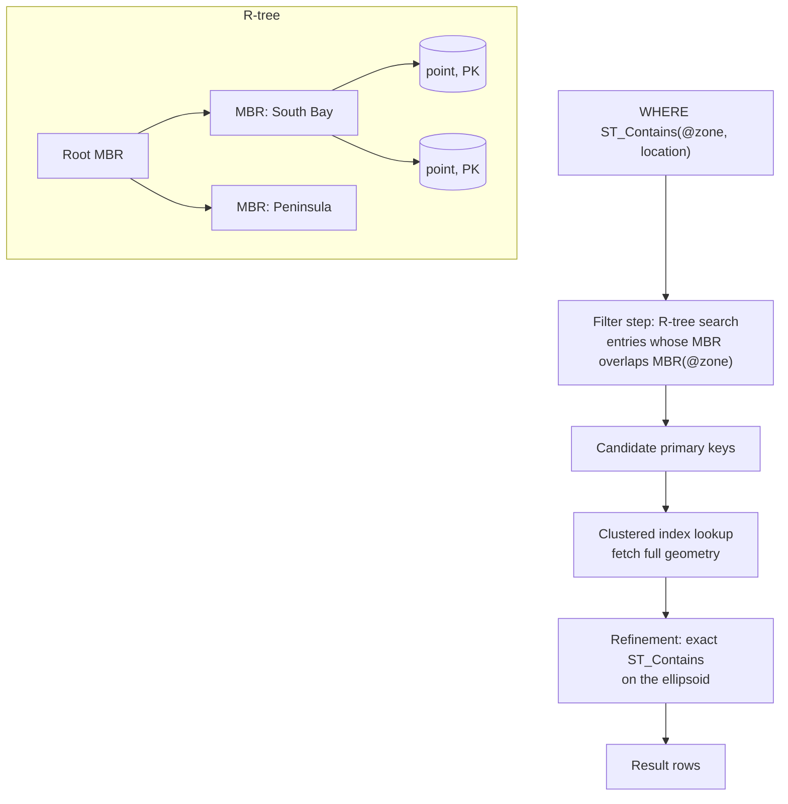

## Introduction

"Which store is closest to this customer?" "Which deliveries fall inside the same-day zone?" "How many riders are within 2 km of the restaurant?" These are **spatial** questions: they are about positions and shapes, and they need operations that ordinary columns do not provide — distance on the surface of the Earth, *point-in-polygon* tests, intersections — plus an index that can find nearby objects without reading the whole table.

MySQL implements the **OpenGIS / SQL/MM** model of spatial data: geometry types (`POINT`, `LINESTRING`, `POLYGON`, their `MULTI…` collections and `GEOMETRY`), **spatial reference systems** identified by an **SRID**, a family of `ST_…` functions, and **R-tree `SPATIAL` indexes** in InnoDB. Since MySQL 8.0, computations on SRID **4326** (WGS 84, GPS coordinates) are done on the **ellipsoid**, in metres — a big change from 5.7, where everything was flat Cartesian maths.

This lesson builds a small store locator for the shop and covers:

- geometry types, WKT/GeoJSON input and output, and the **axis-order trap** of SRID 4326;
- measurement (`ST_Distance`, `ST_Distance_Sphere`, `ST_Length`, `ST_Area`) and predicates (`ST_Contains`, `ST_Within`, `ST_Intersects`, `MBRContains`);
- `SPATIAL` indexes: why they require `NOT NULL` and an `SRID` attribute, and how `EXPLAIN` shows their use;
- the standard pattern for an **index-assisted distance query**.

:::note[Dataset]
The lab loads the **shop** dataset; the lesson adds `stores` (five stores with real-world coordinates), `city_coords` (approximate city-centre coordinates for the shop's customer cities) and `courier_pings` (20,000 generated GPS positions in the San Francisco Bay Area) for index experiments. All results are captured from a real server.
:::

## DBMS Theory

:::theory[The spatial data model]
The **Simple Features** specification (OGC, adopted as ISO 19125 and the basis of SQL/MM Spatial) defines:

- **Geometry types**: `Point` (0-dimensional), `LineString` (1-D), `Polygon` (2-D, an outer ring plus optional holes), and collections `MultiPoint`, `MultiLineString`, `MultiPolygon`, `GeometryCollection`.
- **Representations**: Well-Known Text (WKT, e.g. `POINT(37.33 -121.88)`) and Well-Known Binary (WKB).
- **Topological predicates** from the *Dimensionally Extended 9-Intersection Model* (DE-9IM): `Contains`, `Within`, `Intersects`, `Touches`, `Crosses`, `Overlaps`, `Disjoint`, `Equals` — each defined by how the interiors, boundaries and exteriors of two geometries intersect.
- **Spatial reference systems (SRS)**: coordinates only mean something relative to an SRS. A **Cartesian (projected)** SRS is a flat plane with linear units; a **geographic** SRS describes positions on an ellipsoid with angular units (degrees of latitude and longitude).
:::

The SRS determines the maths:

| SRS | Example | Units of coordinates | Distance / area computed | Typical use |
|---|---|---|---|---|
| SRID 0 | MySQL's default, unitless plane | abstract | Euclidean, in coordinate units | CAD, floor plans, games, legacy data |
| Geographic | **SRID 4326** (WGS 84, used by GPS) | degrees lat/long | Geodesic on the ellipsoid, in **metres** | Global positions, store locators |
| Projected | SRID 3857 (Web Mercator), UTM zones | metres on a map projection | Euclidean on the projection (distorted far from the projection's centre) | Web map tiles, local engineering |

**Spatial indexing** uses the **R-tree** (Guttman, 1984): a balanced tree in which every entry is a **minimum bounding rectangle (MBR)**. A node's MBR encloses the MBRs of its children, so a search descends only into nodes whose rectangle overlaps the search window. The index answers *"which objects' bounding boxes intersect this box?"* — a **filter** step; the exact geometric predicate is then evaluated on the candidates — the **refinement** step. Every spatial query plan in this lesson has that two-step shape.

## Why It Exists

Before native spatial support, applications stored `lat DECIMAL(9,6), lng DECIMAL(9,6)` and wrote distance formulas by hand:

- **Wrong maths.** Treating degrees as a flat grid is badly wrong away from the equator: one degree of longitude is about 111 km at the equator but only about 88 km at San José's latitude and about 75 km at Seattle's. Hand-written Haversine formulas get copied with sign errors and radius mistakes.
- **No point-in-polygon.** "Is this address inside the delivery zone?" for an arbitrary polygon is non-trivial computational geometry.
- **No index for 2-D proximity.** A composite B+ tree on `(lat, lng)` can range-scan latitude, but then must filter longitude row by row; it cannot efficiently answer "nearby in both dimensions".

Spatial types give **correct geodesic computation**, a **standard function library** that behaves like PostGIS and other OGC systems, and **R-tree indexes** for two-dimensional search. For many applications — store locators, delivery zones, geofencing, asset tracking — that removes the need for a separate GIS database.

## Internal Working

:::internals[How MySQL stores and indexes geometries]
- **Storage format.** A geometry value is stored as a 4-byte **SRID** followed by the **WKB** encoding. A `POINT` therefore occupies 25 bytes (4 SRID + 1 byte order + 4 type + 2 × 8-byte doubles). Values are stored like BLOBs.
- **SRID attribute on a column.** `location POINT NOT NULL SRID 4326` makes the column *restricted*: inserting a geometry with any other SRID is an error (3643). Without the attribute, a column can hold mixed SRIDs.
- **Spatial reference systems** are part of the data dictionary; `information_schema.ST_SPATIAL_REFERENCE_SYSTEMS` lists more than 5,000 EPSG definitions. `CREATE SPATIAL REFERENCE SYSTEM` (an administrative statement) adds custom ones.
- **InnoDB SPATIAL index** is an **R-tree** whose leaf entries are (MBR, primary key). For a geographic SRS the MBRs are computed in latitude/longitude and the comparisons are geography-aware.
- **Requirements.** A SPATIAL index requires the column to be `NOT NULL` (error 1252 otherwise), and the optimizer only uses it when the column has an **SRID attribute** — otherwise MySQL creates the index but warns (3674) that it will never be used, because an index can only hold values from one SRS.
- **What can use it.** The optimizer uses an R-tree for MBR and topological predicates in `WHERE` (`MBRContains`, `MBRWithin`, `MBRIntersects`, `ST_Contains`, `ST_Within`, `ST_Intersects`, `ST_Covers`, …) when one argument is the indexed column and the other is a constant geometry. It does **not** use it for `ST_Distance(…) < r` or `ST_Distance_Sphere(…) < r` — those are not window predicates.
:::



:::version[5.7 vs 8.0 / 8.4]
In MySQL 5.7, all spatial calculations were Cartesian regardless of SRID. MySQL 8.0 introduced SRS support: geographic calculations on the ellipsoid, the column `SRID` attribute, `ST_Transform` between SRSs (8.0.13), and latitude-longitude axis order for WKT in geographic SRSs. Code migrated from 5.7 that wrote `POINT(lng lat)` WKT with SRID 4326 either fails with an out-of-range latitude or silently swaps coordinates. MySQL 8.4 keeps the 8.0 behaviour.
:::

## MySQL Implementation

Create a store table with a restricted, indexable POINT column:

```sql run
CREATE TABLE stores (
  store_id INT PRIMARY KEY,
  name     VARCHAR(40) NOT NULL,
  city     VARCHAR(40) NOT NULL,
  location POINT NOT NULL SRID 4326,
  SPATIAL INDEX sp_stores_location (location)
);
INSERT INTO stores VALUES
 (1, 'Downtown San Jose', 'San Jose',      ST_GeomFromText('POINT(37.3352 -121.8811)', 4326)),
 (2, 'Mission District',  'San Francisco', ST_GeomFromText('POINT(37.7599 -122.4148)', 4326)),
 (3, 'University Ave',    'Palo Alto',     ST_GeomFromText('POINT(37.4419 -122.1430)', 4326)),
 (4, 'Seattle Center',    'Seattle',       ST_GeomFromText('POINT(47.6205 -122.3493)', 4326)),
 (5, 'South Congress',    'Austin',        ST_GeomFromText('POINT(30.2500 -97.7500)',  4326));
SELECT store_id, name, ST_AsText(location) AS wkt,
       ST_Latitude(location) AS lat, ST_Longitude(location) AS lng, ST_SRID(location) AS srid
FROM stores ORDER BY store_id;
```

**Axis order.** For SRID 4326 the EPSG definition orders axes **latitude first**, and MySQL 8 follows it for WKT: `POINT(37.3352 -121.8811)` is latitude 37.3352, longitude −121.8811. The `POINT(x, y)` *constructor* is different: it takes **x = longitude, y = latitude**, and `ST_SRID(…, 4326)` assigns the SRS. GeoJSON, by its own specification, is always longitude-latitude. Three formats, two conventions — compare them on one point:

```sql run
SET @sjsu = ST_SRID(POINT(-121.8811, 37.3352), 4326);
SELECT ST_AsText(@sjsu)                         AS wkt_default,
       ST_AsText(@sjsu, 'axis-order=long-lat')  AS wkt_long_lat,
       ST_AsGeoJSON(@sjsu)                      AS geojson,
       ST_AsText(ST_GeomFromGeoJSON('{"type": "Point", "coordinates": [-121.8811, 37.3352]}')) AS from_geojson;
```

All four describe the same location (SJSU). Getting the order wrong is caught when the swapped "latitude" is outside ±90°:

```sql run error
INSERT INTO stores VALUES (9, 'Swapped', 'Nowhere', ST_GeomFromText('POINT(-121.8811 37.3352)', 4326));
```

## Syntax Breakdown

| Category | Functions | Notes |
|---|---|---|
| Types | `POINT`, `LINESTRING`, `POLYGON`, `MULTIPOINT`, `MULTILINESTRING`, `MULTIPOLYGON`, `GEOMCOLLECTION`, `GEOMETRY` | Column attribute `SRID n` restricts the column to one SRS |
| Construct | `ST_GeomFromText(wkt, srid [, options])`, `ST_PointFromText`, `POINT(x, y)`, `ST_SRID(g, srid)`, `ST_GeomFromGeoJSON(json)` | WKT for SRID 4326: lat-long; `POINT(x,y)`: x = longitude |
| Output | `ST_AsText(g [, 'axis-order=…'])`, `ST_AsGeoJSON(g)`, `ST_AsBinary(g)` | |
| Accessors | `ST_X`, `ST_Y`, `ST_Latitude`, `ST_Longitude`, `ST_SRID`, `ST_NumPoints`, `ST_IsValid` | Prefer `ST_Latitude`/`ST_Longitude` for geographic points |
| Measure | `ST_Distance(g1, g2 [, unit])`, `ST_Distance_Sphere(g1, g2 [, radius])`, `ST_Length`, `ST_Area` | Geographic SRS: metres on the ellipsoid; `ST_Distance_Sphere`: on a sphere (default radius 6,370,986 m) |
| Predicates | `ST_Contains`, `ST_Within`, `ST_Intersects`, `ST_Covers`, `ST_CoveredBy`, `ST_Touches`, `ST_Disjoint`, `ST_Equals` | Exact DE-9IM semantics |
| MBR predicates | `MBRContains`, `MBRWithin`, `MBRIntersects`, `MBRCovers`, … | Compare bounding rectangles only — cheap, approximate |
| Operations | `ST_Buffer`, `ST_Union`, `ST_Intersection`, `ST_Centroid`, `ST_ConvexHull`, `ST_Transform(g, srid)`, `ST_Simplify` | Some operations support only Cartesian SRSs in 8.0 — check the manual per function |
| Index | `SPATIAL INDEX name (col)` | InnoDB R-tree; column must be `NOT NULL` and should have an SRID attribute |

The SRS catalogue is queryable:

```sql run
SELECT SRS_ID, SRS_NAME, ORGANIZATION
FROM information_schema.ST_SPATIAL_REFERENCE_SYSTEMS
WHERE SRS_ID IN (0, 3857, 4326) ORDER BY SRS_ID;
SELECT COUNT(*) AS srs_defined FROM information_schema.ST_SPATIAL_REFERENCE_SYSTEMS;
```

## Practical Examples

### 1. Distances: ellipsoid, sphere and plane

```sql run
SELECT store_id, name,
       ROUND(ST_Distance(location, @sjsu) / 1000, 1)        AS km_ellipsoid,
       ROUND(ST_Distance_Sphere(location, @sjsu) / 1000, 1) AS km_sphere
FROM stores
ORDER BY km_ellipsoid;
SELECT ST_Distance(ST_GeomFromText('POINT(0 0)'), ST_GeomFromText('POINT(3 4)')) AS cartesian_units;
```

For SRID 4326, `ST_Distance` computes the geodesic distance on the WGS 84 ellipsoid in metres; `ST_Distance_Sphere` approximates the Earth as a sphere. They agree to within a fraction of a percent for nearby stores and drift apart over continental distances (in the capture, Seattle differs by about 1 km and Austin by about 4 km between the two methods). On SRID 0 the same function returns plain Euclidean distance (the 3-4-5 triangle).

### 2. Point in polygon — a delivery zone

```sql run
SET @same_day_zone = ST_GeomFromText(
  'POLYGON((37.20 -122.05, 37.20 -121.75, 37.45 -121.75, 37.45 -122.05, 37.20 -122.05))', 4326);
SELECT ST_IsValid(@same_day_zone)                 AS valid_polygon,
       ROUND(ST_Area(@same_day_zone) / 1e6, 1)    AS area_km2;
SELECT store_id, name,
       ST_Contains(@same_day_zone, location) AS zone_contains_store,
       ST_Within(location, @same_day_zone)   AS store_within_zone
FROM stores ORDER BY store_id;
```

The polygon's ring is closed (first point = last point) and valid. `ST_Contains(a, b)` and `ST_Within(b, a)` are the same relation seen from opposite sides; only the San José store is inside the zone. Boundary semantics follow DE-9IM precisely — a point exactly on the edge is **not** *contained* but does *intersect*:

```sql run
SET @square = ST_GeomFromText('POLYGON((0 0, 4 0, 4 4, 0 4, 0 0))');
SELECT ST_Contains(@square, POINT(4, 2))   AS contains_edge_point,
       ST_Intersects(@square, POINT(4, 2)) AS intersects_edge_point,
       ST_Contains(@square, POINT(2, 2))   AS contains_interior_point;
```

If "on the border counts as inside" is the business rule, use `ST_Covers` / `ST_Intersects` rather than `ST_Contains`.

### 3. Nearest store per customer (spatial + relational)

Customers have cities, not coordinates. A small lookup table geocodes cities (approximate centres); a `LATERAL` derived table then picks the nearest store for each customer:

```sql run
CREATE TABLE city_coords (
  city  VARCHAR(60) PRIMARY KEY,
  state CHAR(2) NOT NULL,
  pt    POINT NOT NULL SRID 4326
);
INSERT INTO city_coords VALUES
 ('Austin', 'TX',        ST_SRID(POINT(-97.7431, 30.2672), 4326)),
 ('Boston', 'MA',        ST_SRID(POINT(-71.0589, 42.3601), 4326)),
 ('Chicago', 'IL',       ST_SRID(POINT(-87.6298, 41.8781), 4326)),
 ('Los Angeles', 'CA',   ST_SRID(POINT(-118.2437, 34.0522), 4326)),
 ('New York', 'NY',      ST_SRID(POINT(-74.0060, 40.7128), 4326)),
 ('San Francisco', 'CA', ST_SRID(POINT(-122.4194, 37.7749), 4326)),
 ('San Jose', 'CA',      ST_SRID(POINT(-121.8863, 37.3382), 4326)),
 ('Seattle', 'WA',       ST_SRID(POINT(-122.3321, 47.6062), 4326));
SELECT c.customer_id, c.city, nearest.name AS nearest_store, nearest.km
FROM customers c
JOIN city_coords cc ON cc.city = c.city
JOIN LATERAL (
  SELECT s.name, ROUND(ST_Distance(s.location, cc.pt) / 1000, 1) AS km
  FROM stores s
  ORDER BY ST_Distance(s.location, cc.pt), s.store_id
  LIMIT 1
) AS nearest ON TRUE
WHERE c.customer_id <= 8
ORDER BY c.customer_id;
```

The result is immediately useful to the business: customer 2 in Boston is more than 2,700 km from the nearest store, because every store is in the West or in Texas — a gap that the relational data alone (city names) could not quantify. `LATERAL` lets the inner query refer to `cc.pt` from the outer row, which is how "top-1 per row" queries are written in MySQL 8.0.14+.

With five stores, computing every distance is trivial. With thousands of stores, the inner query should first restrict candidates with an index-friendly bounding box (next sections).

### 4. Lines and lengths

```sql run
SELECT ROUND(ST_Length(ST_GeomFromText(
         'LINESTRING(37.3352 -121.8811, 37.4419 -122.1430, 37.7599 -122.4148)', 4326)) / 1000, 1) AS route_km_via_palo_alto,
       ROUND(ST_Distance(
         ST_GeomFromText('POINT(37.3352 -121.8811)', 4326),
         ST_GeomFromText('POINT(37.7599 -122.4148)', 4326)) / 1000, 1) AS direct_km;
```

A `LINESTRING`'s length on SRID 4326 is the sum of geodesic segment lengths — useful for delivery routes and GPS tracks (straight-line segments between recorded positions, not road distance).

## Execution Walkthrough

Spatial indexes matter once there are many objects. Generate 20,000 courier GPS pings around the Bay Area, then trace how MySQL answers a zone query and a radius query.

```sql run
CREATE TABLE courier_pings (
  ping_id INT PRIMARY KEY,
  pos     POINT NOT NULL SRID 4326
);
SET SESSION cte_max_recursion_depth = 20000;
INSERT INTO courier_pings
WITH RECURSIVE seq(n) AS (SELECT 1 UNION ALL SELECT n + 1 FROM seq WHERE n < 20000)
SELECT n, ST_SRID(POINT(-123 + (n * 7919 % 30011) / 15005.5,
                        36.5 + (n * 104729 % 29989) / 14994.5), 4326)
FROM seq;
ALTER TABLE courier_pings ADD SPATIAL INDEX sp_pings_pos (pos);
ANALYZE TABLE courier_pings;
```

The points cover roughly longitude −123 to −121 and latitude 36.5 to 38.5. The index is added **after** the bulk load — building an R-tree in one pass is cheaper than 20,000 individual R-tree insertions. `ANALYZE TABLE` refreshes statistics for the new table.

```walkthrough
title: Zone and radius queries over courier_pings
steps:
  - title: "1. Zone query: the R-tree filters, ST_Contains refines"
    explain: >-
      ST_Contains with a constant polygon and the indexed column is a window predicate. EXPLAIN shows type range on
      sp_pings_pos; the rows column is the R-tree's estimate of candidates.
    sql: EXPLAIN SELECT COUNT(*) FROM courier_pings WHERE ST_Contains(@same_day_zone, pos);
  - title: "2. The answer"
    sql: SELECT COUNT(*) AS pings_in_zone FROM courier_pings WHERE ST_Contains(@same_day_zone, pos);
  - title: "3. A naive radius query cannot use the index"
    explain: >-
      "Within 5 km of SJSU" written as ST_Distance_Sphere(…) <= 5000 is not a window predicate. The plan is a full
      scan computing a distance for all 20,000 rows.
    sql: EXPLAIN SELECT ping_id FROM courier_pings WHERE ST_Distance_Sphere(pos, @sjsu) <= 5000;
  - title: "4. Build a bounding box around the circle"
    explain: >-
      One degree of latitude is about 111.32 km everywhere; one degree of longitude is 111.32 km × cos(latitude).
      The box is slightly larger than the circle, so it never misses a point — it only lets some corner points
      through, which the exact distance check removes.
    sql: |
      SET @r_m = 5000;
      SET @lat = ST_Latitude(@sjsu), @lng = ST_Longitude(@sjsu);
      SET @dlat = @r_m / 111320, @dlng = @r_m / (111320 * COS(RADIANS(@lat)));
      SET @bbox = ST_GeomFromText(CONCAT('POLYGON((',
          @lat - @dlat, ' ', @lng - @dlng, ',', @lat - @dlat, ' ', @lng + @dlng, ',',
          @lat + @dlat, ' ', @lng + @dlng, ',', @lat + @dlat, ' ', @lng - @dlng, ',',
          @lat - @dlat, ' ', @lng - @dlng, '))'), 4326);
      SELECT ST_AsText(@bbox) AS bbox;
  - title: "5. Filter with MBRContains, refine with the exact distance"
    explain: >-
      Now the plan is an R-tree range scan; the distance is computed only for the candidates inside the box.
    sql: EXPLAIN SELECT ping_id FROM courier_pings WHERE MBRContains(@bbox, pos) AND ST_Distance_Sphere(pos, @sjsu) <= @r_m;
  - title: "6. Same answer, fewer distance computations"
    explain: >-
      The box admits more pings than the circle (the corners), and the refinement removes them; the final count
      equals the naive query's count.
    sql: |
      SELECT (SELECT COUNT(*) FROM courier_pings WHERE ST_Distance_Sphere(pos, @sjsu) <= @r_m)                          AS naive_count,
             (SELECT COUNT(*) FROM courier_pings WHERE MBRContains(@bbox, pos))                                        AS box_candidates,
             (SELECT COUNT(*) FROM courier_pings WHERE MBRContains(@bbox, pos) AND ST_Distance_Sphere(pos, @sjsu) <= @r_m) AS indexed_count;
```

## Output

The final result of the radius search, nearest first:

```sql run
SELECT ping_id,
       ROUND(ST_Distance_Sphere(pos, @sjsu)) AS metres,
       ST_AsText(pos) AS wkt
FROM courier_pings
WHERE MBRContains(@bbox, pos) AND ST_Distance_Sphere(pos, @sjsu) <= @r_m
ORDER BY metres, ping_id
LIMIT 5;
```

Read `metres` as great-circle distance on a sphere; the WKT shows latitude first because the column's SRS is 4326. In the walkthrough, `naive_count` and `indexed_count` must be equal — if they ever differ, the bounding box is too small (for example, computed with longitude and latitude swapped, or near the poles/antimeridian where a simple box breaks down).

## Alternative Approaches

| Approach | Pros | Cons | When |
|---|---|---|---|
| `lat`/`lng` DECIMAL columns + B+ tree on `(lat, lng)` + hand-written Haversine | Portable, simple | Index only helps one dimension; formula errors; no polygons | Very simple "nearby" with small data |
| **POINT SRID 4326 + SPATIAL index** (this lesson) | Correct geodesy, R-tree, OGC functions | Bounding-box pattern needed for radius; some functions Cartesian-only | Store locators, zones, geofencing in MySQL |
| Projected SRS (e.g. UTM) with SRID-restricted column | Fast Euclidean maths in metres | Valid only within the projection's region | City- or region-scale engineering data |
| **Geohash / H3 / S2 cell ids** in an indexed column | Equality/prefix lookups in a B+ tree; easy sharding and aggregation by cell | Cells are approximate; neighbour cells needed at edges | Very high write rates (ride-hailing pings), heatmaps |
| PostGIS (PostgreSQL) | The most complete open-source spatial engine (topology, raster, routing via pgRouting, KNN index ordering) | Different database | GIS-heavy products |
| Search engines (Elasticsearch `geo_point`) | Geo filters combined with text relevance | Separate system | "Coffee shops near me matching *vegan*" |

The common production combination: MySQL holds authoritative locations with a SPATIAL index for zone checks and modest radius queries; high-frequency telemetry is bucketed by cell id (H3/S2) or handled by a stream processor.

## Performance Analysis

Measure the zone query with and without the R-tree:

```sql run measured
EXPLAIN ANALYZE SELECT COUNT(*) FROM courier_pings WHERE ST_Contains(@same_day_zone, pos);
EXPLAIN ANALYZE SELECT COUNT(*) FROM courier_pings IGNORE INDEX (sp_pings_pos) WHERE ST_Contains(@same_day_zone, pos);
```

and the radius query, naive vs bounding box:

```sql run measured
EXPLAIN ANALYZE SELECT COUNT(*) FROM courier_pings WHERE ST_Distance_Sphere(pos, @sjsu) <= @r_m;
EXPLAIN ANALYZE SELECT COUNT(*) FROM courier_pings WHERE MBRContains(@bbox, pos) AND ST_Distance_Sphere(pos, @sjsu) <= @r_m;
```

What drives the cost:

- **Refinement is expensive; filtering is cheap.** Exact geodesic predicates are floating-point-heavy computations on the ellipsoid. The index's value is in reducing how many rows reach refinement — the "rows" figures in the iterator trees show that directly.
- **MBR quality.** Points have zero-area MBRs, so the filter is precise. Long diagonal lines or large irregular polygons have MBRs that cover far more area than the shape, so the filter returns many false candidates.
- **Write cost.** R-tree insertions may split nodes along two dimensions; bulk loads should build the index afterwards. The ingestion of the 20,000 points above was done before `ADD SPATIAL INDEX` for this reason.
- **Query geometry size.** A delivery zone with thousands of vertices makes every refinement test slower; `ST_Simplify` (Cartesian) or storing a simplified copy helps.
- **Statistics.** R-tree row estimates are rough; for joins between spatial and relational predicates, check the join order with `EXPLAIN`.

## Best Practices

:::best-practice[Spatial data in MySQL]
1. **Declare `NOT NULL SRID 4326`** (or the SRS you really use) on every spatial column you will index; the index is unusable without the SRID attribute.
2. **Pick one constructor convention and wrap it**: e.g. always `ST_SRID(POINT(lng, lat), 4326)` from application parameters, and always GeoJSON (lng, lat) at API boundaries. Test the axis order once with a known landmark.
3. **Write radius queries as filter + refine**: `MBRContains(bounding_box, col) AND ST_Distance_Sphere(col, p) <= r`.
4. **Use `ST_Distance` (ellipsoid) when precision matters**, `ST_Distance_Sphere` when it is "good enough" and you want a function with a simple definition; document which.
5. **Validate polygons** (`ST_IsValid`) at ingestion — self-intersecting rings produce wrong or failing predicates.
6. **Load first, index later** for bulk imports; keep stored geometries and query polygons as simple as the use case allows.
7. **Know the boundaries**: the simple bounding-box pattern needs care near the poles and the ±180° meridian.
:::

## Common Mistakes

**Mistake 1 — a SPATIAL index on a nullable column.**

```sql run error
CREATE TABLE bad_nullable (id INT PRIMARY KEY, g POINT SRID 4326, SPATIAL INDEX (g));
```

**Mistake 2 — a SPATIAL index without an SRID attribute.** MySQL accepts it but warns that the optimizer will never use it:

```sql run
CREATE TABLE bad_no_srid (id INT PRIMARY KEY, g POINT NOT NULL, SPATIAL INDEX sp_g (g));
SHOW WARNINGS;
```

**Mistake 3 — inserting a geometry with the wrong (default) SRID.** `ST_GeomFromText` without a second argument produces SRID 0, which a column restricted to 4326 rejects:

```sql run error
INSERT INTO stores VALUES (10, 'No SRID', 'San Jose', ST_GeomFromText('POINT(37.33 -121.88)'));
```

**Mistake 4 — swapping latitude and longitude.** Shown in MySQL Implementation (error 3617 for an out-of-range latitude). When the swapped values happen to be within range (for example, coordinates near the equator), there is *no* error — the point is simply in the wrong place. Validate with a landmark.

**Mistake 5 — mixing SRIDs in one computation.**

```sql run error
SELECT ST_Distance(ST_SRID(POINT(-121.88, 37.33), 4326), ST_SRID(POINT(-122.41, 37.76), 3857));
```

Convert first with `ST_Transform(g, target_srid)`.

**Mistake 6 — expecting `ST_Distance(…) < r` to use the index.** Walkthrough step 3 showed a full scan. Add the bounding-box predicate.

## Industry Application

- **Retail and delivery**: store locators, "do we deliver here?" point-in-polygon checks at checkout, zone-based pricing and dispatch.
- **Ride-hailing and logistics**: couriers' latest positions in a table with a SPATIAL index for "drivers within 2 km"; raw high-frequency pings go to a stream or time-series store, often bucketed by H3/S2 cell.
- **Real estate and travel**: listings filtered by map viewport — the viewport rectangle *is* an `MBRContains` window, which is why map-based search UIs work well with R-trees.
- **Geofencing and compliance**: checking whether a transaction or device location falls inside a jurisdiction polygon.
- **Analytics**: aggregating orders by region polygons or by grid cell for heatmaps, typically exported to a warehouse or GIS tool for visualization.

## Practice Exercises

```exercise
id: ex1
title: Stores within 100 km
difficulty: easy
concepts: [distance-queries, srid]
setup: |
  CREATE TABLE stores (store_id INT PRIMARY KEY, name VARCHAR(40) NOT NULL, location POINT NOT NULL SRID 4326,
    SPATIAL INDEX sp_loc (location));
  INSERT INTO stores VALUES
   (1, 'Downtown San Jose', ST_GeomFromText('POINT(37.3352 -121.8811)', 4326)),
   (2, 'Mission District',  ST_GeomFromText('POINT(37.7599 -122.4148)', 4326)),
   (3, 'University Ave',    ST_GeomFromText('POINT(37.4419 -122.1430)', 4326)),
   (4, 'Seattle Center',    ST_GeomFromText('POINT(47.6205 -122.3493)', 4326)),
   (5, 'South Congress',    ST_GeomFromText('POINT(30.2500 -97.7500)',  4326));
prompt: |
  Return the `store_id` and `name` of every store within **100 km** (great-circle distance on a sphere is
  fine) of the point with **longitude −121.8863, latitude 37.3382**. Columns: `store_id`, `name`.
hints:
  - "Build the point with ST_SRID(POINT(longitude, latitude), 4326) — POINT takes x = longitude."
  - "ST_Distance_Sphere returns metres."
solution: |
  SELECT store_id, name
  FROM stores
  WHERE ST_Distance_Sphere(location, ST_SRID(POINT(-121.8863, 37.3382), 4326)) <= 100000;
explanation: |
  The three Bay Area stores qualify. A classic mistake is `POINT(37.3382, -121.8863)`, which puts x =
  37.3382 as the longitude and y = −121.8863 as the latitude — out of range, so MySQL raises an error.
  `ST_Distance` (ellipsoid) would give the same rows here. On a large table, add an MBRContains bounding box
  so the SPATIAL index can be used.
```

```exercise
id: ex2
title: Customers inside the delivery zone
difficulty: medium
concepts: [topological-predicates, spatial-data]
setup: |
  CREATE TABLE city_coords (city VARCHAR(60) PRIMARY KEY, pt POINT NOT NULL SRID 4326);
  INSERT INTO city_coords VALUES
   ('Austin', ST_SRID(POINT(-97.7431, 30.2672), 4326)), ('Boston', ST_SRID(POINT(-71.0589, 42.3601), 4326)),
   ('Chicago', ST_SRID(POINT(-87.6298, 41.8781), 4326)), ('Los Angeles', ST_SRID(POINT(-118.2437, 34.0522), 4326)),
   ('New York', ST_SRID(POINT(-74.0060, 40.7128), 4326)), ('San Francisco', ST_SRID(POINT(-122.4194, 37.7749), 4326)),
   ('San Jose', ST_SRID(POINT(-121.8863, 37.3382), 4326)), ('Seattle', ST_SRID(POINT(-122.3321, 47.6062), 4326));
prompt: |
  The Bay Area delivery zone is the polygon with corners (latitude, longitude)
  (37.0, −122.6), (37.0, −121.6), (38.0, −121.6), (38.0, −122.6), in SRID 4326.

  Using `customers` and `city_coords`, return `customer_id`, `first_name`, `city` for every customer whose
  city centre lies inside the zone. Order by `customer_id`.
hints:
  - "ST_GeomFromText('POLYGON((lat lng, …, first point again))', 4326) — WKT for 4326 is latitude first, and the ring must be closed."
  - "ST_Contains(zone, cc.pt) or ST_Within(cc.pt, zone)."
solution: |
  SELECT c.customer_id, c.first_name, c.city
  FROM customers c
  JOIN city_coords cc ON cc.city = c.city
  WHERE ST_Contains(
          ST_GeomFromText('POLYGON((37.0 -122.6, 37.0 -121.6, 38.0 -121.6, 38.0 -122.6, 37.0 -122.6))', 4326),
          cc.pt)
  ORDER BY c.customer_id;
orderMatters: true
explanation: |
  San Francisco and San José customers qualify. Forgetting to repeat the first vertex at the end gives an
  invalid (unclosed) polygon error; writing the WKT in longitude-latitude order gives an out-of-range latitude
  error. Using `MBRContains` would give the same answer here because the zone is a rectangle — for an
  irregular polygon, only `ST_Contains` is exact.
```

```exercise
id: ex3
title: An index-friendly radius search
difficulty: hard
concepts: [spatial-index, distance-queries, r-tree]
setup: |
  CREATE TABLE courier_pings (ping_id INT PRIMARY KEY, pos POINT NOT NULL SRID 4326);
  SET SESSION cte_max_recursion_depth = 5000;
  INSERT INTO courier_pings
  WITH RECURSIVE seq(n) AS (SELECT 1 UNION ALL SELECT n + 1 FROM seq WHERE n < 5000)
  SELECT n, ST_SRID(POINT(-123 + (n * 7919 % 30011) / 15005.5, 36.5 + (n * 104729 % 29989) / 14994.5), 4326) FROM seq;
  ALTER TABLE courier_pings ADD SPATIAL INDEX sp_pos (pos);
prompt: |
  Count the courier pings within **10 km** (`ST_Distance_Sphere`) of the point longitude −122.0, latitude 37.5,
  using a query that **can use the SPATIAL index** (a bounding-box predicate plus the exact distance check).
  Return one column `pings`.
hints:
  - "Δlat = 10000 / 111320 degrees; Δlng = 10000 / (111320 × COS(RADIANS(37.5))) degrees."
  - "Build the box polygon in lat-long WKT order with CONCAT, SRID 4326, and use MBRContains(box, pos)."
  - "Keep ST_Distance_Sphere(pos, centre) <= 10000 as the refinement."
solution: |
  SET @c = ST_SRID(POINT(-122.0, 37.5), 4326);
  SET @dlat = 10000 / 111320, @dlng = 10000 / (111320 * COS(RADIANS(37.5)));
  SET @box = ST_GeomFromText(CONCAT('POLYGON((',
      37.5 - @dlat, ' ', -122.0 - @dlng, ',', 37.5 - @dlat, ' ', -122.0 + @dlng, ',',
      37.5 + @dlat, ' ', -122.0 + @dlng, ',', 37.5 + @dlat, ' ', -122.0 - @dlng, ',',
      37.5 - @dlat, ' ', -122.0 - @dlng, '))'), 4326);
  SELECT COUNT(*) AS pings
  FROM courier_pings
  WHERE MBRContains(@box, pos) AND ST_Distance_Sphere(pos, @c) <= 10000;
explanation: |
  The grader compares the count, which equals the naive `ST_Distance_Sphere(...) <= 10000` count — the box
  only removes rows that are certainly outside. Run `EXPLAIN` on both: the box version uses `sp_pos` (type
  range); the naive version scans. If your box is built with longitude first in the WKT, MySQL raises an
  out-of-range latitude error; if it is too small (e.g. Δlng computed without the cosine), the count drops.
```

```exercise
id: ex4
title: Choosing an SRS and data model
difficulty: challenge
kind: open
concepts: [srid, spatial-data, spatial-index]
prompt: |
  A scooter-sharing company stores the last known position of 200,000 scooters in five cities and receives
  a position update from every active scooter every 10 seconds. Queries: "scooters within 300 m of the user"
  (very frequent), "is this parking spot inside a no-parking polygon" (on every ride end), and nightly
  analytics of rides by neighbourhood. Propose the MySQL schema (types, SRIDs, indexes), explain how each query
  is written, and identify where MySQL alone becomes a bottleneck.
solution: |
  - **Schema**: `scooter_position(scooter_id PK, city_id, pos POINT NOT NULL SRID 4326, updated_at,
    SPATIAL INDEX(pos))` holding **only the latest position** (an upsert per update), and
    `no_parking_zone(zone_id PK, city_id, area POLYGON NOT NULL SRID 4326, SPATIAL INDEX(area))`. Ride history
    goes to an append-only `ride` table (start/end POINTs) partitioned by date.
  - **Nearby scooters**: bounding box ± 300 m around the user → `MBRContains(box, pos) AND
    ST_Distance_Sphere(pos, user) <= 300`, `ORDER BY` distance `LIMIT 20`. Points have tiny MBRs, so the R-tree
    filter is tight.
  - **Parking check**: `SELECT 1 FROM no_parking_zone WHERE city_id = ? AND ST_Contains(area, ?) LIMIT 1` — the
    R-tree finds zones whose MBR contains the point; ST_Contains refines. Keep polygons simple and valid.
  - **Analytics**: neighbourhood polygons joined with ride end points nightly, or (better) export rides to a
    warehouse/GIS tool; precompute a neighbourhood id at ride end.
  - **Bottleneck**: 200,000 scooters / 10 s ≈ 20,000 position updates per second, each modifying an R-tree
    entry — high write amplification and contention on one primary. Mitigations: update only when moved more
    than N metres, batch updates, keep positions in an in-memory store (Redis GEO) or bucket by H3/S2 cell id in a
    B+ tree column, and use MySQL for zones, rides and the system of record. A per-city projected SRS (UTM) is
    an option for faster Euclidean maths but complicates multi-city code; 4326 with geodesic functions is
    simpler and correct.
```

## Knowledge Assessment

```quiz
- id: q1
  question: "For a column declared `POINT NOT NULL SRID 4326`, which expression creates the point for longitude −121.88, latitude 37.33?"
  options:
    - "ST_GeomFromText('POINT(-121.88 37.33)', 4326)"
    - "ST_SRID(POINT(-121.88, 37.33), 4326)"
    - "POINT(37.33, -121.88)"
    - "ST_GeomFromText('POINT(37.33 -121.88)')"
  answer: 1
  explanation: "POINT(x, y) takes x = longitude, and ST_SRID assigns 4326. WKT for SRID 4326 is latitude first, so the first option has latitude −121.88 (out of range, error 3617). POINT(37.33, −121.88) swaps x/y and has SRID 0. The last option is correct in order but has SRID 0, which the restricted column rejects (error 3643)."
  concepts: [srid, spatial-data]
- id: q2
  question: "Why does MySQL warn that a SPATIAL index on `g POINT NOT NULL` (no SRID attribute) will not be used?"
  options:
    - "SPATIAL indexes only work on POLYGON columns"
    - "Without an SRID attribute the column may hold values from different SRSs, and one R-tree can only order values of a single SRS"
    - "The index must be declared UNIQUE"
    - "InnoDB does not support SPATIAL indexes"
  answer: 1
  explanation: "An index compares MBRs computed in one coordinate system; mixing SRIDs makes comparisons meaningless, so the optimizer ignores such an index (warning 3674). SPATIAL indexes work for all geometry types, are never UNIQUE, and InnoDB supports them since 5.7."
  concepts: [spatial-index, srid]
- id: q3
  question: "Which WHERE clauses can use a SPATIAL index on `pos` (with `@zone` and `@box` constant geometries)? (Select all that apply.)"
  type: multi
  options:
    - "ST_Contains(@zone, pos)"
    - "MBRContains(@box, pos)"
    - "ST_Distance_Sphere(pos, @p) < 500"
    - "ST_Within(pos, @zone)"
  answer: [0, 1, 3]
  explanation: "Topological and MBR predicates against a constant geometry become R-tree window searches (the lesson shows range access). A distance comparison is not a window predicate, so it cannot use the index on its own — add an MBRContains bounding box."
  concepts: [spatial-index, distance-queries]
- id: q4
  question: "A point lies exactly on the edge of a polygon. What do `ST_Contains(polygon, point)` and `ST_Intersects(polygon, point)` return?"
  options: ["1 and 1", "0 and 1", "1 and 0", "0 and 0"]
  answer: 1
  explanation: "Under DE-9IM, Contains requires the point to be in the polygon's interior; the boundary does not count. Intersects is true when the geometries share any point, boundary included — the lesson's square example returned 0 and 1."
  concepts: [topological-predicates]
- id: q5
  question: "What is the R-tree's role in `WHERE MBRContains(@box, pos) AND ST_Distance_Sphere(pos, @p) <= 5000`?"
  options:
    - "It computes distances faster"
    - "It finds candidates whose bounding rectangle lies in the box (filter step); the distance predicate then removes the corner false positives (refinement)"
    - "It sorts the rows by distance"
    - "It caches the result for later queries"
  answer: 1
  explanation: "Spatial query processing is filter-and-refine: the index answers a rectangle query cheaply, the exact predicate runs only on candidates. R-trees do not compute distances, do not order by distance in MySQL, and do not cache results."
  concepts: [r-tree, distance-queries]
- id: q6
  question: "For two points in SRID 4326, `ST_Distance` and `ST_Distance_Sphere` return slightly different values for Seattle–San José. Why?"
  options:
    - "One of them is in kilometres"
    - "ST_Distance computes on the WGS 84 ellipsoid; ST_Distance_Sphere approximates the Earth as a sphere"
    - "ST_Distance_Sphere uses Cartesian maths"
    - "They round differently"
  answer: 1
  explanation: "Both return metres. The ellipsoidal geodesic is more accurate; the spherical formula ignores the Earth's flattening, which matters more over long distances. Neither is Cartesian for SRID 4326."
  concepts: [distance-queries, srid]
- id: q7
  question: "A MySQL 5.7 application inserts `ST_GeomFromText('POINT(-121.88 37.33)', 4326)` (longitude first). What happens after upgrading to MySQL 8.0/8.4?"
  options:
    - "Nothing — the behaviour is unchanged"
    - "MySQL 8 reads WKT for SRID 4326 as latitude-longitude, so -121.88 is treated as a latitude and the call fails as out of range"
    - "MySQL 8 automatically detects and swaps the axes"
    - "The point is stored with SRID 0"
  answer: 1
  explanation: "MySQL 8 follows the EPSG axis order for geographic SRSs. Values that are out of range raise error 3617 (as in the lesson); swapped values that are in range are silently misplaced. There is no auto-detection, and the SRID is kept as given."
  concepts: [srid, spatial-data]
```
