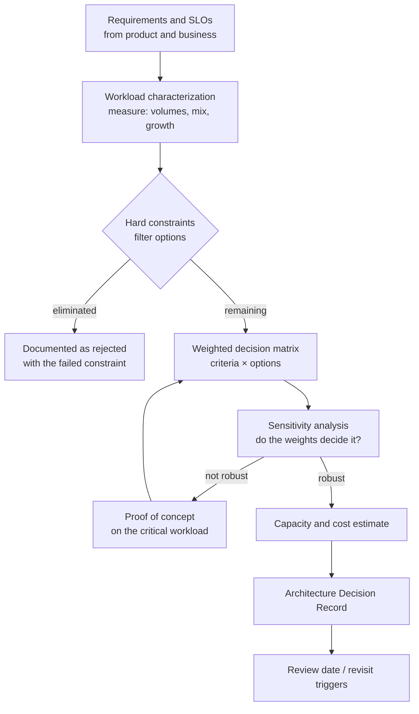

## Introduction

"Which database should we use?" is one of the most consequential and most badly answered questions in software engineering. Badly answered, because it is usually decided by familiarity ("we always use X"), fashion ("everyone is moving to Y") or a benchmark of someone else's workload. Consequential, because data outlives code: the database chosen for a prototype is often still there ten years later, holding the company's most valuable asset, surrounded by tooling, runbooks and skills built around it.

This lesson closes the module — and the course — by turning everything you have learned into a **decision method**:

1. **Characterize the workload** — data shape, access patterns, volumes, growth, consistency and latency needs — with numbers, many of which you can measure in MySQL.
2. **Separate hard constraints** (must-haves that eliminate options) from **weighted criteria** (trade-offs between the remaining ones).
3. **Score options** with a weighted decision matrix — built here in SQL — and test how sensitive the result is to the weights.
4. **Estimate capacity and cost** for the chosen option.
5. **Record the decision** in an **Architecture Decision Record (ADR)**: context, options, decision, consequences.

Five worked scenarios apply the method, linking back to the technologies of this module: relational OLTP ([MySQL vs PostgreSQL](/lessons/m13-mysql-vs-postgresql)), distributed SQL ([Distributed Database Fundamentals](/lessons/m13-distributed-databases)), search engines ([Full-Text Search](/lessons/m13-full-text-search)), warehouses ([Data Warehousing Fundamentals](/lessons/m13-data-warehousing)) and event streams ([Event-Driven Database Considerations](/lessons/m13-event-driven)).

:::note[Dataset]
The lab uses the **shop** dataset to measure a real workload profile (row counts, sizes, growth) and builds its own decision tables (`criteria`, `options`, `scores`, `weight_scenarios`). Scores in the decision matrix are **illustrative judgements for a fictional scenario**, not measurements or vendor claims — the method is the lesson, not the numbers.
:::

## DBMS Theory

:::theory[Decision-making under multiple criteria]
Technology selection is a **multi-criteria decision analysis (MCDA)** problem. The simplest rigorous method is the **weighted sum model**:

> score(option) = Σᵢ wᵢ · sᵢ(option), with Σᵢ wᵢ = 1

where wᵢ is the weight of criterion i and sᵢ the option's score on it (for example 1–5). Three disciplines make it trustworthy:

- **Constraints before weights.** A criterion that is non-negotiable (data residency in the EU, a managed service on the company's cloud, SQL with multi-row ACID transactions) is a **filter**, not a weight. Options that fail it are excluded, however well they score elsewhere — otherwise a high score on a nice-to-have can "buy back" a failed must-have.
- **Independent, well-defined criteria.** Overlapping criteria (e.g. "scalability" and "handles growth") double-count. Each criterion needs a scoring rubric ("5 = proven at 10× our projected peak in production at comparable companies").
- **Sensitivity analysis.** If a small change in weights changes the winner, the decision is not robust; that is a signal to gather evidence (a proof of concept) rather than to argue about weights.
:::

Database-specific criteria fall into recurring families:

| Family | Example questions |
|---|---|
| **Data model fit** | Relational with integrity constraints? Documents? Graph traversals? Time series? Full-text relevance? Vectors? |
| **Workload fit** | Read/write ratio, point lookups vs scans, transaction size, analytical complexity, concurrency, hot keys |
| **Consistency & transactions** | Multi-row/multi-entity ACID? Isolation level needed? Tolerance for eventual consistency? ([CAP Theorem](/lessons/m01-cap-theorem)) |
| **Scale & performance** | Data volume and growth, peak QPS, latency SLOs (p99), geographic distribution |
| **Availability & durability** | RPO/RTO targets, multi-zone/region, backup and point-in-time recovery |
| **Operational maturity** | Managed offerings, monitoring, upgrades, tooling, community and vendor support, failure-mode knowledge |
| **Ecosystem & integration** | Drivers, ORMs, CDC, BI tools, cloud integration |
| **Security & compliance** | Encryption, auditing, access control, certifications, data residency |
| **Team skills** | Existing expertise, hiring market, learning curve |
| **Cost (TCO)** | Licences, infrastructure, managed-service fees, egress, engineering and on-call time |

## Why It Exists

Without a method, teams fall into well-known traps:

- **Résumé-driven or fashion-driven design** — adopting a system for its novelty and discovering its failure modes in production.
- **Benchmark tunnel vision** — choosing on throughput numbers from a workload unlike yours, ignoring operability, consistency and cost.
- **Polyglot sprawl** — five databases for five microservices, each with its own backup, monitoring, upgrade and on-call burden, run by a team that is expert in none.
- **Silent constraints** — discovering after launch that the chosen service is not available in a required region, or cannot provide the needed isolation.
- **Forgotten rationale** — two years later nobody knows *why* the choice was made, so it can neither be defended nor sensibly revisited.

A requirements-driven process, recorded in an ADR, makes the decision explicit, reviewable and revisable when the context changes.

## Internal Working

How does the method work end to end? It is a pipeline from evidence to decision:



The **evidence** comes from three places: measurements of the current system (if one exists), projections from product plans, and targeted proofs of concept for the riskiest assumptions. MySQL can supply much of the first kind directly — data volumes and growth from the data itself and from `information_schema`, workload mix from status counters (`Com_select`, `Com_insert`, `Innodb_rows_read`, …; session-level in the lab, global in production via `SHOW GLOBAL STATUS` or `performance_schema`), and slow queries from the slow query log and `performance_schema` statement digests ([Slow Query Diagnostics](/lessons/m07-slow-query-diagnostics)).

## MySQL Implementation

**Step 1 — characterize the current workload from the data.** Volume and growth of the core business entity, measured on the shop dataset:

```sql run
SELECT COUNT(*)                                   AS orders_2024,
       COUNT(DISTINCT customer_id)                AS active_customers,
       ROUND(COUNT(*) / 366, 2)                   AS orders_per_day,
       (SELECT COUNT(*) FROM order_items)         AS order_lines,
       ROUND((SELECT COUNT(*) FROM order_items) / COUNT(*), 2) AS lines_per_order
FROM orders;
SELECT QUARTER(order_date) AS quarter, COUNT(*) AS orders,
       ROUND(100 * (COUNT(*) / LAG(COUNT(*)) OVER (ORDER BY QUARTER(order_date)) - 1), 1) AS growth_pct_vs_prev_q
FROM orders GROUP BY QUARTER(order_date) ORDER BY quarter;
```

**Storage footprint** per table from the data dictionary (statistics-based estimates, refreshed by `ANALYZE TABLE`):

```sql run
ANALYZE TABLE customers, orders, order_items, payments, products, reviews;
SELECT TABLE_NAME, TABLE_ROWS,
       ROUND(DATA_LENGTH / 1024, 1)  AS data_kb,
       ROUND(INDEX_LENGTH / 1024, 1) AS index_kb,
       ROUND((DATA_LENGTH + INDEX_LENGTH) / NULLIF(TABLE_ROWS, 0)) AS bytes_per_row_incl_indexes
FROM information_schema.TABLES
WHERE TABLE_SCHEMA = DATABASE() AND TABLE_NAME IN ('customers', 'orders', 'order_items', 'payments', 'products', 'reviews')
ORDER BY TABLE_NAME;
```

On tables this small, InnoDB's minimum allocation (16 KB pages, and a fixed initial allocation per index) dominates, so *bytes per row* is inflated; on production-sized tables the same query gives realistic per-row figures. The **workload mix** of a session can be read from status counters — in production you would sample the global counters over a busy hour:

```sql run
SELECT COUNT(*) FROM orders WHERE status = 'paid';
SELECT * FROM order_items WHERE order_id = 12;
SHOW SESSION STATUS WHERE Variable_name IN ('Com_select', 'Com_insert', 'Com_update', 'Com_delete', 'Handler_read_key', 'Handler_read_rnd_next');
```

`Handler_read_key` (index lookups) versus `Handler_read_rnd_next` (sequential row reads, i.e. scans) is a quick indicator of point-lookup versus scan-heavy access — exactly the axis that separates OLTP engines from analytical ones. (The session counters include everything this lab session has run so far, such as the `ANALYZE TABLE` statements; `Innodb_*` counters such as `Innodb_rows_read` are server-wide even when requested with `SHOW SESSION STATUS`, so they are left out here.)

## Syntax Breakdown

The decision artefacts, and how they map to SQL objects used in this lesson:

| Artefact | Content | In the lab |
|---|---|---|
| Requirements list | Functional + non-functional requirements with measurable targets (p99 latency, RPO/RTO, QPS, volume) | Prose / ADR |
| Hard constraints | Pass/fail checks per option | `options.meets_constraints` + `constraint_notes` |
| Criteria and weights | Each criterion with a weight (sum = 1) and a scoring rubric | `criteria(criterion, weight, rubric)` |
| Score matrix | Score 1–5 per (option, criterion) with justification | `scores(option, criterion, score, evidence)` |
| Weighted result | Σ weight × score per option | Aggregate query |
| Sensitivity analysis | Results under alternative weight sets | `weight_scenarios` + window ranking |
| Capacity estimate | Rows, bytes, IOPS, connections at horizon (e.g. 3 years) | Projection query |
| ADR | Title, status, context, decision, alternatives, consequences, review triggers | Markdown in the repository |

## Practical Examples

### 1. A weighted decision matrix in SQL

Scenario (fictional): a mid-size e-commerce company is re-platforming its order service. Projected: 20× today's order volume in three years, peak 3,000 transactions/s, strict integrity for orders and payments, a single cloud region with multi-zone HA, team of eight backend engineers with strong MySQL experience.

```sql run
CREATE TABLE options (
  option_name       VARCHAR(40) PRIMARY KEY,
  meets_constraints BOOLEAN NOT NULL,
  constraint_notes  VARCHAR(200) NOT NULL
);
INSERT INTO options VALUES
 ('Managed MySQL 8.4',          TRUE,  'ACID, available in region, multi-AZ HA'),
 ('Managed PostgreSQL',         TRUE,  'ACID, available in region, multi-AZ HA'),
 ('Distributed SQL service',    TRUE,  'ACID across shards, available in region'),
 ('Document database',          TRUE,  'Multi-document transactions available; schema-flexible'),
 ('Wide-column store',          FALSE, 'No multi-row ACID transactions for order + payment');
CREATE TABLE criteria (
  criterion VARCHAR(30) PRIMARY KEY,
  weight    DECIMAL(4,3) NOT NULL,
  rubric    VARCHAR(200) NOT NULL
);
INSERT INTO criteria VALUES
 ('integrity',     0.25, '5 = FKs, CHECK, multi-row ACID with well-understood isolation'),
 ('workload_fit',  0.20, '5 = proven for OLTP at >= 10x projected peak'),
 ('ops_maturity',  0.20, '5 = mature managed offering, backups/PITR, monitoring, upgrade path'),
 ('team_skills',   0.15, '5 = team already operates it in production'),
 ('scalability',   0.10, '5 = horizontal write scale without application sharding'),
 ('cost',          0.10, '5 = lowest 3-year TCO including engineering time');
CREATE TABLE scores (
  option_name VARCHAR(40) NOT NULL,
  criterion   VARCHAR(30) NOT NULL,
  score       TINYINT NOT NULL CHECK (score BETWEEN 1 AND 5),
  PRIMARY KEY (option_name, criterion),
  FOREIGN KEY (option_name) REFERENCES options (option_name),
  FOREIGN KEY (criterion)   REFERENCES criteria (criterion)
);
INSERT INTO scores VALUES
 ('Managed MySQL 8.4','integrity',5), ('Managed MySQL 8.4','workload_fit',5), ('Managed MySQL 8.4','ops_maturity',5),
 ('Managed MySQL 8.4','team_skills',5), ('Managed MySQL 8.4','scalability',2), ('Managed MySQL 8.4','cost',4),
 ('Managed PostgreSQL','integrity',5), ('Managed PostgreSQL','workload_fit',5), ('Managed PostgreSQL','ops_maturity',5),
 ('Managed PostgreSQL','team_skills',3), ('Managed PostgreSQL','scalability',2), ('Managed PostgreSQL','cost',4),
 ('Distributed SQL service','integrity',4), ('Distributed SQL service','workload_fit',4), ('Distributed SQL service','ops_maturity',3),
 ('Distributed SQL service','team_skills',2), ('Distributed SQL service','scalability',5), ('Distributed SQL service','cost',2),
 ('Document database','integrity',3), ('Document database','workload_fit',3), ('Document database','ops_maturity',4),
 ('Document database','team_skills',2), ('Document database','scalability',4), ('Document database','cost',3),
 ('Wide-column store','integrity',1), ('Wide-column store','workload_fit',2), ('Wide-column store','ops_maturity',3),
 ('Wide-column store','team_skills',1), ('Wide-column store','scalability',5), ('Wide-column store','cost',3);
SELECT ROUND(SUM(weight), 3) AS weights_sum FROM criteria;
```

The constraint filter comes first; then the weighted sum over the surviving options:

```sql run
SELECT o.option_name,
       ROUND(SUM(c.weight * s.score), 2) AS weighted_score,
       RANK() OVER (ORDER BY SUM(c.weight * s.score) DESC) AS rank_
FROM options o
JOIN scores s   ON s.option_name = o.option_name
JOIN criteria c ON c.criterion = s.criterion
WHERE o.meets_constraints
GROUP BY o.option_name
ORDER BY weighted_score DESC, o.option_name;
SELECT option_name, constraint_notes AS rejected_because FROM options WHERE NOT meets_constraints;
```

The wide-column store is **excluded by a constraint**, not out-scored — and the rejection reason is recorded, which an ADR reviewer will want to see. Among the remaining options, the two managed relational services lead, separated mainly by team skills.

### 2. Sensitivity analysis: do the weights decide it?

Define alternative weight sets that different stakeholders might argue for, and see whether the winner changes:

```sql run
CREATE TABLE weight_scenarios (
  scenario  VARCHAR(30) NOT NULL,
  criterion VARCHAR(30) NOT NULL,
  weight    DECIMAL(4,3) NOT NULL,
  PRIMARY KEY (scenario, criterion)
);
INSERT INTO weight_scenarios
SELECT 'baseline', criterion, weight FROM criteria
UNION ALL SELECT 'growth_first', criterion,
  CASE criterion WHEN 'scalability' THEN 0.30 WHEN 'integrity' THEN 0.20 WHEN 'workload_fit' THEN 0.15
                 WHEN 'ops_maturity' THEN 0.15 WHEN 'team_skills' THEN 0.10 ELSE 0.10 END FROM criteria
UNION ALL SELECT 'skills_neutral', criterion,
  CASE criterion WHEN 'team_skills' THEN 0.00 WHEN 'integrity' THEN 0.30 WHEN 'workload_fit' THEN 0.25
                 WHEN 'ops_maturity' THEN 0.25 ELSE weight END FROM criteria;
SELECT scenario, ROUND(SUM(weight), 3) AS weights_sum FROM weight_scenarios GROUP BY scenario ORDER BY scenario;
SELECT scenario, option_name, weighted_score, rank_in_scenario
FROM (
  SELECT w.scenario, s.option_name,
         ROUND(SUM(w.weight * s.score), 2) AS weighted_score,
         RANK() OVER (PARTITION BY w.scenario ORDER BY SUM(w.weight * s.score) DESC) AS rank_in_scenario
  FROM weight_scenarios w
  JOIN scores s  ON s.criterion = w.criterion
  JOIN options o ON o.option_name = s.option_name AND o.meets_constraints
  GROUP BY w.scenario, s.option_name
) AS ranked
WHERE rank_in_scenario <= 2
ORDER BY scenario, rank_in_scenario, option_name;
```

Read the result as a robustness test. Managed MySQL ranks first under the baseline and the growth-first weights, so prioritizing scalability does not change the decision (both relational options score 2 on scalability, and the distributed option's advantage there is outweighed). Under the skills-neutral weights, however, MySQL and PostgreSQL **tie** at 4.60: the entire difference between them comes from the team's existing skills. That is a legitimate, often decisive criterion — but it must be stated explicitly in the ADR ("we weight team skills because a team of eight will operate this for years"), because a reviewer who weights it differently would be indifferent between the two. Had the winner flipped between very different options, the right response would be evidence — a proof of concept on the critical workload — rather than more argument about weights.

### 3. A capacity estimate for the chosen option

Project the order data to the three-year horizon (20× volume) using measured per-row sizes. Because the lab tables are tiny, use an **assumed** average row size where the measured one is distorted by minimum allocations, and say so:

```sql run
WITH current_volume AS (
  SELECT (SELECT COUNT(*) FROM orders)      AS orders_per_year,
         (SELECT COUNT(*) FROM order_items) AS lines_per_year
),
assumptions AS (
  SELECT 20 AS growth_factor, 3 AS years_retained,
         350 AS bytes_per_order_incl_indexes,      -- assumption: typical for this schema at scale
         180 AS bytes_per_line_incl_indexes        -- assumption
)
SELECT cv.orders_per_year * a.growth_factor                             AS orders_per_year_at_horizon,
       cv.orders_per_year * a.growth_factor * a.years_retained          AS orders_retained,
       ROUND(cv.orders_per_year * a.growth_factor * a.years_retained * a.bytes_per_order_incl_indexes / POW(1024, 2), 2) AS orders_mb,
       ROUND(cv.lines_per_year  * a.growth_factor * a.years_retained * a.bytes_per_line_incl_indexes  / POW(1024, 2), 2) AS lines_mb
FROM current_volume cv CROSS JOIN assumptions a;
```

The shop is a teaching dataset, so the result is small; the **structure** of the estimate is what transfers: measured current volume × growth factor × retention × bytes per row (including indexes), plus headroom for indexes added later, undo/redo/binlog, backups and replicas. Repeat the exercise for peak transactions per second (orders/day × peak-hour factor × statements per order) and for connections. If the horizon estimate fits comfortably on one primary with replicas — as most OLTP workloads do — a sharded or distributed system is premature; if it does not, that is quantified evidence for the distributed options.

## Execution Walkthrough

Apply the method step by step to one decision: *"Where should product search run?"* (the shop currently uses `LIKE` queries).

```walkthrough
title: Product search — from requirements to decision
steps:
  - title: "1. Requirements"
    explain: >-
      Typo tolerance and synonyms requested by marketing; facets by category and price band; results under 100 ms
      p99 at 200 searches/s; catalogue of a few hundred thousand products within three years; product changes
      visible in search within a minute; the team has no search-engine experience.
  - title: "2. Measure today's workload"
    explain: The current search is a LIKE scan — measure what it reads per query on the catalogue table.
    sql: |
      EXPLAIN SELECT product_id, name FROM products WHERE name LIKE '%keyboard%' OR sku LIKE '%keyboard%';
  - title: "3. Hard constraints"
    explain: >-
      Typo tolerance and synonym handling are must-haves. MySQL FULLTEXT has neither (no fuzzy matching, no
      stemming or synonyms — Full-Text Search lesson), so it is filtered out for the customer-facing search, but
      remains an option for internal admin search. Remaining: a managed search engine fed from MySQL.
  - title: "4. Weighted criteria among search engines"
    explain: >-
      Relevance features, managed offering, CDC/connector support, cost, learning curve. The same SQL matrix as in
      Practical Example 1 applies; here the decisive factor is a managed service to compensate for missing skills.
  - title: "5. Architecture and consequences"
    explain: >-
      MySQL stays the source of truth; an outbox or binlog CDC pipeline (Event-Driven lesson) feeds the search
      index within seconds; the application tolerates eventual consistency in search results and re-reads
      prices and stock from MySQL. Consequences recorded: a new system to operate, an index-rebuild runbook,
      reconciliation of document counts, and an on-call rotation that includes the search cluster.
  - title: "6. Record and set revisit triggers"
    explain: >-
      The ADR states the decision, the rejected options (MySQL FULLTEXT for customer search: failed the typo/synonym
      constraint) and when to revisit — for example if the catalogue stays below 50,000 products and marketing drops
      typo tolerance, or if the managed service's cost exceeds an agreed budget.
```

## Output

The outputs of the method are artefacts, not query results: a filtered option list with rejection reasons, a weighted ranking with its sensitivity analysis, a capacity estimate with stated assumptions, and the ADR. Here is the ADR for Practical Example 1, in the widely used Nygard format:

```text
# ADR-014: Database for the re-platformed order service

Status: Accepted (2026-11-09)            Review: 2027-11 or on revisit trigger

## Context
Order service re-platform. Projected 20x order volume in 3 years, peak ~3,000 tx/s,
strict integrity for orders and payments (multi-row ACID), single region with multi-zone HA
(RPO 0 within region, RTO < 5 min), team of 8 with production MySQL experience.

## Options considered
- Managed MySQL 8.4 (chosen)
- Managed PostgreSQL
- Distributed SQL service
- Document database
- Wide-column store (rejected: no multi-row ACID for order + payment — hard constraint)

## Decision
Managed MySQL 8.4 LTS with multi-zone HA, read replicas for reporting, binlog CDC to the
warehouse. Highest weighted score under baseline and growth-first weights; tied with managed
PostgreSQL when team skills are ignored, so team skills are the decisive, deliberate criterion.
Capacity estimate for 3 years fits a single primary with headroom; no sharding now.

## Consequences
+ Leverages team skills; mature tooling; well-understood failure modes.
- Write scaling is vertical; if peak exceeds ~3x the estimate, revisit sharding (Vitess)
  or distributed SQL. Keep the order schema shard-friendly (customer_id on every table).
- Analytical queries move to the warehouse; no reporting on the primary.

## Revisit triggers
Sustained write load > 60% of primary capacity; multi-region writes required; new compliance
constraints on data residency.
```

## Alternative Approaches

The weighted-sum matrix is one decision technique among several, each with a place:

| Technique | Strength | Weakness | Use when |
|---|---|---|---|
| **Weighted decision matrix** (this lesson) | Transparent, quick, easy to review | Weights and scores are subjective; additive model hides trade-offs | Most selection decisions |
| **Must/want analysis (Kepner-Tregoe)** | Explicit separation of musts and wants | Same subjectivity in wants | Procurement-style evaluations |
| **Analytic Hierarchy Process (AHP)** | Pairwise comparisons derive consistent weights | Heavier process | Large, contested decisions with many stakeholders |
| **Proof of concept / spike** | Real evidence on the riskiest assumption | Time and cost; risk of testing the wrong thing | The matrix is not robust, or a key claim is unverified |
| **Benchmark on your workload** | Quantitative performance evidence | Easy to build unrepresentative tests | Performance is a deciding criterion |
| **"Boring technology" default** | Minimizes operational risk and cognitive load | May leave real gains unexploited | Default stance; deviate only with evidence |
| **Reversible pilot** (one service, strangler pattern) | Learn in production with bounded risk | Temporary dual systems | Migrations and new technology adoption |

Many organizations also keep a **technology radar** (adopt / trial / assess / hold) so that individual teams choose from a curated set, which limits polyglot sprawl while allowing experimentation.

## Performance Analysis

Performance is one criterion, and usually not the deciding one for OLTP — most mainstream engines handle typical workloads comfortably when well designed. Where performance *does* decide, analyse it the way this course has throughout:

- **Characterize the dominant access paths** (point lookups by key, range scans, aggregations over large ranges, full-text queries, joins across entities) and their volumes — the plan shapes from Module 7 are the right vocabulary.
- **Match engines to access paths**: B+ tree row stores for keyed OLTP; columnar engines for scans and aggregates ([Analytical Query Optimization](/lessons/m13-analytical-optimization)); inverted indexes for text relevance; R-trees for spatial windows ([Spatial Data Fundamentals](/lessons/m13-spatial)).
- **Quantify headroom**: compare projected peak load with measured capacity of one node (from a load test on representative data), and plan the scaling path *before* it is needed.
- **Measure tail latency** (p99/p999) under concurrency, including during backups, failovers and schema changes — the moments when systems differ most.
- **Count the hidden costs**: cross-node round-trips in distributed systems, replication lag, connection overheads, and the engineering time to keep each system healthy.

The capacity query in Practical Example 3 is the template: measured numbers × explicit assumptions → a figure you can compare with a node's tested capacity.

## Best Practices

:::best-practice[Choosing database technology]
1. **Start from requirements with numbers** (volume, growth, peak, latency percentiles, RPO/RTO, consistency), not from products.
2. **Apply hard constraints first**, record each rejected option with the constraint it failed.
3. **Weight what matters to the organization**, including operational maturity and team skills — they dominate long-term success more often than raw performance.
4. **Test robustness** with alternative weights; resolve non-robust decisions with a focused proof of concept on your data.
5. **Prefer fewer, well-understood systems**; add a specialized store (search, cache, warehouse, stream) only when a requirement demands it, and feed it from the system of record.
6. **Write an ADR** with context, options, decision, consequences and revisit triggers; keep it in the repository next to the code.
7. **Design for change**: keep schemas and access layers portable where cheap, so that a future decision to move remains possible.
:::

## Common Mistakes

**Mistake 1 — letting a nice-to-have outweigh a must-have.** If the excluded wide-column store were scored without the constraint filter, its high scalability score would partly compensate for failing integrity:

```sql run
SELECT o.option_name, o.meets_constraints, ROUND(SUM(c.weight * s.score), 2) AS weighted_score_without_filter
FROM options o JOIN scores s USING (option_name) JOIN criteria c USING (criterion)
GROUP BY o.option_name, o.meets_constraints
ORDER BY weighted_score_without_filter DESC, o.option_name;
```

It still ranks last here, but with different scores it could overtake an option that meets every requirement — which is why constraints are filters, not weights.

**Mistake 2 — weights that do not sum to 1 (or change between options).** Always check (`SELECT SUM(weight)`), and use the same weights for every option.

**Mistake 3 — choosing on someone else's benchmark.** Vendor and community benchmarks test their workloads and configurations; run yours.

**Mistake 4 — ignoring the cost of operations.** A system that is 20% faster but needs a dedicated expert on call may cost more than it saves.

**Mistake 5 — no revisit trigger.** Contexts change (10× growth, new regions, new regulations); without explicit triggers, decisions are either never revisited or revisited constantly.

**Mistake 6 — one database per microservice by default.** Service-level *ownership* of data does not require a different *technology* per service; separate schemas or instances of the same engine give isolation without multiplying operational burden.

## Industry Application

- **Architecture review boards** in larger companies require ADRs or design documents for new data stores, with explicit evaluation of operational support and security.
- **Platform teams** offer a small menu of supported databases (for example: managed MySQL or PostgreSQL for OLTP, a warehouse, a cache, a search engine, a stream) with automation for provisioning, backups and monitoring; teams that need something else write an ADR and commit to operating it.
- **Startups** typically choose one general-purpose relational database and defer specialized systems until a requirement forces them — the "boring technology" stance.
- **Migrations** (on-premise to cloud, one engine to another) are justified with the same matrix, with migration cost and risk as additional criteria.
- **Interviews** for senior and staff roles routinely include "design X and choose the storage" questions; structuring the answer as requirements → constraints → trade-offs → decision → consequences is what interviewers look for.

### Worked scenarios (summary)

| Scenario | Key requirements | Typical choice | Why |
|---|---|---|---|
| E-commerce order service | Multi-row ACID, moderate scale, strong team MySQL skills | Managed MySQL (or PostgreSQL) + replicas; warehouse via CDC | Integrity + maturity + skills; scale fits one primary |
| IoT telemetry, 200,000 events/s, 13-month retention, aggregates by device and time | Append-heavy, time-range scans, downsampling | Time-series or columnar store (e.g. ClickHouse, TimescaleDB) fed by a stream; MySQL for device metadata | Scan/aggregate workload and volume exceed row-store sweet spot |
| Global fintech ledger with multi-region writes and strict consistency | Serializable transactions across regions, data residency | Distributed SQL with geo-partitioning, or region-sharded MySQL with sagas for rare cross-region transfers | Consensus-based multi-region ACID vs simpler regional shards |
| Product search with typo tolerance and facets | Relevance features, near-real-time updates | Search engine fed by CDC; MySQL as source of truth | Linguistic features absent from MySQL FULLTEXT |
| Company-wide analytics and BI | Large scans, many sources, ad-hoc SQL | Cloud warehouse (or HeatWave for MySQL-centric shops); dimensional models; ELT | Columnar engines and separation from OLTP |

## Practice Exercises

````exercise
id: ex1
title: Weighted scores
difficulty: easy
concepts: [decision-matrix]
setup: |
  CREATE TABLE criteria (criterion VARCHAR(30) PRIMARY KEY, weight DECIMAL(4,3) NOT NULL);
  INSERT INTO criteria VALUES ('integrity', 0.40), ('ops_maturity', 0.30), ('cost', 0.30);
  CREATE TABLE scores (option_name VARCHAR(40) NOT NULL, criterion VARCHAR(30) NOT NULL, score TINYINT NOT NULL, PRIMARY KEY (option_name, criterion));
  INSERT INTO scores VALUES ('A', 'integrity', 5), ('A', 'ops_maturity', 4), ('A', 'cost', 3),
                            ('B', 'integrity', 3), ('B', 'ops_maturity', 5), ('B', 'cost', 5),
                            ('C', 'integrity', 4), ('C', 'ops_maturity', 4), ('C', 'cost', 4);
prompt: |
  Compute the weighted score Σ weight × score per option. Return `option_name` and `weighted_score`
  (rounded to 2 decimals), highest first.
hints:
  - "Join scores to criteria on criterion and SUM(weight * score) per option."
solution: |
  SELECT s.option_name, ROUND(SUM(c.weight * s.score), 2) AS weighted_score
  FROM scores s JOIN criteria c ON c.criterion = s.criterion
  GROUP BY s.option_name
  ORDER BY weighted_score DESC;
orderMatters: true
explanation: |
  B scores 4.20, A 4.10 and C 4.00 — close enough that a sensitivity analysis is warranted before choosing.
  Averaging the raw scores (ignoring weights) would rank B first too, but for a different reason, and would
  break as soon as weights differ more.
````

````exercise
id: ex2
title: Constraints first
difficulty: medium
concepts: [decision-matrix, requirements-analysis]
setup: |
  CREATE TABLE options (option_name VARCHAR(40) PRIMARY KEY, region_available BOOLEAN NOT NULL, acid_multi_row BOOLEAN NOT NULL);
  INSERT INTO options VALUES ('A', TRUE, TRUE), ('B', TRUE, FALSE), ('C', FALSE, TRUE), ('D', TRUE, TRUE);
  CREATE TABLE criteria (criterion VARCHAR(30) PRIMARY KEY, weight DECIMAL(4,3) NOT NULL);
  INSERT INTO criteria VALUES ('performance', 0.5), ('team_skills', 0.5);
  CREATE TABLE scores (option_name VARCHAR(40), criterion VARCHAR(30), score TINYINT, PRIMARY KEY (option_name, criterion));
  INSERT INTO scores VALUES ('A','performance',3), ('A','team_skills',5), ('B','performance',5), ('B','team_skills',5),
                            ('C','performance',5), ('C','team_skills',4), ('D','performance',4), ('D','team_skills',3);
prompt: |
  Hard constraints: the option must be available in the required region **and** support multi-row ACID
  transactions. Return the **best-scoring option that satisfies both constraints**, as columns
  `option_name`, `weighted_score` (2 decimals). If several tie, return all of them.
hints:
  - "Filter options with WHERE region_available AND acid_multi_row before aggregating."
  - "Rank the weighted scores with RANK() and keep rank 1 in an outer query."
solution: |
  SELECT option_name, weighted_score
  FROM (
    SELECT o.option_name, ROUND(SUM(c.weight * s.score), 2) AS weighted_score,
           RANK() OVER (ORDER BY SUM(c.weight * s.score) DESC) AS rnk
    FROM options o
    JOIN scores s   ON s.option_name = o.option_name
    JOIN criteria c ON c.criterion = s.criterion
    WHERE o.region_available AND o.acid_multi_row
    GROUP BY o.option_name
  ) AS ranked
  WHERE rnk = 1;
explanation: |
  A (4.00) beats D (3.50). Without the filter, B (5.00) would "win" despite lacking multi-row ACID, and C
  despite not being available in the region — the classic mistake of letting scores compensate for failed
  must-haves. RANK() returns ties, as the prompt requires.
````

````exercise
id: ex3
title: Three-year storage projection
difficulty: hard
concepts: [capacity-planning, workload-characterization]
prompt: |
  Using the shop's 2024 data as the current yearly volume, estimate the storage needed for `order_items` after
  **3 years** if yearly volume grows **40% per year** (year 1 = 1.4 × 2024, year 2 = 1.4², year 3 = 1.4³) and all
  rows are retained, assuming **200 bytes per row including indexes**. Return `rows_after_3_years` (rounded to
  an integer) and `megabytes` (rounded to 3 decimals).
hints:
  - "Current yearly rows = COUNT(*) FROM order_items."
  - "Rows retained after 3 years = current × (1.4 + 1.4² + 1.4³) — the 2024 rows themselves are not counted again."
  - "MB = rows × 200 / 1024²."
solution: |
  SELECT ROUND(n * (1.4 + POW(1.4, 2) + POW(1.4, 3))) AS rows_after_3_years,
         ROUND(n * (1.4 + POW(1.4, 2) + POW(1.4, 3)) * 200 / POW(1024, 2), 3) AS megabytes
  FROM (SELECT COUNT(*) AS n FROM order_items) AS current_volume;
explanation: |
  The geometric growth matters: 1.4 + 1.96 + 2.744 = 6.104 years' worth of 2024 volume, not 3 × 1.4. In a real
  plan you would include the existing 2024 rows if they are retained, add index growth from future indexes,
  undo/redo/binary logs, replicas and backups, and headroom (often 2× or more), then compare with the tested
  capacity of the target instance class.
````

````exercise
id: ex4
title: Write an ADR
difficulty: challenge
kind: open
concepts: [architecture-decision-records, technology-selection]
prompt: |
  A healthcare scheduling startup (US only, HIPAA-regulated) needs a database for appointments, patients and
  providers: ~5 million appointments/year, strong consistency (no double-booking), audit trail of every change,
  PITR with RPO ≤ 5 min, a team of four full-stack developers with PostgreSQL and some MySQL experience, a
  limited budget. Write a concise ADR (Context, Options, Decision, Consequences, Revisit triggers) choosing
  the database and justifying it with the method of this lesson.
solution: |
  **ADR-001: Primary database for the scheduling platform** — Status: Accepted.

  **Context.** ~5 M appointments/year (≈ 14k/day, peaks perhaps 50–100 writes/s); strong consistency for
  bookings; full change audit; HIPAA (encryption at rest/in transit, access logging, BAA with the provider);
  RPO ≤ 5 min; small team with PostgreSQL experience; tight budget.

  **Hard constraints.** Managed service with a HIPAA BAA in the US; multi-row ACID with constraints to
  prevent double-booking; PITR. Options failing: self-managed anything (team too small), stores without
  multi-row transactions.

  **Options.** Managed PostgreSQL; managed MySQL 8.4; distributed SQL service; document database.

  **Decision.** Managed PostgreSQL (multi-AZ, PITR). Rationale: meets all constraints; strongest team skills
  (weighted heavily for a 4-person team); exclusion constraints (`EXCLUDE USING gist` on provider + time
  range) express "no overlapping appointments" declaratively; volume is far below a single instance's
  capacity. Managed MySQL scored close (also suitable — double-booking prevented with a unique slot table or
  locking reads); distributed SQL rejected on cost and complexity with no scale need.

  **Consequences.** Audit via trigger-maintained history tables or logical-decoding CDC to an append-only
  store; encryption and access logging configured per HIPAA; on-call limited to application-level issues;
  vertical scaling sufficient for years; reporting offloaded to a read replica.

  **Revisit triggers.** > 10× growth or multi-region requirement; managed-service cost > agreed budget;
  new compliance requirements (e.g. data residency outside the US).
````

````exercise
id: ex5
title: Scenario critique
difficulty: hard
kind: open
concepts: [technology-selection, total-cost-of-ownership]
prompt: |
  A team of five proposes, for a new B2B SaaS product with ~2,000 customers: MongoDB for user data, Cassandra
  for audit events, Neo4j for permissions, Elasticsearch for search and PostgreSQL for billing — "the best tool
  for each job". Critique the proposal using the criteria of this lesson and propose an alternative.
solution: |
  - **Operational cost**: five database technologies, each with backup, monitoring, upgrades, security
    hardening, capacity planning and on-call knowledge — for a five-person team. Operational maturity and
    team skills, the most heavily weighted criteria for small teams, are spread thin.
  - **Consistency across stores**: a permission change (Neo4j), a user update (MongoDB) and a billing event
    (PostgreSQL) cannot be committed atomically; every cross-entity invariant needs sagas/outbox plumbing.
  - **Requirements vs scale**: 2,000 customers is small. Audit events, permission graphs and document-shaped
    user profiles are all well served by one relational database: an append-only audit table (partitioned by
    month), recursive CTEs or closure tables for permission hierarchies, JSON columns for flexible profile
    attributes.
  - **Alternative**: one managed relational database (PostgreSQL or MySQL) for all OLTP data, with clear
    schemas per bounded context; FULLTEXT/tsvector search initially; add a search engine *only* when search
    requirements exceed it, fed by CDC; revisit audit storage if volume reaches billions of rows. Record this
    in an ADR with revisit triggers for each deferred specialized store.
````

## Knowledge Assessment

```quiz
- id: q1
  question: "Why should a requirement such as 'data must stay in the EU' be applied as a filter rather than given a weight?"
  options:
    - "Because weights must sum to 1"
    - "Because a must-have that an option fails cannot be compensated by high scores elsewhere; weighting it would allow exactly that"
    - "Because filters are faster to compute"
    - "Because compliance is never important"
  answer: 1
  explanation: "An additive model lets strengths offset weaknesses, which is wrong for non-negotiable requirements. The lesson's Common Mistake 1 shows the scores of an excluded option. Weights summing to 1 and computation speed are unrelated."
  concepts: [decision-matrix, requirements-analysis]
- id: q2
  question: "A sensitivity analysis shows the winning option changes when the team-skills weight drops from 0.15 to 0. What is the right next step?"
  options:
    - "Pick the option that wins most often"
    - "Make the weighting judgement explicit (why team skills matter, or not) and/or gather evidence such as a proof of concept, and record it in the ADR"
    - "Remove the team-skills criterion"
    - "Average the scores of the two leading options"
  answer: 1
  explanation: "A non-robust result means the decision hinges on a judgement or an uncertain score. Making it explicit and testing the risky assumption is the disciplined response; dropping criteria or averaging hides the issue."
  concepts: [sensitivity-analysis]
- id: q3
  question: "Which items belong in an Architecture Decision Record? (Select all that apply.)"
  type: multi
  options:
    - "Context and constraints"
    - "Options considered and why rejected ones failed"
    - "Consequences, both positive and negative"
    - "Revisit triggers"
    - "The full source code of the service"
  answer: [0, 1, 2, 3]
  explanation: "An ADR captures the decision's rationale and its expected consequences so that future readers can understand and revisit it. Source code is not part of it."
  concepts: [architecture-decision-records]
- id: q4
  question: "In MySQL, which pair of status counters gives a quick indication of whether a workload is dominated by index lookups or by scans?"
  options:
    - "Com_insert and Com_delete"
    - "Handler_read_key and Handler_read_rnd_next"
    - "Threads_connected and Threads_running"
    - "Bytes_sent and Bytes_received"
  answer: 1
  explanation: "Handler_read_key counts index-based row reads, Handler_read_rnd_next counts sequential reads of the next row (scans). The other pairs describe the statement mix, connections and network traffic."
  concepts: [workload-characterization]
- id: q5
  question: "Current volume is 1 M rows/year, growing 50% per year; all rows are kept. How many rows are added over the next 2 years?"
  options: ["2 M", "3 M", "3.75 M", "2.25 M"]
  answer: 2
  explanation: "Year 1 adds 1.5 M and year 2 adds 2.25 M: 3.75 M in total (geometric growth). 3 M assumes linear growth of 1.5 M per year; 2.25 M is only the second year."
  concepts: [capacity-planning]
- id: q6
  question: "A team of four is choosing a database for a typical B2B OLTP application. Which criterion is most often underweighted in such decisions?"
  options:
    - "Peak benchmark throughput"
    - "Operational maturity and the team's ability to run the system reliably"
    - "Number of GitHub stars"
    - "Support for the newest SQL standard"
  answer: 1
  explanation: "For small teams, failure modes, managed offerings, tooling and existing skills dominate long-term success. Benchmarks rarely decide typical OLTP, and popularity metrics or newest-standard features are weak proxies."
  concepts: [technology-selection, total-cost-of-ownership]
- id: q7
  question: "The capacity estimate for the next three years fits comfortably on a single primary with replicas. What does this imply for a proposed distributed SQL system?"
  options:
    - "It must be adopted anyway to be future-proof"
    - "Its main advantage (horizontal write scale) is not currently needed; its costs (latency, operations, migration) must be justified by other requirements, otherwise it is premature"
    - "It will be cheaper"
    - "Capacity estimates are irrelevant to database choice"
  answer: 1
  explanation: "Quantified headroom turns 'might need scale' into evidence. Distributed systems can still be right for other reasons (multi-region writes, residency), but not for capacity alone in this case."
  concepts: [capacity-planning, technology-selection]
```
