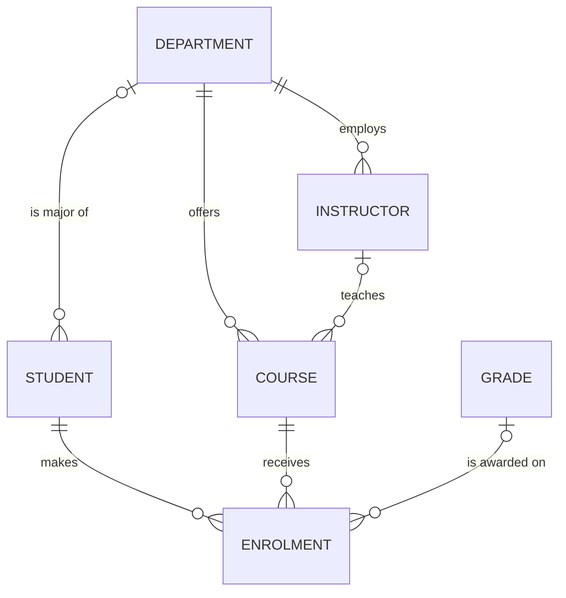
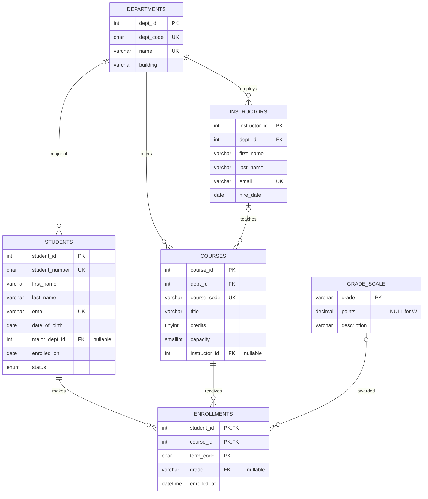

:::industry[Project brief — Riverside Community College, Office of the Registrar]
**Client.** The registrar of a (fictional) 4,000-student community college runs enrolment on three shared spreadsheets: one for students, one for the course catalogue and one "master sheet" where advisers paste a row every time a student takes a course. Last term two advisers edited the master sheet at the same time and 40 grades were lost; a student's GPA was miscalculated because her email was spelled two different ways; and nobody can answer "how many students are enrolled in Data Science courses this term?" without an afternoon of copy-and-paste.

**Your job.** Design and build the first version of a relational **Student Management System** in MySQL that replaces the spreadsheets for students, departments, instructors, courses, enrolments and grades.

**Deliverables**

1. A one-page requirements summary with business rules (Stage 1).
2. An ER diagram and a relational schema (Stages 2–5).
3. A DDL script that creates every table with keys and constraints (Stages 6–7).
4. CRUD statements and five reports: transcript, roster, departmental load, GPA ranking, students not enrolled (Stage 8).
5. An index plan justified with `EXPLAIN` (Stages 9 and 11).
6. A transactional course-swap procedure, a privacy-safe view and an account design (Stages 10 and 12).
7. A validation script that proves the constraints work (Stage 13) and a short production checklist (Stage 14).

**Acceptance criteria**

- Every table has a primary key; every relationship is enforced by a foreign key; no business rule that can be declared is left to application code.
- Bad data is rejected by the database: duplicate student numbers or emails, unknown departments or courses, impossible credit values, malformed term codes, unknown grades.
- The five reports return correct results on the sample data and use joins and aggregation, not application loops.
- A failed course swap leaves the database exactly as it was.
- The adviser-facing view exposes no date of birth.

**Estimated effort:** 8–12 hours for a learner who has completed Modules 1–4. Every graded task below runs in your private lab; each exercise lab is pre-loaded with the reference schema of the stages before it, so you can attempt the stages in any order.
:::

This is a **beginner** project, but it is not a toy. The schema you build here — entities with surrogate keys, natural keys protected by `UNIQUE`, a junction table with a composite key, a lookup table referenced by a foreign key — is the skeleton of almost every operational database you will meet in industry. Work through the stages in order the first time: each one ends with a graded task, and the run blocks in each stage build on the tables created in the stage before.

## 1. Requirements Gathering

A professional does not open a SQL editor on day one. The first deliverable is a **shared understanding of the problem**, written down and agreed with the people who will use the system. Requirements gathering for a database answers four questions:

1. **What things does the business need to remember?** (candidate entities and attributes)
2. **What questions will people ask?** (reports and lookups → queries, and later, indexes)
3. **What must always be true?** (business rules → constraints)
4. **How much, how fast, who?** (volumes, response times, users and their permissions → non-functional requirements)

The usual technique is a short series of interviews with each stakeholder group, plus a look at the artefacts they already use. The spreadsheet a user maintains today is the most honest requirements document you will ever get: its columns are the attributes they need, its duplicated values reveal the entities, and its inconsistencies reveal the rules nobody enforced.

### Worked example — interview notes

Here are condensed notes from a 30-minute interview with the registrar, Ms. Alvarez:

> "Every student gets a student number like **S20240001** when they are admitted — S, then the admission year, then four digits. We also need their legal name, college email, date of birth and the date they first enrolled. Students may declare a major, but many are undeclared for their first year. A student is active, on leave, graduated, or withdrawn.
>
> Courses belong to one department and have a code like **CS340**, a title and a number of credits — never less than 1 and never more than 6. Each course has a seat capacity and is normally taught by one instructor, although sometimes we publish a course before an instructor is assigned. Instructors belong to exactly one department.
>
> A student enrols in a course for a **term** — 2025FA is Fall 2025, then SP for spring and SU for summer. They can take the same course again in a later term if they failed it, but not twice in the same term. During the term there is no grade; at the end the instructor submits a letter grade. W means withdrawn and does not count towards the GPA.
>
> What I need every day: a student's transcript, the class roster for each course, how many enrolments each department has this term, the honour roll by GPA, and a list of active students who have not registered yet. Advisers should see contact details but **not** dates of birth — that's protected under FERPA."

From these notes a professional extracts a structured list. Notice how every sentence turns into something concrete:

| Requirement (from the interview) | Type | Becomes |
|---|---|---|
| Student number S + year + 4 digits, unique | Business rule | `CHAR(9)`, `UNIQUE`, `CHECK (… REGEXP …)` |
| Major is optional | Business rule | nullable foreign key `major_dept_id` |
| Status is one of four values | Business rule | `ENUM` (or lookup table) with a default |
| Credits between 1 and 6 | Business rule | `CHECK (credits BETWEEN 1 AND 6)` |
| Course may have no instructor yet | Business rule | nullable foreign key `instructor_id` |
| Same course again in a later term, not twice in one term | Business rule | composite primary key (student, course, term) |
| No grade during the term; W not in GPA | Business rule | nullable `grade`; grade points in a lookup table where W has no points |
| Transcript, roster, departmental load, honour roll, not registered | Functional (reports) | the five queries of Stage 8 |
| Advisers must not see date of birth | Security | a view in Stage 12, plus account privileges |
| ~4,000 students, ~200 courses, ~25,000 enrolments per year | Non-functional (volume) | ~250,000 rows in ten years: small, so integrity and clarity beat tuning |

:::best-practice[Write requirements so they can be tested]
"Credits must be sensible" cannot be tested; "credits is an integer from 1 to 6 inclusive" can — and it becomes a `CHECK` constraint and a test case in Stage 13. Every business rule in your requirements should name the exact condition. When the stakeholder cannot say, write the question down as an **open issue** rather than guessing.
:::

### Your task

```exercise
id: p1-ex1
title: Turn interview notes into testable business rules
difficulty: easy
kind: open
concepts: [requirements-analysis, business-rules]
prompt: |
  The registrar sends a follow-up email:

  > "Two more things. A course can only be taught by an instructor from the same department as the course.
  > And when a student withdraws from the college, we must keep their enrolment history for seven years —
  > nothing may be deleted. Oh, and the number of students in a course for a term must never exceed its capacity."

  For each of the three statements:

  1. Rewrite it as a precise, testable business rule.
  2. Say whether it can be enforced **declaratively** in MySQL (a key, `NOT NULL`, `UNIQUE`, `CHECK`, foreign key) or needs
     something else (a trigger, a transaction in a stored procedure, a privilege, or a process), and why.
  3. Write one test case (input and expected outcome) you would add to the validation script in Stage 13.
solution: |
  **1. Instructor and course in the same department.**
  Rule: *for every course with a non-NULL `instructor_id`, `instructors.dept_id` of that instructor equals `courses.dept_id`.*
  This compares values in **two different tables**, so a single-table `CHECK` constraint cannot express it (MySQL
  CHECK constraints may only reference columns of the row being written). Options: a composite foreign key
  `(instructor_id, dept_id) REFERENCES instructors (instructor_id, dept_id)` — which requires a `UNIQUE (instructor_id, dept_id)`
  on instructors and makes the rule declarative — or a `BEFORE INSERT/UPDATE` trigger. The composite-FK trick is the
  more robust, declarative choice. Test: assign a Mathematics instructor to `CS340` → must be rejected.

  **2. Seven-year retention of enrolment history.**
  Rule: *no row in `enrollments` (or `students`) may be deleted while the student's last enrolment is less than seven years old.*
  This is partly declarative: foreign keys with the default `ON DELETE RESTRICT` (never `CASCADE`) stop a student
  row from being deleted while it has enrolments. The "nothing may be deleted" part is best enforced with
  **privileges** — the application account gets no `DELETE` privilege on `enrollments` — and the seven-year purge
  becomes a scheduled, audited archival job. Test: `DELETE FROM students WHERE student_number = 'S20240008'` → must
  fail with error 1451 because the student has enrolments.

  **3. Capacity.**
  Rule: *for every (course_id, term_code), `COUNT(*)` of enrolments ≤ `courses.capacity`.*
  This is an **aggregate across many rows**, which no declarative constraint can express. It must be enforced in the
  enrolment transaction: lock the course row (`SELECT … FOR UPDATE`), count the current enrolments, insert only if
  below capacity, commit (Stage 10 and Module 8). Test: fill a course of capacity 2 with two students, then enrol a
  third → must be refused, and the count must stay 2.

  Good answers also note that rules enforced outside declarative constraints need a **detective control** — a
  validation query that finds violations (Stage 13) — because code paths can bypass them.
```

## 2. Entities and Relationships

With requirements agreed, the next stage is **conceptual modelling**: identify the *entities* (things with independent existence that the business identifies individually), their *attributes*, and the *relationships* between them with their **cardinality** (one-to-one, one-to-many, many-to-many) and **participation** (mandatory or optional). This is still independent of MySQL — it is the model you would draw on a whiteboard with the registrar. Revise the vocabulary in [Entities, Attributes and Relationships](/lessons/m05-entities-attributes) and [Relationships and Cardinality](/lessons/m05-relationships-cardinality) if any term below is unfamiliar.

A reliable technique is **noun and verb analysis** of the interview notes: nouns that the business identifies individually ("student S20240001", "course CS340") are entity candidates; nouns that describe something else ("email", "credits") are attributes; verbs that connect two entity nouns ("instructor *teaches* course", "student *enrols in* course") are relationships.

| Entity | Identified by | Key attributes from the notes |
|---|---|---|
| Department | department code (CS) | name, building |
| Instructor | email (unique) | name, hire date, department |
| Student | student number (S20240001) | name, email, date of birth, enrolled on, status, major |
| Course | course code (CS340) | title, credits, capacity, department, instructor |
| Grade | letter (A-, B+, W) | grade points, description |
| Enrolment | student + course + term | grade |

Two modelling decisions deserve explanation, because beginners usually get them wrong:

- **Enrolment is a relationship that carries data.** "Student *enrols in* course" is many-to-many: a student takes many courses and a course has many students. The relationship itself has attributes — the **term** and the **grade** — that belong to neither the student nor the course. In the relational model a many-to-many relationship with attributes becomes its own table (an *associative entity*), here `enrollments`.
- **Grade is an entity, not just an attribute.** We could store the letter and compute points with a `CASE` expression in every report. Making the grading scale a small lookup table means the points are defined **once**, the set of valid letters is enforced by a foreign key, and if the college changes its scale (say, adds A+), it is a data change, not a code change in ten reports.

| Relationship | Cardinality | Participation | Notes |
|---|---|---|---|
| Department employs Instructor | 1 : N | every instructor has exactly one department | mandatory FK |
| Department offers Course | 1 : N | every course has exactly one department | mandatory FK |
| Department is major of Student | 1 : N | a student has zero or one major | optional FK |
| Instructor teaches Course | 1 : N | a course has zero or one instructor | optional FK |
| Student enrols in Course (per term) | M : N | both sides optional | associative entity `enrollments` |
| Grade is awarded on Enrolment | 1 : N | an enrolment has zero or one grade | optional FK |



Read the crow's-foot notation from each end: `||` is "exactly one", `|o` is "zero or one", `o{` is "zero or many". The line `DEPARTMENT |o--o{ STUDENT` says a student has zero or one major department, and a department is the major of zero or many students.

:::note[What we deliberately left out]
A real registrar distinguishes a **course** (CS340 in the catalogue) from a **section** (CS340, Fall 2025, Tuesday/Thursday, taught by Dr. Raman). This first version follows the registrar's own description — one instructor per course, term stored on the enrolment — and records the section concept as a future extension. You will model sections, prerequisites and room scheduling in the advanced [University Management Database](/projects/p6-university) project. Writing such scope decisions down is part of the job.
:::

## 3. ER Diagram

The conceptual diagram above shows *what* is related. The **logical ER diagram** adds every attribute, the primary key (PK) of each entity, foreign keys (FK) and unique natural keys (UK). This is the diagram that goes into the design document and that reviewers sign off before tables are created.



### Surrogate keys versus natural keys

Every main entity has a **surrogate key** (`student_id`, an auto-incremented integer) *and* a **natural key** protected by `UNIQUE` (`student_number`). This is the most common pattern in industry, and it is worth understanding why (see [Keys](/lessons/m01-keys)):

- The surrogate key is **small** (4 bytes), **stable** and **meaningless**, so it never needs to change. Foreign keys and indexes that copy it stay small. In InnoDB the primary key is also the clustered index, and every secondary index stores the primary key — a short, ever-increasing integer keeps all of them compact and inserts append to the end of the B+ tree.
- The natural key is what **humans** use and what must be **unique in the real world**. If you made `student_number` only an ordinary column, nothing would stop two students sharing one — so it gets a `UNIQUE` constraint.

`enrollments` is the exception: it has no surrogate key, because its natural key — (student, course, term) — is exactly the uniqueness rule from the requirements, it is short, and nothing else references an enrolment. Adding an `enrollment_id` would be harmless, but you would *still* need a `UNIQUE (student_id, course_id, term_code)`; forgetting it is a classic bug that lets duplicate enrolments in.

```exercise
id: p1-ex2
title: Extend the ER model — advisers and prerequisites
difficulty: medium
kind: open
concepts: [er-modeling, cardinality, self-referencing-relationship]
prompt: |
  The registrar asks for two additions in version 1.1:

  1. Every **active** student must eventually have one faculty **adviser** (an instructor); an instructor advises many students.
     New students may be unassigned for up to two weeks.
  2. Courses can have **prerequisites**: CS340 requires CS210 *and* MATH120; CS210 is a prerequisite of several courses.

  For each addition: give the cardinality and participation, say how it maps to tables and columns (which table gets
  which new column or which new table is created, with its primary key and foreign keys), and mention one constraint
  you would add or one rule that cannot be enforced declaratively. Sketch the change as Mermaid `erDiagram` lines if you like.
solution: |
  **Adviser.** Instructor *advises* Student is **1 : N** (an instructor advises many students; a student has at most one
  adviser). Participation on the student side is **optional** (new students may be unassigned), so it maps to a nullable
  foreign key column on the "many" side:
  `ALTER TABLE students ADD COLUMN adviser_id INT UNSIGNED NULL, ADD CONSTRAINT fk_students_adviser FOREIGN KEY (adviser_id) REFERENCES instructors (instructor_id) ON DELETE SET NULL;`
  `ON DELETE SET NULL` is reasonable: if an instructor leaves, the students become unassigned rather than blocking the
  deletion or deleting students. The rule "every active student has an adviser after two weeks" involves time and the
  status column, so it is not a good fit for a CHECK constraint (it would reject the first two weeks); enforce it with a
  validation query that lists active students enrolled more than 14 days ago with `adviser_id IS NULL`.

  **Prerequisites.** Course *requires* Course is a **many-to-many self-relationship** (unary M:N): a course can have many
  prerequisites and be a prerequisite of many courses. It maps to a junction table:
  `course_prerequisites(course_id, prereq_course_id)`, primary key `(course_id, prereq_course_id)`, both columns foreign
  keys to `courses(course_id)`. Add `CHECK (course_id <> prereq_course_id)` to forbid a course requiring itself. Cycles
  (A requires B, B requires A) cannot be prevented declaratively; detect them with a recursive CTE (Module 4) in the
  validation suite.

  ~~~
  INSTRUCTORS |o--o{ STUDENTS : advises
  COURSES ||--o{ COURSE_PREREQUISITES : "has prerequisite"
  COURSES ||--o{ COURSE_PREREQUISITES : "is prerequisite of"
  ~~~
```

## 4. Schema Design

The **logical schema** translates the ER diagram into relations, and the **physical design** picks MySQL data types, nullability, defaults and naming. The mapping rules from [ER to Relational Mapping](/lessons/m05-er-to-relational) are mechanical:

1. Each strong entity → a table; its identifier → the primary key.
2. Each 1 : N relationship → a foreign key column on the "N" side (nullable if participation is optional).
3. Each M : N relationship → a junction table whose primary key combines the two foreign keys (plus any attribute that is part of the identity — here the term).
4. Relationship attributes (term, grade) → columns of the junction table.

The resulting relational schema, with primary keys underlined in words:

- **departments**(<u>dept_id</u>, dept_code, name, building)
- **instructors**(<u>instructor_id</u>, dept_id → departments, first_name, last_name, email, hire_date)
- **students**(<u>student_id</u>, student_number, first_name, last_name, email, date_of_birth, major_dept_id → departments, enrolled_on, status)
- **courses**(<u>course_id</u>, dept_id → departments, course_code, title, credits, capacity, instructor_id → instructors)
- **grade_scale**(<u>grade</u>, points, description)
- **enrollments**(<u>student_id → students, course_id → courses, term_code</u>, grade → grade_scale, enrolled_at)

### Data type decisions

Choosing types is where the physical design earns its keep. Each choice below is a small, deliberate trade-off (see [Numeric Data Types](/lessons/m02-numeric-types) and [String Data Types](/lessons/m02-string-types)):

| Column | Type | Why |
|---|---|---|
| `*_id` | `INT UNSIGNED` | 4 bytes, up to 4.29 billion values; `BIGINT` would be overkill for a college. All FK columns must have the **same type and signedness** as the column they reference. |
| `student_number` | `CHAR(9)` | Fixed length by definition; `CHAR` documents that. |
| `dept_code` | `CHAR(4)` | Short fixed-width code; `'CS'` is stored padded but compared without the padding. |
| `email` | `VARCHAR(255)` | Variable length; 255 is a common upper bound. Collation `utf8mb4_0900_ai_ci` (default) makes the `UNIQUE` check case-insensitive — `Maya.Patel@…` and `maya.patel@…` collide, which is what we want. |
| names | `VARCHAR(50)`, `utf8mb4` | International names need the full Unicode range; MySQL 8's default character set `utf8mb4` provides it. |
| `date_of_birth`, `enrolled_on` | `DATE` | No time component needed; never store dates as strings. |
| `credits` | `TINYINT UNSIGNED` | 0–255 is plenty; the real range (1–6) is enforced by `CHECK`. |
| `capacity` | `SMALLINT UNSIGNED` | 0–65,535 seats. |
| `points` | `DECIMAL(3,2)` | Exact values like 3.70; never `FLOAT` for values you will sum and compare. |
| `status` | `ENUM(...)` | Four fixed values; compact and self-validating. A lookup table is better when values change often or carry attributes. |
| `term_code` | `CHAR(6)` | `2025FA` sorts chronologically within a year only by accident (`FA` < `SP` < `SU` alphabetically, but Fall is last). Reports must order terms by year and an explicit season order — a known limitation we document. |

:::warning[Integer display width and ZEROFILL]
You may see old schemas with `INT(11)`. The number in parentheses is a *display width*, not a size limit; it was deprecated in MySQL 8.0.17 and is ignored. Write `INT`. Likewise, `ZEROFILL` is deprecated — format numbers in queries or the application instead.
:::

**Naming conventions** also belong to the design: plural `snake_case` table names, `<entity>_id` keys, and *named* constraints (`fk_enrollments_student`, `uq_students_email`, `chk_courses_credits`). Named constraints make error messages readable and let migrations drop or alter a constraint by a predictable name.

```exercise
id: p1-ex3
title: Data type review
difficulty: easy
kind: open
concepts: [data-types, schema-design]
prompt: |
  A teammate proposes this table for a future "payments" feature (students paying tuition):

  ~~~sql
  CREATE TABLE payments (
    id          INT,
    student     VARCHAR(100),      -- the student's full name
    amount      FLOAT,
    paid_on     VARCHAR(10),       -- e.g. '09/15/2025'
    method      VARCHAR(50),       -- 'card', 'cash', 'bank transfer'
    is_refunded VARCHAR(3)         -- 'yes' / 'no'
  );
  ~~~

  Review it like a senior engineer in a code review: list at least **five** concrete problems and propose a corrected
  `CREATE TABLE` statement with appropriate keys, types, nullability and constraints.
solution: |
  Problems:

  1. **No primary key** — `id INT` is neither `NOT NULL` nor a key; duplicates and NULLs are possible, and InnoDB will
     create a hidden 6-byte row id for the clustered index.
  2. **`student` stores a name instead of a foreign key** — names are not unique and change; payments cannot be joined
     reliably to students. Use `student_id INT UNSIGNED NOT NULL` with a foreign key to `students`.
  3. **`amount FLOAT`** — binary floating point cannot represent most cents exactly, so sums drift. Use `DECIMAL(10,2)`
     and `CHECK (amount > 0)`.
  4. **`paid_on VARCHAR(10)`** — dates as strings cannot be range-filtered or sorted correctly (`'10/01/2025' < '09/15/2025'`
     as strings) and accept garbage like `'31/31/2025'`. Use `DATE` (or `DATETIME` if the time matters).
  5. **`method VARCHAR(50)`** — free text invites `'Card'`, `'credit card'`, `'card '`. Use `ENUM('card','cash','bank_transfer')`
     or a lookup table with a foreign key.
  6. **`is_refunded VARCHAR(3)`** — use `BOOLEAN NOT NULL DEFAULT FALSE` (MySQL stores `TINYINT(1)`), or better, model refunds
     as their own rows so history is not overwritten.
  7. Nullability is unspecified everywhere — every column is nullable by default.

  ~~~sql
  CREATE TABLE payments (
    payment_id  INT UNSIGNED NOT NULL AUTO_INCREMENT PRIMARY KEY,
    student_id  INT UNSIGNED NOT NULL,
    amount      DECIMAL(10,2) NOT NULL,
    paid_on     DATE NOT NULL,
    method      ENUM('card','cash','bank_transfer') NOT NULL,
    is_refunded BOOLEAN NOT NULL DEFAULT FALSE,
    CONSTRAINT fk_payments_student FOREIGN KEY (student_id) REFERENCES students (student_id),
    CONSTRAINT chk_payments_amount CHECK (amount > 0)
  );
  ~~~
```

## 5. Normalization

Before creating tables, a professional checks the design against the **normal forms** (revise [First Normal Form](/lessons/m06-1nf), [Second Normal Form](/lessons/m06-2nf) and [Third Normal Form](/lessons/m06-3nf)). The schema of Stage 4 was derived from an ER model, which usually produces a normalized result — but the best way to *see* why it matters is to load the registrar's current master spreadsheet into a table and look at the damage.

```sql run
CREATE TABLE registrar_sheet (
  student_number   CHAR(9),
  student_name     VARCHAR(100),
  student_email    VARCHAR(255),
  course_code      VARCHAR(10),
  course_title     VARCHAR(150),
  credits          TINYINT,
  instructor_email VARCHAR(255),
  dept_name        VARCHAR(100),
  term_code        CHAR(6),
  grade            VARCHAR(2)
);
INSERT INTO registrar_sheet VALUES
  ('S20240001','Maya Patel','maya.patel@students.example.edu','CS101','Introduction to Programming',4,'priya.raman@faculty.example.edu','Computer Science','2024FA','A'),
  ('S20240001','Maya Patel','maya.patel@students.example.edu','MATH120','Calculus I',4,'elena.petrova@faculty.example.edu','Mathematics','2024FA','B+'),
  ('S20240001','Maya Patel','mpatel@mail.example.com','CS210','Data Structures',4,'david.okafor@faculty.example.edu','Computer Science','2025SP','A-'),
  ('S20240002','Liam Chen','liam.chen@students.example.edu','CS101','Intro to Programming',4,'priya.raman@faculty.example.edu','Computer Science','2024FA','B'),
  ('S20240002','Liam Chen','liam.chen@students.example.edu','DATA200','Introduction to Data Analytics',3,'samuel.ortiz@faculty.example.edu','Data Science','2024FA','A'),
  ('S20240003','Sofia Garcia','sofia.garcia@students.example.edu','CS101','Introduction to Programming',4,'priya.raman@faculty.example.edu','Computer Science','2024FA','A-'),
  ('S20240003','Sofia Garcia','sofia.garcia@students.example.edu','CS340','Database Systems',3,'priya.raman@faculty.example.edu','Computer Science','2025SP','A'),
  ('S20240003','Sofia Garcia','sofia.g@students.example.edu','MATH250','Linear Algebra',3,'elena.petrova@faculty.example.edu','Mathematics','2025FA',NULL),
  ('S20240004','Noah Kim','noah.kim@students.example.edu','MATH120','Calculus I',4,'elena.petrova@faculty.example.edu','Mathematics','2024FA','A'),
  ('S20240004','Noah Kim','noah.kim@students.example.edu','CS340','Database Systems',4,'priya.raman@faculty.example.edu','Computer Science','2025FA',NULL);
SELECT * FROM registrar_sheet ORDER BY student_number, term_code, course_code;
```

The sheet is in First Normal Form (every cell holds one value), but look at the **functional dependencies** hiding in it:

- `student_number → student_name, student_email` — a student's name and email depend only on the student.
- `course_code → course_title, credits, instructor_email, dept_name` — course facts depend only on the course.
- `student_number, course_code, term_code → grade` — only the grade depends on the whole key.

The key of the sheet is (student_number, course_code, term_code). Name, email, title, credits and department depend on *part* of that key — a **partial dependency**, so the sheet violates **2NF**. And `instructor_email → dept_name` style chains (an instructor belongs to a department) are **transitive dependencies** that violate **3NF**. The practical consequences are the three classic anomalies, and the sheet already shows them:

```sql run
-- Update anomaly: one course, two different titles / credit values
SELECT course_code,
       COUNT(DISTINCT course_title) AS titles,
       COUNT(DISTINCT credits)      AS credit_values,
       GROUP_CONCAT(DISTINCT course_title ORDER BY course_title SEPARATOR ' | ') AS spellings
FROM registrar_sheet
GROUP BY course_code
HAVING COUNT(DISTINCT course_title) > 1 OR COUNT(DISTINCT credits) > 1
ORDER BY course_code;
```

CS101 has been typed with two different titles, and CS340 with two different credit values: when the same fact is stored in many rows, an edit that misses one row leaves the database **contradicting itself**. The other two anomalies are just as real: you cannot record a new course until some student enrols in it (**insertion anomaly**), and if the only student in a course is deleted, the course's title and credits disappear with them (**deletion anomaly**).

The decomposition removes each dependency by giving every determinant its own table — which is exactly the schema of Stage 4: students (student_number → name, email), courses (course_code → title, credits, department, instructor), instructors (email → department), and enrollments holding only what depends on the full key (the grade). Each fact is then stored **once**, and the foreign keys guarantee the pieces join back without loss.

```exercise
id: p1-ex4
title: Find the students whose email was typed inconsistently
difficulty: easy
concepts: [normalization, update-anomaly, group-by, having, count-distinct]
setup: |
  CREATE TABLE registrar_sheet (
    student_number CHAR(9), student_name VARCHAR(100), student_email VARCHAR(255), course_code VARCHAR(10),
    course_title VARCHAR(150), credits TINYINT, instructor_email VARCHAR(255), dept_name VARCHAR(100),
    term_code CHAR(6), grade VARCHAR(2));
  INSERT INTO registrar_sheet VALUES
    ('S20240001','Maya Patel','maya.patel@students.example.edu','CS101','Introduction to Programming',4,'priya.raman@faculty.example.edu','Computer Science','2024FA','A'),
    ('S20240001','Maya Patel','maya.patel@students.example.edu','MATH120','Calculus I',4,'elena.petrova@faculty.example.edu','Mathematics','2024FA','B+'),
    ('S20240001','Maya Patel','mpatel@mail.example.com','CS210','Data Structures',4,'david.okafor@faculty.example.edu','Computer Science','2025SP','A-'),
    ('S20240002','Liam Chen','liam.chen@students.example.edu','CS101','Intro to Programming',4,'priya.raman@faculty.example.edu','Computer Science','2024FA','B'),
    ('S20240002','Liam Chen','liam.chen@students.example.edu','DATA200','Introduction to Data Analytics',3,'samuel.ortiz@faculty.example.edu','Data Science','2024FA','A'),
    ('S20240003','Sofia Garcia','sofia.garcia@students.example.edu','CS101','Introduction to Programming',4,'priya.raman@faculty.example.edu','Computer Science','2024FA','A-'),
    ('S20240003','Sofia Garcia','sofia.garcia@students.example.edu','CS340','Database Systems',3,'priya.raman@faculty.example.edu','Computer Science','2025SP','A'),
    ('S20240003','Sofia Garcia','sofia.g@students.example.edu','MATH250','Linear Algebra',3,'elena.petrova@faculty.example.edu','Mathematics','2025FA',NULL),
    ('S20240004','Noah Kim','noah.kim@students.example.edu','MATH120','Calculus I',4,'elena.petrova@faculty.example.edu','Mathematics','2024FA','A'),
    ('S20240004','Noah Kim','noah.kim@students.example.edu','CS340','Database Systems',4,'priya.raman@faculty.example.edu','Computer Science','2025FA',NULL);
prompt: |
  Using `registrar_sheet`, list every student whose email address appears in **more than one spelling** — evidence of an
  update anomaly. Return the columns `student_number` and `email_variants` (the number of distinct emails for that
  student), one row per affected student, ordered by `student_number`.
hints:
  - "Group the rows by the determinant of the email: the student number."
  - "COUNT(DISTINCT student_email) counts the spellings; filter groups with HAVING, not WHERE."
solution: |
  SELECT student_number, COUNT(DISTINCT student_email) AS email_variants
  FROM registrar_sheet
  GROUP BY student_number
  HAVING COUNT(DISTINCT student_email) > 1
  ORDER BY student_number;
orderMatters: true
explanation: |
  The functional dependency `student_number → student_email` says each student has exactly one email; any group with
  more than one distinct value is a violation. `WHERE COUNT(...) > 1` is a common wrong answer — aggregates are not
  allowed in WHERE (error 1111) because WHERE runs before grouping. In the normalized schema this anomaly is impossible:
  the email is stored once, in `students`, and `UNIQUE (email)` additionally stops two students sharing one.
```

## 6. MySQL Table Creation

Now the design becomes DDL. Professionals keep the DDL in a **versioned migration script** in source control (Stage 14), create tables **parents first** (a foreign key can only reference a table that exists), and run the script against an empty schema in a test environment before anything else.

Creation order follows the foreign keys: `departments` and `grade_scale` reference nothing; `instructors` references `departments`; `students` and `courses` reference `departments` (and `instructors`); `enrollments` references `students`, `courses` and `grade_scale`.

### Worked example — the first three tables

```sql run
CREATE TABLE departments (
  dept_id   INT UNSIGNED NOT NULL AUTO_INCREMENT,
  dept_code CHAR(4)      NOT NULL,
  name      VARCHAR(100) NOT NULL,
  building  VARCHAR(60)  NULL,
  PRIMARY KEY (dept_id),
  CONSTRAINT uq_departments_code UNIQUE (dept_code),
  CONSTRAINT uq_departments_name UNIQUE (name)
);
CREATE TABLE instructors (
  instructor_id INT UNSIGNED NOT NULL AUTO_INCREMENT,
  dept_id       INT UNSIGNED NOT NULL,
  first_name    VARCHAR(50)  NOT NULL,
  last_name     VARCHAR(50)  NOT NULL,
  email         VARCHAR(255) NOT NULL,
  hire_date     DATE         NOT NULL,
  PRIMARY KEY (instructor_id),
  CONSTRAINT uq_instructors_email UNIQUE (email),
  CONSTRAINT fk_instructors_dept FOREIGN KEY (dept_id) REFERENCES departments (dept_id)
);
CREATE TABLE grade_scale (
  grade       VARCHAR(2)   NOT NULL,
  points      DECIMAL(3,2) NULL,
  description VARCHAR(60)  NOT NULL,
  PRIMARY KEY (grade),
  CONSTRAINT chk_grade_points CHECK (points BETWEEN 0 AND 4)
);
SHOW TABLES;
```

Every design decision from Stage 4 is visible: surrogate primary keys, named `UNIQUE` constraints for the natural keys, a named foreign key from `instructors` to `departments`, and a `CHECK` that keeps grade points between 0 and 4. Notice that `points` is nullable: a `CHECK` condition that evaluates to UNKNOWN (because `points` is NULL) is **not** a violation, so `W` can have no points while every other grade is checked. That is the SQL standard's rule, and it surprises people — if NULL should be forbidden, add `NOT NULL` separately.

You can always ask MySQL what it actually created. `information_schema` is the catalogue of your schema, and it is how the graders below check your work:

```sql run
SELECT COLUMN_NAME, COLUMN_TYPE, IS_NULLABLE, COLUMN_KEY, COLUMN_DEFAULT, EXTRA
FROM information_schema.COLUMNS
WHERE TABLE_SCHEMA = DATABASE() AND TABLE_NAME = 'instructors'
ORDER BY ORDINAL_POSITION;
```

`COLUMN_KEY` shows `PRI` for the primary key, `UNI` for the unique email and `MUL` (a non-unique index) for `dept_id` — InnoDB **created an index on the foreign key column automatically**, because it needs one to check references efficiently.

### Your tasks

```exercise
id: p1-ex5
title: Create the students table
difficulty: easy
kind: dml
concepts: [create-table, primary-keys, unique-constraints, foreign-keys, check-constraints]
setup: |
  CREATE TABLE departments (
    dept_id   INT UNSIGNED NOT NULL AUTO_INCREMENT,
    dept_code CHAR(4)      NOT NULL,
    name      VARCHAR(100) NOT NULL,
    building  VARCHAR(60)  NULL,
    PRIMARY KEY (dept_id),
    CONSTRAINT uq_departments_code UNIQUE (dept_code),
    CONSTRAINT uq_departments_name UNIQUE (name)
  );
  CREATE TABLE instructors (
    instructor_id INT UNSIGNED NOT NULL AUTO_INCREMENT,
    dept_id       INT UNSIGNED NOT NULL,
    first_name    VARCHAR(50)  NOT NULL,
    last_name     VARCHAR(50)  NOT NULL,
    email         VARCHAR(255) NOT NULL,
    hire_date     DATE         NOT NULL,
    PRIMARY KEY (instructor_id),
    CONSTRAINT uq_instructors_email UNIQUE (email),
    CONSTRAINT fk_instructors_dept FOREIGN KEY (dept_id) REFERENCES departments (dept_id)
  );
  CREATE TABLE grade_scale (
    grade       VARCHAR(2)   NOT NULL,
    points      DECIMAL(3,2) NULL,
    description VARCHAR(60)  NOT NULL,
    PRIMARY KEY (grade),
    CONSTRAINT chk_grade_points CHECK (points BETWEEN 0 AND 4)
  );
prompt: |
  The lab contains `departments`, `instructors` and `grade_scale`. Create the table **`students`** with exactly these
  columns, in this order:

  | Column | Type | Null? | Notes |
  |---|---|---|---|
  | `student_id` | `INT UNSIGNED` | NOT NULL | primary key, `AUTO_INCREMENT` |
  | `student_number` | `CHAR(9)` | NOT NULL | unique; must match `^S[0-9]{8}$` (CHECK) |
  | `first_name` | `VARCHAR(50)` | NOT NULL | |
  | `last_name` | `VARCHAR(50)` | NOT NULL | |
  | `email` | `VARCHAR(255)` | NOT NULL | unique |
  | `date_of_birth` | `DATE` | NOT NULL | |
  | `major_dept_id` | `INT UNSIGNED` | NULL | foreign key → `departments(dept_id)` |
  | `enrolled_on` | `DATE` | NOT NULL | |
  | `status` | `ENUM('active','on_leave','graduated','withdrawn')` | NOT NULL | default `'active'` |

  The grader compares the column definitions and then tries to insert valid and invalid rows.
hints:
  - "Declare the constraints after the columns: PRIMARY KEY (student_id), CONSTRAINT uq_... UNIQUE (...), CONSTRAINT fk_... FOREIGN KEY (...) REFERENCES departments (dept_id)."
  - "The foreign key column must have exactly the same type as departments.dept_id — INT UNSIGNED."
  - "CHECK (student_number REGEXP '^S[0-9]{8}$') enforces the format."
solution: |
  CREATE TABLE students (
    student_id     INT UNSIGNED NOT NULL AUTO_INCREMENT,
    student_number CHAR(9)      NOT NULL,
    first_name     VARCHAR(50)  NOT NULL,
    last_name      VARCHAR(50)  NOT NULL,
    email          VARCHAR(255) NOT NULL,
    date_of_birth  DATE         NOT NULL,
    major_dept_id  INT UNSIGNED NULL,
    enrolled_on    DATE         NOT NULL,
    status         ENUM('active','on_leave','graduated','withdrawn') NOT NULL DEFAULT 'active',
    PRIMARY KEY (student_id),
    CONSTRAINT uq_students_number UNIQUE (student_number),
    CONSTRAINT uq_students_email  UNIQUE (email),
    CONSTRAINT fk_students_major  FOREIGN KEY (major_dept_id) REFERENCES departments (dept_id),
    CONSTRAINT chk_students_number CHECK (student_number REGEXP '^S[0-9]{8}$')
  );
check: |
  INSERT INTO departments (dept_id, dept_code, name) VALUES (1, 'CS', 'Computer Science');
  INSERT IGNORE INTO students (student_number, first_name, last_name, email, date_of_birth, major_dept_id, enrolled_on) VALUES
    ('S20250001', 'Ana',  'Ruiz', 'ana@x.edu',  '2005-01-01', 1,    '2025-08-18'),
    ('S20250001', 'Dup',  'Num',  'dup@x.edu',  '2005-01-01', 1,    '2025-08-18'),
    ('S20250002', 'Dup',  'Mail', 'ANA@x.edu',  '2005-01-01', NULL, '2025-08-18'),
    ('S20250003', 'Bad',  'Dept', 'bd@x.edu',   '2005-01-01', 99,   '2025-08-18'),
    ('X12',       'Bad',  'Num',  'bn@x.edu',   '2005-01-01', NULL, '2025-08-18'),
    ('S20250004', 'Ben',  'Okoro','ben@x.edu',  '2004-05-05', NULL, '2025-08-18');
  SELECT 'column' AS kind, COLUMN_NAME AS name, COLUMN_TYPE AS detail, IS_NULLABLE AS extra
  FROM information_schema.COLUMNS WHERE TABLE_SCHEMA = DATABASE() AND TABLE_NAME = 'students'
  UNION ALL
  SELECT 'row', student_number, email, CONCAT(status, '/', COALESCE(major_dept_id, '-')) FROM students
  ORDER BY kind, name;
explanation: |
  The grader inserts six rows with `INSERT IGNORE`, which turns constraint violations into warnings and skips the bad
  row. Only Ana and Ben may survive: the second row duplicates a student number, the third duplicates Ana's email in a
  different case (the default collation is case-insensitive, so the `UNIQUE` index treats them as equal), the fourth
  references a department that does not exist, and the fifth has a malformed student number. Ben's row also proves
  that `status` defaults to `active`. If an extra row survives, the constraint that should have rejected it is missing.
```

```exercise
id: p1-ex6
title: Create the courses table
difficulty: medium
kind: dml
concepts: [create-table, foreign-keys, check-constraints, on-delete]
setup: |
  CREATE TABLE departments (
    dept_id   INT UNSIGNED NOT NULL AUTO_INCREMENT,
    dept_code CHAR(4)      NOT NULL,
    name      VARCHAR(100) NOT NULL,
    building  VARCHAR(60)  NULL,
    PRIMARY KEY (dept_id),
    CONSTRAINT uq_departments_code UNIQUE (dept_code),
    CONSTRAINT uq_departments_name UNIQUE (name)
  );
  CREATE TABLE instructors (
    instructor_id INT UNSIGNED NOT NULL AUTO_INCREMENT,
    dept_id       INT UNSIGNED NOT NULL,
    first_name    VARCHAR(50)  NOT NULL,
    last_name     VARCHAR(50)  NOT NULL,
    email         VARCHAR(255) NOT NULL,
    hire_date     DATE         NOT NULL,
    PRIMARY KEY (instructor_id),
    CONSTRAINT uq_instructors_email UNIQUE (email),
    CONSTRAINT fk_instructors_dept FOREIGN KEY (dept_id) REFERENCES departments (dept_id)
  );
  CREATE TABLE grade_scale (
    grade       VARCHAR(2)   NOT NULL,
    points      DECIMAL(3,2) NULL,
    description VARCHAR(60)  NOT NULL,
    PRIMARY KEY (grade),
    CONSTRAINT chk_grade_points CHECK (points BETWEEN 0 AND 4)
  );
  INSERT INTO departments (dept_id, dept_code, name) VALUES (1, 'CS', 'Computer Science');
  INSERT INTO instructors (instructor_id, dept_id, first_name, last_name, email, hire_date) VALUES
    (1, 1, 'Priya', 'Raman', 'priya@x.edu', '2015-08-15');
prompt: |
  Create **`courses`** with these columns in this order:

  | Column | Type | Null? | Notes |
  |---|---|---|---|
  | `course_id` | `INT UNSIGNED` | NOT NULL | primary key, `AUTO_INCREMENT` |
  | `dept_id` | `INT UNSIGNED` | NOT NULL | FK → `departments(dept_id)` |
  | `course_code` | `VARCHAR(10)` | NOT NULL | unique |
  | `title` | `VARCHAR(150)` | NOT NULL | |
  | `credits` | `TINYINT UNSIGNED` | NOT NULL | between 1 and 6 inclusive |
  | `capacity` | `SMALLINT UNSIGNED` | NOT NULL | default 30, must be > 0 |
  | `instructor_id` | `INT UNSIGNED` | NULL | FK → `instructors(instructor_id)`; **if the instructor row is deleted, the course stays and becomes unassigned** |

  The grader inserts test rows and then deletes the instructor.
hints:
  - "Two foreign keys and two CHECK constraints are needed."
  - "'The course stays and becomes unassigned' is the referential action ON DELETE SET NULL on the instructor foreign key."
solution: |
  CREATE TABLE courses (
    course_id     INT UNSIGNED      NOT NULL AUTO_INCREMENT,
    dept_id       INT UNSIGNED      NOT NULL,
    course_code   VARCHAR(10)       NOT NULL,
    title         VARCHAR(150)      NOT NULL,
    credits       TINYINT UNSIGNED  NOT NULL,
    capacity      SMALLINT UNSIGNED NOT NULL DEFAULT 30,
    instructor_id INT UNSIGNED      NULL,
    PRIMARY KEY (course_id),
    CONSTRAINT uq_courses_code UNIQUE (course_code),
    CONSTRAINT fk_courses_dept FOREIGN KEY (dept_id) REFERENCES departments (dept_id),
    CONSTRAINT fk_courses_instructor FOREIGN KEY (instructor_id) REFERENCES instructors (instructor_id) ON DELETE SET NULL,
    CONSTRAINT chk_courses_credits CHECK (credits BETWEEN 1 AND 6),
    CONSTRAINT chk_courses_capacity CHECK (capacity > 0)
  );
check: |
  INSERT IGNORE INTO courses (dept_id, course_code, title, credits, instructor_id) VALUES
    (1, 'CS101', 'Intro to Programming', 4, 1),
    (1, 'CS101', 'Duplicate code',       3, NULL),
    (2, 'CS102', 'Unknown department',   3, NULL),
    (1, 'CS103', 'Zero credits',         0, NULL),
    (1, 'CS104', 'Seven credits',        7, NULL),
    (1, 'CS105', 'Unknown instructor',   3, 42),
    (1, 'CS340', 'Database Systems',     3, 1);
  INSERT IGNORE INTO courses (dept_id, course_code, title, credits, capacity) VALUES (1, 'CS900', 'No seats', 3, 0);
  DELETE FROM instructors WHERE instructor_id = 1;
  SELECT course_code, title, credits, capacity, COALESCE(instructor_id, 'unassigned') AS instructor
  FROM courses ORDER BY course_code;
explanation: |
  Only CS101 and CS340 are valid. After the instructor is deleted both courses must still exist with `instructor_id`
  NULL — that is `ON DELETE SET NULL`. With the default action (`RESTRICT` / `NO ACTION`) the grader's `DELETE` would
  fail with error 1451; with `ON DELETE CASCADE` the courses would vanish together with the instructor, which would
  silently destroy catalogue data. Choosing the referential action is a business decision, not a syntax detail:
  ask "what should happen to the children?" for every foreign key.
```

## 7. Constraints and Relationships

**Checkpoint.** The block below creates the reference versions of `students` and `courses` in the main lab so the following stages can build on them. Attempt the two exercises above first — then compare your DDL with this one.

```sql run
CREATE TABLE students (
  student_id     INT UNSIGNED NOT NULL AUTO_INCREMENT,
  student_number CHAR(9)      NOT NULL,
  first_name     VARCHAR(50)  NOT NULL,
  last_name      VARCHAR(50)  NOT NULL,
  email          VARCHAR(255) NOT NULL,
  date_of_birth  DATE         NOT NULL,
  major_dept_id  INT UNSIGNED NULL,
  enrolled_on    DATE         NOT NULL,
  status         ENUM('active','on_leave','graduated','withdrawn') NOT NULL DEFAULT 'active',
  PRIMARY KEY (student_id),
  CONSTRAINT uq_students_number UNIQUE (student_number),
  CONSTRAINT uq_students_email  UNIQUE (email),
  CONSTRAINT fk_students_major  FOREIGN KEY (major_dept_id) REFERENCES departments (dept_id),
  CONSTRAINT chk_students_number CHECK (student_number REGEXP '^S[0-9]{8}$')
);
CREATE TABLE courses (
  course_id     INT UNSIGNED      NOT NULL AUTO_INCREMENT,
  dept_id       INT UNSIGNED      NOT NULL,
  course_code   VARCHAR(10)       NOT NULL,
  title         VARCHAR(150)      NOT NULL,
  credits       TINYINT UNSIGNED  NOT NULL,
  capacity      SMALLINT UNSIGNED NOT NULL DEFAULT 30,
  instructor_id INT UNSIGNED      NULL,
  PRIMARY KEY (course_id),
  CONSTRAINT uq_courses_code UNIQUE (course_code),
  CONSTRAINT fk_courses_dept FOREIGN KEY (dept_id) REFERENCES departments (dept_id),
  CONSTRAINT fk_courses_instructor FOREIGN KEY (instructor_id) REFERENCES instructors (instructor_id) ON DELETE SET NULL,
  CONSTRAINT chk_courses_credits CHECK (credits BETWEEN 1 AND 6),
  CONSTRAINT chk_courses_capacity CHECK (capacity > 0)
);
SELECT TABLE_NAME, CONSTRAINT_NAME, CONSTRAINT_TYPE
FROM information_schema.TABLE_CONSTRAINTS
WHERE TABLE_SCHEMA = DATABASE() AND TABLE_NAME IN ('students', 'courses')
ORDER BY TABLE_NAME, CONSTRAINT_TYPE, CONSTRAINT_NAME;
```

The catalogue lists every constraint by name: one `PRIMARY KEY`, the `UNIQUE` natural keys, the `FOREIGN KEY`s and the `CHECK`s. Constraints are the database's **last line of defence**: the application should validate input too (for good error messages), but only constraints hold regardless of which program, script or person writes the data. Revise the theory in [Integrity Constraints](/lessons/m01-integrity-constraints) and the MySQL details in [Constraints in MySQL](/lessons/m02-constraints-mysql).

### Worked example — watching the constraints reject bad data

Load the reference data (departments, instructors and the grade scale first, then students and courses):

```sql run
INSERT INTO departments (dept_id, dept_code, name, building) VALUES
  (1, 'CS',   'Computer Science', 'Duncan Hall'),
  (2, 'MATH', 'Mathematics',      'MacQuarrie Hall'),
  (3, 'DATA', 'Data Science',     'Duncan Hall'),
  (4, 'BUS',  'Business',         'Boccardo Center');
INSERT INTO instructors (instructor_id, dept_id, first_name, last_name, email, hire_date) VALUES
  (1, 1, 'Priya',  'Raman',   'priya.raman@faculty.example.edu',   '2015-08-15'),
  (2, 1, 'David',  'Okafor',  'david.okafor@faculty.example.edu',  '2018-01-10'),
  (3, 2, 'Elena',  'Petrova', 'elena.petrova@faculty.example.edu', '2012-08-20'),
  (4, 3, 'Samuel', 'Ortiz',   'samuel.ortiz@faculty.example.edu',  '2019-08-19'),
  (5, 3, 'Hannah', 'Weiss',   'hannah.weiss@faculty.example.edu',  '2021-01-11'),
  (6, 4, 'Marcus', 'Bell',    'marcus.bell@faculty.example.edu',   '2016-08-22');
INSERT INTO grade_scale (grade, points, description) VALUES
  ('A', 4.00, 'Excellent'), ('A-', 3.70, 'Excellent'), ('B+', 3.30, 'Good'), ('B', 3.00, 'Good'),
  ('B-', 2.70, 'Good'), ('C+', 2.30, 'Satisfactory'), ('C', 2.00, 'Satisfactory'), ('C-', 1.70, 'Below average'),
  ('D', 1.00, 'Poor'), ('F', 0.00, 'Fail'), ('W', NULL, 'Withdrawn - not counted in GPA');
INSERT INTO students (student_id, student_number, first_name, last_name, email, date_of_birth, major_dept_id, enrolled_on, status) VALUES
  (1,  'S20240001', 'Maya',     'Patel',    'maya.patel@students.example.edu',     '2003-04-12', 1,    '2024-08-19', 'active'),
  (2,  'S20240002', 'Liam',     'Chen',     'liam.chen@students.example.edu',      '2002-11-03', 3,    '2024-08-19', 'active'),
  (3,  'S20240003', 'Sofia',    'Garcia',   'sofia.garcia@students.example.edu',   '2004-01-25', 1,    '2024-08-19', 'active'),
  (4,  'S20240004', 'Noah',     'Kim',      'noah.kim@students.example.edu',       '2003-07-30', 2,    '2024-08-19', 'active'),
  (5,  'S20240005', 'Ava',      'Johnson',  'ava.johnson@students.example.edu',    '2001-09-14', 4,    '2024-08-19', 'on_leave'),
  (6,  'S20240006', 'Ethan',    'Nguyen',   'ethan.nguyen@students.example.edu',   '2004-03-08', 3,    '2024-08-19', 'active'),
  (7,  'S20240007', 'Isabella', 'Rossi',    'isabella.rossi@students.example.edu', '2003-12-01', 1,    '2024-08-19', 'active'),
  (8,  'S20240008', 'Lucas',    'Brown',    'lucas.brown@students.example.edu',    '2002-05-22', 4,    '2024-08-19', 'withdrawn'),
  (9,  'S20240009', 'Mia',      'Wilson',   'mia.wilson@students.example.edu',     '2004-06-17', 3,    '2024-08-19', 'active'),
  (10, 'S20240010', 'Arjun',    'Singh',    'arjun.singh@students.example.edu',    '2003-02-28', 1,    '2024-08-19', 'active'),
  (11, 'S20250011', 'Olivia',   'Martin',   'olivia.martin@students.example.edu',  '2005-08-09', 3,    '2025-01-21', 'active'),
  (12, 'S20250012', 'James',    'Lee',      'james.lee@students.example.edu',      '2005-10-30', 2,    '2025-01-21', 'active'),
  (13, 'S20250013', 'Chloe',    'Davis',    'chloe.davis@students.example.edu',    '2004-12-12', NULL, '2025-01-21', 'active'),
  (14, 'S20250014', 'Daniel',   'Lopez',    'daniel.lopez@students.example.edu',   '2005-03-03', 1,    '2025-01-21', 'active'),
  (15, 'S20250015', 'Emma',     'Thompson', 'emma.thompson@students.example.edu',  '2005-05-19', 4,    '2025-01-21', 'active'),
  (16, 'S20250016', 'Ryan',     'Park',     'ryan.park@students.example.edu',      '2005-07-07', 3,    '2025-08-18', 'active'),
  (17, 'S20250017', 'Zoe',      'Clark',    'zoe.clark@students.example.edu',      '2006-01-15', 1,    '2025-08-18', 'active'),
  (18, 'S20250018', 'Omar',     'Haddad',   'omar.haddad@students.example.edu',    '2005-11-11', NULL, '2025-08-18', 'active'),
  (19, 'S20250019', 'Grace',    'Ito',      'grace.ito@students.example.edu',      '2006-02-20', 2,    '2025-08-18', 'active'),
  (20, 'S20250020', 'Henry',    'Walker',   'henry.walker@students.example.edu',   '2005-09-09', 4,    '2025-08-18', 'active');
INSERT INTO courses (course_id, dept_id, course_code, title, credits, capacity, instructor_id) VALUES
  (1,  1, 'CS101',   'Introduction to Programming',     4, 40, 1),
  (2,  1, 'CS210',   'Data Structures',                 4, 35, 2),
  (3,  1, 'CS340',   'Database Systems',                3, 30, 1),
  (4,  2, 'MATH120', 'Calculus I',                      4, 45, 3),
  (5,  2, 'MATH250', 'Linear Algebra',                  3, 35, 3),
  (6,  3, 'DATA200', 'Introduction to Data Analytics',  3, 40, 4),
  (7,  3, 'DATA310', 'Machine Learning',                3, 30, 5),
  (8,  4, 'BUS100',  'Introduction to Business',        3, 50, 6),
  (9,  4, 'BUS220',  'Business Statistics',             3, 40, 6),
  (10, 3, 'DATA400', 'Data Science Capstone',           4, 20, NULL);
SELECT (SELECT COUNT(*) FROM departments) AS departments, (SELECT COUNT(*) FROM instructors) AS instructors,
       (SELECT COUNT(*) FROM students) AS students, (SELECT COUNT(*) FROM courses) AS courses;
```

Each kind of constraint fails with its own error code. Learn to recognise them — they are what your application will catch and translate into user-facing messages:

```sql run error
-- Foreign key: department 9 does not exist (error 1452)
INSERT INTO instructors (dept_id, first_name, last_name, email, hire_date)
VALUES (9, 'Test', 'Person', 'test.person@faculty.example.edu', '2025-01-01');
```

```sql run error
-- UNIQUE: email already used by Maya Patel, typed in a different case (error 1062)
INSERT INTO students (student_number, first_name, last_name, email, date_of_birth, enrolled_on)
VALUES ('S20259999', 'Maya', 'Imposter', 'MAYA.PATEL@students.example.edu', '2005-01-01', '2025-08-18');
```

```sql run error
-- CHECK: 8 credits is outside 1..6 (error 3819)
UPDATE courses SET credits = 8 WHERE course_code = 'CS340';
```

```sql run error
-- Referenced row: a department with instructors and courses cannot be deleted (error 1451)
DELETE FROM departments WHERE dept_code = 'BUS';
```

Read the messages: MySQL names the violated constraint (`uq_students_email`, `chk_courses_credits`, `fk_instructors_dept` …), which is exactly why constraints should be named. Error 1451 is the default referential action — `RESTRICT` (MySQL treats `NO ACTION` identically, because InnoDB checks foreign keys immediately rather than at commit). For a registrar, refusing to delete a department that still has courses is the right behaviour.

:::mysql[Foreign keys and CHECK in MySQL]
- InnoDB enforces foreign keys; the MyISAM engine parses and ignores them. MySQL 8 uses InnoDB by default.
- `CHECK` constraints are enforced only since **MySQL 8.0.16**; earlier versions parsed and silently ignored them. If you inherit a schema created on 5.7, its CHECK clauses were never enforced and the data may violate them.
- A `CHECK` may only reference columns of the same row, and cannot use subqueries, stored functions or non-deterministic functions such as `NOW()`.
- `SET foreign_key_checks = 0` disables FK checking for the session (used by dump/restore tools). Rows inserted while it is off are **not re-checked** when it is turned back on.
:::

### Your task — the enrolment junction table

```exercise
id: p1-ex7
title: Create the enrollments junction table
difficulty: medium
kind: dml
concepts: [composite-primary-key, foreign-keys, check-constraints, many-to-many]
setup: |
  CREATE TABLE departments (
    dept_id   INT UNSIGNED NOT NULL AUTO_INCREMENT,
    dept_code CHAR(4)      NOT NULL,
    name      VARCHAR(100) NOT NULL,
    building  VARCHAR(60)  NULL,
    PRIMARY KEY (dept_id),
    CONSTRAINT uq_departments_code UNIQUE (dept_code),
    CONSTRAINT uq_departments_name UNIQUE (name)
  );
  CREATE TABLE instructors (
    instructor_id INT UNSIGNED NOT NULL AUTO_INCREMENT,
    dept_id       INT UNSIGNED NOT NULL,
    first_name    VARCHAR(50)  NOT NULL,
    last_name     VARCHAR(50)  NOT NULL,
    email         VARCHAR(255) NOT NULL,
    hire_date     DATE         NOT NULL,
    PRIMARY KEY (instructor_id),
    CONSTRAINT uq_instructors_email UNIQUE (email),
    CONSTRAINT fk_instructors_dept FOREIGN KEY (dept_id) REFERENCES departments (dept_id)
  );
  CREATE TABLE grade_scale (
    grade       VARCHAR(2)   NOT NULL,
    points      DECIMAL(3,2) NULL,
    description VARCHAR(60)  NOT NULL,
    PRIMARY KEY (grade),
    CONSTRAINT chk_grade_points CHECK (points BETWEEN 0 AND 4)
  );
  CREATE TABLE students (
    student_id     INT UNSIGNED NOT NULL AUTO_INCREMENT,
    student_number CHAR(9)      NOT NULL,
    first_name     VARCHAR(50)  NOT NULL,
    last_name      VARCHAR(50)  NOT NULL,
    email          VARCHAR(255) NOT NULL,
    date_of_birth  DATE         NOT NULL,
    major_dept_id  INT UNSIGNED NULL,
    enrolled_on    DATE         NOT NULL,
    status         ENUM('active','on_leave','graduated','withdrawn') NOT NULL DEFAULT 'active',
    PRIMARY KEY (student_id),
    CONSTRAINT uq_students_number UNIQUE (student_number),
    CONSTRAINT uq_students_email  UNIQUE (email),
    CONSTRAINT fk_students_major  FOREIGN KEY (major_dept_id) REFERENCES departments (dept_id),
    CONSTRAINT chk_students_number CHECK (student_number REGEXP '^S[0-9]{8}$')
  );
  CREATE TABLE courses (
    course_id     INT UNSIGNED      NOT NULL AUTO_INCREMENT,
    dept_id       INT UNSIGNED      NOT NULL,
    course_code   VARCHAR(10)       NOT NULL,
    title         VARCHAR(150)      NOT NULL,
    credits       TINYINT UNSIGNED  NOT NULL,
    capacity      SMALLINT UNSIGNED NOT NULL DEFAULT 30,
    instructor_id INT UNSIGNED      NULL,
    PRIMARY KEY (course_id),
    CONSTRAINT uq_courses_code UNIQUE (course_code),
    CONSTRAINT fk_courses_dept FOREIGN KEY (dept_id) REFERENCES departments (dept_id),
    CONSTRAINT fk_courses_instructor FOREIGN KEY (instructor_id) REFERENCES instructors (instructor_id) ON DELETE SET NULL,
    CONSTRAINT chk_courses_credits CHECK (credits BETWEEN 1 AND 6),
    CONSTRAINT chk_courses_capacity CHECK (capacity > 0)
  );
  INSERT INTO departments (dept_id, dept_code, name, building) VALUES
    (1, 'CS',   'Computer Science', 'Duncan Hall'),
    (2, 'MATH', 'Mathematics',      'MacQuarrie Hall'),
    (3, 'DATA', 'Data Science',     'Duncan Hall'),
    (4, 'BUS',  'Business',         'Boccardo Center');
  INSERT INTO instructors (instructor_id, dept_id, first_name, last_name, email, hire_date) VALUES
    (1, 1, 'Priya',  'Raman',   'priya.raman@faculty.example.edu',   '2015-08-15'),
    (2, 1, 'David',  'Okafor',  'david.okafor@faculty.example.edu',  '2018-01-10'),
    (3, 2, 'Elena',  'Petrova', 'elena.petrova@faculty.example.edu', '2012-08-20'),
    (4, 3, 'Samuel', 'Ortiz',   'samuel.ortiz@faculty.example.edu',  '2019-08-19'),
    (5, 3, 'Hannah', 'Weiss',   'hannah.weiss@faculty.example.edu',  '2021-01-11'),
    (6, 4, 'Marcus', 'Bell',    'marcus.bell@faculty.example.edu',   '2016-08-22');
  INSERT INTO grade_scale (grade, points, description) VALUES
    ('A', 4.00, 'Excellent'), ('A-', 3.70, 'Excellent'), ('B+', 3.30, 'Good'), ('B', 3.00, 'Good'),
    ('B-', 2.70, 'Good'), ('C+', 2.30, 'Satisfactory'), ('C', 2.00, 'Satisfactory'), ('C-', 1.70, 'Below average'),
    ('D', 1.00, 'Poor'), ('F', 0.00, 'Fail'), ('W', NULL, 'Withdrawn - not counted in GPA');
  INSERT INTO students (student_id, student_number, first_name, last_name, email, date_of_birth, major_dept_id, enrolled_on, status) VALUES
    (1,  'S20240001', 'Maya',     'Patel',    'maya.patel@students.example.edu',     '2003-04-12', 1,    '2024-08-19', 'active'),
    (2,  'S20240002', 'Liam',     'Chen',     'liam.chen@students.example.edu',      '2002-11-03', 3,    '2024-08-19', 'active'),
    (3,  'S20240003', 'Sofia',    'Garcia',   'sofia.garcia@students.example.edu',   '2004-01-25', 1,    '2024-08-19', 'active'),
    (4,  'S20240004', 'Noah',     'Kim',      'noah.kim@students.example.edu',       '2003-07-30', 2,    '2024-08-19', 'active'),
    (5,  'S20240005', 'Ava',      'Johnson',  'ava.johnson@students.example.edu',    '2001-09-14', 4,    '2024-08-19', 'on_leave'),
    (6,  'S20240006', 'Ethan',    'Nguyen',   'ethan.nguyen@students.example.edu',   '2004-03-08', 3,    '2024-08-19', 'active'),
    (7,  'S20240007', 'Isabella', 'Rossi',    'isabella.rossi@students.example.edu', '2003-12-01', 1,    '2024-08-19', 'active'),
    (8,  'S20240008', 'Lucas',    'Brown',    'lucas.brown@students.example.edu',    '2002-05-22', 4,    '2024-08-19', 'withdrawn'),
    (9,  'S20240009', 'Mia',      'Wilson',   'mia.wilson@students.example.edu',     '2004-06-17', 3,    '2024-08-19', 'active'),
    (10, 'S20240010', 'Arjun',    'Singh',    'arjun.singh@students.example.edu',    '2003-02-28', 1,    '2024-08-19', 'active'),
    (11, 'S20250011', 'Olivia',   'Martin',   'olivia.martin@students.example.edu',  '2005-08-09', 3,    '2025-01-21', 'active'),
    (12, 'S20250012', 'James',    'Lee',      'james.lee@students.example.edu',      '2005-10-30', 2,    '2025-01-21', 'active'),
    (13, 'S20250013', 'Chloe',    'Davis',    'chloe.davis@students.example.edu',    '2004-12-12', NULL, '2025-01-21', 'active'),
    (14, 'S20250014', 'Daniel',   'Lopez',    'daniel.lopez@students.example.edu',   '2005-03-03', 1,    '2025-01-21', 'active'),
    (15, 'S20250015', 'Emma',     'Thompson', 'emma.thompson@students.example.edu',  '2005-05-19', 4,    '2025-01-21', 'active'),
    (16, 'S20250016', 'Ryan',     'Park',     'ryan.park@students.example.edu',      '2005-07-07', 3,    '2025-08-18', 'active'),
    (17, 'S20250017', 'Zoe',      'Clark',    'zoe.clark@students.example.edu',      '2006-01-15', 1,    '2025-08-18', 'active'),
    (18, 'S20250018', 'Omar',     'Haddad',   'omar.haddad@students.example.edu',    '2005-11-11', NULL, '2025-08-18', 'active'),
    (19, 'S20250019', 'Grace',    'Ito',      'grace.ito@students.example.edu',      '2006-02-20', 2,    '2025-08-18', 'active'),
    (20, 'S20250020', 'Henry',    'Walker',   'henry.walker@students.example.edu',   '2005-09-09', 4,    '2025-08-18', 'active');
  INSERT INTO courses (course_id, dept_id, course_code, title, credits, capacity, instructor_id) VALUES
    (1,  1, 'CS101',   'Introduction to Programming',     4, 40, 1),
    (2,  1, 'CS210',   'Data Structures',                 4, 35, 2),
    (3,  1, 'CS340',   'Database Systems',                3, 30, 1),
    (4,  2, 'MATH120', 'Calculus I',                      4, 45, 3),
    (5,  2, 'MATH250', 'Linear Algebra',                  3, 35, 3),
    (6,  3, 'DATA200', 'Introduction to Data Analytics',  3, 40, 4),
    (7,  3, 'DATA310', 'Machine Learning',                3, 30, 5),
    (8,  4, 'BUS100',  'Introduction to Business',        3, 50, 6),
    (9,  4, 'BUS220',  'Business Statistics',             3, 40, 6),
    (10, 3, 'DATA400', 'Data Science Capstone',           4, 20, NULL);
prompt: |
  Create **`enrollments`**, the table that resolves the many-to-many relationship between students and courses.
  Columns, in this order:

  | Column | Type | Null? | Notes |
  |---|---|---|---|
  | `student_id` | `INT UNSIGNED` | NOT NULL | FK → `students` |
  | `course_id` | `INT UNSIGNED` | NOT NULL | FK → `courses` |
  | `term_code` | `CHAR(6)` | NOT NULL | four digits followed by `SP`, `SU` or `FA` (e.g. `2025FA`) |
  | `grade` | `VARCHAR(2)` | NULL | must be a grade that exists in `grade_scale`; NULL = in progress |
  | `enrolled_at` | `DATETIME` | NOT NULL | defaults to the current timestamp |

  A student may take the same course again in a **different** term, but not twice in the **same** term.
  Choose the primary key accordingly. Do not delete students or courses when enrolments exist (use the default action).
hints:
  - "The identity of an enrolment is the combination (student, course, term): PRIMARY KEY (student_id, course_id, term_code)."
  - "Three foreign keys: to students, courses and grade_scale(grade). The last one makes 'unknown grade' impossible."
  - "CHECK (term_code REGEXP '^[0-9]{4}(SP|SU|FA)$')."
solution: |
  CREATE TABLE enrollments (
    student_id  INT UNSIGNED NOT NULL,
    course_id   INT UNSIGNED NOT NULL,
    term_code   CHAR(6)      NOT NULL,
    grade       VARCHAR(2)   NULL,
    enrolled_at DATETIME     NOT NULL DEFAULT CURRENT_TIMESTAMP,
    PRIMARY KEY (student_id, course_id, term_code),
    CONSTRAINT fk_enrollments_student FOREIGN KEY (student_id) REFERENCES students (student_id),
    CONSTRAINT fk_enrollments_course  FOREIGN KEY (course_id)  REFERENCES courses (course_id),
    CONSTRAINT fk_enrollments_grade   FOREIGN KEY (grade)      REFERENCES grade_scale (grade),
    CONSTRAINT chk_enrollments_term   CHECK (term_code REGEXP '^[0-9]{4}(SP|SU|FA)$')
  );
check: |
  INSERT IGNORE INTO enrollments (student_id, course_id, term_code, grade) VALUES
    (1, 1, '2024FA', 'A'),
    (1, 1, '2024FA', 'B'),
    (1, 1, '2025SP', 'B+'),
    (999, 1, '2025FA', NULL),
    (1, 999, '2025FA', NULL),
    (2, 1, '2025XX', NULL),
    (2, 2, '2025FA', 'Z'),
    (2, 2, '2025FA', NULL);
  SELECT student_id, course_id, term_code, COALESCE(grade, 'in progress') AS grade
  FROM enrollments ORDER BY student_id, course_id, term_code;
explanation: |
  Three rows survive: student 1 in course 1 in Fall 2024 and again in Spring 2025 (a retake in a different term is
  allowed by the composite key), and student 2 in course 2 in progress. The grader's rejected rows are a duplicate in
  the same term (primary key), an unknown student and an unknown course (foreign keys), a malformed term (CHECK) and an
  unknown grade `Z` (foreign key to `grade_scale`). A common mistake is `PRIMARY KEY (student_id, course_id)`, which
  forbids retakes; another is `UNIQUE (term_code)` or a key on single columns, which models the wrong rule.
  Note that the foreign key on `course_id` gets its own index, because `course_id` is not the leftmost column of the
  primary key — check with `SHOW INDEX FROM enrollments`.
```

## 8. SQL Implementation

**Checkpoint** — create the reference `enrollments` table and load three terms of enrolments (Fall 2024 and Spring 2025 are graded; Fall 2025 is in progress):

```sql run
CREATE TABLE enrollments (
  student_id  INT UNSIGNED NOT NULL,
  course_id   INT UNSIGNED NOT NULL,
  term_code   CHAR(6)      NOT NULL,
  grade       VARCHAR(2)   NULL,
  enrolled_at DATETIME     NOT NULL DEFAULT CURRENT_TIMESTAMP,
  PRIMARY KEY (student_id, course_id, term_code),
  CONSTRAINT fk_enrollments_student FOREIGN KEY (student_id) REFERENCES students (student_id),
  CONSTRAINT fk_enrollments_course  FOREIGN KEY (course_id)  REFERENCES courses (course_id),
  CONSTRAINT fk_enrollments_grade   FOREIGN KEY (grade)      REFERENCES grade_scale (grade),
  CONSTRAINT chk_enrollments_term   CHECK (term_code REGEXP '^[0-9]{4}(SP|SU|FA)$')
);
INSERT INTO enrollments (student_id, course_id, term_code, grade) VALUES
  (1,1,'2024FA','A'),(1,4,'2024FA','B+'),(2,1,'2024FA','B'),(2,6,'2024FA','A'),
  (3,1,'2024FA','A-'),(3,4,'2024FA','C+'),(4,4,'2024FA','A'),(4,1,'2024FA','B-'),
  (5,8,'2024FA','B'),(5,9,'2024FA','W'),(6,6,'2024FA','B+'),(6,4,'2024FA','C'),
  (7,1,'2024FA','B+'),(7,4,'2024FA','B'),(8,8,'2024FA','D'),(8,9,'2024FA','F'),
  (9,6,'2024FA','A'),(9,1,'2024FA','A-'),(10,1,'2024FA','C'),(10,4,'2024FA','B-'),
  (1,2,'2025SP','A-'),(1,5,'2025SP','B'),(2,7,'2025SP','B+'),(2,9,'2025SP','A-'),
  (3,2,'2025SP','B'),(3,3,'2025SP','A'),(4,5,'2025SP','A'),(4,2,'2025SP','B+'),
  (6,7,'2025SP','B'),(6,9,'2025SP','B-'),(7,2,'2025SP','C+'),(7,3,'2025SP','B+'),
  (9,7,'2025SP','A'),(9,5,'2025SP','B+'),(10,2,'2025SP','B'),(10,3,'2025SP','W'),
  (11,1,'2025SP','A'),(11,6,'2025SP','A-'),(12,4,'2025SP','B'),(12,1,'2025SP','B+'),
  (13,8,'2025SP','A-'),(13,6,'2025SP','B'),(14,1,'2025SP','C+'),(14,4,'2025SP','C'),
  (15,8,'2025SP','B+'),(15,9,'2025SP','B'),
  (1,3,'2025FA',NULL),(1,7,'2025FA',NULL),(2,10,'2025FA',NULL),(2,3,'2025FA',NULL),
  (3,7,'2025FA',NULL),(3,5,'2025FA',NULL),(4,3,'2025FA',NULL),(6,10,'2025FA',NULL),
  (6,3,'2025FA',NULL),(7,7,'2025FA',NULL),(9,10,'2025FA',NULL),(9,3,'2025FA',NULL),
  (11,2,'2025FA',NULL),(11,7,'2025FA',NULL),(12,5,'2025FA',NULL),(12,2,'2025FA',NULL),
  (13,9,'2025FA',NULL),(14,2,'2025FA',NULL),(14,6,'2025FA',NULL),(16,1,'2025FA',NULL),
  (16,6,'2025FA',NULL),(17,1,'2025FA',NULL),(17,4,'2025FA',NULL),(18,8,'2025FA',NULL),
  (18,1,'2025FA',NULL),(19,4,'2025FA',NULL),(19,1,'2025FA',NULL);
SELECT term_code, COUNT(*) AS enrolments, COUNT(grade) AS graded
FROM enrollments
GROUP BY term_code
ORDER BY LEFT(term_code, 4), FIELD(RIGHT(term_code, 2), 'SP', 'SU', 'FA');
```

`COUNT(grade)` counts only non-NULL grades, so the in-progress term shows zero graded enrolments. The `ORDER BY` uses `FIELD()` to put seasons in calendar order — the term-code limitation we documented in Stage 4.

### CRUD — the operations behind every screen

Every screen in the registrar's application maps to **C**reate, **R**ead, **U**pdate or **D**elete statements. Professional habits: always name the columns in `INSERT`, always filter `UPDATE` and `DELETE` by a key, and **preview** the rows with a `SELECT` using the same `WHERE` before changing them.

```sql run
-- Create: admit a new student (student_id is generated)
INSERT INTO students (student_number, first_name, last_name, email, date_of_birth, major_dept_id, enrolled_on)
VALUES ('S20250021', 'Priyanka', 'Das', 'priyanka.das@students.example.edu', '2006-03-30', 3, '2025-08-18');
SELECT LAST_INSERT_ID() AS new_student_id;
```

`LAST_INSERT_ID()` returns the `AUTO_INCREMENT` value generated by *this session's* last insert — it is safe under concurrency, unlike `SELECT MAX(student_id)`, which could return another session's student. Notice the value is **22**, not 21, although only 20 students existed: the rejected insert in Stage 7 (the duplicate email) had already reserved 21. InnoDB never hands an auto-increment value back, so **gaps are normal** — never use a surrogate key as a count or expect it to be consecutive.

```sql run
-- Update: Chloe Davis declares a Data Science major. Preview, then change by natural key.
SELECT student_id, student_number, major_dept_id FROM students WHERE student_number = 'S20250013';
UPDATE students
SET major_dept_id = (SELECT dept_id FROM departments WHERE dept_code = 'DATA')
WHERE student_number = 'S20250013';
SELECT student_number, first_name, last_name, major_dept_id FROM students WHERE student_number = 'S20250013';
```

```sql run
-- Create + Delete: Priyanka registers for CS101, then drops it during the add/drop period
INSERT INTO enrollments (student_id, course_id, term_code)
SELECT s.student_id, c.course_id, '2025FA'
FROM students s JOIN courses c ON c.course_code = 'CS101'
WHERE s.student_number = 'S20250021';
DELETE e FROM enrollments e
JOIN students s ON s.student_id = e.student_id
JOIN courses  c ON c.course_id  = e.course_id
WHERE s.student_number = 'S20250021' AND c.course_code = 'CS101' AND e.term_code = '2025FA';
SELECT COUNT(*) AS priyanka_enrolments
FROM enrollments e JOIN students s ON s.student_id = e.student_id
WHERE s.student_number = 'S20250021';
```

The `INSERT … SELECT` looks the surrogate keys up from the natural keys the user typed, so the application never has to know internal ids. The multi-table `DELETE` does the same for removal.

:::warning[Status change, not deletion]
When a student leaves the college, the registrar **updates** `status` to `withdrawn`; it never deletes the student. The foreign keys from `enrollments` would refuse the delete anyway (error 1451), and that refusal is a feature — the transcript must survive.
:::

### Reports — joins and aggregation

The class roster is a three-way join. First, the course list with instructor names — note the difference between `INNER JOIN` and `LEFT JOIN` when a course has no instructor:

```sql run
SELECT c.course_code, c.title, CONCAT(i.first_name, ' ', i.last_name) AS instructor
FROM courses c
JOIN instructors i ON i.instructor_id = c.instructor_id
ORDER BY c.course_code;
```

```sql run
SELECT c.course_code, c.title, COALESCE(CONCAT(i.first_name, ' ', i.last_name), '(unassigned)') AS instructor
FROM courses c
LEFT JOIN instructors i ON i.instructor_id = c.instructor_id
ORDER BY c.course_code;
```

The inner join returned nine courses; the left join returns all ten, including DATA400 with no instructor. A catalogue report that silently drops a course is a real bug — choose the join type from the requirement ("all courses"), not by habit. Revise [INNER JOIN](/lessons/m04-inner-join) and [Outer Joins](/lessons/m04-outer-joins) if needed.

Now a roster with an aggregate per course — enrolment against capacity for the current term:

```sql run
SELECT c.course_code,
       c.capacity,
       COUNT(e.student_id)                              AS enrolled,
       c.capacity - COUNT(e.student_id)                 AS seats_left,
       ROUND(100 * COUNT(e.student_id) / c.capacity, 1) AS pct_full
FROM courses c
LEFT JOIN enrollments e ON e.course_id = c.course_id AND e.term_code = '2025FA'
GROUP BY c.course_id, c.course_code, c.capacity
ORDER BY pct_full DESC, c.course_code;
```

Two details make this correct. The term filter is in the **`ON` clause**, not in `WHERE`: putting `e.term_code = '2025FA'` in `WHERE` would discard the NULL-extended rows of courses with no Fall 2025 enrolments and turn the left join back into an inner join. And `COUNT(e.student_id)` counts matched enrolments, so an empty course shows 0 — `COUNT(*)` would show 1 for it, counting the NULL-extended row.

### Your tasks — the registrar's reports

Each exercise lab contains the full schema and the same sample data as the checkpoint above (without the CRUD changes).

```exercise
id: p1-ex8
title: A student's transcript
difficulty: easy
concepts: [joins, inner-join, order-by]
setup: |
  CREATE TABLE departments (
    dept_id   INT UNSIGNED NOT NULL AUTO_INCREMENT,
    dept_code CHAR(4)      NOT NULL,
    name      VARCHAR(100) NOT NULL,
    building  VARCHAR(60)  NULL,
    PRIMARY KEY (dept_id),
    CONSTRAINT uq_departments_code UNIQUE (dept_code),
    CONSTRAINT uq_departments_name UNIQUE (name)
  );
  CREATE TABLE instructors (
    instructor_id INT UNSIGNED NOT NULL AUTO_INCREMENT,
    dept_id       INT UNSIGNED NOT NULL,
    first_name    VARCHAR(50)  NOT NULL,
    last_name     VARCHAR(50)  NOT NULL,
    email         VARCHAR(255) NOT NULL,
    hire_date     DATE         NOT NULL,
    PRIMARY KEY (instructor_id),
    CONSTRAINT uq_instructors_email UNIQUE (email),
    CONSTRAINT fk_instructors_dept FOREIGN KEY (dept_id) REFERENCES departments (dept_id)
  );
  CREATE TABLE grade_scale (
    grade       VARCHAR(2)   NOT NULL,
    points      DECIMAL(3,2) NULL,
    description VARCHAR(60)  NOT NULL,
    PRIMARY KEY (grade),
    CONSTRAINT chk_grade_points CHECK (points BETWEEN 0 AND 4)
  );
  CREATE TABLE students (
    student_id     INT UNSIGNED NOT NULL AUTO_INCREMENT,
    student_number CHAR(9)      NOT NULL,
    first_name     VARCHAR(50)  NOT NULL,
    last_name      VARCHAR(50)  NOT NULL,
    email          VARCHAR(255) NOT NULL,
    date_of_birth  DATE         NOT NULL,
    major_dept_id  INT UNSIGNED NULL,
    enrolled_on    DATE         NOT NULL,
    status         ENUM('active','on_leave','graduated','withdrawn') NOT NULL DEFAULT 'active',
    PRIMARY KEY (student_id),
    CONSTRAINT uq_students_number UNIQUE (student_number),
    CONSTRAINT uq_students_email  UNIQUE (email),
    CONSTRAINT fk_students_major  FOREIGN KEY (major_dept_id) REFERENCES departments (dept_id),
    CONSTRAINT chk_students_number CHECK (student_number REGEXP '^S[0-9]{8}$')
  );
  CREATE TABLE courses (
    course_id     INT UNSIGNED      NOT NULL AUTO_INCREMENT,
    dept_id       INT UNSIGNED      NOT NULL,
    course_code   VARCHAR(10)       NOT NULL,
    title         VARCHAR(150)      NOT NULL,
    credits       TINYINT UNSIGNED  NOT NULL,
    capacity      SMALLINT UNSIGNED NOT NULL DEFAULT 30,
    instructor_id INT UNSIGNED      NULL,
    PRIMARY KEY (course_id),
    CONSTRAINT uq_courses_code UNIQUE (course_code),
    CONSTRAINT fk_courses_dept FOREIGN KEY (dept_id) REFERENCES departments (dept_id),
    CONSTRAINT fk_courses_instructor FOREIGN KEY (instructor_id) REFERENCES instructors (instructor_id) ON DELETE SET NULL,
    CONSTRAINT chk_courses_credits CHECK (credits BETWEEN 1 AND 6),
    CONSTRAINT chk_courses_capacity CHECK (capacity > 0)
  );
  CREATE TABLE enrollments (
    student_id  INT UNSIGNED NOT NULL,
    course_id   INT UNSIGNED NOT NULL,
    term_code   CHAR(6)      NOT NULL,
    grade       VARCHAR(2)   NULL,
    enrolled_at DATETIME     NOT NULL DEFAULT CURRENT_TIMESTAMP,
    PRIMARY KEY (student_id, course_id, term_code),
    CONSTRAINT fk_enrollments_student FOREIGN KEY (student_id) REFERENCES students (student_id),
    CONSTRAINT fk_enrollments_course  FOREIGN KEY (course_id)  REFERENCES courses (course_id),
    CONSTRAINT fk_enrollments_grade   FOREIGN KEY (grade)      REFERENCES grade_scale (grade),
    CONSTRAINT chk_enrollments_term   CHECK (term_code REGEXP '^[0-9]{4}(SP|SU|FA)$')
  );
  INSERT INTO departments (dept_id, dept_code, name, building) VALUES
    (1, 'CS',   'Computer Science', 'Duncan Hall'),
    (2, 'MATH', 'Mathematics',      'MacQuarrie Hall'),
    (3, 'DATA', 'Data Science',     'Duncan Hall'),
    (4, 'BUS',  'Business',         'Boccardo Center');
  INSERT INTO instructors (instructor_id, dept_id, first_name, last_name, email, hire_date) VALUES
    (1, 1, 'Priya',  'Raman',   'priya.raman@faculty.example.edu',   '2015-08-15'),
    (2, 1, 'David',  'Okafor',  'david.okafor@faculty.example.edu',  '2018-01-10'),
    (3, 2, 'Elena',  'Petrova', 'elena.petrova@faculty.example.edu', '2012-08-20'),
    (4, 3, 'Samuel', 'Ortiz',   'samuel.ortiz@faculty.example.edu',  '2019-08-19'),
    (5, 3, 'Hannah', 'Weiss',   'hannah.weiss@faculty.example.edu',  '2021-01-11'),
    (6, 4, 'Marcus', 'Bell',    'marcus.bell@faculty.example.edu',   '2016-08-22');
  INSERT INTO grade_scale (grade, points, description) VALUES
    ('A', 4.00, 'Excellent'), ('A-', 3.70, 'Excellent'), ('B+', 3.30, 'Good'), ('B', 3.00, 'Good'),
    ('B-', 2.70, 'Good'), ('C+', 2.30, 'Satisfactory'), ('C', 2.00, 'Satisfactory'), ('C-', 1.70, 'Below average'),
    ('D', 1.00, 'Poor'), ('F', 0.00, 'Fail'), ('W', NULL, 'Withdrawn - not counted in GPA');
  INSERT INTO students (student_id, student_number, first_name, last_name, email, date_of_birth, major_dept_id, enrolled_on, status) VALUES
    (1,  'S20240001', 'Maya',     'Patel',    'maya.patel@students.example.edu',     '2003-04-12', 1,    '2024-08-19', 'active'),
    (2,  'S20240002', 'Liam',     'Chen',     'liam.chen@students.example.edu',      '2002-11-03', 3,    '2024-08-19', 'active'),
    (3,  'S20240003', 'Sofia',    'Garcia',   'sofia.garcia@students.example.edu',   '2004-01-25', 1,    '2024-08-19', 'active'),
    (4,  'S20240004', 'Noah',     'Kim',      'noah.kim@students.example.edu',       '2003-07-30', 2,    '2024-08-19', 'active'),
    (5,  'S20240005', 'Ava',      'Johnson',  'ava.johnson@students.example.edu',    '2001-09-14', 4,    '2024-08-19', 'on_leave'),
    (6,  'S20240006', 'Ethan',    'Nguyen',   'ethan.nguyen@students.example.edu',   '2004-03-08', 3,    '2024-08-19', 'active'),
    (7,  'S20240007', 'Isabella', 'Rossi',    'isabella.rossi@students.example.edu', '2003-12-01', 1,    '2024-08-19', 'active'),
    (8,  'S20240008', 'Lucas',    'Brown',    'lucas.brown@students.example.edu',    '2002-05-22', 4,    '2024-08-19', 'withdrawn'),
    (9,  'S20240009', 'Mia',      'Wilson',   'mia.wilson@students.example.edu',     '2004-06-17', 3,    '2024-08-19', 'active'),
    (10, 'S20240010', 'Arjun',    'Singh',    'arjun.singh@students.example.edu',    '2003-02-28', 1,    '2024-08-19', 'active'),
    (11, 'S20250011', 'Olivia',   'Martin',   'olivia.martin@students.example.edu',  '2005-08-09', 3,    '2025-01-21', 'active'),
    (12, 'S20250012', 'James',    'Lee',      'james.lee@students.example.edu',      '2005-10-30', 2,    '2025-01-21', 'active'),
    (13, 'S20250013', 'Chloe',    'Davis',    'chloe.davis@students.example.edu',    '2004-12-12', NULL, '2025-01-21', 'active'),
    (14, 'S20250014', 'Daniel',   'Lopez',    'daniel.lopez@students.example.edu',   '2005-03-03', 1,    '2025-01-21', 'active'),
    (15, 'S20250015', 'Emma',     'Thompson', 'emma.thompson@students.example.edu',  '2005-05-19', 4,    '2025-01-21', 'active'),
    (16, 'S20250016', 'Ryan',     'Park',     'ryan.park@students.example.edu',      '2005-07-07', 3,    '2025-08-18', 'active'),
    (17, 'S20250017', 'Zoe',      'Clark',    'zoe.clark@students.example.edu',      '2006-01-15', 1,    '2025-08-18', 'active'),
    (18, 'S20250018', 'Omar',     'Haddad',   'omar.haddad@students.example.edu',    '2005-11-11', NULL, '2025-08-18', 'active'),
    (19, 'S20250019', 'Grace',    'Ito',      'grace.ito@students.example.edu',      '2006-02-20', 2,    '2025-08-18', 'active'),
    (20, 'S20250020', 'Henry',    'Walker',   'henry.walker@students.example.edu',   '2005-09-09', 4,    '2025-08-18', 'active');
  INSERT INTO courses (course_id, dept_id, course_code, title, credits, capacity, instructor_id) VALUES
    (1,  1, 'CS101',   'Introduction to Programming',     4, 40, 1),
    (2,  1, 'CS210',   'Data Structures',                 4, 35, 2),
    (3,  1, 'CS340',   'Database Systems',                3, 30, 1),
    (4,  2, 'MATH120', 'Calculus I',                      4, 45, 3),
    (5,  2, 'MATH250', 'Linear Algebra',                  3, 35, 3),
    (6,  3, 'DATA200', 'Introduction to Data Analytics',  3, 40, 4),
    (7,  3, 'DATA310', 'Machine Learning',                3, 30, 5),
    (8,  4, 'BUS100',  'Introduction to Business',        3, 50, 6),
    (9,  4, 'BUS220',  'Business Statistics',             3, 40, 6),
    (10, 3, 'DATA400', 'Data Science Capstone',           4, 20, NULL);
  INSERT INTO enrollments (student_id, course_id, term_code, grade) VALUES
    (1,1,'2024FA','A'),(1,4,'2024FA','B+'),(2,1,'2024FA','B'),(2,6,'2024FA','A'),
    (3,1,'2024FA','A-'),(3,4,'2024FA','C+'),(4,4,'2024FA','A'),(4,1,'2024FA','B-'),
    (5,8,'2024FA','B'),(5,9,'2024FA','W'),(6,6,'2024FA','B+'),(6,4,'2024FA','C'),
    (7,1,'2024FA','B+'),(7,4,'2024FA','B'),(8,8,'2024FA','D'),(8,9,'2024FA','F'),
    (9,6,'2024FA','A'),(9,1,'2024FA','A-'),(10,1,'2024FA','C'),(10,4,'2024FA','B-'),
    (1,2,'2025SP','A-'),(1,5,'2025SP','B'),(2,7,'2025SP','B+'),(2,9,'2025SP','A-'),
    (3,2,'2025SP','B'),(3,3,'2025SP','A'),(4,5,'2025SP','A'),(4,2,'2025SP','B+'),
    (6,7,'2025SP','B'),(6,9,'2025SP','B-'),(7,2,'2025SP','C+'),(7,3,'2025SP','B+'),
    (9,7,'2025SP','A'),(9,5,'2025SP','B+'),(10,2,'2025SP','B'),(10,3,'2025SP','W'),
    (11,1,'2025SP','A'),(11,6,'2025SP','A-'),(12,4,'2025SP','B'),(12,1,'2025SP','B+'),
    (13,8,'2025SP','A-'),(13,6,'2025SP','B'),(14,1,'2025SP','C+'),(14,4,'2025SP','C'),
    (15,8,'2025SP','B+'),(15,9,'2025SP','B'),
    (1,3,'2025FA',NULL),(1,7,'2025FA',NULL),(2,10,'2025FA',NULL),(2,3,'2025FA',NULL),
    (3,7,'2025FA',NULL),(3,5,'2025FA',NULL),(4,3,'2025FA',NULL),(6,10,'2025FA',NULL),
    (6,3,'2025FA',NULL),(7,7,'2025FA',NULL),(9,10,'2025FA',NULL),(9,3,'2025FA',NULL),
    (11,2,'2025FA',NULL),(11,7,'2025FA',NULL),(12,5,'2025FA',NULL),(12,2,'2025FA',NULL),
    (13,9,'2025FA',NULL),(14,2,'2025FA',NULL),(14,6,'2025FA',NULL),(16,1,'2025FA',NULL),
    (16,6,'2025FA',NULL),(17,1,'2025FA',NULL),(17,4,'2025FA',NULL),(18,8,'2025FA',NULL),
    (18,1,'2025FA',NULL),(19,4,'2025FA',NULL),(19,1,'2025FA',NULL);
prompt: |
  Produce the transcript of student **S20240003** (Sofia Garcia). Return one row per enrolment with the columns
  `term_code`, `course_code`, `title`, `credits`, `grade` — show `IP` (in progress) when the grade is NULL.
  Order chronologically by term (year, then SP, SU, FA) and then by `course_code`.
hints:
  - "Join enrollments to students (to filter by student_number) and to courses (for code, title and credits)."
  - "COALESCE(e.grade, 'IP') replaces the NULL grade."
  - "ORDER BY LEFT(term_code, 4), FIELD(RIGHT(term_code, 2), 'SP', 'SU', 'FA'), course_code."
solution: |
  SELECT e.term_code, c.course_code, c.title, c.credits, COALESCE(e.grade, 'IP') AS grade
  FROM enrollments e
  JOIN students s ON s.student_id = e.student_id
  JOIN courses  c ON c.course_id  = e.course_id
  WHERE s.student_number = 'S20240003'
  ORDER BY LEFT(e.term_code, 4), FIELD(RIGHT(e.term_code, 2), 'SP', 'SU', 'FA'), c.course_code;
orderMatters: true
explanation: |
  Filtering by the natural key `student_number` (not by the internal `student_id`) is what a real screen does — the
  user types the number. Ordering by `term_code` alone would put `2025FA` before `2025SP`, because `F` sorts before `S`;
  the `FIELD()` expression imposes the academic order.
```

```exercise
id: p1-ex9
title: Departmental teaching load this term
difficulty: medium
concepts: [joins, group-by, having, count-distinct]
setup: |
  CREATE TABLE departments (
    dept_id   INT UNSIGNED NOT NULL AUTO_INCREMENT,
    dept_code CHAR(4)      NOT NULL,
    name      VARCHAR(100) NOT NULL,
    building  VARCHAR(60)  NULL,
    PRIMARY KEY (dept_id),
    CONSTRAINT uq_departments_code UNIQUE (dept_code),
    CONSTRAINT uq_departments_name UNIQUE (name)
  );
  CREATE TABLE instructors (
    instructor_id INT UNSIGNED NOT NULL AUTO_INCREMENT,
    dept_id       INT UNSIGNED NOT NULL,
    first_name    VARCHAR(50)  NOT NULL,
    last_name     VARCHAR(50)  NOT NULL,
    email         VARCHAR(255) NOT NULL,
    hire_date     DATE         NOT NULL,
    PRIMARY KEY (instructor_id),
    CONSTRAINT uq_instructors_email UNIQUE (email),
    CONSTRAINT fk_instructors_dept FOREIGN KEY (dept_id) REFERENCES departments (dept_id)
  );
  CREATE TABLE grade_scale (
    grade       VARCHAR(2)   NOT NULL,
    points      DECIMAL(3,2) NULL,
    description VARCHAR(60)  NOT NULL,
    PRIMARY KEY (grade),
    CONSTRAINT chk_grade_points CHECK (points BETWEEN 0 AND 4)
  );
  CREATE TABLE students (
    student_id     INT UNSIGNED NOT NULL AUTO_INCREMENT,
    student_number CHAR(9)      NOT NULL,
    first_name     VARCHAR(50)  NOT NULL,
    last_name      VARCHAR(50)  NOT NULL,
    email          VARCHAR(255) NOT NULL,
    date_of_birth  DATE         NOT NULL,
    major_dept_id  INT UNSIGNED NULL,
    enrolled_on    DATE         NOT NULL,
    status         ENUM('active','on_leave','graduated','withdrawn') NOT NULL DEFAULT 'active',
    PRIMARY KEY (student_id),
    CONSTRAINT uq_students_number UNIQUE (student_number),
    CONSTRAINT uq_students_email  UNIQUE (email),
    CONSTRAINT fk_students_major  FOREIGN KEY (major_dept_id) REFERENCES departments (dept_id),
    CONSTRAINT chk_students_number CHECK (student_number REGEXP '^S[0-9]{8}$')
  );
  CREATE TABLE courses (
    course_id     INT UNSIGNED      NOT NULL AUTO_INCREMENT,
    dept_id       INT UNSIGNED      NOT NULL,
    course_code   VARCHAR(10)       NOT NULL,
    title         VARCHAR(150)      NOT NULL,
    credits       TINYINT UNSIGNED  NOT NULL,
    capacity      SMALLINT UNSIGNED NOT NULL DEFAULT 30,
    instructor_id INT UNSIGNED      NULL,
    PRIMARY KEY (course_id),
    CONSTRAINT uq_courses_code UNIQUE (course_code),
    CONSTRAINT fk_courses_dept FOREIGN KEY (dept_id) REFERENCES departments (dept_id),
    CONSTRAINT fk_courses_instructor FOREIGN KEY (instructor_id) REFERENCES instructors (instructor_id) ON DELETE SET NULL,
    CONSTRAINT chk_courses_credits CHECK (credits BETWEEN 1 AND 6),
    CONSTRAINT chk_courses_capacity CHECK (capacity > 0)
  );
  CREATE TABLE enrollments (
    student_id  INT UNSIGNED NOT NULL,
    course_id   INT UNSIGNED NOT NULL,
    term_code   CHAR(6)      NOT NULL,
    grade       VARCHAR(2)   NULL,
    enrolled_at DATETIME     NOT NULL DEFAULT CURRENT_TIMESTAMP,
    PRIMARY KEY (student_id, course_id, term_code),
    CONSTRAINT fk_enrollments_student FOREIGN KEY (student_id) REFERENCES students (student_id),
    CONSTRAINT fk_enrollments_course  FOREIGN KEY (course_id)  REFERENCES courses (course_id),
    CONSTRAINT fk_enrollments_grade   FOREIGN KEY (grade)      REFERENCES grade_scale (grade),
    CONSTRAINT chk_enrollments_term   CHECK (term_code REGEXP '^[0-9]{4}(SP|SU|FA)$')
  );
  INSERT INTO departments (dept_id, dept_code, name, building) VALUES
    (1, 'CS',   'Computer Science', 'Duncan Hall'),
    (2, 'MATH', 'Mathematics',      'MacQuarrie Hall'),
    (3, 'DATA', 'Data Science',     'Duncan Hall'),
    (4, 'BUS',  'Business',         'Boccardo Center');
  INSERT INTO instructors (instructor_id, dept_id, first_name, last_name, email, hire_date) VALUES
    (1, 1, 'Priya',  'Raman',   'priya.raman@faculty.example.edu',   '2015-08-15'),
    (2, 1, 'David',  'Okafor',  'david.okafor@faculty.example.edu',  '2018-01-10'),
    (3, 2, 'Elena',  'Petrova', 'elena.petrova@faculty.example.edu', '2012-08-20'),
    (4, 3, 'Samuel', 'Ortiz',   'samuel.ortiz@faculty.example.edu',  '2019-08-19'),
    (5, 3, 'Hannah', 'Weiss',   'hannah.weiss@faculty.example.edu',  '2021-01-11'),
    (6, 4, 'Marcus', 'Bell',    'marcus.bell@faculty.example.edu',   '2016-08-22');
  INSERT INTO grade_scale (grade, points, description) VALUES
    ('A', 4.00, 'Excellent'), ('A-', 3.70, 'Excellent'), ('B+', 3.30, 'Good'), ('B', 3.00, 'Good'),
    ('B-', 2.70, 'Good'), ('C+', 2.30, 'Satisfactory'), ('C', 2.00, 'Satisfactory'), ('C-', 1.70, 'Below average'),
    ('D', 1.00, 'Poor'), ('F', 0.00, 'Fail'), ('W', NULL, 'Withdrawn - not counted in GPA');
  INSERT INTO students (student_id, student_number, first_name, last_name, email, date_of_birth, major_dept_id, enrolled_on, status) VALUES
    (1,  'S20240001', 'Maya',     'Patel',    'maya.patel@students.example.edu',     '2003-04-12', 1,    '2024-08-19', 'active'),
    (2,  'S20240002', 'Liam',     'Chen',     'liam.chen@students.example.edu',      '2002-11-03', 3,    '2024-08-19', 'active'),
    (3,  'S20240003', 'Sofia',    'Garcia',   'sofia.garcia@students.example.edu',   '2004-01-25', 1,    '2024-08-19', 'active'),
    (4,  'S20240004', 'Noah',     'Kim',      'noah.kim@students.example.edu',       '2003-07-30', 2,    '2024-08-19', 'active'),
    (5,  'S20240005', 'Ava',      'Johnson',  'ava.johnson@students.example.edu',    '2001-09-14', 4,    '2024-08-19', 'on_leave'),
    (6,  'S20240006', 'Ethan',    'Nguyen',   'ethan.nguyen@students.example.edu',   '2004-03-08', 3,    '2024-08-19', 'active'),
    (7,  'S20240007', 'Isabella', 'Rossi',    'isabella.rossi@students.example.edu', '2003-12-01', 1,    '2024-08-19', 'active'),
    (8,  'S20240008', 'Lucas',    'Brown',    'lucas.brown@students.example.edu',    '2002-05-22', 4,    '2024-08-19', 'withdrawn'),
    (9,  'S20240009', 'Mia',      'Wilson',   'mia.wilson@students.example.edu',     '2004-06-17', 3,    '2024-08-19', 'active'),
    (10, 'S20240010', 'Arjun',    'Singh',    'arjun.singh@students.example.edu',    '2003-02-28', 1,    '2024-08-19', 'active'),
    (11, 'S20250011', 'Olivia',   'Martin',   'olivia.martin@students.example.edu',  '2005-08-09', 3,    '2025-01-21', 'active'),
    (12, 'S20250012', 'James',    'Lee',      'james.lee@students.example.edu',      '2005-10-30', 2,    '2025-01-21', 'active'),
    (13, 'S20250013', 'Chloe',    'Davis',    'chloe.davis@students.example.edu',    '2004-12-12', NULL, '2025-01-21', 'active'),
    (14, 'S20250014', 'Daniel',   'Lopez',    'daniel.lopez@students.example.edu',   '2005-03-03', 1,    '2025-01-21', 'active'),
    (15, 'S20250015', 'Emma',     'Thompson', 'emma.thompson@students.example.edu',  '2005-05-19', 4,    '2025-01-21', 'active'),
    (16, 'S20250016', 'Ryan',     'Park',     'ryan.park@students.example.edu',      '2005-07-07', 3,    '2025-08-18', 'active'),
    (17, 'S20250017', 'Zoe',      'Clark',    'zoe.clark@students.example.edu',      '2006-01-15', 1,    '2025-08-18', 'active'),
    (18, 'S20250018', 'Omar',     'Haddad',   'omar.haddad@students.example.edu',    '2005-11-11', NULL, '2025-08-18', 'active'),
    (19, 'S20250019', 'Grace',    'Ito',      'grace.ito@students.example.edu',      '2006-02-20', 2,    '2025-08-18', 'active'),
    (20, 'S20250020', 'Henry',    'Walker',   'henry.walker@students.example.edu',   '2005-09-09', 4,    '2025-08-18', 'active');
  INSERT INTO courses (course_id, dept_id, course_code, title, credits, capacity, instructor_id) VALUES
    (1,  1, 'CS101',   'Introduction to Programming',     4, 40, 1),
    (2,  1, 'CS210',   'Data Structures',                 4, 35, 2),
    (3,  1, 'CS340',   'Database Systems',                3, 30, 1),
    (4,  2, 'MATH120', 'Calculus I',                      4, 45, 3),
    (5,  2, 'MATH250', 'Linear Algebra',                  3, 35, 3),
    (6,  3, 'DATA200', 'Introduction to Data Analytics',  3, 40, 4),
    (7,  3, 'DATA310', 'Machine Learning',                3, 30, 5),
    (8,  4, 'BUS100',  'Introduction to Business',        3, 50, 6),
    (9,  4, 'BUS220',  'Business Statistics',             3, 40, 6),
    (10, 3, 'DATA400', 'Data Science Capstone',           4, 20, NULL);
  INSERT INTO enrollments (student_id, course_id, term_code, grade) VALUES
    (1,1,'2024FA','A'),(1,4,'2024FA','B+'),(2,1,'2024FA','B'),(2,6,'2024FA','A'),
    (3,1,'2024FA','A-'),(3,4,'2024FA','C+'),(4,4,'2024FA','A'),(4,1,'2024FA','B-'),
    (5,8,'2024FA','B'),(5,9,'2024FA','W'),(6,6,'2024FA','B+'),(6,4,'2024FA','C'),
    (7,1,'2024FA','B+'),(7,4,'2024FA','B'),(8,8,'2024FA','D'),(8,9,'2024FA','F'),
    (9,6,'2024FA','A'),(9,1,'2024FA','A-'),(10,1,'2024FA','C'),(10,4,'2024FA','B-'),
    (1,2,'2025SP','A-'),(1,5,'2025SP','B'),(2,7,'2025SP','B+'),(2,9,'2025SP','A-'),
    (3,2,'2025SP','B'),(3,3,'2025SP','A'),(4,5,'2025SP','A'),(4,2,'2025SP','B+'),
    (6,7,'2025SP','B'),(6,9,'2025SP','B-'),(7,2,'2025SP','C+'),(7,3,'2025SP','B+'),
    (9,7,'2025SP','A'),(9,5,'2025SP','B+'),(10,2,'2025SP','B'),(10,3,'2025SP','W'),
    (11,1,'2025SP','A'),(11,6,'2025SP','A-'),(12,4,'2025SP','B'),(12,1,'2025SP','B+'),
    (13,8,'2025SP','A-'),(13,6,'2025SP','B'),(14,1,'2025SP','C+'),(14,4,'2025SP','C'),
    (15,8,'2025SP','B+'),(15,9,'2025SP','B'),
    (1,3,'2025FA',NULL),(1,7,'2025FA',NULL),(2,10,'2025FA',NULL),(2,3,'2025FA',NULL),
    (3,7,'2025FA',NULL),(3,5,'2025FA',NULL),(4,3,'2025FA',NULL),(6,10,'2025FA',NULL),
    (6,3,'2025FA',NULL),(7,7,'2025FA',NULL),(9,10,'2025FA',NULL),(9,3,'2025FA',NULL),
    (11,2,'2025FA',NULL),(11,7,'2025FA',NULL),(12,5,'2025FA',NULL),(12,2,'2025FA',NULL),
    (13,9,'2025FA',NULL),(14,2,'2025FA',NULL),(14,6,'2025FA',NULL),(16,1,'2025FA',NULL),
    (16,6,'2025FA',NULL),(17,1,'2025FA',NULL),(17,4,'2025FA',NULL),(18,8,'2025FA',NULL),
    (18,1,'2025FA',NULL),(19,4,'2025FA',NULL),(19,1,'2025FA',NULL);
prompt: |
  For term **2025FA**, report per department (the department that **offers the course**):

  1. `dept_code`
  2. `courses_running` — number of distinct courses with at least one enrolment
  3. `enrolments` — number of enrolments
  4. `distinct_students` — number of different students

  Only include departments with **at least 5 enrolments**. Order by `enrolments` descending, then `dept_code`.
hints:
  - "Join enrollments → courses → departments and filter the term in WHERE (an inner join is correct here: courses without enrolments do not count)."
  - "COUNT(DISTINCT e.course_id), COUNT(*), COUNT(DISTINCT e.student_id)."
  - "The 'at least 5' filter applies to a group — HAVING."
solution: |
  SELECT d.dept_code,
         COUNT(DISTINCT e.course_id)  AS courses_running,
         COUNT(*)                     AS enrolments,
         COUNT(DISTINCT e.student_id) AS distinct_students
  FROM enrollments e
  JOIN courses c     ON c.course_id = e.course_id
  JOIN departments d ON d.dept_id   = c.dept_id
  WHERE e.term_code = '2025FA'
  GROUP BY d.dept_id, d.dept_code
  HAVING COUNT(*) >= 5
  ORDER BY enrolments DESC, d.dept_code;
orderMatters: true
explanation: |
  On this sample data no student takes two Fall 2025 courses in the same department, so `distinct_students` equals
  `enrolments` — but the two answer different questions and diverge as soon as someone does. Test data that cannot
  tell two formulas apart cannot catch a bug that confuses them. Joining via `students.major_dept_id` instead of `courses.dept_id` is the typical wrong answer — it answers "how many
  enrolments do each department's *majors* have", a different question. Grouping by `d.dept_id` as well as
  `dept_code` is good practice: the key makes the grouping unambiguous and satisfies `ONLY_FULL_GROUP_BY`.
```

```exercise
id: p1-ex10
title: Honour roll — credit-weighted GPA
difficulty: hard
concepts: [joins, aggregate-functions, weighted-average, null-handling, having]
setup: |
  CREATE TABLE departments (
    dept_id   INT UNSIGNED NOT NULL AUTO_INCREMENT,
    dept_code CHAR(4)      NOT NULL,
    name      VARCHAR(100) NOT NULL,
    building  VARCHAR(60)  NULL,
    PRIMARY KEY (dept_id),
    CONSTRAINT uq_departments_code UNIQUE (dept_code),
    CONSTRAINT uq_departments_name UNIQUE (name)
  );
  CREATE TABLE instructors (
    instructor_id INT UNSIGNED NOT NULL AUTO_INCREMENT,
    dept_id       INT UNSIGNED NOT NULL,
    first_name    VARCHAR(50)  NOT NULL,
    last_name     VARCHAR(50)  NOT NULL,
    email         VARCHAR(255) NOT NULL,
    hire_date     DATE         NOT NULL,
    PRIMARY KEY (instructor_id),
    CONSTRAINT uq_instructors_email UNIQUE (email),
    CONSTRAINT fk_instructors_dept FOREIGN KEY (dept_id) REFERENCES departments (dept_id)
  );
  CREATE TABLE grade_scale (
    grade       VARCHAR(2)   NOT NULL,
    points      DECIMAL(3,2) NULL,
    description VARCHAR(60)  NOT NULL,
    PRIMARY KEY (grade),
    CONSTRAINT chk_grade_points CHECK (points BETWEEN 0 AND 4)
  );
  CREATE TABLE students (
    student_id     INT UNSIGNED NOT NULL AUTO_INCREMENT,
    student_number CHAR(9)      NOT NULL,
    first_name     VARCHAR(50)  NOT NULL,
    last_name      VARCHAR(50)  NOT NULL,
    email          VARCHAR(255) NOT NULL,
    date_of_birth  DATE         NOT NULL,
    major_dept_id  INT UNSIGNED NULL,
    enrolled_on    DATE         NOT NULL,
    status         ENUM('active','on_leave','graduated','withdrawn') NOT NULL DEFAULT 'active',
    PRIMARY KEY (student_id),
    CONSTRAINT uq_students_number UNIQUE (student_number),
    CONSTRAINT uq_students_email  UNIQUE (email),
    CONSTRAINT fk_students_major  FOREIGN KEY (major_dept_id) REFERENCES departments (dept_id),
    CONSTRAINT chk_students_number CHECK (student_number REGEXP '^S[0-9]{8}$')
  );
  CREATE TABLE courses (
    course_id     INT UNSIGNED      NOT NULL AUTO_INCREMENT,
    dept_id       INT UNSIGNED      NOT NULL,
    course_code   VARCHAR(10)       NOT NULL,
    title         VARCHAR(150)      NOT NULL,
    credits       TINYINT UNSIGNED  NOT NULL,
    capacity      SMALLINT UNSIGNED NOT NULL DEFAULT 30,
    instructor_id INT UNSIGNED      NULL,
    PRIMARY KEY (course_id),
    CONSTRAINT uq_courses_code UNIQUE (course_code),
    CONSTRAINT fk_courses_dept FOREIGN KEY (dept_id) REFERENCES departments (dept_id),
    CONSTRAINT fk_courses_instructor FOREIGN KEY (instructor_id) REFERENCES instructors (instructor_id) ON DELETE SET NULL,
    CONSTRAINT chk_courses_credits CHECK (credits BETWEEN 1 AND 6),
    CONSTRAINT chk_courses_capacity CHECK (capacity > 0)
  );
  CREATE TABLE enrollments (
    student_id  INT UNSIGNED NOT NULL,
    course_id   INT UNSIGNED NOT NULL,
    term_code   CHAR(6)      NOT NULL,
    grade       VARCHAR(2)   NULL,
    enrolled_at DATETIME     NOT NULL DEFAULT CURRENT_TIMESTAMP,
    PRIMARY KEY (student_id, course_id, term_code),
    CONSTRAINT fk_enrollments_student FOREIGN KEY (student_id) REFERENCES students (student_id),
    CONSTRAINT fk_enrollments_course  FOREIGN KEY (course_id)  REFERENCES courses (course_id),
    CONSTRAINT fk_enrollments_grade   FOREIGN KEY (grade)      REFERENCES grade_scale (grade),
    CONSTRAINT chk_enrollments_term   CHECK (term_code REGEXP '^[0-9]{4}(SP|SU|FA)$')
  );
  INSERT INTO departments (dept_id, dept_code, name, building) VALUES
    (1, 'CS',   'Computer Science', 'Duncan Hall'),
    (2, 'MATH', 'Mathematics',      'MacQuarrie Hall'),
    (3, 'DATA', 'Data Science',     'Duncan Hall'),
    (4, 'BUS',  'Business',         'Boccardo Center');
  INSERT INTO instructors (instructor_id, dept_id, first_name, last_name, email, hire_date) VALUES
    (1, 1, 'Priya',  'Raman',   'priya.raman@faculty.example.edu',   '2015-08-15'),
    (2, 1, 'David',  'Okafor',  'david.okafor@faculty.example.edu',  '2018-01-10'),
    (3, 2, 'Elena',  'Petrova', 'elena.petrova@faculty.example.edu', '2012-08-20'),
    (4, 3, 'Samuel', 'Ortiz',   'samuel.ortiz@faculty.example.edu',  '2019-08-19'),
    (5, 3, 'Hannah', 'Weiss',   'hannah.weiss@faculty.example.edu',  '2021-01-11'),
    (6, 4, 'Marcus', 'Bell',    'marcus.bell@faculty.example.edu',   '2016-08-22');
  INSERT INTO grade_scale (grade, points, description) VALUES
    ('A', 4.00, 'Excellent'), ('A-', 3.70, 'Excellent'), ('B+', 3.30, 'Good'), ('B', 3.00, 'Good'),
    ('B-', 2.70, 'Good'), ('C+', 2.30, 'Satisfactory'), ('C', 2.00, 'Satisfactory'), ('C-', 1.70, 'Below average'),
    ('D', 1.00, 'Poor'), ('F', 0.00, 'Fail'), ('W', NULL, 'Withdrawn - not counted in GPA');
  INSERT INTO students (student_id, student_number, first_name, last_name, email, date_of_birth, major_dept_id, enrolled_on, status) VALUES
    (1,  'S20240001', 'Maya',     'Patel',    'maya.patel@students.example.edu',     '2003-04-12', 1,    '2024-08-19', 'active'),
    (2,  'S20240002', 'Liam',     'Chen',     'liam.chen@students.example.edu',      '2002-11-03', 3,    '2024-08-19', 'active'),
    (3,  'S20240003', 'Sofia',    'Garcia',   'sofia.garcia@students.example.edu',   '2004-01-25', 1,    '2024-08-19', 'active'),
    (4,  'S20240004', 'Noah',     'Kim',      'noah.kim@students.example.edu',       '2003-07-30', 2,    '2024-08-19', 'active'),
    (5,  'S20240005', 'Ava',      'Johnson',  'ava.johnson@students.example.edu',    '2001-09-14', 4,    '2024-08-19', 'on_leave'),
    (6,  'S20240006', 'Ethan',    'Nguyen',   'ethan.nguyen@students.example.edu',   '2004-03-08', 3,    '2024-08-19', 'active'),
    (7,  'S20240007', 'Isabella', 'Rossi',    'isabella.rossi@students.example.edu', '2003-12-01', 1,    '2024-08-19', 'active'),
    (8,  'S20240008', 'Lucas',    'Brown',    'lucas.brown@students.example.edu',    '2002-05-22', 4,    '2024-08-19', 'withdrawn'),
    (9,  'S20240009', 'Mia',      'Wilson',   'mia.wilson@students.example.edu',     '2004-06-17', 3,    '2024-08-19', 'active'),
    (10, 'S20240010', 'Arjun',    'Singh',    'arjun.singh@students.example.edu',    '2003-02-28', 1,    '2024-08-19', 'active'),
    (11, 'S20250011', 'Olivia',   'Martin',   'olivia.martin@students.example.edu',  '2005-08-09', 3,    '2025-01-21', 'active'),
    (12, 'S20250012', 'James',    'Lee',      'james.lee@students.example.edu',      '2005-10-30', 2,    '2025-01-21', 'active'),
    (13, 'S20250013', 'Chloe',    'Davis',    'chloe.davis@students.example.edu',    '2004-12-12', NULL, '2025-01-21', 'active'),
    (14, 'S20250014', 'Daniel',   'Lopez',    'daniel.lopez@students.example.edu',   '2005-03-03', 1,    '2025-01-21', 'active'),
    (15, 'S20250015', 'Emma',     'Thompson', 'emma.thompson@students.example.edu',  '2005-05-19', 4,    '2025-01-21', 'active'),
    (16, 'S20250016', 'Ryan',     'Park',     'ryan.park@students.example.edu',      '2005-07-07', 3,    '2025-08-18', 'active'),
    (17, 'S20250017', 'Zoe',      'Clark',    'zoe.clark@students.example.edu',      '2006-01-15', 1,    '2025-08-18', 'active'),
    (18, 'S20250018', 'Omar',     'Haddad',   'omar.haddad@students.example.edu',    '2005-11-11', NULL, '2025-08-18', 'active'),
    (19, 'S20250019', 'Grace',    'Ito',      'grace.ito@students.example.edu',      '2006-02-20', 2,    '2025-08-18', 'active'),
    (20, 'S20250020', 'Henry',    'Walker',   'henry.walker@students.example.edu',   '2005-09-09', 4,    '2025-08-18', 'active');
  INSERT INTO courses (course_id, dept_id, course_code, title, credits, capacity, instructor_id) VALUES
    (1,  1, 'CS101',   'Introduction to Programming',     4, 40, 1),
    (2,  1, 'CS210',   'Data Structures',                 4, 35, 2),
    (3,  1, 'CS340',   'Database Systems',                3, 30, 1),
    (4,  2, 'MATH120', 'Calculus I',                      4, 45, 3),
    (5,  2, 'MATH250', 'Linear Algebra',                  3, 35, 3),
    (6,  3, 'DATA200', 'Introduction to Data Analytics',  3, 40, 4),
    (7,  3, 'DATA310', 'Machine Learning',                3, 30, 5),
    (8,  4, 'BUS100',  'Introduction to Business',        3, 50, 6),
    (9,  4, 'BUS220',  'Business Statistics',             3, 40, 6),
    (10, 3, 'DATA400', 'Data Science Capstone',           4, 20, NULL);
  INSERT INTO enrollments (student_id, course_id, term_code, grade) VALUES
    (1,1,'2024FA','A'),(1,4,'2024FA','B+'),(2,1,'2024FA','B'),(2,6,'2024FA','A'),
    (3,1,'2024FA','A-'),(3,4,'2024FA','C+'),(4,4,'2024FA','A'),(4,1,'2024FA','B-'),
    (5,8,'2024FA','B'),(5,9,'2024FA','W'),(6,6,'2024FA','B+'),(6,4,'2024FA','C'),
    (7,1,'2024FA','B+'),(7,4,'2024FA','B'),(8,8,'2024FA','D'),(8,9,'2024FA','F'),
    (9,6,'2024FA','A'),(9,1,'2024FA','A-'),(10,1,'2024FA','C'),(10,4,'2024FA','B-'),
    (1,2,'2025SP','A-'),(1,5,'2025SP','B'),(2,7,'2025SP','B+'),(2,9,'2025SP','A-'),
    (3,2,'2025SP','B'),(3,3,'2025SP','A'),(4,5,'2025SP','A'),(4,2,'2025SP','B+'),
    (6,7,'2025SP','B'),(6,9,'2025SP','B-'),(7,2,'2025SP','C+'),(7,3,'2025SP','B+'),
    (9,7,'2025SP','A'),(9,5,'2025SP','B+'),(10,2,'2025SP','B'),(10,3,'2025SP','W'),
    (11,1,'2025SP','A'),(11,6,'2025SP','A-'),(12,4,'2025SP','B'),(12,1,'2025SP','B+'),
    (13,8,'2025SP','A-'),(13,6,'2025SP','B'),(14,1,'2025SP','C+'),(14,4,'2025SP','C'),
    (15,8,'2025SP','B+'),(15,9,'2025SP','B'),
    (1,3,'2025FA',NULL),(1,7,'2025FA',NULL),(2,10,'2025FA',NULL),(2,3,'2025FA',NULL),
    (3,7,'2025FA',NULL),(3,5,'2025FA',NULL),(4,3,'2025FA',NULL),(6,10,'2025FA',NULL),
    (6,3,'2025FA',NULL),(7,7,'2025FA',NULL),(9,10,'2025FA',NULL),(9,3,'2025FA',NULL),
    (11,2,'2025FA',NULL),(11,7,'2025FA',NULL),(12,5,'2025FA',NULL),(12,2,'2025FA',NULL),
    (13,9,'2025FA',NULL),(14,2,'2025FA',NULL),(14,6,'2025FA',NULL),(16,1,'2025FA',NULL),
    (16,6,'2025FA',NULL),(17,1,'2025FA',NULL),(17,4,'2025FA',NULL),(18,8,'2025FA',NULL),
    (18,1,'2025FA',NULL),(19,4,'2025FA',NULL),(19,1,'2025FA',NULL);
prompt: |
  The GPA is the **credit-weighted** average of grade points: Σ(points × credits) ÷ Σ(credits), over enrolments whose
  grade has points (grades in progress and `W` do not count). List every student with **at least 10 graded credits**:

  1. `student_number`
  2. `student_name` — first and last name separated by a space
  3. `graded_credits`
  4. `gpa` — rounded to 2 decimals

  Order by `gpa` descending, then `student_number`.
hints:
  - "Join enrollments to grade_scale on the grade; an inner join already drops in-progress rows (grade NULL), but W has points NULL — filter it with WHERE g.points IS NOT NULL."
  - "SUM(g.points * c.credits) / SUM(c.credits) is the weighted average; AVG(g.points) would weight a 1-credit course like a 4-credit one."
  - "HAVING SUM(c.credits) >= 10."
solution: |
  SELECT s.student_number,
         CONCAT(s.first_name, ' ', s.last_name)         AS student_name,
         SUM(c.credits)                                 AS graded_credits,
         ROUND(SUM(g.points * c.credits) / SUM(c.credits), 2) AS gpa
  FROM enrollments e
  JOIN students    s ON s.student_id = e.student_id
  JOIN courses     c ON c.course_id  = e.course_id
  JOIN grade_scale g ON g.grade      = e.grade
  WHERE g.points IS NOT NULL
  GROUP BY s.student_id, s.student_number, s.first_name, s.last_name
  HAVING SUM(c.credits) >= 10
  ORDER BY gpa DESC, s.student_number;
orderMatters: true
explanation: |
  Two classic errors produce plausible but wrong GPAs. `AVG(g.points)` ignores credits. Forgetting
  `WHERE g.points IS NOT NULL` counts a `W` course's credits in the denominator (its points are NULL, so `SUM` of the
  product skips it but `SUM(c.credits)` does not), which lowers the GPA of every student who withdrew from a course —
  the very bug the registrar complained about. Because `points` is `DECIMAL`, the arithmetic is exact before rounding.
```

```exercise
id: p1-ex11
title: Active students who have not registered
difficulty: medium
concepts: [outer-joins, anti-join, null-handling]
setup: |
  CREATE TABLE departments (
    dept_id   INT UNSIGNED NOT NULL AUTO_INCREMENT,
    dept_code CHAR(4)      NOT NULL,
    name      VARCHAR(100) NOT NULL,
    building  VARCHAR(60)  NULL,
    PRIMARY KEY (dept_id),
    CONSTRAINT uq_departments_code UNIQUE (dept_code),
    CONSTRAINT uq_departments_name UNIQUE (name)
  );
  CREATE TABLE instructors (
    instructor_id INT UNSIGNED NOT NULL AUTO_INCREMENT,
    dept_id       INT UNSIGNED NOT NULL,
    first_name    VARCHAR(50)  NOT NULL,
    last_name     VARCHAR(50)  NOT NULL,
    email         VARCHAR(255) NOT NULL,
    hire_date     DATE         NOT NULL,
    PRIMARY KEY (instructor_id),
    CONSTRAINT uq_instructors_email UNIQUE (email),
    CONSTRAINT fk_instructors_dept FOREIGN KEY (dept_id) REFERENCES departments (dept_id)
  );
  CREATE TABLE grade_scale (
    grade       VARCHAR(2)   NOT NULL,
    points      DECIMAL(3,2) NULL,
    description VARCHAR(60)  NOT NULL,
    PRIMARY KEY (grade),
    CONSTRAINT chk_grade_points CHECK (points BETWEEN 0 AND 4)
  );
  CREATE TABLE students (
    student_id     INT UNSIGNED NOT NULL AUTO_INCREMENT,
    student_number CHAR(9)      NOT NULL,
    first_name     VARCHAR(50)  NOT NULL,
    last_name      VARCHAR(50)  NOT NULL,
    email          VARCHAR(255) NOT NULL,
    date_of_birth  DATE         NOT NULL,
    major_dept_id  INT UNSIGNED NULL,
    enrolled_on    DATE         NOT NULL,
    status         ENUM('active','on_leave','graduated','withdrawn') NOT NULL DEFAULT 'active',
    PRIMARY KEY (student_id),
    CONSTRAINT uq_students_number UNIQUE (student_number),
    CONSTRAINT uq_students_email  UNIQUE (email),
    CONSTRAINT fk_students_major  FOREIGN KEY (major_dept_id) REFERENCES departments (dept_id),
    CONSTRAINT chk_students_number CHECK (student_number REGEXP '^S[0-9]{8}$')
  );
  CREATE TABLE courses (
    course_id     INT UNSIGNED      NOT NULL AUTO_INCREMENT,
    dept_id       INT UNSIGNED      NOT NULL,
    course_code   VARCHAR(10)       NOT NULL,
    title         VARCHAR(150)      NOT NULL,
    credits       TINYINT UNSIGNED  NOT NULL,
    capacity      SMALLINT UNSIGNED NOT NULL DEFAULT 30,
    instructor_id INT UNSIGNED      NULL,
    PRIMARY KEY (course_id),
    CONSTRAINT uq_courses_code UNIQUE (course_code),
    CONSTRAINT fk_courses_dept FOREIGN KEY (dept_id) REFERENCES departments (dept_id),
    CONSTRAINT fk_courses_instructor FOREIGN KEY (instructor_id) REFERENCES instructors (instructor_id) ON DELETE SET NULL,
    CONSTRAINT chk_courses_credits CHECK (credits BETWEEN 1 AND 6),
    CONSTRAINT chk_courses_capacity CHECK (capacity > 0)
  );
  CREATE TABLE enrollments (
    student_id  INT UNSIGNED NOT NULL,
    course_id   INT UNSIGNED NOT NULL,
    term_code   CHAR(6)      NOT NULL,
    grade       VARCHAR(2)   NULL,
    enrolled_at DATETIME     NOT NULL DEFAULT CURRENT_TIMESTAMP,
    PRIMARY KEY (student_id, course_id, term_code),
    CONSTRAINT fk_enrollments_student FOREIGN KEY (student_id) REFERENCES students (student_id),
    CONSTRAINT fk_enrollments_course  FOREIGN KEY (course_id)  REFERENCES courses (course_id),
    CONSTRAINT fk_enrollments_grade   FOREIGN KEY (grade)      REFERENCES grade_scale (grade),
    CONSTRAINT chk_enrollments_term   CHECK (term_code REGEXP '^[0-9]{4}(SP|SU|FA)$')
  );
  INSERT INTO departments (dept_id, dept_code, name, building) VALUES
    (1, 'CS',   'Computer Science', 'Duncan Hall'),
    (2, 'MATH', 'Mathematics',      'MacQuarrie Hall'),
    (3, 'DATA', 'Data Science',     'Duncan Hall'),
    (4, 'BUS',  'Business',         'Boccardo Center');
  INSERT INTO instructors (instructor_id, dept_id, first_name, last_name, email, hire_date) VALUES
    (1, 1, 'Priya',  'Raman',   'priya.raman@faculty.example.edu',   '2015-08-15'),
    (2, 1, 'David',  'Okafor',  'david.okafor@faculty.example.edu',  '2018-01-10'),
    (3, 2, 'Elena',  'Petrova', 'elena.petrova@faculty.example.edu', '2012-08-20'),
    (4, 3, 'Samuel', 'Ortiz',   'samuel.ortiz@faculty.example.edu',  '2019-08-19'),
    (5, 3, 'Hannah', 'Weiss',   'hannah.weiss@faculty.example.edu',  '2021-01-11'),
    (6, 4, 'Marcus', 'Bell',    'marcus.bell@faculty.example.edu',   '2016-08-22');
  INSERT INTO grade_scale (grade, points, description) VALUES
    ('A', 4.00, 'Excellent'), ('A-', 3.70, 'Excellent'), ('B+', 3.30, 'Good'), ('B', 3.00, 'Good'),
    ('B-', 2.70, 'Good'), ('C+', 2.30, 'Satisfactory'), ('C', 2.00, 'Satisfactory'), ('C-', 1.70, 'Below average'),
    ('D', 1.00, 'Poor'), ('F', 0.00, 'Fail'), ('W', NULL, 'Withdrawn - not counted in GPA');
  INSERT INTO students (student_id, student_number, first_name, last_name, email, date_of_birth, major_dept_id, enrolled_on, status) VALUES
    (1,  'S20240001', 'Maya',     'Patel',    'maya.patel@students.example.edu',     '2003-04-12', 1,    '2024-08-19', 'active'),
    (2,  'S20240002', 'Liam',     'Chen',     'liam.chen@students.example.edu',      '2002-11-03', 3,    '2024-08-19', 'active'),
    (3,  'S20240003', 'Sofia',    'Garcia',   'sofia.garcia@students.example.edu',   '2004-01-25', 1,    '2024-08-19', 'active'),
    (4,  'S20240004', 'Noah',     'Kim',      'noah.kim@students.example.edu',       '2003-07-30', 2,    '2024-08-19', 'active'),
    (5,  'S20240005', 'Ava',      'Johnson',  'ava.johnson@students.example.edu',    '2001-09-14', 4,    '2024-08-19', 'on_leave'),
    (6,  'S20240006', 'Ethan',    'Nguyen',   'ethan.nguyen@students.example.edu',   '2004-03-08', 3,    '2024-08-19', 'active'),
    (7,  'S20240007', 'Isabella', 'Rossi',    'isabella.rossi@students.example.edu', '2003-12-01', 1,    '2024-08-19', 'active'),
    (8,  'S20240008', 'Lucas',    'Brown',    'lucas.brown@students.example.edu',    '2002-05-22', 4,    '2024-08-19', 'withdrawn'),
    (9,  'S20240009', 'Mia',      'Wilson',   'mia.wilson@students.example.edu',     '2004-06-17', 3,    '2024-08-19', 'active'),
    (10, 'S20240010', 'Arjun',    'Singh',    'arjun.singh@students.example.edu',    '2003-02-28', 1,    '2024-08-19', 'active'),
    (11, 'S20250011', 'Olivia',   'Martin',   'olivia.martin@students.example.edu',  '2005-08-09', 3,    '2025-01-21', 'active'),
    (12, 'S20250012', 'James',    'Lee',      'james.lee@students.example.edu',      '2005-10-30', 2,    '2025-01-21', 'active'),
    (13, 'S20250013', 'Chloe',    'Davis',    'chloe.davis@students.example.edu',    '2004-12-12', NULL, '2025-01-21', 'active'),
    (14, 'S20250014', 'Daniel',   'Lopez',    'daniel.lopez@students.example.edu',   '2005-03-03', 1,    '2025-01-21', 'active'),
    (15, 'S20250015', 'Emma',     'Thompson', 'emma.thompson@students.example.edu',  '2005-05-19', 4,    '2025-01-21', 'active'),
    (16, 'S20250016', 'Ryan',     'Park',     'ryan.park@students.example.edu',      '2005-07-07', 3,    '2025-08-18', 'active'),
    (17, 'S20250017', 'Zoe',      'Clark',    'zoe.clark@students.example.edu',      '2006-01-15', 1,    '2025-08-18', 'active'),
    (18, 'S20250018', 'Omar',     'Haddad',   'omar.haddad@students.example.edu',    '2005-11-11', NULL, '2025-08-18', 'active'),
    (19, 'S20250019', 'Grace',    'Ito',      'grace.ito@students.example.edu',      '2006-02-20', 2,    '2025-08-18', 'active'),
    (20, 'S20250020', 'Henry',    'Walker',   'henry.walker@students.example.edu',   '2005-09-09', 4,    '2025-08-18', 'active');
  INSERT INTO courses (course_id, dept_id, course_code, title, credits, capacity, instructor_id) VALUES
    (1,  1, 'CS101',   'Introduction to Programming',     4, 40, 1),
    (2,  1, 'CS210',   'Data Structures',                 4, 35, 2),
    (3,  1, 'CS340',   'Database Systems',                3, 30, 1),
    (4,  2, 'MATH120', 'Calculus I',                      4, 45, 3),
    (5,  2, 'MATH250', 'Linear Algebra',                  3, 35, 3),
    (6,  3, 'DATA200', 'Introduction to Data Analytics',  3, 40, 4),
    (7,  3, 'DATA310', 'Machine Learning',                3, 30, 5),
    (8,  4, 'BUS100',  'Introduction to Business',        3, 50, 6),
    (9,  4, 'BUS220',  'Business Statistics',             3, 40, 6),
    (10, 3, 'DATA400', 'Data Science Capstone',           4, 20, NULL);
  INSERT INTO enrollments (student_id, course_id, term_code, grade) VALUES
    (1,1,'2024FA','A'),(1,4,'2024FA','B+'),(2,1,'2024FA','B'),(2,6,'2024FA','A'),
    (3,1,'2024FA','A-'),(3,4,'2024FA','C+'),(4,4,'2024FA','A'),(4,1,'2024FA','B-'),
    (5,8,'2024FA','B'),(5,9,'2024FA','W'),(6,6,'2024FA','B+'),(6,4,'2024FA','C'),
    (7,1,'2024FA','B+'),(7,4,'2024FA','B'),(8,8,'2024FA','D'),(8,9,'2024FA','F'),
    (9,6,'2024FA','A'),(9,1,'2024FA','A-'),(10,1,'2024FA','C'),(10,4,'2024FA','B-'),
    (1,2,'2025SP','A-'),(1,5,'2025SP','B'),(2,7,'2025SP','B+'),(2,9,'2025SP','A-'),
    (3,2,'2025SP','B'),(3,3,'2025SP','A'),(4,5,'2025SP','A'),(4,2,'2025SP','B+'),
    (6,7,'2025SP','B'),(6,9,'2025SP','B-'),(7,2,'2025SP','C+'),(7,3,'2025SP','B+'),
    (9,7,'2025SP','A'),(9,5,'2025SP','B+'),(10,2,'2025SP','B'),(10,3,'2025SP','W'),
    (11,1,'2025SP','A'),(11,6,'2025SP','A-'),(12,4,'2025SP','B'),(12,1,'2025SP','B+'),
    (13,8,'2025SP','A-'),(13,6,'2025SP','B'),(14,1,'2025SP','C+'),(14,4,'2025SP','C'),
    (15,8,'2025SP','B+'),(15,9,'2025SP','B'),
    (1,3,'2025FA',NULL),(1,7,'2025FA',NULL),(2,10,'2025FA',NULL),(2,3,'2025FA',NULL),
    (3,7,'2025FA',NULL),(3,5,'2025FA',NULL),(4,3,'2025FA',NULL),(6,10,'2025FA',NULL),
    (6,3,'2025FA',NULL),(7,7,'2025FA',NULL),(9,10,'2025FA',NULL),(9,3,'2025FA',NULL),
    (11,2,'2025FA',NULL),(11,7,'2025FA',NULL),(12,5,'2025FA',NULL),(12,2,'2025FA',NULL),
    (13,9,'2025FA',NULL),(14,2,'2025FA',NULL),(14,6,'2025FA',NULL),(16,1,'2025FA',NULL),
    (16,6,'2025FA',NULL),(17,1,'2025FA',NULL),(17,4,'2025FA',NULL),(18,8,'2025FA',NULL),
    (18,1,'2025FA',NULL),(19,4,'2025FA',NULL),(19,1,'2025FA',NULL);
prompt: |
  The registrar e-mails every **active** student who has **no enrolment in term 2025FA**. Return `student_number`,
  `first_name`, `last_name`, `email`, ordered by `student_number`. Students who have never enrolled in anything must
  be included.
hints:
  - "This is an anti-join: students for whom no matching 2025FA enrolment exists."
  - "With LEFT JOIN, the term condition must go in the ON clause; then keep rows where the enrolment side IS NULL."
  - "NOT EXISTS (SELECT 1 FROM enrollments e WHERE e.student_id = s.student_id AND e.term_code = '2025FA') is an equivalent formulation."
solution: |
  SELECT s.student_number, s.first_name, s.last_name, s.email
  FROM students s
  LEFT JOIN enrollments e ON e.student_id = s.student_id AND e.term_code = '2025FA'
  WHERE s.status = 'active' AND e.student_id IS NULL
  ORDER BY s.student_number;
orderMatters: true
explanation: |
  The classic mistake is `LEFT JOIN enrollments e ON e.student_id = s.student_id WHERE e.term_code = '2025FA' AND
  e.student_id IS NULL`, which returns **nothing**: rows with no enrolment have `e.term_code` NULL and fail the WHERE.
  Another is `WHERE e.term_code <> '2025FA'`, which returns students who took *some other* term — including students
  who are also enrolled in 2025FA. `NOT EXISTS` states the intent most directly and the optimizer executes it as an
  anti-join. Filtering by `status = 'active'` excludes the student on leave and the withdrawn student.
```

## 9. Indexing Strategy

An index plan starts from the **queries**, not from the tables: list the access paths the application needs, then make sure each one can be served by an index — and add nothing else, because every index costs disk space, buffer-pool memory and extra work on every `INSERT`, `UPDATE` and `DELETE`. Revise [B-Trees and B+ Trees](/lessons/m07-btree-bplustree) and [Composite Indexes](/lessons/m07-composite-indexes).

| Access path (from Stage 1) | Served by |
|---|---|
| Look up a student by number or email | `uq_students_number`, `uq_students_email` (a `UNIQUE` constraint *is* an index) |
| A student's transcript (`WHERE student_id = ?`) | `PRIMARY KEY (student_id, course_id, term_code)` — `student_id` is its leftmost column |
| A course roster for a term (`WHERE course_id = ? AND term_code = ?`) | only the automatic FK index on `course_id` — candidate for a composite index |
| Adviser search by surname (`WHERE last_name = ?`) | nothing yet |

The indexes MySQL already created — the primary key, one per `UNIQUE` constraint, and one per foreign key that was not already covered:

```sql run
SELECT TABLE_NAME, INDEX_NAME, SEQ_IN_INDEX, COLUMN_NAME, NON_UNIQUE
FROM information_schema.STATISTICS
WHERE TABLE_SCHEMA = DATABASE() AND TABLE_NAME IN ('students', 'enrollments')
ORDER BY TABLE_NAME, INDEX_NAME, SEQ_IN_INDEX;
```

`enrollments` has no separate index for `fk_enrollments_student`: the primary key starts with `student_id`, so it already serves the foreign key. `course_id` and `grade` are not leftmost in any index, so InnoDB created `fk_enrollments_course` and `fk_enrollments_grade`.

### Worked example — the surname search

```sql run
ANALYZE TABLE students;
EXPLAIN SELECT student_number, first_name, last_name FROM students WHERE last_name = 'Garcia';
```

`type: ALL` is a full table scan: with no index on `last_name`, MySQL reads every row. On 21 rows that is instant — and on tiny tables the optimizer may rightly prefer a scan even when an index exists — but the registrar will have 40,000 student records after ten years and the advisers search all day. Add a composite index whose leftmost column is the searched one (the second column helps "Garcia, Sofia" searches and sorting by full name):

```sql run
CREATE INDEX idx_students_name ON students (last_name, first_name);
ANALYZE TABLE students;
EXPLAIN SELECT student_number, first_name, last_name FROM students WHERE last_name = 'Garcia';
```

Now the plan uses `idx_students_name` with access type `ref` and estimates one row. We ran `ANALYZE TABLE` before each `EXPLAIN` so the optimizer had fresh statistics for a table we just loaded — without statistics, plans on newly filled tables can be misleading.

```exercise
id: p1-ex12
title: Index the course roster
difficulty: medium
kind: dml
concepts: [composite-indexes, foreign-keys, indexes]
setup: |
  CREATE TABLE departments (
    dept_id   INT UNSIGNED NOT NULL AUTO_INCREMENT,
    dept_code CHAR(4)      NOT NULL,
    name      VARCHAR(100) NOT NULL,
    building  VARCHAR(60)  NULL,
    PRIMARY KEY (dept_id),
    CONSTRAINT uq_departments_code UNIQUE (dept_code),
    CONSTRAINT uq_departments_name UNIQUE (name)
  );
  CREATE TABLE instructors (
    instructor_id INT UNSIGNED NOT NULL AUTO_INCREMENT,
    dept_id       INT UNSIGNED NOT NULL,
    first_name    VARCHAR(50)  NOT NULL,
    last_name     VARCHAR(50)  NOT NULL,
    email         VARCHAR(255) NOT NULL,
    hire_date     DATE         NOT NULL,
    PRIMARY KEY (instructor_id),
    CONSTRAINT uq_instructors_email UNIQUE (email),
    CONSTRAINT fk_instructors_dept FOREIGN KEY (dept_id) REFERENCES departments (dept_id)
  );
  CREATE TABLE grade_scale (
    grade       VARCHAR(2)   NOT NULL,
    points      DECIMAL(3,2) NULL,
    description VARCHAR(60)  NOT NULL,
    PRIMARY KEY (grade),
    CONSTRAINT chk_grade_points CHECK (points BETWEEN 0 AND 4)
  );
  CREATE TABLE students (
    student_id     INT UNSIGNED NOT NULL AUTO_INCREMENT,
    student_number CHAR(9)      NOT NULL,
    first_name     VARCHAR(50)  NOT NULL,
    last_name      VARCHAR(50)  NOT NULL,
    email          VARCHAR(255) NOT NULL,
    date_of_birth  DATE         NOT NULL,
    major_dept_id  INT UNSIGNED NULL,
    enrolled_on    DATE         NOT NULL,
    status         ENUM('active','on_leave','graduated','withdrawn') NOT NULL DEFAULT 'active',
    PRIMARY KEY (student_id),
    CONSTRAINT uq_students_number UNIQUE (student_number),
    CONSTRAINT uq_students_email  UNIQUE (email),
    CONSTRAINT fk_students_major  FOREIGN KEY (major_dept_id) REFERENCES departments (dept_id),
    CONSTRAINT chk_students_number CHECK (student_number REGEXP '^S[0-9]{8}$')
  );
  CREATE TABLE courses (
    course_id     INT UNSIGNED      NOT NULL AUTO_INCREMENT,
    dept_id       INT UNSIGNED      NOT NULL,
    course_code   VARCHAR(10)       NOT NULL,
    title         VARCHAR(150)      NOT NULL,
    credits       TINYINT UNSIGNED  NOT NULL,
    capacity      SMALLINT UNSIGNED NOT NULL DEFAULT 30,
    instructor_id INT UNSIGNED      NULL,
    PRIMARY KEY (course_id),
    CONSTRAINT uq_courses_code UNIQUE (course_code),
    CONSTRAINT fk_courses_dept FOREIGN KEY (dept_id) REFERENCES departments (dept_id),
    CONSTRAINT fk_courses_instructor FOREIGN KEY (instructor_id) REFERENCES instructors (instructor_id) ON DELETE SET NULL,
    CONSTRAINT chk_courses_credits CHECK (credits BETWEEN 1 AND 6),
    CONSTRAINT chk_courses_capacity CHECK (capacity > 0)
  );
  CREATE TABLE enrollments (
    student_id  INT UNSIGNED NOT NULL,
    course_id   INT UNSIGNED NOT NULL,
    term_code   CHAR(6)      NOT NULL,
    grade       VARCHAR(2)   NULL,
    enrolled_at DATETIME     NOT NULL DEFAULT CURRENT_TIMESTAMP,
    PRIMARY KEY (student_id, course_id, term_code),
    CONSTRAINT fk_enrollments_student FOREIGN KEY (student_id) REFERENCES students (student_id),
    CONSTRAINT fk_enrollments_course  FOREIGN KEY (course_id)  REFERENCES courses (course_id),
    CONSTRAINT fk_enrollments_grade   FOREIGN KEY (grade)      REFERENCES grade_scale (grade),
    CONSTRAINT chk_enrollments_term   CHECK (term_code REGEXP '^[0-9]{4}(SP|SU|FA)$')
  );
  INSERT INTO departments (dept_id, dept_code, name, building) VALUES
    (1, 'CS',   'Computer Science', 'Duncan Hall'),
    (2, 'MATH', 'Mathematics',      'MacQuarrie Hall'),
    (3, 'DATA', 'Data Science',     'Duncan Hall'),
    (4, 'BUS',  'Business',         'Boccardo Center');
  INSERT INTO instructors (instructor_id, dept_id, first_name, last_name, email, hire_date) VALUES
    (1, 1, 'Priya',  'Raman',   'priya.raman@faculty.example.edu',   '2015-08-15'),
    (2, 1, 'David',  'Okafor',  'david.okafor@faculty.example.edu',  '2018-01-10'),
    (3, 2, 'Elena',  'Petrova', 'elena.petrova@faculty.example.edu', '2012-08-20'),
    (4, 3, 'Samuel', 'Ortiz',   'samuel.ortiz@faculty.example.edu',  '2019-08-19'),
    (5, 3, 'Hannah', 'Weiss',   'hannah.weiss@faculty.example.edu',  '2021-01-11'),
    (6, 4, 'Marcus', 'Bell',    'marcus.bell@faculty.example.edu',   '2016-08-22');
  INSERT INTO grade_scale (grade, points, description) VALUES
    ('A', 4.00, 'Excellent'), ('A-', 3.70, 'Excellent'), ('B+', 3.30, 'Good'), ('B', 3.00, 'Good'),
    ('B-', 2.70, 'Good'), ('C+', 2.30, 'Satisfactory'), ('C', 2.00, 'Satisfactory'), ('C-', 1.70, 'Below average'),
    ('D', 1.00, 'Poor'), ('F', 0.00, 'Fail'), ('W', NULL, 'Withdrawn - not counted in GPA');
  INSERT INTO students (student_id, student_number, first_name, last_name, email, date_of_birth, major_dept_id, enrolled_on, status) VALUES
    (1,  'S20240001', 'Maya',     'Patel',    'maya.patel@students.example.edu',     '2003-04-12', 1,    '2024-08-19', 'active'),
    (2,  'S20240002', 'Liam',     'Chen',     'liam.chen@students.example.edu',      '2002-11-03', 3,    '2024-08-19', 'active'),
    (3,  'S20240003', 'Sofia',    'Garcia',   'sofia.garcia@students.example.edu',   '2004-01-25', 1,    '2024-08-19', 'active'),
    (4,  'S20240004', 'Noah',     'Kim',      'noah.kim@students.example.edu',       '2003-07-30', 2,    '2024-08-19', 'active'),
    (5,  'S20240005', 'Ava',      'Johnson',  'ava.johnson@students.example.edu',    '2001-09-14', 4,    '2024-08-19', 'on_leave'),
    (6,  'S20240006', 'Ethan',    'Nguyen',   'ethan.nguyen@students.example.edu',   '2004-03-08', 3,    '2024-08-19', 'active'),
    (7,  'S20240007', 'Isabella', 'Rossi',    'isabella.rossi@students.example.edu', '2003-12-01', 1,    '2024-08-19', 'active'),
    (8,  'S20240008', 'Lucas',    'Brown',    'lucas.brown@students.example.edu',    '2002-05-22', 4,    '2024-08-19', 'withdrawn'),
    (9,  'S20240009', 'Mia',      'Wilson',   'mia.wilson@students.example.edu',     '2004-06-17', 3,    '2024-08-19', 'active'),
    (10, 'S20240010', 'Arjun',    'Singh',    'arjun.singh@students.example.edu',    '2003-02-28', 1,    '2024-08-19', 'active'),
    (11, 'S20250011', 'Olivia',   'Martin',   'olivia.martin@students.example.edu',  '2005-08-09', 3,    '2025-01-21', 'active'),
    (12, 'S20250012', 'James',    'Lee',      'james.lee@students.example.edu',      '2005-10-30', 2,    '2025-01-21', 'active'),
    (13, 'S20250013', 'Chloe',    'Davis',    'chloe.davis@students.example.edu',    '2004-12-12', NULL, '2025-01-21', 'active'),
    (14, 'S20250014', 'Daniel',   'Lopez',    'daniel.lopez@students.example.edu',   '2005-03-03', 1,    '2025-01-21', 'active'),
    (15, 'S20250015', 'Emma',     'Thompson', 'emma.thompson@students.example.edu',  '2005-05-19', 4,    '2025-01-21', 'active'),
    (16, 'S20250016', 'Ryan',     'Park',     'ryan.park@students.example.edu',      '2005-07-07', 3,    '2025-08-18', 'active'),
    (17, 'S20250017', 'Zoe',      'Clark',    'zoe.clark@students.example.edu',      '2006-01-15', 1,    '2025-08-18', 'active'),
    (18, 'S20250018', 'Omar',     'Haddad',   'omar.haddad@students.example.edu',    '2005-11-11', NULL, '2025-08-18', 'active'),
    (19, 'S20250019', 'Grace',    'Ito',      'grace.ito@students.example.edu',      '2006-02-20', 2,    '2025-08-18', 'active'),
    (20, 'S20250020', 'Henry',    'Walker',   'henry.walker@students.example.edu',   '2005-09-09', 4,    '2025-08-18', 'active');
  INSERT INTO courses (course_id, dept_id, course_code, title, credits, capacity, instructor_id) VALUES
    (1,  1, 'CS101',   'Introduction to Programming',     4, 40, 1),
    (2,  1, 'CS210',   'Data Structures',                 4, 35, 2),
    (3,  1, 'CS340',   'Database Systems',                3, 30, 1),
    (4,  2, 'MATH120', 'Calculus I',                      4, 45, 3),
    (5,  2, 'MATH250', 'Linear Algebra',                  3, 35, 3),
    (6,  3, 'DATA200', 'Introduction to Data Analytics',  3, 40, 4),
    (7,  3, 'DATA310', 'Machine Learning',                3, 30, 5),
    (8,  4, 'BUS100',  'Introduction to Business',        3, 50, 6),
    (9,  4, 'BUS220',  'Business Statistics',             3, 40, 6),
    (10, 3, 'DATA400', 'Data Science Capstone',           4, 20, NULL);
  INSERT INTO enrollments (student_id, course_id, term_code, grade) VALUES
    (1,1,'2024FA','A'),(1,4,'2024FA','B+'),(2,1,'2024FA','B'),(2,6,'2024FA','A'),
    (3,1,'2024FA','A-'),(3,4,'2024FA','C+'),(4,4,'2024FA','A'),(4,1,'2024FA','B-'),
    (5,8,'2024FA','B'),(5,9,'2024FA','W'),(6,6,'2024FA','B+'),(6,4,'2024FA','C'),
    (7,1,'2024FA','B+'),(7,4,'2024FA','B'),(8,8,'2024FA','D'),(8,9,'2024FA','F'),
    (9,6,'2024FA','A'),(9,1,'2024FA','A-'),(10,1,'2024FA','C'),(10,4,'2024FA','B-'),
    (1,2,'2025SP','A-'),(1,5,'2025SP','B'),(2,7,'2025SP','B+'),(2,9,'2025SP','A-'),
    (3,2,'2025SP','B'),(3,3,'2025SP','A'),(4,5,'2025SP','A'),(4,2,'2025SP','B+'),
    (6,7,'2025SP','B'),(6,9,'2025SP','B-'),(7,2,'2025SP','C+'),(7,3,'2025SP','B+'),
    (9,7,'2025SP','A'),(9,5,'2025SP','B+'),(10,2,'2025SP','B'),(10,3,'2025SP','W'),
    (11,1,'2025SP','A'),(11,6,'2025SP','A-'),(12,4,'2025SP','B'),(12,1,'2025SP','B+'),
    (13,8,'2025SP','A-'),(13,6,'2025SP','B'),(14,1,'2025SP','C+'),(14,4,'2025SP','C'),
    (15,8,'2025SP','B+'),(15,9,'2025SP','B'),
    (1,3,'2025FA',NULL),(1,7,'2025FA',NULL),(2,10,'2025FA',NULL),(2,3,'2025FA',NULL),
    (3,7,'2025FA',NULL),(3,5,'2025FA',NULL),(4,3,'2025FA',NULL),(6,10,'2025FA',NULL),
    (6,3,'2025FA',NULL),(7,7,'2025FA',NULL),(9,10,'2025FA',NULL),(9,3,'2025FA',NULL),
    (11,2,'2025FA',NULL),(11,7,'2025FA',NULL),(12,5,'2025FA',NULL),(12,2,'2025FA',NULL),
    (13,9,'2025FA',NULL),(14,2,'2025FA',NULL),(14,6,'2025FA',NULL),(16,1,'2025FA',NULL),
    (16,6,'2025FA',NULL),(17,1,'2025FA',NULL),(17,4,'2025FA',NULL),(18,8,'2025FA',NULL),
    (18,1,'2025FA',NULL),(19,4,'2025FA',NULL),(19,1,'2025FA',NULL);
prompt: |
  The roster screen runs `SELECT … FROM enrollments WHERE course_id = ? AND term_code = ?` hundreds of times a day.
  Create a composite index named **`idx_enrollments_course_term`** on `enrollments` that serves this query with both
  equality conditions. The grader inspects the index definition in `information_schema.STATISTICS`.
hints:
  - "Both predicates are equalities, so both columns can be used; put course_id first so the index can also replace the foreign key index on course_id."
  - "CREATE INDEX idx_enrollments_course_term ON enrollments (course_id, term_code);"
solution: |
  CREATE INDEX idx_enrollments_course_term ON enrollments (course_id, term_code);
check: |
  SELECT INDEX_NAME, SEQ_IN_INDEX, COLUMN_NAME, NON_UNIQUE
  FROM information_schema.STATISTICS
  WHERE TABLE_SCHEMA = DATABASE() AND TABLE_NAME = 'enrollments' AND INDEX_NAME = 'idx_enrollments_course_term'
  ORDER BY SEQ_IN_INDEX;
explanation: |
  For two equality predicates the column order does not matter for *this* query, but it matters for everything else:
  with `course_id` first, the index also serves "all enrolments of a course in any term" and it can enforce the foreign
  key on `course_id`. When you create it, InnoDB silently drops the now-redundant automatic index `fk_enrollments_course`
  (an index created *implicitly* for a foreign key is removed when another index can serve the constraint). With
  `(term_code, course_id)` the automatic FK index would have to stay, and you would maintain two indexes.
```

**Checkpoint** — apply the reference index and confirm what happened to the foreign-key index:

```sql run
CREATE INDEX idx_enrollments_course_term ON enrollments (course_id, term_code);
SELECT INDEX_NAME, GROUP_CONCAT(COLUMN_NAME ORDER BY SEQ_IN_INDEX) AS columns
FROM information_schema.STATISTICS
WHERE TABLE_SCHEMA = DATABASE() AND TABLE_NAME = 'enrollments'
GROUP BY INDEX_NAME
ORDER BY INDEX_NAME;
```

`fk_enrollments_course` has disappeared: the new composite index starts with `course_id`, so it can serve the foreign key, and InnoDB dropped the index it had created implicitly. The constraint itself is unchanged — only its supporting index was replaced.

## 10. Transaction Management

A **transaction** groups statements into one unit that either happens completely or not at all (**atomicity**), moves the database from one valid state to another (**consistency**), is isolated from concurrent work (**isolation**) and survives crashes once committed (**durability**). Revise [ACID Properties](/lessons/m01-acid-transactions) and [The Transaction Lifecycle](/lessons/m08-transaction-lifecycle).

In MySQL every statement runs in its own transaction by default (`autocommit = 1`). That is fine for a single `INSERT`, but a **course swap** — drop course A, add course B — is two statements that must succeed or fail together. If the drop succeeds and the add fails (course full, wrong code, connection lost), a student who asked to *change* course ends up with *no* course.

### Worked example — a failed swap rolls back

Noah Kim (S20240004) wants to swap CS340 for a course whose id the adviser mistypes as 99:

```sql run
START TRANSACTION;
DELETE FROM enrollments WHERE student_id = 4 AND course_id = 3 AND term_code = '2025FA';
SELECT ROW_COUNT() AS rows_deleted;
```

```sql run error
INSERT INTO enrollments (student_id, course_id, term_code) VALUES (4, 99, '2025FA');
```

The insert fails on the foreign key. A failed statement in MySQL rolls back **only that statement**; the transaction — including the delete — is still open. The application must decide, and the correct decision is to undo everything:

```sql run
ROLLBACK;
SELECT e.term_code, c.course_code FROM enrollments e JOIN courses c ON c.course_id = e.course_id
WHERE e.student_id = 4 AND e.term_code = '2025FA';
```

Noah is still enrolled in CS340: the delete was undone. Now the correct swap, to DATA310:

```sql run
START TRANSACTION;
DELETE FROM enrollments WHERE student_id = 4 AND course_id = 3 AND term_code = '2025FA';
INSERT INTO enrollments (student_id, course_id, term_code) VALUES (4, 7, '2025FA');
COMMIT;
SELECT e.term_code, c.course_code FROM enrollments e JOIN courses c ON c.course_id = e.course_id
WHERE e.student_id = 4 AND e.term_code = '2025FA';
```

:::warning[Statements that commit for you]
DDL statements (`CREATE`, `ALTER`, `DROP`, `TRUNCATE`) cause an **implicit commit** in MySQL: running `CREATE INDEX` in the middle of a transaction commits the work done so far, and it cannot be rolled back. Never mix schema changes into business transactions.
:::

### Concurrency — the capacity rule

The capacity rule from Stage 1 ("never more students than seats") is a **read-then-write** check: count the enrolments, then insert if there is room. Two advisers registering two students for the last seat at the same moment can both read "29 of 30" and both insert — 31 students. The standard fix is to **lock the course row** before counting, so the second transaction waits for the first:

```sql
START TRANSACTION;
SELECT capacity FROM courses WHERE course_id = 10 FOR UPDATE;      -- second adviser waits here
SELECT COUNT(*) FROM enrollments WHERE course_id = 10 AND term_code = '2025FA';
-- application: if count < capacity then
INSERT INTO enrollments (student_id, course_id, term_code) VALUES (16, 10, '2025FA');
COMMIT;                                                             -- releases the lock
```

You will see this race happen for real, with two concurrent sessions, in the [E-commerce](/projects/p3-ecommerce) project (overselling the last item in stock) and study the locking in [Locking in InnoDB](/lessons/m08-locking) and [Pessimistic vs Optimistic Concurrency](/lessons/m08-optimistic-pessimistic).

```exercise
id: p1-ex13
title: Which operations need an explicit transaction?
difficulty: medium
kind: open
concepts: [transactions, atomicity, autocommit]
prompt: |
  For each registrar operation, say whether it needs an explicit multi-statement transaction (and why), or is safe as
  a single autocommitted statement:

  1. Correcting the spelling of a student's last name.
  2. Submitting final grades for all 32 students of CS340 from the instructor's grade sheet.
  3. Admitting a new student **and** enrolling them in two courses in one screen.
  4. Graduating a student: setting `status = 'graduated'` and closing any in-progress enrolments.
  5. Producing the departmental load report.

  Then explain what the application must do when a statement inside the transaction fails.
solution: |
  1. **Single statement** — one `UPDATE` by key is atomic on its own.
  2. **Transaction**, or one multi-row statement. The sheet is a unit: if row 17 fails (an invalid grade), you do not
     want half the class graded and the instructor unsure which half. Wrap the 32 updates in `START TRANSACTION … COMMIT`
     and roll back on any error (or validate the whole sheet first).
  3. **Transaction** — the student insert and the two enrolment inserts must succeed together; otherwise a course full
     error could leave a student admitted but not registered, and a retry would fail on the unique student number.
  4. **Transaction** — two tables change to reflect one business event; a crash between them would leave a graduated
     student with open enrolments.
  5. **No write transaction** — it is a single `SELECT`, which reads a consistent snapshot on its own. (A report made of
     several SELECTs that must agree with each other can be wrapped in a `START TRANSACTION WITH CONSISTENT SNAPSHOT`
     … `COMMIT` so all of them see the same data.)

  When a statement fails, MySQL rolls back only that statement and leaves the transaction open. The application must
  catch the error and issue `ROLLBACK` (then report the failure or retry), never `COMMIT` the remaining work. Errors such
  as a deadlock (1213) roll back the whole transaction automatically and are safe to retry.
```

## 11. Query Optimization

Query optimization in a beginner project is mostly about writing queries the optimizer *can* execute efficiently. The most important habit is writing **sargable** predicates (Search ARGument ABLE): conditions that compare an **unmodified indexed column** to a value, so an index range can be used. Revise [Reading EXPLAIN](/lessons/m07-explain) and [SARGable Queries](/lessons/m07-sargable-queries).

To see the effect we need realistic volume. The admissions portal (which will feed the student table) keeps every application; generate 100,000 of them spread over three years:

```sql run
CREATE TABLE admission_applications (
  application_id  INT UNSIGNED NOT NULL PRIMARY KEY,
  applicant_email VARCHAR(255) NOT NULL,
  program         VARCHAR(10)  NOT NULL,
  submitted_at    DATETIME     NOT NULL,
  status          ENUM('submitted','under_review','admitted','rejected') NOT NULL,
  INDEX idx_applications_submitted (submitted_at)
);
SET SESSION cte_max_recursion_depth = 100000;
INSERT INTO admission_applications
WITH RECURSIVE seq(n) AS (SELECT 1 UNION ALL SELECT n + 1 FROM seq WHERE n < 100000)
SELECT n,
       CONCAT('applicant', n, '@mail.example.com'),
       ELT(1 + n % 5, 'CS', 'DATA', 'MATH', 'BUS', 'UNDECLARED'),
       TIMESTAMP('2023-01-01') + INTERVAL ((n * 7919) % 1576800) MINUTE,
       ELT(1 + (n * 31) % 4, 'submitted', 'under_review', 'admitted', 'rejected')
FROM seq;
ANALYZE TABLE admission_applications;
```

The expression `(n * 7919) % 1576800` scatters the 100,000 timestamps pseudo-randomly over 1,576,800 minutes (three years from January 2023), so the generated data is not in date order — like real data, it does not arrive sorted by the column you filter on.

### Worked example — functions on indexed columns

"How many applications did we receive in March 2025?" Written the intuitive way:

```sql run
EXPLAIN SELECT COUNT(*) FROM admission_applications
WHERE YEAR(submitted_at) = 2025 AND MONTH(submitted_at) = 3;
```

Read the plan carefully: `possible_keys` is NULL and `type` is `index` — a **full index scan**. MySQL reads the index from the first entry to the last (about 100,000 rows estimated) only because the index happens to contain the one column the query needs; it cannot *seek* into it, because the B+ tree is sorted by `submitted_at`, not by `YEAR(submitted_at)`, so the function must be computed for every entry. Rewrite the condition as a **half-open range** on the bare column:

```sql run
EXPLAIN SELECT COUNT(*) FROM admission_applications
WHERE submitted_at >= '2025-03-01' AND submitted_at < '2025-04-01';
```

Now the access type is `range` on `idx_applications_submitted`, and the estimate drops from about 100,000 rows to 2,830 — the number of March applications. Both queries return the same count — check:

```sql run
SELECT (SELECT COUNT(*) FROM admission_applications
        WHERE YEAR(submitted_at) = 2025 AND MONTH(submitted_at) = 3) AS with_functions,
       (SELECT COUNT(*) FROM admission_applications
        WHERE submitted_at >= '2025-03-01' AND submitted_at < '2025-04-01') AS sargable_range;
```

The half-open form `>= start AND < next_start` is also the only *correct* way to cover a whole day or month with `DATETIME` values: `BETWEEN '2025-03-01' AND '2025-03-31'` silently excludes everything after midnight on 31 March.

Measure the difference rather than assume it — `EXPLAIN ANALYZE` executes the query and reports actual rows and time per plan step:

```sql run measured
EXPLAIN ANALYZE SELECT COUNT(*) FROM admission_applications
WHERE YEAR(submitted_at) = 2025 AND MONTH(submitted_at) = 3;
```

```sql run measured
EXPLAIN ANALYZE SELECT COUNT(*) FROM admission_applications
WHERE submitted_at >= '2025-03-01' AND submitted_at < '2025-04-01';
```

The first plan scans all 100,000 index entries and filters them; the second reads only the entries inside the range. The absolute times are from the build machine and will differ on yours — the *ratio* and the row counts are the lesson.

:::best-practice[Other beginner-level optimizations]
- Select only the columns you need; `SELECT *` defeats covering indexes and sends unused data over the network.
- Use `EXISTS` / `NOT EXISTS` for existence checks instead of `COUNT(*) > 0`.
- Compare columns with values of the **same type**: `WHERE student_number = 20240001` (a number against a `CHAR` column) forces a conversion on every row and cannot use the index.
:::

```exercise
id: p1-ex14
title: Program demand in Q1 2025 — written sargably
difficulty: medium
concepts: [sargability, range-predicates, group-by]
setup: |
  CREATE TABLE admission_applications (
    application_id INT UNSIGNED NOT NULL PRIMARY KEY, applicant_email VARCHAR(255) NOT NULL,
    program VARCHAR(10) NOT NULL, submitted_at DATETIME NOT NULL,
    status ENUM('submitted','under_review','admitted','rejected') NOT NULL,
    INDEX idx_applications_submitted (submitted_at));
  SET SESSION cte_max_recursion_depth = 5000;
  INSERT INTO admission_applications
  WITH RECURSIVE seq(n) AS (SELECT 1 UNION ALL SELECT n + 1 FROM seq WHERE n < 5000)
  SELECT n, CONCAT('applicant', n, '@mail.example.com'), ELT(1 + n % 5, 'CS', 'DATA', 'MATH', 'BUS', 'UNDECLARED'),
         TIMESTAMP('2023-01-01') + INTERVAL ((n * 7919) % 1576800) MINUTE,
         ELT(1 + (n * 31) % 4, 'submitted', 'under_review', 'admitted', 'rejected')
  FROM seq;
prompt: |
  Admissions wants the number of applications **per program** submitted in the first quarter of 2025
  (1 January 2025 00:00 up to, but not including, 1 April 2025), and how many of them were admitted.
  Return `program`, `applications`, `admitted`, ordered by `applications` descending, then `program`.

  Write the date filter so that the index on `submitted_at` can be used (verify with `EXPLAIN` in your lab —
  the grader can only compare results).
hints:
  - "Use a half-open range: submitted_at >= '2025-01-01' AND submitted_at < '2025-04-01'."
  - "SUM(status = 'admitted') counts admitted applications in the same pass."
solution: |
  SELECT program,
         COUNT(*)               AS applications,
         SUM(status = 'admitted') AS admitted
  FROM admission_applications
  WHERE submitted_at >= '2025-01-01' AND submitted_at < '2025-04-01'
  GROUP BY program
  ORDER BY applications DESC, program;
orderMatters: true
explanation: |
  `WHERE QUARTER(submitted_at) = 1 AND YEAR(submitted_at) = 2025` returns the same rows but forces a full scan.
  `BETWEEN '2025-01-01' AND '2025-03-31'` is wrong: it stops at midnight at the start of 31 March and loses that day's
  applications. On this small exercise table the optimizer may still choose a scan for a quarter of the data — that is a
  cost decision, which EXPLAIN shows; the point is that the sargable form *allows* the range access.
```

## 12. Security

Student records are protected by **FERPA** in the United States (and by GDPR-style laws elsewhere): access must be limited to people with a legitimate educational interest, and disclosure must be controlled. Database security for this project has three layers — revise [Users and Authentication](/lessons/m11-users-authentication) and [Privileges and Roles](/lessons/m11-privileges-roles):

1. **Accounts with least privilege.** The web application, the advisers' reporting tool and the DBA each get their own account with only the privileges they need. Nobody's application uses `root`.
2. **Views as an access layer.** Accounts that must not see sensitive columns get privileges on a **view** that omits them, not on the base table.
3. **Operational controls.** TLS for connections, encrypted backups, auditing, and no personal data copied into test environments.

The account design is shown as a display-only script: creating users and granting privileges is an administrator task that the sandbox does not allow.

```sql
-- Display only: run by a DBA, not possible in the lab sandbox
CREATE ROLE registrar_app, adviser_read;

-- The registrar application: full CRUD on operational tables, but no DELETE on history
GRANT SELECT, INSERT, UPDATE         ON college.students    TO registrar_app;
GRANT SELECT, INSERT, UPDATE, DELETE ON college.enrollments TO registrar_app;  -- add/drop period
GRANT SELECT                         ON college.courses     TO registrar_app;
GRANT SELECT                         ON college.departments TO registrar_app;
GRANT SELECT                         ON college.grade_scale TO registrar_app;

-- Advisers: read-only, and only through views that hide date of birth
GRANT SELECT ON college.v_student_directory TO adviser_read;
GRANT SELECT ON college.v_course_roster     TO adviser_read;

CREATE USER 'registrar_svc'@'10.0.%' IDENTIFIED BY '…from the secrets manager…' REQUIRE SSL;
GRANT registrar_app TO 'registrar_svc'@'10.0.%';
SET DEFAULT ROLE registrar_app TO 'registrar_svc'@'10.0.%';
```

Note what is *absent*: no `ALL PRIVILEGES`, no `GRANT OPTION`, no DDL privileges for the application (schema changes go through reviewed migrations run by a separate deployment account), and the host part `'10.0.%'` limits where the account can connect from.

### Worked example — the student directory view

```sql run
CREATE VIEW v_student_directory AS
SELECT s.student_number,
       s.first_name,
       s.last_name,
       s.email,
       d.dept_code AS major,
       s.status
FROM students s
LEFT JOIN departments d ON d.dept_id = s.major_dept_id;

SELECT * FROM v_student_directory WHERE status = 'active' ORDER BY student_number LIMIT 5;
```

The view contains no `date_of_birth` and no internal ids. An account granted `SELECT` on the view but not on `students` can read exactly these columns and nothing else — the view's definer (by default the creator) holds the privileges on the base tables. `LEFT JOIN` keeps undeclared students (major NULL) in the directory.

:::note[Views are not a performance feature]
A simple view like this one is **merged** into the outer query (`ALGORITHM=MERGE`), so `SELECT … FROM v_student_directory WHERE status = 'active'` is executed as if you had written the join yourself, and indexes on the base tables are used. Views with `GROUP BY`, `DISTINCT` or aggregates are materialized into a temporary table instead. See [Views](/lessons/m09-views).
:::

```exercise
id: p1-ex15
title: The adviser's course roster view
difficulty: medium
kind: dml
concepts: [views, joins, security, least-privilege]
setup: |
  CREATE TABLE departments (
    dept_id   INT UNSIGNED NOT NULL AUTO_INCREMENT,
    dept_code CHAR(4)      NOT NULL,
    name      VARCHAR(100) NOT NULL,
    building  VARCHAR(60)  NULL,
    PRIMARY KEY (dept_id),
    CONSTRAINT uq_departments_code UNIQUE (dept_code),
    CONSTRAINT uq_departments_name UNIQUE (name)
  );
  CREATE TABLE instructors (
    instructor_id INT UNSIGNED NOT NULL AUTO_INCREMENT,
    dept_id       INT UNSIGNED NOT NULL,
    first_name    VARCHAR(50)  NOT NULL,
    last_name     VARCHAR(50)  NOT NULL,
    email         VARCHAR(255) NOT NULL,
    hire_date     DATE         NOT NULL,
    PRIMARY KEY (instructor_id),
    CONSTRAINT uq_instructors_email UNIQUE (email),
    CONSTRAINT fk_instructors_dept FOREIGN KEY (dept_id) REFERENCES departments (dept_id)
  );
  CREATE TABLE grade_scale (
    grade       VARCHAR(2)   NOT NULL,
    points      DECIMAL(3,2) NULL,
    description VARCHAR(60)  NOT NULL,
    PRIMARY KEY (grade),
    CONSTRAINT chk_grade_points CHECK (points BETWEEN 0 AND 4)
  );
  CREATE TABLE students (
    student_id     INT UNSIGNED NOT NULL AUTO_INCREMENT,
    student_number CHAR(9)      NOT NULL,
    first_name     VARCHAR(50)  NOT NULL,
    last_name      VARCHAR(50)  NOT NULL,
    email          VARCHAR(255) NOT NULL,
    date_of_birth  DATE         NOT NULL,
    major_dept_id  INT UNSIGNED NULL,
    enrolled_on    DATE         NOT NULL,
    status         ENUM('active','on_leave','graduated','withdrawn') NOT NULL DEFAULT 'active',
    PRIMARY KEY (student_id),
    CONSTRAINT uq_students_number UNIQUE (student_number),
    CONSTRAINT uq_students_email  UNIQUE (email),
    CONSTRAINT fk_students_major  FOREIGN KEY (major_dept_id) REFERENCES departments (dept_id),
    CONSTRAINT chk_students_number CHECK (student_number REGEXP '^S[0-9]{8}$')
  );
  CREATE TABLE courses (
    course_id     INT UNSIGNED      NOT NULL AUTO_INCREMENT,
    dept_id       INT UNSIGNED      NOT NULL,
    course_code   VARCHAR(10)       NOT NULL,
    title         VARCHAR(150)      NOT NULL,
    credits       TINYINT UNSIGNED  NOT NULL,
    capacity      SMALLINT UNSIGNED NOT NULL DEFAULT 30,
    instructor_id INT UNSIGNED      NULL,
    PRIMARY KEY (course_id),
    CONSTRAINT uq_courses_code UNIQUE (course_code),
    CONSTRAINT fk_courses_dept FOREIGN KEY (dept_id) REFERENCES departments (dept_id),
    CONSTRAINT fk_courses_instructor FOREIGN KEY (instructor_id) REFERENCES instructors (instructor_id) ON DELETE SET NULL,
    CONSTRAINT chk_courses_credits CHECK (credits BETWEEN 1 AND 6),
    CONSTRAINT chk_courses_capacity CHECK (capacity > 0)
  );
  CREATE TABLE enrollments (
    student_id  INT UNSIGNED NOT NULL,
    course_id   INT UNSIGNED NOT NULL,
    term_code   CHAR(6)      NOT NULL,
    grade       VARCHAR(2)   NULL,
    enrolled_at DATETIME     NOT NULL DEFAULT CURRENT_TIMESTAMP,
    PRIMARY KEY (student_id, course_id, term_code),
    CONSTRAINT fk_enrollments_student FOREIGN KEY (student_id) REFERENCES students (student_id),
    CONSTRAINT fk_enrollments_course  FOREIGN KEY (course_id)  REFERENCES courses (course_id),
    CONSTRAINT fk_enrollments_grade   FOREIGN KEY (grade)      REFERENCES grade_scale (grade),
    CONSTRAINT chk_enrollments_term   CHECK (term_code REGEXP '^[0-9]{4}(SP|SU|FA)$')
  );
  INSERT INTO departments (dept_id, dept_code, name, building) VALUES
    (1, 'CS',   'Computer Science', 'Duncan Hall'),
    (2, 'MATH', 'Mathematics',      'MacQuarrie Hall'),
    (3, 'DATA', 'Data Science',     'Duncan Hall'),
    (4, 'BUS',  'Business',         'Boccardo Center');
  INSERT INTO instructors (instructor_id, dept_id, first_name, last_name, email, hire_date) VALUES
    (1, 1, 'Priya',  'Raman',   'priya.raman@faculty.example.edu',   '2015-08-15'),
    (2, 1, 'David',  'Okafor',  'david.okafor@faculty.example.edu',  '2018-01-10'),
    (3, 2, 'Elena',  'Petrova', 'elena.petrova@faculty.example.edu', '2012-08-20'),
    (4, 3, 'Samuel', 'Ortiz',   'samuel.ortiz@faculty.example.edu',  '2019-08-19'),
    (5, 3, 'Hannah', 'Weiss',   'hannah.weiss@faculty.example.edu',  '2021-01-11'),
    (6, 4, 'Marcus', 'Bell',    'marcus.bell@faculty.example.edu',   '2016-08-22');
  INSERT INTO grade_scale (grade, points, description) VALUES
    ('A', 4.00, 'Excellent'), ('A-', 3.70, 'Excellent'), ('B+', 3.30, 'Good'), ('B', 3.00, 'Good'),
    ('B-', 2.70, 'Good'), ('C+', 2.30, 'Satisfactory'), ('C', 2.00, 'Satisfactory'), ('C-', 1.70, 'Below average'),
    ('D', 1.00, 'Poor'), ('F', 0.00, 'Fail'), ('W', NULL, 'Withdrawn - not counted in GPA');
  INSERT INTO students (student_id, student_number, first_name, last_name, email, date_of_birth, major_dept_id, enrolled_on, status) VALUES
    (1,  'S20240001', 'Maya',     'Patel',    'maya.patel@students.example.edu',     '2003-04-12', 1,    '2024-08-19', 'active'),
    (2,  'S20240002', 'Liam',     'Chen',     'liam.chen@students.example.edu',      '2002-11-03', 3,    '2024-08-19', 'active'),
    (3,  'S20240003', 'Sofia',    'Garcia',   'sofia.garcia@students.example.edu',   '2004-01-25', 1,    '2024-08-19', 'active'),
    (4,  'S20240004', 'Noah',     'Kim',      'noah.kim@students.example.edu',       '2003-07-30', 2,    '2024-08-19', 'active'),
    (5,  'S20240005', 'Ava',      'Johnson',  'ava.johnson@students.example.edu',    '2001-09-14', 4,    '2024-08-19', 'on_leave'),
    (6,  'S20240006', 'Ethan',    'Nguyen',   'ethan.nguyen@students.example.edu',   '2004-03-08', 3,    '2024-08-19', 'active'),
    (7,  'S20240007', 'Isabella', 'Rossi',    'isabella.rossi@students.example.edu', '2003-12-01', 1,    '2024-08-19', 'active'),
    (8,  'S20240008', 'Lucas',    'Brown',    'lucas.brown@students.example.edu',    '2002-05-22', 4,    '2024-08-19', 'withdrawn'),
    (9,  'S20240009', 'Mia',      'Wilson',   'mia.wilson@students.example.edu',     '2004-06-17', 3,    '2024-08-19', 'active'),
    (10, 'S20240010', 'Arjun',    'Singh',    'arjun.singh@students.example.edu',    '2003-02-28', 1,    '2024-08-19', 'active'),
    (11, 'S20250011', 'Olivia',   'Martin',   'olivia.martin@students.example.edu',  '2005-08-09', 3,    '2025-01-21', 'active'),
    (12, 'S20250012', 'James',    'Lee',      'james.lee@students.example.edu',      '2005-10-30', 2,    '2025-01-21', 'active'),
    (13, 'S20250013', 'Chloe',    'Davis',    'chloe.davis@students.example.edu',    '2004-12-12', NULL, '2025-01-21', 'active'),
    (14, 'S20250014', 'Daniel',   'Lopez',    'daniel.lopez@students.example.edu',   '2005-03-03', 1,    '2025-01-21', 'active'),
    (15, 'S20250015', 'Emma',     'Thompson', 'emma.thompson@students.example.edu',  '2005-05-19', 4,    '2025-01-21', 'active'),
    (16, 'S20250016', 'Ryan',     'Park',     'ryan.park@students.example.edu',      '2005-07-07', 3,    '2025-08-18', 'active'),
    (17, 'S20250017', 'Zoe',      'Clark',    'zoe.clark@students.example.edu',      '2006-01-15', 1,    '2025-08-18', 'active'),
    (18, 'S20250018', 'Omar',     'Haddad',   'omar.haddad@students.example.edu',    '2005-11-11', NULL, '2025-08-18', 'active'),
    (19, 'S20250019', 'Grace',    'Ito',      'grace.ito@students.example.edu',      '2006-02-20', 2,    '2025-08-18', 'active'),
    (20, 'S20250020', 'Henry',    'Walker',   'henry.walker@students.example.edu',   '2005-09-09', 4,    '2025-08-18', 'active');
  INSERT INTO courses (course_id, dept_id, course_code, title, credits, capacity, instructor_id) VALUES
    (1,  1, 'CS101',   'Introduction to Programming',     4, 40, 1),
    (2,  1, 'CS210',   'Data Structures',                 4, 35, 2),
    (3,  1, 'CS340',   'Database Systems',                3, 30, 1),
    (4,  2, 'MATH120', 'Calculus I',                      4, 45, 3),
    (5,  2, 'MATH250', 'Linear Algebra',                  3, 35, 3),
    (6,  3, 'DATA200', 'Introduction to Data Analytics',  3, 40, 4),
    (7,  3, 'DATA310', 'Machine Learning',                3, 30, 5),
    (8,  4, 'BUS100',  'Introduction to Business',        3, 50, 6),
    (9,  4, 'BUS220',  'Business Statistics',             3, 40, 6),
    (10, 3, 'DATA400', 'Data Science Capstone',           4, 20, NULL);
  INSERT INTO enrollments (student_id, course_id, term_code, grade) VALUES
    (1,1,'2024FA','A'),(1,4,'2024FA','B+'),(2,1,'2024FA','B'),(2,6,'2024FA','A'),
    (3,1,'2024FA','A-'),(3,4,'2024FA','C+'),(4,4,'2024FA','A'),(4,1,'2024FA','B-'),
    (5,8,'2024FA','B'),(5,9,'2024FA','W'),(6,6,'2024FA','B+'),(6,4,'2024FA','C'),
    (7,1,'2024FA','B+'),(7,4,'2024FA','B'),(8,8,'2024FA','D'),(8,9,'2024FA','F'),
    (9,6,'2024FA','A'),(9,1,'2024FA','A-'),(10,1,'2024FA','C'),(10,4,'2024FA','B-'),
    (1,2,'2025SP','A-'),(1,5,'2025SP','B'),(2,7,'2025SP','B+'),(2,9,'2025SP','A-'),
    (3,2,'2025SP','B'),(3,3,'2025SP','A'),(4,5,'2025SP','A'),(4,2,'2025SP','B+'),
    (6,7,'2025SP','B'),(6,9,'2025SP','B-'),(7,2,'2025SP','C+'),(7,3,'2025SP','B+'),
    (9,7,'2025SP','A'),(9,5,'2025SP','B+'),(10,2,'2025SP','B'),(10,3,'2025SP','W'),
    (11,1,'2025SP','A'),(11,6,'2025SP','A-'),(12,4,'2025SP','B'),(12,1,'2025SP','B+'),
    (13,8,'2025SP','A-'),(13,6,'2025SP','B'),(14,1,'2025SP','C+'),(14,4,'2025SP','C'),
    (15,8,'2025SP','B+'),(15,9,'2025SP','B'),
    (1,3,'2025FA',NULL),(1,7,'2025FA',NULL),(2,10,'2025FA',NULL),(2,3,'2025FA',NULL),
    (3,7,'2025FA',NULL),(3,5,'2025FA',NULL),(4,3,'2025FA',NULL),(6,10,'2025FA',NULL),
    (6,3,'2025FA',NULL),(7,7,'2025FA',NULL),(9,10,'2025FA',NULL),(9,3,'2025FA',NULL),
    (11,2,'2025FA',NULL),(11,7,'2025FA',NULL),(12,5,'2025FA',NULL),(12,2,'2025FA',NULL),
    (13,9,'2025FA',NULL),(14,2,'2025FA',NULL),(14,6,'2025FA',NULL),(16,1,'2025FA',NULL),
    (16,6,'2025FA',NULL),(17,1,'2025FA',NULL),(17,4,'2025FA',NULL),(18,8,'2025FA',NULL),
    (18,1,'2025FA',NULL),(19,4,'2025FA',NULL),(19,1,'2025FA',NULL);
prompt: |
  Create a view named **`v_course_roster`** that advisers will query instead of the base tables. It must return one
  row per enrolment with exactly these columns, in this order:

  1. `term_code`
  2. `course_code`
  3. `student_number`
  4. `student_name` — first and last name separated by a space
  5. `major` — the student's major department code, or NULL if undeclared
  6. `grade` — the grade, or NULL while in progress

  It must not expose dates of birth or internal ids. The grader queries the view for term 2025FA.
hints:
  - "Join enrollments → students → courses, and LEFT JOIN departments for the major (undeclared students must not disappear)."
  - "CREATE VIEW v_course_roster AS SELECT e.term_code, c.course_code, s.student_number, CONCAT(...) AS student_name, d.dept_code AS major, e.grade FROM …"
solution: |
  CREATE VIEW v_course_roster AS
  SELECT e.term_code,
         c.course_code,
         s.student_number,
         CONCAT(s.first_name, ' ', s.last_name) AS student_name,
         d.dept_code AS major,
         e.grade
  FROM enrollments e
  JOIN students s ON s.student_id = e.student_id
  JOIN courses  c ON c.course_id  = e.course_id
  LEFT JOIN departments d ON d.dept_id = s.major_dept_id;
check: |
  SELECT * FROM v_course_roster WHERE term_code = '2025FA' ORDER BY course_code, student_number;
explanation: |
  The grader selects the view's rows for Fall 2025. An inner join to `departments` would silently drop the enrolments
  of undeclared students (Chloe Davis and Omar Haddad) — a roster missing two students is a serious defect. Never
  define a view with `SELECT *`: the column list is frozen when the view is created, and the explicit list documents
  exactly what the advisers are allowed to see.
```

## 13. Testing and Validation

A database deliverable is not finished until you can **prove** it behaves as specified. Professionals keep a test script next to the DDL with three kinds of tests:

1. **Negative tests** — every constraint rejects what it should (one test per business rule from Stage 1).
2. **Positive tests** — legitimate operations succeed (a retake in a later term, an undeclared major, a W grade).
3. **Data validation queries** — "detective" checks that find rows violating rules the schema cannot enforce declaratively. Each returns a count that must be 0 (or a list that must be empty) and runs regularly, for example nightly.

### Worked example — negative and positive tests

```sql run error
-- Rule: no duplicate enrolment in the same term (primary key) — must fail with 1062
INSERT INTO enrollments (student_id, course_id, term_code) VALUES (1, 3, '2025FA');
```

```sql run error
-- Rule: term codes are YYYY + SP/SU/FA — must fail with 3819
INSERT INTO enrollments (student_id, course_id, term_code) VALUES (16, 2, 'FALL25');
```

```sql run error
-- Rule: enrolment history is never deleted with the student — must fail with 1451
DELETE FROM students WHERE student_number = 'S20240008';
```

```sql run
-- Positive: a retake of a failed course in a later term is allowed (Lucas failed BUS220 in 2024FA)
START TRANSACTION;
INSERT INTO enrollments (student_id, course_id, term_code) VALUES (8, 9, '2025SP');
SELECT term_code, grade FROM enrollments WHERE student_id = 8 AND course_id = 9 ORDER BY term_code;
ROLLBACK;
```

The positive test runs inside a transaction and rolls back, so it leaves no trace in the data — a useful pattern for tests against a shared test database.

### Worked example — detective checks

Some rules cannot be declared. "A course's instructor belongs to the course's department" spans two tables; "enrolment ≤ capacity" is an aggregate. Each becomes a validation query:

```sql run
SELECT 'instructor_outside_course_department' AS check_name, COUNT(*) AS failures
FROM courses c JOIN instructors i ON i.instructor_id = c.instructor_id
WHERE i.dept_id <> c.dept_id
UNION ALL
SELECT 'course_over_capacity_2025FA', COUNT(*)
FROM (SELECT c.course_id
      FROM courses c JOIN enrollments e ON e.course_id = c.course_id AND e.term_code = '2025FA'
      GROUP BY c.course_id, c.capacity
      HAVING COUNT(*) > c.capacity) AS over_cap;
```

Both checks return 0 failures on the current data. In production these queries feed a monitoring job that alerts when any count becomes non-zero.

```exercise
id: p1-ex16
title: Write the nightly data-quality report
difficulty: hard
concepts: [data-validation, union-all, anti-join, aggregate-functions]
setup: |
  CREATE TABLE departments (
    dept_id   INT UNSIGNED NOT NULL AUTO_INCREMENT,
    dept_code CHAR(4)      NOT NULL,
    name      VARCHAR(100) NOT NULL,
    building  VARCHAR(60)  NULL,
    PRIMARY KEY (dept_id),
    CONSTRAINT uq_departments_code UNIQUE (dept_code),
    CONSTRAINT uq_departments_name UNIQUE (name)
  );
  CREATE TABLE instructors (
    instructor_id INT UNSIGNED NOT NULL AUTO_INCREMENT,
    dept_id       INT UNSIGNED NOT NULL,
    first_name    VARCHAR(50)  NOT NULL,
    last_name     VARCHAR(50)  NOT NULL,
    email         VARCHAR(255) NOT NULL,
    hire_date     DATE         NOT NULL,
    PRIMARY KEY (instructor_id),
    CONSTRAINT uq_instructors_email UNIQUE (email),
    CONSTRAINT fk_instructors_dept FOREIGN KEY (dept_id) REFERENCES departments (dept_id)
  );
  CREATE TABLE grade_scale (
    grade       VARCHAR(2)   NOT NULL,
    points      DECIMAL(3,2) NULL,
    description VARCHAR(60)  NOT NULL,
    PRIMARY KEY (grade),
    CONSTRAINT chk_grade_points CHECK (points BETWEEN 0 AND 4)
  );
  CREATE TABLE students (
    student_id     INT UNSIGNED NOT NULL AUTO_INCREMENT,
    student_number CHAR(9)      NOT NULL,
    first_name     VARCHAR(50)  NOT NULL,
    last_name      VARCHAR(50)  NOT NULL,
    email          VARCHAR(255) NOT NULL,
    date_of_birth  DATE         NOT NULL,
    major_dept_id  INT UNSIGNED NULL,
    enrolled_on    DATE         NOT NULL,
    status         ENUM('active','on_leave','graduated','withdrawn') NOT NULL DEFAULT 'active',
    PRIMARY KEY (student_id),
    CONSTRAINT uq_students_number UNIQUE (student_number),
    CONSTRAINT uq_students_email  UNIQUE (email),
    CONSTRAINT fk_students_major  FOREIGN KEY (major_dept_id) REFERENCES departments (dept_id),
    CONSTRAINT chk_students_number CHECK (student_number REGEXP '^S[0-9]{8}$')
  );
  CREATE TABLE courses (
    course_id     INT UNSIGNED      NOT NULL AUTO_INCREMENT,
    dept_id       INT UNSIGNED      NOT NULL,
    course_code   VARCHAR(10)       NOT NULL,
    title         VARCHAR(150)      NOT NULL,
    credits       TINYINT UNSIGNED  NOT NULL,
    capacity      SMALLINT UNSIGNED NOT NULL DEFAULT 30,
    instructor_id INT UNSIGNED      NULL,
    PRIMARY KEY (course_id),
    CONSTRAINT uq_courses_code UNIQUE (course_code),
    CONSTRAINT fk_courses_dept FOREIGN KEY (dept_id) REFERENCES departments (dept_id),
    CONSTRAINT fk_courses_instructor FOREIGN KEY (instructor_id) REFERENCES instructors (instructor_id) ON DELETE SET NULL,
    CONSTRAINT chk_courses_credits CHECK (credits BETWEEN 1 AND 6),
    CONSTRAINT chk_courses_capacity CHECK (capacity > 0)
  );
  CREATE TABLE enrollments (
    student_id  INT UNSIGNED NOT NULL,
    course_id   INT UNSIGNED NOT NULL,
    term_code   CHAR(6)      NOT NULL,
    grade       VARCHAR(2)   NULL,
    enrolled_at DATETIME     NOT NULL DEFAULT CURRENT_TIMESTAMP,
    PRIMARY KEY (student_id, course_id, term_code),
    CONSTRAINT fk_enrollments_student FOREIGN KEY (student_id) REFERENCES students (student_id),
    CONSTRAINT fk_enrollments_course  FOREIGN KEY (course_id)  REFERENCES courses (course_id),
    CONSTRAINT fk_enrollments_grade   FOREIGN KEY (grade)      REFERENCES grade_scale (grade),
    CONSTRAINT chk_enrollments_term   CHECK (term_code REGEXP '^[0-9]{4}(SP|SU|FA)$')
  );
  INSERT INTO departments (dept_id, dept_code, name, building) VALUES
    (1, 'CS',   'Computer Science', 'Duncan Hall'),
    (2, 'MATH', 'Mathematics',      'MacQuarrie Hall'),
    (3, 'DATA', 'Data Science',     'Duncan Hall'),
    (4, 'BUS',  'Business',         'Boccardo Center');
  INSERT INTO instructors (instructor_id, dept_id, first_name, last_name, email, hire_date) VALUES
    (1, 1, 'Priya',  'Raman',   'priya.raman@faculty.example.edu',   '2015-08-15'),
    (2, 1, 'David',  'Okafor',  'david.okafor@faculty.example.edu',  '2018-01-10'),
    (3, 2, 'Elena',  'Petrova', 'elena.petrova@faculty.example.edu', '2012-08-20'),
    (4, 3, 'Samuel', 'Ortiz',   'samuel.ortiz@faculty.example.edu',  '2019-08-19'),
    (5, 3, 'Hannah', 'Weiss',   'hannah.weiss@faculty.example.edu',  '2021-01-11'),
    (6, 4, 'Marcus', 'Bell',    'marcus.bell@faculty.example.edu',   '2016-08-22');
  INSERT INTO grade_scale (grade, points, description) VALUES
    ('A', 4.00, 'Excellent'), ('A-', 3.70, 'Excellent'), ('B+', 3.30, 'Good'), ('B', 3.00, 'Good'),
    ('B-', 2.70, 'Good'), ('C+', 2.30, 'Satisfactory'), ('C', 2.00, 'Satisfactory'), ('C-', 1.70, 'Below average'),
    ('D', 1.00, 'Poor'), ('F', 0.00, 'Fail'), ('W', NULL, 'Withdrawn - not counted in GPA');
  INSERT INTO students (student_id, student_number, first_name, last_name, email, date_of_birth, major_dept_id, enrolled_on, status) VALUES
    (1,  'S20240001', 'Maya',     'Patel',    'maya.patel@students.example.edu',     '2003-04-12', 1,    '2024-08-19', 'active'),
    (2,  'S20240002', 'Liam',     'Chen',     'liam.chen@students.example.edu',      '2002-11-03', 3,    '2024-08-19', 'active'),
    (3,  'S20240003', 'Sofia',    'Garcia',   'sofia.garcia@students.example.edu',   '2004-01-25', 1,    '2024-08-19', 'active'),
    (4,  'S20240004', 'Noah',     'Kim',      'noah.kim@students.example.edu',       '2003-07-30', 2,    '2024-08-19', 'active'),
    (5,  'S20240005', 'Ava',      'Johnson',  'ava.johnson@students.example.edu',    '2001-09-14', 4,    '2024-08-19', 'on_leave'),
    (6,  'S20240006', 'Ethan',    'Nguyen',   'ethan.nguyen@students.example.edu',   '2004-03-08', 3,    '2024-08-19', 'active'),
    (7,  'S20240007', 'Isabella', 'Rossi',    'isabella.rossi@students.example.edu', '2003-12-01', 1,    '2024-08-19', 'active'),
    (8,  'S20240008', 'Lucas',    'Brown',    'lucas.brown@students.example.edu',    '2002-05-22', 4,    '2024-08-19', 'withdrawn'),
    (9,  'S20240009', 'Mia',      'Wilson',   'mia.wilson@students.example.edu',     '2004-06-17', 3,    '2024-08-19', 'active'),
    (10, 'S20240010', 'Arjun',    'Singh',    'arjun.singh@students.example.edu',    '2003-02-28', 1,    '2024-08-19', 'active'),
    (11, 'S20250011', 'Olivia',   'Martin',   'olivia.martin@students.example.edu',  '2005-08-09', 3,    '2025-01-21', 'active'),
    (12, 'S20250012', 'James',    'Lee',      'james.lee@students.example.edu',      '2005-10-30', 2,    '2025-01-21', 'active'),
    (13, 'S20250013', 'Chloe',    'Davis',    'chloe.davis@students.example.edu',    '2004-12-12', NULL, '2025-01-21', 'active'),
    (14, 'S20250014', 'Daniel',   'Lopez',    'daniel.lopez@students.example.edu',   '2005-03-03', 1,    '2025-01-21', 'active'),
    (15, 'S20250015', 'Emma',     'Thompson', 'emma.thompson@students.example.edu',  '2005-05-19', 4,    '2025-01-21', 'active'),
    (16, 'S20250016', 'Ryan',     'Park',     'ryan.park@students.example.edu',      '2005-07-07', 3,    '2025-08-18', 'active'),
    (17, 'S20250017', 'Zoe',      'Clark',    'zoe.clark@students.example.edu',      '2006-01-15', 1,    '2025-08-18', 'active'),
    (18, 'S20250018', 'Omar',     'Haddad',   'omar.haddad@students.example.edu',    '2005-11-11', NULL, '2025-08-18', 'active'),
    (19, 'S20250019', 'Grace',    'Ito',      'grace.ito@students.example.edu',      '2006-02-20', 2,    '2025-08-18', 'active'),
    (20, 'S20250020', 'Henry',    'Walker',   'henry.walker@students.example.edu',   '2005-09-09', 4,    '2025-08-18', 'active');
  INSERT INTO courses (course_id, dept_id, course_code, title, credits, capacity, instructor_id) VALUES
    (1,  1, 'CS101',   'Introduction to Programming',     4, 40, 1),
    (2,  1, 'CS210',   'Data Structures',                 4, 35, 2),
    (3,  1, 'CS340',   'Database Systems',                3, 30, 1),
    (4,  2, 'MATH120', 'Calculus I',                      4, 45, 3),
    (5,  2, 'MATH250', 'Linear Algebra',                  3, 35, 3),
    (6,  3, 'DATA200', 'Introduction to Data Analytics',  3, 40, 4),
    (7,  3, 'DATA310', 'Machine Learning',                3, 30, 5),
    (8,  4, 'BUS100',  'Introduction to Business',        3, 50, 6),
    (9,  4, 'BUS220',  'Business Statistics',             3, 40, 6),
    (10, 3, 'DATA400', 'Data Science Capstone',           4, 20, NULL);
  INSERT INTO enrollments (student_id, course_id, term_code, grade) VALUES
    (1,1,'2024FA','A'),(1,4,'2024FA','B+'),(2,1,'2024FA','B'),(2,6,'2024FA','A'),
    (3,1,'2024FA','A-'),(3,4,'2024FA','C+'),(4,4,'2024FA','A'),(4,1,'2024FA','B-'),
    (5,8,'2024FA','B'),(5,9,'2024FA','W'),(6,6,'2024FA','B+'),(6,4,'2024FA','C'),
    (7,1,'2024FA','B+'),(7,4,'2024FA','B'),(8,8,'2024FA','D'),(8,9,'2024FA','F'),
    (9,6,'2024FA','A'),(9,1,'2024FA','A-'),(10,1,'2024FA','C'),(10,4,'2024FA','B-'),
    (1,2,'2025SP','A-'),(1,5,'2025SP','B'),(2,7,'2025SP','B+'),(2,9,'2025SP','A-'),
    (3,2,'2025SP','B'),(3,3,'2025SP','A'),(4,5,'2025SP','A'),(4,2,'2025SP','B+'),
    (6,7,'2025SP','B'),(6,9,'2025SP','B-'),(7,2,'2025SP','C+'),(7,3,'2025SP','B+'),
    (9,7,'2025SP','A'),(9,5,'2025SP','B+'),(10,2,'2025SP','B'),(10,3,'2025SP','W'),
    (11,1,'2025SP','A'),(11,6,'2025SP','A-'),(12,4,'2025SP','B'),(12,1,'2025SP','B+'),
    (13,8,'2025SP','A-'),(13,6,'2025SP','B'),(14,1,'2025SP','C+'),(14,4,'2025SP','C'),
    (15,8,'2025SP','B+'),(15,9,'2025SP','B'),
    (1,3,'2025FA',NULL),(1,7,'2025FA',NULL),(2,10,'2025FA',NULL),(2,3,'2025FA',NULL),
    (3,7,'2025FA',NULL),(3,5,'2025FA',NULL),(4,3,'2025FA',NULL),(6,10,'2025FA',NULL),
    (6,3,'2025FA',NULL),(7,7,'2025FA',NULL),(9,10,'2025FA',NULL),(9,3,'2025FA',NULL),
    (11,2,'2025FA',NULL),(11,7,'2025FA',NULL),(12,5,'2025FA',NULL),(12,2,'2025FA',NULL),
    (13,9,'2025FA',NULL),(14,2,'2025FA',NULL),(14,6,'2025FA',NULL),(16,1,'2025FA',NULL),
    (16,6,'2025FA',NULL),(17,1,'2025FA',NULL),(17,4,'2025FA',NULL),(18,8,'2025FA',NULL),
    (18,1,'2025FA',NULL),(19,4,'2025FA',NULL),(19,1,'2025FA',NULL);
prompt: |
  Write one query that returns a data-quality report with the columns `check_name` and `failures`, one row per check,
  **in this order**:

  1. `withdrawn_student_enrolled_2025FA` — enrolments in term 2025FA whose student has status `withdrawn` or `on_leave`.
  2. `ungraded_in_closed_term` — enrolments in the closed terms `2024FA` and `2025SP` with no grade.
  3. `active_student_without_major` — active students with no declared major.
  4. `course_without_instructor` — courses with no instructor assigned.

  `failures` is the number of offending rows for each check (0 when there are none).
hints:
  - "Write four small SELECT 'name' AS check_name, COUNT(*) AS failures … queries and combine them with UNION ALL."
  - "Only ORDER BY guarantees row order: give each branch a sequence number (1, 2, 3, 4), wrap the UNION ALL in a derived table and sort by that number."
  - "COUNT(*) on a filter that matches nothing returns 0, so every check produces a row."
solution: |
  SELECT check_name, failures FROM (
    SELECT 1 AS seq, 'withdrawn_student_enrolled_2025FA' AS check_name, COUNT(*) AS failures
    FROM enrollments e JOIN students s ON s.student_id = e.student_id
    WHERE e.term_code = '2025FA' AND s.status IN ('withdrawn', 'on_leave')
    UNION ALL
    SELECT 2, 'ungraded_in_closed_term', COUNT(*)
    FROM enrollments WHERE term_code IN ('2024FA', '2025SP') AND grade IS NULL
    UNION ALL
    SELECT 3, 'active_student_without_major', COUNT(*)
    FROM students WHERE status = 'active' AND major_dept_id IS NULL
    UNION ALL
    SELECT 4, 'course_without_instructor', COUNT(*)
    FROM courses WHERE instructor_id IS NULL
  ) AS report
  ORDER BY seq;
orderMatters: true
explanation: |
  Each branch is an ungrouped aggregate, so it returns exactly one row even when nothing matches — the report always has
  four rows, which makes it easy to monitor. The `seq` column in a derived table makes the order explicit: SQL does not
  promise that `UNION ALL` output follows branch order without an `ORDER BY`. On the sample data, two active students
  are undeclared and DATA400 has no instructor; the other two checks are clean. A real job would store each night's
  counts in a history table to show trends.
```

## 14. Production Considerations

A schema that passes its tests in a lab still has to survive years of production. Before the registrar's office goes live, a professional reviews:

**Migrations and change management.** The DDL of Stages 6–9 becomes the first file of a versioned migration history (`V001__create_core_tables.sql`, `V002__add_roster_index.sql`, …) managed by a tool such as Flyway or Liquibase, reviewed like code and applied by a deployment account — never by hand in production. Adding a column, an index or a constraint to a large table later is an online operation in InnoDB for most changes (`ALGORITHM=INSTANT` or `INPLACE`), but adding a `CHECK` or a foreign key validates every existing row, so test migrations on a production-sized copy first. See [Database Migrations and Version Management](/lessons/m11-migrations-versioning).

**Backups and recovery.** Decide the **RPO** (how much data may be lost — for grades, essentially none) and the **RTO** (how long the system may be down — perhaps a few hours outside registration week). A typical setup is a nightly consistent logical or physical backup plus binary logs for point-in-time recovery, and — the step most teams skip — a **restore test** every month (see [Logical and Physical Backups](/lessons/m11-backups)).

```sql
-- Display only (shell commands): a consistent logical backup of an InnoDB schema without locking it
-- mysqldump --single-transaction --routines --triggers --set-gtid-purged=OFF college > college_2025-11-09.sql
```

**Data lifecycle.** Enrolment history must be kept for years (Stage 1, retention rule). Plan an archival process — for example moving terms older than seven years to an archive schema — and document it, rather than letting the operational tables grow forever or deleting history ad hoc.

**Peak load.** Registration week concentrates thousands of enrolments into a few hours. The capacity check of Stage 10 serializes enrolments **per course**, so those transactions must be short: no user interaction while one is open.

**Privacy.** Production student data must never be copied into development or test databases unmasked. Generate synthetic data (as we did for the applications table) or mask names, emails and dates of birth before refreshing a test environment.

:::best-practice[Go-live checklist for version 1]
1. Every table has a primary key and every relationship a named foreign key with a deliberate `ON DELETE` action.
2. Every business rule from the requirements is either a constraint, enforced in a transaction, or covered by a validation query — and has a test.
3. Indexes exist for every frequent access path, and no index exists without a query that needs it.
4. The application connects with a least-privilege account; advisers use views.
5. Backups run, and a restore has been tested.
6. The validation report runs nightly and alerts on non-zero failures.
:::

### Project review

```quiz
- id: q1
  question: "Why does `enrollments` use the composite primary key (student_id, course_id, term_code) rather than (student_id, course_id)?"
  options:
    - "Because MySQL requires every column of a junction table to be in the primary key"
    - "Because a student may retake a course in a later term, but must not be enrolled twice in the same term"
    - "Because term_code makes the index smaller"
    - "Because composite keys are faster than surrogate keys"
  answer: 1
  explanation: "The key encodes the business rule from the requirements. (student_id, course_id) would forbid retakes; MySQL does not require junction tables to include every column, and adding a column makes the index larger, not smaller."
  concepts: [composite-primary-key, many-to-many]
- id: q2
  question: "`grade_scale.points` is nullable and has `CHECK (points BETWEEN 0 AND 4)`. What happens when you insert the grade 'W' with points NULL?"
  options:
    - "It is rejected: NULL is not between 0 and 4"
    - "It is accepted: a CHECK condition that evaluates to UNKNOWN is not a violation"
    - "It is accepted only if foreign_key_checks = 0"
    - "MySQL converts NULL to 0 and accepts it"
  answer: 1
  explanation: "A CHECK constraint is violated only when its condition is FALSE. NULL BETWEEN 0 AND 4 is UNKNOWN, so the row is accepted. Add NOT NULL if NULL must be rejected."
  concepts: [check-constraints, null-handling]
- id: q3
  question: "A report uses `FROM courses c LEFT JOIN enrollments e ON e.course_id = c.course_id WHERE e.term_code = '2025FA'`. What is wrong?"
  options:
    - "Nothing; it lists every course with its Fall 2025 enrolments"
    - "The WHERE condition removes the NULL-extended rows, so courses without Fall 2025 enrolments disappear — it behaves like an inner join"
    - "LEFT JOIN cannot be combined with WHERE"
    - "It counts each enrolment twice"
  answer: 1
  explanation: "For unmatched courses e.term_code is NULL, so the WHERE condition is UNKNOWN and the row is discarded. Move the term filter into the ON clause to keep all courses."
  concepts: [outer-joins, null-handling]
- id: q4
  question: "Which statements about foreign keys in MySQL 8 are true? (Select all that apply.)"
  type: multi
  options:
    - "InnoDB creates an index on the referencing columns if no usable index exists"
    - "The referencing and referenced columns must have compatible types (for integers, the same size and signedness)"
    - "ON DELETE CASCADE is the default referential action"
    - "Deleting a parent row that still has children fails with error 1451 under the default action"
  answer: [0, 1, 3]
  explanation: "The default is RESTRICT/NO ACTION (error 1451), not CASCADE. InnoDB needs an index to check references efficiently and creates one automatically; INT UNSIGNED must reference INT UNSIGNED."
  concepts: [foreign-keys, indexes]
- id: q5
  question: "The GPA query uses `SUM(points * credits) / SUM(credits)` but forgets `WHERE points IS NOT NULL`. What happens to a student with a W grade?"
  options:
    - "Nothing; SUM ignores NULLs in both numerator and denominator"
    - "The W course's credits are added to the denominator but contribute nothing to the numerator, so the GPA is too low"
    - "The whole GPA becomes NULL"
    - "The query fails with a division-by-zero error"
  answer: 1
  explanation: "points * credits is NULL for W and is skipped by the numerator's SUM, but credits is not NULL, so the denominator includes it. The result is lower than the true GPA."
  concepts: [aggregate-functions, null-handling, weighted-average]
- id: q6
  question: "Inside a transaction, a DELETE succeeds and the following INSERT fails with a foreign key error. What is the state of the transaction?"
  options:
    - "MySQL has rolled back the whole transaction automatically"
    - "Only the failed INSERT was rolled back; the DELETE is still pending and the application must decide to ROLLBACK or COMMIT"
    - "The DELETE was committed automatically when the INSERT failed"
    - "The session is disconnected"
  answer: 1
  explanation: "A statement error rolls back only that statement. The transaction stays open with the DELETE pending; correct code issues ROLLBACK. (Deadlocks, error 1213, are different: they roll back the entire transaction.)"
  concepts: [transactions, atomicity]
- id: q7
  question: "Why is `WHERE YEAR(submitted_at) = 2025` slower than `WHERE submitted_at >= '2025-01-01' AND submitted_at < '2026-01-01'` on a large table with an index on submitted_at?"
  options:
    - "YEAR() is not allowed in WHERE"
    - "The index is ordered by submitted_at, not by YEAR(submitted_at), so the function form cannot use a range scan and must evaluate every row"
    - "The range form uses the query cache"
    - "They have identical plans; the difference is only network time"
  answer: 1
  explanation: "Wrapping an indexed column in a function makes the predicate non-sargable. The half-open range on the bare column lets the optimizer read only the matching part of the B+ tree. (The query cache was removed in MySQL 8.0.)"
  concepts: [sargability, indexes]
- id: q8
  question: "Advisers must see student contact details but not dates of birth. Which design meets the requirement in MySQL?"
  options:
    - "Tell advisers not to select the date_of_birth column"
    - "Grant SELECT on a view that omits date_of_birth, and no privileges on the students table"
    - "Store date_of_birth in a VARCHAR so it is harder to read"
    - "Give advisers the same account as the application"
  answer: 1
  explanation: "A view exposes exactly the permitted columns; the adviser account needs privileges only on the view. Policy alone is not enforcement, and sharing the application account violates least privilege."
  concepts: [views, security, least-privilege]
```
