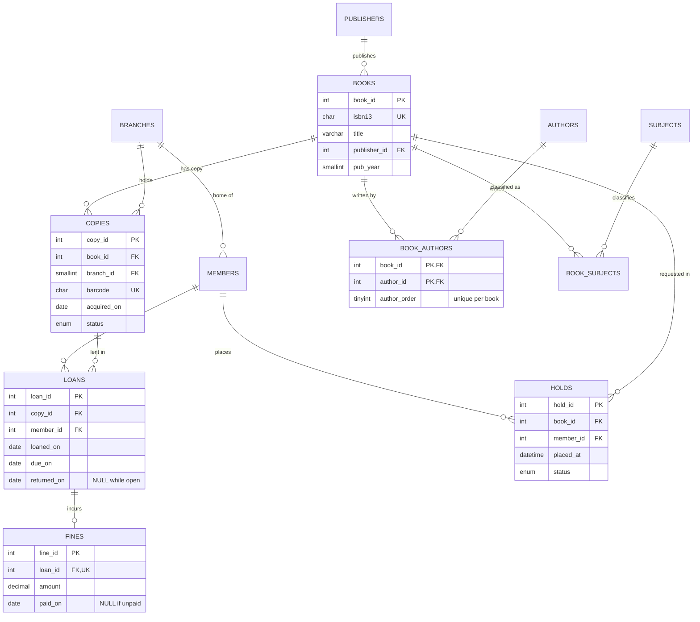

:::industry[Project brief — Bayview Public Library network]
**Client.** A (fictional) city library network with three branches, 40,000 items and 18,000 card holders. Its 20-year-old circulation system stores the catalogue as one wide table exported from a spreadsheet, cannot tell staff which *branch* has a free copy, and once let two librarians check out the same copy to two people within a second of each other. The city has funded a replacement database; you are the database engineer.

**Deliverables**

1. Requirements and business rules for circulation (Stage 1).
2. An ER model that separates *works* (titles) from *copies* (physical items) and resolves every many-to-many relationship (Stages 2–3).
3. A normalization audit of the legacy catalogue and a migration of its data into the new tables (Stage 5).
4. The DDL, including partial-uniqueness rules ("one open loan per copy", "one active hold per member and title") (Stages 6–7).
5. Circulation reports: availability by branch, overdue items with accrued fines, popular titles (Stages 8 and 11).
6. Transactional `checkout_copy` and `return_copy` procedures (Stage 10).
7. Views for the public catalogue and for member self-service, plus an account design (Stage 12).
8. A consistency test suite (Stage 13) and an archival and privacy plan (Stage 14).

**Acceptance criteria**

- A copy can never be on two open loans, even under concurrent checkouts.
- A checkout either records the loan *and* marks the copy as on loan, or does neither.
- Members who are suspended, over their loan limit, overdue or owing more than $5.00 cannot borrow.
- Reports count correctly when a title has several authors (no join fan-out).
- The public catalogue exposes no member data.

**Estimated effort:** 12–16 hours, after the prerequisite lessons on ER mapping, 3NF, the transaction lifecycle and views. Each exercise lab is pre-loaded with the reference schema and data of the stages before it. The circulation "today" in every example and exercise is **16 March 2026** — reports take the date as a literal so that results are reproducible.
:::

## 1. Requirements Gathering

The circulation manager, the cataloguing team and two branch supervisors were interviewed. A professional turns those conversations into three lists — **what must be stored**, **what must be answered**, **what must always be true** — and separates *functional* requirements from *non-functional* ones (volume, concurrency, privacy).

### Worked example — from interview to requirement list

> **Cataloguing:** "A *title* — we say *work* or *bibliographic record* — has an ISBN-13, a title, a publisher and a year. Most books have one author, many have several, and the **order** of the authors matters on the citation. Every title is classified under one or more subjects. We buy several **copies** of popular titles and spread them across branches; each copy has its own barcode."
>
> **Circulation:** "Members have a card number, a home branch and a loan limit — five for most people, more for teachers. A loan is for 21 days. When a copy comes back late the fine is 25 cents a day. Members who are suspended, who have anything overdue, who are at their limit, or who owe more than five dollars can't borrow. If all copies are out, a member can place a **hold** on the title — but only one active hold per title."
>
> **Branch supervisor:** "At 10 a.m. on Saturdays we have queues at every desk. Last year two of us scanned the same book for two members and both got a receipt."

| # | Requirement | Kind | Design consequence |
|---|---|---|---|
| R1 | Work (ISBN, title, publisher, year) vs copy (barcode, branch) | Data | two entities: `books`, `copies` (1 : N) |
| R2 | Several ordered authors per work; an author writes many works | Data | M : N with attribute → `book_authors(book_id, author_id, author_order)` |
| R3 | One or more subjects per work | Data | M : N → `book_subjects` |
| R4 | 21-day loans; fine $0.25/day late | Rule | `due_on = loaned_on + 21`; fines computed on return |
| R5 | Eligibility: active, nothing overdue, below limit, unpaid fines ≤ $5.00 | Rule | checked inside the checkout transaction |
| R6 | A copy is on at most one open loan | Rule, concurrency | partial unique constraint + row lock |
| R7 | One *active* hold per member and title | Rule | partial unique constraint |
| R8 | Availability per branch; overdue list; popular titles | Reports | Stage 8 and 11 queries, views |
| R9 | Peak: ~30 checkouts per minute network-wide | Non-functional | short transactions, indexed lookups by barcode and card |
| R10 | Public catalogue must not reveal who borrowed what | Privacy | separate view and account (Stage 12) |

R6 is the most important line in the table. It is a **business rule**, a **concurrency requirement** and the supervisor's bug report all at once. Rules like this must be enforced by the database itself, because the application has many instances (every desk) and a check performed in one of them knows nothing about the others.

```exercise
id: p2-ex1
title: Classify the circulation rules by enforcement mechanism
difficulty: easy
kind: open
concepts: [requirements-analysis, business-rules, constraints]
prompt: |
  For each rule, say **where** it should be enforced — a declarative constraint (which one), a check inside a
  transaction, a trigger, a scheduled job, or a privilege — and justify the choice in one or two sentences:

  1. An ISBN-13 is 13 digits starting with 978 or 979.
  2. A loan's due date is after its loan date.
  3. A member cannot have more open loans than their `max_loans`.
  4. A copy cannot be on two open loans at the same time.
  5. Members with no activity for three years are marked `closed`.
  6. Branch staff may not change fines; only the finance office may.
solution: |
  1. **CHECK constraint** — `CHECK (isbn13 REGEXP '^97[89][0-9]{10}$')`: a single-row, deterministic condition. (The
     ISBN check digit could also be verified in a CHECK with arithmetic on SUBSTRING values, or in the application.)
  2. **CHECK constraint** — `CHECK (due_on > loaned_on)`: compares two columns of the same row.
  3. **Check inside the checkout transaction** — it is an aggregate over many loan rows, which no declarative
     constraint can express. The transaction must lock the member row first (`SELECT … FOR UPDATE`) so that two
     concurrent checkouts for the same member are serialized; otherwise both can count 4 open loans and both insert
     a fifth and sixth.
  4. **Partial unique constraint**, backed by a lock in the transaction. MySQL has no `UNIQUE … WHERE returned_on IS NULL`,
     but a generated column that is `copy_id` for open loans and NULL otherwise, with a `UNIQUE` index on it, gives the
     same guarantee declaratively (Stage 7). The procedure's `FOR UPDATE` on the copy provides a friendly error;
     the constraint is the safety net that holds even for buggy code paths.
  5. **Scheduled job** — it depends on the passage of time, not on a write. (MySQL events could run it, or an
     external scheduler; either way it is an `UPDATE … WHERE last_activity < …` batch.)
  6. **Privilege** — the branch application account gets `SELECT` on `fines` but no `UPDATE`; the finance account
     gets `UPDATE (paid_on)` on it (column-level privilege). A trigger could also reject changes, but privileges are
     the standard tool for "who may do what".
```

## 2. Entities and Relationships

The central modelling insight in library systems — and in retail, rentals, ticketing, anything with physical inventory — is the difference between a **type** and an **instance**. "Practical SQL Patterns" is one *work*; the library owns three *copies* of it. Attributes of the work (ISBN, title, publisher, authors, subjects) are recorded once; attributes of each copy (barcode, branch, acquisition date, condition, status) are recorded per copy. A member borrows a **copy**, but places a hold on a **work** ("the next available copy of this title, at any branch").

Revise [Entities, Attributes and Relationships](/lessons/m05-entities-attributes) and [Relationships and Cardinality](/lessons/m05-relationships-cardinality) if needed.

| Entity | Identifier | Notes |
|---|---|---|
| Branch | branch id (name unique) | three branches |
| Publisher | publisher id (name unique) | each work has one publisher |
| Book (work) | book id (ISBN-13 unique) | one bibliographic record |
| Author | author id | names are *not* unique — two authors can share a name |
| Subject | subject id (name unique) | controlled vocabulary |
| Copy | copy id (barcode unique) | physical item at one branch |
| Member | member id (card number unique, email unique) | home branch, loan limit, status |
| Loan | loan id | member borrows copy, over a period |
| Fine | fine id | at most one per loan |
| Hold | hold id | member waits for a work |

| Relationship | Cardinality | How it is represented |
|---|---|---|
| Publisher publishes Book | 1 : N | `books.publisher_id` |
| Book has Copy | 1 : N | `copies.book_id` |
| Branch holds Copy | 1 : N | `copies.branch_id` |
| Book written by Author (ordered) | M : N | junction `book_authors` with `author_order` |
| Book classified under Subject | M : N | junction `book_subjects` |
| Member borrows Copy | M : N over time | associative entity `loans` |
| Loan incurs Fine | 1 : 0..1 | `fines.loan_id` with `UNIQUE` |
| Member holds Book | M : N over time | associative entity `holds` |

**Why are loans and holds entities, not plain junction tables?** `book_authors` records a *timeless fact*: Ada Moreno co-wrote "Designing Data Systems", once. A loan records an *event*: Alice borrowed copy C0000001 in December **and again** in February. The pair (member, copy) is therefore not an identifier — the same pair recurs — and the loan has its own lifecycle (open → returned), its own attributes (dates) and its own dependants (a fine). That makes it an entity with a surrogate key.

```exercise
id: p2-ex2
title: Choose the primary key of loans
difficulty: medium
kind: open
concepts: [associative-entity, primary-keys, er-modeling]
prompt: |
  A teammate proposes `PRIMARY KEY (member_id, copy_id)` for `loans`, arguing that "a loan is just the many-to-many
  relationship between members and copies". Another proposes `PRIMARY KEY (copy_id, loaned_on)`.

  Evaluate both proposals against the requirements (repeat borrowing, renewals, same-day re-loans after a mistaken
  checkout, the fines table referencing a loan). Recommend a key and say which **additional** uniqueness rule the
  table needs.
solution: |
  `(member_id, copy_id)` is wrong: it allows each member to borrow each copy **once in their lifetime**. Alice's
  second loan of the same copy would violate the key. It models the relationship as timeless, but borrowing is an event.

  `(copy_id, loaned_on)` is closer — a copy is normally loaned at most once per day — but it still breaks on edge
  cases (a checkout made by mistake, returned and re-issued to another member the same day), and it makes the key
  depend on a business date that might need correcting. It is also a wide, two-column key that `fines` would have to copy.

  Recommendation: a **surrogate key** `loan_id INT UNSIGNED AUTO_INCREMENT`. Loans are events with their own lifecycle
  and dependants (fines reference `loan_id`), and an integer key keeps the clustered index append-only and the
  foreign key small. The real business rule is not "unique pair" but **"at most one open loan per copy"** — a *partial*
  uniqueness rule on `copy_id` where `returned_on IS NULL`, implemented in Stage 7 with a generated column and a
  `UNIQUE` index.
```

## 3. ER Diagram



Two notations deserve a second look. `LOANS ||--o| FINES` is a one-to-zero-or-one relationship: implemented as a foreign key on `fines.loan_id` **plus** a `UNIQUE` constraint, which is what limits it to one fine per loan. `BOOK_AUTHORS` has a composite primary key made of two foreign keys — the standard representation of a many-to-many relationship — plus `author_order`, an attribute of the relationship itself.

### Model it yourself

The ER builder below lets you create entities, attributes and 1:1, 1:N or M:N relationships, and generates the ER diagram and MySQL DDL from your model. Use it to model the **holds** part of the system (the next exercise) and compare the DDL it generates for an M:N relationship with the hand-written `book_authors` table: the builder produces a junction table with a composite key, exactly as the mapping rules prescribe.

```viz
type: er-builder
```

```exercise
id: p2-ex3
title: Model holds and the waiting queue
difficulty: medium
kind: open
concepts: [er-modeling, associative-entity, partial-uniqueness]
prompt: |
  Requirements for holds: a member places a hold on a **work** (not a copy). Holds are served first come, first served
  per work. A hold is `waiting`, then `ready` when a returned copy is set aside for the member at their home branch
  (they have 3 days to collect it), then `fulfilled` when they borrow it — or `cancelled`. A member can have only one
  *active* (waiting or ready) hold per work, but may place a new hold on the same work after an earlier one was fulfilled.

  Design the `holds` entity: attributes, keys, relationships and cardinalities, and explain how you would (a) determine
  a member's position in the queue and (b) enforce "one active hold per member and work". Use the ER builder if you like.
solution: |
  **Entity** `holds(hold_id PK, book_id FK → books, member_id FK → members, placed_at DATETIME, status ENUM('waiting',
  'ready','fulfilled','cancelled'), ready_copy_id FK → copies NULL, ready_until DATE NULL)`. It is an associative
  entity between Member and Book (M : N over time), with a surrogate key because the same (member, book) pair can recur
  after fulfilment.

  **Queue position** is *derived*, not stored: the position of a waiting hold is the number of waiting holds on the
  same book placed earlier, plus one — `ROW_NUMBER() OVER (PARTITION BY book_id ORDER BY placed_at, hold_id)` over
  waiting holds. Storing a position column would require renumbering every later hold on each cancellation (an update
  anomaly). An index on `(book_id, status, placed_at)` serves the queue query.

  **One active hold** is a partial uniqueness rule — unique `(member_id, book_id)` *only while* status is waiting or
  ready. MySQL has no partial indexes, but NULLs are not equal to each other in a `UNIQUE` index, so a generated
  column `active_flag = IF(status IN ('waiting','ready'), 1, NULL)` and `UNIQUE (member_id, book_id, active_flag)`
  allows any number of fulfilled/cancelled holds (flag NULL) but only one active one (flag 1). You implement exactly this
  in Stage 7. `ready_copy_id` should reference the copy that was set aside; the rule "ready implies ready_copy_id is not
  NULL" is a single-row CHECK: `CHECK (status <> 'ready' OR ready_copy_id IS NOT NULL)`.
```

## 4. Schema Design

Mapping the ER model to relations (see [ER to Relational Mapping](/lessons/m05-er-to-relational)) gives eleven tables. The interesting decisions are the ones that are *not* mechanical:

| Decision | Choice | Reasoning |
|---|---|---|
| Key of `book_authors` | `(book_id, author_id)` + `UNIQUE (book_id, author_order)` | an author appears once per book; positions 1, 2, 3 are unique per book |
| `ON DELETE` for `book_authors.book_id` | `CASCADE` | authorship rows have no meaning without the book; deleting a catalogue record (made in error) removes them |
| `ON DELETE` for `book_authors.author_id` | `RESTRICT` (default) | deleting an author who still has books would silently corrupt citations |
| `ON DELETE` for `copies.book_id`, `loans.*` | `RESTRICT` | circulation history must never disappear as a side effect |
| Copy status | `ENUM` column on `copies` | fast "available?" checks; must agree with `loans` (a controlled redundancy, tested in Stage 13) |
| Loan period | `due_on` column | the due date can be extended (renewals) and must be stored, not recomputed |
| Fine amount | `DECIMAL(6,2)` | money is exact |
| Open loans | `returned_on IS NULL` | no separate "is_open" flag that could disagree with the date |

The **copy status** row deserves attention. Strictly, "on loan" is derivable from `loans` (there is an open loan for this copy), so storing it is redundancy. We keep it deliberately because the desk application checks availability constantly and the status also carries values that *cannot* be derived (`lost`, `withdrawn`). Every controlled redundancy needs two things: **one place that maintains it** (the checkout and return procedures, inside the same transaction as the loan change) and **a test that detects drift** (Stage 13). Revise [Denormalization](/lessons/m06-denormalization) for the general principle.

## 5. Normalization

The cataloguing team exported the legacy catalogue for migration. It has one row per (work, author):

```sql run
CREATE TABLE legacy_catalog (
  isbn13 CHAR(13), title VARCHAR(200), pub_year SMALLINT, publisher VARCHAR(120), publisher_city VARCHAR(60),
  author VARCHAR(120), author_birth_year SMALLINT
);
INSERT INTO legacy_catalog VALUES
  ('9780000000101', 'Designing Data Systems',     2019, 'Lighthouse Press', 'Portland',  'Ada Moreno',     1975),
  ('9780000000101', 'Designing Data Systems',     2019, 'Lighthouse Press', 'Portland',  'Kenji Watanabe', 1981),
  ('9780000000102', 'The Relational Mind',        2015, 'Lighthouse Press', 'Portland',  'Ada Moreno',     1975),
  ('9780000000103', 'Practical SQL Patterns',     2022, 'Meridian Books',   'Boston',    'Kenji Watanabe', 1981),
  ('9780000000103', 'Practical SQL Patterns',     2022, 'Meridian Books',   'Boston',    'Tom Becker',     NULL),
  ('9780000000104', 'Statistics for the Curious', 2018, 'Meridian Books',   'Cambridge', 'Grace Okonkwo',  1979),
  ('9780000000108', 'The Lighthouse Keeper',      2017, 'Quarry & Finch',   'Seattle',   'Ines Duarte',    1968),
  ('9780000000109', 'Gardens of Stone',           2020, 'Quarry & Finch',   'Seattle',   'Ines Duarte',    1968);
SELECT * FROM legacy_catalog ORDER BY isbn13, author;
```

### Worked example — finding the dependencies

Interviewing the cataloguers and inspecting the data gives these functional dependencies:

- `isbn13 → title, pub_year, publisher` (a work has one title, year and publisher)
- `publisher → publisher_city` (a publisher is in one city)
- `author → author_birth_year` (assuming author names identify authors in this export — they do not in general, which is why the new schema uses `author_id`)

The only candidate key is **{isbn13, author}**. Explore it in the analyzer: it computes attribute closures, the candidate key, the prime attributes and the highest normal form, and proposes a decomposition.

```viz
type: fd
attributes: [isbn13, title, pub_year, publisher, publisher_city, author, author_birth_year]
fds: ["isbn13 -> title, pub_year, publisher", "publisher -> publisher_city", "author -> author_birth_year"]
```

The relation is in 1NF but **not in 2NF**: `title`, `pub_year` and `publisher` depend on `isbn13` alone — part of the key — and `author_birth_year` depends on `author` alone. `publisher_city` depends on the key only *transitively* (`isbn13 → publisher → publisher_city`), a 3NF violation. Revise [Second Normal Form](/lessons/m06-2nf) and [Third Normal Form](/lessons/m06-3nf).

The anomaly predicted by `publisher → publisher_city` is already in the data:

```sql run
SELECT publisher, COUNT(DISTINCT publisher_city) AS cities,
       GROUP_CONCAT(DISTINCT publisher_city ORDER BY publisher_city) AS recorded_as
FROM legacy_catalog
GROUP BY publisher
HAVING COUNT(DISTINCT publisher_city) > 1;
```

Meridian Books is recorded in two cities — an update anomaly. The 3NF decomposition has one relation per determinant: **works**(isbn13, title, pub_year, publisher), **publishers**(publisher, publisher_city), **authors**(author, author_birth_year) and **authorship**(isbn13, author). A decomposition must be **lossless**: joining the pieces back must reproduce exactly the original rows, no more and no fewer. Check it with CTEs before writing a single migration statement:

```sql run
WITH works       AS (SELECT DISTINCT isbn13, title, pub_year, publisher FROM legacy_catalog),
     publishers  AS (SELECT publisher, MIN(publisher_city) AS publisher_city FROM legacy_catalog GROUP BY publisher),
     authors     AS (SELECT DISTINCT author, author_birth_year FROM legacy_catalog),
     authorship  AS (SELECT DISTINCT isbn13, author FROM legacy_catalog)
SELECT (SELECT COUNT(*) FROM legacy_catalog) AS original_rows,
       COUNT(*)                              AS rejoined_rows,
       SUM(p.publisher_city <> l.publisher_city) AS rows_whose_city_was_corrected
FROM authorship a
JOIN works w      ON w.isbn13 = a.isbn13
JOIN publishers p ON p.publisher = w.publisher
JOIN authors au   ON au.author = a.author
JOIN legacy_catalog l ON l.isbn13 = a.isbn13 AND l.author = a.author;
```

The rejoin produces the same number of rows as the original, so no information was lost or invented. Because each decomposed relation shares a key with the next (`isbn13`, `publisher`, `author`), the join cannot create spurious tuples. The one row whose city differs is the anomaly the migration *resolves* — the cataloguers confirmed Boston, and taking `MIN(publisher_city)` happens to pick it; in a real migration you record such decisions in a mapping table rather than relying on alphabetical luck.

```exercise
id: p2-ex4
title: Normalize the paper loan slip
difficulty: medium
kind: open
concepts: [functional-dependencies, candidate-keys, 2nf, 3nf, decomposition]
prompt: |
  The branches also kept paper loan slips, typed into a table
  `loan_slip(card_number, member_name, barcode, isbn13, title, branch, loaned_on, due_on)` with these dependencies:

  - `card_number → member_name`
  - `barcode → isbn13, branch`
  - `isbn13 → title`
  - `barcode, loaned_on → card_number, due_on`

  1. Find the candidate key(s). 2. State the highest normal form and every dependency that violates 2NF or 3NF.
  3. Give a lossless, dependency-preserving 3NF decomposition and map each relation to a table of our schema.
  Verify your answer with the analyzer below.
solution: |
  1. `{barcode, loaned_on}⁺` = {barcode, loaned_on, isbn13, branch, card_number, due_on, title, member_name} — all
     attributes, and neither attribute alone determines everything, so **{barcode, loaned_on}** is the only candidate key.
  2. The relation is in **1NF only**. `barcode → isbn13, branch` is a partial dependency (2NF violation), and so are
     `barcode → title` and the others derived from it. `card_number → member_name` and `isbn13 → title` are transitive
     dependencies of non-prime attributes on the key (3NF violations).
  3. Decomposition: `members(card_number, member_name)`, `books(isbn13, title)`, `copies(barcode, isbn13, branch)`,
     `loans(barcode, loaned_on, card_number, due_on)`. Every FD is contained in one relation (dependency-preserving), and
     each relation joins to the next on a key (lossless). These are exactly our `members`, `books`, `copies` and `loans`
     tables — except that our schema replaces the natural keys by surrogate keys and stores `copy_id`/`member_id` in
     `loans`, keeping `barcode` and `card_number` as `UNIQUE` columns.
```

```viz
type: fd
attributes: [card_number, member_name, barcode, isbn13, title, branch, loaned_on, due_on]
fds: ["card_number -> member_name", "barcode -> isbn13, branch", "isbn13 -> title", "barcode, loaned_on -> card_number, due_on"]
```

```exercise
id: p2-ex5
title: Migrate the legacy catalogue into publishers and books
difficulty: hard
kind: dml
concepts: [normalization, data-migration, insert-select, group-by]
setup: |
  CREATE TABLE legacy_catalog (
    isbn13 CHAR(13), title VARCHAR(200), pub_year SMALLINT, publisher VARCHAR(120), publisher_city VARCHAR(60),
    author VARCHAR(120), author_birth_year SMALLINT
  );
  INSERT INTO legacy_catalog VALUES
    ('9780000000101', 'Designing Data Systems',     2019, 'Lighthouse Press', 'Portland',  'Ada Moreno',     1975),
    ('9780000000101', 'Designing Data Systems',     2019, 'Lighthouse Press', 'Portland',  'Kenji Watanabe', 1981),
    ('9780000000102', 'The Relational Mind',        2015, 'Lighthouse Press', 'Portland',  'Ada Moreno',     1975),
    ('9780000000103', 'Practical SQL Patterns',     2022, 'Meridian Books',   'Boston',    'Kenji Watanabe', 1981),
    ('9780000000103', 'Practical SQL Patterns',     2022, 'Meridian Books',   'Boston',    'Tom Becker',     NULL),
    ('9780000000104', 'Statistics for the Curious', 2018, 'Meridian Books',   'Cambridge', 'Grace Okonkwo',  1979),
    ('9780000000108', 'The Lighthouse Keeper',      2017, 'Quarry & Finch',   'Seattle',   'Ines Duarte',    1968),
    ('9780000000109', 'Gardens of Stone',           2020, 'Quarry & Finch',   'Seattle',   'Ines Duarte',    1968);
  CREATE TABLE publishers (
    publisher_id INT UNSIGNED NOT NULL AUTO_INCREMENT,
    name         VARCHAR(120) NOT NULL,
    city         VARCHAR(60)  NULL,
    PRIMARY KEY (publisher_id),
    CONSTRAINT uq_publishers_name UNIQUE (name)
  );
  CREATE TABLE books (
    book_id      INT UNSIGNED      NOT NULL AUTO_INCREMENT,
    isbn13       CHAR(13)          NOT NULL,
    title        VARCHAR(200)      NOT NULL,
    publisher_id INT UNSIGNED      NOT NULL,
    pub_year     SMALLINT UNSIGNED NOT NULL,
    PRIMARY KEY (book_id),
    CONSTRAINT uq_books_isbn UNIQUE (isbn13),
    CONSTRAINT fk_books_publisher FOREIGN KEY (publisher_id) REFERENCES publishers (publisher_id),
    CONSTRAINT chk_books_isbn CHECK (isbn13 REGEXP '^97[89][0-9]{10}$'),
    CONSTRAINT chk_books_year CHECK (pub_year BETWEEN 1450 AND 2100)
  );
prompt: |
  The lab contains `legacy_catalog` and the new, empty tables `publishers(publisher_id, name, city)` and
  `books(book_id, isbn13, title, publisher_id, pub_year)` (ids are `AUTO_INCREMENT`).

  Write the migration: insert **one row per publisher** (if a publisher appears with several cities, keep the
  alphabetically first one), then **one row per work**, with `publisher_id` looked up from the new `publishers` table.
  The grader joins the two tables and compares ISBN, title, year, publisher name and city.
hints:
  - "INSERT INTO publishers (name, city) SELECT publisher, MIN(publisher_city) FROM legacy_catalog GROUP BY publisher;"
  - "SELECT DISTINCT isbn13, title, pub_year, publisher FROM legacy_catalog gives one row per work — two rows per two-author work would otherwise violate uq_books_isbn."
  - "Join that result to publishers ON publishers.name = legacy.publisher to obtain publisher_id."
solution: |
  INSERT INTO publishers (name, city)
  SELECT publisher, MIN(publisher_city)
  FROM legacy_catalog
  GROUP BY publisher;

  INSERT INTO books (isbn13, title, publisher_id, pub_year)
  SELECT w.isbn13, w.title, p.publisher_id, w.pub_year
  FROM (SELECT DISTINCT isbn13, title, pub_year, publisher FROM legacy_catalog) AS w
  JOIN publishers p ON p.name = w.publisher;
check: |
  SELECT b.isbn13, b.title, b.pub_year, p.name, p.city
  FROM books b JOIN publishers p ON p.publisher_id = b.publisher_id
  ORDER BY b.isbn13;
explanation: |
  `SELECT DISTINCT publisher, publisher_city` would produce two Meridian Books rows and fail on the `UNIQUE (name)`
  constraint — the constraint *detects* the anomaly for you. Grouping by the determinant (`publisher`) and choosing one
  value resolves it. For the works, `DISTINCT` collapses the one-row-per-author repetition; if two rows of the same ISBN
  disagreed on the title, `DISTINCT` would keep both and `uq_books_isbn` would stop the migration — again, constraints
  turn silent data problems into loud errors. Migrations of this kind should run inside a transaction, so a failure
  leaves the target tables empty rather than half-filled.
```

## 6. MySQL Table Creation

Tables are created parents first: `branches`, `publishers`, `authors`, `subjects` reference nothing; `books` references `publishers`; `copies` references `books` and `branches`; `members` references `branches`; `loans` references `copies` and `members`; `fines` references `loans`.

### Worked example — the core schema

```sql run
CREATE TABLE publishers (
  publisher_id INT UNSIGNED NOT NULL AUTO_INCREMENT,
  name         VARCHAR(120) NOT NULL,
  city         VARCHAR(60)  NULL,
  PRIMARY KEY (publisher_id),
  CONSTRAINT uq_publishers_name UNIQUE (name)
);
CREATE TABLE books (
  book_id      INT UNSIGNED      NOT NULL AUTO_INCREMENT,
  isbn13       CHAR(13)          NOT NULL,
  title        VARCHAR(200)      NOT NULL,
  publisher_id INT UNSIGNED      NOT NULL,
  pub_year     SMALLINT UNSIGNED NOT NULL,
  PRIMARY KEY (book_id),
  CONSTRAINT uq_books_isbn UNIQUE (isbn13),
  CONSTRAINT fk_books_publisher FOREIGN KEY (publisher_id) REFERENCES publishers (publisher_id),
  CONSTRAINT chk_books_isbn CHECK (isbn13 REGEXP '^97[89][0-9]{10}$'),
  CONSTRAINT chk_books_year CHECK (pub_year BETWEEN 1450 AND 2100)
);
CREATE TABLE branches (
  branch_id SMALLINT UNSIGNED NOT NULL AUTO_INCREMENT,
  name      VARCHAR(80) NOT NULL,
  city      VARCHAR(60) NOT NULL,
  PRIMARY KEY (branch_id),
  CONSTRAINT uq_branches_name UNIQUE (name)
);
CREATE TABLE authors (
  author_id  INT UNSIGNED NOT NULL AUTO_INCREMENT,
  full_name  VARCHAR(120) NOT NULL,
  birth_year SMALLINT     NULL,
  PRIMARY KEY (author_id)
);
CREATE TABLE book_authors (
  book_id      INT UNSIGNED     NOT NULL,
  author_id    INT UNSIGNED     NOT NULL,
  author_order TINYINT UNSIGNED NOT NULL,
  PRIMARY KEY (book_id, author_id),
  CONSTRAINT uq_book_authors_order UNIQUE (book_id, author_order),
  CONSTRAINT fk_book_authors_book   FOREIGN KEY (book_id)   REFERENCES books (book_id) ON DELETE CASCADE,
  CONSTRAINT fk_book_authors_author FOREIGN KEY (author_id) REFERENCES authors (author_id)
);
CREATE TABLE subjects (
  subject_id SMALLINT UNSIGNED NOT NULL AUTO_INCREMENT,
  name       VARCHAR(60) NOT NULL,
  PRIMARY KEY (subject_id),
  CONSTRAINT uq_subjects_name UNIQUE (name)
);
CREATE TABLE copies (
  copy_id     INT UNSIGNED      NOT NULL AUTO_INCREMENT,
  book_id     INT UNSIGNED      NOT NULL,
  branch_id   SMALLINT UNSIGNED NOT NULL,
  barcode     CHAR(8)           NOT NULL,
  acquired_on DATE              NOT NULL,
  status      ENUM('available','on_loan','lost','withdrawn') NOT NULL DEFAULT 'available',
  PRIMARY KEY (copy_id),
  CONSTRAINT uq_copies_barcode UNIQUE (barcode),
  CONSTRAINT fk_copies_book   FOREIGN KEY (book_id)   REFERENCES books (book_id),
  CONSTRAINT fk_copies_branch FOREIGN KEY (branch_id) REFERENCES branches (branch_id)
);
CREATE TABLE members (
  member_id      INT UNSIGNED      NOT NULL AUTO_INCREMENT,
  card_number    CHAR(8)           NOT NULL,
  full_name      VARCHAR(120)      NOT NULL,
  email          VARCHAR(255)      NOT NULL,
  home_branch_id SMALLINT UNSIGNED NOT NULL,
  joined_on      DATE              NOT NULL,
  max_loans      TINYINT UNSIGNED  NOT NULL DEFAULT 5,
  status         ENUM('active','suspended','closed') NOT NULL DEFAULT 'active',
  PRIMARY KEY (member_id),
  CONSTRAINT uq_members_card  UNIQUE (card_number),
  CONSTRAINT uq_members_email UNIQUE (email),
  CONSTRAINT fk_members_branch FOREIGN KEY (home_branch_id) REFERENCES branches (branch_id),
  CONSTRAINT chk_members_max_loans CHECK (max_loans BETWEEN 1 AND 20)
);
CREATE TABLE loans (
  loan_id      INT UNSIGNED NOT NULL AUTO_INCREMENT,
  copy_id      INT UNSIGNED NOT NULL,
  member_id    INT UNSIGNED NOT NULL,
  loaned_on    DATE         NOT NULL,
  due_on       DATE         NOT NULL,
  returned_on  DATE         NULL,
  open_copy_id INT UNSIGNED AS (IF(returned_on IS NULL, copy_id, NULL)) VIRTUAL,
  PRIMARY KEY (loan_id),
  CONSTRAINT uq_loans_one_open_per_copy UNIQUE (open_copy_id),
  CONSTRAINT fk_loans_copy   FOREIGN KEY (copy_id)   REFERENCES copies (copy_id),
  CONSTRAINT fk_loans_member FOREIGN KEY (member_id) REFERENCES members (member_id),
  CONSTRAINT chk_loans_due      CHECK (due_on > loaned_on),
  CONSTRAINT chk_loans_returned CHECK (returned_on IS NULL OR returned_on >= loaned_on)
);
CREATE TABLE fines (
  fine_id     INT UNSIGNED NOT NULL AUTO_INCREMENT,
  loan_id     INT UNSIGNED NOT NULL,
  amount      DECIMAL(6,2) NOT NULL,
  assessed_on DATE         NOT NULL,
  paid_on     DATE         NULL,
  PRIMARY KEY (fine_id),
  CONSTRAINT uq_fines_loan UNIQUE (loan_id),
  CONSTRAINT fk_fines_loan FOREIGN KEY (loan_id) REFERENCES loans (loan_id),
  CONSTRAINT chk_fines_amount CHECK (amount > 0)
);
SELECT TABLE_NAME, COUNT(*) AS columns
FROM information_schema.COLUMNS
WHERE TABLE_SCHEMA = DATABASE() AND TABLE_NAME <> 'legacy_catalog'
GROUP BY TABLE_NAME
ORDER BY TABLE_NAME;
```

Look closely at `loans`. The line

```sql
open_copy_id INT UNSIGNED AS (IF(returned_on IS NULL, copy_id, NULL)) VIRTUAL,
CONSTRAINT uq_loans_one_open_per_copy UNIQUE (open_copy_id)
```

implements requirement R6 declaratively. `open_copy_id` is a **generated column**: MySQL computes it from the row, and it equals `copy_id` while the loan is open and NULL once it is returned. A `UNIQUE` index treats NULLs as distinct, so any number of *returned* loans of a copy can coexist, but two *open* loans of the same copy would put the same value into the index twice — and are rejected. This is how MySQL emulates the **partial unique index** (`… WHERE returned_on IS NULL`) that PostgreSQL and SQL Server support directly.

:::mysql[VIRTUAL vs STORED generated columns]
A `VIRTUAL` column is computed when read and occupies no space in the row; an index on it stores the computed values, so the uniqueness check is as fast as for an ordinary column. `STORED` computes it on write and keeps it in the row. Both can be indexed in InnoDB. Restriction: a base column of a generated column (here `copy_id`) cannot use `ON DELETE CASCADE`/`SET NULL` in its foreign key — another reason `loans` uses `RESTRICT`.
:::

### Your task — the second junction table

```exercise
id: p2-ex6
title: Create the book_subjects junction table
difficulty: medium
kind: dml
concepts: [many-to-many, composite-primary-key, foreign-keys, on-delete-cascade]
setup: |
  CREATE TABLE publishers (
    publisher_id INT UNSIGNED NOT NULL AUTO_INCREMENT,
    name         VARCHAR(120) NOT NULL,
    city         VARCHAR(60)  NULL,
    PRIMARY KEY (publisher_id),
    CONSTRAINT uq_publishers_name UNIQUE (name)
  );
  CREATE TABLE books (
    book_id      INT UNSIGNED      NOT NULL AUTO_INCREMENT,
    isbn13       CHAR(13)          NOT NULL,
    title        VARCHAR(200)      NOT NULL,
    publisher_id INT UNSIGNED      NOT NULL,
    pub_year     SMALLINT UNSIGNED NOT NULL,
    PRIMARY KEY (book_id),
    CONSTRAINT uq_books_isbn UNIQUE (isbn13),
    CONSTRAINT fk_books_publisher FOREIGN KEY (publisher_id) REFERENCES publishers (publisher_id),
    CONSTRAINT chk_books_isbn CHECK (isbn13 REGEXP '^97[89][0-9]{10}$'),
    CONSTRAINT chk_books_year CHECK (pub_year BETWEEN 1450 AND 2100)
  );
  CREATE TABLE subjects (
    subject_id SMALLINT UNSIGNED NOT NULL AUTO_INCREMENT, name VARCHAR(60) NOT NULL,
    PRIMARY KEY (subject_id), CONSTRAINT uq_subjects_name UNIQUE (name));
  INSERT INTO publishers (publisher_id, name) VALUES (1, 'Lighthouse Press');
  INSERT INTO books (book_id, isbn13, title, publisher_id, pub_year) VALUES
    (1, '9780000000101', 'Designing Data Systems', 1, 2019), (2, '9780000000102', 'The Relational Mind', 1, 2015);
  INSERT INTO subjects (subject_id, name) VALUES (1, 'Computing'), (2, 'Data Science'), (3, 'Fiction');
prompt: |
  Create **`book_subjects(book_id, subject_id)`** resolving the many-to-many relationship between `books` and
  `subjects`. Match the referenced column types exactly (`books.book_id` is `INT UNSIGNED`, `subjects.subject_id` is
  `SMALLINT UNSIGNED`). Rules:

  - a book is classified under a subject at most once;
  - deleting a book (a catalogue record created by mistake) removes its classifications automatically;
  - a subject that is still in use cannot be deleted.

  The grader inserts classifications, deletes book 2 and tries to delete subject 1.
hints:
  - "PRIMARY KEY (book_id, subject_id) enforces 'at most once'."
  - "The book foreign key needs ON DELETE CASCADE; the subject foreign key keeps the default (RESTRICT)."
solution: |
  CREATE TABLE book_subjects (
    book_id    INT UNSIGNED      NOT NULL,
    subject_id SMALLINT UNSIGNED NOT NULL,
    PRIMARY KEY (book_id, subject_id),
    CONSTRAINT fk_book_subjects_book    FOREIGN KEY (book_id)    REFERENCES books (book_id) ON DELETE CASCADE,
    CONSTRAINT fk_book_subjects_subject FOREIGN KEY (subject_id) REFERENCES subjects (subject_id)
  );
check: |
  INSERT IGNORE INTO book_subjects (book_id, subject_id) VALUES (1, 1), (1, 2), (1, 1), (2, 1), (2, 3), (9, 1), (1, 9);
  DELETE FROM books WHERE book_id = 2;
  DELETE IGNORE FROM subjects WHERE subject_id = 1;
  SELECT 'classification' AS kind, CONCAT(book_id, '-', subject_id) AS item FROM book_subjects
  UNION ALL
  SELECT 'subject', name FROM subjects
  ORDER BY kind, item;
explanation: |
  After the grader runs, book 1 keeps its two classifications, book 2's rows were removed by the cascade, the duplicate
  and the rows referencing a missing book or subject were rejected, and subject 1 (*Computing*) still exists because
  `RESTRICT` refused the delete (`DELETE IGNORE` turned the error into a warning). If `DELETE FROM books` failed, the
  book foreign key lacks `ON DELETE CASCADE`; if *Computing* disappeared, the subject foreign key was declared with
  `CASCADE`, which would silently strip the subject from every book.
```

## 7. Constraints and Relationships

**Checkpoint** — create the reference `book_subjects` table and load the sample data: 3 branches, 12 works, 22 copies, 10 members, 24 loans (12 still open) and 4 fines.

```sql run
CREATE TABLE book_subjects (
  book_id    INT UNSIGNED      NOT NULL,
  subject_id SMALLINT UNSIGNED NOT NULL,
  PRIMARY KEY (book_id, subject_id),
  CONSTRAINT fk_book_subjects_book    FOREIGN KEY (book_id)    REFERENCES books (book_id) ON DELETE CASCADE,
  CONSTRAINT fk_book_subjects_subject FOREIGN KEY (subject_id) REFERENCES subjects (subject_id)
);
INSERT INTO branches (branch_id, name, city) VALUES
  (1, 'Central Library', 'Bayview'), (2, 'Harbor Branch', 'Bayview'), (3, 'Hillside Branch', 'Westfield');
INSERT INTO publishers (publisher_id, name, city) VALUES
  (1, 'Lighthouse Press', 'Portland'), (2, 'Meridian Books', 'Boston'),
  (3, 'Quarry & Finch', 'Seattle'), (4, 'Blue Heron Publishing', 'Bayview');
INSERT INTO books (book_id, isbn13, title, publisher_id, pub_year) VALUES
  (1, '9780000000101', 'Designing Data Systems', 1, 2019),
  (2, '9780000000102', 'The Relational Mind', 1, 2015),
  (3, '9780000000103', 'Practical SQL Patterns', 2, 2022),
  (4, '9780000000104', 'Statistics for the Curious', 2, 2018),
  (5, '9780000000105', 'Python for Analysts', 1, 2023),
  (6, '9780000000106', 'Machine Learning in Practice', 3, 2021),
  (7, '9780000000107', 'Tides of Bayview', 4, 2010),
  (8, '9780000000108', 'The Lighthouse Keeper', 3, 2017),
  (9, '9780000000109', 'Gardens of Stone', 3, 2020),
  (10, '9780000000110', 'A Short History of Maps', 4, 2012),
  (11, '9780000000111', 'Cooking with Seasons', 2, 2016),
  (12, '9780000000112', 'The Quiet Orbit', 3, 2024);
INSERT INTO authors (author_id, full_name, birth_year) VALUES
  (1, 'Ada Moreno', 1975), (2, 'Kenji Watanabe', 1981), (3, 'Leila Haddad', 1990), (4, 'Tom Becker', NULL),
  (5, 'Grace Okonkwo', 1979), (6, 'Ines Duarte', 1968), (7, 'Paul Lindqvist', 1955), (8, 'Ravi Menon', 1986);
INSERT INTO book_authors (book_id, author_id, author_order) VALUES
  (1,1,1),(1,2,2),(2,1,1),(3,2,1),(3,4,2),(4,5,1),(5,4,1),(5,8,2),(6,8,1),(6,1,2),(6,5,3),
  (7,7,1),(8,6,1),(9,6,1),(10,7,1),(10,3,2),(11,3,1),(12,6,1),(12,2,2);
INSERT INTO subjects (subject_id, name) VALUES
  (1, 'Computing'), (2, 'Data Science'), (3, 'Fiction'), (4, 'History'), (5, 'Statistics'), (6, 'Cooking');
INSERT INTO book_subjects (book_id, subject_id) VALUES
  (1,1),(1,2),(2,1),(3,1),(3,2),(4,5),(4,2),(5,1),(5,2),(6,2),(6,1),(6,5),(7,4),(8,3),(9,3),(10,4),(11,6),(12,3);
INSERT INTO copies (copy_id, book_id, branch_id, barcode, acquired_on, status) VALUES
  (1, 1, 1, 'C0000001', '2020-01-15', 'available'), (2, 1, 2, 'C0000002', '2020-01-15', 'available'),
  (3, 2, 1, 'C0000003', '2016-03-01', 'on_loan'),   (4, 3, 1, 'C0000004', '2022-09-10', 'on_loan'),
  (5, 3, 2, 'C0000005', '2022-09-10', 'on_loan'),   (6, 3, 3, 'C0000006', '2022-09-10', 'available'),
  (7, 4, 1, 'C0000007', '2018-05-20', 'on_loan'),   (8, 5, 1, 'C0000008', '2023-11-01', 'on_loan'),
  (9, 5, 3, 'C0000009', '2023-11-01', 'available'), (10, 6, 1, 'C0000010', '2021-06-15', 'available'),
  (11, 6, 2, 'C0000011', '2021-06-15', 'on_loan'),  (12, 7, 1, 'C0000012', '2010-07-01', 'available'),
  (13, 7, 2, 'C0000013', '2010-07-01', 'on_loan'),  (14, 7, 3, 'C0000014', '2011-02-01', 'available'),
  (15, 8, 2, 'C0000015', '2017-10-10', 'available'),(16, 8, 3, 'C0000016', '2017-10-10', 'on_loan'),
  (17, 9, 1, 'C0000017', '2020-11-11', 'on_loan'),  (18, 10, 1, 'C0000018', '2012-04-04', 'lost'),
  (19, 11, 3, 'C0000019', '2016-12-12', 'available'),(20, 12, 1, 'C0000020', '2024-05-05', 'on_loan'),
  (21, 12, 2, 'C0000021', '2024-05-05', 'on_loan'), (22, 12, 3, 'C0000022', '2024-05-05', 'on_loan');
INSERT INTO members (member_id, card_number, full_name, email, home_branch_id, joined_on, max_loans, status) VALUES
  (1, 'M0000001', 'Alice Romero',    'alice.romero@mail.example.com',    1, '2019-02-11', 5,  'active'),
  (2, 'M0000002', 'Ben Carter',      'ben.carter@mail.example.com',      1, '2020-06-01', 5,  'active'),
  (3, 'M0000003', 'Chen Wei',        'chen.wei@mail.example.com',        2, '2021-09-15', 5,  'active'),
  (4, 'M0000004', 'Dana Brooks',     'dana.brooks@mail.example.com',     2, '2018-01-20', 10, 'active'),
  (5, 'M0000005', 'Elif Yilmaz',     'elif.yilmaz@mail.example.com',     3, '2022-03-03', 5,  'active'),
  (6, 'M0000006', 'Farah Siddiqui',  'farah.siddiqui@mail.example.com',  3, '2023-07-07', 3,  'active'),
  (7, 'M0000007', 'George Mensah',   'george.mensah@mail.example.com',   1, '2017-05-05', 5,  'suspended'),
  (8, 'M0000008', 'Hana Sato',       'hana.sato@mail.example.com',       1, '2024-01-10', 5,  'active'),
  (9, 'M0000009', 'Ivan Petrov',     'ivan.petrov@mail.example.com',     2, '2025-02-14', 5,  'active'),
  (10, 'M0000010', 'Julia Fernandes', 'julia.fernandes@mail.example.com', 3, '2025-10-01', 5,  'active');
INSERT INTO loans (loan_id, copy_id, member_id, loaned_on, due_on, returned_on) VALUES
  (1, 1, 1, '2025-12-01', '2025-12-22', '2025-12-20'),  (2, 4, 2, '2025-12-03', '2025-12-24', '2026-01-05'),
  (3, 8, 3, '2025-12-10', '2025-12-31', '2025-12-28'),  (4, 12, 4, '2026-01-05', '2026-01-26', '2026-01-25'),
  (5, 20, 5, '2026-01-10', '2026-01-31', '2026-02-10'), (6, 15, 6, '2026-01-15', '2026-02-05', '2026-02-01'),
  (7, 10, 1, '2026-01-20', '2026-02-10', '2026-02-09'), (8, 7, 7, '2025-11-01', '2025-11-22', NULL),
  (9, 1, 2, '2026-02-01', '2026-02-22', '2026-02-20'),  (10, 4, 3, '2026-02-10', '2026-03-03', NULL),
  (11, 20, 1, '2026-02-15', '2026-03-08', NULL),        (12, 5, 4, '2026-02-20', '2026-03-13', NULL),
  (13, 11, 4, '2026-02-25', '2026-03-18', NULL),        (14, 13, 5, '2026-03-01', '2026-03-22', NULL),
  (15, 16, 6, '2026-03-02', '2026-03-23', NULL),        (16, 8, 8, '2026-03-05', '2026-03-26', NULL),
  (17, 21, 9, '2026-03-06', '2026-03-27', NULL),        (18, 3, 2, '2026-03-08', '2026-03-29', NULL),
  (19, 17, 1, '2026-03-10', '2026-03-31', NULL),        (20, 22, 10, '2026-03-12', '2026-04-02', NULL),
  (21, 9, 3, '2026-01-03', '2026-01-24', '2026-01-30'), (22, 6, 5, '2026-02-02', '2026-02-23', '2026-02-23'),
  (23, 12, 8, '2026-02-01', '2026-02-22', '2026-03-01'),(24, 19, 10, '2026-02-11', '2026-03-04', '2026-03-02');
INSERT INTO fines (fine_id, loan_id, amount, assessed_on, paid_on) VALUES
  (1, 2, 3.00, '2026-01-05', '2026-01-05'), (2, 5, 2.50, '2026-02-10', '2026-02-10'),
  (3, 21, 1.50, '2026-01-30', NULL),        (4, 23, 1.75, '2026-03-01', NULL);
SELECT (SELECT COUNT(*) FROM books) AS works, (SELECT COUNT(*) FROM copies) AS copies,
       (SELECT COUNT(*) FROM members) AS members, (SELECT COUNT(*) FROM loans) AS loans,
       (SELECT COUNT(*) FROM loans WHERE returned_on IS NULL) AS open_loans,
       (SELECT COUNT(*) FROM fines) AS fines;
```

### Worked example — the constraints at work

The double-checkout bug from the brief, reproduced directly: copy C0000004 (id 4) is on an open loan to Chen Wei; try to open a second loan for it.

```sql run error
INSERT INTO loans (copy_id, member_id, loaned_on, due_on) VALUES (4, 1, '2026-03-16', '2026-04-06');
```

Error 1062 on `uq_loans_one_open_per_copy`: the generated column computed `open_copy_id = 4` for the new row, and the index already contains 4. Returned loans do not interfere — copy 1 has two returned loans and its `open_copy_id` is NULL in both:

```sql run
SELECT loan_id, copy_id, loaned_on, returned_on, open_copy_id
FROM loans WHERE copy_id IN (1, 4) ORDER BY copy_id, loan_id;
```

Single-row business rules are `CHECK` constraints; relationships with history are protected by `RESTRICT`:

```sql run error
-- A loan due before it starts (error 3819)
INSERT INTO loans (copy_id, member_id, loaned_on, due_on) VALUES (2, 1, '2026-03-16', '2026-03-01');
```

```sql run error
-- A copy with loan history cannot be deleted (error 1451) — it is marked 'withdrawn' instead
DELETE FROM copies WHERE barcode = 'C0000001';
```

`ON DELETE CASCADE` on the authorship junction is visible when a catalogue record created by mistake is removed:

```sql run
INSERT INTO books (book_id, isbn13, title, publisher_id, pub_year) VALUES (99, '9789999999999', 'Duplicate record', 1, 2026);
INSERT INTO book_authors (book_id, author_id, author_order) VALUES (99, 1, 1);
DELETE FROM books WHERE book_id = 99;
SELECT COUNT(*) AS authorship_rows_left_for_book_99 FROM book_authors WHERE book_id = 99;
```

And `RESTRICT` on the other side of the same junction protects the author:

```sql run error
DELETE FROM authors WHERE full_name = 'Ada Moreno';
```

:::warning[CASCADE is a business decision]
`ON DELETE CASCADE` is right for rows that are *parts* of the parent (authorship lines of a book record). It is dangerous for rows that are *facts in their own right* (loans of a copy, books of an author): one mistaken delete would erase history across several tables, with no error to warn anyone. When in doubt, `RESTRICT` and an explicit status column (`withdrawn`, `closed`) are the safe choice.
:::

### Your task — one active hold per member and work

```exercise
id: p2-ex7
title: Create holds with a partial uniqueness rule
difficulty: hard
kind: dml
concepts: [generated-columns, unique-constraints, partial-uniqueness, foreign-keys]
setup: |
  CREATE TABLE publishers (
    publisher_id INT UNSIGNED NOT NULL AUTO_INCREMENT,
    name         VARCHAR(120) NOT NULL,
    city         VARCHAR(60)  NULL,
    PRIMARY KEY (publisher_id),
    CONSTRAINT uq_publishers_name UNIQUE (name)
  );
  CREATE TABLE books (
    book_id      INT UNSIGNED      NOT NULL AUTO_INCREMENT,
    isbn13       CHAR(13)          NOT NULL,
    title        VARCHAR(200)      NOT NULL,
    publisher_id INT UNSIGNED      NOT NULL,
    pub_year     SMALLINT UNSIGNED NOT NULL,
    PRIMARY KEY (book_id),
    CONSTRAINT uq_books_isbn UNIQUE (isbn13),
    CONSTRAINT fk_books_publisher FOREIGN KEY (publisher_id) REFERENCES publishers (publisher_id),
    CONSTRAINT chk_books_isbn CHECK (isbn13 REGEXP '^97[89][0-9]{10}$'),
    CONSTRAINT chk_books_year CHECK (pub_year BETWEEN 1450 AND 2100)
  );
  CREATE TABLE branches (
    branch_id SMALLINT UNSIGNED NOT NULL AUTO_INCREMENT,
    name      VARCHAR(80) NOT NULL,
    city      VARCHAR(60) NOT NULL,
    PRIMARY KEY (branch_id),
    CONSTRAINT uq_branches_name UNIQUE (name)
  );
  CREATE TABLE authors (
    author_id  INT UNSIGNED NOT NULL AUTO_INCREMENT,
    full_name  VARCHAR(120) NOT NULL,
    birth_year SMALLINT     NULL,
    PRIMARY KEY (author_id)
  );
  CREATE TABLE book_authors (
    book_id      INT UNSIGNED     NOT NULL,
    author_id    INT UNSIGNED     NOT NULL,
    author_order TINYINT UNSIGNED NOT NULL,
    PRIMARY KEY (book_id, author_id),
    CONSTRAINT uq_book_authors_order UNIQUE (book_id, author_order),
    CONSTRAINT fk_book_authors_book   FOREIGN KEY (book_id)   REFERENCES books (book_id) ON DELETE CASCADE,
    CONSTRAINT fk_book_authors_author FOREIGN KEY (author_id) REFERENCES authors (author_id)
  );
  CREATE TABLE subjects (
    subject_id SMALLINT UNSIGNED NOT NULL AUTO_INCREMENT,
    name       VARCHAR(60) NOT NULL,
    PRIMARY KEY (subject_id),
    CONSTRAINT uq_subjects_name UNIQUE (name)
  );
  CREATE TABLE copies (
    copy_id     INT UNSIGNED      NOT NULL AUTO_INCREMENT,
    book_id     INT UNSIGNED      NOT NULL,
    branch_id   SMALLINT UNSIGNED NOT NULL,
    barcode     CHAR(8)           NOT NULL,
    acquired_on DATE              NOT NULL,
    status      ENUM('available','on_loan','lost','withdrawn') NOT NULL DEFAULT 'available',
    PRIMARY KEY (copy_id),
    CONSTRAINT uq_copies_barcode UNIQUE (barcode),
    CONSTRAINT fk_copies_book   FOREIGN KEY (book_id)   REFERENCES books (book_id),
    CONSTRAINT fk_copies_branch FOREIGN KEY (branch_id) REFERENCES branches (branch_id)
  );
  CREATE TABLE members (
    member_id      INT UNSIGNED      NOT NULL AUTO_INCREMENT,
    card_number    CHAR(8)           NOT NULL,
    full_name      VARCHAR(120)      NOT NULL,
    email          VARCHAR(255)      NOT NULL,
    home_branch_id SMALLINT UNSIGNED NOT NULL,
    joined_on      DATE              NOT NULL,
    max_loans      TINYINT UNSIGNED  NOT NULL DEFAULT 5,
    status         ENUM('active','suspended','closed') NOT NULL DEFAULT 'active',
    PRIMARY KEY (member_id),
    CONSTRAINT uq_members_card  UNIQUE (card_number),
    CONSTRAINT uq_members_email UNIQUE (email),
    CONSTRAINT fk_members_branch FOREIGN KEY (home_branch_id) REFERENCES branches (branch_id),
    CONSTRAINT chk_members_max_loans CHECK (max_loans BETWEEN 1 AND 20)
  );
  CREATE TABLE loans (
    loan_id      INT UNSIGNED NOT NULL AUTO_INCREMENT,
    copy_id      INT UNSIGNED NOT NULL,
    member_id    INT UNSIGNED NOT NULL,
    loaned_on    DATE         NOT NULL,
    due_on       DATE         NOT NULL,
    returned_on  DATE         NULL,
    open_copy_id INT UNSIGNED AS (IF(returned_on IS NULL, copy_id, NULL)) VIRTUAL,
    PRIMARY KEY (loan_id),
    CONSTRAINT uq_loans_one_open_per_copy UNIQUE (open_copy_id),
    CONSTRAINT fk_loans_copy   FOREIGN KEY (copy_id)   REFERENCES copies (copy_id),
    CONSTRAINT fk_loans_member FOREIGN KEY (member_id) REFERENCES members (member_id),
    CONSTRAINT chk_loans_due      CHECK (due_on > loaned_on),
    CONSTRAINT chk_loans_returned CHECK (returned_on IS NULL OR returned_on >= loaned_on)
  );
  CREATE TABLE fines (
    fine_id     INT UNSIGNED NOT NULL AUTO_INCREMENT,
    loan_id     INT UNSIGNED NOT NULL,
    amount      DECIMAL(6,2) NOT NULL,
    assessed_on DATE         NOT NULL,
    paid_on     DATE         NULL,
    PRIMARY KEY (fine_id),
    CONSTRAINT uq_fines_loan UNIQUE (loan_id),
    CONSTRAINT fk_fines_loan FOREIGN KEY (loan_id) REFERENCES loans (loan_id),
    CONSTRAINT chk_fines_amount CHECK (amount > 0)
  );
  CREATE TABLE book_subjects (
    book_id    INT UNSIGNED      NOT NULL,
    subject_id SMALLINT UNSIGNED NOT NULL,
    PRIMARY KEY (book_id, subject_id),
    CONSTRAINT fk_book_subjects_book    FOREIGN KEY (book_id)    REFERENCES books (book_id) ON DELETE CASCADE,
    CONSTRAINT fk_book_subjects_subject FOREIGN KEY (subject_id) REFERENCES subjects (subject_id)
  );
  INSERT INTO branches (branch_id, name, city) VALUES
    (1, 'Central Library', 'Bayview'), (2, 'Harbor Branch', 'Bayview'), (3, 'Hillside Branch', 'Westfield');
  INSERT INTO publishers (publisher_id, name, city) VALUES
    (1, 'Lighthouse Press', 'Portland'), (2, 'Meridian Books', 'Boston'),
    (3, 'Quarry & Finch', 'Seattle'), (4, 'Blue Heron Publishing', 'Bayview');
  INSERT INTO books (book_id, isbn13, title, publisher_id, pub_year) VALUES
    (1, '9780000000101', 'Designing Data Systems', 1, 2019),
    (2, '9780000000102', 'The Relational Mind', 1, 2015),
    (3, '9780000000103', 'Practical SQL Patterns', 2, 2022),
    (4, '9780000000104', 'Statistics for the Curious', 2, 2018),
    (5, '9780000000105', 'Python for Analysts', 1, 2023),
    (6, '9780000000106', 'Machine Learning in Practice', 3, 2021),
    (7, '9780000000107', 'Tides of Bayview', 4, 2010),
    (8, '9780000000108', 'The Lighthouse Keeper', 3, 2017),
    (9, '9780000000109', 'Gardens of Stone', 3, 2020),
    (10, '9780000000110', 'A Short History of Maps', 4, 2012),
    (11, '9780000000111', 'Cooking with Seasons', 2, 2016),
    (12, '9780000000112', 'The Quiet Orbit', 3, 2024);
  INSERT INTO authors (author_id, full_name, birth_year) VALUES
    (1, 'Ada Moreno', 1975), (2, 'Kenji Watanabe', 1981), (3, 'Leila Haddad', 1990), (4, 'Tom Becker', NULL),
    (5, 'Grace Okonkwo', 1979), (6, 'Ines Duarte', 1968), (7, 'Paul Lindqvist', 1955), (8, 'Ravi Menon', 1986);
  INSERT INTO book_authors (book_id, author_id, author_order) VALUES
    (1,1,1),(1,2,2),(2,1,1),(3,2,1),(3,4,2),(4,5,1),(5,4,1),(5,8,2),(6,8,1),(6,1,2),(6,5,3),
    (7,7,1),(8,6,1),(9,6,1),(10,7,1),(10,3,2),(11,3,1),(12,6,1),(12,2,2);
  INSERT INTO subjects (subject_id, name) VALUES
    (1, 'Computing'), (2, 'Data Science'), (3, 'Fiction'), (4, 'History'), (5, 'Statistics'), (6, 'Cooking');
  INSERT INTO book_subjects (book_id, subject_id) VALUES
    (1,1),(1,2),(2,1),(3,1),(3,2),(4,5),(4,2),(5,1),(5,2),(6,2),(6,1),(6,5),(7,4),(8,3),(9,3),(10,4),(11,6),(12,3);
  INSERT INTO copies (copy_id, book_id, branch_id, barcode, acquired_on, status) VALUES
    (1, 1, 1, 'C0000001', '2020-01-15', 'available'), (2, 1, 2, 'C0000002', '2020-01-15', 'available'),
    (3, 2, 1, 'C0000003', '2016-03-01', 'on_loan'),   (4, 3, 1, 'C0000004', '2022-09-10', 'on_loan'),
    (5, 3, 2, 'C0000005', '2022-09-10', 'on_loan'),   (6, 3, 3, 'C0000006', '2022-09-10', 'available'),
    (7, 4, 1, 'C0000007', '2018-05-20', 'on_loan'),   (8, 5, 1, 'C0000008', '2023-11-01', 'on_loan'),
    (9, 5, 3, 'C0000009', '2023-11-01', 'available'), (10, 6, 1, 'C0000010', '2021-06-15', 'available'),
    (11, 6, 2, 'C0000011', '2021-06-15', 'on_loan'),  (12, 7, 1, 'C0000012', '2010-07-01', 'available'),
    (13, 7, 2, 'C0000013', '2010-07-01', 'on_loan'),  (14, 7, 3, 'C0000014', '2011-02-01', 'available'),
    (15, 8, 2, 'C0000015', '2017-10-10', 'available'),(16, 8, 3, 'C0000016', '2017-10-10', 'on_loan'),
    (17, 9, 1, 'C0000017', '2020-11-11', 'on_loan'),  (18, 10, 1, 'C0000018', '2012-04-04', 'lost'),
    (19, 11, 3, 'C0000019', '2016-12-12', 'available'),(20, 12, 1, 'C0000020', '2024-05-05', 'on_loan'),
    (21, 12, 2, 'C0000021', '2024-05-05', 'on_loan'), (22, 12, 3, 'C0000022', '2024-05-05', 'on_loan');
  INSERT INTO members (member_id, card_number, full_name, email, home_branch_id, joined_on, max_loans, status) VALUES
    (1, 'M0000001', 'Alice Romero',    'alice.romero@mail.example.com',    1, '2019-02-11', 5,  'active'),
    (2, 'M0000002', 'Ben Carter',      'ben.carter@mail.example.com',      1, '2020-06-01', 5,  'active'),
    (3, 'M0000003', 'Chen Wei',        'chen.wei@mail.example.com',        2, '2021-09-15', 5,  'active'),
    (4, 'M0000004', 'Dana Brooks',     'dana.brooks@mail.example.com',     2, '2018-01-20', 10, 'active'),
    (5, 'M0000005', 'Elif Yilmaz',     'elif.yilmaz@mail.example.com',     3, '2022-03-03', 5,  'active'),
    (6, 'M0000006', 'Farah Siddiqui',  'farah.siddiqui@mail.example.com',  3, '2023-07-07', 3,  'active'),
    (7, 'M0000007', 'George Mensah',   'george.mensah@mail.example.com',   1, '2017-05-05', 5,  'suspended'),
    (8, 'M0000008', 'Hana Sato',       'hana.sato@mail.example.com',       1, '2024-01-10', 5,  'active'),
    (9, 'M0000009', 'Ivan Petrov',     'ivan.petrov@mail.example.com',     2, '2025-02-14', 5,  'active'),
    (10, 'M0000010', 'Julia Fernandes', 'julia.fernandes@mail.example.com', 3, '2025-10-01', 5,  'active');
  INSERT INTO loans (loan_id, copy_id, member_id, loaned_on, due_on, returned_on) VALUES
    (1, 1, 1, '2025-12-01', '2025-12-22', '2025-12-20'),  (2, 4, 2, '2025-12-03', '2025-12-24', '2026-01-05'),
    (3, 8, 3, '2025-12-10', '2025-12-31', '2025-12-28'),  (4, 12, 4, '2026-01-05', '2026-01-26', '2026-01-25'),
    (5, 20, 5, '2026-01-10', '2026-01-31', '2026-02-10'), (6, 15, 6, '2026-01-15', '2026-02-05', '2026-02-01'),
    (7, 10, 1, '2026-01-20', '2026-02-10', '2026-02-09'), (8, 7, 7, '2025-11-01', '2025-11-22', NULL),
    (9, 1, 2, '2026-02-01', '2026-02-22', '2026-02-20'),  (10, 4, 3, '2026-02-10', '2026-03-03', NULL),
    (11, 20, 1, '2026-02-15', '2026-03-08', NULL),        (12, 5, 4, '2026-02-20', '2026-03-13', NULL),
    (13, 11, 4, '2026-02-25', '2026-03-18', NULL),        (14, 13, 5, '2026-03-01', '2026-03-22', NULL),
    (15, 16, 6, '2026-03-02', '2026-03-23', NULL),        (16, 8, 8, '2026-03-05', '2026-03-26', NULL),
    (17, 21, 9, '2026-03-06', '2026-03-27', NULL),        (18, 3, 2, '2026-03-08', '2026-03-29', NULL),
    (19, 17, 1, '2026-03-10', '2026-03-31', NULL),        (20, 22, 10, '2026-03-12', '2026-04-02', NULL),
    (21, 9, 3, '2026-01-03', '2026-01-24', '2026-01-30'), (22, 6, 5, '2026-02-02', '2026-02-23', '2026-02-23'),
    (23, 12, 8, '2026-02-01', '2026-02-22', '2026-03-01'),(24, 19, 10, '2026-02-11', '2026-03-04', '2026-03-02');
  INSERT INTO fines (fine_id, loan_id, amount, assessed_on, paid_on) VALUES
    (1, 2, 3.00, '2026-01-05', '2026-01-05'), (2, 5, 2.50, '2026-02-10', '2026-02-10'),
    (3, 21, 1.50, '2026-01-30', NULL),        (4, 23, 1.75, '2026-03-01', NULL);
prompt: |
  Create **`holds`** with these columns in this order:

  | Column | Type | Notes |
  |---|---|---|
  | `hold_id` | `INT UNSIGNED NOT NULL AUTO_INCREMENT` | primary key |
  | `book_id` | `INT UNSIGNED NOT NULL` | FK → `books` |
  | `member_id` | `INT UNSIGNED NOT NULL` | FK → `members` |
  | `placed_at` | `DATETIME NOT NULL` | |
  | `status` | `ENUM('waiting','ready','fulfilled','cancelled') NOT NULL` | default `'waiting'` |
  | `active_flag` | generated column | 1 when status is waiting or ready, otherwise NULL |

  A member may have **at most one active (waiting or ready) hold per book**, but any number of fulfilled or cancelled
  holds for it. Enforce this with a `UNIQUE` constraint. The grader inserts a sequence of holds with `INSERT IGNORE`.
hints:
  - "active_flag TINYINT AS (IF(status IN ('waiting','ready'), 1, NULL)) VIRTUAL"
  - "UNIQUE (member_id, book_id, active_flag): rows whose flag is NULL never collide with each other."
solution: |
  CREATE TABLE holds (
    hold_id     INT UNSIGNED NOT NULL AUTO_INCREMENT,
    book_id     INT UNSIGNED NOT NULL,
    member_id   INT UNSIGNED NOT NULL,
    placed_at   DATETIME     NOT NULL,
    status      ENUM('waiting','ready','fulfilled','cancelled') NOT NULL DEFAULT 'waiting',
    active_flag TINYINT AS (IF(status IN ('waiting','ready'), 1, NULL)) VIRTUAL,
    PRIMARY KEY (hold_id),
    CONSTRAINT uq_holds_one_active UNIQUE (member_id, book_id, active_flag),
    CONSTRAINT fk_holds_book   FOREIGN KEY (book_id)   REFERENCES books (book_id),
    CONSTRAINT fk_holds_member FOREIGN KEY (member_id) REFERENCES members (member_id)
  );
check: |
  INSERT IGNORE INTO holds (book_id, member_id, placed_at, status) VALUES
    (12, 2, '2026-03-01 10:00:00', 'fulfilled'),
    (12, 2, '2026-03-05 10:00:00', 'cancelled'),
    (12, 2, '2026-03-10 10:00:00', 'waiting'),
    (12, 2, '2026-03-11 10:00:00', 'waiting'),
    (12, 2, '2026-03-12 10:00:00', 'ready'),
    (12, 3, '2026-03-12 11:00:00', 'waiting'),
    (3,  2, '2026-03-12 12:00:00', 'waiting'),
    (12, 99, '2026-03-12 13:00:00', 'waiting');
  INSERT IGNORE INTO holds (book_id, member_id, placed_at) VALUES (3, 3, '2026-03-13 09:00:00');
  SELECT book_id, member_id, placed_at, status FROM holds ORDER BY placed_at;
explanation: |
  Member 2 keeps one fulfilled, one cancelled and exactly one waiting hold on book 12; the second waiting hold and the
  `ready` hold collide with it (both have `active_flag = 1`). Holds by other members or on other books are independent,
  the hold for member 99 fails its foreign key, and the last insert proves the `waiting` default. A plain
  `UNIQUE (member_id, book_id)` would wrongly reject the history rows; no unique constraint at all would accept the
  duplicates. The same generated-column technique appears in production schemas for "one primary address per customer",
  "one active subscription per account" and soft-deleted rows.
```

## 8. SQL Implementation

**Checkpoint** — create the reference `holds` table:

```sql run
CREATE TABLE holds (
  hold_id     INT UNSIGNED NOT NULL AUTO_INCREMENT,
  book_id     INT UNSIGNED NOT NULL,
  member_id   INT UNSIGNED NOT NULL,
  placed_at   DATETIME     NOT NULL,
  status      ENUM('waiting','ready','fulfilled','cancelled') NOT NULL DEFAULT 'waiting',
  active_flag TINYINT AS (IF(status IN ('waiting','ready'), 1, NULL)) VIRTUAL,
  PRIMARY KEY (hold_id),
  CONSTRAINT uq_holds_one_active UNIQUE (member_id, book_id, active_flag),
  CONSTRAINT fk_holds_book   FOREIGN KEY (book_id)   REFERENCES books (book_id),
  CONSTRAINT fk_holds_member FOREIGN KEY (member_id) REFERENCES members (member_id)
);
INSERT INTO holds (book_id, member_id, placed_at, status) VALUES
  (12, 2, '2026-03-13 09:00:00', 'waiting'), (12, 4, '2026-03-13 10:30:00', 'waiting'),
  (12, 1, '2026-03-14 11:00:00', 'waiting'), (3, 1, '2026-03-14 12:15:00', 'waiting'),
  (8, 1, '2026-01-20 16:00:00', 'fulfilled');
SELECT INDEX_NAME, SEQ_IN_INDEX, COLUMN_NAME
FROM information_schema.STATISTICS
WHERE TABLE_SCHEMA = DATABASE() AND TABLE_NAME = 'holds' AND INDEX_NAME = 'uq_holds_one_active'
ORDER BY SEQ_IN_INDEX;
```

Four holds are waiting — three of them on *The Quiet Orbit*, whose copies are all out — and one older hold was fulfilled.

### Worked example — the catalogue search

The public catalogue shows each work with its authors in citation order. `GROUP_CONCAT` with its own `ORDER BY` collapses the many-to-many rows into one display string per work:

```sql run
SELECT b.title,
       GROUP_CONCAT(a.full_name ORDER BY ba.author_order SEPARATOR ', ') AS authors,
       p.name AS publisher,
       b.pub_year
FROM books b
JOIN publishers p    ON p.publisher_id = b.publisher_id
JOIN book_authors ba ON ba.book_id = b.book_id
JOIN authors a       ON a.author_id = ba.author_id
JOIN book_subjects bs ON bs.book_id = b.book_id
JOIN subjects s      ON s.subject_id = bs.subject_id AND s.name = 'Data Science'
GROUP BY b.book_id, b.title, p.name, b.pub_year
ORDER BY b.title;
```

Joining through `book_subjects` to filter by subject is safe here because each work has the *Data Science* subject at most once — so the filter keeps exactly one subject row per work and does not multiply the author rows. Keep that reasoning in mind; Stage 11 shows what happens when it does not hold.

A member's current loans, the screen the desk opens when a card is scanned:

```sql run
SELECT c.barcode, b.title, l.loaned_on, l.due_on,
       CASE WHEN l.due_on < '2026-03-16' THEN 'OVERDUE' ELSE 'ok' END AS state
FROM members m
JOIN loans l  ON l.member_id = m.member_id AND l.returned_on IS NULL
JOIN copies c ON c.copy_id = l.copy_id
JOIN books b  ON b.book_id = c.book_id
WHERE m.card_number = 'M0000001'
ORDER BY l.due_on;
```

### Your tasks — circulation reports

```exercise
id: p2-ex8
title: Availability by branch
difficulty: medium
concepts: [outer-joins, conditional-aggregation, anti-join]
setup: |
  CREATE TABLE publishers (
    publisher_id INT UNSIGNED NOT NULL AUTO_INCREMENT,
    name         VARCHAR(120) NOT NULL,
    city         VARCHAR(60)  NULL,
    PRIMARY KEY (publisher_id),
    CONSTRAINT uq_publishers_name UNIQUE (name)
  );
  CREATE TABLE books (
    book_id      INT UNSIGNED      NOT NULL AUTO_INCREMENT,
    isbn13       CHAR(13)          NOT NULL,
    title        VARCHAR(200)      NOT NULL,
    publisher_id INT UNSIGNED      NOT NULL,
    pub_year     SMALLINT UNSIGNED NOT NULL,
    PRIMARY KEY (book_id),
    CONSTRAINT uq_books_isbn UNIQUE (isbn13),
    CONSTRAINT fk_books_publisher FOREIGN KEY (publisher_id) REFERENCES publishers (publisher_id),
    CONSTRAINT chk_books_isbn CHECK (isbn13 REGEXP '^97[89][0-9]{10}$'),
    CONSTRAINT chk_books_year CHECK (pub_year BETWEEN 1450 AND 2100)
  );
  CREATE TABLE branches (
    branch_id SMALLINT UNSIGNED NOT NULL AUTO_INCREMENT,
    name      VARCHAR(80) NOT NULL,
    city      VARCHAR(60) NOT NULL,
    PRIMARY KEY (branch_id),
    CONSTRAINT uq_branches_name UNIQUE (name)
  );
  CREATE TABLE authors (
    author_id  INT UNSIGNED NOT NULL AUTO_INCREMENT,
    full_name  VARCHAR(120) NOT NULL,
    birth_year SMALLINT     NULL,
    PRIMARY KEY (author_id)
  );
  CREATE TABLE book_authors (
    book_id      INT UNSIGNED     NOT NULL,
    author_id    INT UNSIGNED     NOT NULL,
    author_order TINYINT UNSIGNED NOT NULL,
    PRIMARY KEY (book_id, author_id),
    CONSTRAINT uq_book_authors_order UNIQUE (book_id, author_order),
    CONSTRAINT fk_book_authors_book   FOREIGN KEY (book_id)   REFERENCES books (book_id) ON DELETE CASCADE,
    CONSTRAINT fk_book_authors_author FOREIGN KEY (author_id) REFERENCES authors (author_id)
  );
  CREATE TABLE subjects (
    subject_id SMALLINT UNSIGNED NOT NULL AUTO_INCREMENT,
    name       VARCHAR(60) NOT NULL,
    PRIMARY KEY (subject_id),
    CONSTRAINT uq_subjects_name UNIQUE (name)
  );
  CREATE TABLE copies (
    copy_id     INT UNSIGNED      NOT NULL AUTO_INCREMENT,
    book_id     INT UNSIGNED      NOT NULL,
    branch_id   SMALLINT UNSIGNED NOT NULL,
    barcode     CHAR(8)           NOT NULL,
    acquired_on DATE              NOT NULL,
    status      ENUM('available','on_loan','lost','withdrawn') NOT NULL DEFAULT 'available',
    PRIMARY KEY (copy_id),
    CONSTRAINT uq_copies_barcode UNIQUE (barcode),
    CONSTRAINT fk_copies_book   FOREIGN KEY (book_id)   REFERENCES books (book_id),
    CONSTRAINT fk_copies_branch FOREIGN KEY (branch_id) REFERENCES branches (branch_id)
  );
  CREATE TABLE members (
    member_id      INT UNSIGNED      NOT NULL AUTO_INCREMENT,
    card_number    CHAR(8)           NOT NULL,
    full_name      VARCHAR(120)      NOT NULL,
    email          VARCHAR(255)      NOT NULL,
    home_branch_id SMALLINT UNSIGNED NOT NULL,
    joined_on      DATE              NOT NULL,
    max_loans      TINYINT UNSIGNED  NOT NULL DEFAULT 5,
    status         ENUM('active','suspended','closed') NOT NULL DEFAULT 'active',
    PRIMARY KEY (member_id),
    CONSTRAINT uq_members_card  UNIQUE (card_number),
    CONSTRAINT uq_members_email UNIQUE (email),
    CONSTRAINT fk_members_branch FOREIGN KEY (home_branch_id) REFERENCES branches (branch_id),
    CONSTRAINT chk_members_max_loans CHECK (max_loans BETWEEN 1 AND 20)
  );
  CREATE TABLE loans (
    loan_id      INT UNSIGNED NOT NULL AUTO_INCREMENT,
    copy_id      INT UNSIGNED NOT NULL,
    member_id    INT UNSIGNED NOT NULL,
    loaned_on    DATE         NOT NULL,
    due_on       DATE         NOT NULL,
    returned_on  DATE         NULL,
    open_copy_id INT UNSIGNED AS (IF(returned_on IS NULL, copy_id, NULL)) VIRTUAL,
    PRIMARY KEY (loan_id),
    CONSTRAINT uq_loans_one_open_per_copy UNIQUE (open_copy_id),
    CONSTRAINT fk_loans_copy   FOREIGN KEY (copy_id)   REFERENCES copies (copy_id),
    CONSTRAINT fk_loans_member FOREIGN KEY (member_id) REFERENCES members (member_id),
    CONSTRAINT chk_loans_due      CHECK (due_on > loaned_on),
    CONSTRAINT chk_loans_returned CHECK (returned_on IS NULL OR returned_on >= loaned_on)
  );
  CREATE TABLE fines (
    fine_id     INT UNSIGNED NOT NULL AUTO_INCREMENT,
    loan_id     INT UNSIGNED NOT NULL,
    amount      DECIMAL(6,2) NOT NULL,
    assessed_on DATE         NOT NULL,
    paid_on     DATE         NULL,
    PRIMARY KEY (fine_id),
    CONSTRAINT uq_fines_loan UNIQUE (loan_id),
    CONSTRAINT fk_fines_loan FOREIGN KEY (loan_id) REFERENCES loans (loan_id),
    CONSTRAINT chk_fines_amount CHECK (amount > 0)
  );
  CREATE TABLE book_subjects (
    book_id    INT UNSIGNED      NOT NULL,
    subject_id SMALLINT UNSIGNED NOT NULL,
    PRIMARY KEY (book_id, subject_id),
    CONSTRAINT fk_book_subjects_book    FOREIGN KEY (book_id)    REFERENCES books (book_id) ON DELETE CASCADE,
    CONSTRAINT fk_book_subjects_subject FOREIGN KEY (subject_id) REFERENCES subjects (subject_id)
  );
  INSERT INTO branches (branch_id, name, city) VALUES
    (1, 'Central Library', 'Bayview'), (2, 'Harbor Branch', 'Bayview'), (3, 'Hillside Branch', 'Westfield');
  INSERT INTO publishers (publisher_id, name, city) VALUES
    (1, 'Lighthouse Press', 'Portland'), (2, 'Meridian Books', 'Boston'),
    (3, 'Quarry & Finch', 'Seattle'), (4, 'Blue Heron Publishing', 'Bayview');
  INSERT INTO books (book_id, isbn13, title, publisher_id, pub_year) VALUES
    (1, '9780000000101', 'Designing Data Systems', 1, 2019),
    (2, '9780000000102', 'The Relational Mind', 1, 2015),
    (3, '9780000000103', 'Practical SQL Patterns', 2, 2022),
    (4, '9780000000104', 'Statistics for the Curious', 2, 2018),
    (5, '9780000000105', 'Python for Analysts', 1, 2023),
    (6, '9780000000106', 'Machine Learning in Practice', 3, 2021),
    (7, '9780000000107', 'Tides of Bayview', 4, 2010),
    (8, '9780000000108', 'The Lighthouse Keeper', 3, 2017),
    (9, '9780000000109', 'Gardens of Stone', 3, 2020),
    (10, '9780000000110', 'A Short History of Maps', 4, 2012),
    (11, '9780000000111', 'Cooking with Seasons', 2, 2016),
    (12, '9780000000112', 'The Quiet Orbit', 3, 2024);
  INSERT INTO authors (author_id, full_name, birth_year) VALUES
    (1, 'Ada Moreno', 1975), (2, 'Kenji Watanabe', 1981), (3, 'Leila Haddad', 1990), (4, 'Tom Becker', NULL),
    (5, 'Grace Okonkwo', 1979), (6, 'Ines Duarte', 1968), (7, 'Paul Lindqvist', 1955), (8, 'Ravi Menon', 1986);
  INSERT INTO book_authors (book_id, author_id, author_order) VALUES
    (1,1,1),(1,2,2),(2,1,1),(3,2,1),(3,4,2),(4,5,1),(5,4,1),(5,8,2),(6,8,1),(6,1,2),(6,5,3),
    (7,7,1),(8,6,1),(9,6,1),(10,7,1),(10,3,2),(11,3,1),(12,6,1),(12,2,2);
  INSERT INTO subjects (subject_id, name) VALUES
    (1, 'Computing'), (2, 'Data Science'), (3, 'Fiction'), (4, 'History'), (5, 'Statistics'), (6, 'Cooking');
  INSERT INTO book_subjects (book_id, subject_id) VALUES
    (1,1),(1,2),(2,1),(3,1),(3,2),(4,5),(4,2),(5,1),(5,2),(6,2),(6,1),(6,5),(7,4),(8,3),(9,3),(10,4),(11,6),(12,3);
  INSERT INTO copies (copy_id, book_id, branch_id, barcode, acquired_on, status) VALUES
    (1, 1, 1, 'C0000001', '2020-01-15', 'available'), (2, 1, 2, 'C0000002', '2020-01-15', 'available'),
    (3, 2, 1, 'C0000003', '2016-03-01', 'on_loan'),   (4, 3, 1, 'C0000004', '2022-09-10', 'on_loan'),
    (5, 3, 2, 'C0000005', '2022-09-10', 'on_loan'),   (6, 3, 3, 'C0000006', '2022-09-10', 'available'),
    (7, 4, 1, 'C0000007', '2018-05-20', 'on_loan'),   (8, 5, 1, 'C0000008', '2023-11-01', 'on_loan'),
    (9, 5, 3, 'C0000009', '2023-11-01', 'available'), (10, 6, 1, 'C0000010', '2021-06-15', 'available'),
    (11, 6, 2, 'C0000011', '2021-06-15', 'on_loan'),  (12, 7, 1, 'C0000012', '2010-07-01', 'available'),
    (13, 7, 2, 'C0000013', '2010-07-01', 'on_loan'),  (14, 7, 3, 'C0000014', '2011-02-01', 'available'),
    (15, 8, 2, 'C0000015', '2017-10-10', 'available'),(16, 8, 3, 'C0000016', '2017-10-10', 'on_loan'),
    (17, 9, 1, 'C0000017', '2020-11-11', 'on_loan'),  (18, 10, 1, 'C0000018', '2012-04-04', 'lost'),
    (19, 11, 3, 'C0000019', '2016-12-12', 'available'),(20, 12, 1, 'C0000020', '2024-05-05', 'on_loan'),
    (21, 12, 2, 'C0000021', '2024-05-05', 'on_loan'), (22, 12, 3, 'C0000022', '2024-05-05', 'on_loan');
  INSERT INTO members (member_id, card_number, full_name, email, home_branch_id, joined_on, max_loans, status) VALUES
    (1, 'M0000001', 'Alice Romero',    'alice.romero@mail.example.com',    1, '2019-02-11', 5,  'active'),
    (2, 'M0000002', 'Ben Carter',      'ben.carter@mail.example.com',      1, '2020-06-01', 5,  'active'),
    (3, 'M0000003', 'Chen Wei',        'chen.wei@mail.example.com',        2, '2021-09-15', 5,  'active'),
    (4, 'M0000004', 'Dana Brooks',     'dana.brooks@mail.example.com',     2, '2018-01-20', 10, 'active'),
    (5, 'M0000005', 'Elif Yilmaz',     'elif.yilmaz@mail.example.com',     3, '2022-03-03', 5,  'active'),
    (6, 'M0000006', 'Farah Siddiqui',  'farah.siddiqui@mail.example.com',  3, '2023-07-07', 3,  'active'),
    (7, 'M0000007', 'George Mensah',   'george.mensah@mail.example.com',   1, '2017-05-05', 5,  'suspended'),
    (8, 'M0000008', 'Hana Sato',       'hana.sato@mail.example.com',       1, '2024-01-10', 5,  'active'),
    (9, 'M0000009', 'Ivan Petrov',     'ivan.petrov@mail.example.com',     2, '2025-02-14', 5,  'active'),
    (10, 'M0000010', 'Julia Fernandes', 'julia.fernandes@mail.example.com', 3, '2025-10-01', 5,  'active');
  INSERT INTO loans (loan_id, copy_id, member_id, loaned_on, due_on, returned_on) VALUES
    (1, 1, 1, '2025-12-01', '2025-12-22', '2025-12-20'),  (2, 4, 2, '2025-12-03', '2025-12-24', '2026-01-05'),
    (3, 8, 3, '2025-12-10', '2025-12-31', '2025-12-28'),  (4, 12, 4, '2026-01-05', '2026-01-26', '2026-01-25'),
    (5, 20, 5, '2026-01-10', '2026-01-31', '2026-02-10'), (6, 15, 6, '2026-01-15', '2026-02-05', '2026-02-01'),
    (7, 10, 1, '2026-01-20', '2026-02-10', '2026-02-09'), (8, 7, 7, '2025-11-01', '2025-11-22', NULL),
    (9, 1, 2, '2026-02-01', '2026-02-22', '2026-02-20'),  (10, 4, 3, '2026-02-10', '2026-03-03', NULL),
    (11, 20, 1, '2026-02-15', '2026-03-08', NULL),        (12, 5, 4, '2026-02-20', '2026-03-13', NULL),
    (13, 11, 4, '2026-02-25', '2026-03-18', NULL),        (14, 13, 5, '2026-03-01', '2026-03-22', NULL),
    (15, 16, 6, '2026-03-02', '2026-03-23', NULL),        (16, 8, 8, '2026-03-05', '2026-03-26', NULL),
    (17, 21, 9, '2026-03-06', '2026-03-27', NULL),        (18, 3, 2, '2026-03-08', '2026-03-29', NULL),
    (19, 17, 1, '2026-03-10', '2026-03-31', NULL),        (20, 22, 10, '2026-03-12', '2026-04-02', NULL),
    (21, 9, 3, '2026-01-03', '2026-01-24', '2026-01-30'), (22, 6, 5, '2026-02-02', '2026-02-23', '2026-02-23'),
    (23, 12, 8, '2026-02-01', '2026-02-22', '2026-03-01'),(24, 19, 10, '2026-02-11', '2026-03-04', '2026-03-02');
  INSERT INTO fines (fine_id, loan_id, amount, assessed_on, paid_on) VALUES
    (1, 2, 3.00, '2026-01-05', '2026-01-05'), (2, 5, 2.50, '2026-02-10', '2026-02-10'),
    (3, 21, 1.50, '2026-01-30', NULL),        (4, 23, 1.75, '2026-03-01', NULL);
prompt: |
  For every work in the subject **Computing**, report per branch that owns at least one copy of it:

  1. `title`
  2. `branch` — the branch name
  3. `lendable_copies` — copies that are not `lost` or `withdrawn`
  4. `available_now` — lendable copies with **no open loan** (use the `loans` table as the source of truth, not `copies.status`)

  Order by `title`, then `branch`.
hints:
  - "Start from copies joined to books, branches and book_subjects/subjects (filter subject name)."
  - "LEFT JOIN loans l ON l.copy_id = c.copy_id AND l.returned_on IS NULL — a copy has at most one open loan, so this join cannot multiply rows."
  - "SUM(c.status NOT IN ('lost','withdrawn')) and SUM(c.status NOT IN ('lost','withdrawn') AND l.loan_id IS NULL)."
solution: |
  SELECT b.title,
         br.name AS branch,
         SUM(c.status NOT IN ('lost', 'withdrawn'))                         AS lendable_copies,
         SUM(c.status NOT IN ('lost', 'withdrawn') AND l.loan_id IS NULL)   AS available_now
  FROM copies c
  JOIN books b          ON b.book_id = c.book_id
  JOIN branches br      ON br.branch_id = c.branch_id
  JOIN book_subjects bs ON bs.book_id = b.book_id
  JOIN subjects s       ON s.subject_id = bs.subject_id AND s.name = 'Computing'
  LEFT JOIN loans l     ON l.copy_id = c.copy_id AND l.returned_on IS NULL
  GROUP BY b.book_id, b.title, br.branch_id, br.name
  ORDER BY b.title, branch;
orderMatters: true
explanation: |
  The `LEFT JOIN` to open loans is an anti-join in aggregate form: `l.loan_id IS NULL` marks copies with no open loan.
  It cannot fan out, because `uq_loans_one_open_per_copy` guarantees at most one open loan per copy — a constraint that
  makes a query *provably* correct. Putting `l.returned_on IS NULL` in `WHERE` instead of `ON` would drop every copy
  that has never been borrowed or whose loans are all returned. Using `copies.status = 'available'` would give the same
  answer only while the redundant status column is in sync with `loans` (Stage 13 tests exactly that).
```

```exercise
id: p2-ex9
title: Overdue items and accrued fines
difficulty: medium
concepts: [joins, date-arithmetic, datediff]
setup: |
  CREATE TABLE publishers (
    publisher_id INT UNSIGNED NOT NULL AUTO_INCREMENT,
    name         VARCHAR(120) NOT NULL,
    city         VARCHAR(60)  NULL,
    PRIMARY KEY (publisher_id),
    CONSTRAINT uq_publishers_name UNIQUE (name)
  );
  CREATE TABLE books (
    book_id      INT UNSIGNED      NOT NULL AUTO_INCREMENT,
    isbn13       CHAR(13)          NOT NULL,
    title        VARCHAR(200)      NOT NULL,
    publisher_id INT UNSIGNED      NOT NULL,
    pub_year     SMALLINT UNSIGNED NOT NULL,
    PRIMARY KEY (book_id),
    CONSTRAINT uq_books_isbn UNIQUE (isbn13),
    CONSTRAINT fk_books_publisher FOREIGN KEY (publisher_id) REFERENCES publishers (publisher_id),
    CONSTRAINT chk_books_isbn CHECK (isbn13 REGEXP '^97[89][0-9]{10}$'),
    CONSTRAINT chk_books_year CHECK (pub_year BETWEEN 1450 AND 2100)
  );
  CREATE TABLE branches (
    branch_id SMALLINT UNSIGNED NOT NULL AUTO_INCREMENT,
    name      VARCHAR(80) NOT NULL,
    city      VARCHAR(60) NOT NULL,
    PRIMARY KEY (branch_id),
    CONSTRAINT uq_branches_name UNIQUE (name)
  );
  CREATE TABLE authors (
    author_id  INT UNSIGNED NOT NULL AUTO_INCREMENT,
    full_name  VARCHAR(120) NOT NULL,
    birth_year SMALLINT     NULL,
    PRIMARY KEY (author_id)
  );
  CREATE TABLE book_authors (
    book_id      INT UNSIGNED     NOT NULL,
    author_id    INT UNSIGNED     NOT NULL,
    author_order TINYINT UNSIGNED NOT NULL,
    PRIMARY KEY (book_id, author_id),
    CONSTRAINT uq_book_authors_order UNIQUE (book_id, author_order),
    CONSTRAINT fk_book_authors_book   FOREIGN KEY (book_id)   REFERENCES books (book_id) ON DELETE CASCADE,
    CONSTRAINT fk_book_authors_author FOREIGN KEY (author_id) REFERENCES authors (author_id)
  );
  CREATE TABLE subjects (
    subject_id SMALLINT UNSIGNED NOT NULL AUTO_INCREMENT,
    name       VARCHAR(60) NOT NULL,
    PRIMARY KEY (subject_id),
    CONSTRAINT uq_subjects_name UNIQUE (name)
  );
  CREATE TABLE copies (
    copy_id     INT UNSIGNED      NOT NULL AUTO_INCREMENT,
    book_id     INT UNSIGNED      NOT NULL,
    branch_id   SMALLINT UNSIGNED NOT NULL,
    barcode     CHAR(8)           NOT NULL,
    acquired_on DATE              NOT NULL,
    status      ENUM('available','on_loan','lost','withdrawn') NOT NULL DEFAULT 'available',
    PRIMARY KEY (copy_id),
    CONSTRAINT uq_copies_barcode UNIQUE (barcode),
    CONSTRAINT fk_copies_book   FOREIGN KEY (book_id)   REFERENCES books (book_id),
    CONSTRAINT fk_copies_branch FOREIGN KEY (branch_id) REFERENCES branches (branch_id)
  );
  CREATE TABLE members (
    member_id      INT UNSIGNED      NOT NULL AUTO_INCREMENT,
    card_number    CHAR(8)           NOT NULL,
    full_name      VARCHAR(120)      NOT NULL,
    email          VARCHAR(255)      NOT NULL,
    home_branch_id SMALLINT UNSIGNED NOT NULL,
    joined_on      DATE              NOT NULL,
    max_loans      TINYINT UNSIGNED  NOT NULL DEFAULT 5,
    status         ENUM('active','suspended','closed') NOT NULL DEFAULT 'active',
    PRIMARY KEY (member_id),
    CONSTRAINT uq_members_card  UNIQUE (card_number),
    CONSTRAINT uq_members_email UNIQUE (email),
    CONSTRAINT fk_members_branch FOREIGN KEY (home_branch_id) REFERENCES branches (branch_id),
    CONSTRAINT chk_members_max_loans CHECK (max_loans BETWEEN 1 AND 20)
  );
  CREATE TABLE loans (
    loan_id      INT UNSIGNED NOT NULL AUTO_INCREMENT,
    copy_id      INT UNSIGNED NOT NULL,
    member_id    INT UNSIGNED NOT NULL,
    loaned_on    DATE         NOT NULL,
    due_on       DATE         NOT NULL,
    returned_on  DATE         NULL,
    open_copy_id INT UNSIGNED AS (IF(returned_on IS NULL, copy_id, NULL)) VIRTUAL,
    PRIMARY KEY (loan_id),
    CONSTRAINT uq_loans_one_open_per_copy UNIQUE (open_copy_id),
    CONSTRAINT fk_loans_copy   FOREIGN KEY (copy_id)   REFERENCES copies (copy_id),
    CONSTRAINT fk_loans_member FOREIGN KEY (member_id) REFERENCES members (member_id),
    CONSTRAINT chk_loans_due      CHECK (due_on > loaned_on),
    CONSTRAINT chk_loans_returned CHECK (returned_on IS NULL OR returned_on >= loaned_on)
  );
  CREATE TABLE fines (
    fine_id     INT UNSIGNED NOT NULL AUTO_INCREMENT,
    loan_id     INT UNSIGNED NOT NULL,
    amount      DECIMAL(6,2) NOT NULL,
    assessed_on DATE         NOT NULL,
    paid_on     DATE         NULL,
    PRIMARY KEY (fine_id),
    CONSTRAINT uq_fines_loan UNIQUE (loan_id),
    CONSTRAINT fk_fines_loan FOREIGN KEY (loan_id) REFERENCES loans (loan_id),
    CONSTRAINT chk_fines_amount CHECK (amount > 0)
  );
  CREATE TABLE book_subjects (
    book_id    INT UNSIGNED      NOT NULL,
    subject_id SMALLINT UNSIGNED NOT NULL,
    PRIMARY KEY (book_id, subject_id),
    CONSTRAINT fk_book_subjects_book    FOREIGN KEY (book_id)    REFERENCES books (book_id) ON DELETE CASCADE,
    CONSTRAINT fk_book_subjects_subject FOREIGN KEY (subject_id) REFERENCES subjects (subject_id)
  );
  INSERT INTO branches (branch_id, name, city) VALUES
    (1, 'Central Library', 'Bayview'), (2, 'Harbor Branch', 'Bayview'), (3, 'Hillside Branch', 'Westfield');
  INSERT INTO publishers (publisher_id, name, city) VALUES
    (1, 'Lighthouse Press', 'Portland'), (2, 'Meridian Books', 'Boston'),
    (3, 'Quarry & Finch', 'Seattle'), (4, 'Blue Heron Publishing', 'Bayview');
  INSERT INTO books (book_id, isbn13, title, publisher_id, pub_year) VALUES
    (1, '9780000000101', 'Designing Data Systems', 1, 2019),
    (2, '9780000000102', 'The Relational Mind', 1, 2015),
    (3, '9780000000103', 'Practical SQL Patterns', 2, 2022),
    (4, '9780000000104', 'Statistics for the Curious', 2, 2018),
    (5, '9780000000105', 'Python for Analysts', 1, 2023),
    (6, '9780000000106', 'Machine Learning in Practice', 3, 2021),
    (7, '9780000000107', 'Tides of Bayview', 4, 2010),
    (8, '9780000000108', 'The Lighthouse Keeper', 3, 2017),
    (9, '9780000000109', 'Gardens of Stone', 3, 2020),
    (10, '9780000000110', 'A Short History of Maps', 4, 2012),
    (11, '9780000000111', 'Cooking with Seasons', 2, 2016),
    (12, '9780000000112', 'The Quiet Orbit', 3, 2024);
  INSERT INTO authors (author_id, full_name, birth_year) VALUES
    (1, 'Ada Moreno', 1975), (2, 'Kenji Watanabe', 1981), (3, 'Leila Haddad', 1990), (4, 'Tom Becker', NULL),
    (5, 'Grace Okonkwo', 1979), (6, 'Ines Duarte', 1968), (7, 'Paul Lindqvist', 1955), (8, 'Ravi Menon', 1986);
  INSERT INTO book_authors (book_id, author_id, author_order) VALUES
    (1,1,1),(1,2,2),(2,1,1),(3,2,1),(3,4,2),(4,5,1),(5,4,1),(5,8,2),(6,8,1),(6,1,2),(6,5,3),
    (7,7,1),(8,6,1),(9,6,1),(10,7,1),(10,3,2),(11,3,1),(12,6,1),(12,2,2);
  INSERT INTO subjects (subject_id, name) VALUES
    (1, 'Computing'), (2, 'Data Science'), (3, 'Fiction'), (4, 'History'), (5, 'Statistics'), (6, 'Cooking');
  INSERT INTO book_subjects (book_id, subject_id) VALUES
    (1,1),(1,2),(2,1),(3,1),(3,2),(4,5),(4,2),(5,1),(5,2),(6,2),(6,1),(6,5),(7,4),(8,3),(9,3),(10,4),(11,6),(12,3);
  INSERT INTO copies (copy_id, book_id, branch_id, barcode, acquired_on, status) VALUES
    (1, 1, 1, 'C0000001', '2020-01-15', 'available'), (2, 1, 2, 'C0000002', '2020-01-15', 'available'),
    (3, 2, 1, 'C0000003', '2016-03-01', 'on_loan'),   (4, 3, 1, 'C0000004', '2022-09-10', 'on_loan'),
    (5, 3, 2, 'C0000005', '2022-09-10', 'on_loan'),   (6, 3, 3, 'C0000006', '2022-09-10', 'available'),
    (7, 4, 1, 'C0000007', '2018-05-20', 'on_loan'),   (8, 5, 1, 'C0000008', '2023-11-01', 'on_loan'),
    (9, 5, 3, 'C0000009', '2023-11-01', 'available'), (10, 6, 1, 'C0000010', '2021-06-15', 'available'),
    (11, 6, 2, 'C0000011', '2021-06-15', 'on_loan'),  (12, 7, 1, 'C0000012', '2010-07-01', 'available'),
    (13, 7, 2, 'C0000013', '2010-07-01', 'on_loan'),  (14, 7, 3, 'C0000014', '2011-02-01', 'available'),
    (15, 8, 2, 'C0000015', '2017-10-10', 'available'),(16, 8, 3, 'C0000016', '2017-10-10', 'on_loan'),
    (17, 9, 1, 'C0000017', '2020-11-11', 'on_loan'),  (18, 10, 1, 'C0000018', '2012-04-04', 'lost'),
    (19, 11, 3, 'C0000019', '2016-12-12', 'available'),(20, 12, 1, 'C0000020', '2024-05-05', 'on_loan'),
    (21, 12, 2, 'C0000021', '2024-05-05', 'on_loan'), (22, 12, 3, 'C0000022', '2024-05-05', 'on_loan');
  INSERT INTO members (member_id, card_number, full_name, email, home_branch_id, joined_on, max_loans, status) VALUES
    (1, 'M0000001', 'Alice Romero',    'alice.romero@mail.example.com',    1, '2019-02-11', 5,  'active'),
    (2, 'M0000002', 'Ben Carter',      'ben.carter@mail.example.com',      1, '2020-06-01', 5,  'active'),
    (3, 'M0000003', 'Chen Wei',        'chen.wei@mail.example.com',        2, '2021-09-15', 5,  'active'),
    (4, 'M0000004', 'Dana Brooks',     'dana.brooks@mail.example.com',     2, '2018-01-20', 10, 'active'),
    (5, 'M0000005', 'Elif Yilmaz',     'elif.yilmaz@mail.example.com',     3, '2022-03-03', 5,  'active'),
    (6, 'M0000006', 'Farah Siddiqui',  'farah.siddiqui@mail.example.com',  3, '2023-07-07', 3,  'active'),
    (7, 'M0000007', 'George Mensah',   'george.mensah@mail.example.com',   1, '2017-05-05', 5,  'suspended'),
    (8, 'M0000008', 'Hana Sato',       'hana.sato@mail.example.com',       1, '2024-01-10', 5,  'active'),
    (9, 'M0000009', 'Ivan Petrov',     'ivan.petrov@mail.example.com',     2, '2025-02-14', 5,  'active'),
    (10, 'M0000010', 'Julia Fernandes', 'julia.fernandes@mail.example.com', 3, '2025-10-01', 5,  'active');
  INSERT INTO loans (loan_id, copy_id, member_id, loaned_on, due_on, returned_on) VALUES
    (1, 1, 1, '2025-12-01', '2025-12-22', '2025-12-20'),  (2, 4, 2, '2025-12-03', '2025-12-24', '2026-01-05'),
    (3, 8, 3, '2025-12-10', '2025-12-31', '2025-12-28'),  (4, 12, 4, '2026-01-05', '2026-01-26', '2026-01-25'),
    (5, 20, 5, '2026-01-10', '2026-01-31', '2026-02-10'), (6, 15, 6, '2026-01-15', '2026-02-05', '2026-02-01'),
    (7, 10, 1, '2026-01-20', '2026-02-10', '2026-02-09'), (8, 7, 7, '2025-11-01', '2025-11-22', NULL),
    (9, 1, 2, '2026-02-01', '2026-02-22', '2026-02-20'),  (10, 4, 3, '2026-02-10', '2026-03-03', NULL),
    (11, 20, 1, '2026-02-15', '2026-03-08', NULL),        (12, 5, 4, '2026-02-20', '2026-03-13', NULL),
    (13, 11, 4, '2026-02-25', '2026-03-18', NULL),        (14, 13, 5, '2026-03-01', '2026-03-22', NULL),
    (15, 16, 6, '2026-03-02', '2026-03-23', NULL),        (16, 8, 8, '2026-03-05', '2026-03-26', NULL),
    (17, 21, 9, '2026-03-06', '2026-03-27', NULL),        (18, 3, 2, '2026-03-08', '2026-03-29', NULL),
    (19, 17, 1, '2026-03-10', '2026-03-31', NULL),        (20, 22, 10, '2026-03-12', '2026-04-02', NULL),
    (21, 9, 3, '2026-01-03', '2026-01-24', '2026-01-30'), (22, 6, 5, '2026-02-02', '2026-02-23', '2026-02-23'),
    (23, 12, 8, '2026-02-01', '2026-02-22', '2026-03-01'),(24, 19, 10, '2026-02-11', '2026-03-04', '2026-03-02');
  INSERT INTO fines (fine_id, loan_id, amount, assessed_on, paid_on) VALUES
    (1, 2, 3.00, '2026-01-05', '2026-01-05'), (2, 5, 2.50, '2026-02-10', '2026-02-10'),
    (3, 21, 1.50, '2026-01-30', NULL),        (4, 23, 1.75, '2026-03-01', NULL);
prompt: |
  As of **2026-03-16**, list every open loan whose due date has passed:

  1. `card_number`, 2. `full_name`, 3. `title`, 4. `barcode`, 5. `due_on`,
  6. `days_overdue` — whole days between `due_on` and 2026-03-16,
  7. `accrued_fine` — `days_overdue × 0.25`, as a decimal with 2 places

  Order by `days_overdue` descending, then `barcode`.
hints:
  - "Open and overdue: l.returned_on IS NULL AND l.due_on < '2026-03-16'."
  - "DATEDIFF('2026-03-16', l.due_on) returns whole days."
  - "Multiply by 0.25 (a DECIMAL literal) to keep the arithmetic exact; CAST(... AS DECIMAL(6,2)) or ROUND(..., 2) fixes the scale."
solution: |
  SELECT m.card_number, m.full_name, b.title, c.barcode, l.due_on,
         DATEDIFF('2026-03-16', l.due_on)                             AS days_overdue,
         CAST(DATEDIFF('2026-03-16', l.due_on) * 0.25 AS DECIMAL(6,2)) AS accrued_fine
  FROM loans l
  JOIN members m ON m.member_id = l.member_id
  JOIN copies c  ON c.copy_id   = l.copy_id
  JOIN books b   ON b.book_id   = c.book_id
  WHERE l.returned_on IS NULL AND l.due_on < '2026-03-16'
  ORDER BY days_overdue DESC, c.barcode;
orderMatters: true
explanation: |
  The report date is a literal so the result is reproducible; in production it would be `CURDATE()` (evaluated once per
  statement). `DATEDIFF(a, b)` is `a − b` in days — reversing the arguments gives negative numbers. The suspended member's
  loan from November is the longest overdue item: suspension does not close loans, which is why the report starts from
  `loans`, not from active members. Stage 9 indexes this query.
```

## 9. Indexing Strategy

The circulation desk's hot paths are lookups by **barcode** and **card number** (served by the `UNIQUE` indexes), a member's open loans (`loans.member_id` — FK index), the open loan of a copy (`uq_loans_one_open_per_copy` — or the FK index on `copy_id`), and two reports: overdue items and a member's history. Revise [Composite Indexes](/lessons/m07-composite-indexes) and [Reading EXPLAIN](/lessons/m07-explain).

Index decisions must be made on realistic volumes. Generate ten years of returned loans — 60,000 synthetic rows dated 2016–2025 (they do not affect the 2026 reports above):

```sql run
SET SESSION cte_max_recursion_depth = 60000;
INSERT INTO loans (copy_id, member_id, loaned_on, due_on, returned_on)
WITH RECURSIVE seq(n) AS (SELECT 1 UNION ALL SELECT n + 1 FROM seq WHERE n < 60000)
SELECT 1 + n % 22,
       1 + (n * 7) % 10,
       DATE('2016-01-01') + INTERVAL ((n * 37) % 3650) DAY,
       DATE('2016-01-01') + INTERVAL ((n * 37) % 3650 + 21) DAY,
       DATE('2016-01-01') + INTERVAL ((n * 37) % 3650 + n % 28) DAY
FROM seq;
ANALYZE TABLE loans;
SELECT COUNT(*) AS loans, SUM(returned_on IS NULL) AS open_loans FROM loans;
```

### Worked example — the overdue report

```sql run
EXPLAIN SELECT loan_id, copy_id, member_id, due_on
FROM loans
WHERE returned_on IS NULL AND due_on < '2026-03-16';
```

A full scan (`type: ALL`) of 60,000 rows to find a handful of open loans. Both predicates point to one composite index: an **equality** on `returned_on` (`IS NULL` is treated as an equality for index lookups) followed by a **range** on `due_on`. Equality columns first, then the range column:

```sql run
CREATE INDEX idx_loans_open_due ON loans (returned_on, due_on);
ANALYZE TABLE loans;
EXPLAIN SELECT loan_id, copy_id, member_id, due_on
FROM loans
WHERE returned_on IS NULL AND due_on < '2026-03-16';
```

The plan switches to a `range` scan on `idx_loans_open_due` and the row estimate collapses to the few open, overdue loans. With the columns reversed — `(due_on, returned_on)` — the range on `due_on` would come first and the index would have to scan every loan ever due before 16 March 2026, open or not.

```sql run measured
EXPLAIN ANALYZE SELECT loan_id, copy_id, member_id, due_on
FROM loans
WHERE returned_on IS NULL AND due_on < '2026-03-16';
```

:::performance[Every index has a write cost]
Each checkout and return now maintains the primary key, the two FK indexes, the generated-column unique index and `idx_loans_open_due` — five B+ trees per loan row. At 30 checkouts a minute this is negligible, but on a high-write table every index must justify itself with a query that needs it. `information_schema.STATISTICS` tells you what exists; the `sys.schema_unused_indexes` view (on a real server, not in the sandbox) tells you what is never used.
:::

```exercise
id: p2-ex10
title: Index a member's borrowing history
difficulty: medium
kind: dml
concepts: [composite-indexes, order-by-optimization, foreign-keys]
setup: |
  CREATE TABLE publishers (
    publisher_id INT UNSIGNED NOT NULL AUTO_INCREMENT,
    name         VARCHAR(120) NOT NULL,
    city         VARCHAR(60)  NULL,
    PRIMARY KEY (publisher_id),
    CONSTRAINT uq_publishers_name UNIQUE (name)
  );
  CREATE TABLE books (
    book_id      INT UNSIGNED      NOT NULL AUTO_INCREMENT,
    isbn13       CHAR(13)          NOT NULL,
    title        VARCHAR(200)      NOT NULL,
    publisher_id INT UNSIGNED      NOT NULL,
    pub_year     SMALLINT UNSIGNED NOT NULL,
    PRIMARY KEY (book_id),
    CONSTRAINT uq_books_isbn UNIQUE (isbn13),
    CONSTRAINT fk_books_publisher FOREIGN KEY (publisher_id) REFERENCES publishers (publisher_id),
    CONSTRAINT chk_books_isbn CHECK (isbn13 REGEXP '^97[89][0-9]{10}$'),
    CONSTRAINT chk_books_year CHECK (pub_year BETWEEN 1450 AND 2100)
  );
  CREATE TABLE branches (
    branch_id SMALLINT UNSIGNED NOT NULL AUTO_INCREMENT,
    name      VARCHAR(80) NOT NULL,
    city      VARCHAR(60) NOT NULL,
    PRIMARY KEY (branch_id),
    CONSTRAINT uq_branches_name UNIQUE (name)
  );
  CREATE TABLE authors (
    author_id  INT UNSIGNED NOT NULL AUTO_INCREMENT,
    full_name  VARCHAR(120) NOT NULL,
    birth_year SMALLINT     NULL,
    PRIMARY KEY (author_id)
  );
  CREATE TABLE book_authors (
    book_id      INT UNSIGNED     NOT NULL,
    author_id    INT UNSIGNED     NOT NULL,
    author_order TINYINT UNSIGNED NOT NULL,
    PRIMARY KEY (book_id, author_id),
    CONSTRAINT uq_book_authors_order UNIQUE (book_id, author_order),
    CONSTRAINT fk_book_authors_book   FOREIGN KEY (book_id)   REFERENCES books (book_id) ON DELETE CASCADE,
    CONSTRAINT fk_book_authors_author FOREIGN KEY (author_id) REFERENCES authors (author_id)
  );
  CREATE TABLE subjects (
    subject_id SMALLINT UNSIGNED NOT NULL AUTO_INCREMENT,
    name       VARCHAR(60) NOT NULL,
    PRIMARY KEY (subject_id),
    CONSTRAINT uq_subjects_name UNIQUE (name)
  );
  CREATE TABLE copies (
    copy_id     INT UNSIGNED      NOT NULL AUTO_INCREMENT,
    book_id     INT UNSIGNED      NOT NULL,
    branch_id   SMALLINT UNSIGNED NOT NULL,
    barcode     CHAR(8)           NOT NULL,
    acquired_on DATE              NOT NULL,
    status      ENUM('available','on_loan','lost','withdrawn') NOT NULL DEFAULT 'available',
    PRIMARY KEY (copy_id),
    CONSTRAINT uq_copies_barcode UNIQUE (barcode),
    CONSTRAINT fk_copies_book   FOREIGN KEY (book_id)   REFERENCES books (book_id),
    CONSTRAINT fk_copies_branch FOREIGN KEY (branch_id) REFERENCES branches (branch_id)
  );
  CREATE TABLE members (
    member_id      INT UNSIGNED      NOT NULL AUTO_INCREMENT,
    card_number    CHAR(8)           NOT NULL,
    full_name      VARCHAR(120)      NOT NULL,
    email          VARCHAR(255)      NOT NULL,
    home_branch_id SMALLINT UNSIGNED NOT NULL,
    joined_on      DATE              NOT NULL,
    max_loans      TINYINT UNSIGNED  NOT NULL DEFAULT 5,
    status         ENUM('active','suspended','closed') NOT NULL DEFAULT 'active',
    PRIMARY KEY (member_id),
    CONSTRAINT uq_members_card  UNIQUE (card_number),
    CONSTRAINT uq_members_email UNIQUE (email),
    CONSTRAINT fk_members_branch FOREIGN KEY (home_branch_id) REFERENCES branches (branch_id),
    CONSTRAINT chk_members_max_loans CHECK (max_loans BETWEEN 1 AND 20)
  );
  CREATE TABLE loans (
    loan_id      INT UNSIGNED NOT NULL AUTO_INCREMENT,
    copy_id      INT UNSIGNED NOT NULL,
    member_id    INT UNSIGNED NOT NULL,
    loaned_on    DATE         NOT NULL,
    due_on       DATE         NOT NULL,
    returned_on  DATE         NULL,
    open_copy_id INT UNSIGNED AS (IF(returned_on IS NULL, copy_id, NULL)) VIRTUAL,
    PRIMARY KEY (loan_id),
    CONSTRAINT uq_loans_one_open_per_copy UNIQUE (open_copy_id),
    CONSTRAINT fk_loans_copy   FOREIGN KEY (copy_id)   REFERENCES copies (copy_id),
    CONSTRAINT fk_loans_member FOREIGN KEY (member_id) REFERENCES members (member_id),
    CONSTRAINT chk_loans_due      CHECK (due_on > loaned_on),
    CONSTRAINT chk_loans_returned CHECK (returned_on IS NULL OR returned_on >= loaned_on)
  );
  CREATE TABLE fines (
    fine_id     INT UNSIGNED NOT NULL AUTO_INCREMENT,
    loan_id     INT UNSIGNED NOT NULL,
    amount      DECIMAL(6,2) NOT NULL,
    assessed_on DATE         NOT NULL,
    paid_on     DATE         NULL,
    PRIMARY KEY (fine_id),
    CONSTRAINT uq_fines_loan UNIQUE (loan_id),
    CONSTRAINT fk_fines_loan FOREIGN KEY (loan_id) REFERENCES loans (loan_id),
    CONSTRAINT chk_fines_amount CHECK (amount > 0)
  );
  CREATE TABLE book_subjects (
    book_id    INT UNSIGNED      NOT NULL,
    subject_id SMALLINT UNSIGNED NOT NULL,
    PRIMARY KEY (book_id, subject_id),
    CONSTRAINT fk_book_subjects_book    FOREIGN KEY (book_id)    REFERENCES books (book_id) ON DELETE CASCADE,
    CONSTRAINT fk_book_subjects_subject FOREIGN KEY (subject_id) REFERENCES subjects (subject_id)
  );
  INSERT INTO branches (branch_id, name, city) VALUES
    (1, 'Central Library', 'Bayview'), (2, 'Harbor Branch', 'Bayview'), (3, 'Hillside Branch', 'Westfield');
  INSERT INTO publishers (publisher_id, name, city) VALUES
    (1, 'Lighthouse Press', 'Portland'), (2, 'Meridian Books', 'Boston'),
    (3, 'Quarry & Finch', 'Seattle'), (4, 'Blue Heron Publishing', 'Bayview');
  INSERT INTO books (book_id, isbn13, title, publisher_id, pub_year) VALUES
    (1, '9780000000101', 'Designing Data Systems', 1, 2019),
    (2, '9780000000102', 'The Relational Mind', 1, 2015),
    (3, '9780000000103', 'Practical SQL Patterns', 2, 2022),
    (4, '9780000000104', 'Statistics for the Curious', 2, 2018),
    (5, '9780000000105', 'Python for Analysts', 1, 2023),
    (6, '9780000000106', 'Machine Learning in Practice', 3, 2021),
    (7, '9780000000107', 'Tides of Bayview', 4, 2010),
    (8, '9780000000108', 'The Lighthouse Keeper', 3, 2017),
    (9, '9780000000109', 'Gardens of Stone', 3, 2020),
    (10, '9780000000110', 'A Short History of Maps', 4, 2012),
    (11, '9780000000111', 'Cooking with Seasons', 2, 2016),
    (12, '9780000000112', 'The Quiet Orbit', 3, 2024);
  INSERT INTO authors (author_id, full_name, birth_year) VALUES
    (1, 'Ada Moreno', 1975), (2, 'Kenji Watanabe', 1981), (3, 'Leila Haddad', 1990), (4, 'Tom Becker', NULL),
    (5, 'Grace Okonkwo', 1979), (6, 'Ines Duarte', 1968), (7, 'Paul Lindqvist', 1955), (8, 'Ravi Menon', 1986);
  INSERT INTO book_authors (book_id, author_id, author_order) VALUES
    (1,1,1),(1,2,2),(2,1,1),(3,2,1),(3,4,2),(4,5,1),(5,4,1),(5,8,2),(6,8,1),(6,1,2),(6,5,3),
    (7,7,1),(8,6,1),(9,6,1),(10,7,1),(10,3,2),(11,3,1),(12,6,1),(12,2,2);
  INSERT INTO subjects (subject_id, name) VALUES
    (1, 'Computing'), (2, 'Data Science'), (3, 'Fiction'), (4, 'History'), (5, 'Statistics'), (6, 'Cooking');
  INSERT INTO book_subjects (book_id, subject_id) VALUES
    (1,1),(1,2),(2,1),(3,1),(3,2),(4,5),(4,2),(5,1),(5,2),(6,2),(6,1),(6,5),(7,4),(8,3),(9,3),(10,4),(11,6),(12,3);
  INSERT INTO copies (copy_id, book_id, branch_id, barcode, acquired_on, status) VALUES
    (1, 1, 1, 'C0000001', '2020-01-15', 'available'), (2, 1, 2, 'C0000002', '2020-01-15', 'available'),
    (3, 2, 1, 'C0000003', '2016-03-01', 'on_loan'),   (4, 3, 1, 'C0000004', '2022-09-10', 'on_loan'),
    (5, 3, 2, 'C0000005', '2022-09-10', 'on_loan'),   (6, 3, 3, 'C0000006', '2022-09-10', 'available'),
    (7, 4, 1, 'C0000007', '2018-05-20', 'on_loan'),   (8, 5, 1, 'C0000008', '2023-11-01', 'on_loan'),
    (9, 5, 3, 'C0000009', '2023-11-01', 'available'), (10, 6, 1, 'C0000010', '2021-06-15', 'available'),
    (11, 6, 2, 'C0000011', '2021-06-15', 'on_loan'),  (12, 7, 1, 'C0000012', '2010-07-01', 'available'),
    (13, 7, 2, 'C0000013', '2010-07-01', 'on_loan'),  (14, 7, 3, 'C0000014', '2011-02-01', 'available'),
    (15, 8, 2, 'C0000015', '2017-10-10', 'available'),(16, 8, 3, 'C0000016', '2017-10-10', 'on_loan'),
    (17, 9, 1, 'C0000017', '2020-11-11', 'on_loan'),  (18, 10, 1, 'C0000018', '2012-04-04', 'lost'),
    (19, 11, 3, 'C0000019', '2016-12-12', 'available'),(20, 12, 1, 'C0000020', '2024-05-05', 'on_loan'),
    (21, 12, 2, 'C0000021', '2024-05-05', 'on_loan'), (22, 12, 3, 'C0000022', '2024-05-05', 'on_loan');
  INSERT INTO members (member_id, card_number, full_name, email, home_branch_id, joined_on, max_loans, status) VALUES
    (1, 'M0000001', 'Alice Romero',    'alice.romero@mail.example.com',    1, '2019-02-11', 5,  'active'),
    (2, 'M0000002', 'Ben Carter',      'ben.carter@mail.example.com',      1, '2020-06-01', 5,  'active'),
    (3, 'M0000003', 'Chen Wei',        'chen.wei@mail.example.com',        2, '2021-09-15', 5,  'active'),
    (4, 'M0000004', 'Dana Brooks',     'dana.brooks@mail.example.com',     2, '2018-01-20', 10, 'active'),
    (5, 'M0000005', 'Elif Yilmaz',     'elif.yilmaz@mail.example.com',     3, '2022-03-03', 5,  'active'),
    (6, 'M0000006', 'Farah Siddiqui',  'farah.siddiqui@mail.example.com',  3, '2023-07-07', 3,  'active'),
    (7, 'M0000007', 'George Mensah',   'george.mensah@mail.example.com',   1, '2017-05-05', 5,  'suspended'),
    (8, 'M0000008', 'Hana Sato',       'hana.sato@mail.example.com',       1, '2024-01-10', 5,  'active'),
    (9, 'M0000009', 'Ivan Petrov',     'ivan.petrov@mail.example.com',     2, '2025-02-14', 5,  'active'),
    (10, 'M0000010', 'Julia Fernandes', 'julia.fernandes@mail.example.com', 3, '2025-10-01', 5,  'active');
  INSERT INTO loans (loan_id, copy_id, member_id, loaned_on, due_on, returned_on) VALUES
    (1, 1, 1, '2025-12-01', '2025-12-22', '2025-12-20'),  (2, 4, 2, '2025-12-03', '2025-12-24', '2026-01-05'),
    (3, 8, 3, '2025-12-10', '2025-12-31', '2025-12-28'),  (4, 12, 4, '2026-01-05', '2026-01-26', '2026-01-25'),
    (5, 20, 5, '2026-01-10', '2026-01-31', '2026-02-10'), (6, 15, 6, '2026-01-15', '2026-02-05', '2026-02-01'),
    (7, 10, 1, '2026-01-20', '2026-02-10', '2026-02-09'), (8, 7, 7, '2025-11-01', '2025-11-22', NULL),
    (9, 1, 2, '2026-02-01', '2026-02-22', '2026-02-20'),  (10, 4, 3, '2026-02-10', '2026-03-03', NULL),
    (11, 20, 1, '2026-02-15', '2026-03-08', NULL),        (12, 5, 4, '2026-02-20', '2026-03-13', NULL),
    (13, 11, 4, '2026-02-25', '2026-03-18', NULL),        (14, 13, 5, '2026-03-01', '2026-03-22', NULL),
    (15, 16, 6, '2026-03-02', '2026-03-23', NULL),        (16, 8, 8, '2026-03-05', '2026-03-26', NULL),
    (17, 21, 9, '2026-03-06', '2026-03-27', NULL),        (18, 3, 2, '2026-03-08', '2026-03-29', NULL),
    (19, 17, 1, '2026-03-10', '2026-03-31', NULL),        (20, 22, 10, '2026-03-12', '2026-04-02', NULL),
    (21, 9, 3, '2026-01-03', '2026-01-24', '2026-01-30'), (22, 6, 5, '2026-02-02', '2026-02-23', '2026-02-23'),
    (23, 12, 8, '2026-02-01', '2026-02-22', '2026-03-01'),(24, 19, 10, '2026-02-11', '2026-03-04', '2026-03-02');
  INSERT INTO fines (fine_id, loan_id, amount, assessed_on, paid_on) VALUES
    (1, 2, 3.00, '2026-01-05', '2026-01-05'), (2, 5, 2.50, '2026-02-10', '2026-02-10'),
    (3, 21, 1.50, '2026-01-30', NULL),        (4, 23, 1.75, '2026-03-01', NULL);
prompt: |
  The member self-service page shows `SELECT … FROM loans WHERE member_id = ? ORDER BY loaned_on DESC LIMIT 20`.
  Create an index named **`idx_loans_member_history`** that lets MySQL find the member's loans **and** read them
  already sorted by `loaned_on`, so no filesort is needed. The grader inspects `information_schema.STATISTICS`.
hints:
  - "Equality column first, then the ORDER BY column."
  - "InnoDB can scan an ascending index backwards for ORDER BY … DESC; a DESC index column is also allowed in MySQL 8."
solution: |
  CREATE INDEX idx_loans_member_history ON loans (member_id, loaned_on);
check: |
  SELECT INDEX_NAME, SEQ_IN_INDEX, COLUMN_NAME
  FROM information_schema.STATISTICS
  WHERE TABLE_SCHEMA = DATABASE() AND TABLE_NAME = 'loans' AND INDEX_NAME = 'idx_loans_member_history'
  ORDER BY SEQ_IN_INDEX;
explanation: |
  Within one `member_id`, the index entries are ordered by `loaned_on`, so `ORDER BY loaned_on DESC LIMIT 20` reads the
  last 20 entries of that member's range backwards and stops — EXPLAIN shows no "Using filesort". `(loaned_on, member_id)`
  would be useless for this query. Because the new index starts with `member_id`, InnoDB drops the implicit index it had
  created for `fk_loans_member`. (`(member_id, loaned_on DESC)` is equally correct; a descending index avoids the backward
  scan, which matters mainly for mixed-direction sorts.)
```

## 10. Transaction Management

Checkout is the heart of the system and the textbook case for a transaction: **read** the state (copy available? member eligible?), **decide**, **write** two rows (insert the loan, update the copy) — and keep anyone else from changing that state between the read and the write. Revise [The Transaction Lifecycle](/lessons/m08-transaction-lifecycle) and [Locking Reads](/lessons/m08-locking).

Three design rules for the procedure:

1. **Lock what you decide on.** `SELECT … FOR UPDATE` on the copy row makes a second desk scanning the same barcode *wait* until the first transaction commits; it then sees `on_loan` and refuses. Locking the member row serializes two simultaneous checkouts for the same member, so the loan-limit count cannot be read by both before either inserts.
2. **All or nothing.** An `EXIT HANDLER` rolls back on *any* error — a business rule violated with `SIGNAL`, or a constraint error — and re-raises it (`RESIGNAL`) so the caller sees the real message.
3. **Keep it short.** No user interaction inside the transaction; the procedure runs in milliseconds and releases its locks at `COMMIT`.

### Worked example — `checkout_copy`

```sql run
CREATE PROCEDURE checkout_copy(IN p_barcode CHAR(8), IN p_card CHAR(8), IN p_today DATE)
BEGIN
  DECLARE v_copy_id     INT UNSIGNED;
  DECLARE v_copy_status VARCHAR(20);
  DECLARE v_member_id   INT UNSIGNED;
  DECLARE v_member_stat VARCHAR(20);
  DECLARE v_max_loans   INT;
  DECLARE v_open_loans  INT;
  DECLARE v_overdue     INT;
  DECLARE v_unpaid      DECIMAL(8,2);
  DECLARE EXIT HANDLER FOR SQLEXCEPTION
  BEGIN
    ROLLBACK;
    RESIGNAL;
  END;

  START TRANSACTION;
  -- 1. Lock the copy row: a concurrent checkout of the same copy waits here
  SELECT copy_id, status INTO v_copy_id, v_copy_status
  FROM copies WHERE barcode = p_barcode FOR UPDATE;
  IF v_copy_id IS NULL THEN
    SIGNAL SQLSTATE '45000' SET MESSAGE_TEXT = 'Unknown barcode';
  END IF;
  IF v_copy_status <> 'available' THEN
    SIGNAL SQLSTATE '45000' SET MESSAGE_TEXT = 'Copy is not available';
  END IF;
  -- 2. Lock the member row: concurrent checkouts by the same member are serialized (max_loans rule)
  SELECT member_id, status, max_loans INTO v_member_id, v_member_stat, v_max_loans
  FROM members WHERE card_number = p_card FOR UPDATE;
  IF v_member_id IS NULL OR v_member_stat <> 'active' THEN
    SIGNAL SQLSTATE '45000' SET MESSAGE_TEXT = 'Unknown or inactive member';
  END IF;
  SELECT COUNT(*), COALESCE(SUM(due_on < p_today), 0) INTO v_open_loans, v_overdue
  FROM loans WHERE member_id = v_member_id AND returned_on IS NULL;
  SELECT COALESCE(SUM(f.amount), 0) INTO v_unpaid
  FROM fines f JOIN loans l ON l.loan_id = f.loan_id
  WHERE l.member_id = v_member_id AND f.paid_on IS NULL;
  IF v_overdue > 0 THEN
    SIGNAL SQLSTATE '45000' SET MESSAGE_TEXT = 'Member has overdue loans';
  END IF;
  IF v_open_loans >= v_max_loans THEN
    SIGNAL SQLSTATE '45000' SET MESSAGE_TEXT = 'Loan limit reached';
  END IF;
  IF v_unpaid > 5.00 THEN
    SIGNAL SQLSTATE '45000' SET MESSAGE_TEXT = 'Unpaid fines exceed 5.00';
  END IF;
  -- 3. Write: the loan row and the copy status change commit together
  INSERT INTO loans (copy_id, member_id, loaned_on, due_on)
  VALUES (v_copy_id, v_member_id, p_today, p_today + INTERVAL 21 DAY);
  UPDATE copies SET status = 'on_loan' WHERE copy_id = v_copy_id;
  COMMIT;
  SELECT LAST_INSERT_ID() AS loan_id, p_today + INTERVAL 21 DAY AS due_on;
END
```

Hana Sato borrows *Designing Data Systems* (C0000001, available at Central):

```sql run
CALL checkout_copy('C0000001', 'M0000008', '2026-03-16');
```

```sql run
SELECT c.barcode, c.status, l.member_id, l.loaned_on, l.due_on
FROM copies c JOIN loans l ON l.copy_id = c.copy_id AND l.returned_on IS NULL
WHERE c.barcode = 'C0000001';
```

Both writes are visible together. (The new `loan_id` is far above 60,025, the number of loans: the bulk `INSERT … SELECT` of Stage 9 reserved auto-increment values in growing batches and left the unused ones behind. Gaps in surrogate keys are normal and meaningless.) Now Ben Carter tries to borrow the same copy a minute later:

```sql run error
CALL checkout_copy('C0000001', 'M0000002', '2026-03-16');
```

And Chen Wei, who has an overdue loan, tries to borrow an available copy:

```sql run error
CALL checkout_copy('C0000002', 'M0000003', '2026-03-16');
```

```sql run
SELECT barcode, status FROM copies WHERE barcode IN ('C0000001', 'C0000002') ORDER BY barcode;
```

C0000002 is still available — the refused checkout changed nothing. The `SIGNAL SQLSTATE '45000'` error (MySQL error code 1644, "unhandled user-defined exception") carries the business message to the desk application, which displays it.

:::internals[Why both the lock and the constraint?]
Without `FOR UPDATE`, two concurrent checkouts of the same copy would both read `available` from their consistent snapshots (REPEATABLE READ). The second INSERT would then fail on `uq_loans_one_open_per_copy` — the database stays correct, but the user gets a cryptic duplicate-key error. With the lock, the second transaction waits, re-reads the **latest committed** row (locking reads always read the newest version, not the snapshot) and refuses cleanly. The constraint remains the guarantee; the lock gives correct behaviour *and* a good message. You will watch exactly this race with two live sessions in the [E-commerce](/projects/p3-ecommerce) project.
:::

```exercise
id: p2-ex11
title: Write the return_copy procedure
difficulty: hard
kind: dml
concepts: [stored-procedures, transactions, select-for-update, signal, error-handling]
setup: |
  CREATE TABLE publishers (
    publisher_id INT UNSIGNED NOT NULL AUTO_INCREMENT,
    name         VARCHAR(120) NOT NULL,
    city         VARCHAR(60)  NULL,
    PRIMARY KEY (publisher_id),
    CONSTRAINT uq_publishers_name UNIQUE (name)
  );
  CREATE TABLE books (
    book_id      INT UNSIGNED      NOT NULL AUTO_INCREMENT,
    isbn13       CHAR(13)          NOT NULL,
    title        VARCHAR(200)      NOT NULL,
    publisher_id INT UNSIGNED      NOT NULL,
    pub_year     SMALLINT UNSIGNED NOT NULL,
    PRIMARY KEY (book_id),
    CONSTRAINT uq_books_isbn UNIQUE (isbn13),
    CONSTRAINT fk_books_publisher FOREIGN KEY (publisher_id) REFERENCES publishers (publisher_id),
    CONSTRAINT chk_books_isbn CHECK (isbn13 REGEXP '^97[89][0-9]{10}$'),
    CONSTRAINT chk_books_year CHECK (pub_year BETWEEN 1450 AND 2100)
  );
  CREATE TABLE branches (
    branch_id SMALLINT UNSIGNED NOT NULL AUTO_INCREMENT,
    name      VARCHAR(80) NOT NULL,
    city      VARCHAR(60) NOT NULL,
    PRIMARY KEY (branch_id),
    CONSTRAINT uq_branches_name UNIQUE (name)
  );
  CREATE TABLE authors (
    author_id  INT UNSIGNED NOT NULL AUTO_INCREMENT,
    full_name  VARCHAR(120) NOT NULL,
    birth_year SMALLINT     NULL,
    PRIMARY KEY (author_id)
  );
  CREATE TABLE book_authors (
    book_id      INT UNSIGNED     NOT NULL,
    author_id    INT UNSIGNED     NOT NULL,
    author_order TINYINT UNSIGNED NOT NULL,
    PRIMARY KEY (book_id, author_id),
    CONSTRAINT uq_book_authors_order UNIQUE (book_id, author_order),
    CONSTRAINT fk_book_authors_book   FOREIGN KEY (book_id)   REFERENCES books (book_id) ON DELETE CASCADE,
    CONSTRAINT fk_book_authors_author FOREIGN KEY (author_id) REFERENCES authors (author_id)
  );
  CREATE TABLE subjects (
    subject_id SMALLINT UNSIGNED NOT NULL AUTO_INCREMENT,
    name       VARCHAR(60) NOT NULL,
    PRIMARY KEY (subject_id),
    CONSTRAINT uq_subjects_name UNIQUE (name)
  );
  CREATE TABLE copies (
    copy_id     INT UNSIGNED      NOT NULL AUTO_INCREMENT,
    book_id     INT UNSIGNED      NOT NULL,
    branch_id   SMALLINT UNSIGNED NOT NULL,
    barcode     CHAR(8)           NOT NULL,
    acquired_on DATE              NOT NULL,
    status      ENUM('available','on_loan','lost','withdrawn') NOT NULL DEFAULT 'available',
    PRIMARY KEY (copy_id),
    CONSTRAINT uq_copies_barcode UNIQUE (barcode),
    CONSTRAINT fk_copies_book   FOREIGN KEY (book_id)   REFERENCES books (book_id),
    CONSTRAINT fk_copies_branch FOREIGN KEY (branch_id) REFERENCES branches (branch_id)
  );
  CREATE TABLE members (
    member_id      INT UNSIGNED      NOT NULL AUTO_INCREMENT,
    card_number    CHAR(8)           NOT NULL,
    full_name      VARCHAR(120)      NOT NULL,
    email          VARCHAR(255)      NOT NULL,
    home_branch_id SMALLINT UNSIGNED NOT NULL,
    joined_on      DATE              NOT NULL,
    max_loans      TINYINT UNSIGNED  NOT NULL DEFAULT 5,
    status         ENUM('active','suspended','closed') NOT NULL DEFAULT 'active',
    PRIMARY KEY (member_id),
    CONSTRAINT uq_members_card  UNIQUE (card_number),
    CONSTRAINT uq_members_email UNIQUE (email),
    CONSTRAINT fk_members_branch FOREIGN KEY (home_branch_id) REFERENCES branches (branch_id),
    CONSTRAINT chk_members_max_loans CHECK (max_loans BETWEEN 1 AND 20)
  );
  CREATE TABLE loans (
    loan_id      INT UNSIGNED NOT NULL AUTO_INCREMENT,
    copy_id      INT UNSIGNED NOT NULL,
    member_id    INT UNSIGNED NOT NULL,
    loaned_on    DATE         NOT NULL,
    due_on       DATE         NOT NULL,
    returned_on  DATE         NULL,
    open_copy_id INT UNSIGNED AS (IF(returned_on IS NULL, copy_id, NULL)) VIRTUAL,
    PRIMARY KEY (loan_id),
    CONSTRAINT uq_loans_one_open_per_copy UNIQUE (open_copy_id),
    CONSTRAINT fk_loans_copy   FOREIGN KEY (copy_id)   REFERENCES copies (copy_id),
    CONSTRAINT fk_loans_member FOREIGN KEY (member_id) REFERENCES members (member_id),
    CONSTRAINT chk_loans_due      CHECK (due_on > loaned_on),
    CONSTRAINT chk_loans_returned CHECK (returned_on IS NULL OR returned_on >= loaned_on)
  );
  CREATE TABLE fines (
    fine_id     INT UNSIGNED NOT NULL AUTO_INCREMENT,
    loan_id     INT UNSIGNED NOT NULL,
    amount      DECIMAL(6,2) NOT NULL,
    assessed_on DATE         NOT NULL,
    paid_on     DATE         NULL,
    PRIMARY KEY (fine_id),
    CONSTRAINT uq_fines_loan UNIQUE (loan_id),
    CONSTRAINT fk_fines_loan FOREIGN KEY (loan_id) REFERENCES loans (loan_id),
    CONSTRAINT chk_fines_amount CHECK (amount > 0)
  );
  CREATE TABLE book_subjects (
    book_id    INT UNSIGNED      NOT NULL,
    subject_id SMALLINT UNSIGNED NOT NULL,
    PRIMARY KEY (book_id, subject_id),
    CONSTRAINT fk_book_subjects_book    FOREIGN KEY (book_id)    REFERENCES books (book_id) ON DELETE CASCADE,
    CONSTRAINT fk_book_subjects_subject FOREIGN KEY (subject_id) REFERENCES subjects (subject_id)
  );
  INSERT INTO branches (branch_id, name, city) VALUES
    (1, 'Central Library', 'Bayview'), (2, 'Harbor Branch', 'Bayview'), (3, 'Hillside Branch', 'Westfield');
  INSERT INTO publishers (publisher_id, name, city) VALUES
    (1, 'Lighthouse Press', 'Portland'), (2, 'Meridian Books', 'Boston'),
    (3, 'Quarry & Finch', 'Seattle'), (4, 'Blue Heron Publishing', 'Bayview');
  INSERT INTO books (book_id, isbn13, title, publisher_id, pub_year) VALUES
    (1, '9780000000101', 'Designing Data Systems', 1, 2019),
    (2, '9780000000102', 'The Relational Mind', 1, 2015),
    (3, '9780000000103', 'Practical SQL Patterns', 2, 2022),
    (4, '9780000000104', 'Statistics for the Curious', 2, 2018),
    (5, '9780000000105', 'Python for Analysts', 1, 2023),
    (6, '9780000000106', 'Machine Learning in Practice', 3, 2021),
    (7, '9780000000107', 'Tides of Bayview', 4, 2010),
    (8, '9780000000108', 'The Lighthouse Keeper', 3, 2017),
    (9, '9780000000109', 'Gardens of Stone', 3, 2020),
    (10, '9780000000110', 'A Short History of Maps', 4, 2012),
    (11, '9780000000111', 'Cooking with Seasons', 2, 2016),
    (12, '9780000000112', 'The Quiet Orbit', 3, 2024);
  INSERT INTO authors (author_id, full_name, birth_year) VALUES
    (1, 'Ada Moreno', 1975), (2, 'Kenji Watanabe', 1981), (3, 'Leila Haddad', 1990), (4, 'Tom Becker', NULL),
    (5, 'Grace Okonkwo', 1979), (6, 'Ines Duarte', 1968), (7, 'Paul Lindqvist', 1955), (8, 'Ravi Menon', 1986);
  INSERT INTO book_authors (book_id, author_id, author_order) VALUES
    (1,1,1),(1,2,2),(2,1,1),(3,2,1),(3,4,2),(4,5,1),(5,4,1),(5,8,2),(6,8,1),(6,1,2),(6,5,3),
    (7,7,1),(8,6,1),(9,6,1),(10,7,1),(10,3,2),(11,3,1),(12,6,1),(12,2,2);
  INSERT INTO subjects (subject_id, name) VALUES
    (1, 'Computing'), (2, 'Data Science'), (3, 'Fiction'), (4, 'History'), (5, 'Statistics'), (6, 'Cooking');
  INSERT INTO book_subjects (book_id, subject_id) VALUES
    (1,1),(1,2),(2,1),(3,1),(3,2),(4,5),(4,2),(5,1),(5,2),(6,2),(6,1),(6,5),(7,4),(8,3),(9,3),(10,4),(11,6),(12,3);
  INSERT INTO copies (copy_id, book_id, branch_id, barcode, acquired_on, status) VALUES
    (1, 1, 1, 'C0000001', '2020-01-15', 'available'), (2, 1, 2, 'C0000002', '2020-01-15', 'available'),
    (3, 2, 1, 'C0000003', '2016-03-01', 'on_loan'),   (4, 3, 1, 'C0000004', '2022-09-10', 'on_loan'),
    (5, 3, 2, 'C0000005', '2022-09-10', 'on_loan'),   (6, 3, 3, 'C0000006', '2022-09-10', 'available'),
    (7, 4, 1, 'C0000007', '2018-05-20', 'on_loan'),   (8, 5, 1, 'C0000008', '2023-11-01', 'on_loan'),
    (9, 5, 3, 'C0000009', '2023-11-01', 'available'), (10, 6, 1, 'C0000010', '2021-06-15', 'available'),
    (11, 6, 2, 'C0000011', '2021-06-15', 'on_loan'),  (12, 7, 1, 'C0000012', '2010-07-01', 'available'),
    (13, 7, 2, 'C0000013', '2010-07-01', 'on_loan'),  (14, 7, 3, 'C0000014', '2011-02-01', 'available'),
    (15, 8, 2, 'C0000015', '2017-10-10', 'available'),(16, 8, 3, 'C0000016', '2017-10-10', 'on_loan'),
    (17, 9, 1, 'C0000017', '2020-11-11', 'on_loan'),  (18, 10, 1, 'C0000018', '2012-04-04', 'lost'),
    (19, 11, 3, 'C0000019', '2016-12-12', 'available'),(20, 12, 1, 'C0000020', '2024-05-05', 'on_loan'),
    (21, 12, 2, 'C0000021', '2024-05-05', 'on_loan'), (22, 12, 3, 'C0000022', '2024-05-05', 'on_loan');
  INSERT INTO members (member_id, card_number, full_name, email, home_branch_id, joined_on, max_loans, status) VALUES
    (1, 'M0000001', 'Alice Romero',    'alice.romero@mail.example.com',    1, '2019-02-11', 5,  'active'),
    (2, 'M0000002', 'Ben Carter',      'ben.carter@mail.example.com',      1, '2020-06-01', 5,  'active'),
    (3, 'M0000003', 'Chen Wei',        'chen.wei@mail.example.com',        2, '2021-09-15', 5,  'active'),
    (4, 'M0000004', 'Dana Brooks',     'dana.brooks@mail.example.com',     2, '2018-01-20', 10, 'active'),
    (5, 'M0000005', 'Elif Yilmaz',     'elif.yilmaz@mail.example.com',     3, '2022-03-03', 5,  'active'),
    (6, 'M0000006', 'Farah Siddiqui',  'farah.siddiqui@mail.example.com',  3, '2023-07-07', 3,  'active'),
    (7, 'M0000007', 'George Mensah',   'george.mensah@mail.example.com',   1, '2017-05-05', 5,  'suspended'),
    (8, 'M0000008', 'Hana Sato',       'hana.sato@mail.example.com',       1, '2024-01-10', 5,  'active'),
    (9, 'M0000009', 'Ivan Petrov',     'ivan.petrov@mail.example.com',     2, '2025-02-14', 5,  'active'),
    (10, 'M0000010', 'Julia Fernandes', 'julia.fernandes@mail.example.com', 3, '2025-10-01', 5,  'active');
  INSERT INTO loans (loan_id, copy_id, member_id, loaned_on, due_on, returned_on) VALUES
    (1, 1, 1, '2025-12-01', '2025-12-22', '2025-12-20'),  (2, 4, 2, '2025-12-03', '2025-12-24', '2026-01-05'),
    (3, 8, 3, '2025-12-10', '2025-12-31', '2025-12-28'),  (4, 12, 4, '2026-01-05', '2026-01-26', '2026-01-25'),
    (5, 20, 5, '2026-01-10', '2026-01-31', '2026-02-10'), (6, 15, 6, '2026-01-15', '2026-02-05', '2026-02-01'),
    (7, 10, 1, '2026-01-20', '2026-02-10', '2026-02-09'), (8, 7, 7, '2025-11-01', '2025-11-22', NULL),
    (9, 1, 2, '2026-02-01', '2026-02-22', '2026-02-20'),  (10, 4, 3, '2026-02-10', '2026-03-03', NULL),
    (11, 20, 1, '2026-02-15', '2026-03-08', NULL),        (12, 5, 4, '2026-02-20', '2026-03-13', NULL),
    (13, 11, 4, '2026-02-25', '2026-03-18', NULL),        (14, 13, 5, '2026-03-01', '2026-03-22', NULL),
    (15, 16, 6, '2026-03-02', '2026-03-23', NULL),        (16, 8, 8, '2026-03-05', '2026-03-26', NULL),
    (17, 21, 9, '2026-03-06', '2026-03-27', NULL),        (18, 3, 2, '2026-03-08', '2026-03-29', NULL),
    (19, 17, 1, '2026-03-10', '2026-03-31', NULL),        (20, 22, 10, '2026-03-12', '2026-04-02', NULL),
    (21, 9, 3, '2026-01-03', '2026-01-24', '2026-01-30'), (22, 6, 5, '2026-02-02', '2026-02-23', '2026-02-23'),
    (23, 12, 8, '2026-02-01', '2026-02-22', '2026-03-01'),(24, 19, 10, '2026-02-11', '2026-03-04', '2026-03-02');
  INSERT INTO fines (fine_id, loan_id, amount, assessed_on, paid_on) VALUES
    (1, 2, 3.00, '2026-01-05', '2026-01-05'), (2, 5, 2.50, '2026-02-10', '2026-02-10'),
    (3, 21, 1.50, '2026-01-30', NULL),        (4, 23, 1.75, '2026-03-01', NULL);
prompt: |
  Write a stored procedure **`return_copy(IN p_barcode CHAR(8), IN p_today DATE)`** that, in one transaction:

  1. finds the **open** loan of the copy with this barcode, locking it; if there is none, raises
     `SIGNAL SQLSTATE '45000'` and changes nothing;
  2. sets the loan's `returned_on` to `p_today`;
  3. sets the copy's `status` to `'available'`;
  4. if `p_today` is after `due_on`, inserts a fine of `DATEDIFF(p_today, due_on) × 0.25` with `assessed_on = p_today`
     (and `paid_on` NULL).

  Any error must roll back the whole transaction. The grader returns two copies (one late, one on time) and tries to
  return a copy that is not on loan.
hints:
  - "Start from the structure of checkout_copy: DECLARE variables, an EXIT HANDLER FOR SQLEXCEPTION with ROLLBACK and RESIGNAL, then START TRANSACTION."
  - "SELECT loan_id, due_on INTO v_loan_id, v_due_on FROM loans WHERE copy_id = … AND returned_on IS NULL FOR UPDATE; a missing row leaves the variables NULL."
  - "IF p_today > v_due_on THEN INSERT INTO fines (loan_id, amount, assessed_on) VALUES (…); END IF;"
solution: |
  CREATE PROCEDURE return_copy(IN p_barcode CHAR(8), IN p_today DATE)
  BEGIN
    DECLARE v_copy_id INT UNSIGNED;
    DECLARE v_loan_id INT UNSIGNED;
    DECLARE v_due_on  DATE;
    DECLARE EXIT HANDLER FOR SQLEXCEPTION
    BEGIN
      ROLLBACK;
      RESIGNAL;
    END;

    START TRANSACTION;
    SELECT copy_id INTO v_copy_id FROM copies WHERE barcode = p_barcode FOR UPDATE;
    SELECT loan_id, due_on INTO v_loan_id, v_due_on
    FROM loans WHERE copy_id = v_copy_id AND returned_on IS NULL FOR UPDATE;
    IF v_loan_id IS NULL THEN
      SIGNAL SQLSTATE '45000' SET MESSAGE_TEXT = 'No open loan for this copy';
    END IF;
    UPDATE loans SET returned_on = p_today WHERE loan_id = v_loan_id;
    UPDATE copies SET status = 'available' WHERE copy_id = v_copy_id;
    IF p_today > v_due_on THEN
      INSERT INTO fines (loan_id, amount, assessed_on)
      VALUES (v_loan_id, DATEDIFF(p_today, v_due_on) * 0.25, p_today);
    END IF;
    COMMIT;
  END
check: |
  CALL return_copy('C0000004', '2026-03-16');
  CALL return_copy('C0000011', '2026-03-16');
  CREATE PROCEDURE grader_bad_return()
  BEGIN
    DECLARE CONTINUE HANDLER FOR SQLEXCEPTION SET @bad_return_rejected = 1;
    SET @bad_return_rejected = 0;
    CALL return_copy('C0000001', '2026-03-16');
  END;
  CALL grader_bad_return();
  SELECT 'loan' AS kind, c.barcode AS item, CONCAT(l.loaned_on, ' to ', COALESCE(l.returned_on, 'open')) AS detail
  FROM loans l JOIN copies c ON c.copy_id = l.copy_id WHERE c.barcode IN ('C0000001', 'C0000004', 'C0000011')
  UNION ALL
  SELECT 'copy', barcode, status FROM copies WHERE barcode IN ('C0000001', 'C0000004', 'C0000011')
  UNION ALL
  SELECT 'fine', CAST(loan_id AS CHAR), CONCAT(amount, ' assessed ', assessed_on, ' paid ', COALESCE(paid_on, '-')) FROM fines
  UNION ALL
  SELECT 'bad_return_rejected', '', CAST(@bad_return_rejected AS CHAR)
  ORDER BY kind, item, detail;
explanation: |
  C0000004 was due on 3 March, so returning it on 16 March creates a fine of 13 × 0.25 = 3.25; C0000011 is returned
  before its due date and gets no fine. Returning C0000001, which has no open loan, must raise an error — the grader's
  wrapper catches it and records `bad_return_rejected = 1`. Typical bugs: forgetting `returned_on IS NULL` (the
  procedure then picks an old, already returned loan of the copy), comparing `p_today >= due_on` (fining a book
  returned on its due date), or leaving out the handler, so a failed fine insert would leave the loan closed but the
  copy still `on_loan`.
```

## 11. Query Optimization

### Views and how MySQL executes them

The branch dashboards all need "lendable and available copies per work and branch". Instead of copying the query into five reports, define it once as a view (revise [Views](/lessons/m09-views)):

```sql run
CREATE VIEW v_branch_availability AS
SELECT c.book_id,
       c.branch_id,
       SUM(c.status NOT IN ('lost', 'withdrawn'))                       AS lendable_copies,
       SUM(c.status NOT IN ('lost', 'withdrawn') AND l.loan_id IS NULL) AS available_now
FROM copies c
LEFT JOIN loans l ON l.copy_id = c.copy_id AND l.returned_on IS NULL
GROUP BY c.book_id, c.branch_id;

SELECT b.title, br.name AS branch, v.lendable_copies, v.available_now
FROM v_branch_availability v
JOIN books b     ON b.book_id = v.book_id
JOIN branches br ON br.branch_id = v.branch_id
WHERE b.title = 'The Quiet Orbit'
ORDER BY br.name;
```

All three copies of *The Quiet Orbit* are out. How did MySQL run that? A view with `GROUP BY` cannot be merged into the outer query, so it is processed with the **TEMPTABLE** algorithm — materialized as a derived table:

```sql run
EXPLAIN FORMAT=TREE
SELECT b.title, br.name AS branch, v.lendable_copies, v.available_now
FROM v_branch_availability v
JOIN books b     ON b.book_id = v.book_id
JOIN branches br ON br.branch_id = v.branch_id
WHERE b.title = 'The Quiet Orbit';
```

Read the tree from the innermost lines outwards. MySQL **materializes the entire view** — it aggregates *all* copies into a temporary table (`Aggregate using temporary table`, then `Materialize`) — builds an automatic index on it (`<auto_key0>`) and probes that index with the `book_id` of the one matching book. The title filter is on `books`, outside the view, so it cannot be pushed into the aggregation. (Note in passing that the left join to open loans now uses `idx_loans_open_due` with `returned_on = NULL` — the index from Stage 9 serves more than one query.) With 22 copies this costs nothing; with 40,000 copies, a dashboard that aggregates the whole collection on every page load to show one title would. Filtering on a column the view groups by (`WHERE v.book_id = 12`) lets MySQL 8.0.22+ push the condition into the derived table and aggregate only that book's copies.

```sql run
EXPLAIN FORMAT=TREE
SELECT branch_id, lendable_copies, available_now FROM v_branch_availability WHERE book_id = 12;
```

The plan confirms it: the materialization now begins with an index lookup on `copies` using `fk_copies_book (book_id=12)` — three copies are aggregated instead of all 22. Whether a view-based report scales therefore depends on *which* columns it filters on.
 The professional habit is to **read the plan of every view-based report** at production volume, and to know which views merge (`ALGORITHM=MERGE`: simple select-project-join views) and which materialize (`GROUP BY`, `DISTINCT`, aggregates, `UNION`, `LIMIT`).

### Worked example — join fan-out

The most common *correctness* bug in reporting over many-to-many schemas is **fan-out**: joining a parent to two *independent* child tables multiplies their rows. Count, per member, their 2026 loans and their active holds:

```sql run
-- Wrong: every loan row is paired with every hold row of the same member
SELECT m.card_number, COUNT(l.loan_id) AS loans_2026, COUNT(h.hold_id) AS active_holds
FROM members m
LEFT JOIN loans l ON l.member_id = m.member_id AND l.loaned_on >= '2026-01-01'
LEFT JOIN holds h ON h.member_id = m.member_id AND h.status IN ('waiting', 'ready')
GROUP BY m.member_id, m.card_number
ORDER BY m.card_number;
```

Alice Romero (M0000001) has three 2026 loans and two active holds, so the join produces 3 × 2 = 6 rows for her and *both* counts read 6. Ben Carter and Dana Brooks have one hold each, so their hold count is inflated to their number of loans. Members without holds are unaffected — which is exactly why fan-out bugs survive testing on data where most parents have at most one kind of child. `COUNT(DISTINCT …)` would repair these counts but not a `SUM`. The fix is to **aggregate each child before joining**, so each derived table has one row per member:

```sql run
SELECT m.card_number,
       COALESCE(l.loans_2026, 0)  AS loans_2026,
       COALESCE(h.active_holds, 0) AS active_holds
FROM members m
LEFT JOIN (SELECT member_id, COUNT(*) AS loans_2026
           FROM loans WHERE loaned_on >= '2026-01-01' GROUP BY member_id) AS l
       ON l.member_id = m.member_id
LEFT JOIN (SELECT member_id, COUNT(*) AS active_holds
           FROM holds WHERE status IN ('waiting', 'ready') GROUP BY member_id) AS h
       ON h.member_id = m.member_id
ORDER BY m.card_number;
```

Pre-aggregation is also usually *faster*: each derived table is grouped once, and the final join touches one row per member instead of a product.

```exercise
id: p2-ex12
title: Most borrowed titles of 2026 — without fan-out
difficulty: hard
concepts: [fan-out, derived-tables, group-concat, many-to-many]
setup: |
  CREATE TABLE publishers (
    publisher_id INT UNSIGNED NOT NULL AUTO_INCREMENT,
    name         VARCHAR(120) NOT NULL,
    city         VARCHAR(60)  NULL,
    PRIMARY KEY (publisher_id),
    CONSTRAINT uq_publishers_name UNIQUE (name)
  );
  CREATE TABLE books (
    book_id      INT UNSIGNED      NOT NULL AUTO_INCREMENT,
    isbn13       CHAR(13)          NOT NULL,
    title        VARCHAR(200)      NOT NULL,
    publisher_id INT UNSIGNED      NOT NULL,
    pub_year     SMALLINT UNSIGNED NOT NULL,
    PRIMARY KEY (book_id),
    CONSTRAINT uq_books_isbn UNIQUE (isbn13),
    CONSTRAINT fk_books_publisher FOREIGN KEY (publisher_id) REFERENCES publishers (publisher_id),
    CONSTRAINT chk_books_isbn CHECK (isbn13 REGEXP '^97[89][0-9]{10}$'),
    CONSTRAINT chk_books_year CHECK (pub_year BETWEEN 1450 AND 2100)
  );
  CREATE TABLE branches (
    branch_id SMALLINT UNSIGNED NOT NULL AUTO_INCREMENT,
    name      VARCHAR(80) NOT NULL,
    city      VARCHAR(60) NOT NULL,
    PRIMARY KEY (branch_id),
    CONSTRAINT uq_branches_name UNIQUE (name)
  );
  CREATE TABLE authors (
    author_id  INT UNSIGNED NOT NULL AUTO_INCREMENT,
    full_name  VARCHAR(120) NOT NULL,
    birth_year SMALLINT     NULL,
    PRIMARY KEY (author_id)
  );
  CREATE TABLE book_authors (
    book_id      INT UNSIGNED     NOT NULL,
    author_id    INT UNSIGNED     NOT NULL,
    author_order TINYINT UNSIGNED NOT NULL,
    PRIMARY KEY (book_id, author_id),
    CONSTRAINT uq_book_authors_order UNIQUE (book_id, author_order),
    CONSTRAINT fk_book_authors_book   FOREIGN KEY (book_id)   REFERENCES books (book_id) ON DELETE CASCADE,
    CONSTRAINT fk_book_authors_author FOREIGN KEY (author_id) REFERENCES authors (author_id)
  );
  CREATE TABLE subjects (
    subject_id SMALLINT UNSIGNED NOT NULL AUTO_INCREMENT,
    name       VARCHAR(60) NOT NULL,
    PRIMARY KEY (subject_id),
    CONSTRAINT uq_subjects_name UNIQUE (name)
  );
  CREATE TABLE copies (
    copy_id     INT UNSIGNED      NOT NULL AUTO_INCREMENT,
    book_id     INT UNSIGNED      NOT NULL,
    branch_id   SMALLINT UNSIGNED NOT NULL,
    barcode     CHAR(8)           NOT NULL,
    acquired_on DATE              NOT NULL,
    status      ENUM('available','on_loan','lost','withdrawn') NOT NULL DEFAULT 'available',
    PRIMARY KEY (copy_id),
    CONSTRAINT uq_copies_barcode UNIQUE (barcode),
    CONSTRAINT fk_copies_book   FOREIGN KEY (book_id)   REFERENCES books (book_id),
    CONSTRAINT fk_copies_branch FOREIGN KEY (branch_id) REFERENCES branches (branch_id)
  );
  CREATE TABLE members (
    member_id      INT UNSIGNED      NOT NULL AUTO_INCREMENT,
    card_number    CHAR(8)           NOT NULL,
    full_name      VARCHAR(120)      NOT NULL,
    email          VARCHAR(255)      NOT NULL,
    home_branch_id SMALLINT UNSIGNED NOT NULL,
    joined_on      DATE              NOT NULL,
    max_loans      TINYINT UNSIGNED  NOT NULL DEFAULT 5,
    status         ENUM('active','suspended','closed') NOT NULL DEFAULT 'active',
    PRIMARY KEY (member_id),
    CONSTRAINT uq_members_card  UNIQUE (card_number),
    CONSTRAINT uq_members_email UNIQUE (email),
    CONSTRAINT fk_members_branch FOREIGN KEY (home_branch_id) REFERENCES branches (branch_id),
    CONSTRAINT chk_members_max_loans CHECK (max_loans BETWEEN 1 AND 20)
  );
  CREATE TABLE loans (
    loan_id      INT UNSIGNED NOT NULL AUTO_INCREMENT,
    copy_id      INT UNSIGNED NOT NULL,
    member_id    INT UNSIGNED NOT NULL,
    loaned_on    DATE         NOT NULL,
    due_on       DATE         NOT NULL,
    returned_on  DATE         NULL,
    open_copy_id INT UNSIGNED AS (IF(returned_on IS NULL, copy_id, NULL)) VIRTUAL,
    PRIMARY KEY (loan_id),
    CONSTRAINT uq_loans_one_open_per_copy UNIQUE (open_copy_id),
    CONSTRAINT fk_loans_copy   FOREIGN KEY (copy_id)   REFERENCES copies (copy_id),
    CONSTRAINT fk_loans_member FOREIGN KEY (member_id) REFERENCES members (member_id),
    CONSTRAINT chk_loans_due      CHECK (due_on > loaned_on),
    CONSTRAINT chk_loans_returned CHECK (returned_on IS NULL OR returned_on >= loaned_on)
  );
  CREATE TABLE fines (
    fine_id     INT UNSIGNED NOT NULL AUTO_INCREMENT,
    loan_id     INT UNSIGNED NOT NULL,
    amount      DECIMAL(6,2) NOT NULL,
    assessed_on DATE         NOT NULL,
    paid_on     DATE         NULL,
    PRIMARY KEY (fine_id),
    CONSTRAINT uq_fines_loan UNIQUE (loan_id),
    CONSTRAINT fk_fines_loan FOREIGN KEY (loan_id) REFERENCES loans (loan_id),
    CONSTRAINT chk_fines_amount CHECK (amount > 0)
  );
  CREATE TABLE book_subjects (
    book_id    INT UNSIGNED      NOT NULL,
    subject_id SMALLINT UNSIGNED NOT NULL,
    PRIMARY KEY (book_id, subject_id),
    CONSTRAINT fk_book_subjects_book    FOREIGN KEY (book_id)    REFERENCES books (book_id) ON DELETE CASCADE,
    CONSTRAINT fk_book_subjects_subject FOREIGN KEY (subject_id) REFERENCES subjects (subject_id)
  );
  INSERT INTO branches (branch_id, name, city) VALUES
    (1, 'Central Library', 'Bayview'), (2, 'Harbor Branch', 'Bayview'), (3, 'Hillside Branch', 'Westfield');
  INSERT INTO publishers (publisher_id, name, city) VALUES
    (1, 'Lighthouse Press', 'Portland'), (2, 'Meridian Books', 'Boston'),
    (3, 'Quarry & Finch', 'Seattle'), (4, 'Blue Heron Publishing', 'Bayview');
  INSERT INTO books (book_id, isbn13, title, publisher_id, pub_year) VALUES
    (1, '9780000000101', 'Designing Data Systems', 1, 2019),
    (2, '9780000000102', 'The Relational Mind', 1, 2015),
    (3, '9780000000103', 'Practical SQL Patterns', 2, 2022),
    (4, '9780000000104', 'Statistics for the Curious', 2, 2018),
    (5, '9780000000105', 'Python for Analysts', 1, 2023),
    (6, '9780000000106', 'Machine Learning in Practice', 3, 2021),
    (7, '9780000000107', 'Tides of Bayview', 4, 2010),
    (8, '9780000000108', 'The Lighthouse Keeper', 3, 2017),
    (9, '9780000000109', 'Gardens of Stone', 3, 2020),
    (10, '9780000000110', 'A Short History of Maps', 4, 2012),
    (11, '9780000000111', 'Cooking with Seasons', 2, 2016),
    (12, '9780000000112', 'The Quiet Orbit', 3, 2024);
  INSERT INTO authors (author_id, full_name, birth_year) VALUES
    (1, 'Ada Moreno', 1975), (2, 'Kenji Watanabe', 1981), (3, 'Leila Haddad', 1990), (4, 'Tom Becker', NULL),
    (5, 'Grace Okonkwo', 1979), (6, 'Ines Duarte', 1968), (7, 'Paul Lindqvist', 1955), (8, 'Ravi Menon', 1986);
  INSERT INTO book_authors (book_id, author_id, author_order) VALUES
    (1,1,1),(1,2,2),(2,1,1),(3,2,1),(3,4,2),(4,5,1),(5,4,1),(5,8,2),(6,8,1),(6,1,2),(6,5,3),
    (7,7,1),(8,6,1),(9,6,1),(10,7,1),(10,3,2),(11,3,1),(12,6,1),(12,2,2);
  INSERT INTO subjects (subject_id, name) VALUES
    (1, 'Computing'), (2, 'Data Science'), (3, 'Fiction'), (4, 'History'), (5, 'Statistics'), (6, 'Cooking');
  INSERT INTO book_subjects (book_id, subject_id) VALUES
    (1,1),(1,2),(2,1),(3,1),(3,2),(4,5),(4,2),(5,1),(5,2),(6,2),(6,1),(6,5),(7,4),(8,3),(9,3),(10,4),(11,6),(12,3);
  INSERT INTO copies (copy_id, book_id, branch_id, barcode, acquired_on, status) VALUES
    (1, 1, 1, 'C0000001', '2020-01-15', 'available'), (2, 1, 2, 'C0000002', '2020-01-15', 'available'),
    (3, 2, 1, 'C0000003', '2016-03-01', 'on_loan'),   (4, 3, 1, 'C0000004', '2022-09-10', 'on_loan'),
    (5, 3, 2, 'C0000005', '2022-09-10', 'on_loan'),   (6, 3, 3, 'C0000006', '2022-09-10', 'available'),
    (7, 4, 1, 'C0000007', '2018-05-20', 'on_loan'),   (8, 5, 1, 'C0000008', '2023-11-01', 'on_loan'),
    (9, 5, 3, 'C0000009', '2023-11-01', 'available'), (10, 6, 1, 'C0000010', '2021-06-15', 'available'),
    (11, 6, 2, 'C0000011', '2021-06-15', 'on_loan'),  (12, 7, 1, 'C0000012', '2010-07-01', 'available'),
    (13, 7, 2, 'C0000013', '2010-07-01', 'on_loan'),  (14, 7, 3, 'C0000014', '2011-02-01', 'available'),
    (15, 8, 2, 'C0000015', '2017-10-10', 'available'),(16, 8, 3, 'C0000016', '2017-10-10', 'on_loan'),
    (17, 9, 1, 'C0000017', '2020-11-11', 'on_loan'),  (18, 10, 1, 'C0000018', '2012-04-04', 'lost'),
    (19, 11, 3, 'C0000019', '2016-12-12', 'available'),(20, 12, 1, 'C0000020', '2024-05-05', 'on_loan'),
    (21, 12, 2, 'C0000021', '2024-05-05', 'on_loan'), (22, 12, 3, 'C0000022', '2024-05-05', 'on_loan');
  INSERT INTO members (member_id, card_number, full_name, email, home_branch_id, joined_on, max_loans, status) VALUES
    (1, 'M0000001', 'Alice Romero',    'alice.romero@mail.example.com',    1, '2019-02-11', 5,  'active'),
    (2, 'M0000002', 'Ben Carter',      'ben.carter@mail.example.com',      1, '2020-06-01', 5,  'active'),
    (3, 'M0000003', 'Chen Wei',        'chen.wei@mail.example.com',        2, '2021-09-15', 5,  'active'),
    (4, 'M0000004', 'Dana Brooks',     'dana.brooks@mail.example.com',     2, '2018-01-20', 10, 'active'),
    (5, 'M0000005', 'Elif Yilmaz',     'elif.yilmaz@mail.example.com',     3, '2022-03-03', 5,  'active'),
    (6, 'M0000006', 'Farah Siddiqui',  'farah.siddiqui@mail.example.com',  3, '2023-07-07', 3,  'active'),
    (7, 'M0000007', 'George Mensah',   'george.mensah@mail.example.com',   1, '2017-05-05', 5,  'suspended'),
    (8, 'M0000008', 'Hana Sato',       'hana.sato@mail.example.com',       1, '2024-01-10', 5,  'active'),
    (9, 'M0000009', 'Ivan Petrov',     'ivan.petrov@mail.example.com',     2, '2025-02-14', 5,  'active'),
    (10, 'M0000010', 'Julia Fernandes', 'julia.fernandes@mail.example.com', 3, '2025-10-01', 5,  'active');
  INSERT INTO loans (loan_id, copy_id, member_id, loaned_on, due_on, returned_on) VALUES
    (1, 1, 1, '2025-12-01', '2025-12-22', '2025-12-20'),  (2, 4, 2, '2025-12-03', '2025-12-24', '2026-01-05'),
    (3, 8, 3, '2025-12-10', '2025-12-31', '2025-12-28'),  (4, 12, 4, '2026-01-05', '2026-01-26', '2026-01-25'),
    (5, 20, 5, '2026-01-10', '2026-01-31', '2026-02-10'), (6, 15, 6, '2026-01-15', '2026-02-05', '2026-02-01'),
    (7, 10, 1, '2026-01-20', '2026-02-10', '2026-02-09'), (8, 7, 7, '2025-11-01', '2025-11-22', NULL),
    (9, 1, 2, '2026-02-01', '2026-02-22', '2026-02-20'),  (10, 4, 3, '2026-02-10', '2026-03-03', NULL),
    (11, 20, 1, '2026-02-15', '2026-03-08', NULL),        (12, 5, 4, '2026-02-20', '2026-03-13', NULL),
    (13, 11, 4, '2026-02-25', '2026-03-18', NULL),        (14, 13, 5, '2026-03-01', '2026-03-22', NULL),
    (15, 16, 6, '2026-03-02', '2026-03-23', NULL),        (16, 8, 8, '2026-03-05', '2026-03-26', NULL),
    (17, 21, 9, '2026-03-06', '2026-03-27', NULL),        (18, 3, 2, '2026-03-08', '2026-03-29', NULL),
    (19, 17, 1, '2026-03-10', '2026-03-31', NULL),        (20, 22, 10, '2026-03-12', '2026-04-02', NULL),
    (21, 9, 3, '2026-01-03', '2026-01-24', '2026-01-30'), (22, 6, 5, '2026-02-02', '2026-02-23', '2026-02-23'),
    (23, 12, 8, '2026-02-01', '2026-02-22', '2026-03-01'),(24, 19, 10, '2026-02-11', '2026-03-04', '2026-03-02');
  INSERT INTO fines (fine_id, loan_id, amount, assessed_on, paid_on) VALUES
    (1, 2, 3.00, '2026-01-05', '2026-01-05'), (2, 5, 2.50, '2026-02-10', '2026-02-10'),
    (3, 21, 1.50, '2026-01-30', NULL),        (4, 23, 1.75, '2026-03-01', NULL);
prompt: |
  List the **five** most borrowed works among loans made on or after **2026-01-01**:

  1. `title`
  2. `authors` — author names in citation order, separated by `', '`
  3. `loans` — number of 2026 loans of any copy of the work

  Order by `loans` descending, then `title`, and return only the first five rows. Beware: works with several authors
  must not have their loans counted once per author.
hints:
  - "Count loans per book in a derived table first: loans → copies, filter loaned_on, GROUP BY c.book_id."
  - "Build the author list per book in a second derived table with GROUP_CONCAT(full_name ORDER BY author_order SEPARATOR ', ')."
  - "Join both derived tables to books; each has one row per book, so nothing multiplies."
solution: |
  SELECT b.title, au.authors, lc.loans
  FROM books b
  JOIN (SELECT c.book_id, COUNT(*) AS loans
        FROM loans l JOIN copies c ON c.copy_id = l.copy_id
        WHERE l.loaned_on >= '2026-01-01'
        GROUP BY c.book_id) AS lc ON lc.book_id = b.book_id
  JOIN (SELECT ba.book_id, GROUP_CONCAT(a.full_name ORDER BY ba.author_order SEPARATOR ', ') AS authors
        FROM book_authors ba JOIN authors a ON a.author_id = ba.author_id
        GROUP BY ba.book_id) AS au ON au.book_id = b.book_id
  ORDER BY lc.loans DESC, b.title
  LIMIT 5;
orderMatters: true
explanation: |
  The naive query joins loans and book_authors to books in one `GROUP BY` and counts `COUNT(*)`: *The Quiet Orbit* (two
  authors) then shows 8 loans instead of 4, and *Machine Learning in Practice* (three authors) 6 instead of 2, which
  also changes the ranking. `COUNT(DISTINCT l.loan_id)` repairs the count but not the general problem (it fails for
  `SUM`s, and it still builds the inflated intermediate result). Aggregating each many-side separately is the robust
  pattern. The tie-breaker on `title` makes the top five deterministic.
```

## 12. Security

Library records are sensitive: in most US states, library patron records — *who borrowed what* — are confidential by law, and professional ethics in librarianship treat reading history as private. The database design must make the safe thing the default. Revise [Privileges and Roles](/lessons/m11-privileges-roles) and [Views and Stored Programs as a Security Layer](/lessons/m11-security-views-procedures).

The access model has three consumers:

| Consumer | Needs | Gets |
|---|---|---|
| Public catalogue (website, kiosks) | titles, authors, availability per branch | `SELECT` on one view; no access to members or loans |
| Desk application | checkout, return, member lookup | `EXECUTE` on the circulation procedures, `SELECT` on a few tables; no direct `INSERT` into `loans` |
| Member self-service | own account summary | a view filtered by the application to the logged-in member, or a procedure taking the member id |

```sql
-- Display only: account administration is not possible in the lab sandbox
CREATE ROLE catalogue_reader, circulation_desk;
GRANT SELECT ON library.v_public_catalogue TO catalogue_reader;

GRANT EXECUTE ON PROCEDURE library.checkout_copy TO circulation_desk;
GRANT EXECUTE ON PROCEDURE library.return_copy   TO circulation_desk;
GRANT SELECT  ON library.members TO circulation_desk;
GRANT SELECT  ON library.copies  TO circulation_desk;
-- deliberately no INSERT/UPDATE on loans, copies or fines: all changes go through the procedures

CREATE USER 'opac_web'@'10.20.%' IDENTIFIED BY '…' REQUIRE SSL;
GRANT catalogue_reader TO 'opac_web'@'10.20.%';
SET DEFAULT ROLE catalogue_reader TO 'opac_web'@'10.20.%';
```

Granting only `EXECUTE` works because procedures run with **definer's rights** by default (`SQL SECURITY DEFINER`): the procedure's statements are checked against the privileges of the account that created it, not of the caller. The desk account can check out a book — through the rules — but cannot insert an arbitrary loan row, back-date a return or delete a fine.

### Worked example — the public catalogue view

```sql run
CREATE VIEW v_public_catalogue AS
SELECT b.isbn13,
       b.title,
       (SELECT GROUP_CONCAT(a.full_name ORDER BY ba.author_order SEPARATOR ', ')
        FROM book_authors ba JOIN authors a ON a.author_id = ba.author_id
        WHERE ba.book_id = b.book_id)                                   AS authors,
       br.name                                                          AS branch,
       SUM(c.status NOT IN ('lost', 'withdrawn') AND l.loan_id IS NULL) AS available_now
FROM books b
JOIN copies c     ON c.book_id = b.book_id
JOIN branches br  ON br.branch_id = c.branch_id
LEFT JOIN loans l ON l.copy_id = c.copy_id AND l.returned_on IS NULL
GROUP BY b.book_id, b.isbn13, b.title, br.branch_id, br.name;

SELECT title, authors, branch, available_now
FROM v_public_catalogue
WHERE isbn13 = '9780000000103'
ORDER BY branch;
```

The view exposes availability, which is computed *from* loans, but no column that identifies a member or a loan. The author list uses a correlated scalar subquery rather than a join, which sidesteps fan-out against the copies rows.

```exercise
id: p2-ex13
title: The member account summary view
difficulty: hard
kind: dml
concepts: [views, fan-out, derived-tables, security]
setup: |
  CREATE TABLE publishers (
    publisher_id INT UNSIGNED NOT NULL AUTO_INCREMENT,
    name         VARCHAR(120) NOT NULL,
    city         VARCHAR(60)  NULL,
    PRIMARY KEY (publisher_id),
    CONSTRAINT uq_publishers_name UNIQUE (name)
  );
  CREATE TABLE books (
    book_id      INT UNSIGNED      NOT NULL AUTO_INCREMENT,
    isbn13       CHAR(13)          NOT NULL,
    title        VARCHAR(200)      NOT NULL,
    publisher_id INT UNSIGNED      NOT NULL,
    pub_year     SMALLINT UNSIGNED NOT NULL,
    PRIMARY KEY (book_id),
    CONSTRAINT uq_books_isbn UNIQUE (isbn13),
    CONSTRAINT fk_books_publisher FOREIGN KEY (publisher_id) REFERENCES publishers (publisher_id),
    CONSTRAINT chk_books_isbn CHECK (isbn13 REGEXP '^97[89][0-9]{10}$'),
    CONSTRAINT chk_books_year CHECK (pub_year BETWEEN 1450 AND 2100)
  );
  CREATE TABLE branches (
    branch_id SMALLINT UNSIGNED NOT NULL AUTO_INCREMENT,
    name      VARCHAR(80) NOT NULL,
    city      VARCHAR(60) NOT NULL,
    PRIMARY KEY (branch_id),
    CONSTRAINT uq_branches_name UNIQUE (name)
  );
  CREATE TABLE authors (
    author_id  INT UNSIGNED NOT NULL AUTO_INCREMENT,
    full_name  VARCHAR(120) NOT NULL,
    birth_year SMALLINT     NULL,
    PRIMARY KEY (author_id)
  );
  CREATE TABLE book_authors (
    book_id      INT UNSIGNED     NOT NULL,
    author_id    INT UNSIGNED     NOT NULL,
    author_order TINYINT UNSIGNED NOT NULL,
    PRIMARY KEY (book_id, author_id),
    CONSTRAINT uq_book_authors_order UNIQUE (book_id, author_order),
    CONSTRAINT fk_book_authors_book   FOREIGN KEY (book_id)   REFERENCES books (book_id) ON DELETE CASCADE,
    CONSTRAINT fk_book_authors_author FOREIGN KEY (author_id) REFERENCES authors (author_id)
  );
  CREATE TABLE subjects (
    subject_id SMALLINT UNSIGNED NOT NULL AUTO_INCREMENT,
    name       VARCHAR(60) NOT NULL,
    PRIMARY KEY (subject_id),
    CONSTRAINT uq_subjects_name UNIQUE (name)
  );
  CREATE TABLE copies (
    copy_id     INT UNSIGNED      NOT NULL AUTO_INCREMENT,
    book_id     INT UNSIGNED      NOT NULL,
    branch_id   SMALLINT UNSIGNED NOT NULL,
    barcode     CHAR(8)           NOT NULL,
    acquired_on DATE              NOT NULL,
    status      ENUM('available','on_loan','lost','withdrawn') NOT NULL DEFAULT 'available',
    PRIMARY KEY (copy_id),
    CONSTRAINT uq_copies_barcode UNIQUE (barcode),
    CONSTRAINT fk_copies_book   FOREIGN KEY (book_id)   REFERENCES books (book_id),
    CONSTRAINT fk_copies_branch FOREIGN KEY (branch_id) REFERENCES branches (branch_id)
  );
  CREATE TABLE members (
    member_id      INT UNSIGNED      NOT NULL AUTO_INCREMENT,
    card_number    CHAR(8)           NOT NULL,
    full_name      VARCHAR(120)      NOT NULL,
    email          VARCHAR(255)      NOT NULL,
    home_branch_id SMALLINT UNSIGNED NOT NULL,
    joined_on      DATE              NOT NULL,
    max_loans      TINYINT UNSIGNED  NOT NULL DEFAULT 5,
    status         ENUM('active','suspended','closed') NOT NULL DEFAULT 'active',
    PRIMARY KEY (member_id),
    CONSTRAINT uq_members_card  UNIQUE (card_number),
    CONSTRAINT uq_members_email UNIQUE (email),
    CONSTRAINT fk_members_branch FOREIGN KEY (home_branch_id) REFERENCES branches (branch_id),
    CONSTRAINT chk_members_max_loans CHECK (max_loans BETWEEN 1 AND 20)
  );
  CREATE TABLE loans (
    loan_id      INT UNSIGNED NOT NULL AUTO_INCREMENT,
    copy_id      INT UNSIGNED NOT NULL,
    member_id    INT UNSIGNED NOT NULL,
    loaned_on    DATE         NOT NULL,
    due_on       DATE         NOT NULL,
    returned_on  DATE         NULL,
    open_copy_id INT UNSIGNED AS (IF(returned_on IS NULL, copy_id, NULL)) VIRTUAL,
    PRIMARY KEY (loan_id),
    CONSTRAINT uq_loans_one_open_per_copy UNIQUE (open_copy_id),
    CONSTRAINT fk_loans_copy   FOREIGN KEY (copy_id)   REFERENCES copies (copy_id),
    CONSTRAINT fk_loans_member FOREIGN KEY (member_id) REFERENCES members (member_id),
    CONSTRAINT chk_loans_due      CHECK (due_on > loaned_on),
    CONSTRAINT chk_loans_returned CHECK (returned_on IS NULL OR returned_on >= loaned_on)
  );
  CREATE TABLE fines (
    fine_id     INT UNSIGNED NOT NULL AUTO_INCREMENT,
    loan_id     INT UNSIGNED NOT NULL,
    amount      DECIMAL(6,2) NOT NULL,
    assessed_on DATE         NOT NULL,
    paid_on     DATE         NULL,
    PRIMARY KEY (fine_id),
    CONSTRAINT uq_fines_loan UNIQUE (loan_id),
    CONSTRAINT fk_fines_loan FOREIGN KEY (loan_id) REFERENCES loans (loan_id),
    CONSTRAINT chk_fines_amount CHECK (amount > 0)
  );
  CREATE TABLE book_subjects (
    book_id    INT UNSIGNED      NOT NULL,
    subject_id SMALLINT UNSIGNED NOT NULL,
    PRIMARY KEY (book_id, subject_id),
    CONSTRAINT fk_book_subjects_book    FOREIGN KEY (book_id)    REFERENCES books (book_id) ON DELETE CASCADE,
    CONSTRAINT fk_book_subjects_subject FOREIGN KEY (subject_id) REFERENCES subjects (subject_id)
  );
  INSERT INTO branches (branch_id, name, city) VALUES
    (1, 'Central Library', 'Bayview'), (2, 'Harbor Branch', 'Bayview'), (3, 'Hillside Branch', 'Westfield');
  INSERT INTO publishers (publisher_id, name, city) VALUES
    (1, 'Lighthouse Press', 'Portland'), (2, 'Meridian Books', 'Boston'),
    (3, 'Quarry & Finch', 'Seattle'), (4, 'Blue Heron Publishing', 'Bayview');
  INSERT INTO books (book_id, isbn13, title, publisher_id, pub_year) VALUES
    (1, '9780000000101', 'Designing Data Systems', 1, 2019),
    (2, '9780000000102', 'The Relational Mind', 1, 2015),
    (3, '9780000000103', 'Practical SQL Patterns', 2, 2022),
    (4, '9780000000104', 'Statistics for the Curious', 2, 2018),
    (5, '9780000000105', 'Python for Analysts', 1, 2023),
    (6, '9780000000106', 'Machine Learning in Practice', 3, 2021),
    (7, '9780000000107', 'Tides of Bayview', 4, 2010),
    (8, '9780000000108', 'The Lighthouse Keeper', 3, 2017),
    (9, '9780000000109', 'Gardens of Stone', 3, 2020),
    (10, '9780000000110', 'A Short History of Maps', 4, 2012),
    (11, '9780000000111', 'Cooking with Seasons', 2, 2016),
    (12, '9780000000112', 'The Quiet Orbit', 3, 2024);
  INSERT INTO authors (author_id, full_name, birth_year) VALUES
    (1, 'Ada Moreno', 1975), (2, 'Kenji Watanabe', 1981), (3, 'Leila Haddad', 1990), (4, 'Tom Becker', NULL),
    (5, 'Grace Okonkwo', 1979), (6, 'Ines Duarte', 1968), (7, 'Paul Lindqvist', 1955), (8, 'Ravi Menon', 1986);
  INSERT INTO book_authors (book_id, author_id, author_order) VALUES
    (1,1,1),(1,2,2),(2,1,1),(3,2,1),(3,4,2),(4,5,1),(5,4,1),(5,8,2),(6,8,1),(6,1,2),(6,5,3),
    (7,7,1),(8,6,1),(9,6,1),(10,7,1),(10,3,2),(11,3,1),(12,6,1),(12,2,2);
  INSERT INTO subjects (subject_id, name) VALUES
    (1, 'Computing'), (2, 'Data Science'), (3, 'Fiction'), (4, 'History'), (5, 'Statistics'), (6, 'Cooking');
  INSERT INTO book_subjects (book_id, subject_id) VALUES
    (1,1),(1,2),(2,1),(3,1),(3,2),(4,5),(4,2),(5,1),(5,2),(6,2),(6,1),(6,5),(7,4),(8,3),(9,3),(10,4),(11,6),(12,3);
  INSERT INTO copies (copy_id, book_id, branch_id, barcode, acquired_on, status) VALUES
    (1, 1, 1, 'C0000001', '2020-01-15', 'available'), (2, 1, 2, 'C0000002', '2020-01-15', 'available'),
    (3, 2, 1, 'C0000003', '2016-03-01', 'on_loan'),   (4, 3, 1, 'C0000004', '2022-09-10', 'on_loan'),
    (5, 3, 2, 'C0000005', '2022-09-10', 'on_loan'),   (6, 3, 3, 'C0000006', '2022-09-10', 'available'),
    (7, 4, 1, 'C0000007', '2018-05-20', 'on_loan'),   (8, 5, 1, 'C0000008', '2023-11-01', 'on_loan'),
    (9, 5, 3, 'C0000009', '2023-11-01', 'available'), (10, 6, 1, 'C0000010', '2021-06-15', 'available'),
    (11, 6, 2, 'C0000011', '2021-06-15', 'on_loan'),  (12, 7, 1, 'C0000012', '2010-07-01', 'available'),
    (13, 7, 2, 'C0000013', '2010-07-01', 'on_loan'),  (14, 7, 3, 'C0000014', '2011-02-01', 'available'),
    (15, 8, 2, 'C0000015', '2017-10-10', 'available'),(16, 8, 3, 'C0000016', '2017-10-10', 'on_loan'),
    (17, 9, 1, 'C0000017', '2020-11-11', 'on_loan'),  (18, 10, 1, 'C0000018', '2012-04-04', 'lost'),
    (19, 11, 3, 'C0000019', '2016-12-12', 'available'),(20, 12, 1, 'C0000020', '2024-05-05', 'on_loan'),
    (21, 12, 2, 'C0000021', '2024-05-05', 'on_loan'), (22, 12, 3, 'C0000022', '2024-05-05', 'on_loan');
  INSERT INTO members (member_id, card_number, full_name, email, home_branch_id, joined_on, max_loans, status) VALUES
    (1, 'M0000001', 'Alice Romero',    'alice.romero@mail.example.com',    1, '2019-02-11', 5,  'active'),
    (2, 'M0000002', 'Ben Carter',      'ben.carter@mail.example.com',      1, '2020-06-01', 5,  'active'),
    (3, 'M0000003', 'Chen Wei',        'chen.wei@mail.example.com',        2, '2021-09-15', 5,  'active'),
    (4, 'M0000004', 'Dana Brooks',     'dana.brooks@mail.example.com',     2, '2018-01-20', 10, 'active'),
    (5, 'M0000005', 'Elif Yilmaz',     'elif.yilmaz@mail.example.com',     3, '2022-03-03', 5,  'active'),
    (6, 'M0000006', 'Farah Siddiqui',  'farah.siddiqui@mail.example.com',  3, '2023-07-07', 3,  'active'),
    (7, 'M0000007', 'George Mensah',   'george.mensah@mail.example.com',   1, '2017-05-05', 5,  'suspended'),
    (8, 'M0000008', 'Hana Sato',       'hana.sato@mail.example.com',       1, '2024-01-10', 5,  'active'),
    (9, 'M0000009', 'Ivan Petrov',     'ivan.petrov@mail.example.com',     2, '2025-02-14', 5,  'active'),
    (10, 'M0000010', 'Julia Fernandes', 'julia.fernandes@mail.example.com', 3, '2025-10-01', 5,  'active');
  INSERT INTO loans (loan_id, copy_id, member_id, loaned_on, due_on, returned_on) VALUES
    (1, 1, 1, '2025-12-01', '2025-12-22', '2025-12-20'),  (2, 4, 2, '2025-12-03', '2025-12-24', '2026-01-05'),
    (3, 8, 3, '2025-12-10', '2025-12-31', '2025-12-28'),  (4, 12, 4, '2026-01-05', '2026-01-26', '2026-01-25'),
    (5, 20, 5, '2026-01-10', '2026-01-31', '2026-02-10'), (6, 15, 6, '2026-01-15', '2026-02-05', '2026-02-01'),
    (7, 10, 1, '2026-01-20', '2026-02-10', '2026-02-09'), (8, 7, 7, '2025-11-01', '2025-11-22', NULL),
    (9, 1, 2, '2026-02-01', '2026-02-22', '2026-02-20'),  (10, 4, 3, '2026-02-10', '2026-03-03', NULL),
    (11, 20, 1, '2026-02-15', '2026-03-08', NULL),        (12, 5, 4, '2026-02-20', '2026-03-13', NULL),
    (13, 11, 4, '2026-02-25', '2026-03-18', NULL),        (14, 13, 5, '2026-03-01', '2026-03-22', NULL),
    (15, 16, 6, '2026-03-02', '2026-03-23', NULL),        (16, 8, 8, '2026-03-05', '2026-03-26', NULL),
    (17, 21, 9, '2026-03-06', '2026-03-27', NULL),        (18, 3, 2, '2026-03-08', '2026-03-29', NULL),
    (19, 17, 1, '2026-03-10', '2026-03-31', NULL),        (20, 22, 10, '2026-03-12', '2026-04-02', NULL),
    (21, 9, 3, '2026-01-03', '2026-01-24', '2026-01-30'), (22, 6, 5, '2026-02-02', '2026-02-23', '2026-02-23'),
    (23, 12, 8, '2026-02-01', '2026-02-22', '2026-03-01'),(24, 19, 10, '2026-02-11', '2026-03-04', '2026-03-02');
  INSERT INTO fines (fine_id, loan_id, amount, assessed_on, paid_on) VALUES
    (1, 2, 3.00, '2026-01-05', '2026-01-05'), (2, 5, 2.50, '2026-02-10', '2026-02-10'),
    (3, 21, 1.50, '2026-01-30', NULL),        (4, 23, 1.75, '2026-03-01', NULL);
prompt: |
  Create a view **`v_member_account`** for the self-service application with exactly these columns, one row per
  member (including members with no loans and no fines):

  1. `card_number`
  2. `full_name`
  3. `open_loans` — number of loans not yet returned
  4. `unpaid_fines` — total amount of unpaid fines, `0.00` when there are none
  5. `can_borrow_limit_left` — `max_loans − open_loans`

  It must not expose email addresses, member ids or loan details. The grader selects all rows ordered by card number.
hints:
  - "Joining members to loans and to fines in one GROUP BY fans out. Pre-aggregate in derived tables (or use scalar subqueries) — one row per member each."
  - "COALESCE(…, 0) turns 'no rows' into zero after a LEFT JOIN."
solution: |
  CREATE VIEW v_member_account AS
  SELECT m.card_number,
         m.full_name,
         COALESCE(ol.open_loans, 0)              AS open_loans,
         COALESCE(uf.unpaid_fines, 0.00)         AS unpaid_fines,
         m.max_loans - COALESCE(ol.open_loans, 0) AS can_borrow_limit_left
  FROM members m
  LEFT JOIN (SELECT member_id, COUNT(*) AS open_loans
             FROM loans WHERE returned_on IS NULL GROUP BY member_id) AS ol ON ol.member_id = m.member_id
  LEFT JOIN (SELECT l.member_id, SUM(f.amount) AS unpaid_fines
             FROM fines f JOIN loans l ON l.loan_id = f.loan_id
             WHERE f.paid_on IS NULL GROUP BY l.member_id) AS uf ON uf.member_id = m.member_id;
check: |
  SELECT * FROM v_member_account ORDER BY card_number;
explanation: |
  Chen Wei has one open loan and one unpaid fine of 1.50; a single `GROUP BY` over members ⋈ loans ⋈ fines would count
  his open loan once per fine row and sum each fine once per loan row. Pre-aggregation keeps each measure exact.
  Remember the arithmetic subtlety: `max_loans` is `TINYINT UNSIGNED`, and subtracting a larger number from an unsigned
  value raises an out-of-range error in MySQL's default strict mode — not a problem here, because open loans never
  exceed the limit when all checkouts go through `checkout_copy`, but `CAST(m.max_loans AS SIGNED)` makes the view robust.
  A self-service application would select from the view `WHERE card_number = ?` for the logged-in member only.
```

## 13. Testing and Validation

The test plan for a circulation system covers three areas:

1. **Constraint tests** (Stage 7 already ran them): double open loan, inverted dates, deleting history.
2. **Procedure tests** — every rule in `checkout_copy` has a test that triggers it and a test that passes it, and each failing test verifies that *nothing changed*.
3. **Consistency checks** for the controlled redundancy (`copies.status` vs open loans) and for invariants no constraint can state.

### Worked example — procedure tests that verify "nothing changed"

A useful pattern is to capture a fingerprint of the relevant tables before and after a call that must fail:

```sql run
SELECT COUNT(*) AS loans, SUM(returned_on IS NULL) AS open_loans,
       (SELECT GROUP_CONCAT(status ORDER BY copy_id) FROM copies) AS copy_states
FROM loans;
```

```sql run error
-- Test: suspended member must be refused (George Mensah, M0000007)
CALL checkout_copy('C0000002', 'M0000007', '2026-03-16');
```

```sql run error
-- Test: unknown barcode must be refused
CALL checkout_copy('C9999999', 'M0000001', '2026-03-16');
```

```sql run
SELECT COUNT(*) AS loans, SUM(returned_on IS NULL) AS open_loans,
       (SELECT GROUP_CONCAT(status ORDER BY copy_id) FROM copies) AS copy_states
FROM loans;
```

The fingerprints before and after are identical: the refused calls rolled back completely. In a CI pipeline, a test framework (for example a Python test suite with one transaction per test, or MySQL-specific tools) runs these calls and compares the fingerprints automatically.

### Worked example — invariant checks

```sql run
SELECT 'fine_on_open_loan' AS check_name, COUNT(*) AS failures
FROM fines f JOIN loans l ON l.loan_id = f.loan_id WHERE l.returned_on IS NULL
UNION ALL
SELECT 'fine_amount_mismatch', COUNT(*)
FROM fines f JOIN loans l ON l.loan_id = f.loan_id
WHERE f.amount <> DATEDIFF(l.returned_on, l.due_on) * 0.25
UNION ALL
SELECT 'member_over_limit', COUNT(*)
FROM (SELECT l.member_id FROM loans l JOIN members m ON m.member_id = l.member_id
      WHERE l.returned_on IS NULL GROUP BY l.member_id, m.max_loans HAVING COUNT(*) > m.max_loans) AS x;
```

```exercise
id: p2-ex14
title: Detect drift between copies.status and the loans table
difficulty: medium
concepts: [data-validation, controlled-redundancy, outer-joins]
setup: |
  CREATE TABLE publishers (
    publisher_id INT UNSIGNED NOT NULL AUTO_INCREMENT,
    name         VARCHAR(120) NOT NULL,
    city         VARCHAR(60)  NULL,
    PRIMARY KEY (publisher_id),
    CONSTRAINT uq_publishers_name UNIQUE (name)
  );
  CREATE TABLE books (
    book_id      INT UNSIGNED      NOT NULL AUTO_INCREMENT,
    isbn13       CHAR(13)          NOT NULL,
    title        VARCHAR(200)      NOT NULL,
    publisher_id INT UNSIGNED      NOT NULL,
    pub_year     SMALLINT UNSIGNED NOT NULL,
    PRIMARY KEY (book_id),
    CONSTRAINT uq_books_isbn UNIQUE (isbn13),
    CONSTRAINT fk_books_publisher FOREIGN KEY (publisher_id) REFERENCES publishers (publisher_id),
    CONSTRAINT chk_books_isbn CHECK (isbn13 REGEXP '^97[89][0-9]{10}$'),
    CONSTRAINT chk_books_year CHECK (pub_year BETWEEN 1450 AND 2100)
  );
  CREATE TABLE branches (
    branch_id SMALLINT UNSIGNED NOT NULL AUTO_INCREMENT,
    name      VARCHAR(80) NOT NULL,
    city      VARCHAR(60) NOT NULL,
    PRIMARY KEY (branch_id),
    CONSTRAINT uq_branches_name UNIQUE (name)
  );
  CREATE TABLE authors (
    author_id  INT UNSIGNED NOT NULL AUTO_INCREMENT,
    full_name  VARCHAR(120) NOT NULL,
    birth_year SMALLINT     NULL,
    PRIMARY KEY (author_id)
  );
  CREATE TABLE book_authors (
    book_id      INT UNSIGNED     NOT NULL,
    author_id    INT UNSIGNED     NOT NULL,
    author_order TINYINT UNSIGNED NOT NULL,
    PRIMARY KEY (book_id, author_id),
    CONSTRAINT uq_book_authors_order UNIQUE (book_id, author_order),
    CONSTRAINT fk_book_authors_book   FOREIGN KEY (book_id)   REFERENCES books (book_id) ON DELETE CASCADE,
    CONSTRAINT fk_book_authors_author FOREIGN KEY (author_id) REFERENCES authors (author_id)
  );
  CREATE TABLE subjects (
    subject_id SMALLINT UNSIGNED NOT NULL AUTO_INCREMENT,
    name       VARCHAR(60) NOT NULL,
    PRIMARY KEY (subject_id),
    CONSTRAINT uq_subjects_name UNIQUE (name)
  );
  CREATE TABLE copies (
    copy_id     INT UNSIGNED      NOT NULL AUTO_INCREMENT,
    book_id     INT UNSIGNED      NOT NULL,
    branch_id   SMALLINT UNSIGNED NOT NULL,
    barcode     CHAR(8)           NOT NULL,
    acquired_on DATE              NOT NULL,
    status      ENUM('available','on_loan','lost','withdrawn') NOT NULL DEFAULT 'available',
    PRIMARY KEY (copy_id),
    CONSTRAINT uq_copies_barcode UNIQUE (barcode),
    CONSTRAINT fk_copies_book   FOREIGN KEY (book_id)   REFERENCES books (book_id),
    CONSTRAINT fk_copies_branch FOREIGN KEY (branch_id) REFERENCES branches (branch_id)
  );
  CREATE TABLE members (
    member_id      INT UNSIGNED      NOT NULL AUTO_INCREMENT,
    card_number    CHAR(8)           NOT NULL,
    full_name      VARCHAR(120)      NOT NULL,
    email          VARCHAR(255)      NOT NULL,
    home_branch_id SMALLINT UNSIGNED NOT NULL,
    joined_on      DATE              NOT NULL,
    max_loans      TINYINT UNSIGNED  NOT NULL DEFAULT 5,
    status         ENUM('active','suspended','closed') NOT NULL DEFAULT 'active',
    PRIMARY KEY (member_id),
    CONSTRAINT uq_members_card  UNIQUE (card_number),
    CONSTRAINT uq_members_email UNIQUE (email),
    CONSTRAINT fk_members_branch FOREIGN KEY (home_branch_id) REFERENCES branches (branch_id),
    CONSTRAINT chk_members_max_loans CHECK (max_loans BETWEEN 1 AND 20)
  );
  CREATE TABLE loans (
    loan_id      INT UNSIGNED NOT NULL AUTO_INCREMENT,
    copy_id      INT UNSIGNED NOT NULL,
    member_id    INT UNSIGNED NOT NULL,
    loaned_on    DATE         NOT NULL,
    due_on       DATE         NOT NULL,
    returned_on  DATE         NULL,
    open_copy_id INT UNSIGNED AS (IF(returned_on IS NULL, copy_id, NULL)) VIRTUAL,
    PRIMARY KEY (loan_id),
    CONSTRAINT uq_loans_one_open_per_copy UNIQUE (open_copy_id),
    CONSTRAINT fk_loans_copy   FOREIGN KEY (copy_id)   REFERENCES copies (copy_id),
    CONSTRAINT fk_loans_member FOREIGN KEY (member_id) REFERENCES members (member_id),
    CONSTRAINT chk_loans_due      CHECK (due_on > loaned_on),
    CONSTRAINT chk_loans_returned CHECK (returned_on IS NULL OR returned_on >= loaned_on)
  );
  CREATE TABLE fines (
    fine_id     INT UNSIGNED NOT NULL AUTO_INCREMENT,
    loan_id     INT UNSIGNED NOT NULL,
    amount      DECIMAL(6,2) NOT NULL,
    assessed_on DATE         NOT NULL,
    paid_on     DATE         NULL,
    PRIMARY KEY (fine_id),
    CONSTRAINT uq_fines_loan UNIQUE (loan_id),
    CONSTRAINT fk_fines_loan FOREIGN KEY (loan_id) REFERENCES loans (loan_id),
    CONSTRAINT chk_fines_amount CHECK (amount > 0)
  );
  CREATE TABLE book_subjects (
    book_id    INT UNSIGNED      NOT NULL,
    subject_id SMALLINT UNSIGNED NOT NULL,
    PRIMARY KEY (book_id, subject_id),
    CONSTRAINT fk_book_subjects_book    FOREIGN KEY (book_id)    REFERENCES books (book_id) ON DELETE CASCADE,
    CONSTRAINT fk_book_subjects_subject FOREIGN KEY (subject_id) REFERENCES subjects (subject_id)
  );
  INSERT INTO branches (branch_id, name, city) VALUES
    (1, 'Central Library', 'Bayview'), (2, 'Harbor Branch', 'Bayview'), (3, 'Hillside Branch', 'Westfield');
  INSERT INTO publishers (publisher_id, name, city) VALUES
    (1, 'Lighthouse Press', 'Portland'), (2, 'Meridian Books', 'Boston'),
    (3, 'Quarry & Finch', 'Seattle'), (4, 'Blue Heron Publishing', 'Bayview');
  INSERT INTO books (book_id, isbn13, title, publisher_id, pub_year) VALUES
    (1, '9780000000101', 'Designing Data Systems', 1, 2019),
    (2, '9780000000102', 'The Relational Mind', 1, 2015),
    (3, '9780000000103', 'Practical SQL Patterns', 2, 2022),
    (4, '9780000000104', 'Statistics for the Curious', 2, 2018),
    (5, '9780000000105', 'Python for Analysts', 1, 2023),
    (6, '9780000000106', 'Machine Learning in Practice', 3, 2021),
    (7, '9780000000107', 'Tides of Bayview', 4, 2010),
    (8, '9780000000108', 'The Lighthouse Keeper', 3, 2017),
    (9, '9780000000109', 'Gardens of Stone', 3, 2020),
    (10, '9780000000110', 'A Short History of Maps', 4, 2012),
    (11, '9780000000111', 'Cooking with Seasons', 2, 2016),
    (12, '9780000000112', 'The Quiet Orbit', 3, 2024);
  INSERT INTO authors (author_id, full_name, birth_year) VALUES
    (1, 'Ada Moreno', 1975), (2, 'Kenji Watanabe', 1981), (3, 'Leila Haddad', 1990), (4, 'Tom Becker', NULL),
    (5, 'Grace Okonkwo', 1979), (6, 'Ines Duarte', 1968), (7, 'Paul Lindqvist', 1955), (8, 'Ravi Menon', 1986);
  INSERT INTO book_authors (book_id, author_id, author_order) VALUES
    (1,1,1),(1,2,2),(2,1,1),(3,2,1),(3,4,2),(4,5,1),(5,4,1),(5,8,2),(6,8,1),(6,1,2),(6,5,3),
    (7,7,1),(8,6,1),(9,6,1),(10,7,1),(10,3,2),(11,3,1),(12,6,1),(12,2,2);
  INSERT INTO subjects (subject_id, name) VALUES
    (1, 'Computing'), (2, 'Data Science'), (3, 'Fiction'), (4, 'History'), (5, 'Statistics'), (6, 'Cooking');
  INSERT INTO book_subjects (book_id, subject_id) VALUES
    (1,1),(1,2),(2,1),(3,1),(3,2),(4,5),(4,2),(5,1),(5,2),(6,2),(6,1),(6,5),(7,4),(8,3),(9,3),(10,4),(11,6),(12,3);
  INSERT INTO copies (copy_id, book_id, branch_id, barcode, acquired_on, status) VALUES
    (1, 1, 1, 'C0000001', '2020-01-15', 'available'), (2, 1, 2, 'C0000002', '2020-01-15', 'available'),
    (3, 2, 1, 'C0000003', '2016-03-01', 'on_loan'),   (4, 3, 1, 'C0000004', '2022-09-10', 'on_loan'),
    (5, 3, 2, 'C0000005', '2022-09-10', 'on_loan'),   (6, 3, 3, 'C0000006', '2022-09-10', 'available'),
    (7, 4, 1, 'C0000007', '2018-05-20', 'on_loan'),   (8, 5, 1, 'C0000008', '2023-11-01', 'on_loan'),
    (9, 5, 3, 'C0000009', '2023-11-01', 'available'), (10, 6, 1, 'C0000010', '2021-06-15', 'available'),
    (11, 6, 2, 'C0000011', '2021-06-15', 'on_loan'),  (12, 7, 1, 'C0000012', '2010-07-01', 'available'),
    (13, 7, 2, 'C0000013', '2010-07-01', 'on_loan'),  (14, 7, 3, 'C0000014', '2011-02-01', 'available'),
    (15, 8, 2, 'C0000015', '2017-10-10', 'available'),(16, 8, 3, 'C0000016', '2017-10-10', 'on_loan'),
    (17, 9, 1, 'C0000017', '2020-11-11', 'on_loan'),  (18, 10, 1, 'C0000018', '2012-04-04', 'lost'),
    (19, 11, 3, 'C0000019', '2016-12-12', 'available'),(20, 12, 1, 'C0000020', '2024-05-05', 'on_loan'),
    (21, 12, 2, 'C0000021', '2024-05-05', 'on_loan'), (22, 12, 3, 'C0000022', '2024-05-05', 'on_loan');
  INSERT INTO members (member_id, card_number, full_name, email, home_branch_id, joined_on, max_loans, status) VALUES
    (1, 'M0000001', 'Alice Romero',    'alice.romero@mail.example.com',    1, '2019-02-11', 5,  'active'),
    (2, 'M0000002', 'Ben Carter',      'ben.carter@mail.example.com',      1, '2020-06-01', 5,  'active'),
    (3, 'M0000003', 'Chen Wei',        'chen.wei@mail.example.com',        2, '2021-09-15', 5,  'active'),
    (4, 'M0000004', 'Dana Brooks',     'dana.brooks@mail.example.com',     2, '2018-01-20', 10, 'active'),
    (5, 'M0000005', 'Elif Yilmaz',     'elif.yilmaz@mail.example.com',     3, '2022-03-03', 5,  'active'),
    (6, 'M0000006', 'Farah Siddiqui',  'farah.siddiqui@mail.example.com',  3, '2023-07-07', 3,  'active'),
    (7, 'M0000007', 'George Mensah',   'george.mensah@mail.example.com',   1, '2017-05-05', 5,  'suspended'),
    (8, 'M0000008', 'Hana Sato',       'hana.sato@mail.example.com',       1, '2024-01-10', 5,  'active'),
    (9, 'M0000009', 'Ivan Petrov',     'ivan.petrov@mail.example.com',     2, '2025-02-14', 5,  'active'),
    (10, 'M0000010', 'Julia Fernandes', 'julia.fernandes@mail.example.com', 3, '2025-10-01', 5,  'active');
  INSERT INTO loans (loan_id, copy_id, member_id, loaned_on, due_on, returned_on) VALUES
    (1, 1, 1, '2025-12-01', '2025-12-22', '2025-12-20'),  (2, 4, 2, '2025-12-03', '2025-12-24', '2026-01-05'),
    (3, 8, 3, '2025-12-10', '2025-12-31', '2025-12-28'),  (4, 12, 4, '2026-01-05', '2026-01-26', '2026-01-25'),
    (5, 20, 5, '2026-01-10', '2026-01-31', '2026-02-10'), (6, 15, 6, '2026-01-15', '2026-02-05', '2026-02-01'),
    (7, 10, 1, '2026-01-20', '2026-02-10', '2026-02-09'), (8, 7, 7, '2025-11-01', '2025-11-22', NULL),
    (9, 1, 2, '2026-02-01', '2026-02-22', '2026-02-20'),  (10, 4, 3, '2026-02-10', '2026-03-03', NULL),
    (11, 20, 1, '2026-02-15', '2026-03-08', NULL),        (12, 5, 4, '2026-02-20', '2026-03-13', NULL),
    (13, 11, 4, '2026-02-25', '2026-03-18', NULL),        (14, 13, 5, '2026-03-01', '2026-03-22', NULL),
    (15, 16, 6, '2026-03-02', '2026-03-23', NULL),        (16, 8, 8, '2026-03-05', '2026-03-26', NULL),
    (17, 21, 9, '2026-03-06', '2026-03-27', NULL),        (18, 3, 2, '2026-03-08', '2026-03-29', NULL),
    (19, 17, 1, '2026-03-10', '2026-03-31', NULL),        (20, 22, 10, '2026-03-12', '2026-04-02', NULL),
    (21, 9, 3, '2026-01-03', '2026-01-24', '2026-01-30'), (22, 6, 5, '2026-02-02', '2026-02-23', '2026-02-23'),
    (23, 12, 8, '2026-02-01', '2026-02-22', '2026-03-01'),(24, 19, 10, '2026-02-11', '2026-03-04', '2026-03-02');
  INSERT INTO fines (fine_id, loan_id, amount, assessed_on, paid_on) VALUES
    (1, 2, 3.00, '2026-01-05', '2026-01-05'), (2, 5, 2.50, '2026-02-10', '2026-02-10'),
    (3, 21, 1.50, '2026-01-30', NULL),        (4, 23, 1.75, '2026-03-01', NULL);
  UPDATE copies SET status = 'available' WHERE barcode = 'C0000013';
  UPDATE copies SET status = 'on_loan'   WHERE barcode = 'C0000014';
  UPDATE copies SET status = 'lost'      WHERE barcode = 'C0000016';
prompt: |
  Someone fixed copy statuses by hand last night. Find every copy whose `status` disagrees with the `loans` table:

  - a copy with an open loan must have status `on_loan`;
  - a copy with status `on_loan` must have an open loan.

  Return `barcode`, `status`, `has_open_loan` (1 or 0), ordered by `barcode`.
hints:
  - "LEFT JOIN loans l ON l.copy_id = c.copy_id AND l.returned_on IS NULL gives at most one open loan per copy."
  - "Mismatch: (l.loan_id IS NOT NULL AND c.status <> 'on_loan') OR (l.loan_id IS NULL AND c.status = 'on_loan')."
solution: |
  SELECT c.barcode, c.status, (l.loan_id IS NOT NULL) AS has_open_loan
  FROM copies c
  LEFT JOIN loans l ON l.copy_id = c.copy_id AND l.returned_on IS NULL
  WHERE (l.loan_id IS NOT NULL AND c.status <> 'on_loan')
     OR (l.loan_id IS NULL AND c.status = 'on_loan')
  ORDER BY c.barcode;
orderMatters: true
explanation: |
  Three copies drifted. C0000013 and C0000016 are on open loans but no longer marked `on_loan` (one says available,
  one says lost — a lost item that is still on loan must be resolved by staff), and C0000014 is marked `on_loan` with no
  loan. In production this query runs nightly and its result feeds a work queue. The structural fix is to make the
  procedures the *only* writers of `copies.status` (privileges, Stage 12), so manual fixes cannot bypass them.
```

## 14. Production Considerations

**Concurrency at peak.** Saturday morning means many short checkout transactions. Each locks one copy row and one member row for a few milliseconds, so contention only occurs when two desks handle the *same* copy or member — which is exactly when we want serialization. Avoid long transactions (a desk that opens a transaction and waits for the patron to find their card would hold locks for minutes).

**Privacy and retention.** Many libraries deliberately **do not keep** borrowing history once an item is returned and any fine is settled, because data that does not exist cannot be subpoenaed or leaked. The schema supports both policies: keep history (for "my reading history" features, opt-in) or anonymize it — set `member_id` to a placeholder "anonymous" member after N days, preserving statistics per work and branch without identifying readers. This is a policy decision for the library board; the engineer's job is to make either option easy and documented.

**Archiving.** Loans grow by roughly 400,000 rows a year in a network this size. The open-loan index keeps circulation fast regardless, but reports and backups grow. Typical options are a yearly move of returned loans into `loans_archive` (same structure, no unique open-loan index), or **range partitioning** by year — with the caveat that partitioned InnoDB tables cannot have foreign keys in MySQL, so `fines` → `loans` would have to be enforced differently (see [Partitioning](/lessons/m12-partitioning)).

**Schema evolution.** Renewals (extending `due_on`, counting renewals), e-books (a copy without a branch), and inter-branch transfers are the next features. Write each as a reviewed, versioned migration and extend the procedures — never let a new feature write `loans` directly.

**Operations.** Daily backups with binary logs for point-in-time recovery; the consistency report of Stage 13 as a monitored job; and alerts on lock waits (error 1205) during peak hours, which would signal a long-running transaction.

```exercise
id: p2-ex15
title: Design review — anonymizing circulation history
difficulty: challenge
kind: open
concepts: [privacy, data-retention, foreign-keys, design-review]
prompt: |
  The library board decides: *loan records older than 18 months, returned and with no unpaid fine, must no longer
  identify the member; statistics per work, branch and month must remain possible.*

  Propose a concrete design: which rows change and how (or move where), how foreign keys and the unique open-loan
  constraint are affected, how the job runs safely on a live system, and how you would prove that it worked.
solution: |
  **Approach: anonymize in place.** Create one placeholder member (`card_number 'M0000000'`, name 'Anonymous',
  status `closed`). The job sets `loans.member_id` to that member for qualifying loans:
  `returned_on < CURDATE() - INTERVAL 18 MONTH` and `NOT EXISTS (unpaid fine for the loan)`. Foreign keys stay valid
  (the placeholder exists), statistics by work/branch/month are unaffected because `copy_id` and dates remain, and
  `uq_loans_one_open_per_copy` is unaffected because only returned loans (generated value NULL) are touched. Fines of
  anonymized loans are paid by definition and keep pointing at the loan.

  **Alternative: aggregate and delete.** Insert monthly counts into `circulation_stats(book_id, branch_id, month,
  loans)` and delete the detailed rows (and their paid fines first, because of `fk_fines_loan`). Smaller tables, but
  irreversible and less flexible for new statistics.

  **Running it safely:** process in small batches (`UPDATE … WHERE loan_id BETWEEN ? AND ?` or `… LIMIT 1000` in a loop)
  so each transaction is short and does not hold thousands of row locks during opening hours; schedule it at night;
  make it idempotent (re-running changes nothing new). An index on `(returned_on)` — our `idx_loans_open_due` starts with
  it — supports finding candidates.

  **Proof:** a validation query that must return 0 — loans older than 18 months, returned, no unpaid fine, whose
  `member_id` is not the placeholder — plus a check that monthly totals per work and branch are identical before and
  after the job. Also review backups: anonymization in the live database does not remove data from old backups, so
  backup retention must match the policy.
```

### Project review

```quiz
- id: q1
  question: "Why is `loans` modelled with a surrogate key rather than `PRIMARY KEY (member_id, copy_id)`?"
  options:
    - "Because MySQL does not allow composite primary keys on tables with foreign keys"
    - "Because a member can borrow the same copy several times; a loan is an event, not a timeless pair"
    - "Because surrogate keys make joins return fewer rows"
    - "Because AUTO_INCREMENT is required for InnoDB tables"
  answer: 1
  explanation: "The pair (member, copy) recurs over time, so it cannot identify a loan. Composite keys with foreign keys are perfectly legal (book_authors uses one), and InnoDB does not require AUTO_INCREMENT."
  concepts: [associative-entity, primary-keys]
- id: q2
  question: "`open_copy_id` is `IF(returned_on IS NULL, copy_id, NULL)` with a UNIQUE index. Which statement is true?"
  options:
    - "It allows only one loan per copy ever"
    - "It allows any number of returned loans per copy but at most one open loan, because NULLs do not collide in a UNIQUE index"
    - "It requires returned_on to be NOT NULL"
    - "It only works with STORED generated columns"
  answer: 1
  explanation: "Returned loans produce NULL, and multiple NULLs are allowed in a MySQL UNIQUE index; open loans produce copy_id, which must be unique. VIRTUAL columns can be indexed in InnoDB."
  concepts: [generated-columns, unique-constraints]
- id: q3
  question: "The relation (isbn13, title, publisher, publisher_city, author) has FDs isbn13 → title, publisher; publisher → publisher_city. The key is {isbn13, author}. Which normal form does it satisfy?"
  options: ["BCNF", "3NF but not BCNF", "2NF but not 3NF", "1NF only"]
  answer: 3
  explanation: "title and publisher depend on isbn13, a proper subset of the key — a partial dependency, so 2NF is violated. It is in 1NF only."
  concepts: [normalization, 2nf]
- id: q4
  question: "A report joins books to book_authors and to loans and uses COUNT(*) per book. A book with 3 authors and 2 loans shows:"
  options: ["2", "3", "5", "6"]
  answer: 3
  explanation: "Each loan row is combined with each author row: 3 × 2 = 6 rows before grouping. Aggregate the many-sides separately before joining."
  concepts: [fan-out]
- id: q5
  question: "Which statements about `checkout_copy` are correct? (Select all that apply.)"
  type: multi
  options:
    - "SELECT … FOR UPDATE on the copy makes a concurrent checkout of the same copy wait until the first commits"
    - "Without the EXIT HANDLER, a SIGNAL raised after the INSERT would leave the transaction open with the loan row pending"
    - "Locking reads see the transaction's REPEATABLE READ snapshot, so the second desk still sees 'available'"
    - "The unique open-loan constraint protects the data even if a buggy code path skips the lock"
  answer: [0, 1, 3]
  explanation: "Locking reads read the latest committed version, not the snapshot, so the waiting desk sees 'on_loan'. Without a handler, an error inside the procedure does not roll back the transaction. The constraint is the safety net."
  concepts: [select-for-update, transactions, error-handling]
- id: q6
  question: "Which index best serves `WHERE returned_on IS NULL AND due_on < '2026-03-16'`?"
  options: ["(due_on)", "(due_on, returned_on)", "(returned_on, due_on)", "(copy_id, returned_on)"]
  answer: 2
  explanation: "IS NULL is an equality-like condition and goes first; the range column due_on second. With due_on first, the index scans every loan due before the date, open or returned."
  concepts: [composite-indexes]
- id: q7
  question: "A view contains GROUP BY. How does MySQL process a query that selects from it?"
  options:
    - "It always merges the view text into the outer query"
    - "It materializes the view as a derived (temporary) table — the TEMPTABLE algorithm — possibly with conditions pushed down"
    - "It caches the view result until the base tables change"
    - "It rejects the query unless the view is declared WITH CHECK OPTION"
  answer: 1
  explanation: "Views with aggregates, GROUP BY, DISTINCT, UNION or LIMIT cannot be merged and are materialized. MySQL has no automatic view result cache; WITH CHECK OPTION concerns updates through the view."
  concepts: [views]
- id: q8
  question: "The desk application account has EXECUTE on checkout_copy but no INSERT privilege on loans. Why does a checkout still succeed?"
  options:
    - "EXECUTE implies INSERT on all tables"
    - "Stored procedures run with the definer's privileges by default (SQL SECURITY DEFINER)"
    - "The sandbox ignores privileges"
    - "INSERT inside a transaction does not need privileges"
  answer: 1
  explanation: "With SQL SECURITY DEFINER (the default) the statements inside the procedure are checked against the definer's privileges, so the procedure becomes a controlled access path."
  concepts: [security, stored-procedures]
```
