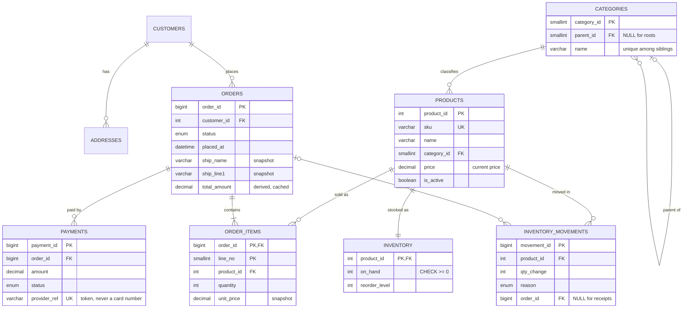

:::industry[Project brief — Northshore Goods, online store re-platforming]
**Client.** A (fictional) mid-sized online retailer selling electronics, kitchenware and books — about 3,000 products, 250,000 customers and 2,000 orders a day, peaking at 40 orders a minute during promotions. Their current store runs on a hosted platform whose export shows the usual problems: prices on old orders changed when the catalogue changed, a flash sale sold 14 units of a speaker that had 9 in stock, and the "my orders" page takes four seconds for long-time customers.

**Your job.** Design the order-management database for the new in-house platform: catalogue, customers and addresses, orders, payments and inventory.

**Deliverables**

1. Requirements and the domain model, including the category hierarchy and the order lifecycle (Stages 1–3).
2. A normalized schema with justified snapshots and controlled redundancy (Stages 4–5).
3. DDL with keys, CHECK constraints and an inventory movement ledger (Stages 6–7).
4. A transactional `place_order` procedure and merchandising/finance reports (Stages 8 and 10).
5. A demonstration of the overselling race and two correct fixes (Stage 10).
6. An index plan and query optimizations measured on 150,000 orders (Stages 9 and 11).
7. A payment-data and access design, an invariant test suite and a scaling plan (Stages 12–14).

**Acceptance criteria**

- Historical orders never change when product prices or customer addresses change.
- Stock can never become negative and the last unit can never be sold twice, under concurrency.
- An order is created completely (header, lines, stock decrements, movements, total) or not at all.
- "My orders" and the operations dashboard use index range scans with no filesort on 150,000 orders.
- No card numbers are stored anywhere in the database.

**Estimated effort:** 14–18 hours after the prerequisite lessons (design case study, composite indexes, transaction lifecycle). Each exercise lab is pre-loaded with the schema and sample data of the stages before it.
:::

## 1. Requirements Gathering

E-commerce databases look simple — products, customers, orders — and that is why they are so often designed badly. The requirements that matter most are not the nouns but the **rules about time and concurrency**: what must stay frozen once an order is placed, what may change, and what happens when many customers act at once. A professional asks about those explicitly.

### Worked example — the questions that shape the schema

| Question to the business | Answer | Consequence |
|---|---|---|
| If a product's price changes, what should an old order show? | The price the customer paid. | `order_items.unit_price` is a **snapshot**, not a lookup of `products.price`. |
| If a customer edits or deletes an address, what happens to past orders? | Past orders keep the address they were shipped to. | The order stores a **copy** of the shipping address. |
| Can a product be in several categories? | One primary category for navigation and reporting; tags come later. | `products.category_id` (1 : N); categories form a **tree**. |
| How is stock tracked? | Units on hand per product (one warehouse for now); every change must be explainable. | `inventory` row per product + an append-only `inventory_movements` ledger. |
| When is stock taken? | When the order is placed; it is returned if the order is cancelled. | Decrement inside the place-order transaction. |
| Can a payment fail and be retried? | Yes, and refunds happen. | `payments` is 1 : N to orders, with a status. |
| What may be stored about cards? | Nothing except the payment provider's token. | `provider_ref` only — PCI DSS scope stays out of the database. |
| What is the order lifecycle? | pending → paid → shipped → delivered; pending or paid → cancelled. | `status ENUM` + transitions enforced by the application/procedures. |
| Volumes and peaks? | 2,000 orders/day, 40/min peak, 3–4 lines per order; 5 years kept online. | ~3.6 M orders, ~13 M lines over 5 years — index design matters. |

Each answer is a design decision you will implement. Writing them down *with the business's words* protects you later when someone asks "why does the order have its own copy of the address?".

```exercise
id: p3-ex1
title: Requirements for returns
difficulty: easy
kind: open
concepts: [requirements-analysis, business-rules]
prompt: |
  Product management wants **returns** in version 1: a customer may return some units of some lines of a delivered
  order within 30 days; returned units go back into stock after inspection; the refund is the price paid.

  Write four to six precise requirements for returns (data to store, rules, reports), and for each say which
  existing table it touches and whether the rule can be a constraint.
solution: |
  1. **A return references an order line and a quantity**: `return_items(return_id, order_id, line_no, quantity)` with a
     composite foreign key to `order_items(order_id, line_no)` and `CHECK (quantity > 0)`.
  2. **Returned quantity ≤ purchased quantity**, summed over all returns of the line — an aggregate across rows, so it
     cannot be a CHECK; enforce it in the return transaction (lock the order line `FOR UPDATE`, sum previous returns).
  3. **Only delivered orders, within 30 days of delivery** — needs a `delivered_at` timestamp on `orders` (currently
     missing — a requirement that changes an existing table) and a check in the procedure.
  4. **Refund amount = quantity × `order_items.unit_price`** — the price snapshot makes this trivial and correct even
     if the product price changed; store the refund as a `payments` row with status `refunded` (or a separate refunds table).
  5. **Restock after inspection** — an `inventory_movements` row with reason `return`, positive quantity and the
     order id (the ledger's CHECK constraint already requires an order id for returns), plus the `on_hand` increment
     in the same transaction.
  6. **Report**: return rate per product and category per month — `return_items ⋈ order_items ⋈ products`.
```

## 2. Entities and Relationships

| Entity | Identifier | Notes |
|---|---|---|
| Customer | customer id (email unique) | status active/blocked |
| Address | address id | belongs to one customer; a customer has many |
| Category | category id (name unique among siblings) | **recursive**: a category has an optional parent |
| Product | product id (SKU unique) | one primary category; current price; active flag |
| Inventory | product id | 1 : 1 with product (stock is volatile, product data is not — separate rows reduce lock contention) |
| Order | order id | customer, status, timestamps, shipping snapshot, total |
| Order item | (order id, line no) | weak entity: identified through its order |
| Payment | payment id (provider ref unique) | many per order (failures, retries, refunds) |
| Inventory movement | movement id | append-only ledger of stock changes |

Three relationships need more than a crow's foot:

- **Category is a parent of Category** — a *unary* (recursive) 1 : N relationship. Implemented as a nullable `parent_id` foreign key to the same table (the **adjacency list** model). It is trivial to maintain and, with MySQL 8's recursive CTEs, easy to query. Alternatives — path enumeration (`'/1/2/3/'`), nested sets, a closure table — trade write simplicity for read speed; see [Recursive CTEs](/lessons/m04-recursive-ctes).
- **Order item is a weak entity.** A line has no meaning outside its order, and it is identified by (order, line number). Its primary key therefore *contains* the order's key.
- **Order references the address only by copy.** There is deliberately **no foreign key** from `orders` to `addresses`: the order stores the name and address as they were at checkout. A foreign key would either block deleting an address (bad UX) or cascade into orders (catastrophic).

```exercise
id: p3-ex2
title: Products in several categories?
difficulty: medium
kind: open
concepts: [er-modeling, many-to-many, cardinality]
prompt: |
  Marketing now wants a product to appear in **several** categories (the headphones under *Audio* and under
  *Gift ideas*), but finance insists that every product has exactly **one** category for revenue reporting.

  Model both requirements. Give the tables and keys, explain how the "exactly one reporting category" rule is enforced,
  and describe what changes in the revenue-by-category report.
solution: |
  Keep `products.category_id NOT NULL` as the **primary (reporting) category** — a 1 : N relationship that guarantees
  exactly one per product by construction (NOT NULL + foreign key). Add a junction table for navigation:
  `product_categories(product_id, category_id)` with `PRIMARY KEY (product_id, category_id)` and foreign keys to both
  tables — the M : N relationship for browsing.

  Optionally require that the primary category is also one of the navigation categories: that is a cross-table rule,
  enforceable with a composite foreign key `(product_id, category_id) REFERENCES product_categories (product_id,
  category_id)` from `products` — workable but circular on insert (insert the junction row first, or defer the FK by
  adding it after loading). Many teams enforce it in the catalogue service and validate nightly instead.

  The revenue report keeps joining through `products.category_id`, so each sale is counted **once**. Reporting through
  `product_categories` would count a product's revenue in every category it appears in — a fan-out that makes category
  totals sum to more than the company's revenue. That is precisely why finance wants one reporting category.
```

## 3. ER Diagram



`ORDERS ||--|{ ORDER_ITEMS` reads "an order has **one or more** lines" (`|{`), which no foreign key can enforce — the foreign key only guarantees every line has an order. "At least one line" is enforced by the place-order procedure and checked by the validation suite (Stage 13). The self-loop on `CATEGORIES` is the recursive relationship.

```exercise
id: p3-ex3
title: Review a teammate's shopping-cart design
difficulty: medium
kind: open
concepts: [design-review, er-modeling, lifecycle]
prompt: |
  A teammate proposes storing shopping carts as orders with a new status `'cart'`: adding to cart inserts
  `order_items`, checkout changes the status to `'pending'`. Abandoned carts stay in `orders` forever.

  Give a design review: at least three concrete problems with this approach and a better alternative.
solution: |
  Problems:

  1. **Mixed lifecycles and volumes.** Carts are created far more often than orders (often 10–50×) and most are
     abandoned. The `orders` table, its indexes and every report would be dominated by non-orders; every revenue query
     needs `status <> 'cart'` and a forgotten filter silently inflates revenue.
  2. **Snapshots taken at the wrong time.** `order_items.unit_price` and the shipping address are meant to freeze at
     checkout. In a cart they must follow the *current* price — so either the snapshot is wrong or the cart shows stale
     prices.
  3. **Stock semantics.** If adding to cart decremented stock, abandoned carts would hold inventory hostage; if it
     doesn't, the "order lines" exist without the invariant that ordered units were taken from stock.
  4. **Identifiers and audit.** Order numbers would be consumed by carts (gaps visible to customers and accountants);
     constraints such as "an order has at least one line and a positive total" no longer hold for all rows.

  Better: separate `carts(cart_id, customer_id NULL, session_token, updated_at)` and `cart_items(cart_id, product_id,
  quantity)` with `PRIMARY KEY (cart_id, product_id)`, no prices stored (always read current prices), and a purge job for
  carts idle more than N days. Checkout runs `place_order`, which copies the cart into an order **in one transaction**
  with price and address snapshots. High-traffic stores often keep carts outside the relational database entirely
  (a key-value store), because carts need no joins and tolerate loss.
```

## 4. Schema Design

The relational schema follows directly from the ER model. The decisions that are *not* mechanical:

| Decision | Choice | Why |
|---|---|---|
| `orders.order_id` type | `BIGINT UNSIGNED` | 3.6 M orders in five years fits an `INT`, but order ids are exposed externally and long-lived; the 4 extra bytes buy decades of headroom. |
| Key of `order_items` | `(order_id, line_no)` + `UNIQUE (order_id, product_id)` | weak entity; the clustered index stores an order's lines together, so "lines of order X" is one contiguous range read. The unique key forbids the same product on two lines. |
| Money | `DECIMAL(10,2)` / `DECIMAL(12,2)` | exact arithmetic for sums and refunds. |
| Stock in a separate `inventory` table | 1 : 1 with products | stock rows are updated on every sale and locked by checkouts; product rows are read constantly by the catalogue. Separating them keeps catalogue reads away from checkout locks and keeps the hot rows small. |
| `on_hand` type | `INT` with `CHECK (on_hand >= 0)` | signed so that an accidental over-decrement raises a CHECK error instead of an unsigned out-of-range error — both stop the write, but the CHECK names the business rule. |
| `orders.total_amount` | stored | derived from the lines, cached for listings and finance; must equal Σ lines (tested). |
| Category tree | adjacency list (`parent_id`) | simple writes, recursive CTE reads; the tree is small (hundreds of nodes). |
| `ON DELETE` | `RESTRICT` everywhere except `addresses → customers` (`CASCADE`) | an address is part of the customer; orders, lines and payments are financial records. |

## 5. Normalization

At first sight the order tables break the rules: `order_items.unit_price` duplicates `products.price`, and `orders.ship_*` duplicates `addresses`. They do not — and understanding *why* is the main normalization lesson of this project.

A functional dependency must hold **at all times**. `product_id → price` holds in `products` (a product has one *current* price). It does **not** hold in `order_items`: the same product was sold at 29.99 in January and 24.99 today. The attribute in `order_items` is a different fact — *the price agreed in this sale* — and it depends on the full key `(order_id, line_no)`. Likewise `ship_line1` is "the address this order was shipped to", determined by `order_id`, not "the customer's current address". Both tables are in 3NF. Revise [Functional Dependencies](/lessons/m06-functional-dependencies) and [Third Normal Form](/lessons/m06-3nf).

Contrast `orders.total_amount`: here `order_id → total_amount` is genuinely **derivable** from other data in the database (Σ quantity × unit_price of the order's lines). That *is* redundancy — a deliberate **denormalization** for read performance (order listings show totals without aggregating lines) — and it needs the two safeguards every controlled redundancy needs: one code path that maintains it (`place_order`) and a test that detects drift (Stage 13). See [Denormalization](/lessons/m06-denormalization).

### Worked example — the snapshot in action

Create the core schema and load the sample data (Stage 6 explains the DDL in detail; here we need the data to see the point):

```sql run
CREATE TABLE customers (
  customer_id INT UNSIGNED NOT NULL AUTO_INCREMENT,
  email       VARCHAR(255) NOT NULL,
  full_name   VARCHAR(120) NOT NULL,
  created_at  DATETIME     NOT NULL,
  status      ENUM('active','blocked') NOT NULL DEFAULT 'active',
  PRIMARY KEY (customer_id),
  CONSTRAINT uq_customers_email UNIQUE (email)
);
CREATE TABLE addresses (
  address_id  INT UNSIGNED NOT NULL AUTO_INCREMENT,
  customer_id INT UNSIGNED NOT NULL,
  label       VARCHAR(30)  NOT NULL,
  line1       VARCHAR(120) NOT NULL,
  city        VARCHAR(60)  NOT NULL,
  postal_code VARCHAR(12)  NOT NULL,
  country     CHAR(2)      NOT NULL,
  PRIMARY KEY (address_id),
  CONSTRAINT fk_addresses_customer FOREIGN KEY (customer_id) REFERENCES customers (customer_id) ON DELETE CASCADE
);
CREATE TABLE categories (
  category_id SMALLINT UNSIGNED NOT NULL,
  parent_id   SMALLINT UNSIGNED NULL,
  name        VARCHAR(60) NOT NULL,
  PRIMARY KEY (category_id),
  CONSTRAINT uq_categories_sibling UNIQUE (parent_id, name),
  CONSTRAINT fk_categories_parent FOREIGN KEY (parent_id) REFERENCES categories (category_id),
  CONSTRAINT chk_categories_not_self CHECK (parent_id IS NULL OR parent_id <> category_id)
);
CREATE TABLE products (
  product_id  INT UNSIGNED      NOT NULL AUTO_INCREMENT,
  sku         VARCHAR(20)       NOT NULL,
  name        VARCHAR(150)      NOT NULL,
  category_id SMALLINT UNSIGNED NOT NULL,
  price       DECIMAL(10,2)     NOT NULL,
  is_active   BOOLEAN           NOT NULL DEFAULT TRUE,
  PRIMARY KEY (product_id),
  CONSTRAINT uq_products_sku UNIQUE (sku),
  CONSTRAINT fk_products_category FOREIGN KEY (category_id) REFERENCES categories (category_id),
  CONSTRAINT chk_products_price CHECK (price >= 0)
);
CREATE TABLE inventory (
  product_id    INT UNSIGNED NOT NULL,
  on_hand       INT          NOT NULL,
  reorder_level INT          NOT NULL DEFAULT 0,
  PRIMARY KEY (product_id),
  CONSTRAINT fk_inventory_product FOREIGN KEY (product_id) REFERENCES products (product_id),
  CONSTRAINT chk_inventory_on_hand CHECK (on_hand >= 0),
  CONSTRAINT chk_inventory_reorder CHECK (reorder_level >= 0)
);
CREATE TABLE orders (
  order_id      BIGINT UNSIGNED NOT NULL AUTO_INCREMENT,
  customer_id   INT UNSIGNED    NOT NULL,
  status        ENUM('pending','paid','shipped','delivered','cancelled') NOT NULL DEFAULT 'pending',
  placed_at     DATETIME        NOT NULL,
  ship_name     VARCHAR(120)    NOT NULL,
  ship_line1    VARCHAR(120)    NOT NULL,
  ship_city     VARCHAR(60)     NOT NULL,
  ship_postal   VARCHAR(12)     NOT NULL,
  ship_country  CHAR(2)         NOT NULL,
  total_amount  DECIMAL(12,2)   NOT NULL DEFAULT 0.00,
  PRIMARY KEY (order_id),
  CONSTRAINT fk_orders_customer FOREIGN KEY (customer_id) REFERENCES customers (customer_id),
  CONSTRAINT chk_orders_total CHECK (total_amount >= 0)
);
CREATE TABLE order_items (
  order_id   BIGINT UNSIGNED   NOT NULL,
  line_no    SMALLINT UNSIGNED NOT NULL,
  product_id INT UNSIGNED      NOT NULL,
  quantity   INT               NOT NULL,
  unit_price DECIMAL(10,2)     NOT NULL,
  PRIMARY KEY (order_id, line_no),
  CONSTRAINT uq_order_items_product UNIQUE (order_id, product_id),
  CONSTRAINT fk_order_items_order   FOREIGN KEY (order_id)   REFERENCES orders (order_id),
  CONSTRAINT fk_order_items_product FOREIGN KEY (product_id) REFERENCES products (product_id),
  CONSTRAINT chk_order_items_qty   CHECK (quantity > 0),
  CONSTRAINT chk_order_items_price CHECK (unit_price >= 0)
);
CREATE TABLE payments (
  payment_id   BIGINT UNSIGNED NOT NULL AUTO_INCREMENT,
  order_id     BIGINT UNSIGNED NOT NULL,
  amount       DECIMAL(12,2)   NOT NULL,
  method       ENUM('card','wallet','bank_transfer') NOT NULL,
  status       ENUM('authorized','captured','refunded','failed') NOT NULL,
  provider_ref VARCHAR(64)     NOT NULL,
  created_at   DATETIME        NOT NULL,
  PRIMARY KEY (payment_id),
  CONSTRAINT uq_payments_provider_ref UNIQUE (provider_ref),
  CONSTRAINT fk_payments_order FOREIGN KEY (order_id) REFERENCES orders (order_id),
  CONSTRAINT chk_payments_amount CHECK (amount > 0)
);
INSERT INTO customers (customer_id, email, full_name, created_at) VALUES
  (1, 'olivia.nakamura@mail.example.com', 'Olivia Nakamura', '2025-06-01 09:12:00'),
  (2, 'marcus.bennett@mail.example.com',  'Marcus Bennett',  '2025-07-15 18:40:00'),
  (3, 'sara.kowalski@mail.example.com',   'Sara Kowalski',   '2025-08-02 11:05:00'),
  (4, 'deepak.rao@mail.example.com',      'Deepak Rao',      '2025-09-21 20:30:00'),
  (5, 'emily.clarke@mail.example.com',    'Emily Clarke',    '2025-10-10 07:55:00'),
  (6, 'tomas.garcia@mail.example.com',    'Tomás García',    '2025-11-03 13:20:00'),
  (7, 'aisha.mohammed@mail.example.com',  'Aisha Mohammed',  '2025-12-12 16:45:00'),
  (8, 'liam.oconnor@mail.example.com',    'Liam O''Connor',  '2026-01-02 10:10:00'),
  (9, 'nina.volkova@mail.example.com',    'Nina Volkova',    '2026-02-14 22:00:00'),
  (10, 'kofi.asante@mail.example.com',    'Kofi Asante',     '2026-03-01 08:00:00');
INSERT INTO addresses (address_id, customer_id, label, line1, city, postal_code, country) VALUES
  (1, 1, 'home', '12 Alder Way',      'San Jose',  '95112', 'US'), (2, 1, 'work', '400 Market Plaza',   'San Jose',  '95113', 'US'),
  (3, 2, 'home', '88 Birch Street',   'Oakland',   '94607', 'US'), (4, 3, 'home', '5 Cedar Court',      'Portland',  '97201', 'US'),
  (5, 4, 'home', '230 Dogwood Ave',   'Austin',    '73301', 'US'), (6, 5, 'home', '17 Elm Row',         'Seattle',   '98101', 'US'),
  (7, 6, 'home', '9 Fir Lane',        'Denver',    '80202', 'US'), (8, 7, 'home', '61 Gingko Blvd',     'Chicago',   '60601', 'US'),
  (9, 8, 'home', '3 Hawthorn Close',  'Boston',    '02108', 'US'), (10, 9, 'home', '140 Ivy Terrace',   'San Diego', '92101', 'US');
INSERT INTO categories (category_id, parent_id, name) VALUES
  (1, NULL, 'Electronics'), (2, 1, 'Computers'), (3, 2, 'Laptops'), (4, 2, 'Accessories'), (5, 1, 'Audio'),
  (6, NULL, 'Home & Kitchen'), (7, 6, 'Coffee'), (8, 6, 'Cookware'), (9, NULL, 'Books');
INSERT INTO products (product_id, sku, name, category_id, price, is_active) VALUES
  (1, 'LAP-14-PRO', 'Aero 14 Pro Laptop',            3, 1299.00, TRUE),
  (2, 'LAP-13-AIR', 'Aero 13 Air Laptop',            3,  899.00, TRUE),
  (3, 'ACC-MOUSE',  'Wireless Mouse',                4,   24.99, TRUE),
  (4, 'ACC-KB',     'Mechanical Keyboard',           4,   89.50, TRUE),
  (5, 'ACC-USBC',   'USB-C Hub',                     4,   45.00, TRUE),
  (6, 'AUD-HP',     'Noise-Cancelling Headphones',   5,  199.00, TRUE),
  (7, 'AUD-SPK',    'Bluetooth Speaker',             5,   59.90, TRUE),
  (8, 'COF-GRIND',  'Burr Coffee Grinder',           7,  129.00, TRUE),
  (9, 'COF-BEANS',  'Single-Origin Beans 1kg',       7,   24.50, TRUE),
  (10, 'CKW-PAN',   'Cast Iron Skillet',             8,   39.95, TRUE),
  (11, 'BK-DATA',   'Databases for Data Scientists', 9,   49.00, TRUE),
  (12, 'ACC-STAND', 'Aluminium Laptop Stand',        4,   34.00, FALSE);
INSERT INTO inventory (product_id, on_hand, reorder_level) VALUES
  (1, 4, 5), (2, 10, 5), (3, 120, 30), (4, 35, 10), (5, 8, 10), (6, 15, 5),
  (7, 1, 5), (8, 6, 5), (9, 200, 50), (10, 22, 10), (11, 0, 5), (12, 0, 0);
INSERT INTO orders (order_id, customer_id, status, placed_at, ship_name, ship_line1, ship_city, ship_postal, ship_country, total_amount) VALUES
  (1,  1, 'delivered', '2026-01-05 10:15:00', 'Olivia Nakamura', '12 Alder Way',     'San Jose', '95112', 'US',   78.99),
  (2,  2, 'delivered', '2026-01-07 14:02:00', 'Marcus Bennett',  '88 Birch Street',  'Oakland',  '94607', 'US', 1299.00),
  (3,  3, 'delivered', '2026-01-12 09:30:00', 'Sara Kowalski',   '5 Cedar Court',    'Portland', '97201', 'US',  258.90),
  (4,  1, 'delivered', '2026-01-20 19:45:00', 'Olivia Nakamura', '400 Market Plaza', 'San Jose', '95113', 'US',  153.50),
  (5,  4, 'cancelled', '2026-01-22 11:11:00', 'Deepak Rao',      '230 Dogwood Ave',  'Austin',   '73301', 'US',  899.00),
  (6,  5, 'shipped',   '2026-02-02 08:05:00', 'Emily Clarke',    '17 Elm Row',       'Seattle',  '98101', 'US',  164.49),
  (7,  2, 'delivered', '2026-02-10 16:40:00', 'Marcus Bennett',  '88 Birch Street',  'Oakland',  '94607', 'US',   79.90),
  (8,  6, 'delivered', '2026-02-14 12:00:00', 'Tomás García',    '9 Fir Lane',       'Denver',   '80202', 'US',  147.00),
  (9,  3, 'paid',      '2026-02-25 21:20:00', 'Sara Kowalski',   '5 Cedar Court',    'Portland', '97201', 'US',  928.99),
  (10, 7, 'paid',      '2026-03-01 10:00:00', 'Aisha Mohammed',  '61 Gingko Blvd',   'Chicago',  '60601', 'US',  398.00),
  (11, 1, 'pending',   '2026-03-03 13:13:00', 'Olivia Nakamura', '12 Alder Way',     'San Jose', '95112', 'US',   59.90),
  (12, 5, 'delivered', '2026-03-04 15:30:00', 'Emily Clarke',    '17 Elm Row',       'Seattle',  '98101', 'US',   98.00),
  (13, 8, 'shipped',   '2026-03-05 09:45:00', 'Liam O''Connor',  '3 Hawthorn Close', 'Boston',   '02108', 'US', 1344.00),
  (14, 4, 'paid',      '2026-03-06 18:00:00', 'Deepak Rao',      '230 Dogwood Ave',  'Austin',   '73301', 'US',  129.00);
INSERT INTO order_items (order_id, line_no, product_id, quantity, unit_price) VALUES
  (1, 1, 3, 1, 29.99), (1, 2, 9, 2, 24.50), (2, 1, 1, 1, 1299.00), (3, 1, 6, 1, 199.00), (3, 2, 7, 1, 59.90),
  (4, 1, 8, 1, 129.00), (4, 2, 9, 1, 24.50), (5, 1, 2, 1, 899.00), (6, 1, 4, 1, 89.50), (6, 2, 3, 1, 29.99),
  (6, 3, 5, 1, 45.00), (7, 1, 10, 2, 39.95), (8, 1, 11, 3, 49.00), (9, 1, 2, 1, 899.00), (9, 2, 3, 1, 29.99),
  (10, 1, 6, 2, 199.00), (11, 1, 7, 1, 59.90), (12, 1, 9, 4, 24.50), (13, 1, 1, 1, 1299.00), (13, 2, 5, 1, 45.00),
  (14, 1, 8, 1, 129.00);
INSERT INTO payments (order_id, amount, method, status, provider_ref, created_at) VALUES
  (1, 78.99, 'card', 'captured', 'pay_8f2k1', '2026-01-05 10:15:20'),
  (2, 1299.00, 'card', 'captured', 'pay_8f2k2', '2026-01-07 14:02:31'),
  (3, 258.90, 'wallet', 'captured', 'pay_8f2k3', '2026-01-12 09:30:12'),
  (4, 153.50, 'card', 'captured', 'pay_8f2k4', '2026-01-20 19:45:40'),
  (5, 899.00, 'card', 'refunded', 'pay_8f2k5', '2026-01-22 11:11:09'),
  (6, 164.49, 'card', 'captured', 'pay_8f2k6', '2026-02-02 08:05:44'),
  (7, 79.90, 'bank_transfer', 'captured', 'pay_8f2k7', '2026-02-10 16:41:02'),
  (8, 147.00, 'card', 'captured', 'pay_8f2k8', '2026-02-14 12:00:18'),
  (9, 928.99, 'card', 'failed', 'pay_8f2k9', '2026-02-25 21:20:30'),
  (9, 928.99, 'wallet', 'captured', 'pay_8f2kA', '2026-02-25 21:24:02'),
  (10, 398.00, 'card', 'captured', 'pay_8f2kB', '2026-03-01 10:00:25'),
  (12, 98.00, 'card', 'captured', 'pay_8f2kC', '2026-03-04 15:30:33'),
  (13, 1344.00, 'card', 'captured', 'pay_8f2kD', '2026-03-05 09:45:10'),
  (14, 129.00, 'wallet', 'captured', 'pay_8f2kE', '2026-03-06 18:00:41');
SELECT (SELECT COUNT(*) FROM customers) AS customers, (SELECT COUNT(*) FROM products) AS products,
       (SELECT COUNT(*) FROM orders) AS orders, (SELECT COUNT(*) FROM order_items) AS order_lines,
       (SELECT COUNT(*) FROM payments) AS payments;
```

The wireless mouse (ACC-MOUSE) was repriced from 29.99 to 24.99 in March. Compare what customers paid with what the catalogue says today:

```sql run
SELECT o.order_id, o.placed_at, oi.unit_price AS paid_unit_price, p.price AS current_price
FROM order_items oi
JOIN orders o   ON o.order_id = oi.order_id
JOIN products p ON p.product_id = oi.product_id
WHERE p.sku = 'ACC-MOUSE'
ORDER BY o.placed_at;
```

Had `order_items` looked the price up from `products`, three historical orders — and every invoice, refund and revenue report based on them — would have changed retroactively by five dollars per unit.

```exercise
id: p3-ex4
title: Should order lines store the product name?
difficulty: medium
kind: open
concepts: [normalization, snapshot-pattern, functional-dependencies]
prompt: |
  The invoice service wants `order_items.product_name` so invoices print the name "as sold". A reviewer objects:
  "`product_id → product_name` — that's a transitive dependency, it violates 3NF."

  Who is right? Argue in terms of functional dependencies, then give your recommendation, including what you would do
  for products that are renamed frequently versus rarely.
solution: |
  It depends on what the column *means*. If `order_items.product_name` means "the product's name" (always equal to
  `products.name`), then `product_id → product_name` holds in `order_items` and the reviewer is right: it is a
  transitive dependency through `product_id`, with the usual update anomaly (rename a product → update millions of
  lines, or they disagree).

  If it means "the name printed on this sale's invoice", the dependency `product_id → product_name` does **not** hold
  over time (the same product had different names in different sales); the attribute depends on the line, like
  `unit_price`, and the table remains in 3NF. Invoices are legal documents, so the "as sold" meaning is usually the
  right requirement.

  Recommendation: if names change rarely and invoices are generated at order time and archived (PDF), you don't need
  the column — the archived document is the snapshot. If invoices are re-rendered from the database, store the snapshot
  (`product_name_at_sale`, named to make the meaning explicit), filled by `place_order`, never updated. An alternative
  is a `product_versions` table (product_id, valid_from, name, …) referenced by the line — fully normalized history,
  at the cost of more joins.
```

## 6. MySQL Table Creation

The tables already exist in the main lab (we needed them in Stage 5); this stage reviews the DDL and adds the one table that is yours to build. The creation order respects foreign keys: `customers`, `categories` first; `addresses`, `products`; `inventory`, `orders`; `order_items`, `payments`.

Points worth noticing in the DDL:

- **The recursive foreign key** `fk_categories_parent` references the table itself; root categories have `parent_id` NULL. `UNIQUE (parent_id, name)` stops two siblings sharing a name — but because NULLs are distinct in unique indexes, it does *not* stop two **roots** called "Books". (Fixing that needs a generated column such as `COALESCE(parent_id, 0)` in the unique key — the same trick as in the [Library](/projects/p2-library-management) project.)
- **`chk_categories_not_self`** prevents the trivial cycle (a category as its own parent). Longer cycles (A → B → A) cannot be expressed as a CHECK; the validation suite detects them with a recursive CTE. Note that `category_id` is deliberately **not** `AUTO_INCREMENT`: MySQL refuses a CHECK constraint that refers to an auto-increment column (error 3818), because the value is not known when the constraint would be evaluated. Categories are curated by merchandisers, so explicit ids are acceptable here; for an auto-increment table the rule would move to a trigger or to the application.
- **`inventory.product_id` is both primary key and foreign key** — the standard 1 : 1 implementation.

```sql run
SELECT TABLE_NAME, CONSTRAINT_NAME, CONSTRAINT_TYPE
FROM information_schema.TABLE_CONSTRAINTS
WHERE TABLE_SCHEMA = DATABASE() AND TABLE_NAME IN ('categories', 'inventory', 'order_items')
ORDER BY TABLE_NAME, CONSTRAINT_TYPE, CONSTRAINT_NAME;
```

### Your task — the inventory ledger

```exercise
id: p3-ex5
title: Create the inventory movement ledger
difficulty: hard
kind: dml
concepts: [create-table, check-constraints, foreign-keys, audit-ledger]
setup: |
  CREATE TABLE customers (
    customer_id INT UNSIGNED NOT NULL AUTO_INCREMENT,
    email       VARCHAR(255) NOT NULL,
    full_name   VARCHAR(120) NOT NULL,
    created_at  DATETIME     NOT NULL,
    status      ENUM('active','blocked') NOT NULL DEFAULT 'active',
    PRIMARY KEY (customer_id),
    CONSTRAINT uq_customers_email UNIQUE (email)
  );
  CREATE TABLE addresses (
    address_id  INT UNSIGNED NOT NULL AUTO_INCREMENT,
    customer_id INT UNSIGNED NOT NULL,
    label       VARCHAR(30)  NOT NULL,
    line1       VARCHAR(120) NOT NULL,
    city        VARCHAR(60)  NOT NULL,
    postal_code VARCHAR(12)  NOT NULL,
    country     CHAR(2)      NOT NULL,
    PRIMARY KEY (address_id),
    CONSTRAINT fk_addresses_customer FOREIGN KEY (customer_id) REFERENCES customers (customer_id) ON DELETE CASCADE
  );
  CREATE TABLE categories (
    category_id SMALLINT UNSIGNED NOT NULL,
    parent_id   SMALLINT UNSIGNED NULL,
    name        VARCHAR(60) NOT NULL,
    PRIMARY KEY (category_id),
    CONSTRAINT uq_categories_sibling UNIQUE (parent_id, name),
    CONSTRAINT fk_categories_parent FOREIGN KEY (parent_id) REFERENCES categories (category_id),
    CONSTRAINT chk_categories_not_self CHECK (parent_id IS NULL OR parent_id <> category_id)
  );
  CREATE TABLE products (
    product_id  INT UNSIGNED      NOT NULL AUTO_INCREMENT,
    sku         VARCHAR(20)       NOT NULL,
    name        VARCHAR(150)      NOT NULL,
    category_id SMALLINT UNSIGNED NOT NULL,
    price       DECIMAL(10,2)     NOT NULL,
    is_active   BOOLEAN           NOT NULL DEFAULT TRUE,
    PRIMARY KEY (product_id),
    CONSTRAINT uq_products_sku UNIQUE (sku),
    CONSTRAINT fk_products_category FOREIGN KEY (category_id) REFERENCES categories (category_id),
    CONSTRAINT chk_products_price CHECK (price >= 0)
  );
  CREATE TABLE inventory (
    product_id    INT UNSIGNED NOT NULL,
    on_hand       INT          NOT NULL,
    reorder_level INT          NOT NULL DEFAULT 0,
    PRIMARY KEY (product_id),
    CONSTRAINT fk_inventory_product FOREIGN KEY (product_id) REFERENCES products (product_id),
    CONSTRAINT chk_inventory_on_hand CHECK (on_hand >= 0),
    CONSTRAINT chk_inventory_reorder CHECK (reorder_level >= 0)
  );
  CREATE TABLE orders (
    order_id      BIGINT UNSIGNED NOT NULL AUTO_INCREMENT,
    customer_id   INT UNSIGNED    NOT NULL,
    status        ENUM('pending','paid','shipped','delivered','cancelled') NOT NULL DEFAULT 'pending',
    placed_at     DATETIME        NOT NULL,
    ship_name     VARCHAR(120)    NOT NULL,
    ship_line1    VARCHAR(120)    NOT NULL,
    ship_city     VARCHAR(60)     NOT NULL,
    ship_postal   VARCHAR(12)     NOT NULL,
    ship_country  CHAR(2)         NOT NULL,
    total_amount  DECIMAL(12,2)   NOT NULL DEFAULT 0.00,
    PRIMARY KEY (order_id),
    CONSTRAINT fk_orders_customer FOREIGN KEY (customer_id) REFERENCES customers (customer_id),
    CONSTRAINT chk_orders_total CHECK (total_amount >= 0)
  );
  CREATE TABLE order_items (
    order_id   BIGINT UNSIGNED   NOT NULL,
    line_no    SMALLINT UNSIGNED NOT NULL,
    product_id INT UNSIGNED      NOT NULL,
    quantity   INT               NOT NULL,
    unit_price DECIMAL(10,2)     NOT NULL,
    PRIMARY KEY (order_id, line_no),
    CONSTRAINT uq_order_items_product UNIQUE (order_id, product_id),
    CONSTRAINT fk_order_items_order   FOREIGN KEY (order_id)   REFERENCES orders (order_id),
    CONSTRAINT fk_order_items_product FOREIGN KEY (product_id) REFERENCES products (product_id),
    CONSTRAINT chk_order_items_qty   CHECK (quantity > 0),
    CONSTRAINT chk_order_items_price CHECK (unit_price >= 0)
  );
  CREATE TABLE payments (
    payment_id   BIGINT UNSIGNED NOT NULL AUTO_INCREMENT,
    order_id     BIGINT UNSIGNED NOT NULL,
    amount       DECIMAL(12,2)   NOT NULL,
    method       ENUM('card','wallet','bank_transfer') NOT NULL,
    status       ENUM('authorized','captured','refunded','failed') NOT NULL,
    provider_ref VARCHAR(64)     NOT NULL,
    created_at   DATETIME        NOT NULL,
    PRIMARY KEY (payment_id),
    CONSTRAINT uq_payments_provider_ref UNIQUE (provider_ref),
    CONSTRAINT fk_payments_order FOREIGN KEY (order_id) REFERENCES orders (order_id),
    CONSTRAINT chk_payments_amount CHECK (amount > 0)
  );
  INSERT INTO customers (customer_id, email, full_name, created_at) VALUES
    (1, 'olivia.nakamura@mail.example.com', 'Olivia Nakamura', '2025-06-01 09:12:00'),
    (2, 'marcus.bennett@mail.example.com',  'Marcus Bennett',  '2025-07-15 18:40:00'),
    (3, 'sara.kowalski@mail.example.com',   'Sara Kowalski',   '2025-08-02 11:05:00'),
    (4, 'deepak.rao@mail.example.com',      'Deepak Rao',      '2025-09-21 20:30:00'),
    (5, 'emily.clarke@mail.example.com',    'Emily Clarke',    '2025-10-10 07:55:00'),
    (6, 'tomas.garcia@mail.example.com',    'Tomás García',    '2025-11-03 13:20:00'),
    (7, 'aisha.mohammed@mail.example.com',  'Aisha Mohammed',  '2025-12-12 16:45:00'),
    (8, 'liam.oconnor@mail.example.com',    'Liam O''Connor',  '2026-01-02 10:10:00'),
    (9, 'nina.volkova@mail.example.com',    'Nina Volkova',    '2026-02-14 22:00:00'),
    (10, 'kofi.asante@mail.example.com',    'Kofi Asante',     '2026-03-01 08:00:00');
  INSERT INTO addresses (address_id, customer_id, label, line1, city, postal_code, country) VALUES
    (1, 1, 'home', '12 Alder Way',      'San Jose',  '95112', 'US'), (2, 1, 'work', '400 Market Plaza',   'San Jose',  '95113', 'US'),
    (3, 2, 'home', '88 Birch Street',   'Oakland',   '94607', 'US'), (4, 3, 'home', '5 Cedar Court',      'Portland',  '97201', 'US'),
    (5, 4, 'home', '230 Dogwood Ave',   'Austin',    '73301', 'US'), (6, 5, 'home', '17 Elm Row',         'Seattle',   '98101', 'US'),
    (7, 6, 'home', '9 Fir Lane',        'Denver',    '80202', 'US'), (8, 7, 'home', '61 Gingko Blvd',     'Chicago',   '60601', 'US'),
    (9, 8, 'home', '3 Hawthorn Close',  'Boston',    '02108', 'US'), (10, 9, 'home', '140 Ivy Terrace',   'San Diego', '92101', 'US');
  INSERT INTO categories (category_id, parent_id, name) VALUES
    (1, NULL, 'Electronics'), (2, 1, 'Computers'), (3, 2, 'Laptops'), (4, 2, 'Accessories'), (5, 1, 'Audio'),
    (6, NULL, 'Home & Kitchen'), (7, 6, 'Coffee'), (8, 6, 'Cookware'), (9, NULL, 'Books');
  INSERT INTO products (product_id, sku, name, category_id, price, is_active) VALUES
    (1, 'LAP-14-PRO', 'Aero 14 Pro Laptop',            3, 1299.00, TRUE),
    (2, 'LAP-13-AIR', 'Aero 13 Air Laptop',            3,  899.00, TRUE),
    (3, 'ACC-MOUSE',  'Wireless Mouse',                4,   24.99, TRUE),
    (4, 'ACC-KB',     'Mechanical Keyboard',           4,   89.50, TRUE),
    (5, 'ACC-USBC',   'USB-C Hub',                     4,   45.00, TRUE),
    (6, 'AUD-HP',     'Noise-Cancelling Headphones',   5,  199.00, TRUE),
    (7, 'AUD-SPK',    'Bluetooth Speaker',             5,   59.90, TRUE),
    (8, 'COF-GRIND',  'Burr Coffee Grinder',           7,  129.00, TRUE),
    (9, 'COF-BEANS',  'Single-Origin Beans 1kg',       7,   24.50, TRUE),
    (10, 'CKW-PAN',   'Cast Iron Skillet',             8,   39.95, TRUE),
    (11, 'BK-DATA',   'Databases for Data Scientists', 9,   49.00, TRUE),
    (12, 'ACC-STAND', 'Aluminium Laptop Stand',        4,   34.00, FALSE);
  INSERT INTO inventory (product_id, on_hand, reorder_level) VALUES
    (1, 4, 5), (2, 10, 5), (3, 120, 30), (4, 35, 10), (5, 8, 10), (6, 15, 5),
    (7, 1, 5), (8, 6, 5), (9, 200, 50), (10, 22, 10), (11, 0, 5), (12, 0, 0);
  INSERT INTO orders (order_id, customer_id, status, placed_at, ship_name, ship_line1, ship_city, ship_postal, ship_country, total_amount) VALUES
    (1,  1, 'delivered', '2026-01-05 10:15:00', 'Olivia Nakamura', '12 Alder Way',     'San Jose', '95112', 'US',   78.99),
    (2,  2, 'delivered', '2026-01-07 14:02:00', 'Marcus Bennett',  '88 Birch Street',  'Oakland',  '94607', 'US', 1299.00),
    (3,  3, 'delivered', '2026-01-12 09:30:00', 'Sara Kowalski',   '5 Cedar Court',    'Portland', '97201', 'US',  258.90),
    (4,  1, 'delivered', '2026-01-20 19:45:00', 'Olivia Nakamura', '400 Market Plaza', 'San Jose', '95113', 'US',  153.50),
    (5,  4, 'cancelled', '2026-01-22 11:11:00', 'Deepak Rao',      '230 Dogwood Ave',  'Austin',   '73301', 'US',  899.00),
    (6,  5, 'shipped',   '2026-02-02 08:05:00', 'Emily Clarke',    '17 Elm Row',       'Seattle',  '98101', 'US',  164.49),
    (7,  2, 'delivered', '2026-02-10 16:40:00', 'Marcus Bennett',  '88 Birch Street',  'Oakland',  '94607', 'US',   79.90),
    (8,  6, 'delivered', '2026-02-14 12:00:00', 'Tomás García',    '9 Fir Lane',       'Denver',   '80202', 'US',  147.00),
    (9,  3, 'paid',      '2026-02-25 21:20:00', 'Sara Kowalski',   '5 Cedar Court',    'Portland', '97201', 'US',  928.99),
    (10, 7, 'paid',      '2026-03-01 10:00:00', 'Aisha Mohammed',  '61 Gingko Blvd',   'Chicago',  '60601', 'US',  398.00),
    (11, 1, 'pending',   '2026-03-03 13:13:00', 'Olivia Nakamura', '12 Alder Way',     'San Jose', '95112', 'US',   59.90),
    (12, 5, 'delivered', '2026-03-04 15:30:00', 'Emily Clarke',    '17 Elm Row',       'Seattle',  '98101', 'US',   98.00),
    (13, 8, 'shipped',   '2026-03-05 09:45:00', 'Liam O''Connor',  '3 Hawthorn Close', 'Boston',   '02108', 'US', 1344.00),
    (14, 4, 'paid',      '2026-03-06 18:00:00', 'Deepak Rao',      '230 Dogwood Ave',  'Austin',   '73301', 'US',  129.00);
  INSERT INTO order_items (order_id, line_no, product_id, quantity, unit_price) VALUES
    (1, 1, 3, 1, 29.99), (1, 2, 9, 2, 24.50), (2, 1, 1, 1, 1299.00), (3, 1, 6, 1, 199.00), (3, 2, 7, 1, 59.90),
    (4, 1, 8, 1, 129.00), (4, 2, 9, 1, 24.50), (5, 1, 2, 1, 899.00), (6, 1, 4, 1, 89.50), (6, 2, 3, 1, 29.99),
    (6, 3, 5, 1, 45.00), (7, 1, 10, 2, 39.95), (8, 1, 11, 3, 49.00), (9, 1, 2, 1, 899.00), (9, 2, 3, 1, 29.99),
    (10, 1, 6, 2, 199.00), (11, 1, 7, 1, 59.90), (12, 1, 9, 4, 24.50), (13, 1, 1, 1, 1299.00), (13, 2, 5, 1, 45.00),
    (14, 1, 8, 1, 129.00);
  INSERT INTO payments (order_id, amount, method, status, provider_ref, created_at) VALUES
    (1, 78.99, 'card', 'captured', 'pay_8f2k1', '2026-01-05 10:15:20'),
    (2, 1299.00, 'card', 'captured', 'pay_8f2k2', '2026-01-07 14:02:31'),
    (3, 258.90, 'wallet', 'captured', 'pay_8f2k3', '2026-01-12 09:30:12'),
    (4, 153.50, 'card', 'captured', 'pay_8f2k4', '2026-01-20 19:45:40'),
    (5, 899.00, 'card', 'refunded', 'pay_8f2k5', '2026-01-22 11:11:09'),
    (6, 164.49, 'card', 'captured', 'pay_8f2k6', '2026-02-02 08:05:44'),
    (7, 79.90, 'bank_transfer', 'captured', 'pay_8f2k7', '2026-02-10 16:41:02'),
    (8, 147.00, 'card', 'captured', 'pay_8f2k8', '2026-02-14 12:00:18'),
    (9, 928.99, 'card', 'failed', 'pay_8f2k9', '2026-02-25 21:20:30'),
    (9, 928.99, 'wallet', 'captured', 'pay_8f2kA', '2026-02-25 21:24:02'),
    (10, 398.00, 'card', 'captured', 'pay_8f2kB', '2026-03-01 10:00:25'),
    (12, 98.00, 'card', 'captured', 'pay_8f2kC', '2026-03-04 15:30:33'),
    (13, 1344.00, 'card', 'captured', 'pay_8f2kD', '2026-03-05 09:45:10'),
    (14, 129.00, 'wallet', 'captured', 'pay_8f2kE', '2026-03-06 18:00:41');
prompt: |
  Every change of stock must be explainable. Create **`inventory_movements`** with columns in this order:

  | Column | Type | Notes |
  |---|---|---|
  | `movement_id` | `BIGINT UNSIGNED NOT NULL AUTO_INCREMENT` | primary key |
  | `product_id` | `INT UNSIGNED NOT NULL` | FK → `products` |
  | `qty_change` | `INT NOT NULL` | never 0 |
  | `reason` | `ENUM('receipt','sale','return','adjustment') NOT NULL` | |
  | `order_id` | `BIGINT UNSIGNED NULL` | FK → `orders` |
  | `created_at` | `DATETIME NOT NULL` | |

  Business rules, as CHECK constraints:

  - a **sale** decreases stock and must reference an order;
  - a **return** increases stock and must reference an order;
  - a **receipt** (delivery from a supplier) increases stock and must **not** reference an order;
  - an **adjustment** (stock count correction) may go either way, with or without an order.

  The grader inserts a series of valid and invalid movements with `INSERT IGNORE`.
hints:
  - "One CHECK can combine the four cases with OR: (reason = 'sale' AND qty_change < 0 AND order_id IS NOT NULL) OR (…)."
  - "Add a separate CHECK (qty_change <> 0) — it also covers adjustments."
  - "Columns used in a CHECK may have foreign keys, but not with ON DELETE/UPDATE CASCADE or SET NULL actions."
solution: |
  CREATE TABLE inventory_movements (
    movement_id BIGINT UNSIGNED NOT NULL AUTO_INCREMENT,
    product_id  INT UNSIGNED    NOT NULL,
    qty_change  INT             NOT NULL,
    reason      ENUM('receipt','sale','return','adjustment') NOT NULL,
    order_id    BIGINT UNSIGNED NULL,
    created_at  DATETIME        NOT NULL,
    PRIMARY KEY (movement_id),
    CONSTRAINT fk_movements_product FOREIGN KEY (product_id) REFERENCES products (product_id),
    CONSTRAINT fk_movements_order   FOREIGN KEY (order_id)   REFERENCES orders (order_id),
    CONSTRAINT chk_movements_nonzero CHECK (qty_change <> 0),
    CONSTRAINT chk_movements_reason CHECK (
         (reason = 'sale'    AND qty_change < 0 AND order_id IS NOT NULL)
      OR (reason = 'return'  AND qty_change > 0 AND order_id IS NOT NULL)
      OR (reason = 'receipt' AND qty_change > 0 AND order_id IS NULL)
      OR (reason = 'adjustment'))
  );
check: |
  INSERT IGNORE INTO inventory_movements (product_id, qty_change, reason, order_id, created_at) VALUES
    (3, -1, 'sale',       1,    '2026-01-05 10:15:00'),
    (3,  1, 'sale',       1,    '2026-01-05 10:15:00'),
    (3, -1, 'sale',       NULL, '2026-01-05 10:15:00'),
    (3,  1, 'return',     1,    '2026-01-20 09:00:00'),
    (3, 50, 'receipt',    NULL, '2026-01-02 08:00:00'),
    (3, 50, 'receipt',    1,    '2026-01-02 08:00:00'),
    (3, -2, 'adjustment', NULL, '2026-01-31 17:00:00'),
    (3,  0, 'adjustment', NULL, '2026-01-31 17:00:00'),
    (99, 5, 'receipt',    NULL, '2026-01-02 08:00:00'),
    (3, -1, 'sale',       999,  '2026-01-05 10:15:00');
  SELECT product_id, qty_change, reason, COALESCE(order_id, '-') AS order_ref, created_at
  FROM inventory_movements ORDER BY created_at, reason, qty_change;
explanation: |
  Four rows survive: the sale with an order, the return with an order, the receipt without an order and the negative
  adjustment. Rejected: a "sale" that adds stock, a sale with no order, a receipt that claims an order, a zero
  adjustment, an unknown product and an unknown order. Encoding the rules as one CHECK with an `OR` per reason keeps
  every case visible in one place; a trigger could do the same but would be invisible in `SHOW CREATE TABLE`. The ledger
  is **append-only**: in production the application account gets `INSERT` and `SELECT` on it but no `UPDATE`/`DELETE`.
```

## 7. Constraints and Relationships

**Checkpoint** — create the reference ledger in the main lab:

```sql run
CREATE TABLE inventory_movements (
  movement_id BIGINT UNSIGNED NOT NULL AUTO_INCREMENT,
  product_id  INT UNSIGNED    NOT NULL,
  qty_change  INT             NOT NULL,
  reason      ENUM('receipt','sale','return','adjustment') NOT NULL,
  order_id    BIGINT UNSIGNED NULL,
  created_at  DATETIME        NOT NULL,
  PRIMARY KEY (movement_id),
  CONSTRAINT fk_movements_product FOREIGN KEY (product_id) REFERENCES products (product_id),
  CONSTRAINT fk_movements_order   FOREIGN KEY (order_id)   REFERENCES orders (order_id),
  CONSTRAINT chk_movements_nonzero CHECK (qty_change <> 0),
  CONSTRAINT chk_movements_reason CHECK (
       (reason = 'sale'    AND qty_change < 0 AND order_id IS NOT NULL)
    OR (reason = 'return'  AND qty_change > 0 AND order_id IS NOT NULL)
    OR (reason = 'receipt' AND qty_change > 0 AND order_id IS NULL)
    OR (reason = 'adjustment'))
);
SELECT CONSTRAINT_NAME, CHECK_CLAUSE
FROM information_schema.CHECK_CONSTRAINTS
WHERE CONSTRAINT_SCHEMA = DATABASE() AND CONSTRAINT_NAME LIKE 'chk_movements%'
ORDER BY CONSTRAINT_NAME;
```

`information_schema.CHECK_CONSTRAINTS` shows the clause as MySQL normalized it — a useful way to confirm that a complex condition was parsed as you intended (operator precedence of `AND`/`OR` is a classic source of wrong CHECKs).

### Worked example — what the constraints refuse

```sql run error
-- Stock can never be negative (error 3819)
UPDATE inventory SET on_hand = on_hand - 5 WHERE product_id = 7;
```

```sql run error
-- The same product twice in one order (error 1062 on uq_order_items_product)
INSERT INTO order_items (order_id, line_no, product_id, quantity, unit_price) VALUES (1, 3, 3, 1, 24.99);
```

```sql run error
-- A category cannot be its own parent (error 3819)
UPDATE categories SET parent_id = 3 WHERE category_id = 3;
```

```sql run error
-- A payment provider reference is used once (error 1062)
INSERT INTO payments (order_id, amount, method, status, provider_ref, created_at)
VALUES (11, 59.90, 'card', 'captured', 'pay_8f2k1', '2026-03-03 13:14:00');
```

Note that the CHECK on `on_hand` refuses `on_hand - 5` for the speaker that has one unit left. That constraint is the **last line of defence against overselling** — but, as Stage 10 shows, it only helps if the application writes *relative* updates. An application that computes the new value itself and writes `SET on_hand = 0` can oversell without ever producing a negative number.

### Querying the hierarchy

The category tree is queried with a recursive CTE: the anchor selects the roots, the recursive part joins children to the rows found so far.

```sql run
WITH RECURSIVE tree AS (
  SELECT category_id, parent_id, name, 0 AS depth, CAST(name AS CHAR(200)) AS path, category_id AS root_id
  FROM categories WHERE parent_id IS NULL
  UNION ALL
  SELECT c.category_id, c.parent_id, c.name, t.depth + 1, CONCAT(t.path, ' > ', c.name), t.root_id
  FROM categories c JOIN tree t ON c.parent_id = t.category_id
)
SELECT category_id, depth, path, root_id FROM tree ORDER BY path;
```

`CAST(name AS CHAR(200))` in the anchor matters: the column types of a recursive CTE are fixed by the anchor member, and without the cast `path` would be as wide as the longest root name, truncating (or, in strict mode, rejecting) the longer paths built in the recursive step.

## 8. SQL Implementation

### Worked example — reading an order

The order detail page: header, lines with product names, and the payment history.

```sql run
SELECT o.order_id, o.status, o.placed_at, o.ship_city, oi.line_no, p.sku, p.name, oi.quantity, oi.unit_price,
       oi.quantity * oi.unit_price AS line_total
FROM orders o
JOIN order_items oi ON oi.order_id = o.order_id
JOIN products p     ON p.product_id = oi.product_id
WHERE o.order_id = 9
ORDER BY oi.line_no;
```

```sql run
SELECT payment_id, amount, method, status, provider_ref, created_at
FROM payments WHERE order_id = 9 ORDER BY created_at;
```

Order 9 shows why payments are 1 : N: the card payment failed and a wallet payment four minutes later succeeded. "Is order 9 paid?" is therefore *not* "does a payment exist" but "does a **captured** payment cover the total".

### Your tasks — merchandising and finance reports

The exercise labs contain the full schema and sample data.

```exercise
id: p3-ex6
title: Revenue by top-level category
difficulty: hard
concepts: [recursive-cte, joins, group-by]
setup: |
  CREATE TABLE customers (
    customer_id INT UNSIGNED NOT NULL AUTO_INCREMENT,
    email       VARCHAR(255) NOT NULL,
    full_name   VARCHAR(120) NOT NULL,
    created_at  DATETIME     NOT NULL,
    status      ENUM('active','blocked') NOT NULL DEFAULT 'active',
    PRIMARY KEY (customer_id),
    CONSTRAINT uq_customers_email UNIQUE (email)
  );
  CREATE TABLE addresses (
    address_id  INT UNSIGNED NOT NULL AUTO_INCREMENT,
    customer_id INT UNSIGNED NOT NULL,
    label       VARCHAR(30)  NOT NULL,
    line1       VARCHAR(120) NOT NULL,
    city        VARCHAR(60)  NOT NULL,
    postal_code VARCHAR(12)  NOT NULL,
    country     CHAR(2)      NOT NULL,
    PRIMARY KEY (address_id),
    CONSTRAINT fk_addresses_customer FOREIGN KEY (customer_id) REFERENCES customers (customer_id) ON DELETE CASCADE
  );
  CREATE TABLE categories (
    category_id SMALLINT UNSIGNED NOT NULL,
    parent_id   SMALLINT UNSIGNED NULL,
    name        VARCHAR(60) NOT NULL,
    PRIMARY KEY (category_id),
    CONSTRAINT uq_categories_sibling UNIQUE (parent_id, name),
    CONSTRAINT fk_categories_parent FOREIGN KEY (parent_id) REFERENCES categories (category_id),
    CONSTRAINT chk_categories_not_self CHECK (parent_id IS NULL OR parent_id <> category_id)
  );
  CREATE TABLE products (
    product_id  INT UNSIGNED      NOT NULL AUTO_INCREMENT,
    sku         VARCHAR(20)       NOT NULL,
    name        VARCHAR(150)      NOT NULL,
    category_id SMALLINT UNSIGNED NOT NULL,
    price       DECIMAL(10,2)     NOT NULL,
    is_active   BOOLEAN           NOT NULL DEFAULT TRUE,
    PRIMARY KEY (product_id),
    CONSTRAINT uq_products_sku UNIQUE (sku),
    CONSTRAINT fk_products_category FOREIGN KEY (category_id) REFERENCES categories (category_id),
    CONSTRAINT chk_products_price CHECK (price >= 0)
  );
  CREATE TABLE inventory (
    product_id    INT UNSIGNED NOT NULL,
    on_hand       INT          NOT NULL,
    reorder_level INT          NOT NULL DEFAULT 0,
    PRIMARY KEY (product_id),
    CONSTRAINT fk_inventory_product FOREIGN KEY (product_id) REFERENCES products (product_id),
    CONSTRAINT chk_inventory_on_hand CHECK (on_hand >= 0),
    CONSTRAINT chk_inventory_reorder CHECK (reorder_level >= 0)
  );
  CREATE TABLE orders (
    order_id      BIGINT UNSIGNED NOT NULL AUTO_INCREMENT,
    customer_id   INT UNSIGNED    NOT NULL,
    status        ENUM('pending','paid','shipped','delivered','cancelled') NOT NULL DEFAULT 'pending',
    placed_at     DATETIME        NOT NULL,
    ship_name     VARCHAR(120)    NOT NULL,
    ship_line1    VARCHAR(120)    NOT NULL,
    ship_city     VARCHAR(60)     NOT NULL,
    ship_postal   VARCHAR(12)     NOT NULL,
    ship_country  CHAR(2)         NOT NULL,
    total_amount  DECIMAL(12,2)   NOT NULL DEFAULT 0.00,
    PRIMARY KEY (order_id),
    CONSTRAINT fk_orders_customer FOREIGN KEY (customer_id) REFERENCES customers (customer_id),
    CONSTRAINT chk_orders_total CHECK (total_amount >= 0)
  );
  CREATE TABLE order_items (
    order_id   BIGINT UNSIGNED   NOT NULL,
    line_no    SMALLINT UNSIGNED NOT NULL,
    product_id INT UNSIGNED      NOT NULL,
    quantity   INT               NOT NULL,
    unit_price DECIMAL(10,2)     NOT NULL,
    PRIMARY KEY (order_id, line_no),
    CONSTRAINT uq_order_items_product UNIQUE (order_id, product_id),
    CONSTRAINT fk_order_items_order   FOREIGN KEY (order_id)   REFERENCES orders (order_id),
    CONSTRAINT fk_order_items_product FOREIGN KEY (product_id) REFERENCES products (product_id),
    CONSTRAINT chk_order_items_qty   CHECK (quantity > 0),
    CONSTRAINT chk_order_items_price CHECK (unit_price >= 0)
  );
  CREATE TABLE payments (
    payment_id   BIGINT UNSIGNED NOT NULL AUTO_INCREMENT,
    order_id     BIGINT UNSIGNED NOT NULL,
    amount       DECIMAL(12,2)   NOT NULL,
    method       ENUM('card','wallet','bank_transfer') NOT NULL,
    status       ENUM('authorized','captured','refunded','failed') NOT NULL,
    provider_ref VARCHAR(64)     NOT NULL,
    created_at   DATETIME        NOT NULL,
    PRIMARY KEY (payment_id),
    CONSTRAINT uq_payments_provider_ref UNIQUE (provider_ref),
    CONSTRAINT fk_payments_order FOREIGN KEY (order_id) REFERENCES orders (order_id),
    CONSTRAINT chk_payments_amount CHECK (amount > 0)
  );
  CREATE TABLE inventory_movements (
    movement_id BIGINT UNSIGNED NOT NULL AUTO_INCREMENT,
    product_id  INT UNSIGNED    NOT NULL,
    qty_change  INT             NOT NULL,
    reason      ENUM('receipt','sale','return','adjustment') NOT NULL,
    order_id    BIGINT UNSIGNED NULL,
    created_at  DATETIME        NOT NULL,
    PRIMARY KEY (movement_id),
    CONSTRAINT fk_movements_product FOREIGN KEY (product_id) REFERENCES products (product_id),
    CONSTRAINT fk_movements_order   FOREIGN KEY (order_id)   REFERENCES orders (order_id),
    CONSTRAINT chk_movements_nonzero CHECK (qty_change <> 0),
    CONSTRAINT chk_movements_reason CHECK (
         (reason = 'sale'    AND qty_change < 0 AND order_id IS NOT NULL)
      OR (reason = 'return'  AND qty_change > 0 AND order_id IS NOT NULL)
      OR (reason = 'receipt' AND qty_change > 0 AND order_id IS NULL)
      OR (reason = 'adjustment'))
  );
  INSERT INTO customers (customer_id, email, full_name, created_at) VALUES
    (1, 'olivia.nakamura@mail.example.com', 'Olivia Nakamura', '2025-06-01 09:12:00'),
    (2, 'marcus.bennett@mail.example.com',  'Marcus Bennett',  '2025-07-15 18:40:00'),
    (3, 'sara.kowalski@mail.example.com',   'Sara Kowalski',   '2025-08-02 11:05:00'),
    (4, 'deepak.rao@mail.example.com',      'Deepak Rao',      '2025-09-21 20:30:00'),
    (5, 'emily.clarke@mail.example.com',    'Emily Clarke',    '2025-10-10 07:55:00'),
    (6, 'tomas.garcia@mail.example.com',    'Tomás García',    '2025-11-03 13:20:00'),
    (7, 'aisha.mohammed@mail.example.com',  'Aisha Mohammed',  '2025-12-12 16:45:00'),
    (8, 'liam.oconnor@mail.example.com',    'Liam O''Connor',  '2026-01-02 10:10:00'),
    (9, 'nina.volkova@mail.example.com',    'Nina Volkova',    '2026-02-14 22:00:00'),
    (10, 'kofi.asante@mail.example.com',    'Kofi Asante',     '2026-03-01 08:00:00');
  INSERT INTO addresses (address_id, customer_id, label, line1, city, postal_code, country) VALUES
    (1, 1, 'home', '12 Alder Way',      'San Jose',  '95112', 'US'), (2, 1, 'work', '400 Market Plaza',   'San Jose',  '95113', 'US'),
    (3, 2, 'home', '88 Birch Street',   'Oakland',   '94607', 'US'), (4, 3, 'home', '5 Cedar Court',      'Portland',  '97201', 'US'),
    (5, 4, 'home', '230 Dogwood Ave',   'Austin',    '73301', 'US'), (6, 5, 'home', '17 Elm Row',         'Seattle',   '98101', 'US'),
    (7, 6, 'home', '9 Fir Lane',        'Denver',    '80202', 'US'), (8, 7, 'home', '61 Gingko Blvd',     'Chicago',   '60601', 'US'),
    (9, 8, 'home', '3 Hawthorn Close',  'Boston',    '02108', 'US'), (10, 9, 'home', '140 Ivy Terrace',   'San Diego', '92101', 'US');
  INSERT INTO categories (category_id, parent_id, name) VALUES
    (1, NULL, 'Electronics'), (2, 1, 'Computers'), (3, 2, 'Laptops'), (4, 2, 'Accessories'), (5, 1, 'Audio'),
    (6, NULL, 'Home & Kitchen'), (7, 6, 'Coffee'), (8, 6, 'Cookware'), (9, NULL, 'Books');
  INSERT INTO products (product_id, sku, name, category_id, price, is_active) VALUES
    (1, 'LAP-14-PRO', 'Aero 14 Pro Laptop',            3, 1299.00, TRUE),
    (2, 'LAP-13-AIR', 'Aero 13 Air Laptop',            3,  899.00, TRUE),
    (3, 'ACC-MOUSE',  'Wireless Mouse',                4,   24.99, TRUE),
    (4, 'ACC-KB',     'Mechanical Keyboard',           4,   89.50, TRUE),
    (5, 'ACC-USBC',   'USB-C Hub',                     4,   45.00, TRUE),
    (6, 'AUD-HP',     'Noise-Cancelling Headphones',   5,  199.00, TRUE),
    (7, 'AUD-SPK',    'Bluetooth Speaker',             5,   59.90, TRUE),
    (8, 'COF-GRIND',  'Burr Coffee Grinder',           7,  129.00, TRUE),
    (9, 'COF-BEANS',  'Single-Origin Beans 1kg',       7,   24.50, TRUE),
    (10, 'CKW-PAN',   'Cast Iron Skillet',             8,   39.95, TRUE),
    (11, 'BK-DATA',   'Databases for Data Scientists', 9,   49.00, TRUE),
    (12, 'ACC-STAND', 'Aluminium Laptop Stand',        4,   34.00, FALSE);
  INSERT INTO inventory (product_id, on_hand, reorder_level) VALUES
    (1, 4, 5), (2, 10, 5), (3, 120, 30), (4, 35, 10), (5, 8, 10), (6, 15, 5),
    (7, 1, 5), (8, 6, 5), (9, 200, 50), (10, 22, 10), (11, 0, 5), (12, 0, 0);
  INSERT INTO orders (order_id, customer_id, status, placed_at, ship_name, ship_line1, ship_city, ship_postal, ship_country, total_amount) VALUES
    (1,  1, 'delivered', '2026-01-05 10:15:00', 'Olivia Nakamura', '12 Alder Way',     'San Jose', '95112', 'US',   78.99),
    (2,  2, 'delivered', '2026-01-07 14:02:00', 'Marcus Bennett',  '88 Birch Street',  'Oakland',  '94607', 'US', 1299.00),
    (3,  3, 'delivered', '2026-01-12 09:30:00', 'Sara Kowalski',   '5 Cedar Court',    'Portland', '97201', 'US',  258.90),
    (4,  1, 'delivered', '2026-01-20 19:45:00', 'Olivia Nakamura', '400 Market Plaza', 'San Jose', '95113', 'US',  153.50),
    (5,  4, 'cancelled', '2026-01-22 11:11:00', 'Deepak Rao',      '230 Dogwood Ave',  'Austin',   '73301', 'US',  899.00),
    (6,  5, 'shipped',   '2026-02-02 08:05:00', 'Emily Clarke',    '17 Elm Row',       'Seattle',  '98101', 'US',  164.49),
    (7,  2, 'delivered', '2026-02-10 16:40:00', 'Marcus Bennett',  '88 Birch Street',  'Oakland',  '94607', 'US',   79.90),
    (8,  6, 'delivered', '2026-02-14 12:00:00', 'Tomás García',    '9 Fir Lane',       'Denver',   '80202', 'US',  147.00),
    (9,  3, 'paid',      '2026-02-25 21:20:00', 'Sara Kowalski',   '5 Cedar Court',    'Portland', '97201', 'US',  928.99),
    (10, 7, 'paid',      '2026-03-01 10:00:00', 'Aisha Mohammed',  '61 Gingko Blvd',   'Chicago',  '60601', 'US',  398.00),
    (11, 1, 'pending',   '2026-03-03 13:13:00', 'Olivia Nakamura', '12 Alder Way',     'San Jose', '95112', 'US',   59.90),
    (12, 5, 'delivered', '2026-03-04 15:30:00', 'Emily Clarke',    '17 Elm Row',       'Seattle',  '98101', 'US',   98.00),
    (13, 8, 'shipped',   '2026-03-05 09:45:00', 'Liam O''Connor',  '3 Hawthorn Close', 'Boston',   '02108', 'US', 1344.00),
    (14, 4, 'paid',      '2026-03-06 18:00:00', 'Deepak Rao',      '230 Dogwood Ave',  'Austin',   '73301', 'US',  129.00);
  INSERT INTO order_items (order_id, line_no, product_id, quantity, unit_price) VALUES
    (1, 1, 3, 1, 29.99), (1, 2, 9, 2, 24.50), (2, 1, 1, 1, 1299.00), (3, 1, 6, 1, 199.00), (3, 2, 7, 1, 59.90),
    (4, 1, 8, 1, 129.00), (4, 2, 9, 1, 24.50), (5, 1, 2, 1, 899.00), (6, 1, 4, 1, 89.50), (6, 2, 3, 1, 29.99),
    (6, 3, 5, 1, 45.00), (7, 1, 10, 2, 39.95), (8, 1, 11, 3, 49.00), (9, 1, 2, 1, 899.00), (9, 2, 3, 1, 29.99),
    (10, 1, 6, 2, 199.00), (11, 1, 7, 1, 59.90), (12, 1, 9, 4, 24.50), (13, 1, 1, 1, 1299.00), (13, 2, 5, 1, 45.00),
    (14, 1, 8, 1, 129.00);
  INSERT INTO payments (order_id, amount, method, status, provider_ref, created_at) VALUES
    (1, 78.99, 'card', 'captured', 'pay_8f2k1', '2026-01-05 10:15:20'),
    (2, 1299.00, 'card', 'captured', 'pay_8f2k2', '2026-01-07 14:02:31'),
    (3, 258.90, 'wallet', 'captured', 'pay_8f2k3', '2026-01-12 09:30:12'),
    (4, 153.50, 'card', 'captured', 'pay_8f2k4', '2026-01-20 19:45:40'),
    (5, 899.00, 'card', 'refunded', 'pay_8f2k5', '2026-01-22 11:11:09'),
    (6, 164.49, 'card', 'captured', 'pay_8f2k6', '2026-02-02 08:05:44'),
    (7, 79.90, 'bank_transfer', 'captured', 'pay_8f2k7', '2026-02-10 16:41:02'),
    (8, 147.00, 'card', 'captured', 'pay_8f2k8', '2026-02-14 12:00:18'),
    (9, 928.99, 'card', 'failed', 'pay_8f2k9', '2026-02-25 21:20:30'),
    (9, 928.99, 'wallet', 'captured', 'pay_8f2kA', '2026-02-25 21:24:02'),
    (10, 398.00, 'card', 'captured', 'pay_8f2kB', '2026-03-01 10:00:25'),
    (12, 98.00, 'card', 'captured', 'pay_8f2kC', '2026-03-04 15:30:33'),
    (13, 1344.00, 'card', 'captured', 'pay_8f2kD', '2026-03-05 09:45:10'),
    (14, 129.00, 'wallet', 'captured', 'pay_8f2kE', '2026-03-06 18:00:41');
prompt: |
  Finance wants revenue per **top-level** category (Electronics, Home & Kitchen, Books) for orders with status
  `paid`, `shipped` or `delivered`. Revenue is Σ `quantity × unit_price` of the order lines.

  Return `top_category`, `orders` (number of distinct orders), `units`, `revenue`, ordered by `revenue` descending.
  Top-level categories without sales do not appear.
hints:
  - "A recursive CTE maps every category to its root: anchor = roots (root_id = category_id), recursive step carries t.root_id to the children."
  - "Then join order_items → products → the CTE (on products.category_id) → categories (on root_id) for the root's name."
  - "COUNT(DISTINCT o.order_id): an order with two Electronics lines is one order."
solution: |
  WITH RECURSIVE tree AS (
    SELECT category_id, category_id AS root_id FROM categories WHERE parent_id IS NULL
    UNION ALL
    SELECT c.category_id, t.root_id FROM categories c JOIN tree t ON c.parent_id = t.category_id
  )
  SELECT r.name AS top_category,
         COUNT(DISTINCT o.order_id)        AS orders,
         SUM(oi.quantity)                  AS units,
         SUM(oi.quantity * oi.unit_price)  AS revenue
  FROM orders o
  JOIN order_items oi ON oi.order_id = o.order_id
  JOIN products p     ON p.product_id = oi.product_id
  JOIN tree t         ON t.category_id = p.category_id
  JOIN categories r   ON r.category_id = t.root_id
  WHERE o.status IN ('paid', 'shipped', 'delivered')
  GROUP BY r.category_id, r.name
  ORDER BY revenue DESC;
orderMatters: true
explanation: |
  Joining `products.category_id` directly to `categories` would report *Laptops*, *Accessories* and *Audio* separately;
  the recursive CTE rolls every leaf up to its root, at any depth. The cancelled order 5 and the pending order 11 are
  excluded. Note that revenue uses the **snapshot** `unit_price` — computing it from `products.price` would
  undercount the mouse sales made at the old price.
```

```exercise
id: p3-ex7
title: Customer lifetime value ranking
difficulty: medium
concepts: [window-functions, rank, aggregate-functions]
setup: |
  CREATE TABLE customers (
    customer_id INT UNSIGNED NOT NULL AUTO_INCREMENT,
    email       VARCHAR(255) NOT NULL,
    full_name   VARCHAR(120) NOT NULL,
    created_at  DATETIME     NOT NULL,
    status      ENUM('active','blocked') NOT NULL DEFAULT 'active',
    PRIMARY KEY (customer_id),
    CONSTRAINT uq_customers_email UNIQUE (email)
  );
  CREATE TABLE addresses (
    address_id  INT UNSIGNED NOT NULL AUTO_INCREMENT,
    customer_id INT UNSIGNED NOT NULL,
    label       VARCHAR(30)  NOT NULL,
    line1       VARCHAR(120) NOT NULL,
    city        VARCHAR(60)  NOT NULL,
    postal_code VARCHAR(12)  NOT NULL,
    country     CHAR(2)      NOT NULL,
    PRIMARY KEY (address_id),
    CONSTRAINT fk_addresses_customer FOREIGN KEY (customer_id) REFERENCES customers (customer_id) ON DELETE CASCADE
  );
  CREATE TABLE categories (
    category_id SMALLINT UNSIGNED NOT NULL,
    parent_id   SMALLINT UNSIGNED NULL,
    name        VARCHAR(60) NOT NULL,
    PRIMARY KEY (category_id),
    CONSTRAINT uq_categories_sibling UNIQUE (parent_id, name),
    CONSTRAINT fk_categories_parent FOREIGN KEY (parent_id) REFERENCES categories (category_id),
    CONSTRAINT chk_categories_not_self CHECK (parent_id IS NULL OR parent_id <> category_id)
  );
  CREATE TABLE products (
    product_id  INT UNSIGNED      NOT NULL AUTO_INCREMENT,
    sku         VARCHAR(20)       NOT NULL,
    name        VARCHAR(150)      NOT NULL,
    category_id SMALLINT UNSIGNED NOT NULL,
    price       DECIMAL(10,2)     NOT NULL,
    is_active   BOOLEAN           NOT NULL DEFAULT TRUE,
    PRIMARY KEY (product_id),
    CONSTRAINT uq_products_sku UNIQUE (sku),
    CONSTRAINT fk_products_category FOREIGN KEY (category_id) REFERENCES categories (category_id),
    CONSTRAINT chk_products_price CHECK (price >= 0)
  );
  CREATE TABLE inventory (
    product_id    INT UNSIGNED NOT NULL,
    on_hand       INT          NOT NULL,
    reorder_level INT          NOT NULL DEFAULT 0,
    PRIMARY KEY (product_id),
    CONSTRAINT fk_inventory_product FOREIGN KEY (product_id) REFERENCES products (product_id),
    CONSTRAINT chk_inventory_on_hand CHECK (on_hand >= 0),
    CONSTRAINT chk_inventory_reorder CHECK (reorder_level >= 0)
  );
  CREATE TABLE orders (
    order_id      BIGINT UNSIGNED NOT NULL AUTO_INCREMENT,
    customer_id   INT UNSIGNED    NOT NULL,
    status        ENUM('pending','paid','shipped','delivered','cancelled') NOT NULL DEFAULT 'pending',
    placed_at     DATETIME        NOT NULL,
    ship_name     VARCHAR(120)    NOT NULL,
    ship_line1    VARCHAR(120)    NOT NULL,
    ship_city     VARCHAR(60)     NOT NULL,
    ship_postal   VARCHAR(12)     NOT NULL,
    ship_country  CHAR(2)         NOT NULL,
    total_amount  DECIMAL(12,2)   NOT NULL DEFAULT 0.00,
    PRIMARY KEY (order_id),
    CONSTRAINT fk_orders_customer FOREIGN KEY (customer_id) REFERENCES customers (customer_id),
    CONSTRAINT chk_orders_total CHECK (total_amount >= 0)
  );
  CREATE TABLE order_items (
    order_id   BIGINT UNSIGNED   NOT NULL,
    line_no    SMALLINT UNSIGNED NOT NULL,
    product_id INT UNSIGNED      NOT NULL,
    quantity   INT               NOT NULL,
    unit_price DECIMAL(10,2)     NOT NULL,
    PRIMARY KEY (order_id, line_no),
    CONSTRAINT uq_order_items_product UNIQUE (order_id, product_id),
    CONSTRAINT fk_order_items_order   FOREIGN KEY (order_id)   REFERENCES orders (order_id),
    CONSTRAINT fk_order_items_product FOREIGN KEY (product_id) REFERENCES products (product_id),
    CONSTRAINT chk_order_items_qty   CHECK (quantity > 0),
    CONSTRAINT chk_order_items_price CHECK (unit_price >= 0)
  );
  CREATE TABLE payments (
    payment_id   BIGINT UNSIGNED NOT NULL AUTO_INCREMENT,
    order_id     BIGINT UNSIGNED NOT NULL,
    amount       DECIMAL(12,2)   NOT NULL,
    method       ENUM('card','wallet','bank_transfer') NOT NULL,
    status       ENUM('authorized','captured','refunded','failed') NOT NULL,
    provider_ref VARCHAR(64)     NOT NULL,
    created_at   DATETIME        NOT NULL,
    PRIMARY KEY (payment_id),
    CONSTRAINT uq_payments_provider_ref UNIQUE (provider_ref),
    CONSTRAINT fk_payments_order FOREIGN KEY (order_id) REFERENCES orders (order_id),
    CONSTRAINT chk_payments_amount CHECK (amount > 0)
  );
  CREATE TABLE inventory_movements (
    movement_id BIGINT UNSIGNED NOT NULL AUTO_INCREMENT,
    product_id  INT UNSIGNED    NOT NULL,
    qty_change  INT             NOT NULL,
    reason      ENUM('receipt','sale','return','adjustment') NOT NULL,
    order_id    BIGINT UNSIGNED NULL,
    created_at  DATETIME        NOT NULL,
    PRIMARY KEY (movement_id),
    CONSTRAINT fk_movements_product FOREIGN KEY (product_id) REFERENCES products (product_id),
    CONSTRAINT fk_movements_order   FOREIGN KEY (order_id)   REFERENCES orders (order_id),
    CONSTRAINT chk_movements_nonzero CHECK (qty_change <> 0),
    CONSTRAINT chk_movements_reason CHECK (
         (reason = 'sale'    AND qty_change < 0 AND order_id IS NOT NULL)
      OR (reason = 'return'  AND qty_change > 0 AND order_id IS NOT NULL)
      OR (reason = 'receipt' AND qty_change > 0 AND order_id IS NULL)
      OR (reason = 'adjustment'))
  );
  INSERT INTO customers (customer_id, email, full_name, created_at) VALUES
    (1, 'olivia.nakamura@mail.example.com', 'Olivia Nakamura', '2025-06-01 09:12:00'),
    (2, 'marcus.bennett@mail.example.com',  'Marcus Bennett',  '2025-07-15 18:40:00'),
    (3, 'sara.kowalski@mail.example.com',   'Sara Kowalski',   '2025-08-02 11:05:00'),
    (4, 'deepak.rao@mail.example.com',      'Deepak Rao',      '2025-09-21 20:30:00'),
    (5, 'emily.clarke@mail.example.com',    'Emily Clarke',    '2025-10-10 07:55:00'),
    (6, 'tomas.garcia@mail.example.com',    'Tomás García',    '2025-11-03 13:20:00'),
    (7, 'aisha.mohammed@mail.example.com',  'Aisha Mohammed',  '2025-12-12 16:45:00'),
    (8, 'liam.oconnor@mail.example.com',    'Liam O''Connor',  '2026-01-02 10:10:00'),
    (9, 'nina.volkova@mail.example.com',    'Nina Volkova',    '2026-02-14 22:00:00'),
    (10, 'kofi.asante@mail.example.com',    'Kofi Asante',     '2026-03-01 08:00:00');
  INSERT INTO addresses (address_id, customer_id, label, line1, city, postal_code, country) VALUES
    (1, 1, 'home', '12 Alder Way',      'San Jose',  '95112', 'US'), (2, 1, 'work', '400 Market Plaza',   'San Jose',  '95113', 'US'),
    (3, 2, 'home', '88 Birch Street',   'Oakland',   '94607', 'US'), (4, 3, 'home', '5 Cedar Court',      'Portland',  '97201', 'US'),
    (5, 4, 'home', '230 Dogwood Ave',   'Austin',    '73301', 'US'), (6, 5, 'home', '17 Elm Row',         'Seattle',   '98101', 'US'),
    (7, 6, 'home', '9 Fir Lane',        'Denver',    '80202', 'US'), (8, 7, 'home', '61 Gingko Blvd',     'Chicago',   '60601', 'US'),
    (9, 8, 'home', '3 Hawthorn Close',  'Boston',    '02108', 'US'), (10, 9, 'home', '140 Ivy Terrace',   'San Diego', '92101', 'US');
  INSERT INTO categories (category_id, parent_id, name) VALUES
    (1, NULL, 'Electronics'), (2, 1, 'Computers'), (3, 2, 'Laptops'), (4, 2, 'Accessories'), (5, 1, 'Audio'),
    (6, NULL, 'Home & Kitchen'), (7, 6, 'Coffee'), (8, 6, 'Cookware'), (9, NULL, 'Books');
  INSERT INTO products (product_id, sku, name, category_id, price, is_active) VALUES
    (1, 'LAP-14-PRO', 'Aero 14 Pro Laptop',            3, 1299.00, TRUE),
    (2, 'LAP-13-AIR', 'Aero 13 Air Laptop',            3,  899.00, TRUE),
    (3, 'ACC-MOUSE',  'Wireless Mouse',                4,   24.99, TRUE),
    (4, 'ACC-KB',     'Mechanical Keyboard',           4,   89.50, TRUE),
    (5, 'ACC-USBC',   'USB-C Hub',                     4,   45.00, TRUE),
    (6, 'AUD-HP',     'Noise-Cancelling Headphones',   5,  199.00, TRUE),
    (7, 'AUD-SPK',    'Bluetooth Speaker',             5,   59.90, TRUE),
    (8, 'COF-GRIND',  'Burr Coffee Grinder',           7,  129.00, TRUE),
    (9, 'COF-BEANS',  'Single-Origin Beans 1kg',       7,   24.50, TRUE),
    (10, 'CKW-PAN',   'Cast Iron Skillet',             8,   39.95, TRUE),
    (11, 'BK-DATA',   'Databases for Data Scientists', 9,   49.00, TRUE),
    (12, 'ACC-STAND', 'Aluminium Laptop Stand',        4,   34.00, FALSE);
  INSERT INTO inventory (product_id, on_hand, reorder_level) VALUES
    (1, 4, 5), (2, 10, 5), (3, 120, 30), (4, 35, 10), (5, 8, 10), (6, 15, 5),
    (7, 1, 5), (8, 6, 5), (9, 200, 50), (10, 22, 10), (11, 0, 5), (12, 0, 0);
  INSERT INTO orders (order_id, customer_id, status, placed_at, ship_name, ship_line1, ship_city, ship_postal, ship_country, total_amount) VALUES
    (1,  1, 'delivered', '2026-01-05 10:15:00', 'Olivia Nakamura', '12 Alder Way',     'San Jose', '95112', 'US',   78.99),
    (2,  2, 'delivered', '2026-01-07 14:02:00', 'Marcus Bennett',  '88 Birch Street',  'Oakland',  '94607', 'US', 1299.00),
    (3,  3, 'delivered', '2026-01-12 09:30:00', 'Sara Kowalski',   '5 Cedar Court',    'Portland', '97201', 'US',  258.90),
    (4,  1, 'delivered', '2026-01-20 19:45:00', 'Olivia Nakamura', '400 Market Plaza', 'San Jose', '95113', 'US',  153.50),
    (5,  4, 'cancelled', '2026-01-22 11:11:00', 'Deepak Rao',      '230 Dogwood Ave',  'Austin',   '73301', 'US',  899.00),
    (6,  5, 'shipped',   '2026-02-02 08:05:00', 'Emily Clarke',    '17 Elm Row',       'Seattle',  '98101', 'US',  164.49),
    (7,  2, 'delivered', '2026-02-10 16:40:00', 'Marcus Bennett',  '88 Birch Street',  'Oakland',  '94607', 'US',   79.90),
    (8,  6, 'delivered', '2026-02-14 12:00:00', 'Tomás García',    '9 Fir Lane',       'Denver',   '80202', 'US',  147.00),
    (9,  3, 'paid',      '2026-02-25 21:20:00', 'Sara Kowalski',   '5 Cedar Court',    'Portland', '97201', 'US',  928.99),
    (10, 7, 'paid',      '2026-03-01 10:00:00', 'Aisha Mohammed',  '61 Gingko Blvd',   'Chicago',  '60601', 'US',  398.00),
    (11, 1, 'pending',   '2026-03-03 13:13:00', 'Olivia Nakamura', '12 Alder Way',     'San Jose', '95112', 'US',   59.90),
    (12, 5, 'delivered', '2026-03-04 15:30:00', 'Emily Clarke',    '17 Elm Row',       'Seattle',  '98101', 'US',   98.00),
    (13, 8, 'shipped',   '2026-03-05 09:45:00', 'Liam O''Connor',  '3 Hawthorn Close', 'Boston',   '02108', 'US', 1344.00),
    (14, 4, 'paid',      '2026-03-06 18:00:00', 'Deepak Rao',      '230 Dogwood Ave',  'Austin',   '73301', 'US',  129.00);
  INSERT INTO order_items (order_id, line_no, product_id, quantity, unit_price) VALUES
    (1, 1, 3, 1, 29.99), (1, 2, 9, 2, 24.50), (2, 1, 1, 1, 1299.00), (3, 1, 6, 1, 199.00), (3, 2, 7, 1, 59.90),
    (4, 1, 8, 1, 129.00), (4, 2, 9, 1, 24.50), (5, 1, 2, 1, 899.00), (6, 1, 4, 1, 89.50), (6, 2, 3, 1, 29.99),
    (6, 3, 5, 1, 45.00), (7, 1, 10, 2, 39.95), (8, 1, 11, 3, 49.00), (9, 1, 2, 1, 899.00), (9, 2, 3, 1, 29.99),
    (10, 1, 6, 2, 199.00), (11, 1, 7, 1, 59.90), (12, 1, 9, 4, 24.50), (13, 1, 1, 1, 1299.00), (13, 2, 5, 1, 45.00),
    (14, 1, 8, 1, 129.00);
  INSERT INTO payments (order_id, amount, method, status, provider_ref, created_at) VALUES
    (1, 78.99, 'card', 'captured', 'pay_8f2k1', '2026-01-05 10:15:20'),
    (2, 1299.00, 'card', 'captured', 'pay_8f2k2', '2026-01-07 14:02:31'),
    (3, 258.90, 'wallet', 'captured', 'pay_8f2k3', '2026-01-12 09:30:12'),
    (4, 153.50, 'card', 'captured', 'pay_8f2k4', '2026-01-20 19:45:40'),
    (5, 899.00, 'card', 'refunded', 'pay_8f2k5', '2026-01-22 11:11:09'),
    (6, 164.49, 'card', 'captured', 'pay_8f2k6', '2026-02-02 08:05:44'),
    (7, 79.90, 'bank_transfer', 'captured', 'pay_8f2k7', '2026-02-10 16:41:02'),
    (8, 147.00, 'card', 'captured', 'pay_8f2k8', '2026-02-14 12:00:18'),
    (9, 928.99, 'card', 'failed', 'pay_8f2k9', '2026-02-25 21:20:30'),
    (9, 928.99, 'wallet', 'captured', 'pay_8f2kA', '2026-02-25 21:24:02'),
    (10, 398.00, 'card', 'captured', 'pay_8f2kB', '2026-03-01 10:00:25'),
    (12, 98.00, 'card', 'captured', 'pay_8f2kC', '2026-03-04 15:30:33'),
    (13, 1344.00, 'card', 'captured', 'pay_8f2kD', '2026-03-05 09:45:10'),
    (14, 129.00, 'wallet', 'captured', 'pay_8f2kE', '2026-03-06 18:00:41');
prompt: |
  Rank customers by lifetime spend over their **non-cancelled** orders (any status except `cancelled`, using
  `orders.total_amount`). Return `email`, `orders`, `lifetime_spend`, `first_order_at` and `spend_rank`
  (`RANK()` by spend, highest = 1). Include only customers with at least one non-cancelled order. Order by
  `spend_rank`, then `email`.
hints:
  - "Aggregate per customer first (GROUP BY), then apply RANK() OVER (ORDER BY SUM(total_amount) DESC) in the same SELECT — window functions run after GROUP BY."
  - "MIN(placed_at) is the first order."
solution: |
  SELECT c.email,
         COUNT(*)                                     AS orders,
         SUM(o.total_amount)                          AS lifetime_spend,
         MIN(o.placed_at)                             AS first_order_at,
         RANK() OVER (ORDER BY SUM(o.total_amount) DESC) AS spend_rank
  FROM customers c
  JOIN orders o ON o.customer_id = c.customer_id
  WHERE o.status <> 'cancelled'
  GROUP BY c.customer_id, c.email
  ORDER BY spend_rank, c.email;
orderMatters: true
explanation: |
  Window functions are evaluated after `GROUP BY` and `HAVING`, so `RANK() OVER (ORDER BY SUM(...))` ranks the grouped
  rows. `RANK` leaves gaps after ties (1, 2, 2, 4); `DENSE_RANK` would not; `ROW_NUMBER` would break ties arbitrarily
  — choose deliberately. Deepak Rao's cancelled laptop order is excluded, so only his paid grinder order counts.
  Summing the cached `total_amount` is valid only because Stage 13 tests that it equals the sum of the lines.
```

```exercise
id: p3-ex8
title: Reorder report
difficulty: medium
concepts: [outer-joins, aggregate-functions, null-handling]
setup: |
  CREATE TABLE customers (
    customer_id INT UNSIGNED NOT NULL AUTO_INCREMENT,
    email       VARCHAR(255) NOT NULL,
    full_name   VARCHAR(120) NOT NULL,
    created_at  DATETIME     NOT NULL,
    status      ENUM('active','blocked') NOT NULL DEFAULT 'active',
    PRIMARY KEY (customer_id),
    CONSTRAINT uq_customers_email UNIQUE (email)
  );
  CREATE TABLE addresses (
    address_id  INT UNSIGNED NOT NULL AUTO_INCREMENT,
    customer_id INT UNSIGNED NOT NULL,
    label       VARCHAR(30)  NOT NULL,
    line1       VARCHAR(120) NOT NULL,
    city        VARCHAR(60)  NOT NULL,
    postal_code VARCHAR(12)  NOT NULL,
    country     CHAR(2)      NOT NULL,
    PRIMARY KEY (address_id),
    CONSTRAINT fk_addresses_customer FOREIGN KEY (customer_id) REFERENCES customers (customer_id) ON DELETE CASCADE
  );
  CREATE TABLE categories (
    category_id SMALLINT UNSIGNED NOT NULL,
    parent_id   SMALLINT UNSIGNED NULL,
    name        VARCHAR(60) NOT NULL,
    PRIMARY KEY (category_id),
    CONSTRAINT uq_categories_sibling UNIQUE (parent_id, name),
    CONSTRAINT fk_categories_parent FOREIGN KEY (parent_id) REFERENCES categories (category_id),
    CONSTRAINT chk_categories_not_self CHECK (parent_id IS NULL OR parent_id <> category_id)
  );
  CREATE TABLE products (
    product_id  INT UNSIGNED      NOT NULL AUTO_INCREMENT,
    sku         VARCHAR(20)       NOT NULL,
    name        VARCHAR(150)      NOT NULL,
    category_id SMALLINT UNSIGNED NOT NULL,
    price       DECIMAL(10,2)     NOT NULL,
    is_active   BOOLEAN           NOT NULL DEFAULT TRUE,
    PRIMARY KEY (product_id),
    CONSTRAINT uq_products_sku UNIQUE (sku),
    CONSTRAINT fk_products_category FOREIGN KEY (category_id) REFERENCES categories (category_id),
    CONSTRAINT chk_products_price CHECK (price >= 0)
  );
  CREATE TABLE inventory (
    product_id    INT UNSIGNED NOT NULL,
    on_hand       INT          NOT NULL,
    reorder_level INT          NOT NULL DEFAULT 0,
    PRIMARY KEY (product_id),
    CONSTRAINT fk_inventory_product FOREIGN KEY (product_id) REFERENCES products (product_id),
    CONSTRAINT chk_inventory_on_hand CHECK (on_hand >= 0),
    CONSTRAINT chk_inventory_reorder CHECK (reorder_level >= 0)
  );
  CREATE TABLE orders (
    order_id      BIGINT UNSIGNED NOT NULL AUTO_INCREMENT,
    customer_id   INT UNSIGNED    NOT NULL,
    status        ENUM('pending','paid','shipped','delivered','cancelled') NOT NULL DEFAULT 'pending',
    placed_at     DATETIME        NOT NULL,
    ship_name     VARCHAR(120)    NOT NULL,
    ship_line1    VARCHAR(120)    NOT NULL,
    ship_city     VARCHAR(60)     NOT NULL,
    ship_postal   VARCHAR(12)     NOT NULL,
    ship_country  CHAR(2)         NOT NULL,
    total_amount  DECIMAL(12,2)   NOT NULL DEFAULT 0.00,
    PRIMARY KEY (order_id),
    CONSTRAINT fk_orders_customer FOREIGN KEY (customer_id) REFERENCES customers (customer_id),
    CONSTRAINT chk_orders_total CHECK (total_amount >= 0)
  );
  CREATE TABLE order_items (
    order_id   BIGINT UNSIGNED   NOT NULL,
    line_no    SMALLINT UNSIGNED NOT NULL,
    product_id INT UNSIGNED      NOT NULL,
    quantity   INT               NOT NULL,
    unit_price DECIMAL(10,2)     NOT NULL,
    PRIMARY KEY (order_id, line_no),
    CONSTRAINT uq_order_items_product UNIQUE (order_id, product_id),
    CONSTRAINT fk_order_items_order   FOREIGN KEY (order_id)   REFERENCES orders (order_id),
    CONSTRAINT fk_order_items_product FOREIGN KEY (product_id) REFERENCES products (product_id),
    CONSTRAINT chk_order_items_qty   CHECK (quantity > 0),
    CONSTRAINT chk_order_items_price CHECK (unit_price >= 0)
  );
  CREATE TABLE payments (
    payment_id   BIGINT UNSIGNED NOT NULL AUTO_INCREMENT,
    order_id     BIGINT UNSIGNED NOT NULL,
    amount       DECIMAL(12,2)   NOT NULL,
    method       ENUM('card','wallet','bank_transfer') NOT NULL,
    status       ENUM('authorized','captured','refunded','failed') NOT NULL,
    provider_ref VARCHAR(64)     NOT NULL,
    created_at   DATETIME        NOT NULL,
    PRIMARY KEY (payment_id),
    CONSTRAINT uq_payments_provider_ref UNIQUE (provider_ref),
    CONSTRAINT fk_payments_order FOREIGN KEY (order_id) REFERENCES orders (order_id),
    CONSTRAINT chk_payments_amount CHECK (amount > 0)
  );
  CREATE TABLE inventory_movements (
    movement_id BIGINT UNSIGNED NOT NULL AUTO_INCREMENT,
    product_id  INT UNSIGNED    NOT NULL,
    qty_change  INT             NOT NULL,
    reason      ENUM('receipt','sale','return','adjustment') NOT NULL,
    order_id    BIGINT UNSIGNED NULL,
    created_at  DATETIME        NOT NULL,
    PRIMARY KEY (movement_id),
    CONSTRAINT fk_movements_product FOREIGN KEY (product_id) REFERENCES products (product_id),
    CONSTRAINT fk_movements_order   FOREIGN KEY (order_id)   REFERENCES orders (order_id),
    CONSTRAINT chk_movements_nonzero CHECK (qty_change <> 0),
    CONSTRAINT chk_movements_reason CHECK (
         (reason = 'sale'    AND qty_change < 0 AND order_id IS NOT NULL)
      OR (reason = 'return'  AND qty_change > 0 AND order_id IS NOT NULL)
      OR (reason = 'receipt' AND qty_change > 0 AND order_id IS NULL)
      OR (reason = 'adjustment'))
  );
  INSERT INTO customers (customer_id, email, full_name, created_at) VALUES
    (1, 'olivia.nakamura@mail.example.com', 'Olivia Nakamura', '2025-06-01 09:12:00'),
    (2, 'marcus.bennett@mail.example.com',  'Marcus Bennett',  '2025-07-15 18:40:00'),
    (3, 'sara.kowalski@mail.example.com',   'Sara Kowalski',   '2025-08-02 11:05:00'),
    (4, 'deepak.rao@mail.example.com',      'Deepak Rao',      '2025-09-21 20:30:00'),
    (5, 'emily.clarke@mail.example.com',    'Emily Clarke',    '2025-10-10 07:55:00'),
    (6, 'tomas.garcia@mail.example.com',    'Tomás García',    '2025-11-03 13:20:00'),
    (7, 'aisha.mohammed@mail.example.com',  'Aisha Mohammed',  '2025-12-12 16:45:00'),
    (8, 'liam.oconnor@mail.example.com',    'Liam O''Connor',  '2026-01-02 10:10:00'),
    (9, 'nina.volkova@mail.example.com',    'Nina Volkova',    '2026-02-14 22:00:00'),
    (10, 'kofi.asante@mail.example.com',    'Kofi Asante',     '2026-03-01 08:00:00');
  INSERT INTO addresses (address_id, customer_id, label, line1, city, postal_code, country) VALUES
    (1, 1, 'home', '12 Alder Way',      'San Jose',  '95112', 'US'), (2, 1, 'work', '400 Market Plaza',   'San Jose',  '95113', 'US'),
    (3, 2, 'home', '88 Birch Street',   'Oakland',   '94607', 'US'), (4, 3, 'home', '5 Cedar Court',      'Portland',  '97201', 'US'),
    (5, 4, 'home', '230 Dogwood Ave',   'Austin',    '73301', 'US'), (6, 5, 'home', '17 Elm Row',         'Seattle',   '98101', 'US'),
    (7, 6, 'home', '9 Fir Lane',        'Denver',    '80202', 'US'), (8, 7, 'home', '61 Gingko Blvd',     'Chicago',   '60601', 'US'),
    (9, 8, 'home', '3 Hawthorn Close',  'Boston',    '02108', 'US'), (10, 9, 'home', '140 Ivy Terrace',   'San Diego', '92101', 'US');
  INSERT INTO categories (category_id, parent_id, name) VALUES
    (1, NULL, 'Electronics'), (2, 1, 'Computers'), (3, 2, 'Laptops'), (4, 2, 'Accessories'), (5, 1, 'Audio'),
    (6, NULL, 'Home & Kitchen'), (7, 6, 'Coffee'), (8, 6, 'Cookware'), (9, NULL, 'Books');
  INSERT INTO products (product_id, sku, name, category_id, price, is_active) VALUES
    (1, 'LAP-14-PRO', 'Aero 14 Pro Laptop',            3, 1299.00, TRUE),
    (2, 'LAP-13-AIR', 'Aero 13 Air Laptop',            3,  899.00, TRUE),
    (3, 'ACC-MOUSE',  'Wireless Mouse',                4,   24.99, TRUE),
    (4, 'ACC-KB',     'Mechanical Keyboard',           4,   89.50, TRUE),
    (5, 'ACC-USBC',   'USB-C Hub',                     4,   45.00, TRUE),
    (6, 'AUD-HP',     'Noise-Cancelling Headphones',   5,  199.00, TRUE),
    (7, 'AUD-SPK',    'Bluetooth Speaker',             5,   59.90, TRUE),
    (8, 'COF-GRIND',  'Burr Coffee Grinder',           7,  129.00, TRUE),
    (9, 'COF-BEANS',  'Single-Origin Beans 1kg',       7,   24.50, TRUE),
    (10, 'CKW-PAN',   'Cast Iron Skillet',             8,   39.95, TRUE),
    (11, 'BK-DATA',   'Databases for Data Scientists', 9,   49.00, TRUE),
    (12, 'ACC-STAND', 'Aluminium Laptop Stand',        4,   34.00, FALSE);
  INSERT INTO inventory (product_id, on_hand, reorder_level) VALUES
    (1, 4, 5), (2, 10, 5), (3, 120, 30), (4, 35, 10), (5, 8, 10), (6, 15, 5),
    (7, 1, 5), (8, 6, 5), (9, 200, 50), (10, 22, 10), (11, 0, 5), (12, 0, 0);
  INSERT INTO orders (order_id, customer_id, status, placed_at, ship_name, ship_line1, ship_city, ship_postal, ship_country, total_amount) VALUES
    (1,  1, 'delivered', '2026-01-05 10:15:00', 'Olivia Nakamura', '12 Alder Way',     'San Jose', '95112', 'US',   78.99),
    (2,  2, 'delivered', '2026-01-07 14:02:00', 'Marcus Bennett',  '88 Birch Street',  'Oakland',  '94607', 'US', 1299.00),
    (3,  3, 'delivered', '2026-01-12 09:30:00', 'Sara Kowalski',   '5 Cedar Court',    'Portland', '97201', 'US',  258.90),
    (4,  1, 'delivered', '2026-01-20 19:45:00', 'Olivia Nakamura', '400 Market Plaza', 'San Jose', '95113', 'US',  153.50),
    (5,  4, 'cancelled', '2026-01-22 11:11:00', 'Deepak Rao',      '230 Dogwood Ave',  'Austin',   '73301', 'US',  899.00),
    (6,  5, 'shipped',   '2026-02-02 08:05:00', 'Emily Clarke',    '17 Elm Row',       'Seattle',  '98101', 'US',  164.49),
    (7,  2, 'delivered', '2026-02-10 16:40:00', 'Marcus Bennett',  '88 Birch Street',  'Oakland',  '94607', 'US',   79.90),
    (8,  6, 'delivered', '2026-02-14 12:00:00', 'Tomás García',    '9 Fir Lane',       'Denver',   '80202', 'US',  147.00),
    (9,  3, 'paid',      '2026-02-25 21:20:00', 'Sara Kowalski',   '5 Cedar Court',    'Portland', '97201', 'US',  928.99),
    (10, 7, 'paid',      '2026-03-01 10:00:00', 'Aisha Mohammed',  '61 Gingko Blvd',   'Chicago',  '60601', 'US',  398.00),
    (11, 1, 'pending',   '2026-03-03 13:13:00', 'Olivia Nakamura', '12 Alder Way',     'San Jose', '95112', 'US',   59.90),
    (12, 5, 'delivered', '2026-03-04 15:30:00', 'Emily Clarke',    '17 Elm Row',       'Seattle',  '98101', 'US',   98.00),
    (13, 8, 'shipped',   '2026-03-05 09:45:00', 'Liam O''Connor',  '3 Hawthorn Close', 'Boston',   '02108', 'US', 1344.00),
    (14, 4, 'paid',      '2026-03-06 18:00:00', 'Deepak Rao',      '230 Dogwood Ave',  'Austin',   '73301', 'US',  129.00);
  INSERT INTO order_items (order_id, line_no, product_id, quantity, unit_price) VALUES
    (1, 1, 3, 1, 29.99), (1, 2, 9, 2, 24.50), (2, 1, 1, 1, 1299.00), (3, 1, 6, 1, 199.00), (3, 2, 7, 1, 59.90),
    (4, 1, 8, 1, 129.00), (4, 2, 9, 1, 24.50), (5, 1, 2, 1, 899.00), (6, 1, 4, 1, 89.50), (6, 2, 3, 1, 29.99),
    (6, 3, 5, 1, 45.00), (7, 1, 10, 2, 39.95), (8, 1, 11, 3, 49.00), (9, 1, 2, 1, 899.00), (9, 2, 3, 1, 29.99),
    (10, 1, 6, 2, 199.00), (11, 1, 7, 1, 59.90), (12, 1, 9, 4, 24.50), (13, 1, 1, 1, 1299.00), (13, 2, 5, 1, 45.00),
    (14, 1, 8, 1, 129.00);
  INSERT INTO payments (order_id, amount, method, status, provider_ref, created_at) VALUES
    (1, 78.99, 'card', 'captured', 'pay_8f2k1', '2026-01-05 10:15:20'),
    (2, 1299.00, 'card', 'captured', 'pay_8f2k2', '2026-01-07 14:02:31'),
    (3, 258.90, 'wallet', 'captured', 'pay_8f2k3', '2026-01-12 09:30:12'),
    (4, 153.50, 'card', 'captured', 'pay_8f2k4', '2026-01-20 19:45:40'),
    (5, 899.00, 'card', 'refunded', 'pay_8f2k5', '2026-01-22 11:11:09'),
    (6, 164.49, 'card', 'captured', 'pay_8f2k6', '2026-02-02 08:05:44'),
    (7, 79.90, 'bank_transfer', 'captured', 'pay_8f2k7', '2026-02-10 16:41:02'),
    (8, 147.00, 'card', 'captured', 'pay_8f2k8', '2026-02-14 12:00:18'),
    (9, 928.99, 'card', 'failed', 'pay_8f2k9', '2026-02-25 21:20:30'),
    (9, 928.99, 'wallet', 'captured', 'pay_8f2kA', '2026-02-25 21:24:02'),
    (10, 398.00, 'card', 'captured', 'pay_8f2kB', '2026-03-01 10:00:25'),
    (12, 98.00, 'card', 'captured', 'pay_8f2kC', '2026-03-04 15:30:33'),
    (13, 1344.00, 'card', 'captured', 'pay_8f2kD', '2026-03-05 09:45:10'),
    (14, 129.00, 'wallet', 'captured', 'pay_8f2kE', '2026-03-06 18:00:41');
prompt: |
  Purchasing needs every **active** product whose stock is at or below its reorder level, with its 2026 sales so far.
  Return `sku`, `name`, `on_hand`, `reorder_level`, `units_sold_2026` (units in non-cancelled orders placed on or after
  2026-01-01; 0 if none). Order by `sku`.
hints:
  - "Start from products JOIN inventory, filter is_active and on_hand <= reorder_level."
  - "Pre-aggregate sales per product in a derived table and LEFT JOIN it, so products without sales keep a row; COALESCE the NULL to 0."
solution: |
  SELECT p.sku, p.name, i.on_hand, i.reorder_level, COALESCE(s.units, 0) AS units_sold_2026
  FROM products p
  JOIN inventory i ON i.product_id = p.product_id
  LEFT JOIN (SELECT oi.product_id, SUM(oi.quantity) AS units
             FROM order_items oi JOIN orders o ON o.order_id = oi.order_id
             WHERE o.status <> 'cancelled' AND o.placed_at >= '2026-01-01'
             GROUP BY oi.product_id) AS s ON s.product_id = p.product_id
  WHERE p.is_active AND i.on_hand <= i.reorder_level
  ORDER BY p.sku;
orderMatters: true
explanation: |
  The discontinued laptop stand has `on_hand = reorder_level = 0` but is inactive, so it is excluded. Joining
  `order_items` directly (without the derived table) and filtering on `o.status` in `WHERE` would drop products with no
  2026 sales — an inner join in disguise. The derived table also makes the cancelled-order filter apply only to the
  sales figure, not to the product list.
```

## 9. Indexing Strategy

Index design starts from the workload. The three hottest queries of the new platform are:

| # | Query | Frequency |
|---|---|---|
| Q1 | "My orders": `WHERE customer_id = ? ORDER BY placed_at DESC LIMIT 10` | every account page view |
| Q2 | Ops dashboard: `WHERE status = 'pending' AND placed_at >= ? ` | every 30 s, all day |
| Q3 | Admin order list: newest first, paginated | staff, all day |

Indexes cannot be judged on 14 orders. Generate two years of realistic history — 5,000 more customers and 150,000 orders with one line each (synthetic orders are dated 2024–2025, so the 2026 reports above are unaffected). `ANALYZE TABLE` afterwards gives the optimizer fresh statistics for the new data distribution.

```sql run
SET SESSION cte_max_recursion_depth = 150000;
INSERT INTO customers (customer_id, email, full_name, created_at)
WITH RECURSIVE seq(n) AS (SELECT 11 UNION ALL SELECT n + 1 FROM seq WHERE n < 5010)
SELECT n, CONCAT('customer', n, '@mail.example.com'), CONCAT('Customer ', n),
       TIMESTAMP('2023-06-01') + INTERVAL (n * 97) % 300 DAY
FROM seq;
INSERT INTO orders (order_id, customer_id, status, placed_at, ship_name, ship_line1, ship_city, ship_postal, ship_country, total_amount)
WITH RECURSIVE seq(n) AS (SELECT 1 UNION ALL SELECT n + 1 FROM seq WHERE n < 150000)
SELECT 1000 + n,
       1 + (n * 7) % 5010,
       ELT(1 + (n * 13) % 20, 'pending', 'paid', 'shipped', 'cancelled', 'delivered', 'delivered', 'delivered',
           'delivered', 'delivered', 'delivered', 'delivered', 'delivered', 'delivered', 'delivered', 'delivered',
           'delivered', 'delivered', 'delivered', 'delivered', 'delivered'),
       TIMESTAMP('2024-01-01') + INTERVAL (n * 7919) % 1051200 MINUTE,
       'Synthetic Customer', '1 Test Street', 'San Jose', '95112', 'US',
       p.price * (1 + n % 3)
FROM seq JOIN products p ON p.product_id = 1 + n % 11;
INSERT INTO order_items (order_id, line_no, product_id, quantity, unit_price)
SELECT o.order_id, 1, p.product_id, 1 + (o.order_id - 1000) % 3, p.price
FROM orders o JOIN products p ON p.product_id = 1 + (o.order_id - 1000) % 11
WHERE o.order_id > 1000;
ANALYZE TABLE customers, orders, order_items;
SELECT COUNT(*) AS orders, MIN(placed_at) AS first_order, MAX(placed_at) AS last_order FROM orders;
```

### Worked example — "my orders"

```sql run
EXPLAIN SELECT order_id, status, placed_at, total_amount
FROM orders WHERE customer_id = 42 ORDER BY placed_at DESC LIMIT 10;
```

MySQL uses the foreign-key index `fk_orders_customer` to find customer 42's ~30 orders, but `Extra` shows **Using filesort**: the index is ordered by `customer_id` (and then by the primary key), not by `placed_at`, so all of the customer's orders are fetched and sorted before the first ten are returned. For a customer with 2,000 orders — the long-time customers who complained — that is 2,000 row lookups and a sort per page view. A composite index **equality column first, sort column second** delivers the rows already in order:

```sql run
CREATE INDEX idx_orders_customer_placed ON orders (customer_id, placed_at);
ANALYZE TABLE orders;
EXPLAIN SELECT order_id, status, placed_at, total_amount
FROM orders WHERE customer_id = 42 ORDER BY placed_at DESC LIMIT 10;
```

The filesort is gone and the index is read **backwards** (`Backward index scan`), stopping after ten entries. Because the new index starts with `customer_id`, InnoDB silently drops the now-redundant implicit index of `fk_orders_customer`. Measure both shapes on the same data with `EXPLAIN ANALYZE`, which executes the query and reports actual rows and times per iterator:

```sql run measured
EXPLAIN ANALYZE SELECT order_id, status, placed_at, total_amount
FROM orders IGNORE INDEX (idx_orders_customer_placed) WHERE customer_id = 42 ORDER BY placed_at DESC LIMIT 10;
```

```sql run measured
EXPLAIN ANALYZE SELECT order_id, status, placed_at, total_amount
FROM orders WHERE customer_id = 42 ORDER BY placed_at DESC LIMIT 10;
```

`IGNORE INDEX` hides the composite index for one query. The first tree is revealing: it is a **full table scan** of all 150,014 orders followed by a sort, not the old foreign-key plan — because the implicit `fk_orders_customer` index no longer exists. The composite index *replaced* it (it now also serves the foreign key), so hiding it leaves no index on `customer_id` at all. The second plan reads exactly the ten rows it returns. Timings are from the build machine and will differ on yours; the row counts in `actual … rows=` are the robust evidence. Revise [Composite Indexes](/lessons/m07-composite-indexes) and [Optimizing Aggregation, Sorting and Pagination](/lessons/m07-optimizing-aggregation-sorting).

```exercise
id: p3-ex9
title: Index the operations dashboard
difficulty: medium
kind: dml
concepts: [composite-indexes, range-predicates, index-column-order]
setup: |
  CREATE TABLE customers (
    customer_id INT UNSIGNED NOT NULL AUTO_INCREMENT,
    email       VARCHAR(255) NOT NULL,
    full_name   VARCHAR(120) NOT NULL,
    created_at  DATETIME     NOT NULL,
    status      ENUM('active','blocked') NOT NULL DEFAULT 'active',
    PRIMARY KEY (customer_id),
    CONSTRAINT uq_customers_email UNIQUE (email)
  );
  CREATE TABLE addresses (
    address_id  INT UNSIGNED NOT NULL AUTO_INCREMENT,
    customer_id INT UNSIGNED NOT NULL,
    label       VARCHAR(30)  NOT NULL,
    line1       VARCHAR(120) NOT NULL,
    city        VARCHAR(60)  NOT NULL,
    postal_code VARCHAR(12)  NOT NULL,
    country     CHAR(2)      NOT NULL,
    PRIMARY KEY (address_id),
    CONSTRAINT fk_addresses_customer FOREIGN KEY (customer_id) REFERENCES customers (customer_id) ON DELETE CASCADE
  );
  CREATE TABLE categories (
    category_id SMALLINT UNSIGNED NOT NULL,
    parent_id   SMALLINT UNSIGNED NULL,
    name        VARCHAR(60) NOT NULL,
    PRIMARY KEY (category_id),
    CONSTRAINT uq_categories_sibling UNIQUE (parent_id, name),
    CONSTRAINT fk_categories_parent FOREIGN KEY (parent_id) REFERENCES categories (category_id),
    CONSTRAINT chk_categories_not_self CHECK (parent_id IS NULL OR parent_id <> category_id)
  );
  CREATE TABLE products (
    product_id  INT UNSIGNED      NOT NULL AUTO_INCREMENT,
    sku         VARCHAR(20)       NOT NULL,
    name        VARCHAR(150)      NOT NULL,
    category_id SMALLINT UNSIGNED NOT NULL,
    price       DECIMAL(10,2)     NOT NULL,
    is_active   BOOLEAN           NOT NULL DEFAULT TRUE,
    PRIMARY KEY (product_id),
    CONSTRAINT uq_products_sku UNIQUE (sku),
    CONSTRAINT fk_products_category FOREIGN KEY (category_id) REFERENCES categories (category_id),
    CONSTRAINT chk_products_price CHECK (price >= 0)
  );
  CREATE TABLE inventory (
    product_id    INT UNSIGNED NOT NULL,
    on_hand       INT          NOT NULL,
    reorder_level INT          NOT NULL DEFAULT 0,
    PRIMARY KEY (product_id),
    CONSTRAINT fk_inventory_product FOREIGN KEY (product_id) REFERENCES products (product_id),
    CONSTRAINT chk_inventory_on_hand CHECK (on_hand >= 0),
    CONSTRAINT chk_inventory_reorder CHECK (reorder_level >= 0)
  );
  CREATE TABLE orders (
    order_id      BIGINT UNSIGNED NOT NULL AUTO_INCREMENT,
    customer_id   INT UNSIGNED    NOT NULL,
    status        ENUM('pending','paid','shipped','delivered','cancelled') NOT NULL DEFAULT 'pending',
    placed_at     DATETIME        NOT NULL,
    ship_name     VARCHAR(120)    NOT NULL,
    ship_line1    VARCHAR(120)    NOT NULL,
    ship_city     VARCHAR(60)     NOT NULL,
    ship_postal   VARCHAR(12)     NOT NULL,
    ship_country  CHAR(2)         NOT NULL,
    total_amount  DECIMAL(12,2)   NOT NULL DEFAULT 0.00,
    PRIMARY KEY (order_id),
    CONSTRAINT fk_orders_customer FOREIGN KEY (customer_id) REFERENCES customers (customer_id),
    CONSTRAINT chk_orders_total CHECK (total_amount >= 0)
  );
  CREATE TABLE order_items (
    order_id   BIGINT UNSIGNED   NOT NULL,
    line_no    SMALLINT UNSIGNED NOT NULL,
    product_id INT UNSIGNED      NOT NULL,
    quantity   INT               NOT NULL,
    unit_price DECIMAL(10,2)     NOT NULL,
    PRIMARY KEY (order_id, line_no),
    CONSTRAINT uq_order_items_product UNIQUE (order_id, product_id),
    CONSTRAINT fk_order_items_order   FOREIGN KEY (order_id)   REFERENCES orders (order_id),
    CONSTRAINT fk_order_items_product FOREIGN KEY (product_id) REFERENCES products (product_id),
    CONSTRAINT chk_order_items_qty   CHECK (quantity > 0),
    CONSTRAINT chk_order_items_price CHECK (unit_price >= 0)
  );
  CREATE TABLE payments (
    payment_id   BIGINT UNSIGNED NOT NULL AUTO_INCREMENT,
    order_id     BIGINT UNSIGNED NOT NULL,
    amount       DECIMAL(12,2)   NOT NULL,
    method       ENUM('card','wallet','bank_transfer') NOT NULL,
    status       ENUM('authorized','captured','refunded','failed') NOT NULL,
    provider_ref VARCHAR(64)     NOT NULL,
    created_at   DATETIME        NOT NULL,
    PRIMARY KEY (payment_id),
    CONSTRAINT uq_payments_provider_ref UNIQUE (provider_ref),
    CONSTRAINT fk_payments_order FOREIGN KEY (order_id) REFERENCES orders (order_id),
    CONSTRAINT chk_payments_amount CHECK (amount > 0)
  );
  CREATE TABLE inventory_movements (
    movement_id BIGINT UNSIGNED NOT NULL AUTO_INCREMENT,
    product_id  INT UNSIGNED    NOT NULL,
    qty_change  INT             NOT NULL,
    reason      ENUM('receipt','sale','return','adjustment') NOT NULL,
    order_id    BIGINT UNSIGNED NULL,
    created_at  DATETIME        NOT NULL,
    PRIMARY KEY (movement_id),
    CONSTRAINT fk_movements_product FOREIGN KEY (product_id) REFERENCES products (product_id),
    CONSTRAINT fk_movements_order   FOREIGN KEY (order_id)   REFERENCES orders (order_id),
    CONSTRAINT chk_movements_nonzero CHECK (qty_change <> 0),
    CONSTRAINT chk_movements_reason CHECK (
         (reason = 'sale'    AND qty_change < 0 AND order_id IS NOT NULL)
      OR (reason = 'return'  AND qty_change > 0 AND order_id IS NOT NULL)
      OR (reason = 'receipt' AND qty_change > 0 AND order_id IS NULL)
      OR (reason = 'adjustment'))
  );
  INSERT INTO customers (customer_id, email, full_name, created_at) VALUES
    (1, 'olivia.nakamura@mail.example.com', 'Olivia Nakamura', '2025-06-01 09:12:00'),
    (2, 'marcus.bennett@mail.example.com',  'Marcus Bennett',  '2025-07-15 18:40:00'),
    (3, 'sara.kowalski@mail.example.com',   'Sara Kowalski',   '2025-08-02 11:05:00'),
    (4, 'deepak.rao@mail.example.com',      'Deepak Rao',      '2025-09-21 20:30:00'),
    (5, 'emily.clarke@mail.example.com',    'Emily Clarke',    '2025-10-10 07:55:00'),
    (6, 'tomas.garcia@mail.example.com',    'Tomás García',    '2025-11-03 13:20:00'),
    (7, 'aisha.mohammed@mail.example.com',  'Aisha Mohammed',  '2025-12-12 16:45:00'),
    (8, 'liam.oconnor@mail.example.com',    'Liam O''Connor',  '2026-01-02 10:10:00'),
    (9, 'nina.volkova@mail.example.com',    'Nina Volkova',    '2026-02-14 22:00:00'),
    (10, 'kofi.asante@mail.example.com',    'Kofi Asante',     '2026-03-01 08:00:00');
  INSERT INTO addresses (address_id, customer_id, label, line1, city, postal_code, country) VALUES
    (1, 1, 'home', '12 Alder Way',      'San Jose',  '95112', 'US'), (2, 1, 'work', '400 Market Plaza',   'San Jose',  '95113', 'US'),
    (3, 2, 'home', '88 Birch Street',   'Oakland',   '94607', 'US'), (4, 3, 'home', '5 Cedar Court',      'Portland',  '97201', 'US'),
    (5, 4, 'home', '230 Dogwood Ave',   'Austin',    '73301', 'US'), (6, 5, 'home', '17 Elm Row',         'Seattle',   '98101', 'US'),
    (7, 6, 'home', '9 Fir Lane',        'Denver',    '80202', 'US'), (8, 7, 'home', '61 Gingko Blvd',     'Chicago',   '60601', 'US'),
    (9, 8, 'home', '3 Hawthorn Close',  'Boston',    '02108', 'US'), (10, 9, 'home', '140 Ivy Terrace',   'San Diego', '92101', 'US');
  INSERT INTO categories (category_id, parent_id, name) VALUES
    (1, NULL, 'Electronics'), (2, 1, 'Computers'), (3, 2, 'Laptops'), (4, 2, 'Accessories'), (5, 1, 'Audio'),
    (6, NULL, 'Home & Kitchen'), (7, 6, 'Coffee'), (8, 6, 'Cookware'), (9, NULL, 'Books');
  INSERT INTO products (product_id, sku, name, category_id, price, is_active) VALUES
    (1, 'LAP-14-PRO', 'Aero 14 Pro Laptop',            3, 1299.00, TRUE),
    (2, 'LAP-13-AIR', 'Aero 13 Air Laptop',            3,  899.00, TRUE),
    (3, 'ACC-MOUSE',  'Wireless Mouse',                4,   24.99, TRUE),
    (4, 'ACC-KB',     'Mechanical Keyboard',           4,   89.50, TRUE),
    (5, 'ACC-USBC',   'USB-C Hub',                     4,   45.00, TRUE),
    (6, 'AUD-HP',     'Noise-Cancelling Headphones',   5,  199.00, TRUE),
    (7, 'AUD-SPK',    'Bluetooth Speaker',             5,   59.90, TRUE),
    (8, 'COF-GRIND',  'Burr Coffee Grinder',           7,  129.00, TRUE),
    (9, 'COF-BEANS',  'Single-Origin Beans 1kg',       7,   24.50, TRUE),
    (10, 'CKW-PAN',   'Cast Iron Skillet',             8,   39.95, TRUE),
    (11, 'BK-DATA',   'Databases for Data Scientists', 9,   49.00, TRUE),
    (12, 'ACC-STAND', 'Aluminium Laptop Stand',        4,   34.00, FALSE);
  INSERT INTO inventory (product_id, on_hand, reorder_level) VALUES
    (1, 4, 5), (2, 10, 5), (3, 120, 30), (4, 35, 10), (5, 8, 10), (6, 15, 5),
    (7, 1, 5), (8, 6, 5), (9, 200, 50), (10, 22, 10), (11, 0, 5), (12, 0, 0);
  INSERT INTO orders (order_id, customer_id, status, placed_at, ship_name, ship_line1, ship_city, ship_postal, ship_country, total_amount) VALUES
    (1,  1, 'delivered', '2026-01-05 10:15:00', 'Olivia Nakamura', '12 Alder Way',     'San Jose', '95112', 'US',   78.99),
    (2,  2, 'delivered', '2026-01-07 14:02:00', 'Marcus Bennett',  '88 Birch Street',  'Oakland',  '94607', 'US', 1299.00),
    (3,  3, 'delivered', '2026-01-12 09:30:00', 'Sara Kowalski',   '5 Cedar Court',    'Portland', '97201', 'US',  258.90),
    (4,  1, 'delivered', '2026-01-20 19:45:00', 'Olivia Nakamura', '400 Market Plaza', 'San Jose', '95113', 'US',  153.50),
    (5,  4, 'cancelled', '2026-01-22 11:11:00', 'Deepak Rao',      '230 Dogwood Ave',  'Austin',   '73301', 'US',  899.00),
    (6,  5, 'shipped',   '2026-02-02 08:05:00', 'Emily Clarke',    '17 Elm Row',       'Seattle',  '98101', 'US',  164.49),
    (7,  2, 'delivered', '2026-02-10 16:40:00', 'Marcus Bennett',  '88 Birch Street',  'Oakland',  '94607', 'US',   79.90),
    (8,  6, 'delivered', '2026-02-14 12:00:00', 'Tomás García',    '9 Fir Lane',       'Denver',   '80202', 'US',  147.00),
    (9,  3, 'paid',      '2026-02-25 21:20:00', 'Sara Kowalski',   '5 Cedar Court',    'Portland', '97201', 'US',  928.99),
    (10, 7, 'paid',      '2026-03-01 10:00:00', 'Aisha Mohammed',  '61 Gingko Blvd',   'Chicago',  '60601', 'US',  398.00),
    (11, 1, 'pending',   '2026-03-03 13:13:00', 'Olivia Nakamura', '12 Alder Way',     'San Jose', '95112', 'US',   59.90),
    (12, 5, 'delivered', '2026-03-04 15:30:00', 'Emily Clarke',    '17 Elm Row',       'Seattle',  '98101', 'US',   98.00),
    (13, 8, 'shipped',   '2026-03-05 09:45:00', 'Liam O''Connor',  '3 Hawthorn Close', 'Boston',   '02108', 'US', 1344.00),
    (14, 4, 'paid',      '2026-03-06 18:00:00', 'Deepak Rao',      '230 Dogwood Ave',  'Austin',   '73301', 'US',  129.00);
  INSERT INTO order_items (order_id, line_no, product_id, quantity, unit_price) VALUES
    (1, 1, 3, 1, 29.99), (1, 2, 9, 2, 24.50), (2, 1, 1, 1, 1299.00), (3, 1, 6, 1, 199.00), (3, 2, 7, 1, 59.90),
    (4, 1, 8, 1, 129.00), (4, 2, 9, 1, 24.50), (5, 1, 2, 1, 899.00), (6, 1, 4, 1, 89.50), (6, 2, 3, 1, 29.99),
    (6, 3, 5, 1, 45.00), (7, 1, 10, 2, 39.95), (8, 1, 11, 3, 49.00), (9, 1, 2, 1, 899.00), (9, 2, 3, 1, 29.99),
    (10, 1, 6, 2, 199.00), (11, 1, 7, 1, 59.90), (12, 1, 9, 4, 24.50), (13, 1, 1, 1, 1299.00), (13, 2, 5, 1, 45.00),
    (14, 1, 8, 1, 129.00);
  INSERT INTO payments (order_id, amount, method, status, provider_ref, created_at) VALUES
    (1, 78.99, 'card', 'captured', 'pay_8f2k1', '2026-01-05 10:15:20'),
    (2, 1299.00, 'card', 'captured', 'pay_8f2k2', '2026-01-07 14:02:31'),
    (3, 258.90, 'wallet', 'captured', 'pay_8f2k3', '2026-01-12 09:30:12'),
    (4, 153.50, 'card', 'captured', 'pay_8f2k4', '2026-01-20 19:45:40'),
    (5, 899.00, 'card', 'refunded', 'pay_8f2k5', '2026-01-22 11:11:09'),
    (6, 164.49, 'card', 'captured', 'pay_8f2k6', '2026-02-02 08:05:44'),
    (7, 79.90, 'bank_transfer', 'captured', 'pay_8f2k7', '2026-02-10 16:41:02'),
    (8, 147.00, 'card', 'captured', 'pay_8f2k8', '2026-02-14 12:00:18'),
    (9, 928.99, 'card', 'failed', 'pay_8f2k9', '2026-02-25 21:20:30'),
    (9, 928.99, 'wallet', 'captured', 'pay_8f2kA', '2026-02-25 21:24:02'),
    (10, 398.00, 'card', 'captured', 'pay_8f2kB', '2026-03-01 10:00:25'),
    (12, 98.00, 'card', 'captured', 'pay_8f2kC', '2026-03-04 15:30:33'),
    (13, 1344.00, 'card', 'captured', 'pay_8f2kD', '2026-03-05 09:45:10'),
    (14, 129.00, 'wallet', 'captured', 'pay_8f2kE', '2026-03-06 18:00:41');
prompt: |
  The dashboard runs every 30 seconds:

  ~~~sql
  SELECT order_id, customer_id, placed_at, total_amount
  FROM orders
  WHERE status = 'pending' AND placed_at >= ?
  ORDER BY placed_at;
  ~~~

  Create an index named **`idx_orders_status_placed`** that lets MySQL read only pending orders in the time range,
  already sorted by `placed_at`. The grader inspects `information_schema.STATISTICS`.
hints:
  - "Equality predicate first, range predicate second: once a range is used, columns after it cannot narrow the scan."
  - "CREATE INDEX idx_orders_status_placed ON orders (status, placed_at);"
solution: |
  CREATE INDEX idx_orders_status_placed ON orders (status, placed_at);
check: |
  SELECT INDEX_NAME, SEQ_IN_INDEX, COLUMN_NAME
  FROM information_schema.STATISTICS
  WHERE TABLE_SCHEMA = DATABASE() AND TABLE_NAME = 'orders' AND INDEX_NAME = 'idx_orders_status_placed'
  ORDER BY SEQ_IN_INDEX;
explanation: |
  With `(status, placed_at)`, all pending orders are adjacent in the index and sorted by time, so the range
  `status = 'pending' AND placed_at >= ?` is one contiguous slice that is also in `ORDER BY` order. With
  `(placed_at, status)` the scan would cover *every* order since the cut-off and filter on status — for a 30-day window
  that is ~60,000 entries instead of a few hundred pending ones. A low-cardinality column like `status` is a poor index
  on its own, but an excellent **leading** column when queries always filter it by equality.
```

**Checkpoint** — apply the reference index and confirm the plan on the generated data:

```sql run
CREATE INDEX idx_orders_status_placed ON orders (status, placed_at);
ANALYZE TABLE orders;
EXPLAIN SELECT order_id, customer_id, placed_at, total_amount
FROM orders WHERE status = 'pending' AND placed_at >= '2025-12-01' ORDER BY placed_at;
```

## 10. Transaction Management

### Worked example — `place_order`, all or nothing

Placing an order touches five tables. Every piece must commit together: an order without its stock decrement oversells; a decrement without its order loses stock; a missing ledger row makes the stock unexplainable. The procedure follows the pattern from [The Transaction Lifecycle](/lessons/m08-transaction-lifecycle): validate, **lock**, re-check, write, commit — and roll back on any error.

```sql run
CREATE PROCEDURE place_order(IN p_customer_id INT UNSIGNED, IN p_address_id INT UNSIGNED,
                             IN p_items JSON, IN p_now DATETIME)
BEGIN
  DECLARE v_order_id BIGINT UNSIGNED;
  DECLARE v_lines    INT;
  DECLARE v_found    INT;
  DECLARE v_short    INT;
  DECLARE EXIT HANDLER FOR SQLEXCEPTION
  BEGIN
    ROLLBACK;
    RESIGNAL;
  END;

  -- 0. Parse the cart (one row per product, quantities summed) into a session-private temporary table
  DROP TEMPORARY TABLE IF EXISTS cart;
  CREATE TEMPORARY TABLE cart (product_id INT UNSIGNED PRIMARY KEY, qty INT NOT NULL);
  INSERT INTO cart (product_id, qty)
  SELECT product_id, SUM(qty)
  FROM JSON_TABLE(p_items, '$[*]' COLUMNS (product_id INT UNSIGNED PATH '$.product_id',
                                          qty        INT          PATH '$.qty')) AS j
  GROUP BY product_id;
  SELECT COUNT(*) INTO v_lines FROM cart WHERE qty > 0;
  IF v_lines = 0 OR v_lines <> (SELECT COUNT(*) FROM cart) THEN
    SIGNAL SQLSTATE '45000' SET MESSAGE_TEXT = 'Cart is empty or has a non-positive quantity';
  END IF;

  START TRANSACTION;
  -- 1. Lock the stock rows of every product in the cart (pessimistic), then check availability
  SELECT COUNT(*), COALESCE(SUM(i.on_hand < c.qty), 0) INTO v_found, v_short
  FROM cart c JOIN inventory i ON i.product_id = c.product_id
  FOR UPDATE OF i;
  IF v_found <> v_lines THEN
    SIGNAL SQLSTATE '45000' SET MESSAGE_TEXT = 'Unknown product in cart';
  END IF;
  IF v_short > 0 THEN
    SIGNAL SQLSTATE '45000' SET MESSAGE_TEXT = 'Insufficient stock';
  END IF;

  -- 2. Order header with a snapshot of the shipping address (the address must belong to the customer)
  INSERT INTO orders (customer_id, status, placed_at, ship_name, ship_line1, ship_city, ship_postal, ship_country)
  SELECT c.customer_id, 'pending', p_now, c.full_name, a.line1, a.city, a.postal_code, a.country
  FROM customers c JOIN addresses a ON a.customer_id = c.customer_id
  WHERE c.customer_id = p_customer_id AND a.address_id = p_address_id AND c.status = 'active';
  IF ROW_COUNT() = 0 THEN
    SIGNAL SQLSTATE '45000' SET MESSAGE_TEXT = 'Unknown customer or address';
  END IF;
  SET v_order_id = LAST_INSERT_ID();

  -- 3. Order lines with a snapshot of the current price; inactive products are refused
  INSERT INTO order_items (order_id, line_no, product_id, quantity, unit_price)
  SELECT v_order_id, ROW_NUMBER() OVER (ORDER BY c.product_id), c.product_id, c.qty, p.price
  FROM cart c JOIN products p ON p.product_id = c.product_id
  WHERE p.is_active;
  IF ROW_COUNT() <> v_lines THEN
    SIGNAL SQLSTATE '45000' SET MESSAGE_TEXT = 'Product is not for sale';
  END IF;

  -- 4. Decrement stock, record the movements, store the total
  UPDATE inventory i JOIN cart c ON c.product_id = i.product_id
  SET i.on_hand = i.on_hand - c.qty;
  INSERT INTO inventory_movements (product_id, qty_change, reason, order_id, created_at)
  SELECT product_id, -qty, 'sale', v_order_id, p_now FROM cart;
  UPDATE orders
  SET total_amount = (SELECT SUM(quantity * unit_price) FROM order_items WHERE order_id = v_order_id)
  WHERE order_id = v_order_id;
  COMMIT;
  SELECT order_id, status, total_amount FROM orders WHERE order_id = v_order_id;
END
```

Design notes:

- The cart arrives as **JSON** (as it would from the web tier) and is unpacked with `JSON_TABLE` into a session-private temporary table, summing duplicate products.
- `SELECT … FOR UPDATE OF i` locks the inventory rows of *all* cart products **before** checking stock; a concurrent order for the same product waits here, then sees the updated quantity. Locking all rows up front, in one statement, also keeps the lock acquisition order consistent between orders, which reduces deadlock risk ([Deadlocks](/lessons/m08-deadlocks)).
- Prices and the address are **copied** into the order (the snapshots of Stage 5).
- `LAST_INSERT_ID()` gives this session's new order id, safe under concurrency.

Olivia orders two mice and a bag of beans, shipped to her work address:

```sql run
CALL place_order(1, 2, '[{"product_id": 3, "qty": 2}, {"product_id": 9, "qty": 1}]', '2026-03-07 09:30:00');
```

```sql run
SELECT oi.line_no, p.sku, oi.quantity, oi.unit_price, i.on_hand AS stock_now
FROM order_items oi JOIN products p ON p.product_id = oi.product_id JOIN inventory i ON i.product_id = oi.product_id
WHERE oi.order_id = (SELECT MAX(order_id) FROM orders WHERE customer_id = 1)
ORDER BY oi.line_no;
```

The lines carry today's price (24.99 for the mouse) and the stock was decremented. Now an order that cannot be fulfilled — two speakers when one is left:

```sql run error
CALL place_order(2, 3, '[{"product_id": 7, "qty": 2}, {"product_id": 3, "qty": 1}]', '2026-03-07 09:31:00');
```

```sql run
SELECT (SELECT on_hand FROM inventory WHERE product_id = 7) AS speakers,
       (SELECT on_hand FROM inventory WHERE product_id = 3) AS mice,
       (SELECT COUNT(*) FROM orders WHERE customer_id = 2 AND placed_at >= '2026-03-07') AS new_orders_for_marcus;
```

Nothing changed — not even the mouse, which *was* in stock. That is atomicity at the business level.

### The race: overselling the last unit

Correct single-user behaviour proves nothing about concurrency. The classic bug is **read–check–write in the application**: read the stock, check it in code, write the new value. Two checkouts for the last Bluetooth speaker, run as two real concurrent sessions:

```concurrency
title: Overselling the last unit (read, check in code, write back)
description: Two checkouts read the stock at the same time, both see one unit, both write the new value they computed.
setup: |
  CREATE TABLE inventory (product_id INT PRIMARY KEY, sku VARCHAR(20) NOT NULL, on_hand INT NOT NULL,
                          CONSTRAINT chk_on_hand CHECK (on_hand >= 0));
  CREATE TABLE order_lines (order_ref VARCHAR(10) PRIMARY KEY, product_id INT NOT NULL, qty INT NOT NULL);
  INSERT INTO inventory VALUES (7, 'AUD-SPK', 1), (8, 'COF-GRIND', 6);
steps:
  - session: A
    sql: START TRANSACTION; SELECT on_hand FROM inventory WHERE product_id = 7;
    note: Checkout A reads one unit in stock. The application decides "1 ≥ 1, OK" and computes the new value 0.
  - session: B
    sql: START TRANSACTION; SELECT on_hand FROM inventory WHERE product_id = 7;
    note: Checkout B also reads one unit — a plain SELECT is a non-locking consistent read, so nothing stops it. B also computes 0.
  - session: A
    sql: UPDATE inventory SET on_hand = 0 WHERE product_id = 7; INSERT INTO order_lines VALUES ('A-1001', 7, 1);
    note: A writes the value it computed and records its order line. A now holds an exclusive lock on the inventory row.
  - session: B
    sql: UPDATE inventory SET on_hand = 0 WHERE product_id = 7;
    expect: blocks
    note: B's UPDATE needs the same row lock and waits — but it is going to write the value it computed earlier, whatever A did.
  - session: A
    sql: COMMIT;
    note: A commits; B's UPDATE proceeds and writes 0 again. It reports 0 affected rows (the row already held 0) — a hint the application could have checked, but code that computes absolute values rarely does.
  - session: B
    sql: INSERT INTO order_lines VALUES ('B-2001', 7, 1); COMMIT;
    note: B records its order line and commits. No error anywhere — and the CHECK constraint never fired, because 0 is a valid value.
  - session: B
    sql: SELECT (SELECT on_hand FROM inventory WHERE product_id = 7) AS on_hand, (SELECT SUM(qty) FROM order_lines WHERE product_id = 7) AS units_sold;
    note: One unit existed, two were sold. This is a lost update — A's decrement was overwritten by B's stale computation.
```

The row lock *did* serialize the two `UPDATE`s, but too late: both transactions made their decision on a value read without a lock. The CHECK constraint could not help, because neither write produced a negative number. Revise [Read Phenomena](/lessons/m08-read-phenomena).

### Fix 1 — pessimistic locking with `SELECT … FOR UPDATE`

Lock the row **when you read it**, so the second checkout cannot even read the stock until the first has finished:

```concurrency
title: Fix 1 — lock the stock row when reading it
description: The same two checkouts, but the read is a locking read.
setup: |
  CREATE TABLE inventory (product_id INT PRIMARY KEY, sku VARCHAR(20) NOT NULL, on_hand INT NOT NULL,
                          CONSTRAINT chk_on_hand CHECK (on_hand >= 0));
  CREATE TABLE order_lines (order_ref VARCHAR(10) PRIMARY KEY, product_id INT NOT NULL, qty INT NOT NULL);
  INSERT INTO inventory VALUES (7, 'AUD-SPK', 1), (8, 'COF-GRIND', 6);
steps:
  - session: A
    sql: START TRANSACTION; SELECT on_hand FROM inventory WHERE product_id = 7 FOR UPDATE;
    note: A reads one unit and takes an exclusive lock on the row in the same step.
  - session: B
    sql: START TRANSACTION;
    note: Checkout B begins its transaction.
  - session: B
    sql: SELECT on_hand FROM inventory WHERE product_id = 7 FOR UPDATE;
    expect: blocks
    note: B asks for the same exclusive lock and waits — instead of reading a value that is about to become stale.
  - observe: locks
  - session: A
    sql: UPDATE inventory SET on_hand = on_hand - 1 WHERE product_id = 7; INSERT INTO order_lines VALUES ('A-1001', 7, 1); COMMIT;
    note: A decrements, records the sale and commits, releasing the lock.
  - session: B
    sql: SELECT (SELECT on_hand FROM inventory WHERE product_id = 7) AS on_hand, (SELECT COUNT(*) FROM order_lines) AS orders;
    note: B's locking read has completed and returned 0 — a locking read always returns the latest committed version, not B's snapshot — so B's application reports "out of stock" instead of selling. One unit, one sale.
  - session: B
    sql: ROLLBACK;
    note: B ends its transaction without writing anything.
```

The lock snapshot shows A's transaction holding `X,REC_NOT_GAP` on the primary-key record of product 7 (a record lock without a gap, because the lookup is an equality on a unique key) and B's lock request `WAITING` on the same record, plus the table-level intention locks (`IX`) both need. This is what `place_order` does with `FOR UPDATE OF i`.

### Fix 2 — an atomic conditional `UPDATE`

When the check is a simple comparison, push it **into the write**: `UPDATE … SET on_hand = on_hand - 1 WHERE … AND on_hand >= 1`. The read, check and write happen in one statement on the locked, latest version of the row, and `ROW_COUNT()` tells the application whether it succeeded.

```concurrency
title: Fix 2 — check and decrement in one statement
description: Each checkout tries to take the unit with a conditional UPDATE and inspects the number of affected rows.
setup: |
  CREATE TABLE inventory (product_id INT PRIMARY KEY, sku VARCHAR(20) NOT NULL, on_hand INT NOT NULL,
                          CONSTRAINT chk_on_hand CHECK (on_hand >= 0));
  CREATE TABLE order_lines (order_ref VARCHAR(10) PRIMARY KEY, product_id INT NOT NULL, qty INT NOT NULL);
  INSERT INTO inventory VALUES (7, 'AUD-SPK', 1), (8, 'COF-GRIND', 6);
steps:
  - session: A
    sql: START TRANSACTION; UPDATE inventory SET on_hand = on_hand - 1 WHERE product_id = 7 AND on_hand >= 1; SELECT ROW_COUNT() AS reserved;
    note: One row changed — A has the unit (and the row lock).
  - session: B
    sql: UPDATE inventory SET on_hand = on_hand - 1 WHERE product_id = 7 AND on_hand >= 1;
    expect: blocks
    note: B's UPDATE waits for A's row lock. An UPDATE always evaluates its WHERE clause against the latest committed version of the row (a "current read"), never against an old snapshot.
  - session: A
    sql: INSERT INTO order_lines VALUES ('A-1001', 7, 1); COMMIT;
    note: A commits with on_hand = 0. B's UPDATE now re-reads the row, finds on_hand >= 1 false and changes nothing.
  - session: B
    sql: SELECT ROW_COUNT() AS reserved;
    note: Zero rows affected — the application knows the unit is gone and shows "out of stock". No lock was held across application code.
  - session: B
    sql: SELECT (SELECT on_hand FROM inventory WHERE product_id = 7) AS on_hand, (SELECT COUNT(*) FROM order_lines) AS orders;
```

| | Fix 1: `SELECT … FOR UPDATE` | Fix 2: conditional `UPDATE` |
|---|---|---|
| Best for | multi-step decisions (several rows, rules that need several reads) | a single counter with a simple condition |
| Round trips | read, then write | one statement |
| Lock held | from the read until commit | from the write until commit |
| Failure signal | the value read | `ROW_COUNT() = 0` |

Both are **pessimistic** (they wait for locks). The optimistic alternative — a `version` column checked in the `UPDATE`'s `WHERE` clause, retrying on conflict — suits low-contention rows; see [Optimistic vs Pessimistic Concurrency](/lessons/m08-optimistic-pessimistic).

```exercise
id: p3-ex10
title: A race-free reserve_stock procedure
difficulty: hard
kind: dml
concepts: [atomic-update, row-count, stored-procedures, signal]
setup: |
  CREATE TABLE customers (
    customer_id INT UNSIGNED NOT NULL AUTO_INCREMENT,
    email       VARCHAR(255) NOT NULL,
    full_name   VARCHAR(120) NOT NULL,
    created_at  DATETIME     NOT NULL,
    status      ENUM('active','blocked') NOT NULL DEFAULT 'active',
    PRIMARY KEY (customer_id),
    CONSTRAINT uq_customers_email UNIQUE (email)
  );
  CREATE TABLE addresses (
    address_id  INT UNSIGNED NOT NULL AUTO_INCREMENT,
    customer_id INT UNSIGNED NOT NULL,
    label       VARCHAR(30)  NOT NULL,
    line1       VARCHAR(120) NOT NULL,
    city        VARCHAR(60)  NOT NULL,
    postal_code VARCHAR(12)  NOT NULL,
    country     CHAR(2)      NOT NULL,
    PRIMARY KEY (address_id),
    CONSTRAINT fk_addresses_customer FOREIGN KEY (customer_id) REFERENCES customers (customer_id) ON DELETE CASCADE
  );
  CREATE TABLE categories (
    category_id SMALLINT UNSIGNED NOT NULL,
    parent_id   SMALLINT UNSIGNED NULL,
    name        VARCHAR(60) NOT NULL,
    PRIMARY KEY (category_id),
    CONSTRAINT uq_categories_sibling UNIQUE (parent_id, name),
    CONSTRAINT fk_categories_parent FOREIGN KEY (parent_id) REFERENCES categories (category_id),
    CONSTRAINT chk_categories_not_self CHECK (parent_id IS NULL OR parent_id <> category_id)
  );
  CREATE TABLE products (
    product_id  INT UNSIGNED      NOT NULL AUTO_INCREMENT,
    sku         VARCHAR(20)       NOT NULL,
    name        VARCHAR(150)      NOT NULL,
    category_id SMALLINT UNSIGNED NOT NULL,
    price       DECIMAL(10,2)     NOT NULL,
    is_active   BOOLEAN           NOT NULL DEFAULT TRUE,
    PRIMARY KEY (product_id),
    CONSTRAINT uq_products_sku UNIQUE (sku),
    CONSTRAINT fk_products_category FOREIGN KEY (category_id) REFERENCES categories (category_id),
    CONSTRAINT chk_products_price CHECK (price >= 0)
  );
  CREATE TABLE inventory (
    product_id    INT UNSIGNED NOT NULL,
    on_hand       INT          NOT NULL,
    reorder_level INT          NOT NULL DEFAULT 0,
    PRIMARY KEY (product_id),
    CONSTRAINT fk_inventory_product FOREIGN KEY (product_id) REFERENCES products (product_id),
    CONSTRAINT chk_inventory_on_hand CHECK (on_hand >= 0),
    CONSTRAINT chk_inventory_reorder CHECK (reorder_level >= 0)
  );
  CREATE TABLE orders (
    order_id      BIGINT UNSIGNED NOT NULL AUTO_INCREMENT,
    customer_id   INT UNSIGNED    NOT NULL,
    status        ENUM('pending','paid','shipped','delivered','cancelled') NOT NULL DEFAULT 'pending',
    placed_at     DATETIME        NOT NULL,
    ship_name     VARCHAR(120)    NOT NULL,
    ship_line1    VARCHAR(120)    NOT NULL,
    ship_city     VARCHAR(60)     NOT NULL,
    ship_postal   VARCHAR(12)     NOT NULL,
    ship_country  CHAR(2)         NOT NULL,
    total_amount  DECIMAL(12,2)   NOT NULL DEFAULT 0.00,
    PRIMARY KEY (order_id),
    CONSTRAINT fk_orders_customer FOREIGN KEY (customer_id) REFERENCES customers (customer_id),
    CONSTRAINT chk_orders_total CHECK (total_amount >= 0)
  );
  CREATE TABLE order_items (
    order_id   BIGINT UNSIGNED   NOT NULL,
    line_no    SMALLINT UNSIGNED NOT NULL,
    product_id INT UNSIGNED      NOT NULL,
    quantity   INT               NOT NULL,
    unit_price DECIMAL(10,2)     NOT NULL,
    PRIMARY KEY (order_id, line_no),
    CONSTRAINT uq_order_items_product UNIQUE (order_id, product_id),
    CONSTRAINT fk_order_items_order   FOREIGN KEY (order_id)   REFERENCES orders (order_id),
    CONSTRAINT fk_order_items_product FOREIGN KEY (product_id) REFERENCES products (product_id),
    CONSTRAINT chk_order_items_qty   CHECK (quantity > 0),
    CONSTRAINT chk_order_items_price CHECK (unit_price >= 0)
  );
  CREATE TABLE payments (
    payment_id   BIGINT UNSIGNED NOT NULL AUTO_INCREMENT,
    order_id     BIGINT UNSIGNED NOT NULL,
    amount       DECIMAL(12,2)   NOT NULL,
    method       ENUM('card','wallet','bank_transfer') NOT NULL,
    status       ENUM('authorized','captured','refunded','failed') NOT NULL,
    provider_ref VARCHAR(64)     NOT NULL,
    created_at   DATETIME        NOT NULL,
    PRIMARY KEY (payment_id),
    CONSTRAINT uq_payments_provider_ref UNIQUE (provider_ref),
    CONSTRAINT fk_payments_order FOREIGN KEY (order_id) REFERENCES orders (order_id),
    CONSTRAINT chk_payments_amount CHECK (amount > 0)
  );
  CREATE TABLE inventory_movements (
    movement_id BIGINT UNSIGNED NOT NULL AUTO_INCREMENT,
    product_id  INT UNSIGNED    NOT NULL,
    qty_change  INT             NOT NULL,
    reason      ENUM('receipt','sale','return','adjustment') NOT NULL,
    order_id    BIGINT UNSIGNED NULL,
    created_at  DATETIME        NOT NULL,
    PRIMARY KEY (movement_id),
    CONSTRAINT fk_movements_product FOREIGN KEY (product_id) REFERENCES products (product_id),
    CONSTRAINT fk_movements_order   FOREIGN KEY (order_id)   REFERENCES orders (order_id),
    CONSTRAINT chk_movements_nonzero CHECK (qty_change <> 0),
    CONSTRAINT chk_movements_reason CHECK (
         (reason = 'sale'    AND qty_change < 0 AND order_id IS NOT NULL)
      OR (reason = 'return'  AND qty_change > 0 AND order_id IS NOT NULL)
      OR (reason = 'receipt' AND qty_change > 0 AND order_id IS NULL)
      OR (reason = 'adjustment'))
  );
  INSERT INTO customers (customer_id, email, full_name, created_at) VALUES
    (1, 'olivia.nakamura@mail.example.com', 'Olivia Nakamura', '2025-06-01 09:12:00'),
    (2, 'marcus.bennett@mail.example.com',  'Marcus Bennett',  '2025-07-15 18:40:00'),
    (3, 'sara.kowalski@mail.example.com',   'Sara Kowalski',   '2025-08-02 11:05:00'),
    (4, 'deepak.rao@mail.example.com',      'Deepak Rao',      '2025-09-21 20:30:00'),
    (5, 'emily.clarke@mail.example.com',    'Emily Clarke',    '2025-10-10 07:55:00'),
    (6, 'tomas.garcia@mail.example.com',    'Tomás García',    '2025-11-03 13:20:00'),
    (7, 'aisha.mohammed@mail.example.com',  'Aisha Mohammed',  '2025-12-12 16:45:00'),
    (8, 'liam.oconnor@mail.example.com',    'Liam O''Connor',  '2026-01-02 10:10:00'),
    (9, 'nina.volkova@mail.example.com',    'Nina Volkova',    '2026-02-14 22:00:00'),
    (10, 'kofi.asante@mail.example.com',    'Kofi Asante',     '2026-03-01 08:00:00');
  INSERT INTO addresses (address_id, customer_id, label, line1, city, postal_code, country) VALUES
    (1, 1, 'home', '12 Alder Way',      'San Jose',  '95112', 'US'), (2, 1, 'work', '400 Market Plaza',   'San Jose',  '95113', 'US'),
    (3, 2, 'home', '88 Birch Street',   'Oakland',   '94607', 'US'), (4, 3, 'home', '5 Cedar Court',      'Portland',  '97201', 'US'),
    (5, 4, 'home', '230 Dogwood Ave',   'Austin',    '73301', 'US'), (6, 5, 'home', '17 Elm Row',         'Seattle',   '98101', 'US'),
    (7, 6, 'home', '9 Fir Lane',        'Denver',    '80202', 'US'), (8, 7, 'home', '61 Gingko Blvd',     'Chicago',   '60601', 'US'),
    (9, 8, 'home', '3 Hawthorn Close',  'Boston',    '02108', 'US'), (10, 9, 'home', '140 Ivy Terrace',   'San Diego', '92101', 'US');
  INSERT INTO categories (category_id, parent_id, name) VALUES
    (1, NULL, 'Electronics'), (2, 1, 'Computers'), (3, 2, 'Laptops'), (4, 2, 'Accessories'), (5, 1, 'Audio'),
    (6, NULL, 'Home & Kitchen'), (7, 6, 'Coffee'), (8, 6, 'Cookware'), (9, NULL, 'Books');
  INSERT INTO products (product_id, sku, name, category_id, price, is_active) VALUES
    (1, 'LAP-14-PRO', 'Aero 14 Pro Laptop',            3, 1299.00, TRUE),
    (2, 'LAP-13-AIR', 'Aero 13 Air Laptop',            3,  899.00, TRUE),
    (3, 'ACC-MOUSE',  'Wireless Mouse',                4,   24.99, TRUE),
    (4, 'ACC-KB',     'Mechanical Keyboard',           4,   89.50, TRUE),
    (5, 'ACC-USBC',   'USB-C Hub',                     4,   45.00, TRUE),
    (6, 'AUD-HP',     'Noise-Cancelling Headphones',   5,  199.00, TRUE),
    (7, 'AUD-SPK',    'Bluetooth Speaker',             5,   59.90, TRUE),
    (8, 'COF-GRIND',  'Burr Coffee Grinder',           7,  129.00, TRUE),
    (9, 'COF-BEANS',  'Single-Origin Beans 1kg',       7,   24.50, TRUE),
    (10, 'CKW-PAN',   'Cast Iron Skillet',             8,   39.95, TRUE),
    (11, 'BK-DATA',   'Databases for Data Scientists', 9,   49.00, TRUE),
    (12, 'ACC-STAND', 'Aluminium Laptop Stand',        4,   34.00, FALSE);
  INSERT INTO inventory (product_id, on_hand, reorder_level) VALUES
    (1, 4, 5), (2, 10, 5), (3, 120, 30), (4, 35, 10), (5, 8, 10), (6, 15, 5),
    (7, 1, 5), (8, 6, 5), (9, 200, 50), (10, 22, 10), (11, 0, 5), (12, 0, 0);
  INSERT INTO orders (order_id, customer_id, status, placed_at, ship_name, ship_line1, ship_city, ship_postal, ship_country, total_amount) VALUES
    (1,  1, 'delivered', '2026-01-05 10:15:00', 'Olivia Nakamura', '12 Alder Way',     'San Jose', '95112', 'US',   78.99),
    (2,  2, 'delivered', '2026-01-07 14:02:00', 'Marcus Bennett',  '88 Birch Street',  'Oakland',  '94607', 'US', 1299.00),
    (3,  3, 'delivered', '2026-01-12 09:30:00', 'Sara Kowalski',   '5 Cedar Court',    'Portland', '97201', 'US',  258.90),
    (4,  1, 'delivered', '2026-01-20 19:45:00', 'Olivia Nakamura', '400 Market Plaza', 'San Jose', '95113', 'US',  153.50),
    (5,  4, 'cancelled', '2026-01-22 11:11:00', 'Deepak Rao',      '230 Dogwood Ave',  'Austin',   '73301', 'US',  899.00),
    (6,  5, 'shipped',   '2026-02-02 08:05:00', 'Emily Clarke',    '17 Elm Row',       'Seattle',  '98101', 'US',  164.49),
    (7,  2, 'delivered', '2026-02-10 16:40:00', 'Marcus Bennett',  '88 Birch Street',  'Oakland',  '94607', 'US',   79.90),
    (8,  6, 'delivered', '2026-02-14 12:00:00', 'Tomás García',    '9 Fir Lane',       'Denver',   '80202', 'US',  147.00),
    (9,  3, 'paid',      '2026-02-25 21:20:00', 'Sara Kowalski',   '5 Cedar Court',    'Portland', '97201', 'US',  928.99),
    (10, 7, 'paid',      '2026-03-01 10:00:00', 'Aisha Mohammed',  '61 Gingko Blvd',   'Chicago',  '60601', 'US',  398.00),
    (11, 1, 'pending',   '2026-03-03 13:13:00', 'Olivia Nakamura', '12 Alder Way',     'San Jose', '95112', 'US',   59.90),
    (12, 5, 'delivered', '2026-03-04 15:30:00', 'Emily Clarke',    '17 Elm Row',       'Seattle',  '98101', 'US',   98.00),
    (13, 8, 'shipped',   '2026-03-05 09:45:00', 'Liam O''Connor',  '3 Hawthorn Close', 'Boston',   '02108', 'US', 1344.00),
    (14, 4, 'paid',      '2026-03-06 18:00:00', 'Deepak Rao',      '230 Dogwood Ave',  'Austin',   '73301', 'US',  129.00);
  INSERT INTO order_items (order_id, line_no, product_id, quantity, unit_price) VALUES
    (1, 1, 3, 1, 29.99), (1, 2, 9, 2, 24.50), (2, 1, 1, 1, 1299.00), (3, 1, 6, 1, 199.00), (3, 2, 7, 1, 59.90),
    (4, 1, 8, 1, 129.00), (4, 2, 9, 1, 24.50), (5, 1, 2, 1, 899.00), (6, 1, 4, 1, 89.50), (6, 2, 3, 1, 29.99),
    (6, 3, 5, 1, 45.00), (7, 1, 10, 2, 39.95), (8, 1, 11, 3, 49.00), (9, 1, 2, 1, 899.00), (9, 2, 3, 1, 29.99),
    (10, 1, 6, 2, 199.00), (11, 1, 7, 1, 59.90), (12, 1, 9, 4, 24.50), (13, 1, 1, 1, 1299.00), (13, 2, 5, 1, 45.00),
    (14, 1, 8, 1, 129.00);
  INSERT INTO payments (order_id, amount, method, status, provider_ref, created_at) VALUES
    (1, 78.99, 'card', 'captured', 'pay_8f2k1', '2026-01-05 10:15:20'),
    (2, 1299.00, 'card', 'captured', 'pay_8f2k2', '2026-01-07 14:02:31'),
    (3, 258.90, 'wallet', 'captured', 'pay_8f2k3', '2026-01-12 09:30:12'),
    (4, 153.50, 'card', 'captured', 'pay_8f2k4', '2026-01-20 19:45:40'),
    (5, 899.00, 'card', 'refunded', 'pay_8f2k5', '2026-01-22 11:11:09'),
    (6, 164.49, 'card', 'captured', 'pay_8f2k6', '2026-02-02 08:05:44'),
    (7, 79.90, 'bank_transfer', 'captured', 'pay_8f2k7', '2026-02-10 16:41:02'),
    (8, 147.00, 'card', 'captured', 'pay_8f2k8', '2026-02-14 12:00:18'),
    (9, 928.99, 'card', 'failed', 'pay_8f2k9', '2026-02-25 21:20:30'),
    (9, 928.99, 'wallet', 'captured', 'pay_8f2kA', '2026-02-25 21:24:02'),
    (10, 398.00, 'card', 'captured', 'pay_8f2kB', '2026-03-01 10:00:25'),
    (12, 98.00, 'card', 'captured', 'pay_8f2kC', '2026-03-04 15:30:33'),
    (13, 1344.00, 'card', 'captured', 'pay_8f2kD', '2026-03-05 09:45:10'),
    (14, 129.00, 'wallet', 'captured', 'pay_8f2kE', '2026-03-06 18:00:41');
prompt: |
  Write **`reserve_stock(IN p_product_id INT UNSIGNED, IN p_qty INT)`** for the warehouse service. It must:

  1. reject a quantity that is NULL, zero or negative with `SIGNAL SQLSTATE '45000'` (a negative reservation would
     *add* stock);
  2. decrement `inventory.on_hand` by `p_qty` **only if** enough stock is available, in a single statement that is
     safe under concurrency (no separate read of the stock);
  3. raise `SIGNAL SQLSTATE '45000'` if nothing was reserved (insufficient stock or unknown product).

  The procedure does not start or commit a transaction itself — it runs inside the caller's transaction. The grader
  makes one valid and three invalid reservations.
hints:
  - "UPDATE inventory SET on_hand = on_hand - p_qty WHERE product_id = p_product_id AND on_hand >= p_qty;"
  - "ROW_COUNT() immediately after the UPDATE returns the number of rows changed: 0 means not reserved."
  - "Check p_qty first: IF p_qty IS NULL OR p_qty <= 0 THEN SIGNAL … END IF;"
solution: |
  CREATE PROCEDURE reserve_stock(IN p_product_id INT UNSIGNED, IN p_qty INT)
  BEGIN
    IF p_qty IS NULL OR p_qty <= 0 THEN
      SIGNAL SQLSTATE '45000' SET MESSAGE_TEXT = 'Quantity must be positive';
    END IF;
    UPDATE inventory
    SET on_hand = on_hand - p_qty
    WHERE product_id = p_product_id AND on_hand >= p_qty;
    IF ROW_COUNT() = 0 THEN
      SIGNAL SQLSTATE '45000' SET MESSAGE_TEXT = 'Insufficient stock';
    END IF;
  END
check: |
  CALL reserve_stock(3, 5);
  CREATE PROCEDURE grader_try(IN p_product INT UNSIGNED, IN p_qty INT, OUT p_rejected INT)
  BEGIN
    DECLARE CONTINUE HANDLER FOR SQLEXCEPTION SET p_rejected = 1;
    SET p_rejected = 0;
    CALL reserve_stock(p_product, p_qty);
  END;
  CALL grader_try(7, 2, @r1);
  CALL grader_try(11, 1, @r2);
  CALL grader_try(9, -10, @r3);
  SELECT 'stock' AS kind, CAST(product_id AS CHAR) AS item, on_hand AS value FROM inventory WHERE product_id IN (3, 7, 9, 11)
  UNION ALL SELECT 'rejected', 'two speakers', @r1
  UNION ALL SELECT 'rejected', 'out-of-stock book', @r2
  UNION ALL SELECT 'rejected', 'negative quantity', @r3
  ORDER BY kind, item;
explanation: |
  The valid call takes 5 mice (120 → 115). Two speakers when one is left, a book with no stock and a reservation of
  −10 beans must all be refused, and stock must be unchanged for them. The classic bug is the negative quantity: without
  the guard, `on_hand - (-10)` *adds* ten units and `on_hand >= -10` is true. Another is reading the stock with a plain
  `SELECT` into a variable and updating afterwards — correct alone, wrong under concurrency (the race shown above).
  Because the procedure doesn't commit, a caller can reserve several products and roll everything back if one fails.
```

## 11. Query Optimization

### Worked example — a covering index for the revenue chart

The finance dashboard plots daily revenue for delivered orders over a quarter:

```sql run measured
EXPLAIN ANALYZE
SELECT DATE(placed_at) AS day, SUM(total_amount) AS revenue
FROM orders
WHERE status = 'delivered' AND placed_at >= '2025-10-01' AND placed_at < '2026-01-01'
GROUP BY DATE(placed_at);
```

The dashboard index `(status, placed_at)` finds the right entries, but every one of them requires a lookup into the clustered index to fetch `total_amount` — one random page access per order. Adding `total_amount` as a third column makes the index **covering**: everything the query needs is in the index, and the plan says "Covering index range scan".

```sql run
CREATE INDEX idx_orders_status_placed_total ON orders (status, placed_at, total_amount);
ANALYZE TABLE orders;
```

```sql run measured
EXPLAIN ANALYZE
SELECT DATE(placed_at) AS day, SUM(total_amount) AS revenue
FROM orders
WHERE status = 'delivered' AND placed_at >= '2025-10-01' AND placed_at < '2026-01-01'
GROUP BY DATE(placed_at);
```

Compare the two trees: the access line changes from an index range scan with row lookups to a covering index range scan over the same number of rows. Now `idx_orders_status_placed` is a **redundant** index — its columns are a prefix of the new one, so every query it serves can use the wider index instead. Drop it; it only costs writes:

```sql run
DROP INDEX idx_orders_status_placed ON orders;
SELECT INDEX_NAME, GROUP_CONCAT(COLUMN_NAME ORDER BY SEQ_IN_INDEX) AS columns
FROM information_schema.STATISTICS
WHERE TABLE_SCHEMA = DATABASE() AND TABLE_NAME = 'orders'
GROUP BY INDEX_NAME ORDER BY INDEX_NAME;
```

### Worked example — OFFSET pagination vs keyset pagination

The admin order list shows 20 orders per page, newest first. The usual implementation is `LIMIT 20 OFFSET n`. Add an index on `placed_at` (InnoDB appends the primary key to every secondary index, so this index is effectively ordered by `(placed_at, order_id)`) and look at page 5,000:

```sql run
CREATE INDEX idx_orders_placed ON orders (placed_at);
ANALYZE TABLE orders;
```

```sql run measured
EXPLAIN ANALYZE
SELECT order_id, customer_id, status, placed_at FROM orders
ORDER BY placed_at DESC, order_id DESC
LIMIT 20 OFFSET 100000;
```

To return 20 rows, MySQL produced and discarded 100,000. The optimizer did not even use the new index: walking 100,020 index entries with a clustered-index lookup for each is estimated to cost more than a full table scan plus a sort (`limit input to 100020 row(s)`), so it scanned and sorted everything. Either way, `OFFSET` cost grows linearly with the page number. **Keyset pagination** remembers where the previous page ended (its last `placed_at` and `order_id`) and asks for rows *after* that position, which the index can seek to directly:

```sql run
SELECT placed_at, order_id FROM orders ORDER BY placed_at DESC, order_id DESC LIMIT 1 OFFSET 99999;
```

```sql run measured
EXPLAIN ANALYZE
SELECT order_id, customer_id, status, placed_at FROM orders
WHERE placed_at < '2024-08-31 09:46:00'
   OR (placed_at = '2024-08-31 09:46:00' AND order_id < 106974)
ORDER BY placed_at DESC, order_id DESC
LIMIT 20;
```

The keyset query is a reverse index range scan that stops after 20 entries (`actual … rows=20`), regardless of how deep the page is. It returns the same 20 rows as the `OFFSET 100000` query, because the cursor is the last row of the page before it. The `(placed_at, order_id)` tie-breaker matters: several orders can share a timestamp, and without the second column a page boundary inside a group of equal timestamps would skip or repeat rows. The trade-off: keyset pagination supports "next/previous page" but not "jump to page 5,000" — which almost no user needs.

:::warning[Keyset values come from the data]
The cursor values above (`2024-08-31 09:46:00`, `106974`) were read from the previous block's result — in an application they come from the last row of the page the user is looking at. If you change the generated data, re-read them.
:::

```exercise
id: p3-ex11
title: The next page of a customer's orders
difficulty: medium
concepts: [keyset-pagination, composite-indexes, order-by-limit]
setup: |
  CREATE TABLE customers (
    customer_id INT UNSIGNED NOT NULL AUTO_INCREMENT,
    email       VARCHAR(255) NOT NULL,
    full_name   VARCHAR(120) NOT NULL,
    created_at  DATETIME     NOT NULL,
    status      ENUM('active','blocked') NOT NULL DEFAULT 'active',
    PRIMARY KEY (customer_id),
    CONSTRAINT uq_customers_email UNIQUE (email)
  );
  CREATE TABLE addresses (
    address_id  INT UNSIGNED NOT NULL AUTO_INCREMENT,
    customer_id INT UNSIGNED NOT NULL,
    label       VARCHAR(30)  NOT NULL,
    line1       VARCHAR(120) NOT NULL,
    city        VARCHAR(60)  NOT NULL,
    postal_code VARCHAR(12)  NOT NULL,
    country     CHAR(2)      NOT NULL,
    PRIMARY KEY (address_id),
    CONSTRAINT fk_addresses_customer FOREIGN KEY (customer_id) REFERENCES customers (customer_id) ON DELETE CASCADE
  );
  CREATE TABLE categories (
    category_id SMALLINT UNSIGNED NOT NULL,
    parent_id   SMALLINT UNSIGNED NULL,
    name        VARCHAR(60) NOT NULL,
    PRIMARY KEY (category_id),
    CONSTRAINT uq_categories_sibling UNIQUE (parent_id, name),
    CONSTRAINT fk_categories_parent FOREIGN KEY (parent_id) REFERENCES categories (category_id),
    CONSTRAINT chk_categories_not_self CHECK (parent_id IS NULL OR parent_id <> category_id)
  );
  CREATE TABLE products (
    product_id  INT UNSIGNED      NOT NULL AUTO_INCREMENT,
    sku         VARCHAR(20)       NOT NULL,
    name        VARCHAR(150)      NOT NULL,
    category_id SMALLINT UNSIGNED NOT NULL,
    price       DECIMAL(10,2)     NOT NULL,
    is_active   BOOLEAN           NOT NULL DEFAULT TRUE,
    PRIMARY KEY (product_id),
    CONSTRAINT uq_products_sku UNIQUE (sku),
    CONSTRAINT fk_products_category FOREIGN KEY (category_id) REFERENCES categories (category_id),
    CONSTRAINT chk_products_price CHECK (price >= 0)
  );
  CREATE TABLE inventory (
    product_id    INT UNSIGNED NOT NULL,
    on_hand       INT          NOT NULL,
    reorder_level INT          NOT NULL DEFAULT 0,
    PRIMARY KEY (product_id),
    CONSTRAINT fk_inventory_product FOREIGN KEY (product_id) REFERENCES products (product_id),
    CONSTRAINT chk_inventory_on_hand CHECK (on_hand >= 0),
    CONSTRAINT chk_inventory_reorder CHECK (reorder_level >= 0)
  );
  CREATE TABLE orders (
    order_id      BIGINT UNSIGNED NOT NULL AUTO_INCREMENT,
    customer_id   INT UNSIGNED    NOT NULL,
    status        ENUM('pending','paid','shipped','delivered','cancelled') NOT NULL DEFAULT 'pending',
    placed_at     DATETIME        NOT NULL,
    ship_name     VARCHAR(120)    NOT NULL,
    ship_line1    VARCHAR(120)    NOT NULL,
    ship_city     VARCHAR(60)     NOT NULL,
    ship_postal   VARCHAR(12)     NOT NULL,
    ship_country  CHAR(2)         NOT NULL,
    total_amount  DECIMAL(12,2)   NOT NULL DEFAULT 0.00,
    PRIMARY KEY (order_id),
    CONSTRAINT fk_orders_customer FOREIGN KEY (customer_id) REFERENCES customers (customer_id),
    CONSTRAINT chk_orders_total CHECK (total_amount >= 0)
  );
  CREATE TABLE order_items (
    order_id   BIGINT UNSIGNED   NOT NULL,
    line_no    SMALLINT UNSIGNED NOT NULL,
    product_id INT UNSIGNED      NOT NULL,
    quantity   INT               NOT NULL,
    unit_price DECIMAL(10,2)     NOT NULL,
    PRIMARY KEY (order_id, line_no),
    CONSTRAINT uq_order_items_product UNIQUE (order_id, product_id),
    CONSTRAINT fk_order_items_order   FOREIGN KEY (order_id)   REFERENCES orders (order_id),
    CONSTRAINT fk_order_items_product FOREIGN KEY (product_id) REFERENCES products (product_id),
    CONSTRAINT chk_order_items_qty   CHECK (quantity > 0),
    CONSTRAINT chk_order_items_price CHECK (unit_price >= 0)
  );
  CREATE TABLE payments (
    payment_id   BIGINT UNSIGNED NOT NULL AUTO_INCREMENT,
    order_id     BIGINT UNSIGNED NOT NULL,
    amount       DECIMAL(12,2)   NOT NULL,
    method       ENUM('card','wallet','bank_transfer') NOT NULL,
    status       ENUM('authorized','captured','refunded','failed') NOT NULL,
    provider_ref VARCHAR(64)     NOT NULL,
    created_at   DATETIME        NOT NULL,
    PRIMARY KEY (payment_id),
    CONSTRAINT uq_payments_provider_ref UNIQUE (provider_ref),
    CONSTRAINT fk_payments_order FOREIGN KEY (order_id) REFERENCES orders (order_id),
    CONSTRAINT chk_payments_amount CHECK (amount > 0)
  );
  CREATE TABLE inventory_movements (
    movement_id BIGINT UNSIGNED NOT NULL AUTO_INCREMENT,
    product_id  INT UNSIGNED    NOT NULL,
    qty_change  INT             NOT NULL,
    reason      ENUM('receipt','sale','return','adjustment') NOT NULL,
    order_id    BIGINT UNSIGNED NULL,
    created_at  DATETIME        NOT NULL,
    PRIMARY KEY (movement_id),
    CONSTRAINT fk_movements_product FOREIGN KEY (product_id) REFERENCES products (product_id),
    CONSTRAINT fk_movements_order   FOREIGN KEY (order_id)   REFERENCES orders (order_id),
    CONSTRAINT chk_movements_nonzero CHECK (qty_change <> 0),
    CONSTRAINT chk_movements_reason CHECK (
         (reason = 'sale'    AND qty_change < 0 AND order_id IS NOT NULL)
      OR (reason = 'return'  AND qty_change > 0 AND order_id IS NOT NULL)
      OR (reason = 'receipt' AND qty_change > 0 AND order_id IS NULL)
      OR (reason = 'adjustment'))
  );
  INSERT INTO customers (customer_id, email, full_name, created_at) VALUES
    (1, 'olivia.nakamura@mail.example.com', 'Olivia Nakamura', '2025-06-01 09:12:00'),
    (2, 'marcus.bennett@mail.example.com',  'Marcus Bennett',  '2025-07-15 18:40:00'),
    (3, 'sara.kowalski@mail.example.com',   'Sara Kowalski',   '2025-08-02 11:05:00'),
    (4, 'deepak.rao@mail.example.com',      'Deepak Rao',      '2025-09-21 20:30:00'),
    (5, 'emily.clarke@mail.example.com',    'Emily Clarke',    '2025-10-10 07:55:00'),
    (6, 'tomas.garcia@mail.example.com',    'Tomás García',    '2025-11-03 13:20:00'),
    (7, 'aisha.mohammed@mail.example.com',  'Aisha Mohammed',  '2025-12-12 16:45:00'),
    (8, 'liam.oconnor@mail.example.com',    'Liam O''Connor',  '2026-01-02 10:10:00'),
    (9, 'nina.volkova@mail.example.com',    'Nina Volkova',    '2026-02-14 22:00:00'),
    (10, 'kofi.asante@mail.example.com',    'Kofi Asante',     '2026-03-01 08:00:00');
  INSERT INTO addresses (address_id, customer_id, label, line1, city, postal_code, country) VALUES
    (1, 1, 'home', '12 Alder Way',      'San Jose',  '95112', 'US'), (2, 1, 'work', '400 Market Plaza',   'San Jose',  '95113', 'US'),
    (3, 2, 'home', '88 Birch Street',   'Oakland',   '94607', 'US'), (4, 3, 'home', '5 Cedar Court',      'Portland',  '97201', 'US'),
    (5, 4, 'home', '230 Dogwood Ave',   'Austin',    '73301', 'US'), (6, 5, 'home', '17 Elm Row',         'Seattle',   '98101', 'US'),
    (7, 6, 'home', '9 Fir Lane',        'Denver',    '80202', 'US'), (8, 7, 'home', '61 Gingko Blvd',     'Chicago',   '60601', 'US'),
    (9, 8, 'home', '3 Hawthorn Close',  'Boston',    '02108', 'US'), (10, 9, 'home', '140 Ivy Terrace',   'San Diego', '92101', 'US');
  INSERT INTO categories (category_id, parent_id, name) VALUES
    (1, NULL, 'Electronics'), (2, 1, 'Computers'), (3, 2, 'Laptops'), (4, 2, 'Accessories'), (5, 1, 'Audio'),
    (6, NULL, 'Home & Kitchen'), (7, 6, 'Coffee'), (8, 6, 'Cookware'), (9, NULL, 'Books');
  INSERT INTO products (product_id, sku, name, category_id, price, is_active) VALUES
    (1, 'LAP-14-PRO', 'Aero 14 Pro Laptop',            3, 1299.00, TRUE),
    (2, 'LAP-13-AIR', 'Aero 13 Air Laptop',            3,  899.00, TRUE),
    (3, 'ACC-MOUSE',  'Wireless Mouse',                4,   24.99, TRUE),
    (4, 'ACC-KB',     'Mechanical Keyboard',           4,   89.50, TRUE),
    (5, 'ACC-USBC',   'USB-C Hub',                     4,   45.00, TRUE),
    (6, 'AUD-HP',     'Noise-Cancelling Headphones',   5,  199.00, TRUE),
    (7, 'AUD-SPK',    'Bluetooth Speaker',             5,   59.90, TRUE),
    (8, 'COF-GRIND',  'Burr Coffee Grinder',           7,  129.00, TRUE),
    (9, 'COF-BEANS',  'Single-Origin Beans 1kg',       7,   24.50, TRUE),
    (10, 'CKW-PAN',   'Cast Iron Skillet',             8,   39.95, TRUE),
    (11, 'BK-DATA',   'Databases for Data Scientists', 9,   49.00, TRUE),
    (12, 'ACC-STAND', 'Aluminium Laptop Stand',        4,   34.00, FALSE);
  INSERT INTO inventory (product_id, on_hand, reorder_level) VALUES
    (1, 4, 5), (2, 10, 5), (3, 120, 30), (4, 35, 10), (5, 8, 10), (6, 15, 5),
    (7, 1, 5), (8, 6, 5), (9, 200, 50), (10, 22, 10), (11, 0, 5), (12, 0, 0);
  INSERT INTO orders (order_id, customer_id, status, placed_at, ship_name, ship_line1, ship_city, ship_postal, ship_country, total_amount) VALUES
    (1,  1, 'delivered', '2026-01-05 10:15:00', 'Olivia Nakamura', '12 Alder Way',     'San Jose', '95112', 'US',   78.99),
    (2,  2, 'delivered', '2026-01-07 14:02:00', 'Marcus Bennett',  '88 Birch Street',  'Oakland',  '94607', 'US', 1299.00),
    (3,  3, 'delivered', '2026-01-12 09:30:00', 'Sara Kowalski',   '5 Cedar Court',    'Portland', '97201', 'US',  258.90),
    (4,  1, 'delivered', '2026-01-20 19:45:00', 'Olivia Nakamura', '400 Market Plaza', 'San Jose', '95113', 'US',  153.50),
    (5,  4, 'cancelled', '2026-01-22 11:11:00', 'Deepak Rao',      '230 Dogwood Ave',  'Austin',   '73301', 'US',  899.00),
    (6,  5, 'shipped',   '2026-02-02 08:05:00', 'Emily Clarke',    '17 Elm Row',       'Seattle',  '98101', 'US',  164.49),
    (7,  2, 'delivered', '2026-02-10 16:40:00', 'Marcus Bennett',  '88 Birch Street',  'Oakland',  '94607', 'US',   79.90),
    (8,  6, 'delivered', '2026-02-14 12:00:00', 'Tomás García',    '9 Fir Lane',       'Denver',   '80202', 'US',  147.00),
    (9,  3, 'paid',      '2026-02-25 21:20:00', 'Sara Kowalski',   '5 Cedar Court',    'Portland', '97201', 'US',  928.99),
    (10, 7, 'paid',      '2026-03-01 10:00:00', 'Aisha Mohammed',  '61 Gingko Blvd',   'Chicago',  '60601', 'US',  398.00),
    (11, 1, 'pending',   '2026-03-03 13:13:00', 'Olivia Nakamura', '12 Alder Way',     'San Jose', '95112', 'US',   59.90),
    (12, 5, 'delivered', '2026-03-04 15:30:00', 'Emily Clarke',    '17 Elm Row',       'Seattle',  '98101', 'US',   98.00),
    (13, 8, 'shipped',   '2026-03-05 09:45:00', 'Liam O''Connor',  '3 Hawthorn Close', 'Boston',   '02108', 'US', 1344.00),
    (14, 4, 'paid',      '2026-03-06 18:00:00', 'Deepak Rao',      '230 Dogwood Ave',  'Austin',   '73301', 'US',  129.00);
  INSERT INTO order_items (order_id, line_no, product_id, quantity, unit_price) VALUES
    (1, 1, 3, 1, 29.99), (1, 2, 9, 2, 24.50), (2, 1, 1, 1, 1299.00), (3, 1, 6, 1, 199.00), (3, 2, 7, 1, 59.90),
    (4, 1, 8, 1, 129.00), (4, 2, 9, 1, 24.50), (5, 1, 2, 1, 899.00), (6, 1, 4, 1, 89.50), (6, 2, 3, 1, 29.99),
    (6, 3, 5, 1, 45.00), (7, 1, 10, 2, 39.95), (8, 1, 11, 3, 49.00), (9, 1, 2, 1, 899.00), (9, 2, 3, 1, 29.99),
    (10, 1, 6, 2, 199.00), (11, 1, 7, 1, 59.90), (12, 1, 9, 4, 24.50), (13, 1, 1, 1, 1299.00), (13, 2, 5, 1, 45.00),
    (14, 1, 8, 1, 129.00);
  INSERT INTO payments (order_id, amount, method, status, provider_ref, created_at) VALUES
    (1, 78.99, 'card', 'captured', 'pay_8f2k1', '2026-01-05 10:15:20'),
    (2, 1299.00, 'card', 'captured', 'pay_8f2k2', '2026-01-07 14:02:31'),
    (3, 258.90, 'wallet', 'captured', 'pay_8f2k3', '2026-01-12 09:30:12'),
    (4, 153.50, 'card', 'captured', 'pay_8f2k4', '2026-01-20 19:45:40'),
    (5, 899.00, 'card', 'refunded', 'pay_8f2k5', '2026-01-22 11:11:09'),
    (6, 164.49, 'card', 'captured', 'pay_8f2k6', '2026-02-02 08:05:44'),
    (7, 79.90, 'bank_transfer', 'captured', 'pay_8f2k7', '2026-02-10 16:41:02'),
    (8, 147.00, 'card', 'captured', 'pay_8f2k8', '2026-02-14 12:00:18'),
    (9, 928.99, 'card', 'failed', 'pay_8f2k9', '2026-02-25 21:20:30'),
    (9, 928.99, 'wallet', 'captured', 'pay_8f2kA', '2026-02-25 21:24:02'),
    (10, 398.00, 'card', 'captured', 'pay_8f2kB', '2026-03-01 10:00:25'),
    (12, 98.00, 'card', 'captured', 'pay_8f2kC', '2026-03-04 15:30:33'),
    (13, 1344.00, 'card', 'captured', 'pay_8f2kD', '2026-03-05 09:45:10'),
    (14, 129.00, 'wallet', 'captured', 'pay_8f2kE', '2026-03-06 18:00:41');
prompt: |
  The "my orders" page for customer **1** (Olivia) shows 2 orders per page, newest first (`placed_at DESC`, ties broken
  by `order_id DESC`). The current page ended with the order placed at `2026-01-20 19:45:00`, `order_id` 4.

  Write the keyset query for the **next** page: `order_id`, `status`, `placed_at`, `total_amount`, at most 2 rows, in
  page order. Do not use `OFFSET`.
hints:
  - "Rows strictly after the cursor in descending order: placed_at < cursor_time OR (placed_at = cursor_time AND order_id < cursor_id)."
  - "Keep customer_id = 1 applied to both branches of the OR — wrap the OR in parentheses."
solution: |
  SELECT order_id, status, placed_at, total_amount
  FROM orders
  WHERE customer_id = 1
    AND (placed_at < '2026-01-20 19:45:00' OR (placed_at = '2026-01-20 19:45:00' AND order_id < 4))
  ORDER BY placed_at DESC, order_id DESC
  LIMIT 2;
orderMatters: true
explanation: |
  Olivia has three orders: the first page showed the pending order of 3 March and the order of 20 January, so the next
  page contains only the 5 January order. Forgetting the parentheses — `WHERE customer_id = 1 AND placed_at < … OR (…)` —
  is the classic bug: `AND` binds tighter than `OR`, so the second branch would return other customers' orders. With
  `idx_orders_customer_placed (customer_id, placed_at)` the query is a short backward range scan; the primary key that
  InnoDB appends to the index makes `order_id` the implicit third column, so the tie-breaker is also covered by the index order.
```

## 12. Security

**Payment data.** The single most important security decision in an e-commerce database is what *not* to store. Card numbers (PAN), CVV codes and magnetic-stripe data must never enter the database: storing them pulls the whole system — servers, backups, logs, every engineer with read access — into **PCI DSS** scope. The payment provider stores the card and returns a token; the database stores only that token (`provider_ref`), the amount and the status. That is why `payments` has no card columns at all.

**Least-privilege accounts.** Revise [Privileges and Roles](/lessons/m11-privileges-roles):

```sql
-- Display only: account administration is not possible in the lab sandbox
CREATE ROLE shop_app, support_agent, analytics_reader;

GRANT SELECT ON shop.products TO shop_app;
GRANT SELECT ON shop.categories TO shop_app;
GRANT SELECT, INSERT, UPDATE ON shop.customers TO shop_app;
GRANT SELECT, INSERT, UPDATE, DELETE ON shop.addresses TO shop_app;
GRANT SELECT ON shop.orders TO shop_app;
GRANT SELECT ON shop.order_items TO shop_app;
GRANT EXECUTE ON PROCEDURE shop.place_order TO shop_app;   -- orders are created only through the procedure
GRANT SELECT, INSERT ON shop.payments TO shop_app;         -- payments are appended, never edited

GRANT SELECT ON shop.v_support_orders TO support_agent;     -- masked view, below

GRANT SELECT ON shop.* TO analytics_reader;                 -- on a read replica, not the primary

CREATE USER 'shop_svc'@'10.1.%' IDENTIFIED BY '…' REQUIRE SSL;
GRANT shop_app TO 'shop_svc'@'10.1.%';
SET DEFAULT ROLE shop_app TO 'shop_svc'@'10.1.%';
```

The application account cannot `INSERT INTO orders` or `UPDATE inventory` directly: it must go through `place_order`, which runs with its definer's privileges and enforces every rule. A SQL-injection bug in some unrelated screen can therefore not create free orders or rewrite stock.

**Data minimization for staff.** Support agents need to find an order by email and see its state, but not harvest the customer list. A view with masked contact data is the access layer:

```sql run
CREATE VIEW v_customer_lookup AS
SELECT customer_id,
       CONCAT(LEFT(email, 2), '***@', SUBSTRING_INDEX(email, '@', -1)) AS email_masked,
       full_name,
       status
FROM customers;

SELECT * FROM v_customer_lookup WHERE customer_id <= 3 ORDER BY customer_id;
```

```exercise
id: p3-ex12
title: The support agents' order view
difficulty: medium
kind: dml
concepts: [views, data-masking, aggregate-functions, security]
setup: |
  CREATE TABLE customers (
    customer_id INT UNSIGNED NOT NULL AUTO_INCREMENT,
    email       VARCHAR(255) NOT NULL,
    full_name   VARCHAR(120) NOT NULL,
    created_at  DATETIME     NOT NULL,
    status      ENUM('active','blocked') NOT NULL DEFAULT 'active',
    PRIMARY KEY (customer_id),
    CONSTRAINT uq_customers_email UNIQUE (email)
  );
  CREATE TABLE addresses (
    address_id  INT UNSIGNED NOT NULL AUTO_INCREMENT,
    customer_id INT UNSIGNED NOT NULL,
    label       VARCHAR(30)  NOT NULL,
    line1       VARCHAR(120) NOT NULL,
    city        VARCHAR(60)  NOT NULL,
    postal_code VARCHAR(12)  NOT NULL,
    country     CHAR(2)      NOT NULL,
    PRIMARY KEY (address_id),
    CONSTRAINT fk_addresses_customer FOREIGN KEY (customer_id) REFERENCES customers (customer_id) ON DELETE CASCADE
  );
  CREATE TABLE categories (
    category_id SMALLINT UNSIGNED NOT NULL,
    parent_id   SMALLINT UNSIGNED NULL,
    name        VARCHAR(60) NOT NULL,
    PRIMARY KEY (category_id),
    CONSTRAINT uq_categories_sibling UNIQUE (parent_id, name),
    CONSTRAINT fk_categories_parent FOREIGN KEY (parent_id) REFERENCES categories (category_id),
    CONSTRAINT chk_categories_not_self CHECK (parent_id IS NULL OR parent_id <> category_id)
  );
  CREATE TABLE products (
    product_id  INT UNSIGNED      NOT NULL AUTO_INCREMENT,
    sku         VARCHAR(20)       NOT NULL,
    name        VARCHAR(150)      NOT NULL,
    category_id SMALLINT UNSIGNED NOT NULL,
    price       DECIMAL(10,2)     NOT NULL,
    is_active   BOOLEAN           NOT NULL DEFAULT TRUE,
    PRIMARY KEY (product_id),
    CONSTRAINT uq_products_sku UNIQUE (sku),
    CONSTRAINT fk_products_category FOREIGN KEY (category_id) REFERENCES categories (category_id),
    CONSTRAINT chk_products_price CHECK (price >= 0)
  );
  CREATE TABLE inventory (
    product_id    INT UNSIGNED NOT NULL,
    on_hand       INT          NOT NULL,
    reorder_level INT          NOT NULL DEFAULT 0,
    PRIMARY KEY (product_id),
    CONSTRAINT fk_inventory_product FOREIGN KEY (product_id) REFERENCES products (product_id),
    CONSTRAINT chk_inventory_on_hand CHECK (on_hand >= 0),
    CONSTRAINT chk_inventory_reorder CHECK (reorder_level >= 0)
  );
  CREATE TABLE orders (
    order_id      BIGINT UNSIGNED NOT NULL AUTO_INCREMENT,
    customer_id   INT UNSIGNED    NOT NULL,
    status        ENUM('pending','paid','shipped','delivered','cancelled') NOT NULL DEFAULT 'pending',
    placed_at     DATETIME        NOT NULL,
    ship_name     VARCHAR(120)    NOT NULL,
    ship_line1    VARCHAR(120)    NOT NULL,
    ship_city     VARCHAR(60)     NOT NULL,
    ship_postal   VARCHAR(12)     NOT NULL,
    ship_country  CHAR(2)         NOT NULL,
    total_amount  DECIMAL(12,2)   NOT NULL DEFAULT 0.00,
    PRIMARY KEY (order_id),
    CONSTRAINT fk_orders_customer FOREIGN KEY (customer_id) REFERENCES customers (customer_id),
    CONSTRAINT chk_orders_total CHECK (total_amount >= 0)
  );
  CREATE TABLE order_items (
    order_id   BIGINT UNSIGNED   NOT NULL,
    line_no    SMALLINT UNSIGNED NOT NULL,
    product_id INT UNSIGNED      NOT NULL,
    quantity   INT               NOT NULL,
    unit_price DECIMAL(10,2)     NOT NULL,
    PRIMARY KEY (order_id, line_no),
    CONSTRAINT uq_order_items_product UNIQUE (order_id, product_id),
    CONSTRAINT fk_order_items_order   FOREIGN KEY (order_id)   REFERENCES orders (order_id),
    CONSTRAINT fk_order_items_product FOREIGN KEY (product_id) REFERENCES products (product_id),
    CONSTRAINT chk_order_items_qty   CHECK (quantity > 0),
    CONSTRAINT chk_order_items_price CHECK (unit_price >= 0)
  );
  CREATE TABLE payments (
    payment_id   BIGINT UNSIGNED NOT NULL AUTO_INCREMENT,
    order_id     BIGINT UNSIGNED NOT NULL,
    amount       DECIMAL(12,2)   NOT NULL,
    method       ENUM('card','wallet','bank_transfer') NOT NULL,
    status       ENUM('authorized','captured','refunded','failed') NOT NULL,
    provider_ref VARCHAR(64)     NOT NULL,
    created_at   DATETIME        NOT NULL,
    PRIMARY KEY (payment_id),
    CONSTRAINT uq_payments_provider_ref UNIQUE (provider_ref),
    CONSTRAINT fk_payments_order FOREIGN KEY (order_id) REFERENCES orders (order_id),
    CONSTRAINT chk_payments_amount CHECK (amount > 0)
  );
  CREATE TABLE inventory_movements (
    movement_id BIGINT UNSIGNED NOT NULL AUTO_INCREMENT,
    product_id  INT UNSIGNED    NOT NULL,
    qty_change  INT             NOT NULL,
    reason      ENUM('receipt','sale','return','adjustment') NOT NULL,
    order_id    BIGINT UNSIGNED NULL,
    created_at  DATETIME        NOT NULL,
    PRIMARY KEY (movement_id),
    CONSTRAINT fk_movements_product FOREIGN KEY (product_id) REFERENCES products (product_id),
    CONSTRAINT fk_movements_order   FOREIGN KEY (order_id)   REFERENCES orders (order_id),
    CONSTRAINT chk_movements_nonzero CHECK (qty_change <> 0),
    CONSTRAINT chk_movements_reason CHECK (
         (reason = 'sale'    AND qty_change < 0 AND order_id IS NOT NULL)
      OR (reason = 'return'  AND qty_change > 0 AND order_id IS NOT NULL)
      OR (reason = 'receipt' AND qty_change > 0 AND order_id IS NULL)
      OR (reason = 'adjustment'))
  );
  INSERT INTO customers (customer_id, email, full_name, created_at) VALUES
    (1, 'olivia.nakamura@mail.example.com', 'Olivia Nakamura', '2025-06-01 09:12:00'),
    (2, 'marcus.bennett@mail.example.com',  'Marcus Bennett',  '2025-07-15 18:40:00'),
    (3, 'sara.kowalski@mail.example.com',   'Sara Kowalski',   '2025-08-02 11:05:00'),
    (4, 'deepak.rao@mail.example.com',      'Deepak Rao',      '2025-09-21 20:30:00'),
    (5, 'emily.clarke@mail.example.com',    'Emily Clarke',    '2025-10-10 07:55:00'),
    (6, 'tomas.garcia@mail.example.com',    'Tomás García',    '2025-11-03 13:20:00'),
    (7, 'aisha.mohammed@mail.example.com',  'Aisha Mohammed',  '2025-12-12 16:45:00'),
    (8, 'liam.oconnor@mail.example.com',    'Liam O''Connor',  '2026-01-02 10:10:00'),
    (9, 'nina.volkova@mail.example.com',    'Nina Volkova',    '2026-02-14 22:00:00'),
    (10, 'kofi.asante@mail.example.com',    'Kofi Asante',     '2026-03-01 08:00:00');
  INSERT INTO addresses (address_id, customer_id, label, line1, city, postal_code, country) VALUES
    (1, 1, 'home', '12 Alder Way',      'San Jose',  '95112', 'US'), (2, 1, 'work', '400 Market Plaza',   'San Jose',  '95113', 'US'),
    (3, 2, 'home', '88 Birch Street',   'Oakland',   '94607', 'US'), (4, 3, 'home', '5 Cedar Court',      'Portland',  '97201', 'US'),
    (5, 4, 'home', '230 Dogwood Ave',   'Austin',    '73301', 'US'), (6, 5, 'home', '17 Elm Row',         'Seattle',   '98101', 'US'),
    (7, 6, 'home', '9 Fir Lane',        'Denver',    '80202', 'US'), (8, 7, 'home', '61 Gingko Blvd',     'Chicago',   '60601', 'US'),
    (9, 8, 'home', '3 Hawthorn Close',  'Boston',    '02108', 'US'), (10, 9, 'home', '140 Ivy Terrace',   'San Diego', '92101', 'US');
  INSERT INTO categories (category_id, parent_id, name) VALUES
    (1, NULL, 'Electronics'), (2, 1, 'Computers'), (3, 2, 'Laptops'), (4, 2, 'Accessories'), (5, 1, 'Audio'),
    (6, NULL, 'Home & Kitchen'), (7, 6, 'Coffee'), (8, 6, 'Cookware'), (9, NULL, 'Books');
  INSERT INTO products (product_id, sku, name, category_id, price, is_active) VALUES
    (1, 'LAP-14-PRO', 'Aero 14 Pro Laptop',            3, 1299.00, TRUE),
    (2, 'LAP-13-AIR', 'Aero 13 Air Laptop',            3,  899.00, TRUE),
    (3, 'ACC-MOUSE',  'Wireless Mouse',                4,   24.99, TRUE),
    (4, 'ACC-KB',     'Mechanical Keyboard',           4,   89.50, TRUE),
    (5, 'ACC-USBC',   'USB-C Hub',                     4,   45.00, TRUE),
    (6, 'AUD-HP',     'Noise-Cancelling Headphones',   5,  199.00, TRUE),
    (7, 'AUD-SPK',    'Bluetooth Speaker',             5,   59.90, TRUE),
    (8, 'COF-GRIND',  'Burr Coffee Grinder',           7,  129.00, TRUE),
    (9, 'COF-BEANS',  'Single-Origin Beans 1kg',       7,   24.50, TRUE),
    (10, 'CKW-PAN',   'Cast Iron Skillet',             8,   39.95, TRUE),
    (11, 'BK-DATA',   'Databases for Data Scientists', 9,   49.00, TRUE),
    (12, 'ACC-STAND', 'Aluminium Laptop Stand',        4,   34.00, FALSE);
  INSERT INTO inventory (product_id, on_hand, reorder_level) VALUES
    (1, 4, 5), (2, 10, 5), (3, 120, 30), (4, 35, 10), (5, 8, 10), (6, 15, 5),
    (7, 1, 5), (8, 6, 5), (9, 200, 50), (10, 22, 10), (11, 0, 5), (12, 0, 0);
  INSERT INTO orders (order_id, customer_id, status, placed_at, ship_name, ship_line1, ship_city, ship_postal, ship_country, total_amount) VALUES
    (1,  1, 'delivered', '2026-01-05 10:15:00', 'Olivia Nakamura', '12 Alder Way',     'San Jose', '95112', 'US',   78.99),
    (2,  2, 'delivered', '2026-01-07 14:02:00', 'Marcus Bennett',  '88 Birch Street',  'Oakland',  '94607', 'US', 1299.00),
    (3,  3, 'delivered', '2026-01-12 09:30:00', 'Sara Kowalski',   '5 Cedar Court',    'Portland', '97201', 'US',  258.90),
    (4,  1, 'delivered', '2026-01-20 19:45:00', 'Olivia Nakamura', '400 Market Plaza', 'San Jose', '95113', 'US',  153.50),
    (5,  4, 'cancelled', '2026-01-22 11:11:00', 'Deepak Rao',      '230 Dogwood Ave',  'Austin',   '73301', 'US',  899.00),
    (6,  5, 'shipped',   '2026-02-02 08:05:00', 'Emily Clarke',    '17 Elm Row',       'Seattle',  '98101', 'US',  164.49),
    (7,  2, 'delivered', '2026-02-10 16:40:00', 'Marcus Bennett',  '88 Birch Street',  'Oakland',  '94607', 'US',   79.90),
    (8,  6, 'delivered', '2026-02-14 12:00:00', 'Tomás García',    '9 Fir Lane',       'Denver',   '80202', 'US',  147.00),
    (9,  3, 'paid',      '2026-02-25 21:20:00', 'Sara Kowalski',   '5 Cedar Court',    'Portland', '97201', 'US',  928.99),
    (10, 7, 'paid',      '2026-03-01 10:00:00', 'Aisha Mohammed',  '61 Gingko Blvd',   'Chicago',  '60601', 'US',  398.00),
    (11, 1, 'pending',   '2026-03-03 13:13:00', 'Olivia Nakamura', '12 Alder Way',     'San Jose', '95112', 'US',   59.90),
    (12, 5, 'delivered', '2026-03-04 15:30:00', 'Emily Clarke',    '17 Elm Row',       'Seattle',  '98101', 'US',   98.00),
    (13, 8, 'shipped',   '2026-03-05 09:45:00', 'Liam O''Connor',  '3 Hawthorn Close', 'Boston',   '02108', 'US', 1344.00),
    (14, 4, 'paid',      '2026-03-06 18:00:00', 'Deepak Rao',      '230 Dogwood Ave',  'Austin',   '73301', 'US',  129.00);
  INSERT INTO order_items (order_id, line_no, product_id, quantity, unit_price) VALUES
    (1, 1, 3, 1, 29.99), (1, 2, 9, 2, 24.50), (2, 1, 1, 1, 1299.00), (3, 1, 6, 1, 199.00), (3, 2, 7, 1, 59.90),
    (4, 1, 8, 1, 129.00), (4, 2, 9, 1, 24.50), (5, 1, 2, 1, 899.00), (6, 1, 4, 1, 89.50), (6, 2, 3, 1, 29.99),
    (6, 3, 5, 1, 45.00), (7, 1, 10, 2, 39.95), (8, 1, 11, 3, 49.00), (9, 1, 2, 1, 899.00), (9, 2, 3, 1, 29.99),
    (10, 1, 6, 2, 199.00), (11, 1, 7, 1, 59.90), (12, 1, 9, 4, 24.50), (13, 1, 1, 1, 1299.00), (13, 2, 5, 1, 45.00),
    (14, 1, 8, 1, 129.00);
  INSERT INTO payments (order_id, amount, method, status, provider_ref, created_at) VALUES
    (1, 78.99, 'card', 'captured', 'pay_8f2k1', '2026-01-05 10:15:20'),
    (2, 1299.00, 'card', 'captured', 'pay_8f2k2', '2026-01-07 14:02:31'),
    (3, 258.90, 'wallet', 'captured', 'pay_8f2k3', '2026-01-12 09:30:12'),
    (4, 153.50, 'card', 'captured', 'pay_8f2k4', '2026-01-20 19:45:40'),
    (5, 899.00, 'card', 'refunded', 'pay_8f2k5', '2026-01-22 11:11:09'),
    (6, 164.49, 'card', 'captured', 'pay_8f2k6', '2026-02-02 08:05:44'),
    (7, 79.90, 'bank_transfer', 'captured', 'pay_8f2k7', '2026-02-10 16:41:02'),
    (8, 147.00, 'card', 'captured', 'pay_8f2k8', '2026-02-14 12:00:18'),
    (9, 928.99, 'card', 'failed', 'pay_8f2k9', '2026-02-25 21:20:30'),
    (9, 928.99, 'wallet', 'captured', 'pay_8f2kA', '2026-02-25 21:24:02'),
    (10, 398.00, 'card', 'captured', 'pay_8f2kB', '2026-03-01 10:00:25'),
    (12, 98.00, 'card', 'captured', 'pay_8f2kC', '2026-03-04 15:30:33'),
    (13, 1344.00, 'card', 'captured', 'pay_8f2kD', '2026-03-05 09:45:10'),
    (14, 129.00, 'wallet', 'captured', 'pay_8f2kE', '2026-03-06 18:00:41');
prompt: |
  Create **`v_support_orders`** with one row per order and exactly these columns:

  1. `order_id`
  2. `email_masked` — first two characters of the customer's email, then `***@`, then the domain (as in `v_customer_lookup`)
  3. `status`
  4. `placed_at`
  5. `items` — number of order lines
  6. `total_amount`
  7. `paid` — 1 if the order has at least one payment with status `captured`, otherwise 0

  Do not expose `provider_ref`, the shipping address or the full email. The grader selects orders 1–14.
hints:
  - "Join orders to customers for the email. Count lines with a correlated subquery or a pre-aggregated derived table to avoid fan-out with payments."
  - "EXISTS (SELECT 1 FROM payments p WHERE p.order_id = o.order_id AND p.status = 'captured') evaluates to 1 or 0."
solution: |
  CREATE VIEW v_support_orders AS
  SELECT o.order_id,
         CONCAT(LEFT(c.email, 2), '***@', SUBSTRING_INDEX(c.email, '@', -1)) AS email_masked,
         o.status,
         o.placed_at,
         (SELECT COUNT(*) FROM order_items oi WHERE oi.order_id = o.order_id) AS items,
         o.total_amount,
         EXISTS (SELECT 1 FROM payments p WHERE p.order_id = o.order_id AND p.status = 'captured') AS paid
  FROM orders o
  JOIN customers c ON c.customer_id = o.customer_id;
check: |
  SELECT * FROM v_support_orders WHERE order_id BETWEEN 1 AND 14 ORDER BY order_id;
explanation: |
  Order 9 has two payments (a failed card and a captured wallet payment) and must show `paid = 1` with 2 items;
  joining lines and payments in one `GROUP BY` would report 4 items for it. The cancelled order 5 was refunded, so it
  has no captured payment, and the pending order 11 has no payment at all. A view like this is granted to the support
  role *instead of* the base tables; the masking happens in the database, so no client can bypass it.
```

## 13. Testing and Validation

### Worked example — procedure tests

Each rule in `place_order` gets a test that violates it, and each failing call is checked for side effects:

The discontinued laptop stand has no stock, so ordering it would fail on the stock check and never reach the "not for sale" rule. A good test isolates the rule it targets — give the stand some (returned) stock first:

```sql run
UPDATE inventory SET on_hand = 3 WHERE product_id = 12;
```

```sql run error
-- Inactive product: stock is available, but the product is not for sale
CALL place_order(5, 6, '[{"product_id": 12, "qty": 1}]', '2026-03-07 10:00:00');
```

```sql run error
-- Address belonging to another customer (address 3 is Marcus's)
CALL place_order(1, 3, '[{"product_id": 3, "qty": 1}]', '2026-03-07 10:01:00');
```

```sql run error
-- Zero quantity
CALL place_order(1, 1, '[{"product_id": 3, "qty": 0}]', '2026-03-07 10:02:00');
```

### Worked example — invariants

These queries must all return 0. They run after every test suite and nightly in production:

```sql run
SELECT 'order_without_lines' AS check_name, COUNT(*) AS failures
FROM orders o WHERE NOT EXISTS (SELECT 1 FROM order_items oi WHERE oi.order_id = o.order_id)
UNION ALL
SELECT 'negative_stock', COUNT(*) FROM inventory WHERE on_hand < 0
UNION ALL
SELECT 'sale_movement_mismatch', COUNT(*)
FROM (SELECT oi.order_id, oi.product_id
      FROM order_items oi JOIN orders o ON o.order_id = oi.order_id
      WHERE o.placed_at >= '2026-03-07'
        AND NOT EXISTS (SELECT 1 FROM inventory_movements m
                        WHERE m.order_id = oi.order_id AND m.product_id = oi.product_id
                          AND m.reason = 'sale' AND m.qty_change = -oi.quantity)) AS x
UNION ALL
SELECT 'category_cycle', COUNT(*)
FROM (WITH RECURSIVE walk AS (
        SELECT category_id AS start_id, parent_id, 1 AS steps FROM categories WHERE parent_id IS NOT NULL
        UNION ALL
        SELECT w.start_id, c.parent_id, w.steps + 1
        FROM walk w JOIN categories c ON c.category_id = w.parent_id
        WHERE c.parent_id IS NOT NULL AND w.steps < 50)
      SELECT DISTINCT start_id FROM walk WHERE parent_id = start_id) AS cycles;
```

The movement check is restricted to orders placed through the procedure (from 7 March on); the imported history has no ledger rows, which is itself a migration decision to document — typically an opening-balance `adjustment` per product. The cycle check walks up from every category; a walk that returns to its start is a cycle, and the `steps < 50` guard keeps a cyclic tree from recursing forever.

```exercise
id: p3-ex13
title: Detect orders whose cached total has drifted
difficulty: medium
concepts: [data-validation, controlled-redundancy, group-by, having]
setup: |
  CREATE TABLE customers (
    customer_id INT UNSIGNED NOT NULL AUTO_INCREMENT,
    email       VARCHAR(255) NOT NULL,
    full_name   VARCHAR(120) NOT NULL,
    created_at  DATETIME     NOT NULL,
    status      ENUM('active','blocked') NOT NULL DEFAULT 'active',
    PRIMARY KEY (customer_id),
    CONSTRAINT uq_customers_email UNIQUE (email)
  );
  CREATE TABLE addresses (
    address_id  INT UNSIGNED NOT NULL AUTO_INCREMENT,
    customer_id INT UNSIGNED NOT NULL,
    label       VARCHAR(30)  NOT NULL,
    line1       VARCHAR(120) NOT NULL,
    city        VARCHAR(60)  NOT NULL,
    postal_code VARCHAR(12)  NOT NULL,
    country     CHAR(2)      NOT NULL,
    PRIMARY KEY (address_id),
    CONSTRAINT fk_addresses_customer FOREIGN KEY (customer_id) REFERENCES customers (customer_id) ON DELETE CASCADE
  );
  CREATE TABLE categories (
    category_id SMALLINT UNSIGNED NOT NULL,
    parent_id   SMALLINT UNSIGNED NULL,
    name        VARCHAR(60) NOT NULL,
    PRIMARY KEY (category_id),
    CONSTRAINT uq_categories_sibling UNIQUE (parent_id, name),
    CONSTRAINT fk_categories_parent FOREIGN KEY (parent_id) REFERENCES categories (category_id),
    CONSTRAINT chk_categories_not_self CHECK (parent_id IS NULL OR parent_id <> category_id)
  );
  CREATE TABLE products (
    product_id  INT UNSIGNED      NOT NULL AUTO_INCREMENT,
    sku         VARCHAR(20)       NOT NULL,
    name        VARCHAR(150)      NOT NULL,
    category_id SMALLINT UNSIGNED NOT NULL,
    price       DECIMAL(10,2)     NOT NULL,
    is_active   BOOLEAN           NOT NULL DEFAULT TRUE,
    PRIMARY KEY (product_id),
    CONSTRAINT uq_products_sku UNIQUE (sku),
    CONSTRAINT fk_products_category FOREIGN KEY (category_id) REFERENCES categories (category_id),
    CONSTRAINT chk_products_price CHECK (price >= 0)
  );
  CREATE TABLE inventory (
    product_id    INT UNSIGNED NOT NULL,
    on_hand       INT          NOT NULL,
    reorder_level INT          NOT NULL DEFAULT 0,
    PRIMARY KEY (product_id),
    CONSTRAINT fk_inventory_product FOREIGN KEY (product_id) REFERENCES products (product_id),
    CONSTRAINT chk_inventory_on_hand CHECK (on_hand >= 0),
    CONSTRAINT chk_inventory_reorder CHECK (reorder_level >= 0)
  );
  CREATE TABLE orders (
    order_id      BIGINT UNSIGNED NOT NULL AUTO_INCREMENT,
    customer_id   INT UNSIGNED    NOT NULL,
    status        ENUM('pending','paid','shipped','delivered','cancelled') NOT NULL DEFAULT 'pending',
    placed_at     DATETIME        NOT NULL,
    ship_name     VARCHAR(120)    NOT NULL,
    ship_line1    VARCHAR(120)    NOT NULL,
    ship_city     VARCHAR(60)     NOT NULL,
    ship_postal   VARCHAR(12)     NOT NULL,
    ship_country  CHAR(2)         NOT NULL,
    total_amount  DECIMAL(12,2)   NOT NULL DEFAULT 0.00,
    PRIMARY KEY (order_id),
    CONSTRAINT fk_orders_customer FOREIGN KEY (customer_id) REFERENCES customers (customer_id),
    CONSTRAINT chk_orders_total CHECK (total_amount >= 0)
  );
  CREATE TABLE order_items (
    order_id   BIGINT UNSIGNED   NOT NULL,
    line_no    SMALLINT UNSIGNED NOT NULL,
    product_id INT UNSIGNED      NOT NULL,
    quantity   INT               NOT NULL,
    unit_price DECIMAL(10,2)     NOT NULL,
    PRIMARY KEY (order_id, line_no),
    CONSTRAINT uq_order_items_product UNIQUE (order_id, product_id),
    CONSTRAINT fk_order_items_order   FOREIGN KEY (order_id)   REFERENCES orders (order_id),
    CONSTRAINT fk_order_items_product FOREIGN KEY (product_id) REFERENCES products (product_id),
    CONSTRAINT chk_order_items_qty   CHECK (quantity > 0),
    CONSTRAINT chk_order_items_price CHECK (unit_price >= 0)
  );
  CREATE TABLE payments (
    payment_id   BIGINT UNSIGNED NOT NULL AUTO_INCREMENT,
    order_id     BIGINT UNSIGNED NOT NULL,
    amount       DECIMAL(12,2)   NOT NULL,
    method       ENUM('card','wallet','bank_transfer') NOT NULL,
    status       ENUM('authorized','captured','refunded','failed') NOT NULL,
    provider_ref VARCHAR(64)     NOT NULL,
    created_at   DATETIME        NOT NULL,
    PRIMARY KEY (payment_id),
    CONSTRAINT uq_payments_provider_ref UNIQUE (provider_ref),
    CONSTRAINT fk_payments_order FOREIGN KEY (order_id) REFERENCES orders (order_id),
    CONSTRAINT chk_payments_amount CHECK (amount > 0)
  );
  CREATE TABLE inventory_movements (
    movement_id BIGINT UNSIGNED NOT NULL AUTO_INCREMENT,
    product_id  INT UNSIGNED    NOT NULL,
    qty_change  INT             NOT NULL,
    reason      ENUM('receipt','sale','return','adjustment') NOT NULL,
    order_id    BIGINT UNSIGNED NULL,
    created_at  DATETIME        NOT NULL,
    PRIMARY KEY (movement_id),
    CONSTRAINT fk_movements_product FOREIGN KEY (product_id) REFERENCES products (product_id),
    CONSTRAINT fk_movements_order   FOREIGN KEY (order_id)   REFERENCES orders (order_id),
    CONSTRAINT chk_movements_nonzero CHECK (qty_change <> 0),
    CONSTRAINT chk_movements_reason CHECK (
         (reason = 'sale'    AND qty_change < 0 AND order_id IS NOT NULL)
      OR (reason = 'return'  AND qty_change > 0 AND order_id IS NOT NULL)
      OR (reason = 'receipt' AND qty_change > 0 AND order_id IS NULL)
      OR (reason = 'adjustment'))
  );
  INSERT INTO customers (customer_id, email, full_name, created_at) VALUES
    (1, 'olivia.nakamura@mail.example.com', 'Olivia Nakamura', '2025-06-01 09:12:00'),
    (2, 'marcus.bennett@mail.example.com',  'Marcus Bennett',  '2025-07-15 18:40:00'),
    (3, 'sara.kowalski@mail.example.com',   'Sara Kowalski',   '2025-08-02 11:05:00'),
    (4, 'deepak.rao@mail.example.com',      'Deepak Rao',      '2025-09-21 20:30:00'),
    (5, 'emily.clarke@mail.example.com',    'Emily Clarke',    '2025-10-10 07:55:00'),
    (6, 'tomas.garcia@mail.example.com',    'Tomás García',    '2025-11-03 13:20:00'),
    (7, 'aisha.mohammed@mail.example.com',  'Aisha Mohammed',  '2025-12-12 16:45:00'),
    (8, 'liam.oconnor@mail.example.com',    'Liam O''Connor',  '2026-01-02 10:10:00'),
    (9, 'nina.volkova@mail.example.com',    'Nina Volkova',    '2026-02-14 22:00:00'),
    (10, 'kofi.asante@mail.example.com',    'Kofi Asante',     '2026-03-01 08:00:00');
  INSERT INTO addresses (address_id, customer_id, label, line1, city, postal_code, country) VALUES
    (1, 1, 'home', '12 Alder Way',      'San Jose',  '95112', 'US'), (2, 1, 'work', '400 Market Plaza',   'San Jose',  '95113', 'US'),
    (3, 2, 'home', '88 Birch Street',   'Oakland',   '94607', 'US'), (4, 3, 'home', '5 Cedar Court',      'Portland',  '97201', 'US'),
    (5, 4, 'home', '230 Dogwood Ave',   'Austin',    '73301', 'US'), (6, 5, 'home', '17 Elm Row',         'Seattle',   '98101', 'US'),
    (7, 6, 'home', '9 Fir Lane',        'Denver',    '80202', 'US'), (8, 7, 'home', '61 Gingko Blvd',     'Chicago',   '60601', 'US'),
    (9, 8, 'home', '3 Hawthorn Close',  'Boston',    '02108', 'US'), (10, 9, 'home', '140 Ivy Terrace',   'San Diego', '92101', 'US');
  INSERT INTO categories (category_id, parent_id, name) VALUES
    (1, NULL, 'Electronics'), (2, 1, 'Computers'), (3, 2, 'Laptops'), (4, 2, 'Accessories'), (5, 1, 'Audio'),
    (6, NULL, 'Home & Kitchen'), (7, 6, 'Coffee'), (8, 6, 'Cookware'), (9, NULL, 'Books');
  INSERT INTO products (product_id, sku, name, category_id, price, is_active) VALUES
    (1, 'LAP-14-PRO', 'Aero 14 Pro Laptop',            3, 1299.00, TRUE),
    (2, 'LAP-13-AIR', 'Aero 13 Air Laptop',            3,  899.00, TRUE),
    (3, 'ACC-MOUSE',  'Wireless Mouse',                4,   24.99, TRUE),
    (4, 'ACC-KB',     'Mechanical Keyboard',           4,   89.50, TRUE),
    (5, 'ACC-USBC',   'USB-C Hub',                     4,   45.00, TRUE),
    (6, 'AUD-HP',     'Noise-Cancelling Headphones',   5,  199.00, TRUE),
    (7, 'AUD-SPK',    'Bluetooth Speaker',             5,   59.90, TRUE),
    (8, 'COF-GRIND',  'Burr Coffee Grinder',           7,  129.00, TRUE),
    (9, 'COF-BEANS',  'Single-Origin Beans 1kg',       7,   24.50, TRUE),
    (10, 'CKW-PAN',   'Cast Iron Skillet',             8,   39.95, TRUE),
    (11, 'BK-DATA',   'Databases for Data Scientists', 9,   49.00, TRUE),
    (12, 'ACC-STAND', 'Aluminium Laptop Stand',        4,   34.00, FALSE);
  INSERT INTO inventory (product_id, on_hand, reorder_level) VALUES
    (1, 4, 5), (2, 10, 5), (3, 120, 30), (4, 35, 10), (5, 8, 10), (6, 15, 5),
    (7, 1, 5), (8, 6, 5), (9, 200, 50), (10, 22, 10), (11, 0, 5), (12, 0, 0);
  INSERT INTO orders (order_id, customer_id, status, placed_at, ship_name, ship_line1, ship_city, ship_postal, ship_country, total_amount) VALUES
    (1,  1, 'delivered', '2026-01-05 10:15:00', 'Olivia Nakamura', '12 Alder Way',     'San Jose', '95112', 'US',   78.99),
    (2,  2, 'delivered', '2026-01-07 14:02:00', 'Marcus Bennett',  '88 Birch Street',  'Oakland',  '94607', 'US', 1299.00),
    (3,  3, 'delivered', '2026-01-12 09:30:00', 'Sara Kowalski',   '5 Cedar Court',    'Portland', '97201', 'US',  258.90),
    (4,  1, 'delivered', '2026-01-20 19:45:00', 'Olivia Nakamura', '400 Market Plaza', 'San Jose', '95113', 'US',  153.50),
    (5,  4, 'cancelled', '2026-01-22 11:11:00', 'Deepak Rao',      '230 Dogwood Ave',  'Austin',   '73301', 'US',  899.00),
    (6,  5, 'shipped',   '2026-02-02 08:05:00', 'Emily Clarke',    '17 Elm Row',       'Seattle',  '98101', 'US',  164.49),
    (7,  2, 'delivered', '2026-02-10 16:40:00', 'Marcus Bennett',  '88 Birch Street',  'Oakland',  '94607', 'US',   79.90),
    (8,  6, 'delivered', '2026-02-14 12:00:00', 'Tomás García',    '9 Fir Lane',       'Denver',   '80202', 'US',  147.00),
    (9,  3, 'paid',      '2026-02-25 21:20:00', 'Sara Kowalski',   '5 Cedar Court',    'Portland', '97201', 'US',  928.99),
    (10, 7, 'paid',      '2026-03-01 10:00:00', 'Aisha Mohammed',  '61 Gingko Blvd',   'Chicago',  '60601', 'US',  398.00),
    (11, 1, 'pending',   '2026-03-03 13:13:00', 'Olivia Nakamura', '12 Alder Way',     'San Jose', '95112', 'US',   59.90),
    (12, 5, 'delivered', '2026-03-04 15:30:00', 'Emily Clarke',    '17 Elm Row',       'Seattle',  '98101', 'US',   98.00),
    (13, 8, 'shipped',   '2026-03-05 09:45:00', 'Liam O''Connor',  '3 Hawthorn Close', 'Boston',   '02108', 'US', 1344.00),
    (14, 4, 'paid',      '2026-03-06 18:00:00', 'Deepak Rao',      '230 Dogwood Ave',  'Austin',   '73301', 'US',  129.00);
  INSERT INTO order_items (order_id, line_no, product_id, quantity, unit_price) VALUES
    (1, 1, 3, 1, 29.99), (1, 2, 9, 2, 24.50), (2, 1, 1, 1, 1299.00), (3, 1, 6, 1, 199.00), (3, 2, 7, 1, 59.90),
    (4, 1, 8, 1, 129.00), (4, 2, 9, 1, 24.50), (5, 1, 2, 1, 899.00), (6, 1, 4, 1, 89.50), (6, 2, 3, 1, 29.99),
    (6, 3, 5, 1, 45.00), (7, 1, 10, 2, 39.95), (8, 1, 11, 3, 49.00), (9, 1, 2, 1, 899.00), (9, 2, 3, 1, 29.99),
    (10, 1, 6, 2, 199.00), (11, 1, 7, 1, 59.90), (12, 1, 9, 4, 24.50), (13, 1, 1, 1, 1299.00), (13, 2, 5, 1, 45.00),
    (14, 1, 8, 1, 129.00);
  INSERT INTO payments (order_id, amount, method, status, provider_ref, created_at) VALUES
    (1, 78.99, 'card', 'captured', 'pay_8f2k1', '2026-01-05 10:15:20'),
    (2, 1299.00, 'card', 'captured', 'pay_8f2k2', '2026-01-07 14:02:31'),
    (3, 258.90, 'wallet', 'captured', 'pay_8f2k3', '2026-01-12 09:30:12'),
    (4, 153.50, 'card', 'captured', 'pay_8f2k4', '2026-01-20 19:45:40'),
    (5, 899.00, 'card', 'refunded', 'pay_8f2k5', '2026-01-22 11:11:09'),
    (6, 164.49, 'card', 'captured', 'pay_8f2k6', '2026-02-02 08:05:44'),
    (7, 79.90, 'bank_transfer', 'captured', 'pay_8f2k7', '2026-02-10 16:41:02'),
    (8, 147.00, 'card', 'captured', 'pay_8f2k8', '2026-02-14 12:00:18'),
    (9, 928.99, 'card', 'failed', 'pay_8f2k9', '2026-02-25 21:20:30'),
    (9, 928.99, 'wallet', 'captured', 'pay_8f2kA', '2026-02-25 21:24:02'),
    (10, 398.00, 'card', 'captured', 'pay_8f2kB', '2026-03-01 10:00:25'),
    (12, 98.00, 'card', 'captured', 'pay_8f2kC', '2026-03-04 15:30:33'),
    (13, 1344.00, 'card', 'captured', 'pay_8f2kD', '2026-03-05 09:45:10'),
    (14, 129.00, 'wallet', 'captured', 'pay_8f2kE', '2026-03-06 18:00:41');
  UPDATE orders SET total_amount = 74.00 WHERE order_id = 1;
  INSERT INTO order_items (order_id, line_no, product_id, quantity, unit_price) VALUES (7, 2, 3, 1, 24.99);
prompt: |
  `orders.total_amount` is a cached value that must equal Σ `quantity × unit_price` of the order's lines.
  List every order where it does not: `order_id`, `stored_total`, `computed_total`, `difference`
  (stored − computed), ordered by `order_id`.
hints:
  - "Aggregate order_items per order in a derived table, then join to orders."
  - "Compare with <> in WHERE (after the join), or GROUP BY o.order_id … HAVING o.total_amount <> SUM(…)."
solution: |
  SELECT o.order_id,
         o.total_amount                 AS stored_total,
         s.computed_total,
         o.total_amount - s.computed_total AS difference
  FROM orders o
  JOIN (SELECT order_id, SUM(quantity * unit_price) AS computed_total
        FROM order_items GROUP BY order_id) AS s ON s.order_id = o.order_id
  WHERE o.total_amount <> s.computed_total
  ORDER BY o.order_id;
orderMatters: true
explanation: |
  Two orders drifted: order 1's total was overwritten by hand, and order 7 gained a line without its total being
  updated. Both are exactly the failure modes of controlled redundancy — a second writer that bypasses the maintaining
  procedure. Because both sides are `DECIMAL`, the `<>` comparison is exact; with `FLOAT` money you would need a
  tolerance. Orders with no lines at all are not caught by this inner join — that is the separate
  `order_without_lines` check.
```

## 14. Production Considerations

**Growth.** At 2,000 orders a day the `orders` table reaches ~3.6 M rows and `order_items` ~13 M in five years — comfortably within a single MySQL server with the indexes above, as long as every hot query is an index range scan. What grows painfully is not query time but **operations**: backups, schema migrations and the buffer pool's working set. Plan for:

- **Archiving or partitioning by time.** Orders older than two years are rarely read. Moving them to an archive table (or partitioning by `placed_at`) keeps the working set small. Remember the MySQL restriction: partitioned InnoDB tables cannot have foreign keys, and every unique key must include the partitioning column — so partitioning `orders` means rethinking the `order_items` foreign key ([Partitioning](/lessons/m12-partitioning)).
- **Read replicas for analytics.** Finance reports and the analytics role read from a replica, so a heavy quarter-end query cannot slow checkouts. Code must tolerate replication lag: "my orders" right after checkout should read from the primary ([Read Replicas](/lessons/m12-read-replicas)).
- **Online schema changes.** Adding an index to a 13 M-row table is an online operation in InnoDB (`ALGORITHM=INPLACE, LOCK=NONE`), but it still consumes I/O and replica lag; schedule it, and test it on a production-sized copy.

**Hot rows.** A flash sale on one product funnels every checkout through **one inventory row lock**. At 40 orders a minute that is fine — each lock is held for milliseconds — but at thousands per second it is a bottleneck. Known patterns: split the stock into N "buckets" rows and decrement any bucket with stock; reserve stock asynchronously through a queue; or accept a small oversell and reconcile.

**Idempotency.** Networks retry. If the web tier calls `place_order` and the connection drops before the reply, a retry must not create a second order. Production systems pass a client-generated **idempotency key** stored in a `UNIQUE` column on `orders`; a retry hits the unique constraint and returns the existing order.

**Monitoring.** Track lock waits (`innodb_row_lock_waits` and `innodb_row_lock_time` in `SHOW GLOBAL STATUS`), deadlocks, the slow query log, and the invariant queries of Stage 13 as alerts.

```exercise
id: p3-ex14
title: Black Friday readiness review
difficulty: challenge
kind: open
concepts: [scalability, concurrency, indexing, production-readiness]
prompt: |
  Marketing plans a Black Friday sale: one headphone model at 50% off, expected 3,000 orders in the first ten minutes,
  2,000 units in stock. Review the design built in this project and list the risks in order of severity, with a
  concrete mitigation for each. Consider locking, stock correctness, the database server, and what happens when the
  stock runs out.
solution: |
  1. **Hot-row contention on `inventory` (product 6).** Every checkout locks the same row in `place_order`. 3,000 orders
     in 600 s is 5 per second — each lock is held for a few milliseconds, so this is still serial but feasible. Risk
     grows if the transaction is slow (e.g. it also calls a payment API — **never** do external calls inside the
     transaction). Mitigation: keep `place_order` short (it is), measure lock waits in a load test, and if needed split
     stock into bucket rows or reserve via a queue.
  2. **Correctness at sell-out.** After the 2,000th unit, every checkout must fail cleanly. `FOR UPDATE` + the
     `on_hand` check + the CHECK constraint guarantee no oversell; the UX needs a clear "sold out" message (the SIGNAL
     text) and the product page should read stock (cached, slightly stale is fine) to stop showing "add to cart".
  3. **Deadlocks between multi-item carts** that include the hot product and other products. Locking all cart rows in
     one statement reduces but does not eliminate them; the application must **retry on error 1213** (the whole
     transaction was rolled back, so retrying is safe).
  4. **Connection storms.** Thousands of simultaneous web requests can exhaust `max_connections`. Use a connection pool
     with a bounded size and queue requests in the application tier.
  5. **Reporting load.** Marketing will refresh dashboards constantly; point them at a replica and the covering
     indexes of Stage 11.
  6. **Duplicate orders from retries** under load (timeouts): idempotency keys on `orders`.
  7. **Payment failures after stock was taken.** Orders stay `pending` while payment is attempted; a job must cancel
     unpaid pending orders after N minutes and return the stock (with `return`/`adjustment` movements), or the sale
     sells out on paper while units sit in abandoned orders.
```

### Project review

```quiz
- id: q1
  question: "Why does `order_items` store `unit_price` instead of joining to `products.price`?"
  options:
    - "To avoid a join for performance reasons only"
    - "Because the price paid in a sale is a different fact from the product's current price; product_id → price does not hold over time in order_items"
    - "Because MySQL cannot join DECIMAL columns"
    - "Because 3NF requires every table to store prices"
  answer: 1
  explanation: "The snapshot records what was agreed in the sale. It depends on the order line, not on the product, so the table stays in 3NF and historical orders do not change when prices change."
  concepts: [snapshot-pattern, normalization]
- id: q2
  question: "In the overselling scenario, both checkouts read on_hand = 1 and wrote on_hand = 0. Why did the CHECK (on_hand >= 0) constraint not stop the second sale?"
  options:
    - "CHECK constraints are not enforced inside transactions"
    - "The written value 0 satisfies the constraint; the bug is a lost update caused by an unlocked read, not a negative value"
    - "InnoDB checks constraints only at COMMIT"
    - "The constraint was disabled by autocommit"
  answer: 1
  explanation: "Each transaction wrote an absolute value computed from a stale read. No write was negative, so the constraint had nothing to reject. Relative updates (on_hand - 1) or locking reads fix the race."
  concepts: [lost-update, check-constraints]
- id: q3
  question: "Session B runs `UPDATE inventory SET on_hand = on_hand - 1 WHERE product_id = 7 AND on_hand >= 1` and waits for A, which then commits on_hand = 0. What happens to B's UPDATE?"
  options:
    - "It updates the row using its REPEATABLE READ snapshot, setting on_hand to 0 again"
    - "It fails with a deadlock error"
    - "It re-reads the latest committed row, the condition is false, and it changes 0 rows"
    - "It sets on_hand to -1 and fails the CHECK"
  answer: 2
  explanation: "UPDATE and DELETE perform a current (locking) read of the latest committed version, not a snapshot read. ROW_COUNT() returns 0, which the application treats as out of stock."
  concepts: [atomic-update, mvcc]
- id: q4
  question: "Which index lets `WHERE customer_id = ? ORDER BY placed_at DESC LIMIT 10` avoid a filesort?"
  options: ["(placed_at)", "(placed_at, customer_id)", "(customer_id, placed_at)", "(customer_id) plus (placed_at) as two separate indexes"]
  answer: 2
  explanation: "Within one customer_id the composite index is ordered by placed_at, so MySQL reads the last ten entries backwards. Two single-column indexes cannot provide that order together."
  concepts: [composite-indexes]
- id: q5
  question: "Which statements about the pagination experiment are true? (Select all that apply.)"
  type: multi
  options:
    - "LIMIT 20 OFFSET 100000 must produce and discard 100,000 rows before returning 20"
    - "Keyset pagination needs a unique tie-breaker such as order_id in both the ORDER BY and the cursor condition"
    - "Keyset pagination makes 'jump to page 5000' cheap"
    - "An InnoDB secondary index on placed_at also stores the primary key, so it is effectively ordered by (placed_at, order_id)"
  answer: [0, 1, 3]
  explanation: "OFFSET cost grows with the offset. Keyset pagination seeks directly to the cursor but only supports next/previous navigation. Secondary index entries include the primary key, which acts as the implicit last column."
  concepts: [keyset-pagination, indexes]
- id: q6
  question: "After creating (status, placed_at, total_amount), why drop (status, placed_at)?"
  options:
    - "Because MySQL cannot have two indexes starting with the same column"
    - "Because it is a left prefix of the new index, so it is redundant; it only adds write cost and memory"
    - "Because covering indexes are always faster for every query"
    - "Because InnoDB drops it automatically"
  answer: 1
  explanation: "Any query served by (status, placed_at) can use the leftmost prefix of the wider index. MySQL allows the duplicate, and only implicit FK indexes are dropped automatically."
  concepts: [covering-indexes, indexes]
- id: q7
  question: "Why does the database store only the payment provider's token (`provider_ref`) and no card number?"
  options:
    - "Because card numbers do not fit in VARCHAR(64)"
    - "To keep the database, its backups and its users out of PCI DSS cardholder-data scope"
    - "Because MySQL forbids storing card numbers"
    - "Because tokens are easier to index"
  answer: 1
  explanation: "Storing PAN/CVV brings every system that touches the data into PCI DSS scope. The provider holds the card; the shop stores a token that is useless to an attacker."
  concepts: [security]
- id: q8
  question: "Why does `place_order` lock all inventory rows of the cart in one `SELECT … FOR UPDATE OF i` before writing anything?"
  options:
    - "Because UPDATE cannot lock rows by itself"
    - "To check stock on locked, current values and acquire all locks up front, so no other order can change them between the check and the decrement"
    - "Because temporary tables require FOR UPDATE"
    - "To make the procedure run in READ COMMITTED"
  answer: 1
  explanation: "Locking first turns check-then-act into a safe sequence: the checked values cannot change before the transaction commits, and acquiring the locks together reduces lock-order deadlocks between concurrent orders."
  concepts: [select-for-update, transactions]
```
