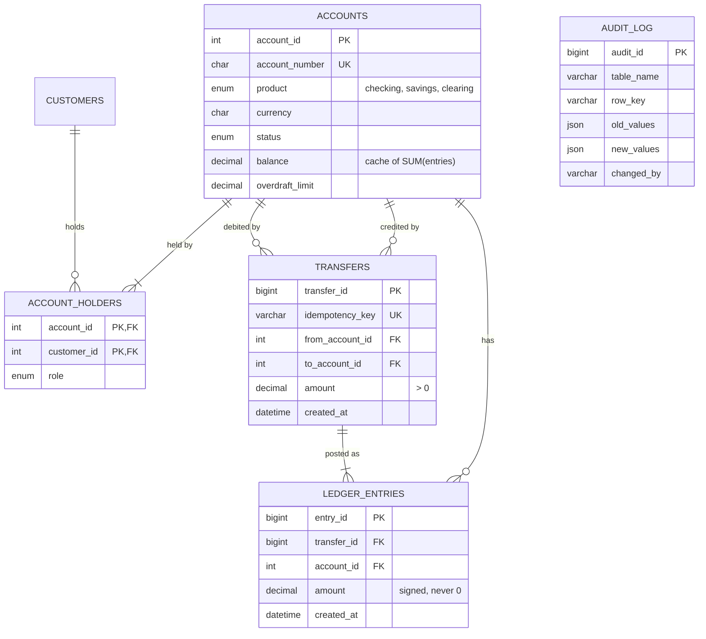

:::industry[Project brief — Harborline Digital Bank, core ledger]
**Client.** A (fictional) digital bank preparing for its banking licence: checking and savings accounts in USD and EUR, joint accounts, card settlements and instant transfers between customers. The regulator's technology audit will ask three questions of the database: *Can money be created or destroyed by a bug or a race? Can you prove every balance from history? Who can change what, and is it recorded?*

**Your job.** Design and build the core ledger: customers, accounts and holders, transfers, a double-entry ledger, an audit trail and the database access layer the banking services will use.

**Deliverables**

1. Requirements mapped to ACID properties and controls (Stage 1).
2. A double-entry data model and ER diagram (Stages 2–3).
3. A schema with exact money types, declarative integrity and an immutable ledger (Stages 4–7).
4. An idempotent `transfer_funds` procedure, statements and exposure reports (Stage 8).
5. Concurrency analysis with live demonstrations: lost update, deadlock between opposite transfers and its lock-ordering fix, isolation-level effects on reports (Stage 10).
6. Index and locking analysis on two years of generated history (Stages 9 and 11).
7. A least-privilege account design, a procedure/view access layer and trigger-based auditing (Stage 12).
8. An invariant test suite and an operations plan for durability and recovery (Stages 13–14).

**Acceptance criteria**

- For every transfer, the ledger entries sum to exactly zero; every account balance equals the sum of its ledger entries.
- No balance goes below `−overdraft_limit`, under any interleaving of concurrent transfers.
- Two opposite transfers between the same accounts can never deadlock each other.
- Retrying a request with the same idempotency key never moves money twice.
- Ledger rows can be neither updated nor deleted; changes to account status and limits are audited.
- Application accounts cannot write to tables directly.

**Estimated effort:** 18–24 hours after the prerequisite lessons on deadlocks, isolation levels and privileges. Each exercise lab is pre-loaded with the reference schema and data of the stages before it; concurrency scenarios run in their own labs with real concurrent sessions.
:::

## 1. Requirements Gathering

In most systems, a bug produces wrong output. In a ledger, a bug produces **wrong money** — and regulators, auditors and customers treat that very differently. Requirements gathering for a bank therefore starts from the **invariants** (what must always be true) and the **controls** (how you prove it), not from screens.

### Worked example — requirements mapped to ACID

The product owner, the head of finance and the compliance officer were interviewed. Their requirements, mapped to the ACID property each depends on (revise [ACID Properties](/lessons/m01-acid-transactions)):

| # | Requirement | Property | Mechanism in this project |
|---|---|---|---|
| R1 | A transfer debits one account and credits another — never only one of them | **Atomicity** | one transaction; rollback on any error |
| R2 | Money is never created or destroyed: every transfer's entries sum to zero | **Consistency** (business invariant) | double-entry ledger; procedure writes both entries; invariant tests |
| R3 | A balance never goes below `−overdraft_limit` | **Consistency** (declarative) | `CHECK (balance >= -overdraft_limit)` |
| R4 | Concurrent transfers behave as if executed one after another | **Isolation** | row locks in a fixed order; locking reads |
| R5 | A confirmed transfer survives a crash or power loss | **Durability** | InnoDB redo log, `innodb_flush_log_at_trx_commit = 1`, `sync_binlog = 1` |
| R6 | A client retry must not pay twice | Correctness | idempotency key with `UNIQUE` constraint |
| R7 | Every balance is explainable from history | Auditability | immutable ledger; balance = Σ entries |
| R8 | Status and limit changes record who, when, old and new values | Auditability | `AFTER UPDATE` trigger into `audit_log` |
| R9 | Services can move money only through approved operations | Security | `EXECUTE` on procedures only; no table privileges |
| R10 | Statements for any account and period within 200 ms | Performance | composite index on (account, time) |

Note how few of these are "features". Most are **properties** that every feature must preserve. This is why banking schemas are small and banking code reviews are long.

```exercise
id: p4-ex1
title: Map new requirements to controls
difficulty: medium
kind: open
concepts: [acid, requirements-analysis, data-integrity]
prompt: |
  Compliance adds three requirements:

  1. "A frozen account can receive incoming transfers but cannot send money."
  2. "Transfers above $10,000 must be held for review instead of being executed immediately."
  3. "If the data centre fails, we may lose at most one second of committed transfers, and must be back within 30 minutes."

  For each: which ACID property or other quality is involved, what changes in the schema or procedures, and what
  test or measurement would prove it is met.
solution: |
  1. **Consistency / business rule.** Today `transfer_funds` requires *both* accounts to be active. Change the check to
     `v_from_status = 'active' AND v_to_status IN ('active','frozen')`. It cannot be a CHECK constraint (it is a rule
     about an operation involving two rows). Tests: transfer *into* frozen account 106 succeeds; transfer *out of* it
     fails with "Account is not active" and leaves balances unchanged.
  2. **Workflow state, atomicity.** Add a status to transfers (`'completed','held','rejected'`) — or a separate
     `transfer_requests` table — and have the procedure insert a *held* request **without** ledger entries or balance
     changes when `amount > 10000`; a reviewer's approval executes the money movement in its own transaction. The
     invariant "ledger entries exist only for completed transfers" must be added to the test suite. Test: a 15,000
     transfer creates a held request, balances unchanged, zero ledger entries for it.
  3. **Durability and availability — RPO 1 s, RTO 30 min.** Within one server, `innodb_flush_log_at_trx_commit = 1` and
     `sync_binlog = 1` make every commit durable. For a data-centre loss you need a copy elsewhere: asynchronous
     replication can lose the last transactions in flight; semi-synchronous replication (or Group Replication / InnoDB
     Cluster) waits for at least one replica to receive each transaction, giving an RPO near zero. RTO is measured, not
     assumed: run a timed failover drill and a point-in-time restore from backup + binary logs.
```

## 2. Entities and Relationships

The defining decision of a ledger is **double-entry bookkeeping**: money never "appears" in an account; every movement is recorded as at least two **entries** that sum to zero — a debit (negative) on one account and a credit (positive) on another. Even a cash deposit is a transfer: from the bank's internal *clearing* account (which represents money entering from outside) to the customer's account. The consequences are powerful:

- **Σ of all entries in the bank = 0**, always. Any other result is a bug you can detect with one query.
- **An account's balance = Σ of its entries.** The stored balance is a cache that can be verified at any time.
- History is never edited. A mistaken transfer is corrected by a **reversing transfer**, so the audit trail shows both the mistake and its correction.

| Entity | Identifier | Notes |
|---|---|---|
| Customer | customer id (email unique) | KYC status ("know your customer" verification) |
| Account | account id (account number unique) | product, currency, status, cached balance, overdraft limit |
| Account holder | (account, customer) | M : N — joint accounts have several holders; a customer holds several accounts |
| Transfer | transfer id (idempotency key unique) | the business event: from, to, amount, currency, time |
| Ledger entry | entry id; (transfer, account) unique | one signed amount per account per transfer |
| Audit record | audit id | who changed which row, old and new values, when |

| Relationship | Cardinality | Notes |
|---|---|---|
| Customer holds Account | M : N with a role (primary, joint, authorized user) | `account_holders` |
| Transfer debits Account / credits Account | each N : 1 | two foreign keys on `transfers` |
| Transfer is posted as Ledger entries | 1 : N (exactly 2 here) | `ledger_entries.transfer_id` |
| Account has Ledger entries | 1 : N | `ledger_entries.account_id` |

Revise [Relationships and Cardinality](/lessons/m05-relationships-cardinality) for the M : N with attributes, and [Data Integrity](/lessons/m01-integrity-constraints) for the vocabulary of invariants.

```exercise
id: p4-ex2
title: Why not just store balances?
difficulty: medium
kind: open
concepts: [double-entry-ledger, data-integrity, auditability]
prompt: |
  A startup engineer argues: "Double entry is accounting bureaucracy. Store `accounts.balance`, write a `transactions`
  log with one row per transfer for history, and update both balances in a transaction. Same result, half the rows."

  Give three concrete situations in which the double-entry ledger detects or prevents a problem that the proposed design
  would not, and one situation where double entry costs more.
solution: |
  1. **Detecting partial or buggy writes.** If a bug (or a manual "fix") updates one balance without the other, the
     single-row log still looks fine. With double entry, Σ(entries) per transfer ≠ 0 or Σ(entries of account) ≠ balance
     immediately flags the discrepancy; the ledger is the independent evidence against which the cached balance is checked.
  2. **Proving a balance to an auditor or in a dispute.** "Why is my balance $1,850?" is answered by listing the
     account's own entries — a statement is just the account's entries with a running sum. With a transfer log you must
     reconstruct each account's view from from/to columns, and fees, interest, FX conversions or multi-leg transfers
     (one payment split across three accounts) do not fit a from/to row at all.
  3. **Multi-leg and internal movements.** A card payment with a fee is three legs (customer −100.50, merchant +100,
     fee income +0.50). Double entry represents it naturally as three entries summing to zero; the from/to log needs
     several rows whose relationship is implicit. Internal accounts (clearing, fees, interest expense) make the bank's
     own books part of the same invariant: Σ all entries = 0.

  **Cost:** twice (or more) as many rows, more index maintenance per transfer and more storage; balance queries must
  either trust a cached balance (which then needs reconciliation) or aggregate entries. At banking volumes this is a
  well-understood, accepted cost.
```

## 3. ER Diagram



`ACCOUNTS ||--|{ ACCOUNT_HOLDERS` says a customer account must have **at least one** holder — a rule a foreign key cannot enforce (internal clearing accounts are the exception, which is why the rule lives in the account-opening procedure and the validation suite, not in the schema). `AUDIT_LOG` deliberately has **no foreign keys**: audit records must survive even if the audited row is later archived or removed, and auditing must never fail because of referential checks.

```exercise
id: p4-ex3
title: Design review — the ledger's keys
difficulty: medium
kind: open
concepts: [er-modeling, unique-constraints, double-entry-ledger]
prompt: |
  Review these alternatives for `ledger_entries` and recommend one, with reasons:

  - (a) `PRIMARY KEY (transfer_id, account_id)` and no `entry_id`;
  - (b) `entry_id` surrogate key and no other unique constraint;
  - (c) `entry_id` surrogate key **and** `UNIQUE (transfer_id, account_id)`.

  Consider statement queries (entries of one account in time order), the risk of duplicate postings, multi-leg
  transfers, and InnoDB's clustered index.
solution: |
  **(c)** is the best fit for this project.

  - The clustered index orders rows by the primary key. With an ever-increasing `entry_id`, inserts append to the end of
    the B+ tree (no page splits in the middle), and `entry_id` gives a total posting order that breaks ties between
    entries with the same timestamp — essential for deterministic running balances.
  - `UNIQUE (transfer_id, account_id)` makes a **duplicate posting** of the same transfer to the same account
    impossible — exactly the bug a retry or a double-submitted batch would cause. Option (b) lacks this protection.
  - (a) has that protection, but clusters rows by transfer: an account's entries are scattered across the whole table,
    and every secondary index carries a 12-byte composite key instead of 8 bytes. It also forbids a transfer that has two
    legs on the same account (e.g. a fee and a principal leg) — acceptable here, but (c) would need to relax the unique
    constraint to `(transfer_id, account_id, leg_type)` in that case, while keeping a surrogate key.
  - For statements, all options need a secondary index starting with `account_id`; in (c) it implicitly ends with
    `entry_id`, the primary key.
```

## 4. Schema Design

Banking schemas are where data-type choices stop being a matter of taste:

| Decision | Choice | Why |
|---|---|---|
| Money type | `DECIMAL(19,4)` | exact fixed-point arithmetic; 4 decimal places accommodate interest and FX calculations before rounding to cents. `FLOAT`/`DOUBLE` can't represent 0.10 exactly — never for money. |
| Sign convention | entries signed (− debit, + credit); `transfers.amount > 0` | Σ entries = 0 is a single aggregate; direction of a transfer is in its from/to columns. |
| Currency | `CHAR(3)` ISO 4217 code, `CHECK REGEXP '^[A-Z]{3}$'` | one currency per account; cross-currency movements become FX transfers through clearing accounts (out of scope). |
| Balance | stored on `accounts` (cache) | reading a balance must be O(1) and lockable; correctness is proven against the ledger. |
| Overdraft | `overdraft_limit ≥ 0`, `CHECK (balance >= -overdraft_limit)` | a **two-column CHECK** — the most important declarative constraint in the schema. |
| Timestamps | `DATETIME(6)` | microsecond precision orders events within the same second; the application supplies UTC. |
| Transfer identity | `idempotency_key VARCHAR(64) UNIQUE` | the client generates the key (e.g. a UUID) per payment request; a retry carries the same key. |
| Deletes | `RESTRICT` everywhere; no `CASCADE` on any money table | financial records are closed or reversed, never removed. |

**Normalization review.** `accounts.balance` is derived data (`= Σ ledger_entries.amount`): a deliberate, controlled redundancy, maintained in exactly one place — `transfer_funds`, in the same transaction as the entries — and verified by reconciliation (Stage 13). `transfers.currency` equals the currency of both accounts; it is redundant too, but it makes each transfer self-describing for downstream systems and is cheap to check. Everything else is in 3NF/BCNF: each table's non-key attributes depend on its key only. Revise [Denormalization](/lessons/m06-denormalization).

## 5. Normalization

The schema's one interesting normalization question is the **balance**. Relational theory says derived data should not be stored. Banking practice stores it anyway. Both are right — under different assumptions — and an engineer must be able to argue the trade-off.

| Option | Reads | Writes and concurrency | Integrity |
|---|---|---|---|
| No stored balance: `SUM(amount)` per request | cost grows with history (thousands of entries per account per year) | nothing extra to update | always correct |
| Stored balance on `accounts` | O(1) | one extra `UPDATE` per leg; the account row becomes the natural **lock** for overdraft checks | must be reconciled |
| Periodic snapshots (`balance_snapshots(account, as_of, balance)`) + Σ entries since snapshot | bounded | cheap | correct if snapshots are |

The deciding argument is concurrency, not read speed: to enforce "balance ≥ −limit" under concurrent transfers, you need **something to lock** that represents the account's spendable money. With a stored balance, that is the account row: `SELECT … FOR UPDATE`, check, update, commit. Without it, two transfers could each sum the entries, each see enough money and each insert a debit — the classic write-skew anomaly — unless every transfer locked the account row anyway. So the stored balance costs little extra and gives the lock a meaning.

```exercise
id: p4-ex4
title: The invariant behind the cached balance
difficulty: hard
kind: open
concepts: [normalization, controlled-redundancy, write-skew, isolation-levels]
prompt: |
  Suppose the team removes `accounts.balance` and computes balances as `SUM(amount)` from `ledger_entries`. The
  transfer procedure becomes: `START TRANSACTION; SELECT SUM(amount) … WHERE account_id = ?; -- check against
  overdraft; INSERT two entries; COMMIT;` running at REPEATABLE READ.

  1. Describe an interleaving of two concurrent transfers from the same account that overdraws it. Name the anomaly.
  2. Does `SELECT SUM(amount) … FOR UPDATE` fix it? Explain what InnoDB locks in that case.
  3. Propose the simplest robust fix.
solution: |
  1. Account balance 100, overdraft 0. T1 and T2 each want to send 80. T1 sums entries → 100; T2 sums entries → 100
     (consistent snapshot, no locks taken); both pass the check; both insert a −80 entry; both commit → balance −60.
     Neither transaction modified a row the other read — each *inserted* a new row — so there is no lost update on a
     shared row. This is **write skew**: two transactions read overlapping data, make disjoint writes, and together
     violate an invariant that each one checked.
  2. `SELECT SUM(amount) FROM ledger_entries WHERE account_id = ? FOR UPDATE` takes **next-key locks** on the index
     range of that account's entries (with an index on `account_id`), including the gap after the last entry. A
     concurrent T2 doing the same locking read waits; T2's INSERT into that gap would also wait. So it does serialize
     the two transfers — but by locking an ever-growing range of entries, which is expensive, and it depends on the index
     existing (without it, InnoDB locks every row it scans — effectively the whole table).
  3. Lock a **single row that represents the account**: keep `accounts` and take `SELECT … FROM accounts WHERE
     account_id = ? FOR UPDATE` at the start of every transfer (with or without a cached balance). Storing the balance
     there as well makes the check O(1). Alternatively, run at SERIALIZABLE, where plain SELECTs take shared next-key
     locks — correct, but with more deadlocks that the application must retry.
```

## 6. MySQL Table Creation

### Worked example — the base tables

```sql run
CREATE TABLE customers (
  customer_id INT UNSIGNED NOT NULL AUTO_INCREMENT,
  full_name   VARCHAR(120) NOT NULL,
  email       VARCHAR(255) NOT NULL,
  kyc_status  ENUM('pending','verified','rejected') NOT NULL DEFAULT 'pending',
  created_at  DATETIME     NOT NULL,
  PRIMARY KEY (customer_id),
  CONSTRAINT uq_customers_email UNIQUE (email)
);
CREATE TABLE accounts (
  account_id      INT UNSIGNED  NOT NULL AUTO_INCREMENT,
  account_number  CHAR(12)      NOT NULL,
  product         ENUM('checking','savings','clearing') NOT NULL,
  currency        CHAR(3)       NOT NULL,
  status          ENUM('active','frozen','closed') NOT NULL DEFAULT 'active',
  balance         DECIMAL(19,4) NOT NULL DEFAULT 0,
  overdraft_limit DECIMAL(19,4) NOT NULL DEFAULT 0,
  opened_at       DATETIME      NOT NULL,
  PRIMARY KEY (account_id),
  CONSTRAINT uq_accounts_number UNIQUE (account_number),
  CONSTRAINT chk_accounts_overdraft CHECK (balance >= -overdraft_limit),
  CONSTRAINT chk_accounts_limit     CHECK (overdraft_limit >= 0),
  CONSTRAINT chk_accounts_currency  CHECK (currency REGEXP '^[A-Z]{3}$')
);
CREATE TABLE account_holders (
  account_id  INT UNSIGNED NOT NULL,
  customer_id INT UNSIGNED NOT NULL,
  role        ENUM('primary','joint','authorized_user') NOT NULL,
  PRIMARY KEY (account_id, customer_id),
  CONSTRAINT fk_holders_account  FOREIGN KEY (account_id)  REFERENCES accounts (account_id),
  CONSTRAINT fk_holders_customer FOREIGN KEY (customer_id) REFERENCES customers (customer_id)
);
CREATE TABLE transfers (
  transfer_id     BIGINT UNSIGNED NOT NULL AUTO_INCREMENT,
  idempotency_key VARCHAR(64)     NOT NULL,
  from_account_id INT UNSIGNED    NOT NULL,
  to_account_id   INT UNSIGNED    NOT NULL,
  amount          DECIMAL(19,4)   NOT NULL,
  currency        CHAR(3)         NOT NULL,
  memo            VARCHAR(140)    NULL,
  created_at      DATETIME(6)     NOT NULL,
  PRIMARY KEY (transfer_id),
  CONSTRAINT uq_transfers_idempotency UNIQUE (idempotency_key),
  CONSTRAINT fk_transfers_from FOREIGN KEY (from_account_id) REFERENCES accounts (account_id),
  CONSTRAINT fk_transfers_to   FOREIGN KEY (to_account_id)   REFERENCES accounts (account_id),
  CONSTRAINT chk_transfers_amount   CHECK (amount > 0),
  CONSTRAINT chk_transfers_distinct CHECK (from_account_id <> to_account_id)
);
CREATE TABLE audit_log (
  audit_id   BIGINT UNSIGNED NOT NULL AUTO_INCREMENT,
  table_name VARCHAR(64)  NOT NULL,
  row_key    VARCHAR(64)  NOT NULL,
  action     ENUM('INSERT','UPDATE','DELETE') NOT NULL,
  old_values JSON         NULL,
  new_values JSON         NULL,
  changed_by VARCHAR(288) NOT NULL,
  changed_at DATETIME(6)  NOT NULL,
  PRIMARY KEY (audit_id)
);
SELECT TABLE_NAME, CONSTRAINT_NAME, CONSTRAINT_TYPE
FROM information_schema.TABLE_CONSTRAINTS
WHERE TABLE_SCHEMA = DATABASE() AND CONSTRAINT_TYPE IN ('CHECK', 'UNIQUE')
ORDER BY TABLE_NAME, CONSTRAINT_NAME;
```

The DDL embodies the requirements: `chk_accounts_overdraft` compares two columns of the same row (MySQL 8.0.16+ enforces it); `uq_transfers_idempotency` is the idempotency guarantee; `chk_transfers_distinct` forbids transfers from an account to itself; `audit_log` uses `JSON` columns so one table can audit any table's changes.

```exercise
id: p4-ex5
title: Create the ledger_entries table
difficulty: medium
kind: dml
concepts: [create-table, foreign-keys, unique-constraints, check-constraints, double-entry-ledger]
setup: |
  CREATE TABLE customers (
    customer_id INT UNSIGNED NOT NULL AUTO_INCREMENT,
    full_name   VARCHAR(120) NOT NULL,
    email       VARCHAR(255) NOT NULL,
    kyc_status  ENUM('pending','verified','rejected') NOT NULL DEFAULT 'pending',
    created_at  DATETIME     NOT NULL,
    PRIMARY KEY (customer_id),
    CONSTRAINT uq_customers_email UNIQUE (email)
  );
  CREATE TABLE accounts (
    account_id      INT UNSIGNED  NOT NULL AUTO_INCREMENT,
    account_number  CHAR(12)      NOT NULL,
    product         ENUM('checking','savings','clearing') NOT NULL,
    currency        CHAR(3)       NOT NULL,
    status          ENUM('active','frozen','closed') NOT NULL DEFAULT 'active',
    balance         DECIMAL(19,4) NOT NULL DEFAULT 0,
    overdraft_limit DECIMAL(19,4) NOT NULL DEFAULT 0,
    opened_at       DATETIME      NOT NULL,
    PRIMARY KEY (account_id),
    CONSTRAINT uq_accounts_number UNIQUE (account_number),
    CONSTRAINT chk_accounts_overdraft CHECK (balance >= -overdraft_limit),
    CONSTRAINT chk_accounts_limit     CHECK (overdraft_limit >= 0),
    CONSTRAINT chk_accounts_currency  CHECK (currency REGEXP '^[A-Z]{3}$')
  );
  CREATE TABLE account_holders (
    account_id  INT UNSIGNED NOT NULL,
    customer_id INT UNSIGNED NOT NULL,
    role        ENUM('primary','joint','authorized_user') NOT NULL,
    PRIMARY KEY (account_id, customer_id),
    CONSTRAINT fk_holders_account  FOREIGN KEY (account_id)  REFERENCES accounts (account_id),
    CONSTRAINT fk_holders_customer FOREIGN KEY (customer_id) REFERENCES customers (customer_id)
  );
  CREATE TABLE transfers (
    transfer_id     BIGINT UNSIGNED NOT NULL AUTO_INCREMENT,
    idempotency_key VARCHAR(64)     NOT NULL,
    from_account_id INT UNSIGNED    NOT NULL,
    to_account_id   INT UNSIGNED    NOT NULL,
    amount          DECIMAL(19,4)   NOT NULL,
    currency        CHAR(3)         NOT NULL,
    memo            VARCHAR(140)    NULL,
    created_at      DATETIME(6)     NOT NULL,
    PRIMARY KEY (transfer_id),
    CONSTRAINT uq_transfers_idempotency UNIQUE (idempotency_key),
    CONSTRAINT fk_transfers_from FOREIGN KEY (from_account_id) REFERENCES accounts (account_id),
    CONSTRAINT fk_transfers_to   FOREIGN KEY (to_account_id)   REFERENCES accounts (account_id),
    CONSTRAINT chk_transfers_amount   CHECK (amount > 0),
    CONSTRAINT chk_transfers_distinct CHECK (from_account_id <> to_account_id)
  );
  CREATE TABLE audit_log (
    audit_id   BIGINT UNSIGNED NOT NULL AUTO_INCREMENT,
    table_name VARCHAR(64)  NOT NULL,
    row_key    VARCHAR(64)  NOT NULL,
    action     ENUM('INSERT','UPDATE','DELETE') NOT NULL,
    old_values JSON         NULL,
    new_values JSON         NULL,
    changed_by VARCHAR(288) NOT NULL,
    changed_at DATETIME(6)  NOT NULL,
    PRIMARY KEY (audit_id)
  );
  INSERT INTO customers (customer_id, full_name, email, kyc_status, created_at) VALUES
    (1, 'Ana Lima',     'ana.lima@mail.example.com',     'verified', '2023-04-10 09:55:00'),
    (2, 'Ben Okafor',   'ben.okafor@mail.example.com',   'verified', '2023-06-22 14:10:00'),
    (3, 'Chloe Martin', 'chloe.martin@mail.example.com', 'verified', '2023-06-22 14:12:00'),
    (4, 'Dev Patel',    'dev.patel@mail.example.com',    'verified', '2023-09-15 11:00:00'),
    (5, 'Eva Novak',    'eva.novak@mail.example.com',    'verified', '2023-10-03 16:30:00'),
    (6, 'Felix Wagner', 'felix.wagner@mail.example.com', 'verified', '2026-01-12 12:40:00');
  INSERT INTO accounts (account_id, account_number, product, currency, status, balance, overdraft_limit, opened_at) VALUES
    (1, 'BK0000000001', 'clearing', 'USD', 'active', -19750.00, 1000000000.00, '2026-01-01 00:00:00'),
    (2, 'BK0000000002', 'clearing', 'EUR', 'active', -1200.00, 1000000000.00, '2026-01-01 00:00:00'),
    (101, 'BK0000000101', 'checking', 'USD', 'active', 3045.50, 0.00, '2023-04-10 10:00:00'),
    (102, 'BK0000000102', 'savings', 'USD', 'active', 9000.00, 0.00, '2023-04-10 10:05:00'),
    (103, 'BK0000000103', 'checking', 'USD', 'active', 1850.00, 0.00, '2023-06-22 14:30:00'),
    (104, 'BK0000000104', 'checking', 'USD', 'active', 724.50, 0.00, '2023-07-01 09:00:00'),
    (105, 'BK0000000105', 'checking', 'USD', 'active', 130.00, 200.00, '2023-09-15 11:20:00'),
    (106, 'BK0000000106', 'savings', 'USD', 'frozen', 5000.00, 0.00, '2023-10-03 16:45:00'),
    (107, 'BK0000000107', 'checking', 'EUR', 'active', 1200.00, 0.00, '2026-01-12 13:00:00');
  INSERT INTO account_holders (account_id, customer_id, role) VALUES
    (101, 1, 'primary'), (102, 1, 'primary'), (103, 2, 'primary'), (103, 3, 'joint'),
    (104, 3, 'primary'), (105, 4, 'primary'), (106, 5, 'primary'), (107, 6, 'primary');
  INSERT INTO transfers (transfer_id, idempotency_key, from_account_id, to_account_id, amount, currency, memo, created_at) VALUES
    (1, 'seed-0001', 1, 101, 2500.00, 'USD', 'Opening deposit', '2026-03-01 09:00:00'),
    (2, 'seed-0002', 1, 102, 10000.00, 'USD', 'Opening deposit', '2026-03-01 09:00:01'),
    (3, 'seed-0003', 1, 103, 1800.00, 'USD', 'Opening deposit', '2026-03-01 09:00:02'),
    (4, 'seed-0004', 1, 104, 650.00, 'USD', 'Opening deposit', '2026-03-01 09:00:03'),
    (5, 'seed-0005', 1, 105, 300.00, 'USD', 'Opening deposit', '2026-03-01 09:00:04'),
    (6, 'seed-0006', 1, 106, 5000.00, 'USD', 'Opening deposit', '2026-03-01 09:00:05'),
    (7, 'seed-0007', 2, 107, 1200.00, 'EUR', 'Opening deposit', '2026-03-01 09:00:06'),
    (8, 'seed-0008', 101, 103, 200.00, 'USD', 'Rent share', '2026-03-02 10:15:00'),
    (9, 'seed-0009', 102, 101, 1000.00, 'USD', 'From savings', '2026-03-03 12:00:00'),
    (10, 'seed-0010', 103, 104, 150.00, 'USD', 'Utilities', '2026-03-05 08:30:00'),
    (11, 'seed-0011', 101, 1, 80.00, 'USD', 'Card settlement', '2026-03-06 18:45:00'),
    (12, 'seed-0012', 105, 1, 420.00, 'USD', 'Card settlement', '2026-03-07 09:10:00'),
    (13, 'seed-0013', 104, 101, 75.50, 'USD', 'Dinner', '2026-03-08 14:00:00'),
    (14, 'seed-0014', 101, 105, 250.00, 'USD', 'Loan to Dev', '2026-03-09 16:20:00');
prompt: |
  Create **`ledger_entries`** with these columns in this order:

  | Column | Type | Notes |
  |---|---|---|
  | `entry_id` | `BIGINT UNSIGNED NOT NULL AUTO_INCREMENT` | primary key |
  | `transfer_id` | `BIGINT UNSIGNED NOT NULL` | FK → `transfers` |
  | `account_id` | `INT UNSIGNED NOT NULL` | FK → `accounts` |
  | `amount` | `DECIMAL(19,4) NOT NULL` | signed; never zero |
  | `created_at` | `DATETIME(6) NOT NULL` | |

  A transfer may post at most one entry per account. Deleting a transfer or an account that has entries must be
  refused. The grader posts valid and invalid entries with `INSERT IGNORE` and tries to delete a transfer.
hints:
  - "PRIMARY KEY (entry_id), UNIQUE (transfer_id, account_id), two FOREIGN KEYs with the default action, CHECK (amount <> 0)."
  - "The FK columns must match the referenced types exactly: transfers.transfer_id is BIGINT UNSIGNED, accounts.account_id is INT UNSIGNED."
solution: |
  CREATE TABLE ledger_entries (
    entry_id    BIGINT UNSIGNED NOT NULL AUTO_INCREMENT,
    transfer_id BIGINT UNSIGNED NOT NULL,
    account_id  INT UNSIGNED    NOT NULL,
    amount      DECIMAL(19,4)   NOT NULL,
    created_at  DATETIME(6)     NOT NULL,
    PRIMARY KEY (entry_id),
    CONSTRAINT uq_ledger_transfer_account UNIQUE (transfer_id, account_id),
    CONSTRAINT fk_ledger_transfer FOREIGN KEY (transfer_id) REFERENCES transfers (transfer_id),
    CONSTRAINT fk_ledger_account  FOREIGN KEY (account_id)  REFERENCES accounts (account_id),
    CONSTRAINT chk_ledger_amount CHECK (amount <> 0)
  );
check: |
  INSERT IGNORE INTO ledger_entries (transfer_id, account_id, amount, created_at) VALUES
    (8, 101, -200.00, '2026-03-02 10:15:00'),
    (8, 103,  200.00, '2026-03-02 10:15:00'),
    (8, 103,  200.00, '2026-03-02 10:15:00'),
    (9, 102, 0.00,    '2026-03-03 12:00:00'),
    (999, 101, 5.00,  '2026-03-03 12:00:00'),
    (9, 999, 5.00,    '2026-03-03 12:00:00'),
    (9, 102, -1000.00, '2026-03-03 12:00:00');
  DELETE IGNORE FROM transfers WHERE transfer_id = 8;
  SELECT 'entry' AS kind, CONCAT(transfer_id, '/', account_id) AS item, amount AS value FROM ledger_entries
  UNION ALL
  SELECT 'transfer_8_still_exists', '', COUNT(*) FROM transfers WHERE transfer_id = 8
  ORDER BY kind, item;
explanation: |
  Three entries survive: both legs of transfer 8 and the debit leg of transfer 9. Rejected: the duplicate posting of
  transfer 8 to account 103 (unique key), a zero amount (CHECK), an unknown transfer and an unknown account (foreign
  keys). The `DELETE IGNORE` of transfer 8 must leave it in place — with `ON DELETE CASCADE` the transfer *and its ledger
  entries* would vanish, destroying the audit evidence. In a ledger, `CASCADE` on any money table is a design defect.
```

## 7. Constraints and Relationships

**Checkpoint** — create the reference ledger and load the seed data: two internal clearing accounts (USD and EUR), seven customer accounts, fourteen transfers (opening deposits and two weeks of activity) and their 28 ledger entries.

```sql run
CREATE TABLE ledger_entries (
  entry_id    BIGINT UNSIGNED NOT NULL AUTO_INCREMENT,
  transfer_id BIGINT UNSIGNED NOT NULL,
  account_id  INT UNSIGNED    NOT NULL,
  amount      DECIMAL(19,4)   NOT NULL,
  created_at  DATETIME(6)     NOT NULL,
  PRIMARY KEY (entry_id),
  CONSTRAINT uq_ledger_transfer_account UNIQUE (transfer_id, account_id),
  CONSTRAINT fk_ledger_transfer FOREIGN KEY (transfer_id) REFERENCES transfers (transfer_id),
  CONSTRAINT fk_ledger_account  FOREIGN KEY (account_id)  REFERENCES accounts (account_id),
  CONSTRAINT chk_ledger_amount CHECK (amount <> 0)
);
INSERT INTO customers (customer_id, full_name, email, kyc_status, created_at) VALUES
  (1, 'Ana Lima',     'ana.lima@mail.example.com',     'verified', '2023-04-10 09:55:00'),
  (2, 'Ben Okafor',   'ben.okafor@mail.example.com',   'verified', '2023-06-22 14:10:00'),
  (3, 'Chloe Martin', 'chloe.martin@mail.example.com', 'verified', '2023-06-22 14:12:00'),
  (4, 'Dev Patel',    'dev.patel@mail.example.com',    'verified', '2023-09-15 11:00:00'),
  (5, 'Eva Novak',    'eva.novak@mail.example.com',    'verified', '2023-10-03 16:30:00'),
  (6, 'Felix Wagner', 'felix.wagner@mail.example.com', 'verified', '2026-01-12 12:40:00');
INSERT INTO accounts (account_id, account_number, product, currency, status, balance, overdraft_limit, opened_at) VALUES
  (1, 'BK0000000001', 'clearing', 'USD', 'active', -19750.00, 1000000000.00, '2026-01-01 00:00:00'),
  (2, 'BK0000000002', 'clearing', 'EUR', 'active', -1200.00, 1000000000.00, '2026-01-01 00:00:00'),
  (101, 'BK0000000101', 'checking', 'USD', 'active', 3045.50, 0.00, '2023-04-10 10:00:00'),
  (102, 'BK0000000102', 'savings', 'USD', 'active', 9000.00, 0.00, '2023-04-10 10:05:00'),
  (103, 'BK0000000103', 'checking', 'USD', 'active', 1850.00, 0.00, '2023-06-22 14:30:00'),
  (104, 'BK0000000104', 'checking', 'USD', 'active', 724.50, 0.00, '2023-07-01 09:00:00'),
  (105, 'BK0000000105', 'checking', 'USD', 'active', 130.00, 200.00, '2023-09-15 11:20:00'),
  (106, 'BK0000000106', 'savings', 'USD', 'frozen', 5000.00, 0.00, '2023-10-03 16:45:00'),
  (107, 'BK0000000107', 'checking', 'EUR', 'active', 1200.00, 0.00, '2026-01-12 13:00:00');
INSERT INTO account_holders (account_id, customer_id, role) VALUES
  (101, 1, 'primary'), (102, 1, 'primary'), (103, 2, 'primary'), (103, 3, 'joint'),
  (104, 3, 'primary'), (105, 4, 'primary'), (106, 5, 'primary'), (107, 6, 'primary');
INSERT INTO transfers (transfer_id, idempotency_key, from_account_id, to_account_id, amount, currency, memo, created_at) VALUES
  (1, 'seed-0001', 1, 101, 2500.00, 'USD', 'Opening deposit', '2026-03-01 09:00:00'),
  (2, 'seed-0002', 1, 102, 10000.00, 'USD', 'Opening deposit', '2026-03-01 09:00:01'),
  (3, 'seed-0003', 1, 103, 1800.00, 'USD', 'Opening deposit', '2026-03-01 09:00:02'),
  (4, 'seed-0004', 1, 104, 650.00, 'USD', 'Opening deposit', '2026-03-01 09:00:03'),
  (5, 'seed-0005', 1, 105, 300.00, 'USD', 'Opening deposit', '2026-03-01 09:00:04'),
  (6, 'seed-0006', 1, 106, 5000.00, 'USD', 'Opening deposit', '2026-03-01 09:00:05'),
  (7, 'seed-0007', 2, 107, 1200.00, 'EUR', 'Opening deposit', '2026-03-01 09:00:06'),
  (8, 'seed-0008', 101, 103, 200.00, 'USD', 'Rent share', '2026-03-02 10:15:00'),
  (9, 'seed-0009', 102, 101, 1000.00, 'USD', 'From savings', '2026-03-03 12:00:00'),
  (10, 'seed-0010', 103, 104, 150.00, 'USD', 'Utilities', '2026-03-05 08:30:00'),
  (11, 'seed-0011', 101, 1, 80.00, 'USD', 'Card settlement', '2026-03-06 18:45:00'),
  (12, 'seed-0012', 105, 1, 420.00, 'USD', 'Card settlement', '2026-03-07 09:10:00'),
  (13, 'seed-0013', 104, 101, 75.50, 'USD', 'Dinner', '2026-03-08 14:00:00'),
  (14, 'seed-0014', 101, 105, 250.00, 'USD', 'Loan to Dev', '2026-03-09 16:20:00');
INSERT INTO ledger_entries (entry_id, transfer_id, account_id, amount, created_at) VALUES
  (1, 1, 1, -2500.00, '2026-03-01 09:00:00'),
  (2, 1, 101, 2500.00, '2026-03-01 09:00:00'),
  (3, 2, 1, -10000.00, '2026-03-01 09:00:01'),
  (4, 2, 102, 10000.00, '2026-03-01 09:00:01'),
  (5, 3, 1, -1800.00, '2026-03-01 09:00:02'),
  (6, 3, 103, 1800.00, '2026-03-01 09:00:02'),
  (7, 4, 1, -650.00, '2026-03-01 09:00:03'),
  (8, 4, 104, 650.00, '2026-03-01 09:00:03'),
  (9, 5, 1, -300.00, '2026-03-01 09:00:04'),
  (10, 5, 105, 300.00, '2026-03-01 09:00:04'),
  (11, 6, 1, -5000.00, '2026-03-01 09:00:05'),
  (12, 6, 106, 5000.00, '2026-03-01 09:00:05'),
  (13, 7, 2, -1200.00, '2026-03-01 09:00:06'),
  (14, 7, 107, 1200.00, '2026-03-01 09:00:06'),
  (15, 8, 101, -200.00, '2026-03-02 10:15:00'),
  (16, 8, 103, 200.00, '2026-03-02 10:15:00'),
  (17, 9, 102, -1000.00, '2026-03-03 12:00:00'),
  (18, 9, 101, 1000.00, '2026-03-03 12:00:00'),
  (19, 10, 103, -150.00, '2026-03-05 08:30:00'),
  (20, 10, 104, 150.00, '2026-03-05 08:30:00'),
  (21, 11, 101, -80.00, '2026-03-06 18:45:00'),
  (22, 11, 1, 80.00, '2026-03-06 18:45:00'),
  (23, 12, 105, -420.00, '2026-03-07 09:10:00'),
  (24, 12, 1, 420.00, '2026-03-07 09:10:00'),
  (25, 13, 104, -75.50, '2026-03-08 14:00:00'),
  (26, 13, 101, 75.50, '2026-03-08 14:00:00'),
  (27, 14, 101, -250.00, '2026-03-09 16:20:00'),
  (28, 14, 105, 250.00, '2026-03-09 16:20:00');
SELECT a.account_number, a.product, a.currency, a.status, a.balance, a.overdraft_limit,
       COALESCE(GROUP_CONCAT(CONCAT(c.full_name, ' (', h.role, ')') ORDER BY h.role, c.full_name SEPARATOR ', '), '-') AS holders
FROM accounts a
LEFT JOIN account_holders h ON h.account_id = a.account_id
LEFT JOIN customers c ON c.customer_id = h.customer_id
GROUP BY a.account_id
ORDER BY a.account_id;
```

Account 103 is a joint account (Ben and Chloe); 105 (Dev) has a $200 overdraft facility; 106 (Eva) is frozen; 107 is in euros. The clearing accounts carry large negative balances — the mirror image of all money deposited into customer accounts.

The global invariant, already checkable:

```sql run
SELECT currency, SUM(balance) AS sum_of_balances
FROM accounts GROUP BY currency ORDER BY currency;
```

Every currency sums to exactly zero: no money exists that did not come from somewhere.

### Worked example — declarative integrity at work

```sql run error
-- Overdraft beyond the limit (error 3819): Dev has 130.00 and a 200.00 limit
UPDATE accounts SET balance = balance - 400 WHERE account_number = 'BK0000000105';
```

```sql run error
-- A transfer to the same account (error 3819)
INSERT INTO transfers (idempotency_key, from_account_id, to_account_id, amount, currency, created_at)
VALUES ('test-self', 101, 101, 10.00, 'USD', '2026-03-10 09:00:00');
```

```sql run error
-- The same idempotency key twice (error 1062)
INSERT INTO transfers (idempotency_key, from_account_id, to_account_id, amount, currency, created_at)
VALUES ('seed-0008', 101, 103, 200.00, 'USD', '2026-03-10 09:00:00');
```

Declarative constraints cover single rows and keys. Three rules need more: **immutability** of the ledger (a trigger), **balanced transfers** (the procedure plus tests) and **auditing** of sensitive changes (a trigger). Immutability is yours.

:::mysql[Triggers in MySQL]
A trigger is bound to one table and one event (`INSERT`, `UPDATE` or `DELETE`), `BEFORE` or `AFTER`, and runs `FOR EACH ROW`. In a `BEFORE` trigger, `SIGNAL` aborts the statement — the row is not written. Since MySQL 8.0.2 a table can have several triggers per event, ordered with `FOLLOWS`/`PRECEDES`. Triggers do **not** fire for `TRUNCATE TABLE` or for changes made by foreign-key cascades, so privileges must close those paths too. Revise [Triggers](/lessons/m09-triggers).
:::

```exercise
id: p4-ex6
title: Make the ledger immutable
difficulty: hard
kind: dml
concepts: [triggers, signal, data-integrity, auditability]
setup: |
  CREATE TABLE customers (
    customer_id INT UNSIGNED NOT NULL AUTO_INCREMENT,
    full_name   VARCHAR(120) NOT NULL,
    email       VARCHAR(255) NOT NULL,
    kyc_status  ENUM('pending','verified','rejected') NOT NULL DEFAULT 'pending',
    created_at  DATETIME     NOT NULL,
    PRIMARY KEY (customer_id),
    CONSTRAINT uq_customers_email UNIQUE (email)
  );
  CREATE TABLE accounts (
    account_id      INT UNSIGNED  NOT NULL AUTO_INCREMENT,
    account_number  CHAR(12)      NOT NULL,
    product         ENUM('checking','savings','clearing') NOT NULL,
    currency        CHAR(3)       NOT NULL,
    status          ENUM('active','frozen','closed') NOT NULL DEFAULT 'active',
    balance         DECIMAL(19,4) NOT NULL DEFAULT 0,
    overdraft_limit DECIMAL(19,4) NOT NULL DEFAULT 0,
    opened_at       DATETIME      NOT NULL,
    PRIMARY KEY (account_id),
    CONSTRAINT uq_accounts_number UNIQUE (account_number),
    CONSTRAINT chk_accounts_overdraft CHECK (balance >= -overdraft_limit),
    CONSTRAINT chk_accounts_limit     CHECK (overdraft_limit >= 0),
    CONSTRAINT chk_accounts_currency  CHECK (currency REGEXP '^[A-Z]{3}$')
  );
  CREATE TABLE account_holders (
    account_id  INT UNSIGNED NOT NULL,
    customer_id INT UNSIGNED NOT NULL,
    role        ENUM('primary','joint','authorized_user') NOT NULL,
    PRIMARY KEY (account_id, customer_id),
    CONSTRAINT fk_holders_account  FOREIGN KEY (account_id)  REFERENCES accounts (account_id),
    CONSTRAINT fk_holders_customer FOREIGN KEY (customer_id) REFERENCES customers (customer_id)
  );
  CREATE TABLE transfers (
    transfer_id     BIGINT UNSIGNED NOT NULL AUTO_INCREMENT,
    idempotency_key VARCHAR(64)     NOT NULL,
    from_account_id INT UNSIGNED    NOT NULL,
    to_account_id   INT UNSIGNED    NOT NULL,
    amount          DECIMAL(19,4)   NOT NULL,
    currency        CHAR(3)         NOT NULL,
    memo            VARCHAR(140)    NULL,
    created_at      DATETIME(6)     NOT NULL,
    PRIMARY KEY (transfer_id),
    CONSTRAINT uq_transfers_idempotency UNIQUE (idempotency_key),
    CONSTRAINT fk_transfers_from FOREIGN KEY (from_account_id) REFERENCES accounts (account_id),
    CONSTRAINT fk_transfers_to   FOREIGN KEY (to_account_id)   REFERENCES accounts (account_id),
    CONSTRAINT chk_transfers_amount   CHECK (amount > 0),
    CONSTRAINT chk_transfers_distinct CHECK (from_account_id <> to_account_id)
  );
  CREATE TABLE audit_log (
    audit_id   BIGINT UNSIGNED NOT NULL AUTO_INCREMENT,
    table_name VARCHAR(64)  NOT NULL,
    row_key    VARCHAR(64)  NOT NULL,
    action     ENUM('INSERT','UPDATE','DELETE') NOT NULL,
    old_values JSON         NULL,
    new_values JSON         NULL,
    changed_by VARCHAR(288) NOT NULL,
    changed_at DATETIME(6)  NOT NULL,
    PRIMARY KEY (audit_id)
  );
  CREATE TABLE ledger_entries (
    entry_id    BIGINT UNSIGNED NOT NULL AUTO_INCREMENT,
    transfer_id BIGINT UNSIGNED NOT NULL,
    account_id  INT UNSIGNED    NOT NULL,
    amount      DECIMAL(19,4)   NOT NULL,
    created_at  DATETIME(6)     NOT NULL,
    PRIMARY KEY (entry_id),
    CONSTRAINT uq_ledger_transfer_account UNIQUE (transfer_id, account_id),
    CONSTRAINT fk_ledger_transfer FOREIGN KEY (transfer_id) REFERENCES transfers (transfer_id),
    CONSTRAINT fk_ledger_account  FOREIGN KEY (account_id)  REFERENCES accounts (account_id),
    CONSTRAINT chk_ledger_amount CHECK (amount <> 0)
  );
  CREATE TRIGGER trg_accounts_audit AFTER UPDATE ON accounts
  FOR EACH ROW
  BEGIN
    IF NOT (OLD.status <=> NEW.status) OR NOT (OLD.overdraft_limit <=> NEW.overdraft_limit) THEN
      INSERT INTO audit_log (table_name, row_key, action, old_values, new_values, changed_by, changed_at)
      VALUES ('accounts', OLD.account_number, 'UPDATE',
              JSON_OBJECT('status', OLD.status, 'overdraft_limit', OLD.overdraft_limit),
              JSON_OBJECT('status', NEW.status, 'overdraft_limit', NEW.overdraft_limit),
              USER(), NOW(6));
    END IF;
  END;
  INSERT INTO customers (customer_id, full_name, email, kyc_status, created_at) VALUES
    (1, 'Ana Lima',     'ana.lima@mail.example.com',     'verified', '2023-04-10 09:55:00'),
    (2, 'Ben Okafor',   'ben.okafor@mail.example.com',   'verified', '2023-06-22 14:10:00'),
    (3, 'Chloe Martin', 'chloe.martin@mail.example.com', 'verified', '2023-06-22 14:12:00'),
    (4, 'Dev Patel',    'dev.patel@mail.example.com',    'verified', '2023-09-15 11:00:00'),
    (5, 'Eva Novak',    'eva.novak@mail.example.com',    'verified', '2023-10-03 16:30:00'),
    (6, 'Felix Wagner', 'felix.wagner@mail.example.com', 'verified', '2026-01-12 12:40:00');
  INSERT INTO accounts (account_id, account_number, product, currency, status, balance, overdraft_limit, opened_at) VALUES
    (1, 'BK0000000001', 'clearing', 'USD', 'active', -19750.00, 1000000000.00, '2026-01-01 00:00:00'),
    (2, 'BK0000000002', 'clearing', 'EUR', 'active', -1200.00, 1000000000.00, '2026-01-01 00:00:00'),
    (101, 'BK0000000101', 'checking', 'USD', 'active', 3045.50, 0.00, '2023-04-10 10:00:00'),
    (102, 'BK0000000102', 'savings', 'USD', 'active', 9000.00, 0.00, '2023-04-10 10:05:00'),
    (103, 'BK0000000103', 'checking', 'USD', 'active', 1850.00, 0.00, '2023-06-22 14:30:00'),
    (104, 'BK0000000104', 'checking', 'USD', 'active', 724.50, 0.00, '2023-07-01 09:00:00'),
    (105, 'BK0000000105', 'checking', 'USD', 'active', 130.00, 200.00, '2023-09-15 11:20:00'),
    (106, 'BK0000000106', 'savings', 'USD', 'frozen', 5000.00, 0.00, '2023-10-03 16:45:00'),
    (107, 'BK0000000107', 'checking', 'EUR', 'active', 1200.00, 0.00, '2026-01-12 13:00:00');
  INSERT INTO account_holders (account_id, customer_id, role) VALUES
    (101, 1, 'primary'), (102, 1, 'primary'), (103, 2, 'primary'), (103, 3, 'joint'),
    (104, 3, 'primary'), (105, 4, 'primary'), (106, 5, 'primary'), (107, 6, 'primary');
  INSERT INTO transfers (transfer_id, idempotency_key, from_account_id, to_account_id, amount, currency, memo, created_at) VALUES
    (1, 'seed-0001', 1, 101, 2500.00, 'USD', 'Opening deposit', '2026-03-01 09:00:00'),
    (2, 'seed-0002', 1, 102, 10000.00, 'USD', 'Opening deposit', '2026-03-01 09:00:01'),
    (3, 'seed-0003', 1, 103, 1800.00, 'USD', 'Opening deposit', '2026-03-01 09:00:02'),
    (4, 'seed-0004', 1, 104, 650.00, 'USD', 'Opening deposit', '2026-03-01 09:00:03'),
    (5, 'seed-0005', 1, 105, 300.00, 'USD', 'Opening deposit', '2026-03-01 09:00:04'),
    (6, 'seed-0006', 1, 106, 5000.00, 'USD', 'Opening deposit', '2026-03-01 09:00:05'),
    (7, 'seed-0007', 2, 107, 1200.00, 'EUR', 'Opening deposit', '2026-03-01 09:00:06'),
    (8, 'seed-0008', 101, 103, 200.00, 'USD', 'Rent share', '2026-03-02 10:15:00'),
    (9, 'seed-0009', 102, 101, 1000.00, 'USD', 'From savings', '2026-03-03 12:00:00'),
    (10, 'seed-0010', 103, 104, 150.00, 'USD', 'Utilities', '2026-03-05 08:30:00'),
    (11, 'seed-0011', 101, 1, 80.00, 'USD', 'Card settlement', '2026-03-06 18:45:00'),
    (12, 'seed-0012', 105, 1, 420.00, 'USD', 'Card settlement', '2026-03-07 09:10:00'),
    (13, 'seed-0013', 104, 101, 75.50, 'USD', 'Dinner', '2026-03-08 14:00:00'),
    (14, 'seed-0014', 101, 105, 250.00, 'USD', 'Loan to Dev', '2026-03-09 16:20:00');
  INSERT INTO ledger_entries (entry_id, transfer_id, account_id, amount, created_at) VALUES
    (1, 1, 1, -2500.00, '2026-03-01 09:00:00'),
    (2, 1, 101, 2500.00, '2026-03-01 09:00:00'),
    (3, 2, 1, -10000.00, '2026-03-01 09:00:01'),
    (4, 2, 102, 10000.00, '2026-03-01 09:00:01'),
    (5, 3, 1, -1800.00, '2026-03-01 09:00:02'),
    (6, 3, 103, 1800.00, '2026-03-01 09:00:02'),
    (7, 4, 1, -650.00, '2026-03-01 09:00:03'),
    (8, 4, 104, 650.00, '2026-03-01 09:00:03'),
    (9, 5, 1, -300.00, '2026-03-01 09:00:04'),
    (10, 5, 105, 300.00, '2026-03-01 09:00:04'),
    (11, 6, 1, -5000.00, '2026-03-01 09:00:05'),
    (12, 6, 106, 5000.00, '2026-03-01 09:00:05'),
    (13, 7, 2, -1200.00, '2026-03-01 09:00:06'),
    (14, 7, 107, 1200.00, '2026-03-01 09:00:06'),
    (15, 8, 101, -200.00, '2026-03-02 10:15:00'),
    (16, 8, 103, 200.00, '2026-03-02 10:15:00'),
    (17, 9, 102, -1000.00, '2026-03-03 12:00:00'),
    (18, 9, 101, 1000.00, '2026-03-03 12:00:00'),
    (19, 10, 103, -150.00, '2026-03-05 08:30:00'),
    (20, 10, 104, 150.00, '2026-03-05 08:30:00'),
    (21, 11, 101, -80.00, '2026-03-06 18:45:00'),
    (22, 11, 1, 80.00, '2026-03-06 18:45:00'),
    (23, 12, 105, -420.00, '2026-03-07 09:10:00'),
    (24, 12, 1, 420.00, '2026-03-07 09:10:00'),
    (25, 13, 104, -75.50, '2026-03-08 14:00:00'),
    (26, 13, 101, 75.50, '2026-03-08 14:00:00'),
    (27, 14, 101, -250.00, '2026-03-09 16:20:00'),
    (28, 14, 105, 250.00, '2026-03-09 16:20:00');
prompt: |
  Create triggers on **`ledger_entries`** so that **any** `UPDATE` or `DELETE` of a ledger row is rejected with
  `SIGNAL SQLSTATE '45000'` and a clear message. Inserts must keep working. (MySQL needs one trigger per event.)

  The grader lists your triggers from `information_schema.TRIGGERS`, attempts an update, a delete and an insert, and
  checks that the ledger is unchanged apart from the insert.
hints:
  - "CREATE TRIGGER trg_ledger_no_update BEFORE UPDATE ON ledger_entries FOR EACH ROW BEGIN SIGNAL SQLSTATE '45000' SET MESSAGE_TEXT = '…'; END"
  - "BEFORE, not AFTER: the SIGNAL must stop the row from being written. Create a second trigger for BEFORE DELETE."
solution: |
  CREATE TRIGGER trg_ledger_no_update BEFORE UPDATE ON ledger_entries
  FOR EACH ROW
  BEGIN
    SIGNAL SQLSTATE '45000' SET MESSAGE_TEXT = 'Ledger entries are immutable; post a reversing transfer instead';
  END;
  CREATE TRIGGER trg_ledger_no_delete BEFORE DELETE ON ledger_entries
  FOR EACH ROW
  BEGIN
    SIGNAL SQLSTATE '45000' SET MESSAGE_TEXT = 'Ledger entries are immutable; post a reversing transfer instead';
  END;
check: |
  CREATE PROCEDURE grader_tamper(OUT p_update_blocked INT, OUT p_delete_blocked INT)
  BEGIN
    BEGIN
      DECLARE EXIT HANDLER FOR SQLEXCEPTION SET p_update_blocked = 1;
      SET p_update_blocked = 0;
      UPDATE ledger_entries SET amount = amount * 10 WHERE entry_id = 15;
    END;
    BEGIN
      DECLARE EXIT HANDLER FOR SQLEXCEPTION SET p_delete_blocked = 1;
      SET p_delete_blocked = 0;
      DELETE FROM ledger_entries WHERE entry_id = 16;
    END;
  END;
  CALL grader_tamper(@upd, @del);
  INSERT INTO transfers (transfer_id, idempotency_key, from_account_id, to_account_id, amount, currency, created_at)
  VALUES (15, 'grader-0015', 101, 104, 1.00, 'USD', '2026-03-10 09:00:00');
  INSERT INTO ledger_entries (transfer_id, account_id, amount, created_at)
  VALUES (15, 101, -1.00, '2026-03-10 09:00:00'), (15, 104, 1.00, '2026-03-10 09:00:00');
  SELECT 'trigger' AS kind, CONCAT(ACTION_TIMING, ' ', EVENT_MANIPULATION) AS item, '' AS value
  FROM information_schema.TRIGGERS WHERE TRIGGER_SCHEMA = DATABASE() AND EVENT_OBJECT_TABLE = 'ledger_entries'
  UNION ALL SELECT 'blocked', 'update', @upd
  UNION ALL SELECT 'blocked', 'delete', @del
  UNION ALL SELECT 'ledger', 'entries', COUNT(*) FROM ledger_entries
  UNION ALL SELECT 'ledger', 'sum', SUM(amount) FROM ledger_entries
  UNION ALL SELECT 'ledger', 'entry_15_amount', amount FROM ledger_entries WHERE entry_id = 15
  ORDER BY kind, item;
explanation: |
  The grader expects exactly two triggers (`BEFORE UPDATE` and `BEFORE DELETE`), both tampering attempts blocked,
  30 entries (28 seed + the two inserted legs), a global sum of 0 and entry 15 unchanged. An `AFTER` trigger with
  `SIGNAL` would also abort the statement (the error rolls the row change back), but `BEFORE` states the intent and
  avoids doing the work first. Corrections in a ledger are made by **reversing transfers**, never by editing entries.
  Remember the gaps triggers leave: `TRUNCATE` and `DROP` bypass them — the application accounts must not have the
  `DROP` privilege (which `TRUNCATE` requires) on this table.
```

## 8. SQL Implementation

**Checkpoint** — install the reference immutability triggers and the audit trigger on `accounts`:

```sql run
CREATE TRIGGER trg_ledger_no_update BEFORE UPDATE ON ledger_entries
FOR EACH ROW
BEGIN
  SIGNAL SQLSTATE '45000' SET MESSAGE_TEXT = 'Ledger entries are immutable; post a reversing transfer instead';
END;
CREATE TRIGGER trg_ledger_no_delete BEFORE DELETE ON ledger_entries
FOR EACH ROW
BEGIN
  SIGNAL SQLSTATE '45000' SET MESSAGE_TEXT = 'Ledger entries are immutable; post a reversing transfer instead';
END;
CREATE TRIGGER trg_accounts_audit AFTER UPDATE ON accounts
FOR EACH ROW
BEGIN
  IF NOT (OLD.status <=> NEW.status) OR NOT (OLD.overdraft_limit <=> NEW.overdraft_limit) THEN
    INSERT INTO audit_log (table_name, row_key, action, old_values, new_values, changed_by, changed_at)
    VALUES ('accounts', OLD.account_number, 'UPDATE',
            JSON_OBJECT('status', OLD.status, 'overdraft_limit', OLD.overdraft_limit),
            JSON_OBJECT('status', NEW.status, 'overdraft_limit', NEW.overdraft_limit),
            USER(), NOW(6));
  END IF;
END;
SELECT TRIGGER_NAME, ACTION_TIMING, EVENT_MANIPULATION, EVENT_OBJECT_TABLE
FROM information_schema.TRIGGERS WHERE TRIGGER_SCHEMA = DATABASE() ORDER BY TRIGGER_NAME;
```

### Worked example — the transfer procedure

Every money movement goes through one procedure. Read it as a checklist of the requirements:

```sql run
CREATE PROCEDURE transfer_funds(IN p_idempotency_key VARCHAR(64), IN p_from CHAR(12), IN p_to CHAR(12),
                                IN p_amount DECIMAL(19,4), IN p_memo VARCHAR(140), IN p_now DATETIME(6))
SQL SECURITY DEFINER
BEGIN
  DECLARE v_existing    BIGINT UNSIGNED;
  DECLARE v_transfer_id BIGINT UNSIGNED;
  DECLARE v_from_id, v_to_id INT UNSIGNED;
  DECLARE v_from_status, v_to_status VARCHAR(10);
  DECLARE v_from_cur, v_to_cur CHAR(3);
  DECLARE v_from_balance, v_from_limit DECIMAL(19,4);
  DECLARE EXIT HANDLER FOR SQLEXCEPTION
  BEGIN
    ROLLBACK;
    RESIGNAL;
  END;

  IF p_amount IS NULL OR p_amount <= 0 THEN
    SIGNAL SQLSTATE '45000' SET MESSAGE_TEXT = 'Amount must be positive';
  END IF;

  -- Idempotency: a retried request returns the original transfer instead of moving money twice
  SELECT transfer_id INTO v_existing FROM transfers WHERE idempotency_key = p_idempotency_key;
  IF v_existing IS NOT NULL THEN
    SELECT v_existing AS transfer_id, 'duplicate request: original transfer returned' AS result;
  ELSE
    SELECT account_id INTO v_from_id FROM accounts WHERE account_number = p_from;
    SELECT account_id INTO v_to_id   FROM accounts WHERE account_number = p_to;
    IF v_from_id IS NULL OR v_to_id IS NULL OR v_from_id = v_to_id THEN
      SIGNAL SQLSTATE '45000' SET MESSAGE_TEXT = 'Unknown or identical accounts';
    END IF;

    START TRANSACTION;
    -- Lock both account rows in one global order (lowest account_id first): no lock-order deadlocks
    IF v_from_id < v_to_id THEN
      SELECT status, currency, balance, overdraft_limit INTO v_from_status, v_from_cur, v_from_balance, v_from_limit
      FROM accounts WHERE account_id = v_from_id FOR UPDATE;
      SELECT status, currency INTO v_to_status, v_to_cur FROM accounts WHERE account_id = v_to_id FOR UPDATE;
    ELSE
      SELECT status, currency INTO v_to_status, v_to_cur FROM accounts WHERE account_id = v_to_id FOR UPDATE;
      SELECT status, currency, balance, overdraft_limit INTO v_from_status, v_from_cur, v_from_balance, v_from_limit
      FROM accounts WHERE account_id = v_from_id FOR UPDATE;
    END IF;

    IF v_from_status <> 'active' OR v_to_status <> 'active' THEN
      SIGNAL SQLSTATE '45000' SET MESSAGE_TEXT = 'Account is not active';
    END IF;
    IF v_from_cur <> v_to_cur THEN
      SIGNAL SQLSTATE '45000' SET MESSAGE_TEXT = 'Currency mismatch';
    END IF;
    IF v_from_balance - p_amount < -v_from_limit THEN
      SIGNAL SQLSTATE '45000' SET MESSAGE_TEXT = 'Insufficient funds';
    END IF;

    INSERT INTO transfers (idempotency_key, from_account_id, to_account_id, amount, currency, memo, created_at)
    VALUES (p_idempotency_key, v_from_id, v_to_id, p_amount, v_from_cur, p_memo, p_now);
    SET v_transfer_id = LAST_INSERT_ID();
    UPDATE accounts SET balance = balance - p_amount WHERE account_id = v_from_id;
    UPDATE accounts SET balance = balance + p_amount WHERE account_id = v_to_id;
    INSERT INTO ledger_entries (transfer_id, account_id, amount, created_at)
    VALUES (v_transfer_id, v_from_id, -p_amount, p_now), (v_transfer_id, v_to_id, p_amount, p_now);
    COMMIT;
    SELECT v_transfer_id AS transfer_id, 'completed' AS result;
  END IF;
END
```

- **Idempotency first (R6).** A request whose key already exists returns the original transfer and does nothing. If two retries race, both may pass this check — but the second `INSERT INTO transfers` violates `uq_transfers_idempotency`, the handler rolls back, and no money moves twice. The constraint is the guarantee; the lookup is the friendly path.
- **Lock ordering (R4).** Both account rows are locked with `SELECT … FOR UPDATE`, always **lowest `account_id` first**, whatever the direction of the transfer. Stage 10 shows why.
- **Checks on locked, current values** (status, currency, overdraft).
- **Both legs, both balances, one commit (R1, R2).**
- **`SQL SECURITY DEFINER`** (the default, written explicitly): the procedure runs with its creator's privileges, so services need only `EXECUTE` (Stage 12).

Ana pays Chloe $120 for concert tickets:

```sql run
CALL transfer_funds('req-20260310-0001', 'BK0000000101', 'BK0000000104', 120.00, 'Concert tickets', '2026-03-10 11:00:00.000000');
```

The mobile app timed out and retries the **same request**:

```sql run
CALL transfer_funds('req-20260310-0001', 'BK0000000101', 'BK0000000104', 120.00, 'Concert tickets', '2026-03-10 11:00:02.500000');
SELECT account_number, balance FROM accounts WHERE account_number IN ('BK0000000101', 'BK0000000104') ORDER BY account_number;
```

The retry returned the original transfer id, and the balances moved once. Business-rule failures roll back cleanly:

```sql run error
-- Dev (130.00, limit 200.00) tries to send 400.00
CALL transfer_funds('req-20260310-0002', 'BK0000000105', 'BK0000000101', 400.00, 'Too much', '2026-03-10 11:05:00');
```

```sql run error
-- USD to EUR is not a plain transfer
CALL transfer_funds('req-20260310-0003', 'BK0000000101', 'BK0000000107', 50.00, 'FX', '2026-03-10 11:06:00');
```

### Your tasks — statements and exposure

```exercise
id: p4-ex7
title: Account statement with running balance
difficulty: hard
concepts: [window-functions, self-join, double-entry-ledger]
setup: |
  CREATE TABLE customers (
    customer_id INT UNSIGNED NOT NULL AUTO_INCREMENT,
    full_name   VARCHAR(120) NOT NULL,
    email       VARCHAR(255) NOT NULL,
    kyc_status  ENUM('pending','verified','rejected') NOT NULL DEFAULT 'pending',
    created_at  DATETIME     NOT NULL,
    PRIMARY KEY (customer_id),
    CONSTRAINT uq_customers_email UNIQUE (email)
  );
  CREATE TABLE accounts (
    account_id      INT UNSIGNED  NOT NULL AUTO_INCREMENT,
    account_number  CHAR(12)      NOT NULL,
    product         ENUM('checking','savings','clearing') NOT NULL,
    currency        CHAR(3)       NOT NULL,
    status          ENUM('active','frozen','closed') NOT NULL DEFAULT 'active',
    balance         DECIMAL(19,4) NOT NULL DEFAULT 0,
    overdraft_limit DECIMAL(19,4) NOT NULL DEFAULT 0,
    opened_at       DATETIME      NOT NULL,
    PRIMARY KEY (account_id),
    CONSTRAINT uq_accounts_number UNIQUE (account_number),
    CONSTRAINT chk_accounts_overdraft CHECK (balance >= -overdraft_limit),
    CONSTRAINT chk_accounts_limit     CHECK (overdraft_limit >= 0),
    CONSTRAINT chk_accounts_currency  CHECK (currency REGEXP '^[A-Z]{3}$')
  );
  CREATE TABLE account_holders (
    account_id  INT UNSIGNED NOT NULL,
    customer_id INT UNSIGNED NOT NULL,
    role        ENUM('primary','joint','authorized_user') NOT NULL,
    PRIMARY KEY (account_id, customer_id),
    CONSTRAINT fk_holders_account  FOREIGN KEY (account_id)  REFERENCES accounts (account_id),
    CONSTRAINT fk_holders_customer FOREIGN KEY (customer_id) REFERENCES customers (customer_id)
  );
  CREATE TABLE transfers (
    transfer_id     BIGINT UNSIGNED NOT NULL AUTO_INCREMENT,
    idempotency_key VARCHAR(64)     NOT NULL,
    from_account_id INT UNSIGNED    NOT NULL,
    to_account_id   INT UNSIGNED    NOT NULL,
    amount          DECIMAL(19,4)   NOT NULL,
    currency        CHAR(3)         NOT NULL,
    memo            VARCHAR(140)    NULL,
    created_at      DATETIME(6)     NOT NULL,
    PRIMARY KEY (transfer_id),
    CONSTRAINT uq_transfers_idempotency UNIQUE (idempotency_key),
    CONSTRAINT fk_transfers_from FOREIGN KEY (from_account_id) REFERENCES accounts (account_id),
    CONSTRAINT fk_transfers_to   FOREIGN KEY (to_account_id)   REFERENCES accounts (account_id),
    CONSTRAINT chk_transfers_amount   CHECK (amount > 0),
    CONSTRAINT chk_transfers_distinct CHECK (from_account_id <> to_account_id)
  );
  CREATE TABLE audit_log (
    audit_id   BIGINT UNSIGNED NOT NULL AUTO_INCREMENT,
    table_name VARCHAR(64)  NOT NULL,
    row_key    VARCHAR(64)  NOT NULL,
    action     ENUM('INSERT','UPDATE','DELETE') NOT NULL,
    old_values JSON         NULL,
    new_values JSON         NULL,
    changed_by VARCHAR(288) NOT NULL,
    changed_at DATETIME(6)  NOT NULL,
    PRIMARY KEY (audit_id)
  );
  CREATE TABLE ledger_entries (
    entry_id    BIGINT UNSIGNED NOT NULL AUTO_INCREMENT,
    transfer_id BIGINT UNSIGNED NOT NULL,
    account_id  INT UNSIGNED    NOT NULL,
    amount      DECIMAL(19,4)   NOT NULL,
    created_at  DATETIME(6)     NOT NULL,
    PRIMARY KEY (entry_id),
    CONSTRAINT uq_ledger_transfer_account UNIQUE (transfer_id, account_id),
    CONSTRAINT fk_ledger_transfer FOREIGN KEY (transfer_id) REFERENCES transfers (transfer_id),
    CONSTRAINT fk_ledger_account  FOREIGN KEY (account_id)  REFERENCES accounts (account_id),
    CONSTRAINT chk_ledger_amount CHECK (amount <> 0)
  );
  CREATE TRIGGER trg_accounts_audit AFTER UPDATE ON accounts
  FOR EACH ROW
  BEGIN
    IF NOT (OLD.status <=> NEW.status) OR NOT (OLD.overdraft_limit <=> NEW.overdraft_limit) THEN
      INSERT INTO audit_log (table_name, row_key, action, old_values, new_values, changed_by, changed_at)
      VALUES ('accounts', OLD.account_number, 'UPDATE',
              JSON_OBJECT('status', OLD.status, 'overdraft_limit', OLD.overdraft_limit),
              JSON_OBJECT('status', NEW.status, 'overdraft_limit', NEW.overdraft_limit),
              USER(), NOW(6));
    END IF;
  END;
  CREATE TRIGGER trg_ledger_no_update BEFORE UPDATE ON ledger_entries
  FOR EACH ROW
  BEGIN
    SIGNAL SQLSTATE '45000' SET MESSAGE_TEXT = 'Ledger entries are immutable; post a reversing transfer instead';
  END;
  CREATE TRIGGER trg_ledger_no_delete BEFORE DELETE ON ledger_entries
  FOR EACH ROW
  BEGIN
    SIGNAL SQLSTATE '45000' SET MESSAGE_TEXT = 'Ledger entries are immutable; post a reversing transfer instead';
  END;
  INSERT INTO customers (customer_id, full_name, email, kyc_status, created_at) VALUES
    (1, 'Ana Lima',     'ana.lima@mail.example.com',     'verified', '2023-04-10 09:55:00'),
    (2, 'Ben Okafor',   'ben.okafor@mail.example.com',   'verified', '2023-06-22 14:10:00'),
    (3, 'Chloe Martin', 'chloe.martin@mail.example.com', 'verified', '2023-06-22 14:12:00'),
    (4, 'Dev Patel',    'dev.patel@mail.example.com',    'verified', '2023-09-15 11:00:00'),
    (5, 'Eva Novak',    'eva.novak@mail.example.com',    'verified', '2023-10-03 16:30:00'),
    (6, 'Felix Wagner', 'felix.wagner@mail.example.com', 'verified', '2026-01-12 12:40:00');
  INSERT INTO accounts (account_id, account_number, product, currency, status, balance, overdraft_limit, opened_at) VALUES
    (1, 'BK0000000001', 'clearing', 'USD', 'active', -19750.00, 1000000000.00, '2026-01-01 00:00:00'),
    (2, 'BK0000000002', 'clearing', 'EUR', 'active', -1200.00, 1000000000.00, '2026-01-01 00:00:00'),
    (101, 'BK0000000101', 'checking', 'USD', 'active', 3045.50, 0.00, '2023-04-10 10:00:00'),
    (102, 'BK0000000102', 'savings', 'USD', 'active', 9000.00, 0.00, '2023-04-10 10:05:00'),
    (103, 'BK0000000103', 'checking', 'USD', 'active', 1850.00, 0.00, '2023-06-22 14:30:00'),
    (104, 'BK0000000104', 'checking', 'USD', 'active', 724.50, 0.00, '2023-07-01 09:00:00'),
    (105, 'BK0000000105', 'checking', 'USD', 'active', 130.00, 200.00, '2023-09-15 11:20:00'),
    (106, 'BK0000000106', 'savings', 'USD', 'frozen', 5000.00, 0.00, '2023-10-03 16:45:00'),
    (107, 'BK0000000107', 'checking', 'EUR', 'active', 1200.00, 0.00, '2026-01-12 13:00:00');
  INSERT INTO account_holders (account_id, customer_id, role) VALUES
    (101, 1, 'primary'), (102, 1, 'primary'), (103, 2, 'primary'), (103, 3, 'joint'),
    (104, 3, 'primary'), (105, 4, 'primary'), (106, 5, 'primary'), (107, 6, 'primary');
  INSERT INTO transfers (transfer_id, idempotency_key, from_account_id, to_account_id, amount, currency, memo, created_at) VALUES
    (1, 'seed-0001', 1, 101, 2500.00, 'USD', 'Opening deposit', '2026-03-01 09:00:00'),
    (2, 'seed-0002', 1, 102, 10000.00, 'USD', 'Opening deposit', '2026-03-01 09:00:01'),
    (3, 'seed-0003', 1, 103, 1800.00, 'USD', 'Opening deposit', '2026-03-01 09:00:02'),
    (4, 'seed-0004', 1, 104, 650.00, 'USD', 'Opening deposit', '2026-03-01 09:00:03'),
    (5, 'seed-0005', 1, 105, 300.00, 'USD', 'Opening deposit', '2026-03-01 09:00:04'),
    (6, 'seed-0006', 1, 106, 5000.00, 'USD', 'Opening deposit', '2026-03-01 09:00:05'),
    (7, 'seed-0007', 2, 107, 1200.00, 'EUR', 'Opening deposit', '2026-03-01 09:00:06'),
    (8, 'seed-0008', 101, 103, 200.00, 'USD', 'Rent share', '2026-03-02 10:15:00'),
    (9, 'seed-0009', 102, 101, 1000.00, 'USD', 'From savings', '2026-03-03 12:00:00'),
    (10, 'seed-0010', 103, 104, 150.00, 'USD', 'Utilities', '2026-03-05 08:30:00'),
    (11, 'seed-0011', 101, 1, 80.00, 'USD', 'Card settlement', '2026-03-06 18:45:00'),
    (12, 'seed-0012', 105, 1, 420.00, 'USD', 'Card settlement', '2026-03-07 09:10:00'),
    (13, 'seed-0013', 104, 101, 75.50, 'USD', 'Dinner', '2026-03-08 14:00:00'),
    (14, 'seed-0014', 101, 105, 250.00, 'USD', 'Loan to Dev', '2026-03-09 16:20:00');
  INSERT INTO ledger_entries (entry_id, transfer_id, account_id, amount, created_at) VALUES
    (1, 1, 1, -2500.00, '2026-03-01 09:00:00'),
    (2, 1, 101, 2500.00, '2026-03-01 09:00:00'),
    (3, 2, 1, -10000.00, '2026-03-01 09:00:01'),
    (4, 2, 102, 10000.00, '2026-03-01 09:00:01'),
    (5, 3, 1, -1800.00, '2026-03-01 09:00:02'),
    (6, 3, 103, 1800.00, '2026-03-01 09:00:02'),
    (7, 4, 1, -650.00, '2026-03-01 09:00:03'),
    (8, 4, 104, 650.00, '2026-03-01 09:00:03'),
    (9, 5, 1, -300.00, '2026-03-01 09:00:04'),
    (10, 5, 105, 300.00, '2026-03-01 09:00:04'),
    (11, 6, 1, -5000.00, '2026-03-01 09:00:05'),
    (12, 6, 106, 5000.00, '2026-03-01 09:00:05'),
    (13, 7, 2, -1200.00, '2026-03-01 09:00:06'),
    (14, 7, 107, 1200.00, '2026-03-01 09:00:06'),
    (15, 8, 101, -200.00, '2026-03-02 10:15:00'),
    (16, 8, 103, 200.00, '2026-03-02 10:15:00'),
    (17, 9, 102, -1000.00, '2026-03-03 12:00:00'),
    (18, 9, 101, 1000.00, '2026-03-03 12:00:00'),
    (19, 10, 103, -150.00, '2026-03-05 08:30:00'),
    (20, 10, 104, 150.00, '2026-03-05 08:30:00'),
    (21, 11, 101, -80.00, '2026-03-06 18:45:00'),
    (22, 11, 1, 80.00, '2026-03-06 18:45:00'),
    (23, 12, 105, -420.00, '2026-03-07 09:10:00'),
    (24, 12, 1, 420.00, '2026-03-07 09:10:00'),
    (25, 13, 104, -75.50, '2026-03-08 14:00:00'),
    (26, 13, 101, 75.50, '2026-03-08 14:00:00'),
    (27, 14, 101, -250.00, '2026-03-09 16:20:00'),
    (28, 14, 105, 250.00, '2026-03-09 16:20:00');
prompt: |
  Produce the statement of account **BK0000000101** (Ana's checking account) from the ledger. One row per entry:

  1. `entry_id`
  2. `posted_at` — the entry's `created_at`
  3. `counterparty` — the account number on the **other** leg of the same transfer
  4. `memo` — the transfer's memo
  5. `amount` — the signed entry amount
  6. `running_balance` — cumulative sum of the account's entries in posting order (`created_at`, then `entry_id`)

  Order by `created_at`, then `entry_id`. The last running balance must equal the account's stored balance.
hints:
  - "Join the account's entries to transfers for the memo, and self-join ledger_entries on the same transfer_id with a different account_id for the counterparty leg."
  - "SUM(e.amount) OVER (ORDER BY e.created_at, e.entry_id ROWS BETWEEN UNBOUNDED PRECEDING AND CURRENT ROW)."
  - "Filter the account by its account_number through a join to accounts, not by guessing its id."
solution: |
  SELECT e.entry_id,
         e.created_at AS posted_at,
         ca.account_number AS counterparty,
         t.memo,
         e.amount,
         SUM(e.amount) OVER (ORDER BY e.created_at, e.entry_id
                             ROWS BETWEEN UNBOUNDED PRECEDING AND CURRENT ROW) AS running_balance
  FROM ledger_entries e
  JOIN accounts a        ON a.account_id = e.account_id AND a.account_number = 'BK0000000101'
  JOIN transfers t       ON t.transfer_id = e.transfer_id
  JOIN ledger_entries o  ON o.transfer_id = e.transfer_id AND o.account_id <> e.account_id
  JOIN accounts ca       ON ca.account_id = o.account_id
  ORDER BY e.created_at, e.entry_id;
orderMatters: true
explanation: |
  The statement ends at 3,045.50 — the stored balance — which is the reconciliation of Stage 13 for one account. The
  explicit `ROWS BETWEEN UNBOUNDED PRECEDING AND CURRENT ROW` frame matters: with only `ORDER BY` the default frame is
  `RANGE … CURRENT ROW`, which treats rows with equal ordering values as peers and would give them the same running
  total. The `entry_id` tie-breaker makes the order total, so the frame choice is safe either way here — but stating it
  is the professional habit. The self-join works because every transfer has exactly two legs; multi-leg transfers would
  need `GROUP_CONCAT` of the other legs.
```

```exercise
id: p4-ex8
title: Customer exposure across joint accounts
difficulty: medium
concepts: [many-to-many, joins, group-by, conditional-aggregation]
setup: |
  CREATE TABLE customers (
    customer_id INT UNSIGNED NOT NULL AUTO_INCREMENT,
    full_name   VARCHAR(120) NOT NULL,
    email       VARCHAR(255) NOT NULL,
    kyc_status  ENUM('pending','verified','rejected') NOT NULL DEFAULT 'pending',
    created_at  DATETIME     NOT NULL,
    PRIMARY KEY (customer_id),
    CONSTRAINT uq_customers_email UNIQUE (email)
  );
  CREATE TABLE accounts (
    account_id      INT UNSIGNED  NOT NULL AUTO_INCREMENT,
    account_number  CHAR(12)      NOT NULL,
    product         ENUM('checking','savings','clearing') NOT NULL,
    currency        CHAR(3)       NOT NULL,
    status          ENUM('active','frozen','closed') NOT NULL DEFAULT 'active',
    balance         DECIMAL(19,4) NOT NULL DEFAULT 0,
    overdraft_limit DECIMAL(19,4) NOT NULL DEFAULT 0,
    opened_at       DATETIME      NOT NULL,
    PRIMARY KEY (account_id),
    CONSTRAINT uq_accounts_number UNIQUE (account_number),
    CONSTRAINT chk_accounts_overdraft CHECK (balance >= -overdraft_limit),
    CONSTRAINT chk_accounts_limit     CHECK (overdraft_limit >= 0),
    CONSTRAINT chk_accounts_currency  CHECK (currency REGEXP '^[A-Z]{3}$')
  );
  CREATE TABLE account_holders (
    account_id  INT UNSIGNED NOT NULL,
    customer_id INT UNSIGNED NOT NULL,
    role        ENUM('primary','joint','authorized_user') NOT NULL,
    PRIMARY KEY (account_id, customer_id),
    CONSTRAINT fk_holders_account  FOREIGN KEY (account_id)  REFERENCES accounts (account_id),
    CONSTRAINT fk_holders_customer FOREIGN KEY (customer_id) REFERENCES customers (customer_id)
  );
  CREATE TABLE transfers (
    transfer_id     BIGINT UNSIGNED NOT NULL AUTO_INCREMENT,
    idempotency_key VARCHAR(64)     NOT NULL,
    from_account_id INT UNSIGNED    NOT NULL,
    to_account_id   INT UNSIGNED    NOT NULL,
    amount          DECIMAL(19,4)   NOT NULL,
    currency        CHAR(3)         NOT NULL,
    memo            VARCHAR(140)    NULL,
    created_at      DATETIME(6)     NOT NULL,
    PRIMARY KEY (transfer_id),
    CONSTRAINT uq_transfers_idempotency UNIQUE (idempotency_key),
    CONSTRAINT fk_transfers_from FOREIGN KEY (from_account_id) REFERENCES accounts (account_id),
    CONSTRAINT fk_transfers_to   FOREIGN KEY (to_account_id)   REFERENCES accounts (account_id),
    CONSTRAINT chk_transfers_amount   CHECK (amount > 0),
    CONSTRAINT chk_transfers_distinct CHECK (from_account_id <> to_account_id)
  );
  CREATE TABLE audit_log (
    audit_id   BIGINT UNSIGNED NOT NULL AUTO_INCREMENT,
    table_name VARCHAR(64)  NOT NULL,
    row_key    VARCHAR(64)  NOT NULL,
    action     ENUM('INSERT','UPDATE','DELETE') NOT NULL,
    old_values JSON         NULL,
    new_values JSON         NULL,
    changed_by VARCHAR(288) NOT NULL,
    changed_at DATETIME(6)  NOT NULL,
    PRIMARY KEY (audit_id)
  );
  CREATE TABLE ledger_entries (
    entry_id    BIGINT UNSIGNED NOT NULL AUTO_INCREMENT,
    transfer_id BIGINT UNSIGNED NOT NULL,
    account_id  INT UNSIGNED    NOT NULL,
    amount      DECIMAL(19,4)   NOT NULL,
    created_at  DATETIME(6)     NOT NULL,
    PRIMARY KEY (entry_id),
    CONSTRAINT uq_ledger_transfer_account UNIQUE (transfer_id, account_id),
    CONSTRAINT fk_ledger_transfer FOREIGN KEY (transfer_id) REFERENCES transfers (transfer_id),
    CONSTRAINT fk_ledger_account  FOREIGN KEY (account_id)  REFERENCES accounts (account_id),
    CONSTRAINT chk_ledger_amount CHECK (amount <> 0)
  );
  CREATE TRIGGER trg_accounts_audit AFTER UPDATE ON accounts
  FOR EACH ROW
  BEGIN
    IF NOT (OLD.status <=> NEW.status) OR NOT (OLD.overdraft_limit <=> NEW.overdraft_limit) THEN
      INSERT INTO audit_log (table_name, row_key, action, old_values, new_values, changed_by, changed_at)
      VALUES ('accounts', OLD.account_number, 'UPDATE',
              JSON_OBJECT('status', OLD.status, 'overdraft_limit', OLD.overdraft_limit),
              JSON_OBJECT('status', NEW.status, 'overdraft_limit', NEW.overdraft_limit),
              USER(), NOW(6));
    END IF;
  END;
  CREATE TRIGGER trg_ledger_no_update BEFORE UPDATE ON ledger_entries
  FOR EACH ROW
  BEGIN
    SIGNAL SQLSTATE '45000' SET MESSAGE_TEXT = 'Ledger entries are immutable; post a reversing transfer instead';
  END;
  CREATE TRIGGER trg_ledger_no_delete BEFORE DELETE ON ledger_entries
  FOR EACH ROW
  BEGIN
    SIGNAL SQLSTATE '45000' SET MESSAGE_TEXT = 'Ledger entries are immutable; post a reversing transfer instead';
  END;
  INSERT INTO customers (customer_id, full_name, email, kyc_status, created_at) VALUES
    (1, 'Ana Lima',     'ana.lima@mail.example.com',     'verified', '2023-04-10 09:55:00'),
    (2, 'Ben Okafor',   'ben.okafor@mail.example.com',   'verified', '2023-06-22 14:10:00'),
    (3, 'Chloe Martin', 'chloe.martin@mail.example.com', 'verified', '2023-06-22 14:12:00'),
    (4, 'Dev Patel',    'dev.patel@mail.example.com',    'verified', '2023-09-15 11:00:00'),
    (5, 'Eva Novak',    'eva.novak@mail.example.com',    'verified', '2023-10-03 16:30:00'),
    (6, 'Felix Wagner', 'felix.wagner@mail.example.com', 'verified', '2026-01-12 12:40:00');
  INSERT INTO accounts (account_id, account_number, product, currency, status, balance, overdraft_limit, opened_at) VALUES
    (1, 'BK0000000001', 'clearing', 'USD', 'active', -19750.00, 1000000000.00, '2026-01-01 00:00:00'),
    (2, 'BK0000000002', 'clearing', 'EUR', 'active', -1200.00, 1000000000.00, '2026-01-01 00:00:00'),
    (101, 'BK0000000101', 'checking', 'USD', 'active', 3045.50, 0.00, '2023-04-10 10:00:00'),
    (102, 'BK0000000102', 'savings', 'USD', 'active', 9000.00, 0.00, '2023-04-10 10:05:00'),
    (103, 'BK0000000103', 'checking', 'USD', 'active', 1850.00, 0.00, '2023-06-22 14:30:00'),
    (104, 'BK0000000104', 'checking', 'USD', 'active', 724.50, 0.00, '2023-07-01 09:00:00'),
    (105, 'BK0000000105', 'checking', 'USD', 'active', 130.00, 200.00, '2023-09-15 11:20:00'),
    (106, 'BK0000000106', 'savings', 'USD', 'frozen', 5000.00, 0.00, '2023-10-03 16:45:00'),
    (107, 'BK0000000107', 'checking', 'EUR', 'active', 1200.00, 0.00, '2026-01-12 13:00:00');
  INSERT INTO account_holders (account_id, customer_id, role) VALUES
    (101, 1, 'primary'), (102, 1, 'primary'), (103, 2, 'primary'), (103, 3, 'joint'),
    (104, 3, 'primary'), (105, 4, 'primary'), (106, 5, 'primary'), (107, 6, 'primary');
  INSERT INTO transfers (transfer_id, idempotency_key, from_account_id, to_account_id, amount, currency, memo, created_at) VALUES
    (1, 'seed-0001', 1, 101, 2500.00, 'USD', 'Opening deposit', '2026-03-01 09:00:00'),
    (2, 'seed-0002', 1, 102, 10000.00, 'USD', 'Opening deposit', '2026-03-01 09:00:01'),
    (3, 'seed-0003', 1, 103, 1800.00, 'USD', 'Opening deposit', '2026-03-01 09:00:02'),
    (4, 'seed-0004', 1, 104, 650.00, 'USD', 'Opening deposit', '2026-03-01 09:00:03'),
    (5, 'seed-0005', 1, 105, 300.00, 'USD', 'Opening deposit', '2026-03-01 09:00:04'),
    (6, 'seed-0006', 1, 106, 5000.00, 'USD', 'Opening deposit', '2026-03-01 09:00:05'),
    (7, 'seed-0007', 2, 107, 1200.00, 'EUR', 'Opening deposit', '2026-03-01 09:00:06'),
    (8, 'seed-0008', 101, 103, 200.00, 'USD', 'Rent share', '2026-03-02 10:15:00'),
    (9, 'seed-0009', 102, 101, 1000.00, 'USD', 'From savings', '2026-03-03 12:00:00'),
    (10, 'seed-0010', 103, 104, 150.00, 'USD', 'Utilities', '2026-03-05 08:30:00'),
    (11, 'seed-0011', 101, 1, 80.00, 'USD', 'Card settlement', '2026-03-06 18:45:00'),
    (12, 'seed-0012', 105, 1, 420.00, 'USD', 'Card settlement', '2026-03-07 09:10:00'),
    (13, 'seed-0013', 104, 101, 75.50, 'USD', 'Dinner', '2026-03-08 14:00:00'),
    (14, 'seed-0014', 101, 105, 250.00, 'USD', 'Loan to Dev', '2026-03-09 16:20:00');
  INSERT INTO ledger_entries (entry_id, transfer_id, account_id, amount, created_at) VALUES
    (1, 1, 1, -2500.00, '2026-03-01 09:00:00'),
    (2, 1, 101, 2500.00, '2026-03-01 09:00:00'),
    (3, 2, 1, -10000.00, '2026-03-01 09:00:01'),
    (4, 2, 102, 10000.00, '2026-03-01 09:00:01'),
    (5, 3, 1, -1800.00, '2026-03-01 09:00:02'),
    (6, 3, 103, 1800.00, '2026-03-01 09:00:02'),
    (7, 4, 1, -650.00, '2026-03-01 09:00:03'),
    (8, 4, 104, 650.00, '2026-03-01 09:00:03'),
    (9, 5, 1, -300.00, '2026-03-01 09:00:04'),
    (10, 5, 105, 300.00, '2026-03-01 09:00:04'),
    (11, 6, 1, -5000.00, '2026-03-01 09:00:05'),
    (12, 6, 106, 5000.00, '2026-03-01 09:00:05'),
    (13, 7, 2, -1200.00, '2026-03-01 09:00:06'),
    (14, 7, 107, 1200.00, '2026-03-01 09:00:06'),
    (15, 8, 101, -200.00, '2026-03-02 10:15:00'),
    (16, 8, 103, 200.00, '2026-03-02 10:15:00'),
    (17, 9, 102, -1000.00, '2026-03-03 12:00:00'),
    (18, 9, 101, 1000.00, '2026-03-03 12:00:00'),
    (19, 10, 103, -150.00, '2026-03-05 08:30:00'),
    (20, 10, 104, 150.00, '2026-03-05 08:30:00'),
    (21, 11, 101, -80.00, '2026-03-06 18:45:00'),
    (22, 11, 1, 80.00, '2026-03-06 18:45:00'),
    (23, 12, 105, -420.00, '2026-03-07 09:10:00'),
    (24, 12, 1, 420.00, '2026-03-07 09:10:00'),
    (25, 13, 104, -75.50, '2026-03-08 14:00:00'),
    (26, 13, 101, 75.50, '2026-03-08 14:00:00'),
    (27, 14, 101, -250.00, '2026-03-09 16:20:00'),
    (28, 14, 105, 250.00, '2026-03-09 16:20:00');
prompt: |
  Risk wants each customer's **USD** position across every account they hold (in any role). Return:

  1. `full_name`
  2. `accounts` — number of USD accounts held
  3. `joint_accounts` — how many of them have more than one holder
  4. `total_balance` — sum of those accounts' balances

  Include only customers with at least one USD account. Order by `total_balance` descending, then `full_name`.
  (A joint account's full balance counts for each of its holders — this is an exposure view, not ownership shares.)
hints:
  - "customers → account_holders → accounts, filtered on currency = 'USD'."
  - "For joint_accounts, a derived table with the number of holders per account helps: SUM(holders > 1)."
solution: |
  SELECT c.full_name,
         COUNT(*)              AS accounts,
         SUM(hc.holders > 1)   AS joint_accounts,
         SUM(a.balance)        AS total_balance
  FROM customers c
  JOIN account_holders h ON h.customer_id = c.customer_id
  JOIN accounts a        ON a.account_id = h.account_id AND a.currency = 'USD'
  JOIN (SELECT account_id, COUNT(*) AS holders FROM account_holders GROUP BY account_id) AS hc
       ON hc.account_id = a.account_id
  GROUP BY c.customer_id, c.full_name
  ORDER BY total_balance DESC, c.full_name;
orderMatters: true
explanation: |
  Ana holds two USD accounts; Chloe holds her own checking account and the joint account with Ben, so the joint
  balance of 1,850.00 appears in both Ben's and Chloe's rows — the sum of this report is therefore larger than the
  bank's customer deposits, by design. Felix holds only a EUR account and is excluded. Joining `account_holders` twice
  without pre-aggregating the holder count (once for "my accounts", once for "how many holders") would fan out and
  double the balances of joint accounts.
```

## 9. Indexing Strategy

The hot read path of a bank is the **statement**: one account, one period, in posting order. The ledger is also the table that grows fastest — two rows per transfer, forever. Generate two years of synthetic history before the go-live date: 60,000 transfers (paired deposits and withdrawals through the clearing account for the five active USD customer accounts, every withdrawal half the preceding deposit so no account goes negative) and their 120,000 ledger entries. Balances are then recomputed from the ledger — itself a demonstration that the ledger is the source of truth.

```sql run
SET SESSION cte_max_recursion_depth = 60000;
INSERT INTO transfers (transfer_id, idempotency_key, from_account_id, to_account_id, amount, currency, memo, created_at)
WITH RECURSIVE seq(n) AS (SELECT 1 UNION ALL SELECT n + 1 FROM seq WHERE n < 60000)
SELECT 1000 + n,
       CONCAT('hist-', n),
       IF(n % 2 = 1, 1, 101 + ((n - 1) DIV 2) % 5),
       IF(n % 2 = 1, 101 + ((n - 1) DIV 2) % 5, 1),
       IF(n % 2 = 1, 100 + ((n - 1) DIV 2) % 97, (100 + ((n - 1) DIV 2) % 97) / 2),
       'USD',
       IF(n % 2 = 1, 'Salary', 'Card settlement'),
       TIMESTAMP('2024-01-01') + INTERVAL (n * 17) MINUTE
FROM seq;
INSERT INTO ledger_entries (transfer_id, account_id, amount, created_at)
SELECT transfer_id, from_account_id, -amount, created_at FROM transfers WHERE transfer_id > 1000
UNION ALL
SELECT transfer_id, to_account_id, amount, created_at FROM transfers WHERE transfer_id > 1000;
UPDATE accounts a
JOIN (SELECT account_id, SUM(amount) AS ledger_balance FROM ledger_entries GROUP BY account_id) AS l
  ON l.account_id = a.account_id
SET a.balance = l.ledger_balance;
ANALYZE TABLE transfers, ledger_entries, accounts;
SELECT COUNT(*) AS entries, SUM(amount) AS global_sum, MIN(created_at) AS first_entry, MAX(created_at) AS last_entry
FROM ledger_entries;
```

The global sum is still exactly zero after 120,000 generated entries. (The synthetic history is dated 2024–2025, before the seed transfers, while its `entry_id`s are higher — which is why statements must order by **posting time** and use `entry_id` only as a tie-breaker.)

### Worked example — the statement query before indexing

```sql run
EXPLAIN SELECT entry_id, created_at, amount
FROM ledger_entries
WHERE account_id = 103 AND created_at >= '2024-03-01' AND created_at < '2024-04-01'
ORDER BY created_at, entry_id;
```

MySQL uses the foreign-key index on `account_id` — but that index cannot narrow the account's entries by date or deliver them in date order: every entry of the account is read, filtered on `created_at` (`filtered` ≈ 11%), and the survivors are sorted (**Using filesort**). The optimizer estimates about 21,600 rows to examine; the true number is about 12,000 — estimates come from sampled index statistics and are routinely off by this much, which is why `EXPLAIN ANALYZE` (actual rows) is the tool for measurement. Statement cost grows with the *age* of the account, not with the length of the statement.

```exercise
id: p4-ex9
title: Index the statement query
difficulty: medium
kind: dml
concepts: [composite-indexes, range-predicates, order-by-optimization]
setup: |
  CREATE TABLE customers (
    customer_id INT UNSIGNED NOT NULL AUTO_INCREMENT,
    full_name   VARCHAR(120) NOT NULL,
    email       VARCHAR(255) NOT NULL,
    kyc_status  ENUM('pending','verified','rejected') NOT NULL DEFAULT 'pending',
    created_at  DATETIME     NOT NULL,
    PRIMARY KEY (customer_id),
    CONSTRAINT uq_customers_email UNIQUE (email)
  );
  CREATE TABLE accounts (
    account_id      INT UNSIGNED  NOT NULL AUTO_INCREMENT,
    account_number  CHAR(12)      NOT NULL,
    product         ENUM('checking','savings','clearing') NOT NULL,
    currency        CHAR(3)       NOT NULL,
    status          ENUM('active','frozen','closed') NOT NULL DEFAULT 'active',
    balance         DECIMAL(19,4) NOT NULL DEFAULT 0,
    overdraft_limit DECIMAL(19,4) NOT NULL DEFAULT 0,
    opened_at       DATETIME      NOT NULL,
    PRIMARY KEY (account_id),
    CONSTRAINT uq_accounts_number UNIQUE (account_number),
    CONSTRAINT chk_accounts_overdraft CHECK (balance >= -overdraft_limit),
    CONSTRAINT chk_accounts_limit     CHECK (overdraft_limit >= 0),
    CONSTRAINT chk_accounts_currency  CHECK (currency REGEXP '^[A-Z]{3}$')
  );
  CREATE TABLE account_holders (
    account_id  INT UNSIGNED NOT NULL,
    customer_id INT UNSIGNED NOT NULL,
    role        ENUM('primary','joint','authorized_user') NOT NULL,
    PRIMARY KEY (account_id, customer_id),
    CONSTRAINT fk_holders_account  FOREIGN KEY (account_id)  REFERENCES accounts (account_id),
    CONSTRAINT fk_holders_customer FOREIGN KEY (customer_id) REFERENCES customers (customer_id)
  );
  CREATE TABLE transfers (
    transfer_id     BIGINT UNSIGNED NOT NULL AUTO_INCREMENT,
    idempotency_key VARCHAR(64)     NOT NULL,
    from_account_id INT UNSIGNED    NOT NULL,
    to_account_id   INT UNSIGNED    NOT NULL,
    amount          DECIMAL(19,4)   NOT NULL,
    currency        CHAR(3)         NOT NULL,
    memo            VARCHAR(140)    NULL,
    created_at      DATETIME(6)     NOT NULL,
    PRIMARY KEY (transfer_id),
    CONSTRAINT uq_transfers_idempotency UNIQUE (idempotency_key),
    CONSTRAINT fk_transfers_from FOREIGN KEY (from_account_id) REFERENCES accounts (account_id),
    CONSTRAINT fk_transfers_to   FOREIGN KEY (to_account_id)   REFERENCES accounts (account_id),
    CONSTRAINT chk_transfers_amount   CHECK (amount > 0),
    CONSTRAINT chk_transfers_distinct CHECK (from_account_id <> to_account_id)
  );
  CREATE TABLE audit_log (
    audit_id   BIGINT UNSIGNED NOT NULL AUTO_INCREMENT,
    table_name VARCHAR(64)  NOT NULL,
    row_key    VARCHAR(64)  NOT NULL,
    action     ENUM('INSERT','UPDATE','DELETE') NOT NULL,
    old_values JSON         NULL,
    new_values JSON         NULL,
    changed_by VARCHAR(288) NOT NULL,
    changed_at DATETIME(6)  NOT NULL,
    PRIMARY KEY (audit_id)
  );
  CREATE TABLE ledger_entries (
    entry_id    BIGINT UNSIGNED NOT NULL AUTO_INCREMENT,
    transfer_id BIGINT UNSIGNED NOT NULL,
    account_id  INT UNSIGNED    NOT NULL,
    amount      DECIMAL(19,4)   NOT NULL,
    created_at  DATETIME(6)     NOT NULL,
    PRIMARY KEY (entry_id),
    CONSTRAINT uq_ledger_transfer_account UNIQUE (transfer_id, account_id),
    CONSTRAINT fk_ledger_transfer FOREIGN KEY (transfer_id) REFERENCES transfers (transfer_id),
    CONSTRAINT fk_ledger_account  FOREIGN KEY (account_id)  REFERENCES accounts (account_id),
    CONSTRAINT chk_ledger_amount CHECK (amount <> 0)
  );
  CREATE TRIGGER trg_accounts_audit AFTER UPDATE ON accounts
  FOR EACH ROW
  BEGIN
    IF NOT (OLD.status <=> NEW.status) OR NOT (OLD.overdraft_limit <=> NEW.overdraft_limit) THEN
      INSERT INTO audit_log (table_name, row_key, action, old_values, new_values, changed_by, changed_at)
      VALUES ('accounts', OLD.account_number, 'UPDATE',
              JSON_OBJECT('status', OLD.status, 'overdraft_limit', OLD.overdraft_limit),
              JSON_OBJECT('status', NEW.status, 'overdraft_limit', NEW.overdraft_limit),
              USER(), NOW(6));
    END IF;
  END;
  CREATE TRIGGER trg_ledger_no_update BEFORE UPDATE ON ledger_entries
  FOR EACH ROW
  BEGIN
    SIGNAL SQLSTATE '45000' SET MESSAGE_TEXT = 'Ledger entries are immutable; post a reversing transfer instead';
  END;
  CREATE TRIGGER trg_ledger_no_delete BEFORE DELETE ON ledger_entries
  FOR EACH ROW
  BEGIN
    SIGNAL SQLSTATE '45000' SET MESSAGE_TEXT = 'Ledger entries are immutable; post a reversing transfer instead';
  END;
  INSERT INTO customers (customer_id, full_name, email, kyc_status, created_at) VALUES
    (1, 'Ana Lima',     'ana.lima@mail.example.com',     'verified', '2023-04-10 09:55:00'),
    (2, 'Ben Okafor',   'ben.okafor@mail.example.com',   'verified', '2023-06-22 14:10:00'),
    (3, 'Chloe Martin', 'chloe.martin@mail.example.com', 'verified', '2023-06-22 14:12:00'),
    (4, 'Dev Patel',    'dev.patel@mail.example.com',    'verified', '2023-09-15 11:00:00'),
    (5, 'Eva Novak',    'eva.novak@mail.example.com',    'verified', '2023-10-03 16:30:00'),
    (6, 'Felix Wagner', 'felix.wagner@mail.example.com', 'verified', '2026-01-12 12:40:00');
  INSERT INTO accounts (account_id, account_number, product, currency, status, balance, overdraft_limit, opened_at) VALUES
    (1, 'BK0000000001', 'clearing', 'USD', 'active', -19750.00, 1000000000.00, '2026-01-01 00:00:00'),
    (2, 'BK0000000002', 'clearing', 'EUR', 'active', -1200.00, 1000000000.00, '2026-01-01 00:00:00'),
    (101, 'BK0000000101', 'checking', 'USD', 'active', 3045.50, 0.00, '2023-04-10 10:00:00'),
    (102, 'BK0000000102', 'savings', 'USD', 'active', 9000.00, 0.00, '2023-04-10 10:05:00'),
    (103, 'BK0000000103', 'checking', 'USD', 'active', 1850.00, 0.00, '2023-06-22 14:30:00'),
    (104, 'BK0000000104', 'checking', 'USD', 'active', 724.50, 0.00, '2023-07-01 09:00:00'),
    (105, 'BK0000000105', 'checking', 'USD', 'active', 130.00, 200.00, '2023-09-15 11:20:00'),
    (106, 'BK0000000106', 'savings', 'USD', 'frozen', 5000.00, 0.00, '2023-10-03 16:45:00'),
    (107, 'BK0000000107', 'checking', 'EUR', 'active', 1200.00, 0.00, '2026-01-12 13:00:00');
  INSERT INTO account_holders (account_id, customer_id, role) VALUES
    (101, 1, 'primary'), (102, 1, 'primary'), (103, 2, 'primary'), (103, 3, 'joint'),
    (104, 3, 'primary'), (105, 4, 'primary'), (106, 5, 'primary'), (107, 6, 'primary');
  INSERT INTO transfers (transfer_id, idempotency_key, from_account_id, to_account_id, amount, currency, memo, created_at) VALUES
    (1, 'seed-0001', 1, 101, 2500.00, 'USD', 'Opening deposit', '2026-03-01 09:00:00'),
    (2, 'seed-0002', 1, 102, 10000.00, 'USD', 'Opening deposit', '2026-03-01 09:00:01'),
    (3, 'seed-0003', 1, 103, 1800.00, 'USD', 'Opening deposit', '2026-03-01 09:00:02'),
    (4, 'seed-0004', 1, 104, 650.00, 'USD', 'Opening deposit', '2026-03-01 09:00:03'),
    (5, 'seed-0005', 1, 105, 300.00, 'USD', 'Opening deposit', '2026-03-01 09:00:04'),
    (6, 'seed-0006', 1, 106, 5000.00, 'USD', 'Opening deposit', '2026-03-01 09:00:05'),
    (7, 'seed-0007', 2, 107, 1200.00, 'EUR', 'Opening deposit', '2026-03-01 09:00:06'),
    (8, 'seed-0008', 101, 103, 200.00, 'USD', 'Rent share', '2026-03-02 10:15:00'),
    (9, 'seed-0009', 102, 101, 1000.00, 'USD', 'From savings', '2026-03-03 12:00:00'),
    (10, 'seed-0010', 103, 104, 150.00, 'USD', 'Utilities', '2026-03-05 08:30:00'),
    (11, 'seed-0011', 101, 1, 80.00, 'USD', 'Card settlement', '2026-03-06 18:45:00'),
    (12, 'seed-0012', 105, 1, 420.00, 'USD', 'Card settlement', '2026-03-07 09:10:00'),
    (13, 'seed-0013', 104, 101, 75.50, 'USD', 'Dinner', '2026-03-08 14:00:00'),
    (14, 'seed-0014', 101, 105, 250.00, 'USD', 'Loan to Dev', '2026-03-09 16:20:00');
  INSERT INTO ledger_entries (entry_id, transfer_id, account_id, amount, created_at) VALUES
    (1, 1, 1, -2500.00, '2026-03-01 09:00:00'),
    (2, 1, 101, 2500.00, '2026-03-01 09:00:00'),
    (3, 2, 1, -10000.00, '2026-03-01 09:00:01'),
    (4, 2, 102, 10000.00, '2026-03-01 09:00:01'),
    (5, 3, 1, -1800.00, '2026-03-01 09:00:02'),
    (6, 3, 103, 1800.00, '2026-03-01 09:00:02'),
    (7, 4, 1, -650.00, '2026-03-01 09:00:03'),
    (8, 4, 104, 650.00, '2026-03-01 09:00:03'),
    (9, 5, 1, -300.00, '2026-03-01 09:00:04'),
    (10, 5, 105, 300.00, '2026-03-01 09:00:04'),
    (11, 6, 1, -5000.00, '2026-03-01 09:00:05'),
    (12, 6, 106, 5000.00, '2026-03-01 09:00:05'),
    (13, 7, 2, -1200.00, '2026-03-01 09:00:06'),
    (14, 7, 107, 1200.00, '2026-03-01 09:00:06'),
    (15, 8, 101, -200.00, '2026-03-02 10:15:00'),
    (16, 8, 103, 200.00, '2026-03-02 10:15:00'),
    (17, 9, 102, -1000.00, '2026-03-03 12:00:00'),
    (18, 9, 101, 1000.00, '2026-03-03 12:00:00'),
    (19, 10, 103, -150.00, '2026-03-05 08:30:00'),
    (20, 10, 104, 150.00, '2026-03-05 08:30:00'),
    (21, 11, 101, -80.00, '2026-03-06 18:45:00'),
    (22, 11, 1, 80.00, '2026-03-06 18:45:00'),
    (23, 12, 105, -420.00, '2026-03-07 09:10:00'),
    (24, 12, 1, 420.00, '2026-03-07 09:10:00'),
    (25, 13, 104, -75.50, '2026-03-08 14:00:00'),
    (26, 13, 101, 75.50, '2026-03-08 14:00:00'),
    (27, 14, 101, -250.00, '2026-03-09 16:20:00'),
    (28, 14, 105, 250.00, '2026-03-09 16:20:00');
prompt: |
  Create an index named **`idx_ledger_account_time`** that serves

  ~~~sql
  SELECT entry_id, created_at, amount FROM ledger_entries
  WHERE account_id = ? AND created_at >= ? AND created_at < ?
  ORDER BY created_at, entry_id;
  ~~~

  with a range scan over exactly the requested period, returning rows already in `ORDER BY` order. Do not add columns
  that InnoDB already stores in every secondary index. The grader inspects `information_schema.STATISTICS`.
hints:
  - "Equality column first, then the range/sort column."
  - "Every InnoDB secondary index entry ends with the primary key — entry_id is already there, after your columns."
solution: |
  CREATE INDEX idx_ledger_account_time ON ledger_entries (account_id, created_at);
check: |
  SELECT INDEX_NAME, SEQ_IN_INDEX, COLUMN_NAME
  FROM information_schema.STATISTICS
  WHERE TABLE_SCHEMA = DATABASE() AND TABLE_NAME = 'ledger_entries' AND INDEX_NAME = 'idx_ledger_account_time'
  ORDER BY SEQ_IN_INDEX;
explanation: |
  `(account_id, created_at)` stores, for each account, its entries sorted by time — and because InnoDB appends the
  primary key, ties are ordered by `entry_id`: the index order *is* `ORDER BY created_at, entry_id`. Adding `entry_id`
  explicitly would be harmless but redundant. With `amount` as a third column the index would also be **covering**
  (no clustered-index lookups); whether that is worth the extra index size depends on statement volume. Because the new
  index starts with `account_id`, InnoDB drops the implicit index of `fk_ledger_account`.
```

**Checkpoint** — apply the reference index and compare the plans:

```sql run
CREATE INDEX idx_ledger_account_time ON ledger_entries (account_id, created_at);
ANALYZE TABLE ledger_entries;
EXPLAIN SELECT entry_id, created_at, amount
FROM ledger_entries
WHERE account_id = 103 AND created_at >= '2024-03-01' AND created_at < '2024-04-01'
ORDER BY created_at, entry_id;
```

```sql run measured
EXPLAIN ANALYZE SELECT entry_id, created_at, amount
FROM ledger_entries
WHERE account_id = 103 AND created_at >= '2024-03-01' AND created_at < '2024-04-01'
ORDER BY created_at, entry_id;
```

The plan is now a `range` scan on `idx_ledger_account_time` with no filesort, and `EXPLAIN ANALYZE` confirms it reads exactly the 526 entries of March 2024 — the cost no longer depends on how old the account is. Other access paths are already covered: transfers by idempotency key (`uq_transfers_idempotency`), accounts by number (`uq_accounts_number`), the legs of a transfer (`uq_ledger_transfer_account`, leftmost column `transfer_id`). Revise [Composite Indexes](/lessons/m07-composite-indexes) and [Clustered and Secondary Indexes](/lessons/m07-clustered-secondary).

## 10. Transaction Management

This is the stage the regulator cares about. Revise [Isolation Levels](/lessons/m08-isolation-levels), [Locking in InnoDB](/lessons/m08-locking) and [Deadlocks](/lessons/m08-deadlocks). Each scenario below runs as **real concurrent sessions** against MySQL; the outputs and lock snapshots are captured from the server, not drawn by hand.

The isolation matrix summarizes which anomalies each level permits, with InnoDB's specifics:

```viz
type: isolation
```

### Scenario 1 — the lost update

Two tellers process withdrawals from Ana's account (balance 500) at the same moment. The legacy teller application reads the balance, computes the new value in code and writes it back:

```concurrency
title: Lost update — read, compute in the application, write back
description: Two withdrawals (100 and 50) from a 500.00 balance under the default REPEATABLE READ.
setup: |
  CREATE TABLE accounts (account_id INT PRIMARY KEY, holder VARCHAR(40) NOT NULL, balance DECIMAL(19,4) NOT NULL,
                         CONSTRAINT chk_balance CHECK (balance >= 0));
  INSERT INTO accounts VALUES (1, 'Ana', 500.0000), (2, 'Ben', 300.0000);
steps:
  - session: A
    sql: START TRANSACTION; SELECT balance FROM accounts WHERE account_id = 1;
    note: Teller A reads 500 and computes 500 − 100 = 400.
  - session: B
    sql: START TRANSACTION; SELECT balance FROM accounts WHERE account_id = 1;
    note: Teller B also reads 500 (a consistent, non-locking read) and computes 500 − 50 = 450.
  - session: A
    sql: UPDATE accounts SET balance = 400 WHERE account_id = 1;
    note: A writes its computed value and now holds the row's exclusive lock.
  - session: B
    sql: UPDATE accounts SET balance = 450 WHERE account_id = 1;
    expect: blocks
    note: B must wait for A's lock …
  - session: A
    sql: COMMIT;
    note: … and as soon as A commits, B's UPDATE overwrites A's result with a value computed from a stale read.
  - session: B
    sql: COMMIT; SELECT balance FROM accounts WHERE account_id = 1;
    note: 450 instead of 350. The bank paid out 150 and debited 50 — A's withdrawal was lost. No error, no warning, no CHECK violation.
```

REPEATABLE READ did not prevent this, because the anomaly is in the *application's* read: the plain `SELECT` took no lock, and the `UPDATE` wrote an absolute value. Two correct fixes: write **relative** updates (`SET balance = balance - 100`, evaluated on the locked current row — as in the [E-commerce](/projects/p3-ecommerce) project), or read with `SELECT … FOR UPDATE`, as `transfer_funds` does.

### Scenario 2 — the same race under SERIALIZABLE

Could a stricter isolation level fix the legacy application without changing its code? Run the identical interleaving at SERIALIZABLE, where InnoDB turns every plain `SELECT` inside a transaction into a **shared-locking** read:

```concurrency
title: The same withdrawals under SERIALIZABLE
description: Plain SELECTs now take shared locks; the two writers end up waiting for each other.
setup: |
  CREATE TABLE accounts (account_id INT PRIMARY KEY, holder VARCHAR(40) NOT NULL, balance DECIMAL(19,4) NOT NULL,
                         CONSTRAINT chk_balance CHECK (balance >= 0));
  INSERT INTO accounts VALUES (1, 'Ana', 500.0000), (2, 'Ben', 300.0000);
steps:
  - session: A
    sql: SET SESSION TRANSACTION ISOLATION LEVEL SERIALIZABLE; START TRANSACTION; SELECT balance FROM accounts WHERE account_id = 1;
    note: A reads 500 and, at SERIALIZABLE, keeps a shared (S) lock on the row until commit.
  - session: B
    sql: SET SESSION TRANSACTION ISOLATION LEVEL SERIALIZABLE; START TRANSACTION; SELECT balance FROM accounts WHERE account_id = 1;
    note: B reads 500 too — shared locks are compatible with each other.
  - session: A
    sql: UPDATE accounts SET balance = 400 WHERE account_id = 1;
    expect: blocks
    note: A needs an exclusive (X) lock, which conflicts with B's S lock. A waits.
  - observe: locks
  - session: B
    sql: UPDATE accounts SET balance = 450 WHERE account_id = 1;
    expect: error
    errorCode: 1213
    note: B now needs X too, which conflicts with A's S lock — while A waits for B. A cycle. InnoDB detects it immediately and rolls back one transaction with error 1213.
  - session: A
    sql: COMMIT; SELECT balance FROM accounts WHERE account_id = 1;
    note: A's UPDATE completed once B was rolled back. The balance is 400 — correct so far; B's withdrawal must be retried by the application.
```

The lock snapshot shows the cycle forming: both transactions hold `S` record locks on account 1 and A's `X` request is `WAITING`. SERIALIZABLE did prevent the lost update — by converting it into a **deadlock**. That is the general rule: stricter isolation trades anomalies for blocking and aborted transactions, so code running at SERIALIZABLE *must* retry on 1213. It is a valid design, but locking only what you mean to change (`FOR UPDATE`) at the default level gives the same correctness with less contention.

### Scenario 3 — a deadlock between two opposite transfers

The bug that kills naive transfer code: Ana sends Ben 100 while Ben sends Ana 50. Each transfer updates its source account first:

```concurrency
title: Deadlock — opposite transfers lock accounts in opposite orders
description: A transfers 1 → 2, B transfers 2 → 1, each debiting its source account first.
setup: |
  CREATE TABLE accounts (account_id INT PRIMARY KEY, holder VARCHAR(40) NOT NULL, balance DECIMAL(19,4) NOT NULL,
                         CONSTRAINT chk_balance CHECK (balance >= 0));
  INSERT INTO accounts VALUES (1, 'Ana', 500.0000), (2, 'Ben', 300.0000);
steps:
  - session: A
    sql: START TRANSACTION; UPDATE accounts SET balance = balance - 100 WHERE account_id = 1;
    note: A debits account 1 and holds its X lock.
  - session: B
    sql: START TRANSACTION; UPDATE accounts SET balance = balance - 50 WHERE account_id = 2;
    note: B debits account 2 and holds its X lock.
  - session: A
    sql: UPDATE accounts SET balance = balance + 100 WHERE account_id = 2;
    expect: blocks
    note: A wants to credit account 2 — locked by B. A waits.
  - observe: locks
  - session: B
    sql: UPDATE accounts SET balance = balance + 50 WHERE account_id = 1;
    expect: error
    errorCode: 1213
    note: B wants account 1 — locked by A, which waits for B. Deadlock. InnoDB rolls back B ("Deadlock found when trying to get lock; try restarting transaction").
  - session: A
    sql: COMMIT; SELECT account_id, balance FROM accounts ORDER BY account_id;
    note: A's transfer completed (400 / 400). B's transfer was rolled back entirely — including its debit — and must be retried.
```

In the snapshot, A holds `X,REC_NOT_GAP` on account 1 and waits for the same lock on account 2; B holds it on account 2. InnoDB's deadlock detector found the cycle when B requested account 1, and chose a victim — usually the transaction that is cheapest to roll back (fewest rows changed and locks held). The outcome is *safe* — atomicity guarantees B's debit was undone — but every deadlock is a failed customer request and a retry. Under load, opposite transfers between the same accounts are common (two people settling up, a merchant refunding a customer).

### Scenario 4 — the fix: a global lock order

If every transaction acquires its locks in the **same global order**, a cycle is impossible: whoever gets the first lock proceeds, and the other waits rather than deadlocks. `transfer_funds` locks the **lower `account_id` first**, whatever the direction:

```concurrency
title: Lock ordering — both transfers lock the lower account id first
description: The same two opposite transfers, but each locks account 1 before account 2.
setup: |
  CREATE TABLE accounts (account_id INT PRIMARY KEY, holder VARCHAR(40) NOT NULL, balance DECIMAL(19,4) NOT NULL,
                         CONSTRAINT chk_balance CHECK (balance >= 0));
  INSERT INTO accounts VALUES (1, 'Ana', 500.0000), (2, 'Ben', 300.0000);
steps:
  - session: A
    sql: START TRANSACTION; SELECT balance FROM accounts WHERE account_id = 1 FOR UPDATE;
    note: A (transfer 1 → 2) locks the lower id, account 1, first.
  - session: B
    sql: START TRANSACTION;
    note: B (transfer 2 → 1) starts.
  - session: B
    sql: SELECT balance FROM accounts WHERE account_id = 1 FOR UPDATE;
    expect: blocks
    note: B also asks for account 1 first — its *destination* — and waits. B holds no lock that A could need.
  - observe: locks
  - session: A
    sql: SELECT balance FROM accounts WHERE account_id = 2 FOR UPDATE; UPDATE accounts SET balance = balance - 100 WHERE account_id = 1; UPDATE accounts SET balance = balance + 100 WHERE account_id = 2; COMMIT;
    note: A locks account 2 (free), moves the money and commits. B's wait ends and it receives account 1 with the new balance, 400.
  - session: B
    sql: SELECT balance FROM accounts WHERE account_id = 2 FOR UPDATE; UPDATE accounts SET balance = balance - 50 WHERE account_id = 2; UPDATE accounts SET balance = balance + 50 WHERE account_id = 1; COMMIT;
    note: B locks account 2 and completes its transfer.
  - session: B
    sql: SELECT account_id, balance FROM accounts ORDER BY account_id;
    note: 450 / 350 — both transfers applied, no deadlock, no retry. The total is still 800.
```

The snapshot is the proof: B waits for account 1 while holding **no** record locks, so no cycle can form. Lock ordering is the standard deadlock-prevention technique (it removes the "circular wait" condition); keeping transactions short and touching rows in primary-key order are its everyday forms. It does not make deadlocks impossible everywhere — gap locks from range scans and secondary-index locks can still create cycles — so production code **always** retries on 1213 as well.

```exercise
id: p4-ex10
title: Retry policy for the payment service
difficulty: hard
kind: open
concepts: [deadlocks, idempotency, error-handling, transactions]
prompt: |
  The payment service calls `transfer_funds` and must handle these errors: **1213** (deadlock), **1205** (lock wait
  timeout), **1644** with message *Insufficient funds*, **1062** on `uq_transfers_idempotency`, and a dropped connection
  after the `CALL` was sent but before a reply arrived.

  For each, state (a) what MySQL has done to the transaction, (b) whether the service should retry, and how,
  and (c) what the customer sees. Then explain why the idempotency key makes the dropped-connection case safe.
solution: |
  - **1213 deadlock:** InnoDB rolled back the **entire** transaction (our handler's ROLLBACK is then a no-op). Safe to
    retry the whole call, with a small randomized backoff (e.g. 10–50 ms, then exponential) and a bounded number of
    attempts (3–5). The customer sees nothing unless retries are exhausted.
  - **1205 lock wait timeout:** by default (`innodb_rollback_on_timeout = OFF`) only the **statement** was rolled back;
    our procedure's EXIT HANDLER rolls back the rest. Retry is possible, but a timeout usually signals a long-running
    transaction elsewhere — alert on it; retry once or twice, then fail with "try again later".
  - **1644 Insufficient funds:** a business outcome, not a technical failure; the procedure rolled back. Do **not**
    retry. Show the customer the decline.
  - **1062 on the idempotency key:** a concurrent duplicate of the same request won the race and committed. Do not
    retry as a new payment: look up the transfer by its idempotency key and return that result.
  - **Dropped connection:** the service cannot know whether the transaction committed. It retries with the **same
    idempotency key**: if the first attempt committed, the procedure finds the key and returns the original transfer;
    if it did not commit (rolled back when the connection died), the retry executes it. Either way the money moves
    exactly once. Without the key, the only safe choice would be to ask a human — or to risk paying twice.
```

### Scenario 5 — isolation levels and the consistency of reports

Isolation also matters for **reads**. The end-of-day job sums account balances to check that the books balance. It reads accounts one at a time while a transfer commits in the middle. Session A runs at READ COMMITTED, session C at the default REPEATABLE READ:

```concurrency
title: A report that reads during a transfer — READ COMMITTED vs REPEATABLE READ
description: Ana (500) and Ben (300) hold 800 in total. B moves 100 from Ana to Ben while two reports are half-way through.
setup: |
  CREATE TABLE accounts (account_id INT PRIMARY KEY, holder VARCHAR(40) NOT NULL, balance DECIMAL(19,4) NOT NULL,
                         CONSTRAINT chk_balance CHECK (balance >= 0));
  INSERT INTO accounts VALUES (1, 'Ana', 500.0000), (2, 'Ben', 300.0000);
steps:
  - session: A
    sql: SET SESSION TRANSACTION ISOLATION LEVEL READ COMMITTED; START TRANSACTION; SELECT balance FROM accounts WHERE account_id = 1;
    note: Report A (READ COMMITTED) reads Ana's balance, 500.
  - session: C
    sql: SET SESSION TRANSACTION ISOLATION LEVEL REPEATABLE READ; START TRANSACTION; SELECT balance FROM accounts WHERE account_id = 1;
    note: Report C (REPEATABLE READ) reads 500 too; its read view (snapshot) is created by this first read.
  - session: B
    sql: START TRANSACTION; UPDATE accounts SET balance = balance - 100 WHERE account_id = 1; UPDATE accounts SET balance = balance + 100 WHERE account_id = 2; COMMIT;
    note: A transfer of 100 from Ana to Ben commits.
  - session: A
    sql: SELECT balance FROM accounts WHERE account_id = 2;
    note: READ COMMITTED takes a fresh snapshot for every statement, so A sees Ben's new balance, 400. A's total is 500 + 400 = 900 — the 100 in flight was counted twice.
  - session: C
    sql: SELECT balance FROM accounts WHERE account_id = 2;
    note: REPEATABLE READ keeps C's snapshot from its first read, so C sees 300. C's total is 800 — consistent.
  - session: A
    sql: SELECT SUM(balance) AS total_now FROM accounts; COMMIT;
    note: A single-statement SUM is consistent even at READ COMMITTED (one statement, one snapshot) — 800.
  - session: C
    sql: COMMIT;
```

A report spanning several statements needs **one snapshot for all of them**: REPEATABLE READ (InnoDB's default) or `START TRANSACTION WITH CONSISTENT SNAPSHOT`. READ COMMITTED is popular for OLTP because it takes fewer gap locks and sees fresh data — which is exactly what makes multi-statement reports inconsistent at that level. These are read anomalies of MVCC snapshots; no locks were involved in A's or C's reads. Revise [MVCC](/lessons/m08-mvcc).

:::internals[What InnoDB actually locks in `transfer_funds`]
The two `SELECT … FOR UPDATE … WHERE account_id = ?` statements are equality lookups on the primary key, so each takes one `X,REC_NOT_GAP` record lock (no gap lock) plus an `IX` intention lock on the table. The `UPDATE`s re-use those locks. The `INSERT`s into `transfers` and `ledger_entries` take insert-intention and record locks on their new rows only, and checking the foreign keys takes shared record locks on the referenced `accounts` and `transfers` rows. Two transfers therefore conflict only if they share an account — the database scales with the number of *distinct* accounts being used at once.
:::

## 11. Query Optimization

### Locking reads lock what they scan

In a ledger, query optimization is also **concurrency** optimization: a locking statement (`SELECT … FOR UPDATE`, `UPDATE`, `DELETE`) locks every index record it *examines*, not just the rows it returns. Without a suitable index, the "scan" is the whole table — and so are the locks.

```concurrency
title: An unindexed locking read locks the whole table
description: The fraud team freezes accounts by holder name, a column without an index.
setup: |
  CREATE TABLE accounts (account_id INT PRIMARY KEY, holder VARCHAR(40) NOT NULL, status VARCHAR(10) NOT NULL,
                         balance DECIMAL(19,4) NOT NULL);
  INSERT INTO accounts VALUES (1, 'Ana', 'active', 500), (2, 'Ben', 'active', 300), (3, 'Chloe', 'active', 900),
                              (4, 'Dev', 'active', 130), (5, 'Eva', 'active', 5000);
steps:
  - session: A
    sql: START TRANSACTION; UPDATE accounts SET status = 'frozen' WHERE holder = 'Dev';
    note: One account matches — but with no index on holder, InnoDB scans the clustered index and locks every record it examines.
  - observe: locks
  - session: B
    sql: UPDATE accounts SET balance = balance + 10 WHERE account_id = 1;
    expect: blocks
    note: A deposit into Ana's account — completely unrelated to Dev — waits for the fraud team's transaction.
  - session: A
    sql: ROLLBACK;
    note: Releasing A's locks unblocks B.
  - session: A
    sql: CREATE INDEX idx_accounts_holder ON accounts (holder); START TRANSACTION; UPDATE accounts SET status = 'frozen' WHERE holder = 'Dev';
    note: With an index on holder, the UPDATE locates Dev's row through the index.
  - observe: locks
  - session: B
    sql: UPDATE accounts SET balance = balance + 10 WHERE account_id = 1;
    note: Now Ana's deposit proceeds immediately — A only locked Dev's records (and a gap in the holder index).
  - session: A
    sql: COMMIT;
```

The first snapshot shows `X` (next-key) locks on **every** primary-key record plus the `supremum pseudo-record` — the whole table is locked, including the gap after the last row, so even inserts would wait. The second shows locks only on the `idx_accounts_holder` entries around 'Dev' and on Dev's clustered record. At REPEATABLE READ, InnoDB keeps the locks on scanned-but-unmatched rows until commit; at READ COMMITTED it releases them after evaluating the `WHERE` clause (semi-consistent read) — one reason high-concurrency systems often choose READ COMMITTED. Either way, **every locking statement on a hot table must be index-driven**.

### Worked example — the reconciliation query on 120,000 entries

Reconciliation compares every stored balance with the ledger. It is a full aggregation of the ledger by account — the index `idx_ledger_account_time` delivers the entries grouped by `account_id`, but `amount` is not in it:

```sql run measured
EXPLAIN ANALYZE
SELECT a.account_number, a.balance, l.ledger_balance
FROM accounts a
JOIN (SELECT account_id, SUM(amount) AS ledger_balance FROM ledger_entries GROUP BY account_id) AS l
  ON l.account_id = a.account_id
WHERE a.balance <> l.ledger_balance;
```

Read the tree bottom-up: MySQL scans all 120,030 entries through `idx_ledger_account_time` — in `account_id` order, so the `Group aggregate` streams one account at a time without a temporary table (fetching `amount` from the clustered index for each entry) — materializes the nine per-account sums, and probes them once per account. `rows=0` at the top: no account is out of balance. This is a batch job, so a full pass over the ledger is the right access path; no index can avoid reading 120,000 amounts (adding `amount` to the index would make the scan covering and save the lookups). What matters is that it reads a **consistent snapshot** (one statement, or one REPEATABLE READ transaction) and does not lock: it is a plain `SELECT`, so it runs alongside live transfers without blocking them. Running it on a replica keeps it away from the primary altogether.

```exercise
id: p4-ex11
title: Velocity check — outgoing volume per account
difficulty: medium
concepts: [sargability, group-by, having, joins]
setup: |
  CREATE TABLE customers (
    customer_id INT UNSIGNED NOT NULL AUTO_INCREMENT,
    full_name   VARCHAR(120) NOT NULL,
    email       VARCHAR(255) NOT NULL,
    kyc_status  ENUM('pending','verified','rejected') NOT NULL DEFAULT 'pending',
    created_at  DATETIME     NOT NULL,
    PRIMARY KEY (customer_id),
    CONSTRAINT uq_customers_email UNIQUE (email)
  );
  CREATE TABLE accounts (
    account_id      INT UNSIGNED  NOT NULL AUTO_INCREMENT,
    account_number  CHAR(12)      NOT NULL,
    product         ENUM('checking','savings','clearing') NOT NULL,
    currency        CHAR(3)       NOT NULL,
    status          ENUM('active','frozen','closed') NOT NULL DEFAULT 'active',
    balance         DECIMAL(19,4) NOT NULL DEFAULT 0,
    overdraft_limit DECIMAL(19,4) NOT NULL DEFAULT 0,
    opened_at       DATETIME      NOT NULL,
    PRIMARY KEY (account_id),
    CONSTRAINT uq_accounts_number UNIQUE (account_number),
    CONSTRAINT chk_accounts_overdraft CHECK (balance >= -overdraft_limit),
    CONSTRAINT chk_accounts_limit     CHECK (overdraft_limit >= 0),
    CONSTRAINT chk_accounts_currency  CHECK (currency REGEXP '^[A-Z]{3}$')
  );
  CREATE TABLE account_holders (
    account_id  INT UNSIGNED NOT NULL,
    customer_id INT UNSIGNED NOT NULL,
    role        ENUM('primary','joint','authorized_user') NOT NULL,
    PRIMARY KEY (account_id, customer_id),
    CONSTRAINT fk_holders_account  FOREIGN KEY (account_id)  REFERENCES accounts (account_id),
    CONSTRAINT fk_holders_customer FOREIGN KEY (customer_id) REFERENCES customers (customer_id)
  );
  CREATE TABLE transfers (
    transfer_id     BIGINT UNSIGNED NOT NULL AUTO_INCREMENT,
    idempotency_key VARCHAR(64)     NOT NULL,
    from_account_id INT UNSIGNED    NOT NULL,
    to_account_id   INT UNSIGNED    NOT NULL,
    amount          DECIMAL(19,4)   NOT NULL,
    currency        CHAR(3)         NOT NULL,
    memo            VARCHAR(140)    NULL,
    created_at      DATETIME(6)     NOT NULL,
    PRIMARY KEY (transfer_id),
    CONSTRAINT uq_transfers_idempotency UNIQUE (idempotency_key),
    CONSTRAINT fk_transfers_from FOREIGN KEY (from_account_id) REFERENCES accounts (account_id),
    CONSTRAINT fk_transfers_to   FOREIGN KEY (to_account_id)   REFERENCES accounts (account_id),
    CONSTRAINT chk_transfers_amount   CHECK (amount > 0),
    CONSTRAINT chk_transfers_distinct CHECK (from_account_id <> to_account_id)
  );
  CREATE TABLE audit_log (
    audit_id   BIGINT UNSIGNED NOT NULL AUTO_INCREMENT,
    table_name VARCHAR(64)  NOT NULL,
    row_key    VARCHAR(64)  NOT NULL,
    action     ENUM('INSERT','UPDATE','DELETE') NOT NULL,
    old_values JSON         NULL,
    new_values JSON         NULL,
    changed_by VARCHAR(288) NOT NULL,
    changed_at DATETIME(6)  NOT NULL,
    PRIMARY KEY (audit_id)
  );
  CREATE TABLE ledger_entries (
    entry_id    BIGINT UNSIGNED NOT NULL AUTO_INCREMENT,
    transfer_id BIGINT UNSIGNED NOT NULL,
    account_id  INT UNSIGNED    NOT NULL,
    amount      DECIMAL(19,4)   NOT NULL,
    created_at  DATETIME(6)     NOT NULL,
    PRIMARY KEY (entry_id),
    CONSTRAINT uq_ledger_transfer_account UNIQUE (transfer_id, account_id),
    CONSTRAINT fk_ledger_transfer FOREIGN KEY (transfer_id) REFERENCES transfers (transfer_id),
    CONSTRAINT fk_ledger_account  FOREIGN KEY (account_id)  REFERENCES accounts (account_id),
    CONSTRAINT chk_ledger_amount CHECK (amount <> 0)
  );
  CREATE TRIGGER trg_accounts_audit AFTER UPDATE ON accounts
  FOR EACH ROW
  BEGIN
    IF NOT (OLD.status <=> NEW.status) OR NOT (OLD.overdraft_limit <=> NEW.overdraft_limit) THEN
      INSERT INTO audit_log (table_name, row_key, action, old_values, new_values, changed_by, changed_at)
      VALUES ('accounts', OLD.account_number, 'UPDATE',
              JSON_OBJECT('status', OLD.status, 'overdraft_limit', OLD.overdraft_limit),
              JSON_OBJECT('status', NEW.status, 'overdraft_limit', NEW.overdraft_limit),
              USER(), NOW(6));
    END IF;
  END;
  CREATE TRIGGER trg_ledger_no_update BEFORE UPDATE ON ledger_entries
  FOR EACH ROW
  BEGIN
    SIGNAL SQLSTATE '45000' SET MESSAGE_TEXT = 'Ledger entries are immutable; post a reversing transfer instead';
  END;
  CREATE TRIGGER trg_ledger_no_delete BEFORE DELETE ON ledger_entries
  FOR EACH ROW
  BEGIN
    SIGNAL SQLSTATE '45000' SET MESSAGE_TEXT = 'Ledger entries are immutable; post a reversing transfer instead';
  END;
  INSERT INTO customers (customer_id, full_name, email, kyc_status, created_at) VALUES
    (1, 'Ana Lima',     'ana.lima@mail.example.com',     'verified', '2023-04-10 09:55:00'),
    (2, 'Ben Okafor',   'ben.okafor@mail.example.com',   'verified', '2023-06-22 14:10:00'),
    (3, 'Chloe Martin', 'chloe.martin@mail.example.com', 'verified', '2023-06-22 14:12:00'),
    (4, 'Dev Patel',    'dev.patel@mail.example.com',    'verified', '2023-09-15 11:00:00'),
    (5, 'Eva Novak',    'eva.novak@mail.example.com',    'verified', '2023-10-03 16:30:00'),
    (6, 'Felix Wagner', 'felix.wagner@mail.example.com', 'verified', '2026-01-12 12:40:00');
  INSERT INTO accounts (account_id, account_number, product, currency, status, balance, overdraft_limit, opened_at) VALUES
    (1, 'BK0000000001', 'clearing', 'USD', 'active', -19750.00, 1000000000.00, '2026-01-01 00:00:00'),
    (2, 'BK0000000002', 'clearing', 'EUR', 'active', -1200.00, 1000000000.00, '2026-01-01 00:00:00'),
    (101, 'BK0000000101', 'checking', 'USD', 'active', 3045.50, 0.00, '2023-04-10 10:00:00'),
    (102, 'BK0000000102', 'savings', 'USD', 'active', 9000.00, 0.00, '2023-04-10 10:05:00'),
    (103, 'BK0000000103', 'checking', 'USD', 'active', 1850.00, 0.00, '2023-06-22 14:30:00'),
    (104, 'BK0000000104', 'checking', 'USD', 'active', 724.50, 0.00, '2023-07-01 09:00:00'),
    (105, 'BK0000000105', 'checking', 'USD', 'active', 130.00, 200.00, '2023-09-15 11:20:00'),
    (106, 'BK0000000106', 'savings', 'USD', 'frozen', 5000.00, 0.00, '2023-10-03 16:45:00'),
    (107, 'BK0000000107', 'checking', 'EUR', 'active', 1200.00, 0.00, '2026-01-12 13:00:00');
  INSERT INTO account_holders (account_id, customer_id, role) VALUES
    (101, 1, 'primary'), (102, 1, 'primary'), (103, 2, 'primary'), (103, 3, 'joint'),
    (104, 3, 'primary'), (105, 4, 'primary'), (106, 5, 'primary'), (107, 6, 'primary');
  INSERT INTO transfers (transfer_id, idempotency_key, from_account_id, to_account_id, amount, currency, memo, created_at) VALUES
    (1, 'seed-0001', 1, 101, 2500.00, 'USD', 'Opening deposit', '2026-03-01 09:00:00'),
    (2, 'seed-0002', 1, 102, 10000.00, 'USD', 'Opening deposit', '2026-03-01 09:00:01'),
    (3, 'seed-0003', 1, 103, 1800.00, 'USD', 'Opening deposit', '2026-03-01 09:00:02'),
    (4, 'seed-0004', 1, 104, 650.00, 'USD', 'Opening deposit', '2026-03-01 09:00:03'),
    (5, 'seed-0005', 1, 105, 300.00, 'USD', 'Opening deposit', '2026-03-01 09:00:04'),
    (6, 'seed-0006', 1, 106, 5000.00, 'USD', 'Opening deposit', '2026-03-01 09:00:05'),
    (7, 'seed-0007', 2, 107, 1200.00, 'EUR', 'Opening deposit', '2026-03-01 09:00:06'),
    (8, 'seed-0008', 101, 103, 200.00, 'USD', 'Rent share', '2026-03-02 10:15:00'),
    (9, 'seed-0009', 102, 101, 1000.00, 'USD', 'From savings', '2026-03-03 12:00:00'),
    (10, 'seed-0010', 103, 104, 150.00, 'USD', 'Utilities', '2026-03-05 08:30:00'),
    (11, 'seed-0011', 101, 1, 80.00, 'USD', 'Card settlement', '2026-03-06 18:45:00'),
    (12, 'seed-0012', 105, 1, 420.00, 'USD', 'Card settlement', '2026-03-07 09:10:00'),
    (13, 'seed-0013', 104, 101, 75.50, 'USD', 'Dinner', '2026-03-08 14:00:00'),
    (14, 'seed-0014', 101, 105, 250.00, 'USD', 'Loan to Dev', '2026-03-09 16:20:00');
  INSERT INTO ledger_entries (entry_id, transfer_id, account_id, amount, created_at) VALUES
    (1, 1, 1, -2500.00, '2026-03-01 09:00:00'),
    (2, 1, 101, 2500.00, '2026-03-01 09:00:00'),
    (3, 2, 1, -10000.00, '2026-03-01 09:00:01'),
    (4, 2, 102, 10000.00, '2026-03-01 09:00:01'),
    (5, 3, 1, -1800.00, '2026-03-01 09:00:02'),
    (6, 3, 103, 1800.00, '2026-03-01 09:00:02'),
    (7, 4, 1, -650.00, '2026-03-01 09:00:03'),
    (8, 4, 104, 650.00, '2026-03-01 09:00:03'),
    (9, 5, 1, -300.00, '2026-03-01 09:00:04'),
    (10, 5, 105, 300.00, '2026-03-01 09:00:04'),
    (11, 6, 1, -5000.00, '2026-03-01 09:00:05'),
    (12, 6, 106, 5000.00, '2026-03-01 09:00:05'),
    (13, 7, 2, -1200.00, '2026-03-01 09:00:06'),
    (14, 7, 107, 1200.00, '2026-03-01 09:00:06'),
    (15, 8, 101, -200.00, '2026-03-02 10:15:00'),
    (16, 8, 103, 200.00, '2026-03-02 10:15:00'),
    (17, 9, 102, -1000.00, '2026-03-03 12:00:00'),
    (18, 9, 101, 1000.00, '2026-03-03 12:00:00'),
    (19, 10, 103, -150.00, '2026-03-05 08:30:00'),
    (20, 10, 104, 150.00, '2026-03-05 08:30:00'),
    (21, 11, 101, -80.00, '2026-03-06 18:45:00'),
    (22, 11, 1, 80.00, '2026-03-06 18:45:00'),
    (23, 12, 105, -420.00, '2026-03-07 09:10:00'),
    (24, 12, 1, 420.00, '2026-03-07 09:10:00'),
    (25, 13, 104, -75.50, '2026-03-08 14:00:00'),
    (26, 13, 101, 75.50, '2026-03-08 14:00:00'),
    (27, 14, 101, -250.00, '2026-03-09 16:20:00'),
    (28, 14, 105, 250.00, '2026-03-09 16:20:00');
prompt: |
  Fraud monitoring flags customer accounts by **outgoing** transfer volume in March 2026
  (from `2026-03-01 00:00` up to, but not including, `2026-04-01 00:00`). Exclude internal clearing accounts.

  Return `account_number`, `outgoing_transfers`, `outgoing_total`, for accounts with `outgoing_total` of at least
  300.00, ordered by `outgoing_total` descending. Write the date filter so an index on `created_at` could be used.
hints:
  - "transfers.from_account_id identifies outgoing transfers; join accounts to get the number and the product."
  - "Half-open range: t.created_at >= '2026-03-01' AND t.created_at < '2026-04-01' — not MONTH(created_at) = 3."
  - "The threshold applies to the group: HAVING SUM(t.amount) >= 300."
solution: |
  SELECT a.account_number,
         COUNT(*)      AS outgoing_transfers,
         SUM(t.amount) AS outgoing_total
  FROM transfers t
  JOIN accounts a ON a.account_id = t.from_account_id
  WHERE a.product <> 'clearing'
    AND t.created_at >= '2026-03-01' AND t.created_at < '2026-04-01'
  GROUP BY a.account_id, a.account_number
  HAVING SUM(t.amount) >= 300
  ORDER BY outgoing_total DESC;
orderMatters: true
explanation: |
  Savings-to-checking (1,000.00 from 102), Ana's three payments (530.00) and Dev's card settlement (420.00) qualify.
  Without excluding clearing accounts, the USD clearing account would top the list with every opening deposit —
  internal accounts must be filtered out of customer-facing risk reports. `MONTH(created_at) = 3` would also match
  March of every other year and make the predicate non-sargable.
```

## 12. Security

Security for a ledger is about **who can move money, and through which door**. Revise [Users and Authentication](/lessons/m11-users-authentication), [Privileges and Roles](/lessons/m11-privileges-roles) and [Database Logic vs Application Logic](/lessons/m09-db-vs-app-logic).

### Least-privilege account design

Every consumer gets its own account and a role granting the minimum it needs. Account administration cannot run in the lab sandbox, so the design is shown as a reviewed script:

```sql
-- Display only: run by the DBA team through change management
CREATE ROLE ledger_service, teller_ui, auditor_ro, ledger_definer_role;

-- The payment service moves money ONLY through the procedure. No table privileges at all.
GRANT EXECUTE ON PROCEDURE bank.transfer_funds TO ledger_service;

-- Tellers: masked read-only view, plus a freeze procedure (audited by trigger)
GRANT SELECT  ON bank.v_teller_accounts TO teller_ui;
GRANT EXECUTE ON PROCEDURE bank.freeze_account TO teller_ui;

-- Auditors: read everything, change nothing
GRANT SELECT ON bank.* TO auditor_ro;

-- The definer of the procedures: owns the table privileges, cannot log in
CREATE USER 'ledger_definer'@'localhost' ACCOUNT LOCK;
GRANT SELECT, INSERT, UPDATE ON bank.accounts      TO 'ledger_definer'@'localhost';
GRANT SELECT, INSERT         ON bank.transfers     TO 'ledger_definer'@'localhost';
GRANT SELECT, INSERT         ON bank.ledger_entries TO 'ledger_definer'@'localhost';
GRANT INSERT                 ON bank.audit_log     TO 'ledger_definer'@'localhost';

CREATE USER 'payments_svc'@'10.8.%' IDENTIFIED WITH caching_sha2_password BY '…from the vault…'
  REQUIRE SSL PASSWORD EXPIRE INTERVAL 90 DAY FAILED_LOGIN_ATTEMPTS 5 PASSWORD_LOCK_TIME 1;
GRANT ledger_service TO 'payments_svc'@'10.8.%';
SET DEFAULT ROLE ledger_service TO 'payments_svc'@'10.8.%';
```

Key points: the procedures are created with `DEFINER = 'ledger_definer'@'localhost'` and `SQL SECURITY DEFINER`, so callers need only `EXECUTE`; the definer account is **locked** (nobody can log in as it) and has no `DELETE`, `DROP` or `ALTER` anywhere — so no path exists, even through a compromised service, to delete or truncate the ledger. In MySQL 8.4 the `mysql_native_password` plugin is disabled by default; `caching_sha2_password` is the standard.

:::version[Privileges for definers in 8.0 and 8.4]
Creating a stored object with a `DEFINER` other than yourself requires the `SET_USER_ID` privilege (MySQL 8.0) — replaced in 8.2+ and 8.4 by `SET_ANY_DEFINER` and `ALLOW_NONEXISTENT_DEFINER`. Deployment accounts that install procedures need the right one for your server version.
:::

### Views as an access layer

Tellers see who holds an account and its status — not the full account number:

```sql run
CREATE VIEW v_teller_accounts AS
SELECT CONCAT('••••', RIGHT(a.account_number, 4)) AS account_masked,
       a.product, a.currency, a.status, a.balance,
       (SELECT GROUP_CONCAT(c.full_name ORDER BY h.role, c.full_name SEPARATOR ', ')
        FROM account_holders h JOIN customers c ON c.customer_id = h.customer_id
        WHERE h.account_id = a.account_id) AS holders
FROM accounts a
WHERE a.product <> 'clearing';

SELECT * FROM v_teller_accounts ORDER BY account_masked;
```

### Audit trail via triggers

The `trg_accounts_audit` trigger installed in Stage 8 records every change of status or overdraft limit. A risk officer raises Dev's limit, then compliance freezes Felix's account:

```sql run
UPDATE accounts SET overdraft_limit = 500.00 WHERE account_number = 'BK0000000105';
UPDATE accounts SET status = 'frozen' WHERE account_number = 'BK0000000107';
UPDATE accounts SET balance = balance WHERE account_number = 'BK0000000101';
SELECT audit_id, table_name, row_key, action, old_values, new_values
FROM audit_log ORDER BY audit_id;
```

Two audit rows: the no-op update of account 101 changed neither audited column, so the trigger skipped it. The `changed_by` and `changed_at` columns (not shown, because they vary per run) hold `USER()` — the *client* account that issued the statement — and the commit-time microsecond timestamp. Note the choice: inside a trigger `CURRENT_USER()` returns the trigger's **definer**, which would make every audit row name the same account. Because the trigger runs inside the same transaction as the change, the audit row commits or rolls back **with** it: there is no audited change without an audit record, and no audit record of a change that did not happen.

```exercise
id: p4-ex12
title: Audit changes to account holders
difficulty: hard
kind: dml
concepts: [triggers, audit-trail, json, security]
setup: |
  CREATE TABLE customers (
    customer_id INT UNSIGNED NOT NULL AUTO_INCREMENT,
    full_name   VARCHAR(120) NOT NULL,
    email       VARCHAR(255) NOT NULL,
    kyc_status  ENUM('pending','verified','rejected') NOT NULL DEFAULT 'pending',
    created_at  DATETIME     NOT NULL,
    PRIMARY KEY (customer_id),
    CONSTRAINT uq_customers_email UNIQUE (email)
  );
  CREATE TABLE accounts (
    account_id      INT UNSIGNED  NOT NULL AUTO_INCREMENT,
    account_number  CHAR(12)      NOT NULL,
    product         ENUM('checking','savings','clearing') NOT NULL,
    currency        CHAR(3)       NOT NULL,
    status          ENUM('active','frozen','closed') NOT NULL DEFAULT 'active',
    balance         DECIMAL(19,4) NOT NULL DEFAULT 0,
    overdraft_limit DECIMAL(19,4) NOT NULL DEFAULT 0,
    opened_at       DATETIME      NOT NULL,
    PRIMARY KEY (account_id),
    CONSTRAINT uq_accounts_number UNIQUE (account_number),
    CONSTRAINT chk_accounts_overdraft CHECK (balance >= -overdraft_limit),
    CONSTRAINT chk_accounts_limit     CHECK (overdraft_limit >= 0),
    CONSTRAINT chk_accounts_currency  CHECK (currency REGEXP '^[A-Z]{3}$')
  );
  CREATE TABLE account_holders (
    account_id  INT UNSIGNED NOT NULL,
    customer_id INT UNSIGNED NOT NULL,
    role        ENUM('primary','joint','authorized_user') NOT NULL,
    PRIMARY KEY (account_id, customer_id),
    CONSTRAINT fk_holders_account  FOREIGN KEY (account_id)  REFERENCES accounts (account_id),
    CONSTRAINT fk_holders_customer FOREIGN KEY (customer_id) REFERENCES customers (customer_id)
  );
  CREATE TABLE transfers (
    transfer_id     BIGINT UNSIGNED NOT NULL AUTO_INCREMENT,
    idempotency_key VARCHAR(64)     NOT NULL,
    from_account_id INT UNSIGNED    NOT NULL,
    to_account_id   INT UNSIGNED    NOT NULL,
    amount          DECIMAL(19,4)   NOT NULL,
    currency        CHAR(3)         NOT NULL,
    memo            VARCHAR(140)    NULL,
    created_at      DATETIME(6)     NOT NULL,
    PRIMARY KEY (transfer_id),
    CONSTRAINT uq_transfers_idempotency UNIQUE (idempotency_key),
    CONSTRAINT fk_transfers_from FOREIGN KEY (from_account_id) REFERENCES accounts (account_id),
    CONSTRAINT fk_transfers_to   FOREIGN KEY (to_account_id)   REFERENCES accounts (account_id),
    CONSTRAINT chk_transfers_amount   CHECK (amount > 0),
    CONSTRAINT chk_transfers_distinct CHECK (from_account_id <> to_account_id)
  );
  CREATE TABLE audit_log (
    audit_id   BIGINT UNSIGNED NOT NULL AUTO_INCREMENT,
    table_name VARCHAR(64)  NOT NULL,
    row_key    VARCHAR(64)  NOT NULL,
    action     ENUM('INSERT','UPDATE','DELETE') NOT NULL,
    old_values JSON         NULL,
    new_values JSON         NULL,
    changed_by VARCHAR(288) NOT NULL,
    changed_at DATETIME(6)  NOT NULL,
    PRIMARY KEY (audit_id)
  );
  CREATE TABLE ledger_entries (
    entry_id    BIGINT UNSIGNED NOT NULL AUTO_INCREMENT,
    transfer_id BIGINT UNSIGNED NOT NULL,
    account_id  INT UNSIGNED    NOT NULL,
    amount      DECIMAL(19,4)   NOT NULL,
    created_at  DATETIME(6)     NOT NULL,
    PRIMARY KEY (entry_id),
    CONSTRAINT uq_ledger_transfer_account UNIQUE (transfer_id, account_id),
    CONSTRAINT fk_ledger_transfer FOREIGN KEY (transfer_id) REFERENCES transfers (transfer_id),
    CONSTRAINT fk_ledger_account  FOREIGN KEY (account_id)  REFERENCES accounts (account_id),
    CONSTRAINT chk_ledger_amount CHECK (amount <> 0)
  );
  CREATE TRIGGER trg_accounts_audit AFTER UPDATE ON accounts
  FOR EACH ROW
  BEGIN
    IF NOT (OLD.status <=> NEW.status) OR NOT (OLD.overdraft_limit <=> NEW.overdraft_limit) THEN
      INSERT INTO audit_log (table_name, row_key, action, old_values, new_values, changed_by, changed_at)
      VALUES ('accounts', OLD.account_number, 'UPDATE',
              JSON_OBJECT('status', OLD.status, 'overdraft_limit', OLD.overdraft_limit),
              JSON_OBJECT('status', NEW.status, 'overdraft_limit', NEW.overdraft_limit),
              USER(), NOW(6));
    END IF;
  END;
  CREATE TRIGGER trg_ledger_no_update BEFORE UPDATE ON ledger_entries
  FOR EACH ROW
  BEGIN
    SIGNAL SQLSTATE '45000' SET MESSAGE_TEXT = 'Ledger entries are immutable; post a reversing transfer instead';
  END;
  CREATE TRIGGER trg_ledger_no_delete BEFORE DELETE ON ledger_entries
  FOR EACH ROW
  BEGIN
    SIGNAL SQLSTATE '45000' SET MESSAGE_TEXT = 'Ledger entries are immutable; post a reversing transfer instead';
  END;
  INSERT INTO customers (customer_id, full_name, email, kyc_status, created_at) VALUES
    (1, 'Ana Lima',     'ana.lima@mail.example.com',     'verified', '2023-04-10 09:55:00'),
    (2, 'Ben Okafor',   'ben.okafor@mail.example.com',   'verified', '2023-06-22 14:10:00'),
    (3, 'Chloe Martin', 'chloe.martin@mail.example.com', 'verified', '2023-06-22 14:12:00'),
    (4, 'Dev Patel',    'dev.patel@mail.example.com',    'verified', '2023-09-15 11:00:00'),
    (5, 'Eva Novak',    'eva.novak@mail.example.com',    'verified', '2023-10-03 16:30:00'),
    (6, 'Felix Wagner', 'felix.wagner@mail.example.com', 'verified', '2026-01-12 12:40:00');
  INSERT INTO accounts (account_id, account_number, product, currency, status, balance, overdraft_limit, opened_at) VALUES
    (1, 'BK0000000001', 'clearing', 'USD', 'active', -19750.00, 1000000000.00, '2026-01-01 00:00:00'),
    (2, 'BK0000000002', 'clearing', 'EUR', 'active', -1200.00, 1000000000.00, '2026-01-01 00:00:00'),
    (101, 'BK0000000101', 'checking', 'USD', 'active', 3045.50, 0.00, '2023-04-10 10:00:00'),
    (102, 'BK0000000102', 'savings', 'USD', 'active', 9000.00, 0.00, '2023-04-10 10:05:00'),
    (103, 'BK0000000103', 'checking', 'USD', 'active', 1850.00, 0.00, '2023-06-22 14:30:00'),
    (104, 'BK0000000104', 'checking', 'USD', 'active', 724.50, 0.00, '2023-07-01 09:00:00'),
    (105, 'BK0000000105', 'checking', 'USD', 'active', 130.00, 200.00, '2023-09-15 11:20:00'),
    (106, 'BK0000000106', 'savings', 'USD', 'frozen', 5000.00, 0.00, '2023-10-03 16:45:00'),
    (107, 'BK0000000107', 'checking', 'EUR', 'active', 1200.00, 0.00, '2026-01-12 13:00:00');
  INSERT INTO account_holders (account_id, customer_id, role) VALUES
    (101, 1, 'primary'), (102, 1, 'primary'), (103, 2, 'primary'), (103, 3, 'joint'),
    (104, 3, 'primary'), (105, 4, 'primary'), (106, 5, 'primary'), (107, 6, 'primary');
  INSERT INTO transfers (transfer_id, idempotency_key, from_account_id, to_account_id, amount, currency, memo, created_at) VALUES
    (1, 'seed-0001', 1, 101, 2500.00, 'USD', 'Opening deposit', '2026-03-01 09:00:00'),
    (2, 'seed-0002', 1, 102, 10000.00, 'USD', 'Opening deposit', '2026-03-01 09:00:01'),
    (3, 'seed-0003', 1, 103, 1800.00, 'USD', 'Opening deposit', '2026-03-01 09:00:02'),
    (4, 'seed-0004', 1, 104, 650.00, 'USD', 'Opening deposit', '2026-03-01 09:00:03'),
    (5, 'seed-0005', 1, 105, 300.00, 'USD', 'Opening deposit', '2026-03-01 09:00:04'),
    (6, 'seed-0006', 1, 106, 5000.00, 'USD', 'Opening deposit', '2026-03-01 09:00:05'),
    (7, 'seed-0007', 2, 107, 1200.00, 'EUR', 'Opening deposit', '2026-03-01 09:00:06'),
    (8, 'seed-0008', 101, 103, 200.00, 'USD', 'Rent share', '2026-03-02 10:15:00'),
    (9, 'seed-0009', 102, 101, 1000.00, 'USD', 'From savings', '2026-03-03 12:00:00'),
    (10, 'seed-0010', 103, 104, 150.00, 'USD', 'Utilities', '2026-03-05 08:30:00'),
    (11, 'seed-0011', 101, 1, 80.00, 'USD', 'Card settlement', '2026-03-06 18:45:00'),
    (12, 'seed-0012', 105, 1, 420.00, 'USD', 'Card settlement', '2026-03-07 09:10:00'),
    (13, 'seed-0013', 104, 101, 75.50, 'USD', 'Dinner', '2026-03-08 14:00:00'),
    (14, 'seed-0014', 101, 105, 250.00, 'USD', 'Loan to Dev', '2026-03-09 16:20:00');
  INSERT INTO ledger_entries (entry_id, transfer_id, account_id, amount, created_at) VALUES
    (1, 1, 1, -2500.00, '2026-03-01 09:00:00'),
    (2, 1, 101, 2500.00, '2026-03-01 09:00:00'),
    (3, 2, 1, -10000.00, '2026-03-01 09:00:01'),
    (4, 2, 102, 10000.00, '2026-03-01 09:00:01'),
    (5, 3, 1, -1800.00, '2026-03-01 09:00:02'),
    (6, 3, 103, 1800.00, '2026-03-01 09:00:02'),
    (7, 4, 1, -650.00, '2026-03-01 09:00:03'),
    (8, 4, 104, 650.00, '2026-03-01 09:00:03'),
    (9, 5, 1, -300.00, '2026-03-01 09:00:04'),
    (10, 5, 105, 300.00, '2026-03-01 09:00:04'),
    (11, 6, 1, -5000.00, '2026-03-01 09:00:05'),
    (12, 6, 106, 5000.00, '2026-03-01 09:00:05'),
    (13, 7, 2, -1200.00, '2026-03-01 09:00:06'),
    (14, 7, 107, 1200.00, '2026-03-01 09:00:06'),
    (15, 8, 101, -200.00, '2026-03-02 10:15:00'),
    (16, 8, 103, 200.00, '2026-03-02 10:15:00'),
    (17, 9, 102, -1000.00, '2026-03-03 12:00:00'),
    (18, 9, 101, 1000.00, '2026-03-03 12:00:00'),
    (19, 10, 103, -150.00, '2026-03-05 08:30:00'),
    (20, 10, 104, 150.00, '2026-03-05 08:30:00'),
    (21, 11, 101, -80.00, '2026-03-06 18:45:00'),
    (22, 11, 1, 80.00, '2026-03-06 18:45:00'),
    (23, 12, 105, -420.00, '2026-03-07 09:10:00'),
    (24, 12, 1, 420.00, '2026-03-07 09:10:00'),
    (25, 13, 104, -75.50, '2026-03-08 14:00:00'),
    (26, 13, 101, 75.50, '2026-03-08 14:00:00'),
    (27, 14, 101, -250.00, '2026-03-09 16:20:00'),
    (28, 14, 105, 250.00, '2026-03-09 16:20:00');
prompt: |
  Adding or removing a holder of an account is a classic step in account-takeover fraud, so it must be audited.
  Create triggers on **`account_holders`** that write to `audit_log`:

  - after an **insert**: `table_name = 'account_holders'`, `row_key = CONCAT(account_id, ':', customer_id)`,
    `action = 'INSERT'`, `old_values` NULL, `new_values = JSON_OBJECT('role', role)`;
  - after a **delete**: same `table_name` and `row_key`, `action = 'DELETE'`, `old_values = JSON_OBJECT('role', role)`,
    `new_values` NULL.

  Fill `changed_by` with `USER()` and `changed_at` with `NOW(6)`. The grader adds Chloe as an authorized user of
  Ana's checking account, removes her again, and reads the audit log (without the user and time columns).
hints:
  - "AFTER INSERT uses NEW.account_id, NEW.customer_id, NEW.role; AFTER DELETE uses OLD.*."
  - "Two triggers: CREATE TRIGGER trg_holders_audit_insert AFTER INSERT ON account_holders FOR EACH ROW BEGIN INSERT INTO audit_log (…) VALUES (…); END"
solution: |
  CREATE TRIGGER trg_holders_audit_insert AFTER INSERT ON account_holders
  FOR EACH ROW
  BEGIN
    INSERT INTO audit_log (table_name, row_key, action, old_values, new_values, changed_by, changed_at)
    VALUES ('account_holders', CONCAT(NEW.account_id, ':', NEW.customer_id), 'INSERT',
            NULL, JSON_OBJECT('role', NEW.role), USER(), NOW(6));
  END;
  CREATE TRIGGER trg_holders_audit_delete AFTER DELETE ON account_holders
  FOR EACH ROW
  BEGIN
    INSERT INTO audit_log (table_name, row_key, action, old_values, new_values, changed_by, changed_at)
    VALUES ('account_holders', CONCAT(OLD.account_id, ':', OLD.customer_id), 'DELETE',
            JSON_OBJECT('role', OLD.role), NULL, USER(), NOW(6));
  END;
check: |
  INSERT INTO account_holders (account_id, customer_id, role) VALUES (101, 3, 'authorized_user');
  DELETE FROM account_holders WHERE account_id = 101 AND customer_id = 3;
  SELECT table_name, row_key, action, old_values, new_values, changed_by IS NOT NULL AS has_user
  FROM audit_log WHERE table_name = 'account_holders' ORDER BY audit_id;
explanation: |
  The grader expects two audit rows, insert then delete, each with the role in the right JSON column. `AFTER`
  triggers are correct for auditing: they run only once the row change has succeeded (a `BEFORE` trigger would also
  log attempts that then fail on a constraint — unless they roll back together, which they do inside one statement, but
  `AFTER` states the intent). A common slip is `CURRENT_USER()`, which inside a trigger is the trigger's definer, not
  the person who made the change. Remember to also restrict `UPDATE` on `account_holders` (a role change) — either a
  third trigger or no `UPDATE` privilege for any application.
```

## 13. Testing and Validation

A ledger's test suite has three layers, and a bank runs all of them continuously, not only before release.

### Worked example — rule tests for `transfer_funds`

```sql run error
-- Frozen source account (Eva, 106)
CALL transfer_funds('test-0001', 'BK0000000106', 'BK0000000101', 10.00, 'test', '2026-03-10 12:00:00');
```

```sql run error
-- Non-positive amount
CALL transfer_funds('test-0002', 'BK0000000101', 'BK0000000104', -25.00, 'test', '2026-03-10 12:00:00');
```

```sql run error
-- Unknown account
CALL transfer_funds('test-0003', 'BK0000000101', 'BK0000009999', 10.00, 'test', '2026-03-10 12:00:00');
```

```sql run error
-- Tampering with history is impossible
UPDATE ledger_entries SET amount = 0.01 WHERE entry_id = 1;
```

### Worked example — the invariant suite

These must all return 0 failures — after every test run, after every deployment, and nightly in production:

```sql run
SELECT 'unbalanced_transfer' AS check_name, COUNT(*) AS failures
FROM (SELECT transfer_id FROM ledger_entries GROUP BY transfer_id HAVING SUM(amount) <> 0 OR COUNT(*) <> 2) AS x
UNION ALL
SELECT 'transfer_without_entries', COUNT(*)
FROM transfers t WHERE NOT EXISTS (SELECT 1 FROM ledger_entries e WHERE e.transfer_id = t.transfer_id)
UNION ALL
SELECT 'entry_amount_mismatch', COUNT(*)
FROM ledger_entries e JOIN transfers t ON t.transfer_id = e.transfer_id
WHERE NOT ((e.account_id = t.from_account_id AND e.amount = -t.amount)
        OR (e.account_id = t.to_account_id   AND e.amount =  t.amount))
UNION ALL
SELECT 'balance_differs_from_ledger', COUNT(*)
FROM accounts a
LEFT JOIN (SELECT account_id, SUM(amount) AS s FROM ledger_entries GROUP BY account_id) l ON l.account_id = a.account_id
WHERE a.balance <> COALESCE(l.s, 0)
UNION ALL
SELECT 'books_do_not_balance', COUNT(*)
FROM (SELECT currency FROM accounts GROUP BY currency HAVING SUM(balance) <> 0) AS y
UNION ALL
SELECT 'customer_account_without_holder', COUNT(*)
FROM accounts a WHERE a.product <> 'clearing'
  AND NOT EXISTS (SELECT 1 FROM account_holders h WHERE h.account_id = a.account_id);
```

Every check passes — on 60,000+ transfers, including the procedure calls of Stage 8 and the regenerated history of Stage 9. In production each check feeds an alert; a non-zero `balance_differs_from_ledger` is a **severity-1 incident**.

**Concurrency tests.** The scenarios of Stage 10 are the template for automated concurrency tests: two (or more) connections driven by a test harness, a deterministic interleaving, and assertions on the final state and on the error codes. Load tests then run thousands of random opposite transfers between a few accounts and assert the invariants afterwards — if lock ordering were broken, the deadlock counter (`SHOW ENGINE INNODB STATUS` on a real server) would show it immediately.

```exercise
id: p4-ex13
title: Find the corrupted accounts
difficulty: hard
concepts: [data-validation, reconciliation, outer-joins, group-by]
setup: |
  CREATE TABLE customers (
    customer_id INT UNSIGNED NOT NULL AUTO_INCREMENT,
    full_name   VARCHAR(120) NOT NULL,
    email       VARCHAR(255) NOT NULL,
    kyc_status  ENUM('pending','verified','rejected') NOT NULL DEFAULT 'pending',
    created_at  DATETIME     NOT NULL,
    PRIMARY KEY (customer_id),
    CONSTRAINT uq_customers_email UNIQUE (email)
  );
  CREATE TABLE accounts (
    account_id      INT UNSIGNED  NOT NULL AUTO_INCREMENT,
    account_number  CHAR(12)      NOT NULL,
    product         ENUM('checking','savings','clearing') NOT NULL,
    currency        CHAR(3)       NOT NULL,
    status          ENUM('active','frozen','closed') NOT NULL DEFAULT 'active',
    balance         DECIMAL(19,4) NOT NULL DEFAULT 0,
    overdraft_limit DECIMAL(19,4) NOT NULL DEFAULT 0,
    opened_at       DATETIME      NOT NULL,
    PRIMARY KEY (account_id),
    CONSTRAINT uq_accounts_number UNIQUE (account_number),
    CONSTRAINT chk_accounts_overdraft CHECK (balance >= -overdraft_limit),
    CONSTRAINT chk_accounts_limit     CHECK (overdraft_limit >= 0),
    CONSTRAINT chk_accounts_currency  CHECK (currency REGEXP '^[A-Z]{3}$')
  );
  CREATE TABLE account_holders (
    account_id  INT UNSIGNED NOT NULL,
    customer_id INT UNSIGNED NOT NULL,
    role        ENUM('primary','joint','authorized_user') NOT NULL,
    PRIMARY KEY (account_id, customer_id),
    CONSTRAINT fk_holders_account  FOREIGN KEY (account_id)  REFERENCES accounts (account_id),
    CONSTRAINT fk_holders_customer FOREIGN KEY (customer_id) REFERENCES customers (customer_id)
  );
  CREATE TABLE transfers (
    transfer_id     BIGINT UNSIGNED NOT NULL AUTO_INCREMENT,
    idempotency_key VARCHAR(64)     NOT NULL,
    from_account_id INT UNSIGNED    NOT NULL,
    to_account_id   INT UNSIGNED    NOT NULL,
    amount          DECIMAL(19,4)   NOT NULL,
    currency        CHAR(3)         NOT NULL,
    memo            VARCHAR(140)    NULL,
    created_at      DATETIME(6)     NOT NULL,
    PRIMARY KEY (transfer_id),
    CONSTRAINT uq_transfers_idempotency UNIQUE (idempotency_key),
    CONSTRAINT fk_transfers_from FOREIGN KEY (from_account_id) REFERENCES accounts (account_id),
    CONSTRAINT fk_transfers_to   FOREIGN KEY (to_account_id)   REFERENCES accounts (account_id),
    CONSTRAINT chk_transfers_amount   CHECK (amount > 0),
    CONSTRAINT chk_transfers_distinct CHECK (from_account_id <> to_account_id)
  );
  CREATE TABLE audit_log (
    audit_id   BIGINT UNSIGNED NOT NULL AUTO_INCREMENT,
    table_name VARCHAR(64)  NOT NULL,
    row_key    VARCHAR(64)  NOT NULL,
    action     ENUM('INSERT','UPDATE','DELETE') NOT NULL,
    old_values JSON         NULL,
    new_values JSON         NULL,
    changed_by VARCHAR(288) NOT NULL,
    changed_at DATETIME(6)  NOT NULL,
    PRIMARY KEY (audit_id)
  );
  CREATE TABLE ledger_entries (
    entry_id    BIGINT UNSIGNED NOT NULL AUTO_INCREMENT,
    transfer_id BIGINT UNSIGNED NOT NULL,
    account_id  INT UNSIGNED    NOT NULL,
    amount      DECIMAL(19,4)   NOT NULL,
    created_at  DATETIME(6)     NOT NULL,
    PRIMARY KEY (entry_id),
    CONSTRAINT uq_ledger_transfer_account UNIQUE (transfer_id, account_id),
    CONSTRAINT fk_ledger_transfer FOREIGN KEY (transfer_id) REFERENCES transfers (transfer_id),
    CONSTRAINT fk_ledger_account  FOREIGN KEY (account_id)  REFERENCES accounts (account_id),
    CONSTRAINT chk_ledger_amount CHECK (amount <> 0)
  );
  CREATE TRIGGER trg_accounts_audit AFTER UPDATE ON accounts
  FOR EACH ROW
  BEGIN
    IF NOT (OLD.status <=> NEW.status) OR NOT (OLD.overdraft_limit <=> NEW.overdraft_limit) THEN
      INSERT INTO audit_log (table_name, row_key, action, old_values, new_values, changed_by, changed_at)
      VALUES ('accounts', OLD.account_number, 'UPDATE',
              JSON_OBJECT('status', OLD.status, 'overdraft_limit', OLD.overdraft_limit),
              JSON_OBJECT('status', NEW.status, 'overdraft_limit', NEW.overdraft_limit),
              USER(), NOW(6));
    END IF;
  END;
  CREATE TRIGGER trg_ledger_no_update BEFORE UPDATE ON ledger_entries
  FOR EACH ROW
  BEGIN
    SIGNAL SQLSTATE '45000' SET MESSAGE_TEXT = 'Ledger entries are immutable; post a reversing transfer instead';
  END;
  CREATE TRIGGER trg_ledger_no_delete BEFORE DELETE ON ledger_entries
  FOR EACH ROW
  BEGIN
    SIGNAL SQLSTATE '45000' SET MESSAGE_TEXT = 'Ledger entries are immutable; post a reversing transfer instead';
  END;
  INSERT INTO customers (customer_id, full_name, email, kyc_status, created_at) VALUES
    (1, 'Ana Lima',     'ana.lima@mail.example.com',     'verified', '2023-04-10 09:55:00'),
    (2, 'Ben Okafor',   'ben.okafor@mail.example.com',   'verified', '2023-06-22 14:10:00'),
    (3, 'Chloe Martin', 'chloe.martin@mail.example.com', 'verified', '2023-06-22 14:12:00'),
    (4, 'Dev Patel',    'dev.patel@mail.example.com',    'verified', '2023-09-15 11:00:00'),
    (5, 'Eva Novak',    'eva.novak@mail.example.com',    'verified', '2023-10-03 16:30:00'),
    (6, 'Felix Wagner', 'felix.wagner@mail.example.com', 'verified', '2026-01-12 12:40:00');
  INSERT INTO accounts (account_id, account_number, product, currency, status, balance, overdraft_limit, opened_at) VALUES
    (1, 'BK0000000001', 'clearing', 'USD', 'active', -19750.00, 1000000000.00, '2026-01-01 00:00:00'),
    (2, 'BK0000000002', 'clearing', 'EUR', 'active', -1200.00, 1000000000.00, '2026-01-01 00:00:00'),
    (101, 'BK0000000101', 'checking', 'USD', 'active', 3045.50, 0.00, '2023-04-10 10:00:00'),
    (102, 'BK0000000102', 'savings', 'USD', 'active', 9000.00, 0.00, '2023-04-10 10:05:00'),
    (103, 'BK0000000103', 'checking', 'USD', 'active', 1850.00, 0.00, '2023-06-22 14:30:00'),
    (104, 'BK0000000104', 'checking', 'USD', 'active', 724.50, 0.00, '2023-07-01 09:00:00'),
    (105, 'BK0000000105', 'checking', 'USD', 'active', 130.00, 200.00, '2023-09-15 11:20:00'),
    (106, 'BK0000000106', 'savings', 'USD', 'frozen', 5000.00, 0.00, '2023-10-03 16:45:00'),
    (107, 'BK0000000107', 'checking', 'EUR', 'active', 1200.00, 0.00, '2026-01-12 13:00:00');
  INSERT INTO account_holders (account_id, customer_id, role) VALUES
    (101, 1, 'primary'), (102, 1, 'primary'), (103, 2, 'primary'), (103, 3, 'joint'),
    (104, 3, 'primary'), (105, 4, 'primary'), (106, 5, 'primary'), (107, 6, 'primary');
  INSERT INTO transfers (transfer_id, idempotency_key, from_account_id, to_account_id, amount, currency, memo, created_at) VALUES
    (1, 'seed-0001', 1, 101, 2500.00, 'USD', 'Opening deposit', '2026-03-01 09:00:00'),
    (2, 'seed-0002', 1, 102, 10000.00, 'USD', 'Opening deposit', '2026-03-01 09:00:01'),
    (3, 'seed-0003', 1, 103, 1800.00, 'USD', 'Opening deposit', '2026-03-01 09:00:02'),
    (4, 'seed-0004', 1, 104, 650.00, 'USD', 'Opening deposit', '2026-03-01 09:00:03'),
    (5, 'seed-0005', 1, 105, 300.00, 'USD', 'Opening deposit', '2026-03-01 09:00:04'),
    (6, 'seed-0006', 1, 106, 5000.00, 'USD', 'Opening deposit', '2026-03-01 09:00:05'),
    (7, 'seed-0007', 2, 107, 1200.00, 'EUR', 'Opening deposit', '2026-03-01 09:00:06'),
    (8, 'seed-0008', 101, 103, 200.00, 'USD', 'Rent share', '2026-03-02 10:15:00'),
    (9, 'seed-0009', 102, 101, 1000.00, 'USD', 'From savings', '2026-03-03 12:00:00'),
    (10, 'seed-0010', 103, 104, 150.00, 'USD', 'Utilities', '2026-03-05 08:30:00'),
    (11, 'seed-0011', 101, 1, 80.00, 'USD', 'Card settlement', '2026-03-06 18:45:00'),
    (12, 'seed-0012', 105, 1, 420.00, 'USD', 'Card settlement', '2026-03-07 09:10:00'),
    (13, 'seed-0013', 104, 101, 75.50, 'USD', 'Dinner', '2026-03-08 14:00:00'),
    (14, 'seed-0014', 101, 105, 250.00, 'USD', 'Loan to Dev', '2026-03-09 16:20:00');
  INSERT INTO ledger_entries (entry_id, transfer_id, account_id, amount, created_at) VALUES
    (1, 1, 1, -2500.00, '2026-03-01 09:00:00'),
    (2, 1, 101, 2500.00, '2026-03-01 09:00:00'),
    (3, 2, 1, -10000.00, '2026-03-01 09:00:01'),
    (4, 2, 102, 10000.00, '2026-03-01 09:00:01'),
    (5, 3, 1, -1800.00, '2026-03-01 09:00:02'),
    (6, 3, 103, 1800.00, '2026-03-01 09:00:02'),
    (7, 4, 1, -650.00, '2026-03-01 09:00:03'),
    (8, 4, 104, 650.00, '2026-03-01 09:00:03'),
    (9, 5, 1, -300.00, '2026-03-01 09:00:04'),
    (10, 5, 105, 300.00, '2026-03-01 09:00:04'),
    (11, 6, 1, -5000.00, '2026-03-01 09:00:05'),
    (12, 6, 106, 5000.00, '2026-03-01 09:00:05'),
    (13, 7, 2, -1200.00, '2026-03-01 09:00:06'),
    (14, 7, 107, 1200.00, '2026-03-01 09:00:06'),
    (15, 8, 101, -200.00, '2026-03-02 10:15:00'),
    (16, 8, 103, 200.00, '2026-03-02 10:15:00'),
    (17, 9, 102, -1000.00, '2026-03-03 12:00:00'),
    (18, 9, 101, 1000.00, '2026-03-03 12:00:00'),
    (19, 10, 103, -150.00, '2026-03-05 08:30:00'),
    (20, 10, 104, 150.00, '2026-03-05 08:30:00'),
    (21, 11, 101, -80.00, '2026-03-06 18:45:00'),
    (22, 11, 1, 80.00, '2026-03-06 18:45:00'),
    (23, 12, 105, -420.00, '2026-03-07 09:10:00'),
    (24, 12, 1, 420.00, '2026-03-07 09:10:00'),
    (25, 13, 104, -75.50, '2026-03-08 14:00:00'),
    (26, 13, 101, 75.50, '2026-03-08 14:00:00'),
    (27, 14, 101, -250.00, '2026-03-09 16:20:00'),
    (28, 14, 105, 250.00, '2026-03-09 16:20:00');
  UPDATE accounts SET balance = balance + 0.01 WHERE account_number = 'BK0000000103';
  INSERT INTO transfers (transfer_id, idempotency_key, from_account_id, to_account_id, amount, currency, created_at)
  VALUES (15, 'manual-fix-15', 104, 105, 30.00, 'USD', '2026-03-10 15:00:00');
  INSERT INTO ledger_entries (transfer_id, account_id, amount, created_at) VALUES (15, 104, -30.00, '2026-03-10 15:00:00');
  UPDATE accounts SET balance = balance - 30.00 WHERE account_number = 'BK0000000104';
prompt: |
  A "manual fix" was run in production last night. Write the reconciliation report: every account whose stored
  `balance` differs from the sum of its ledger entries **or** that has an entry belonging to an unbalanced transfer
  (a transfer whose entries do not sum to zero).

  Return `account_number`, `stored_balance`, `ledger_balance` (0 if the account has no entries),
  `in_unbalanced_transfer` (1 or 0), ordered by `account_number`.
hints:
  - "Pre-aggregate ledger balances per account; LEFT JOIN so accounts without entries get 0."
  - "Unbalanced transfers: SELECT transfer_id FROM ledger_entries GROUP BY transfer_id HAVING SUM(amount) <> 0. An EXISTS against that set per account gives the flag."
  - "Filter rows where the balances differ OR the flag is 1."
solution: |
  WITH lb AS (
    SELECT account_id, SUM(amount) AS ledger_balance FROM ledger_entries GROUP BY account_id
  ), bad AS (
    SELECT transfer_id FROM ledger_entries GROUP BY transfer_id HAVING SUM(amount) <> 0
  )
  SELECT a.account_number,
         a.balance                     AS stored_balance,
         COALESCE(lb.ledger_balance, 0) AS ledger_balance,
         EXISTS (SELECT 1 FROM ledger_entries e JOIN bad ON bad.transfer_id = e.transfer_id
                 WHERE e.account_id = a.account_id) AS in_unbalanced_transfer
  FROM accounts a
  LEFT JOIN lb ON lb.account_id = a.account_id
  WHERE a.balance <> COALESCE(lb.ledger_balance, 0)
     OR EXISTS (SELECT 1 FROM ledger_entries e JOIN bad ON bad.transfer_id = e.transfer_id
                WHERE e.account_id = a.account_id)
  ORDER BY a.account_number;
orderMatters: true
explanation: |
  Two accounts are flagged. BK0000000103's stored balance is one cent higher than its ledger — a direct balance
  edit. BK0000000104 has a one-legged transfer: the debit entry and the balance change were made consistently with
  each other, so its balance *matches* its ledger, and only the unbalanced-transfer check catches it; the credit to
  105 was never posted (105's balance and ledger agree, and 105 has no entry in transfer 15, so it is not flagged). This
  is why reconciliation needs **both** checks: balance-versus-ledger finds edits of the cache, transfer balancing
  finds broken postings. With `DECIMAL` the one-cent difference is detected exactly.
```

## 14. Production Considerations

**Durability settings.** ACID durability in MySQL depends on configuration. Check the two settings that decide whether a committed transfer survives a crash:

```sql run
SELECT @@innodb_flush_log_at_trx_commit AS flush_log_at_commit,
       @@sync_binlog                     AS sync_binlog,
       @@transaction_isolation           AS default_isolation;
```

`innodb_flush_log_at_trx_commit = 1` flushes the redo log to disk at every commit; `sync_binlog = 1` does the same for the binary log, which replication and point-in-time recovery depend on. Both are the defaults, and both must stay at 1 on a ledger — the "faster" values 0 and 2 can lose up to about a second of committed transactions on a crash (with 2, only on an OS crash or power loss). The isolation default, REPEATABLE READ, is what the procedures were designed and tested for. See [Crash Recovery](/lessons/m10-crash-recovery).

**Backups and recovery.** A physical backup tool (MySQL Enterprise Backup or Percona XtraBackup) takes consistent online backups of InnoDB; together with the binary logs it enables **point-in-time recovery** — for example, restoring to the second before an erroneous batch job ran. Backups are encrypted, stored off-site, and restore drills are scheduled and timed (they define the real RTO). See [Restoration and Point-in-Time Recovery](/lessons/m11-restore-pitr).

**High availability.** The primary replicates to at least one replica in another availability zone. Asynchronous replication may lose the last committed transactions on failover; **semi-synchronous** replication or InnoDB Cluster (Group Replication) waits for a replica to receive each transaction before acknowledging the commit. After a failover, the application must not assume the new primary saw an in-flight transfer — idempotency keys make retries safe here too.

```sql
-- Display only (8.4 syntax): replication health on a replica
SHOW REPLICA STATUS;
```

**Encryption and secrets.** TLS for every connection (`REQUIRE SSL` on accounts), InnoDB data-at-rest encryption for tablespaces, redo and undo logs (`ALTER TABLE … ENCRYPTION = 'Y'` with a keyring component), and credentials in a secrets manager — never in application config files.

**Growth and retention.** Ledger entries are kept for the regulatory retention period (often 7–10 years). The ledger is append-only and almost all reads concern recent months, so it is a natural candidate for **range partitioning by time** — but partitioned InnoDB tables cannot participate in foreign keys, so the integrity those keys provide would move into the procedure and the invariant suite. Many banks instead archive closed years into a separate, read-only ledger store and keep **balance snapshots** at year end, so the live table stays small.

**Monitoring.** Deadlocks (the `innodb_deadlocks` counter, and `innodb_print_all_deadlocks` to log each one), lock waits, long-running transactions (`information_schema.INNODB_TRX` ordered by `trx_started`), replication lag, and the invariant suite as alerts.

```exercise
id: p4-ex14
title: Incident review — the erroneous batch job
difficulty: challenge
kind: open
concepts: [point-in-time-recovery, double-entry-ledger, incident-response, auditability]
prompt: |
  At 02:10 a batch job for monthly interest ran with a bug and posted 40,000 transfers crediting 100× the correct
  interest. It was noticed at 02:55; between 02:10 and 02:55, 3,000 genuine customer transfers were also processed.

  Two engineers propose: (a) restore the database to 02:09 with point-in-time recovery; (b) post reversing transfers for
  the 40,000 erroneous ones. Compare the options and recommend one. What does the double-entry design make easy, and
  what controls would have caught the bug earlier?
solution: |
  **(a) Point-in-time recovery to 02:09** would also erase the 3,000 genuine transfers — customers' payments that were
  confirmed to them and possibly to other banks. Replaying them selectively from the binary log is possible in principle
  (skip the job's transactions, apply the rest) but risky and slow, and it rewrites history that downstream systems
  (statements already sent, card networks, regulatory reports) have already seen. PITR is the tool for *disasters*
  (data loss, corruption), not for business-level mistakes.

  **(b) Reversing transfers** is the standard ledger practice and the recommendation. Because every erroneous posting is
  a transfer with its own idempotency key (for example `interest-2026-03-<account>`) and entries that sum to zero, the
  fix is a set-based job: for each erroneous transfer post a transfer in the opposite direction for the excess amount
  (or the full amount, then post the correct interest), with new idempotency keys linking to the original. The
  invariants keep holding at every step, the audit trail shows the error *and* the correction, and genuine transfers are
  untouched. Customers who already spent the excess may go into overdraft — a business decision, visible in the data.

  **Controls that would have caught it:** a pre-commit sanity check in the batch (total interest vs. expected range,
  e.g. Σ balances × rate ± tolerance), running the job in a staging environment against a recent copy, a **two-person
  approval** for batch postings above a threshold, posting batches in smaller chunks with monitoring between them, and
  an alert on unusual credit volume per minute from the clearing/interest-expense account.
```

### Project review

```quiz
- id: q1
  question: "Two tellers each read a balance of 500 with a plain SELECT and write back an absolute value (400 and 450) at REPEATABLE READ. What is the final balance and what is the anomaly?"
  options:
    - "350 — InnoDB serializes the UPDATEs, so both withdrawals apply"
    - "450 — a lost update: the second writer overwrote the first with a value computed from a stale read"
    - "400 — the second UPDATE fails with a deadlock"
    - "The second UPDATE fails the CHECK constraint"
  answer: 1
  explanation: "The row lock serialized the writes, but both values were computed from the same unlocked read. Relative updates or SELECT … FOR UPDATE prevent it."
  concepts: [lost-update, isolation-levels]
- id: q2
  question: "Why did the same interleaving produce error 1213 under SERIALIZABLE?"
  options:
    - "SERIALIZABLE forbids UPDATE statements in transactions"
    - "Plain SELECTs took shared locks; each transaction then needed an exclusive lock blocked by the other's shared lock — a cycle"
    - "SERIALIZABLE uses table locks"
    - "The lock wait timeout is shorter at SERIALIZABLE"
  answer: 1
  explanation: "At SERIALIZABLE (with autocommit off) InnoDB converts plain SELECTs into SELECT … FOR SHARE. Two S locks on the same row followed by two X requests is a classic conversion deadlock."
  concepts: [serializable, deadlocks]
- id: q3
  question: "How does `transfer_funds` prevent deadlocks between opposite transfers?"
  options:
    - "By running at READ UNCOMMITTED"
    - "By locking both account rows in ascending account_id order regardless of transfer direction"
    - "By using LOCK TABLES accounts WRITE"
    - "By retrying automatically inside the procedure"
  answer: 1
  explanation: "A global lock order removes the circular-wait condition: the second transfer waits for the first lock instead of holding one the first transfer needs."
  concepts: [lock-ordering, deadlocks]
- id: q4
  question: "After error 1213, what state is the victim's transaction in, and what should the application do?"
  options:
    - "Only the last statement was rolled back; continue with the next statement"
    - "The whole transaction was rolled back; retry the entire transaction (with the same idempotency key)"
    - "The transaction is still open and holds its locks; COMMIT it"
    - "The connection is closed by the server"
  answer: 1
  explanation: "InnoDB rolls back the victim's entire transaction to break the cycle. Retrying the whole unit of work is safe, and the idempotency key protects against double execution."
  concepts: [deadlocks, idempotency]
- id: q5
  question: "Which statements about the isolation-level report scenario are true? (Select all that apply.)"
  type: multi
  options:
    - "At READ COMMITTED each statement sees a new snapshot, so a multi-statement report can count money in flight twice"
    - "At REPEATABLE READ the read view is created by the first consistent read and reused by later statements of the transaction"
    - "A single SELECT SUM(balance) is consistent at READ COMMITTED"
    - "The READ COMMITTED report blocked the transfer because it held shared locks"
  answer: [0, 1, 2]
  explanation: "Consistent (non-locking) reads take no locks at either level; the difference is when the snapshot is taken. One statement always uses one snapshot."
  concepts: [read-committed, repeatable-read, mvcc]
- id: q6
  question: "`UPDATE accounts SET status = 'frozen' WHERE holder = 'Dev'` runs at REPEATABLE READ with no index on holder. What does it lock?"
  options:
    - "Only Dev's row"
    - "Every record of the clustered index it scans, plus the supremum gap — effectively the whole table until commit"
    - "Nothing until COMMIT"
    - "A table-level S lock"
  answer: 1
  explanation: "Locking statements lock every index record they examine. Without an index the whole clustered index is scanned and next-key locked, blocking unrelated writers."
  concepts: [select-for-update, indexes]
- id: q7
  question: "The payment service has only EXECUTE on `transfer_funds`. Which statements are true? (Select all that apply.)"
  type: multi
  options:
    - "It can move money, because the procedure runs with its definer's privileges (SQL SECURITY DEFINER)"
    - "It can insert ledger entries directly as long as they balance"
    - "A SQL-injection bug elsewhere in the service cannot UPDATE balances directly"
    - "The definer account should be locked so nobody can log in with its privileges"
  answer: [0, 2, 3]
  explanation: "Without table privileges, direct INSERTs or UPDATEs fail. The procedure is the only door, and the definer is a non-login account."
  concepts: [least-privilege, sql-security-definer]
- id: q8
  question: "Why does the audit trigger use USER() rather than CURRENT_USER()?"
  options:
    - "CURRENT_USER() is not allowed in triggers"
    - "Inside a trigger CURRENT_USER() returns the trigger's definer; USER() returns the client account that issued the statement"
    - "USER() is faster"
    - "They are identical in MySQL 8.4"
  answer: 1
  explanation: "Stored objects execute in the definer's security context, so CURRENT_USER() reports the definer. USER() reports the authenticated client, which is what an audit trail needs."
  concepts: [triggers, audit-trail]
- id: q9
  question: "The reconciliation finds an account whose balance equals its ledger sum, but the transfer it took part in has only one entry. Which check catches it?"
  options:
    - "balance_differs_from_ledger"
    - "unbalanced_transfer (entries per transfer must sum to zero and number exactly two)"
    - "The CHECK constraint on balance"
    - "The UNIQUE (transfer_id, account_id) constraint"
  answer: 1
  explanation: "A consistent one-legged posting leaves the account's cache and ledger in agreement; only the per-transfer balancing check reveals the missing leg."
  concepts: [double-entry-ledger, data-validation]
```
