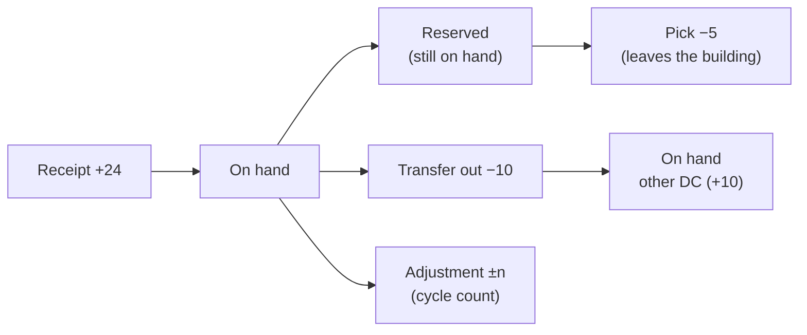
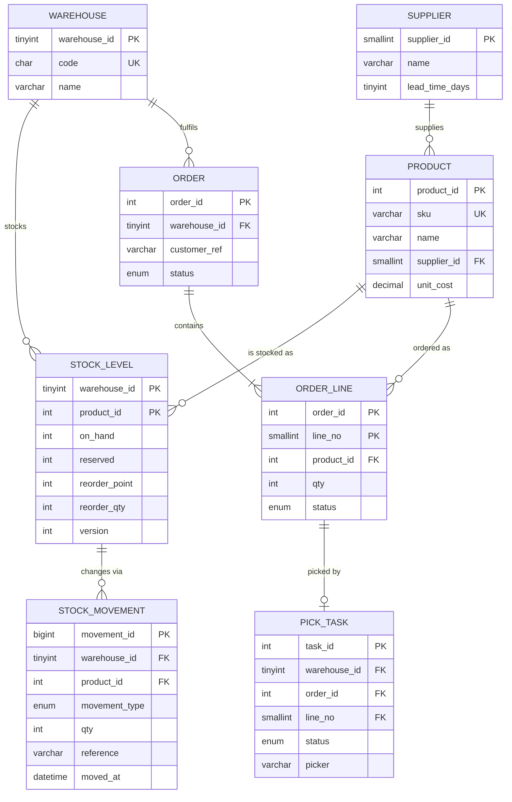
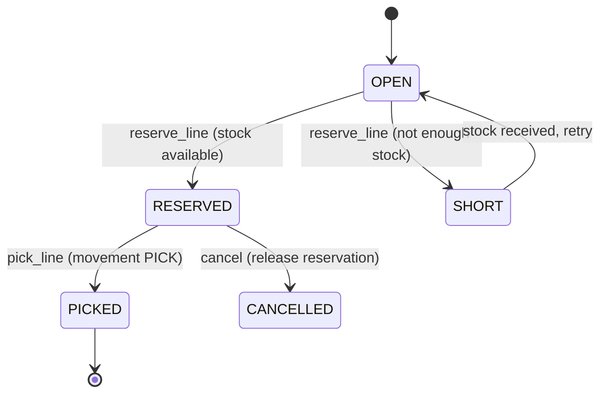

:::industry[Project brief — Cascade Industrial Supply, Operations Technology]
**Client.** Cascade Industrial Supply (fictional) distributes fasteners, tools, safety equipment and electrical parts to contractors from three distribution centres: Oakland (OAK), San Jose (SJC) and Sacramento (SAC). Stock is tracked today in a 15-year-old desktop application that stores one number per product per warehouse and overwrites it on every change. Last quarter the company shipped 212 order lines it did not have (two pickers grabbed the "last unit" at the same moment), finance could not explain a USD 48,000 inventory write-off because nobody knows *which* change produced the current number, and buyers reorder from a spreadsheet exported every Monday.

**Your job.** Design and build the database for a new **Warehouse Management System (WMS)**: products and suppliers, stock per warehouse, an auditable movement history, customer order reservations, a picking queue, replenishment reports, and the performance and operational plan that lets it run at production volume.

**Deliverables**

1. Requirements catalogue with business rules and non-functional requirements (Stage 1).
2. Entity model, ER diagram and relational schema, including the *ledger vs balance* design decision (Stages 2–5).
3. DDL with every enforceable rule declared in the database (Stages 6–7).
4. Stored procedures for reserving, picking and transferring stock, and the reorder, as-of and days-of-cover reports (Stage 8).
5. An index plan justified with `EXPLAIN`/`EXPLAIN ANALYZE` on a year of generated history (Stages 9 and 11).
6. A concurrency design that provably never oversells, and a picking queue that scales with pickers (Stage 10).
7. A privilege model, a reconciliation and validation suite, and a production plan including a month-partitioned ledger (Stages 12–14).

**Acceptance criteria**

- Every change to a quantity is a row in an append-only movement ledger; the maintained balance always equals the sum of the ledger.
- No SQL statement, from any client, can make on-hand stock negative or reserve more than is available.
- Two pickers can never both take the last unit; pickers claiming work never block one another.
- The as-of and reorder reports run with index access paths on 200,000+ movements, verified with real plans.
- Floor staff cannot see unit costs and cannot change stock except through the posting procedures.

**Estimated effort:** 20–25 hours for a learner who has completed Modules 5–8 and the indexing and optimization lessons of Module 7. The run blocks below build the system step by step in one lab; every graded exercise runs in its own fresh lab that is pre-loaded with the parts of the schema it needs (and a smaller generated history — 20 products instead of 500), so you can attempt the stages in any order.
:::

This is an **advanced** project. The domain is ordinary — every retailer, distributor and manufacturer has an inventory database — but getting it right touches almost every topic in the course: modelling events versus state, controlled redundancy, declarative constraints, triggers, transactions and locking, indexing a write-heavy table, plan analysis, and partitioning. The single question that runs through the whole project is: **how do you keep a stored number correct when many people change it at once?**

## 1. Requirements Gathering

A professional starts with the people and the artefacts, not with tables. For a WMS the stakeholders are: **warehouse operations** (receiving, picking, cycle counting), **customer service** (promising stock to customers), **purchasing** (replenishment), **finance** (inventory valuation and audit), and **IT operations** (uptime, backups, performance). Each group asks different questions of the same data, and those questions become queries, indexes and privileges later.

You collect three kinds of requirement:

- **Functional** — what the system must record and answer ("show on-hand, reserved and available stock for a SKU in every warehouse").
- **Business rules** — what must always be true ("stock can never go negative"). These are the most valuable output of requirements gathering for a database engineer, because each one becomes a constraint, a trigger or a transaction design.
- **Non-functional** — volumes, latency, concurrency, availability, retention, security, audit.

### Worked example — the requirements catalogue

After interviews with the operations manager and the finance controller, the first version of the catalogue looks like this. The last column is what makes it a *database* requirements document: every rule is traced to the mechanism that will enforce it.

| ID | Requirement | Type | Source | Enforced by |
|---|---|---|---|---|
| R1 | Track on-hand stock per product per warehouse | Functional | Operations | `stock_levels` table |
| R2 | Every quantity change is recorded with type, reference document and time; history is never edited | Business rule / audit | Finance | Append-only `stock_movements` ledger |
| BR1 | On-hand stock can never be negative | Business rule | Operations | `CHECK (on_hand >= 0)` |
| BR2 | Reserved stock cannot exceed on-hand stock; available = on-hand − reserved | Business rule | Customer service | `CHECK (reserved <= on_hand)` + atomic reservation |
| BR3 | Receipts, transfers-in and returns add stock; picks and transfers-out remove it; adjustments may do either | Business rule | Finance | `CHECK` on movement sign by type |
| BR4 | A product can only move in a warehouse that stocks it | Business rule | Operations | Composite foreign key |
| BR5 | Two pickers must never be sent for the same unit | Concurrency | Operations | Locking design (Stage 10) |
| R3 | Buyers see every SKU at or below its reorder point, with supplier and expected arrival | Report | Purchasing | Reorder query (Stage 8) |
| R4 | Finance can state the on-hand quantity of any SKU at any past month end | Report / audit | Finance | Ledger as-of query + index |
| N1 | Peak 600 movements/minute across all sites; 3 years of history online (~150 M rows at full scale) | Volume | IT | Indexing and partitioning |
| N2 | Reservation and pick confirmation < 100 ms at the 95th percentile | Latency | Operations | Short transactions, index access |

Note what R2 and BR1 imply together: if history is a ledger, *current stock is a derived value* (Stage 4). N1 says the ledger is the largest, most write-intensive table — every index on it has a cost.

:::best-practice[Interview technique for database requirements]
Ask for **examples and exceptions**, not abstractions. "Can stock ever go negative?" gets "no". "What happens when a picker finds the shelf empty but the system says 3?" gets the real process (a negative adjustment, a cycle count, a short pick), and each of those becomes a movement type. Ask finance how they *audit* a number — the answer defines your history requirements.
:::

```exercise
id: p5-ex1
title: Complete the non-functional requirements
difficulty: medium
kind: open
concepts: [requirements-analysis]
prompt: |
  The catalogue above has only two non-functional requirements. Write **five more** that a database engineer
  needs before designing this system (one each for: concurrency, availability/recovery, retention/archiving,
  security, and reporting freshness). For each, state a measurable target and the database mechanism it will
  drive. Then list **three questions** you would ask the operations manager whose answers would change the
  schema.
solution: |
  Example answers (targets are illustrative — the point is that they are measurable and traced to a mechanism):

  - **Concurrency** — up to 40 pickers per DC confirm picks simultaneously; 20 % of picks hit the top 100 SKUs.
    → Short transactions, row locks on `stock_levels` only, a SKIP LOCKED pick queue; hot-row contention tested.
  - **Availability / recovery** — RPO ≤ 1 minute, RTO ≤ 30 minutes; the DCs cannot ship without the WMS.
    → InnoDB with `innodb_flush_log_at_trx_commit=1`, binary logging, a replica for failover, tested PITR.
  - **Retention / archiving** — 3 years of movements online, 7 years archived for tax audit.
    → Ledger partitioned by month; old partitions exchanged out to an archive table / cold storage.
  - **Security** — floor staff may not see costs; nobody may edit or delete a movement; every adjustment
    records who made it. → Roles, views, `SQL SECURITY DEFINER` procedures, append-only triggers, an `entered_by` column.
  - **Reporting freshness** — buyers' reorder report may be 15 minutes stale; finance month-end must be exact.
    → Reorder report from the maintained balance or a replica; month-end from the ledger.

  Questions that change the schema:

  1. "Do you track stock by **bin location** inside a warehouse, or only per warehouse?" (adds a location entity
     and changes the balance key).
  2. "Do any products have **lots, serial numbers or expiry dates**?" (adds a lot dimension to the ledger and the
     balance; picking becomes FEFO).
  3. "Can one order be fulfilled from **several warehouses**, and can a line be **partially** picked?" (changes
     reservations from per-line to per-line-per-warehouse with quantities).
```

## 2. Entities and Relationships

From the catalogue, a first pass of nouns gives the candidate entities. A professional then sorts them into **master data** (changes rarely), **state** (current values) and **events** (things that happened), because each kind is stored, indexed and protected differently.

| Entity | Kind | Identifier | Notes |
|---|---|---|---|
| Warehouse | Master | `warehouse_id`; natural key `code` (OAK) | 3 today, maybe 10 later |
| Supplier | Master | `supplier_id` | Lead time drives the reorder report |
| Product | Master | `product_id`; natural key `sku` | One preferred supplier (v1) |
| Stock level | State (associative) | (warehouse, product) | Current on-hand, reserved, reorder policy |
| Stock movement | Event | `movement_id` | Signed quantity, type, reference document, time |
| Order | Event header | `order_id` | Fulfilled from one warehouse (v1) |
| Order line | Weak entity of Order | (order, line_no) | Product, quantity, status |
| Pick task | Work item | `task_id` | One per reserved line; claimed by a picker |

Relationships and cardinalities:

- A **warehouse** stocks many **products**, and a product is stocked in many warehouses — an M:N relationship whose associative entity, **stock level**, carries attributes (on-hand, reserved, reorder point).
- A **stock level** has many **movements**; each movement belongs to exactly one stock level. This is the key structural rule BR4: a movement references the (warehouse, product) pair, not the warehouse and product independently.
- A **supplier** supplies many products; each product has one preferred supplier.
- An **order** has 1..N **order lines** (identifying relationship — a line has no meaning without its order); each line references one product.
- Each reserved order line has at most one **pick task** (1:0..1).

### Events versus state: the decision that shapes everything

The legacy system stores only state: one number per product per warehouse. When the number is wrong nobody can say why. The new design stores **events** — every receipt, pick, transfer and adjustment as an immutable movement row. Current stock is then a *function* of the events:

> on_hand(w, p) = Σ qty over movements where warehouse = w and product = p

This is how accounting has always worked (a ledger and balances): it gives audit, as-of reporting and the ability to rebuild state after a bug — but not **fast current stock**, since summing thousands of movements per availability check is too slow for N2. Stage 4 resolves this.



A reservation does **not** move stock — the units are still on the shelf — so it is not a ledger movement; it is a claim recorded against the stock level (`reserved`) and against the order line (`status = 'RESERVED'`). Only the pick produces a movement.

```exercise
id: p5-ex2
title: Extend the model with bins and lots
difficulty: hard
kind: open
concepts: [er-modeling, weak-entities]
prompt: |
  Version 2 of the WMS must track stock by **bin location** inside each warehouse (aisle-rack-shelf codes such
  as `A-12-03`) and by **lot** for products that have an expiry date (safety gloves, adhesives). Describe the
  changes to the entity model: new entities and their identifiers (is any of them weak?), how the key of the
  stock balance changes, what a movement must now reference, and one new business rule with how you would
  enforce it. Mention one cost of the change.
solution: |
  - **Location (bin)** — a weak entity of Warehouse: identified by (warehouse_id, bin_code); attributes such as
    zone, pick sequence, capacity. In practice it is given a surrogate `location_id` with `UNIQUE (warehouse_id, bin_code)`
    so that other tables can reference it with one column.
  - **Lot** — identified by (product_id, lot_code) with `expires_on`; again often a surrogate `lot_id` with a unique
    natural key. Products without lots use a single "no lot" row or a nullable lot (a nullable column cannot be part
    of a PRIMARY KEY, so the "no lot" row is the cleaner choice).
  - **Stock balance** key becomes (location_id, product_id, lot_id). Warehouse-level stock is then an aggregate of
    bins — either computed or kept as a second maintained balance.
  - **Movement** references the balance key (location, product, lot); a warehouse transfer becomes two movements
    between bins, and a bin-to-bin "putaway" or "replenishment" movement type appears that does not change
    warehouse totals.
  - **New rule:** picking must take the earliest-expiring lot first (FEFO), and an expired lot must not be reserved.
    The expiry rule can be enforced inside the reservation procedure (`WHERE l.expires_on > p_ship_date`) — a CHECK
    cannot reference another table or the current date.
  - **Cost:** the balance table grows by a factor of (bins × lots per product), reservations must choose specific
    bins/lots (more locking and more complex procedures), and every report must aggregate over the extra levels.
```

## 3. ER Diagram

The diagram below uses crow's-foot notation (Mermaid `erDiagram`). Identifying relationships — where the child's key contains the parent's key — are drawn with solid lines; non-identifying ones are dashed.



How to read the important parts:

- `STOCK_LEVEL` is the associative entity of the WAREHOUSE–PRODUCT M:N relationship; its primary key is the pair.
- `STOCK_MOVEMENT` points at `STOCK_LEVEL`, not at WAREHOUSE and PRODUCT separately. That single design choice makes BR4 ("only move stock a warehouse carries") a foreign key instead of application logic.
- `ORDER_LINE` is a weak entity: `line_no` is only unique within its order.
- `PICK_TASK` carries a deliberate copy of `warehouse_id` for the picking-queue index; a composite foreign key keeps it consistent (Stage 7).

The order line lifecycle is a small state machine — worth drawing because each arrow is a transaction you will write:



## 4. Schema Design

Mapping the ER model to relations is mechanical; the engineering is in the **types**, **keys** and **one big decision**.

### Type and key decisions

| Decision | Choice | Why |
|---|---|---|
| Surrogate vs natural keys | Surrogate integer keys, natural keys (`sku`, `code`) as `UNIQUE` | SKUs get renamed when suppliers rebrand; integers keep foreign keys and the ledger narrow |
| Warehouse key type | `TINYINT UNSIGNED` (0–255) | It is repeated in every one of ~150 M ledger rows: 1 byte vs 4 bytes is ~450 MB at full scale, in the clustered index *and* every secondary index |
| Movement key | `BIGINT UNSIGNED AUTO_INCREMENT` | `INT UNSIGNED` (4.29 billion) is enough for decades at 600/min, but BIGINT removes the question for 4 extra bytes; ascending inserts append to the right edge of the clustered index |
| Quantity | Signed `INT`, one column | `+24` receipt, `−5` pick: the balance is a plain `SUM(qty)`. Two unsigned columns (in/out) make every report more complex |
| Money | `DECIMAL(10,2)` | Exact arithmetic for valuation |
| Movement time | `DATETIME` (not `TIMESTAMP`) | No 2038 limit; stored as written. The application writes warehouse-local or UTC consistently — a documented choice |
| Movement type | `ENUM` | Small, closed, code-driven set; one byte. A lookup table is better when users add types or types carry attributes |

### The big decision — derived balance or maintained balance?

| | **A. Derived only** (`SUM` over the ledger on demand) | **B. Maintained only** (overwrite a number, as today) | **C. Ledger + maintained balance** |
|---|---|---|---|
| Audit trail | Complete | None | Complete |
| Current stock read | O(movements) per SKU — too slow at scale | O(1) | O(1) |
| As-of history | Yes | No | Yes |
| Risk | Slow availability checks | Silent drift, no explanation | The two can disagree |
| Concurrency control | Locking a "sum" is awkward | Row lock on one row | Row lock on the balance row |

Professionals choose **C**: the ledger is the **source of truth**, `stock_levels.on_hand` is a **maintained projection** of it — controlled redundancy, introduced on purpose for performance and for a lockable row. The price is the risk named in the last row, so you must make disagreement **impossible by construction** and **detectable by test**:

1. Every movement and its balance update happen in **the same transaction** — here, in the same *statement*, because an `AFTER INSERT` trigger applies the movement to the balance.
2. **No other write path** updates `on_hand`: privileges deny direct `UPDATE` to applications (Stage 12).
3. A **reconciliation query** proves Σ ledger = balance and runs nightly (Stage 13).

`reserved` is also maintained redundancy (it equals the sum of reserved order-line quantities); the same three-part discipline applies to it.

:::note[Revise]
The trade-off between derived and stored data is the same one discussed under denormalization in [BCNF](/lessons/m06-bcnf) and the Module 6 lessons that follow it; optimistic vs pessimistic control of the balance row is [Optimistic vs Pessimistic Concurrency](/lessons/m08-optimistic-pessimistic).
:::

### Relational schema

```text
warehouses      (warehouse_id PK, code UK, name)
suppliers       (supplier_id PK, name, lead_time_days)
products        (product_id PK, sku UK, name, supplier_id FK→suppliers, unit_cost, is_active)
stock_levels    (warehouse_id FK, product_id FK, on_hand, reserved, reorder_point, reorder_qty, version,
                 PK (warehouse_id, product_id))
stock_movements (movement_id PK, (warehouse_id, product_id) FK→stock_levels, movement_type, qty, reference, moved_at)
orders          (order_id PK, warehouse_id FK, customer_ref, status, created_at, UK (order_id, warehouse_id))
order_lines     (order_id FK, line_no, product_id FK, qty, status, PK (order_id, line_no))
pick_tasks      (task_id PK, warehouse_id, (order_id, line_no) FK→order_lines,
                 (order_id, warehouse_id) FK→orders, status, picker, claimed_at)
```

## 5. Normalization

Normalization theory reasons about **functional dependencies within one relation**. It is worth applying in two directions here: to the legacy data (to see why it breaks) and to the new schema (to classify the redundancy we chose).

### The legacy export

The current system exports one wide sheet. Load a few rows of it:

```sql run
CREATE TABLE legacy_stock_sheet (
  warehouse_code  CHAR(3),
  warehouse_name  VARCHAR(60),
  sku             VARCHAR(20),
  product_name    VARCHAR(100),
  supplier_name   VARCHAR(80),
  lead_time_days  TINYINT,
  qty             INT,
  reorder_point   INT
);
INSERT INTO legacy_stock_sheet VALUES
  ('OAK', 'Oakland DC',  'BOLT-M8', 'M8 hex bolt (100)', 'Bayline Fasteners', 5, 140, 60),
  ('SJC', 'San Jose DC', 'BOLT-M8', 'M8 hex bolt (100)', 'Bayline Fasteners', 5,  35, 60),
  ('OAK', 'Oakland DC',  'NUT-M8',  'M8 nut (100)',      'Bayline Fasteners', 7, 410, 80),
  ('SJC', 'San Jose',    'DRILL-18','18V drill',         'Sierra Tools',     12,   4, 10);
SELECT supplier_name, COUNT(DISTINCT lead_time_days) AS lead_times_recorded,
       GROUP_CONCAT(DISTINCT lead_time_days ORDER BY lead_time_days) AS values_seen
FROM legacy_stock_sheet
GROUP BY supplier_name
ORDER BY supplier_name;
```

Bayline's lead time is recorded with two values — an **update anomaly**: lead time depends on the supplier, but it is stored once per stock row, so one change must be repeated in many rows and someone missed one. The same sheet shows "San Jose DC" and "San Jose" for one warehouse. Write the functional dependencies down and let the analyser find the keys and the decomposition:

```viz
type: fd
attributes: [warehouse_code, warehouse_name, sku, product_name, supplier_name, lead_time_days, qty, reorder_point]
fds:
  - "warehouse_code -> warehouse_name"
  - "sku -> product_name, supplier_name"
  - "supplier_name -> lead_time_days"
  - "warehouse_code, sku -> qty, reorder_point"
```

The only candidate key is {warehouse_code, sku}. `warehouse_name` and `product_name` depend on *part* of the key (a 2NF violation), and `lead_time_days` depends on the key only transitively through `supplier_name` (a 3NF violation). The BCNF decomposition produces exactly the master tables of our schema — warehouses, products, suppliers — plus a (warehouse, product) relation holding quantity and policy: `stock_levels`.

### Classifying the redundancy in the new schema

Every table in the new schema is in BCNF: in `stock_levels`, the only non-trivial dependencies are (warehouse_id, product_id) → on_hand, reserved, reorder_point, reorder_qty, version, and the determinant is the key. So where is the redundancy? It is **between** relations: `on_hand` is derivable from `stock_movements` by aggregation, and `reserved` from `order_lines`. Classical normal forms do not see such inter-relation, aggregate redundancy at all — which is why passing BCNF is not the same as "no redundancy", and why derived data needs the explicit consistency mechanisms of Stage 4.

:::note[Revise]
Attribute closure, candidate keys and the BCNF decomposition algorithm are covered in [Boyce–Codd Normal Form](/lessons/m06-bcnf).
:::

```exercise
id: p5-ex3
title: Design review — is the price snapshot a normalization violation?
difficulty: medium
kind: open
concepts: [normalization, functional-dependencies]
prompt: |
  A colleague proposes adding `unit_cost DECIMAL(10,2)` to `stock_movements`, filled with the product's cost
  at the moment of the movement. A reviewer objects: "unit_cost depends on product_id, so this violates 3NF —
  read it from `products`." Who is right? Answer in terms of functional dependencies, explain what finance
  would lose under the reviewer's design, and state the one condition under which the reviewer would be right.
solution: |
  The colleague is right. The FD the reviewer assumes, product_id → unit_cost, holds in `products` for the
  **current** cost, but it does not hold in `stock_movements`: the same product moves at different costs over time
  (cost changes when the supplier raises prices), so two movement rows with the same product_id can legitimately
  have different unit_cost values. The value is a fact about the **movement** (movement_id → unit_cost) — a
  historical snapshot — and the table stays in BCNF.

  With the reviewer's design, finance could only value historical movements at today's cost, so inventory
  valuation and cost of goods sold for past periods would silently change whenever a cost is updated — exactly
  the unexplained write-off problem the project is meant to fix.

  The reviewer would be right only if the business rule were "cost never changes" or "we always value at current
  cost" — then movement_id → unit_cost would be implied by product_id → unit_cost and the column would be true
  redundancy (an update anomaly waiting to happen).
```

## 6. MySQL Table Creation

Create the tables in dependency order (parents first). Read each `CREATE TABLE` against the schema in Stage 4 — every key, unique constraint and foreign key is a requirement from Stage 1. `CHECK` constraints and the trigger come in Stage 7, so you can see what each one adds.

```sql run
CREATE TABLE warehouses (
  warehouse_id  TINYINT UNSIGNED NOT NULL,
  code          CHAR(3)     NOT NULL,
  name          VARCHAR(60) NOT NULL,
  PRIMARY KEY (warehouse_id),
  UNIQUE KEY uq_warehouses_code (code)
);
CREATE TABLE suppliers (
  supplier_id     SMALLINT UNSIGNED NOT NULL,
  name            VARCHAR(80) NOT NULL,
  lead_time_days  TINYINT UNSIGNED NOT NULL,
  PRIMARY KEY (supplier_id),
  CONSTRAINT chk_suppliers_lead CHECK (lead_time_days BETWEEN 1 AND 120)
);
CREATE TABLE products (
  product_id   INT UNSIGNED NOT NULL,
  sku          VARCHAR(20)  NOT NULL,
  name         VARCHAR(100) NOT NULL,
  supplier_id  SMALLINT UNSIGNED NOT NULL,
  unit_cost    DECIMAL(10,2) NOT NULL,
  is_active    BOOLEAN NOT NULL DEFAULT TRUE,
  PRIMARY KEY (product_id),
  UNIQUE KEY uq_products_sku (sku),
  CONSTRAINT fk_products_supplier FOREIGN KEY (supplier_id) REFERENCES suppliers (supplier_id),
  CONSTRAINT chk_products_cost CHECK (unit_cost >= 0)
);
CREATE TABLE stock_levels (
  warehouse_id   TINYINT UNSIGNED NOT NULL,
  product_id     INT UNSIGNED NOT NULL,
  on_hand        INT NOT NULL DEFAULT 0,
  reserved       INT NOT NULL DEFAULT 0,
  reorder_point  INT NOT NULL DEFAULT 0,
  reorder_qty    INT NOT NULL DEFAULT 0,
  version        INT UNSIGNED NOT NULL DEFAULT 0,
  PRIMARY KEY (warehouse_id, product_id),
  KEY idx_stock_levels_product (product_id),
  CONSTRAINT fk_stock_levels_warehouse FOREIGN KEY (warehouse_id) REFERENCES warehouses (warehouse_id),
  CONSTRAINT fk_stock_levels_product   FOREIGN KEY (product_id)   REFERENCES products (product_id)
);
CREATE TABLE stock_movements (
  movement_id    BIGINT UNSIGNED NOT NULL AUTO_INCREMENT,
  warehouse_id   TINYINT UNSIGNED NOT NULL,
  product_id     INT UNSIGNED NOT NULL,
  movement_type  ENUM('RECEIPT','PICK','ADJUST','TRANSFER_IN','TRANSFER_OUT','RETURN') NOT NULL,
  qty            INT NOT NULL,
  reference      VARCHAR(30) NOT NULL,
  moved_at       DATETIME NOT NULL,
  PRIMARY KEY (movement_id),
  CONSTRAINT fk_movements_stock FOREIGN KEY (warehouse_id, product_id)
    REFERENCES stock_levels (warehouse_id, product_id)
);
CREATE TABLE orders (
  order_id      INT UNSIGNED NOT NULL AUTO_INCREMENT,
  warehouse_id  TINYINT UNSIGNED NOT NULL,
  customer_ref  VARCHAR(30) NOT NULL,
  status        ENUM('OPEN','RELEASED','SHIPPED','CANCELLED') NOT NULL DEFAULT 'OPEN',
  created_at    DATETIME NOT NULL,
  PRIMARY KEY (order_id),
  UNIQUE KEY uq_orders_id_warehouse (order_id, warehouse_id),
  CONSTRAINT fk_orders_warehouse FOREIGN KEY (warehouse_id) REFERENCES warehouses (warehouse_id)
);
CREATE TABLE order_lines (
  order_id    INT UNSIGNED NOT NULL,
  line_no     SMALLINT UNSIGNED NOT NULL,
  product_id  INT UNSIGNED NOT NULL,
  qty         INT NOT NULL,
  status      ENUM('OPEN','RESERVED','PICKED','SHORT','CANCELLED') NOT NULL DEFAULT 'OPEN',
  PRIMARY KEY (order_id, line_no),
  CONSTRAINT fk_lines_order   FOREIGN KEY (order_id)   REFERENCES orders (order_id),
  CONSTRAINT fk_lines_product FOREIGN KEY (product_id) REFERENCES products (product_id),
  CONSTRAINT chk_lines_qty CHECK (qty > 0)
);
CREATE TABLE pick_tasks (
  task_id       INT UNSIGNED NOT NULL AUTO_INCREMENT,
  warehouse_id  TINYINT UNSIGNED NOT NULL,
  order_id      INT UNSIGNED NOT NULL,
  line_no       SMALLINT UNSIGNED NOT NULL,
  status        ENUM('OPEN','CLAIMED','DONE') NOT NULL DEFAULT 'OPEN',
  picker        VARCHAR(30) NULL,
  claimed_at    DATETIME NULL,
  PRIMARY KEY (task_id),
  UNIQUE KEY uq_pick_tasks_line (order_id, line_no),
  KEY idx_pick_tasks_queue (warehouse_id, status, task_id),
  CONSTRAINT fk_tasks_line     FOREIGN KEY (order_id, line_no)      REFERENCES order_lines (order_id, line_no),
  CONSTRAINT fk_tasks_order_wh FOREIGN KEY (order_id, warehouse_id) REFERENCES orders (order_id, warehouse_id)
);
```

Inspect the relationship graph the database now enforces — this is the ER diagram as the server sees it:

```sql run
SELECT table_name, constraint_name,
       GROUP_CONCAT(column_name ORDER BY ordinal_position) AS fk_columns,
       referenced_table_name AS parent
FROM information_schema.key_column_usage
WHERE table_schema = DATABASE() AND referenced_table_name IS NOT NULL
GROUP BY table_name, constraint_name, referenced_table_name
ORDER BY table_name, constraint_name;
```

:::mysql[Foreign keys need indexes]
InnoDB requires an index on the referencing columns of every foreign key (with the FK columns as its leftmost prefix) and creates one automatically if none exists. `fk_movements_stock` therefore got an index on `stock_movements (warehouse_id, product_id)` named after the constraint, and `fk_tasks_order_wh` one on `pick_tasks (order_id, warehouse_id)`. On the ledger, that automatic index is a real write cost — Stage 9 decides whether it earns its place.
:::

```exercise
id: p5-ex4
title: Create the inter-warehouse transfer table
difficulty: medium
kind: dml
concepts: [schema-design, check-constraints, foreign-keys]
setup: |
  CREATE TABLE warehouses (warehouse_id TINYINT UNSIGNED PRIMARY KEY, code CHAR(3) NOT NULL UNIQUE, name VARCHAR(60) NOT NULL);
  INSERT INTO warehouses VALUES (1,'OAK','Oakland DC'),(2,'SJC','San Jose DC'),(3,'SAC','Sacramento DC');
  CREATE TABLE products (product_id INT UNSIGNED PRIMARY KEY, sku VARCHAR(20) NOT NULL UNIQUE, name VARCHAR(100) NOT NULL);
  INSERT INTO products VALUES (1,'BOLT-M8','M8 hex bolt'),(2,'DRILL-18V','18V drill');
prompt: |
  Transfers between distribution centres are requested, shipped and received on different days, so each
  transfer needs a header row. Create a table **`transfers`** with:

  | column | type / rule |
  |---|---|
  | `transfer_id` | `INT UNSIGNED`, auto-increment primary key |
  | `from_warehouse_id` | `TINYINT UNSIGNED NOT NULL`, references `warehouses` |
  | `to_warehouse_id` | `TINYINT UNSIGNED NOT NULL`, references `warehouses` |
  | `product_id` | `INT UNSIGNED NOT NULL`, references `products` |
  | `qty` | `INT NOT NULL`, must be greater than 0 |
  | `status` | `ENUM('REQUESTED','SHIPPED','RECEIVED','CANCELLED') NOT NULL`, default `'REQUESTED'` |
  | `requested_at` | `DATETIME NOT NULL` |

  A transfer from a warehouse to itself must be rejected by the database. The grader inserts a mix of valid
  and invalid rows with `INSERT IGNORE` (which turns constraint violations into warnings and skips the row)
  and compares which rows survive.
hints:
  - "A CHECK constraint may compare two columns of the same row: CHECK (from_warehouse_id <> to_warehouse_id)."
  - "You need two separate foreign keys to warehouses — one per column — each with its own name."
solution: |
  CREATE TABLE transfers (
    transfer_id        INT UNSIGNED NOT NULL AUTO_INCREMENT,
    from_warehouse_id  TINYINT UNSIGNED NOT NULL,
    to_warehouse_id    TINYINT UNSIGNED NOT NULL,
    product_id         INT UNSIGNED NOT NULL,
    qty                INT NOT NULL,
    status             ENUM('REQUESTED','SHIPPED','RECEIVED','CANCELLED') NOT NULL DEFAULT 'REQUESTED',
    requested_at       DATETIME NOT NULL,
    PRIMARY KEY (transfer_id),
    CONSTRAINT fk_transfers_from    FOREIGN KEY (from_warehouse_id) REFERENCES warehouses (warehouse_id),
    CONSTRAINT fk_transfers_to      FOREIGN KEY (to_warehouse_id)   REFERENCES warehouses (warehouse_id),
    CONSTRAINT fk_transfers_product FOREIGN KEY (product_id)        REFERENCES products (product_id),
    CONSTRAINT chk_transfers_qty    CHECK (qty > 0),
    CONSTRAINT chk_transfers_route  CHECK (from_warehouse_id <> to_warehouse_id)
  );
check: |
  INSERT IGNORE INTO transfers (from_warehouse_id, to_warehouse_id, product_id, qty, requested_at) VALUES
    (1, 2, 1, 10, '2026-01-05 09:00:00'),
    (2, 2, 1, 10, '2026-01-05 09:00:00'),
    (1, 3, 2,  0, '2026-01-05 09:00:00'),
    (1, 9, 1,  5, '2026-01-05 09:00:00'),
    (3, 1, 7,  5, '2026-01-05 09:00:00'),
    (3, 1, 2,  4, '2026-01-05 09:00:00');
  SELECT from_warehouse_id, to_warehouse_id, product_id, qty, status
  FROM transfers ORDER BY from_warehouse_id, to_warehouse_id, product_id;
explanation: |
  Only the two valid transfers survive (1→2 of product 1, and 3→1 of product 2), each with the default status
  `REQUESTED`. The rejected rows test each rule: same-warehouse route, non-positive quantity, unknown warehouse 9
  and unknown product 7. A common miss is the route rule — without `chk_transfers_route` the 2→2 row is stored
  and would later produce a TRANSFER_OUT and TRANSFER_IN that cancel out while inflating activity reports.
  Note that `INSERT IGNORE` is used here only as a testing device; in application code it hides real errors.
```

## 7. Constraints and Relationships

Now declare the rules from Stage 1 that are not yet in the DDL. The goal is that **no client — not the application, not a DBA's ad-hoc script — can store a state that violates a business rule.**

```sql run
ALTER TABLE stock_levels
  ADD CONSTRAINT chk_stock_on_hand  CHECK (on_hand >= 0),
  ADD CONSTRAINT chk_stock_reserved CHECK (reserved >= 0 AND reserved <= on_hand),
  ADD CONSTRAINT chk_stock_policy   CHECK (reorder_point >= 0 AND reorder_qty >= 0);
ALTER TABLE stock_movements
  ADD CONSTRAINT chk_movements_qty  CHECK (qty <> 0),
  ADD CONSTRAINT chk_movements_sign CHECK (
       (movement_type IN ('RECEIPT', 'TRANSFER_IN', 'RETURN') AND qty > 0)
    OR (movement_type IN ('PICK', 'TRANSFER_OUT') AND qty < 0)
    OR  movement_type = 'ADJUST');
CREATE TRIGGER trg_movements_apply
AFTER INSERT ON stock_movements
FOR EACH ROW
  UPDATE stock_levels
  SET on_hand = on_hand + NEW.qty,
      version = version + 1
  WHERE warehouse_id = NEW.warehouse_id AND product_id = NEW.product_id;
```

How the pieces cooperate:

- `chk_movements_sign` implements BR3 row by row.
- The trigger applies every movement to its balance **inside the same statement**. If the resulting balance violates `chk_stock_on_hand` or `chk_stock_reserved`, the trigger's `UPDATE` fails, and because a trigger error fails the triggering statement, InnoDB rolls back **the movement insert too**. The ledger and the balance cannot diverge, whichever client writes.
- `fk_movements_stock` guarantees the trigger always finds exactly one balance row to update (BR4), so the trigger never needs an "insert if missing" branch.

### Load a year of history — through the rules

Because the rules are in place, the generated history goes through exactly the same checks as production traffic. The data: 3 warehouses, 4 suppliers, 500 products, 1,500 stock levels with reorder points between 40 and 150, an opening adjustment of 60 units per stock level, then 200,000 movements spread over 2025 — every 10th a receipt of 24 units, the rest picks of 1–3 units. The arithmetic is deterministic (no `RAND()`), so your lab produces identical numbers.

```sql run
SET SESSION cte_max_recursion_depth = 200000;
INSERT INTO warehouses VALUES (1, 'OAK', 'Oakland DC'), (2, 'SJC', 'San Jose DC'), (3, 'SAC', 'Sacramento DC');
INSERT INTO suppliers VALUES (1, 'Bayline Fasteners', 5), (2, 'Sierra Tools', 12),
                             (3, 'Pacific Safety', 8), (4, 'Redwood Electric', 21);
INSERT INTO products (product_id, sku, name, supplier_id, unit_cost)
WITH RECURSIVE s(n) AS (SELECT 1 UNION ALL SELECT n + 1 FROM s WHERE n < 500)
SELECT n, CONCAT('SKU-', LPAD(n, 5, '0')),
       CONCAT(ELT(1 + n % 5, 'Hex bolt', 'Drill bit', 'Safety glove', 'Cable tie', 'LED lamp'), ' #', n),
       1 + n % 4, 2.50 + (n * 37) % 200
FROM s;
INSERT INTO stock_levels (warehouse_id, product_id, reorder_point, reorder_qty)
SELECT w.warehouse_id, p.product_id, 40 + (p.product_id % 12) * 10, 200
FROM warehouses w CROSS JOIN products p;
INSERT INTO stock_movements (warehouse_id, product_id, movement_type, qty, reference, moved_at)
SELECT w.warehouse_id, p.product_id, 'ADJUST', 60, 'OPENING', '2025-01-01 00:00:00'
FROM warehouses w CROSS JOIN products p;
```

```sql run
INSERT INTO stock_movements (warehouse_id, product_id, movement_type, qty, reference, moved_at)
WITH RECURSIVE s(n) AS (SELECT 1 UNION ALL SELECT n + 1 FROM s WHERE n < 100000)
SELECT IF(n % 10 = 0, 1 + (n DIV 10) % 3, 1 + n % 3),
       IF(n % 10 = 0, 1 + ((n DIV 10) * 261) % 500, 1 + (n * 261) % 500),
       IF(n % 10 = 0, 'RECEIPT', 'PICK'),
       IF(n % 10 = 0, 24, -(1 + (n DIV 7) % 3)),
       CONCAT('DOC-', n),
       '2025-01-01 06:00:00' + INTERVAL n * 157 SECOND
FROM s;
```

```sql run
INSERT INTO stock_movements (warehouse_id, product_id, movement_type, qty, reference, moved_at)
WITH RECURSIVE s(n) AS (SELECT 100001 UNION ALL SELECT n + 1 FROM s WHERE n < 200000)
SELECT IF(n % 10 = 0, 1 + (n DIV 10) % 3, 1 + n % 3),
       IF(n % 10 = 0, 1 + ((n DIV 10) * 261) % 500, 1 + (n * 261) % 500),
       IF(n % 10 = 0, 'RECEIPT', 'PICK'),
       IF(n % 10 = 0, 24, -(1 + (n DIV 7) % 3)),
       CONCAT('DOC-', n),
       '2025-01-01 06:00:00' + INTERVAL n * 157 SECOND
FROM s;
SELECT COUNT(*) AS movements, MIN(moved_at) AS first_movement, MAX(moved_at) AS last_movement,
       SUM(qty) AS net_units
FROM stock_movements;
SELECT MIN(on_hand) AS min_on_hand, MAX(on_hand) AS max_on_hand, SUM(on_hand) AS total_on_hand,
       SUM(version) AS balance_updates
FROM stock_levels;
```

Every one of the 201,500 movements fired the trigger once — `SUM(version)` counts those balance updates — and total on-hand equals the ledger's net units. The load is split into two statements to stay well under the sandbox's 10-second limit; production bulk loads are batched the same way to keep transactions and undo small.

### Prove the rules

A constraint you have not seen fail is a constraint you have not tested. First, pick more than is on the shelf:

```sql run error
INSERT INTO stock_movements (warehouse_id, product_id, movement_type, qty, reference, moved_at)
VALUES (1, 42, 'PICK', -100000, 'ORD-TEST', '2026-01-02 09:00:00');
```

The movement satisfied its own checks; the trigger's balance update violated `chk_stock_on_hand`, so the whole insert was rolled back. A receipt with a negative quantity fails on the ledger's own rule:

```sql run error
INSERT INTO stock_movements (warehouse_id, product_id, movement_type, qty, reference, moved_at)
VALUES (1, 42, 'RECEIPT', -5, 'PO-TEST', '2026-01-02 09:00:00');
```

A new product that no warehouse stocks yet cannot move anywhere until a stock level is created for it:

```sql run
INSERT INTO products (product_id, sku, name, supplier_id, unit_cost)
VALUES (501, 'SKU-00501', 'Torque wrench #501', 2, 64.00);
```

```sql run error
INSERT INTO stock_movements (warehouse_id, product_id, movement_type, qty, reference, moved_at)
VALUES (1, 501, 'RECEIPT', 10, 'PO-7781', '2026-01-02 09:00:00');
```

Finally, verify nothing leaked from the three failed statements — the balance of product 42 in OAK must still equal its ledger:

```sql run
SELECT s.on_hand,
       (SELECT SUM(qty) FROM stock_movements m
        WHERE m.warehouse_id = 1 AND m.product_id = 42) AS ledger_on_hand,
       s.version
FROM stock_levels s
WHERE s.warehouse_id = 1 AND s.product_id = 42;
```

### Two MySQL gotchas you would hit with other trigger designs

**Gotcha 1 — `CHECK` is evaluated on the row you *try* to insert, before `ON DUPLICATE KEY UPDATE`.** A popular alternative trigger body is an "upsert": `INSERT INTO stock_levels … VALUES (w, p, NEW.qty) ON DUPLICATE KEY UPDATE on_hand = on_hand + NEW.qty`. For a pick, `NEW.qty` is negative, and the candidate row fails `chk_stock_on_hand` even though the row exists and the update would be fine:

```sql run error
INSERT INTO stock_levels (warehouse_id, product_id, on_hand)
VALUES (1, 42, -1)
ON DUPLICATE KEY UPDATE on_hand = on_hand - 1;
```

Our design avoids the upsert entirely: the composite foreign key guarantees the balance row exists, so a plain `UPDATE` suffices.

**Gotcha 2 — a trigger cannot modify a table the triggering statement reads.** A cycle-count script that computes adjustments with `INSERT INTO stock_movements … SELECT … FROM stock_levels` fails, because the trigger then updates `stock_levels` while the statement is still reading it:

```sql run error
INSERT INTO stock_movements (warehouse_id, product_id, movement_type, qty, reference, moved_at)
SELECT warehouse_id, product_id, 'ADJUST', 1, 'COUNT-FIX', '2026-01-02 08:00:00'
FROM stock_levels
WHERE warehouse_id = 1 AND product_id = 42;
```

The fix is to materialize the input first (a temporary table, or the application sending explicit rows). The same restriction is why the opening balances above were generated from `warehouses CROSS JOIN products` rather than from `stock_levels`.

:::warning[What CHECK constraints cannot do]
A `CHECK` sees only the row being written: it cannot reference another table, call a stored function, or use non-deterministic functions such as `NOW()`. Rules that span tables ("an order line's product must be stocked in the order's warehouse") need a composite foreign key if the data model allows one, otherwise a trigger or the posting procedure. And remember that MySQL ignored `CHECK` clauses entirely before 8.0.16 — on an old server they parse and do nothing.
:::

The composite foreign key `fk_tasks_order_wh` is another cross-table rule turned into a declaration: a pick task's copied `warehouse_id` must match its order's warehouse, because the pair (order_id, warehouse_id) must exist in `orders`. That is why `orders` carries the otherwise redundant `UNIQUE (order_id, warehouse_id)` — a foreign key must reference a key.

```exercise
id: p5-ex5
title: Make the ledger append-only
difficulty: medium
kind: dml
concepts: [triggers, audit]
setup: |
  CREATE TABLE stock_movements (movement_id BIGINT UNSIGNED AUTO_INCREMENT PRIMARY KEY, warehouse_id TINYINT UNSIGNED NOT NULL, product_id INT UNSIGNED NOT NULL, movement_type ENUM('RECEIPT','PICK','ADJUST','TRANSFER_IN','TRANSFER_OUT','RETURN') NOT NULL, qty INT NOT NULL, reference VARCHAR(30) NOT NULL, moved_at DATETIME NOT NULL);
  INSERT INTO stock_movements (warehouse_id, product_id, movement_type, qty, reference, moved_at) VALUES (1, 1, 'RECEIPT', 24, 'PO-1', '2025-03-01 08:00:00'), (1, 1, 'PICK', -2, 'ORD-9', '2025-03-02 10:00:00');
prompt: |
  Finance requires that a movement, once written, is never changed or removed: a mistake is corrected with a
  new compensating `ADJUST` movement. Enforce this in the database with two triggers on `stock_movements`:

  - `trg_movements_no_update` — `BEFORE UPDATE`, rejects every update
  - `trg_movements_no_delete` — `BEFORE DELETE`, rejects every delete

  Both must raise `SQLSTATE '45000'` with a message of your choice. The grader inspects
  `information_schema.TRIGGERS` (name, timing, event, and whether the body signals `45000`) and also counts the
  rows of the ledger.
hints:
  - "A trigger body can be a single statement: SIGNAL SQLSTATE '45000' SET MESSAGE_TEXT = '…'."
  - "Use FOR EACH ROW. No BEGIN … END is needed for a one-statement body."
solution: |
  CREATE TRIGGER trg_movements_no_update BEFORE UPDATE ON stock_movements
  FOR EACH ROW SIGNAL SQLSTATE '45000' SET MESSAGE_TEXT = 'stock_movements is append-only: post an ADJUST movement';
  CREATE TRIGGER trg_movements_no_delete BEFORE DELETE ON stock_movements
  FOR EACH ROW SIGNAL SQLSTATE '45000' SET MESSAGE_TEXT = 'stock_movements is append-only: post an ADJUST movement';
check: |
  SELECT trigger_name, action_timing, event_manipulation,
         action_statement LIKE '%45000%' AS signals_45000,
         (SELECT COUNT(*) FROM stock_movements) AS ledger_rows
  FROM information_schema.triggers
  WHERE trigger_schema = DATABASE() AND event_object_table = 'stock_movements'
  ORDER BY trigger_name;
explanation: |
  Triggers apply to every client, which is what "append-only" needs. Two limits are worth knowing:
  `TRUNCATE TABLE` and `DROP TABLE` do not fire DELETE triggers, so the privilege model (Stage 12) must also deny
  `DROP` to applications; and a DBA with `TRIGGER` privilege can drop the trigger. Defence in depth is therefore
  triggers **plus** privileges **plus** binary-log retention for forensic recovery. Updating via `REPLACE` or
  `INSERT … ON DUPLICATE KEY UPDATE` is also caught, because those fire DELETE/UPDATE triggers when they hit an
  existing row.
```

## 8. SQL Implementation

The application never writes `stock_levels` directly. Every business operation is a **posting procedure** that runs inside a transaction started by the caller, so that a multi-line order can be reserved atomically. A professional writes these procedures around three habits: lock or conditionally update the *balance row first*, keep the transaction short, and make every outcome explicit (an OUT parameter or a `SIGNAL`, never a silent no-op).

### Reserve a line — the atomic conditional update

```sql run
CREATE PROCEDURE reserve_line(IN p_order_id INT UNSIGNED, IN p_line_no SMALLINT UNSIGNED,
                              OUT p_result VARCHAR(10))
BEGIN
  DECLARE v_wh TINYINT UNSIGNED;
  DECLARE v_product INT UNSIGNED;
  DECLARE v_qty INT;
  SELECT o.warehouse_id, l.product_id, l.qty INTO v_wh, v_product, v_qty
  FROM order_lines l JOIN orders o ON o.order_id = l.order_id
  WHERE l.order_id = p_order_id AND l.line_no = p_line_no AND l.status = 'OPEN'
  FOR UPDATE;
  IF v_wh IS NULL THEN
    SIGNAL SQLSTATE '45000' SET MESSAGE_TEXT = 'order line not found or not OPEN';
  END IF;
  UPDATE stock_levels
  SET reserved = reserved + v_qty, version = version + 1
  WHERE warehouse_id = v_wh AND product_id = v_product
    AND on_hand - reserved >= v_qty;
  IF ROW_COUNT() = 1 THEN
    UPDATE order_lines SET status = 'RESERVED' WHERE order_id = p_order_id AND line_no = p_line_no;
    INSERT INTO pick_tasks (warehouse_id, order_id, line_no) VALUES (v_wh, p_order_id, p_line_no);
    SET p_result = 'RESERVED';
  ELSE
    UPDATE order_lines SET status = 'SHORT' WHERE order_id = p_order_id AND line_no = p_line_no;
    SET p_result = 'SHORT';
  END IF;
END
```

The heart of it is one statement: `UPDATE … SET reserved = reserved + q WHERE … AND on_hand - reserved >= q`. The availability test and the change happen **atomically under the row's exclusive lock**, so there is no window between "check" and "act" for another session to slip into. `ROW_COUNT()` tells the procedure which branch it is in. Stage 10 shows this under real concurrency.

### Pick a line — order of statements matters

```sql run
CREATE PROCEDURE pick_line(IN p_order_id INT UNSIGNED, IN p_line_no SMALLINT UNSIGNED,
                           IN p_picked_at DATETIME)
BEGIN
  DECLARE v_wh TINYINT UNSIGNED;
  DECLARE v_product INT UNSIGNED;
  DECLARE v_qty INT;
  SELECT o.warehouse_id, l.product_id, l.qty INTO v_wh, v_product, v_qty
  FROM order_lines l JOIN orders o ON o.order_id = l.order_id
  WHERE l.order_id = p_order_id AND l.line_no = p_line_no AND l.status = 'RESERVED'
  FOR UPDATE;
  IF v_wh IS NULL THEN
    SIGNAL SQLSTATE '45000' SET MESSAGE_TEXT = 'order line not found or not RESERVED';
  END IF;
  UPDATE stock_levels SET reserved = reserved - v_qty
  WHERE warehouse_id = v_wh AND product_id = v_product;
  INSERT INTO stock_movements (warehouse_id, product_id, movement_type, qty, reference, moved_at)
  VALUES (v_wh, v_product, 'PICK', -v_qty, CONCAT('ORD-', p_order_id, '/', p_line_no), p_picked_at);
  UPDATE order_lines SET status = 'PICKED' WHERE order_id = p_order_id AND line_no = p_line_no;
  UPDATE pick_tasks SET status = 'DONE' WHERE order_id = p_order_id AND line_no = p_line_no;
END
```

Why is the reservation released **before** the movement is posted? MySQL checks constraints after **each statement**, not at commit (there are no deferred constraints). If the last 5 units are reserved (on_hand 5, reserved 5) and the movement went first, the trigger would set on_hand to 0 while reserved is still 5 and `chk_stock_reserved` would fire. Releasing first gives on_hand 5, reserved 0, then on_hand 0, reserved 0 — valid after every statement.

Now run the business process. Two orders arrive at OAK; order 2 asks for far more than exists:

```sql run
INSERT INTO orders (order_id, warehouse_id, customer_ref, created_at)
VALUES (1, 1, 'CUST-0042', '2026-01-02 08:15:00'), (2, 1, 'CUST-0077', '2026-01-02 08:20:00');
INSERT INTO order_lines (order_id, line_no, product_id, qty)
VALUES (1, 1, 42, 5), (1, 2, 43, 2), (2, 1, 44, 5000);
START TRANSACTION;
CALL reserve_line(1, 1, @r11);
CALL reserve_line(1, 2, @r12);
CALL reserve_line(2, 1, @r21);
COMMIT;
SELECT @r11, @r12, @r21;
SELECT product_id, on_hand, reserved, on_hand - reserved AS available, version
FROM stock_levels WHERE warehouse_id = 1 AND product_id IN (42, 43, 44) ORDER BY product_id;
```

Pick line 1 of order 1, then look at the trail it leaves:

```sql run
START TRANSACTION;
CALL pick_line(1, 1, '2026-01-02 10:05:00');
COMMIT;
SELECT movement_id, movement_type, qty, reference, moved_at
FROM stock_movements WHERE warehouse_id = 1 AND product_id = 42
ORDER BY movement_id DESC LIMIT 3;
SELECT l.order_id, l.line_no, l.status AS line_status, t.task_id, t.status AS task_status
FROM order_lines l LEFT JOIN pick_tasks t ON t.order_id = l.order_id AND t.line_no = l.line_no
ORDER BY l.order_id, l.line_no;
```

Product 42 is back to zero reserved, its on-hand fell by 5, and the ledger explains why with a reference to the order line. Order 2's line is `SHORT` and has no pick task.

### Reports

**Stock position for one SKU across the network** — the most frequent customer-service query, answered from the maintained balance:

```sql run
SELECT w.code AS warehouse, p.sku, s.on_hand, s.reserved, s.on_hand - s.reserved AS available
FROM stock_levels s
JOIN warehouses w ON w.warehouse_id = s.warehouse_id
JOIN products p   ON p.product_id = s.product_id
WHERE p.sku = 'SKU-00043'
ORDER BY w.code;
```

**As-of stock from the ledger** — finance's month-end question. Only the ledger can answer it:

```sql run
SELECT w.code AS warehouse, SUM(m.qty) AS on_hand_at_june_end
FROM stock_movements m
JOIN warehouses w ON w.warehouse_id = m.warehouse_id
WHERE m.product_id = 42 AND m.moved_at < '2025-07-01'
GROUP BY w.code
ORDER BY w.code;
```

**How many stock levels are at or below their reorder point**, per warehouse — the headline number for purchasing:

```sql run
SELECT w.code AS warehouse,
       COUNT(*) AS stocked_skus,
       SUM(s.on_hand - s.reserved <= s.reorder_point) AS at_or_below_reorder_point
FROM stock_levels s JOIN warehouses w ON w.warehouse_id = s.warehouse_id
GROUP BY w.code
ORDER BY w.code;
```

The buyers' full reorder report, the month-end trend and days-of-cover are yours to build.

```exercise
id: p5-ex6
title: The reorder report
difficulty: medium
concepts: [joins, derived-data, reporting]
setup: |
  CREATE TABLE warehouses (warehouse_id TINYINT UNSIGNED PRIMARY KEY, code CHAR(3) NOT NULL UNIQUE, name VARCHAR(60) NOT NULL);
  INSERT INTO warehouses VALUES (1,'OAK','Oakland DC'),(2,'SJC','San Jose DC'),(3,'SAC','Sacramento DC');
  CREATE TABLE suppliers (supplier_id SMALLINT UNSIGNED PRIMARY KEY, name VARCHAR(80) NOT NULL, lead_time_days TINYINT UNSIGNED NOT NULL);
  INSERT INTO suppliers VALUES (1,'Bayline Fasteners',5),(2,'Sierra Tools',12),(3,'Pacific Safety',8),(4,'Redwood Electric',21);
  CREATE TABLE products (product_id INT UNSIGNED PRIMARY KEY, sku VARCHAR(20) NOT NULL UNIQUE, name VARCHAR(100) NOT NULL, supplier_id SMALLINT UNSIGNED NOT NULL, unit_cost DECIMAL(10,2) NOT NULL);
  CREATE TABLE stock_levels (warehouse_id TINYINT UNSIGNED NOT NULL, product_id INT UNSIGNED NOT NULL, on_hand INT NOT NULL DEFAULT 0, reserved INT NOT NULL DEFAULT 0, reorder_point INT NOT NULL, reorder_qty INT NOT NULL, version INT UNSIGNED NOT NULL DEFAULT 0, PRIMARY KEY (warehouse_id, product_id));
  CREATE TABLE stock_movements (movement_id BIGINT UNSIGNED AUTO_INCREMENT PRIMARY KEY, warehouse_id TINYINT UNSIGNED NOT NULL, product_id INT UNSIGNED NOT NULL, movement_type ENUM('RECEIPT','PICK','ADJUST','TRANSFER_IN','TRANSFER_OUT','RETURN') NOT NULL, qty INT NOT NULL, reference VARCHAR(30) NOT NULL, moved_at DATETIME NOT NULL);
  SET SESSION cte_max_recursion_depth = 10000;
  INSERT INTO products WITH RECURSIVE s(n) AS (SELECT 1 UNION ALL SELECT n + 1 FROM s WHERE n < 20) SELECT n, CONCAT('SKU-', LPAD(n, 5, '0')), CONCAT(ELT(1 + n % 5, 'Hex bolt', 'Drill bit', 'Safety glove', 'Cable tie', 'LED lamp'), ' #', n), 1 + n % 4, 2.50 + (n * 37) % 200 FROM s;
  INSERT INTO stock_levels (warehouse_id, product_id, reorder_point, reorder_qty) SELECT w.warehouse_id, p.product_id, 40 + (p.product_id % 12) * 10, 200 FROM warehouses w CROSS JOIN products p;
  INSERT INTO stock_movements (warehouse_id, product_id, movement_type, qty, reference, moved_at) SELECT warehouse_id, product_id, 'ADJUST', 60, 'OPENING', '2025-01-01' FROM stock_levels;
  INSERT INTO stock_movements (warehouse_id, product_id, movement_type, qty, reference, moved_at) WITH RECURSIVE s(n) AS (SELECT 1 UNION ALL SELECT n + 1 FROM s WHERE n < 8000) SELECT IF(n % 10 = 0, 1 + (n DIV 10) % 3, 1 + n % 3), IF(n % 10 = 0, 1 + ((n DIV 10) * 7) % 20, 1 + (n * 7) % 20), IF(n % 10 = 0, 'RECEIPT', 'PICK'), IF(n % 10 = 0, 24, -(1 + (n DIV 7) % 3)), CONCAT('DOC-', n), '2025-01-01 06:00:00' + INTERVAL n * 3930 SECOND FROM s;
  UPDATE stock_levels s JOIN (SELECT warehouse_id, product_id, SUM(qty) AS bal FROM stock_movements GROUP BY warehouse_id, product_id) b USING (warehouse_id, product_id) SET s.on_hand = b.bal;
  UPDATE stock_levels SET reserved = 60 WHERE warehouse_id = 1 AND product_id IN (8, 11);
prompt: |
  Purchasing runs the reorder report every morning. The lab holds the reference schema with a year of history
  for 20 products in 3 warehouses; some stock is reserved for open orders.

  Return one row per stock level whose **available** quantity (on_hand − reserved) is **at or below** its
  reorder point, with these columns in order:

  1. `warehouse` — warehouse code
  2. `sku`
  3. `supplier` — supplier name
  4. `available`
  5. `reorder_point`
  6. `order_qty` — `reorder_qty` plus the shortfall below the reorder point, i.e. reorder_qty + (reorder_point − available)
  7. `expected_arrival` — the report's run date **2026-01-02** plus the supplier's lead time in days (a `DATE`)
hints:
  - "Join stock_levels to warehouses, products and suppliers; filter on the derived expression on_hand - reserved."
  - "Use a fixed date literal for the run date (DATE '2026-01-02' + INTERVAL lead_time_days DAY) so the result is reproducible — never CURDATE() in a graded or audited report."
  - "Filtering on on_hand instead of available is the classic mistake: reserved units are not available to sell or reorder against."
solution: |
  SELECT w.code AS warehouse, p.sku, sp.name AS supplier,
         s.on_hand - s.reserved AS available,
         s.reorder_point,
         s.reorder_qty + (s.reorder_point - (s.on_hand - s.reserved)) AS order_qty,
         DATE '2026-01-02' + INTERVAL sp.lead_time_days DAY AS expected_arrival
  FROM stock_levels s
  JOIN warehouses w ON w.warehouse_id = s.warehouse_id
  JOIN products p   ON p.product_id = s.product_id
  JOIN suppliers sp ON sp.supplier_id = p.supplier_id
  WHERE s.on_hand - s.reserved <= s.reorder_point;
explanation: |
  The decisive detail is **available vs on-hand**: OAK's SKU-00008 has 125 on hand — above its reorder point of
  120 — but 60 units are reserved, so only 65 are available and it must be reordered. A report on `on_hand`
  would leave buyers blind to stock already promised to customers. In production the report would also subtract
  quantities already **on order** (open purchase orders), which this schema does not model yet. The filter is on
  an expression, so no index serves it — fine for a balance table read once a morning.
```

```exercise
id: p5-ex7
title: Month-end stock trend from the ledger
difficulty: hard
concepts: [window-functions, ledger, as-of-reporting]
setup: |
  CREATE TABLE stock_movements (movement_id BIGINT UNSIGNED AUTO_INCREMENT PRIMARY KEY, warehouse_id TINYINT UNSIGNED NOT NULL, product_id INT UNSIGNED NOT NULL, movement_type ENUM('RECEIPT','PICK','ADJUST','TRANSFER_IN','TRANSFER_OUT','RETURN') NOT NULL, qty INT NOT NULL, reference VARCHAR(30) NOT NULL, moved_at DATETIME NOT NULL);
  SET SESSION cte_max_recursion_depth = 10000;
  INSERT INTO stock_movements (warehouse_id, product_id, movement_type, qty, reference, moved_at) WITH RECURSIVE s(n) AS (SELECT 1 UNION ALL SELECT n + 1 FROM s WHERE n < 60) SELECT 1 + (n - 1) DIV 20, 1 + (n - 1) % 20, 'ADJUST', 60, 'OPENING', '2025-01-01' FROM s;
  INSERT INTO stock_movements (warehouse_id, product_id, movement_type, qty, reference, moved_at) WITH RECURSIVE s(n) AS (SELECT 1 UNION ALL SELECT n + 1 FROM s WHERE n < 8000) SELECT IF(n % 10 = 0, 1 + (n DIV 10) % 3, 1 + n % 3), IF(n % 10 = 0, 1 + ((n DIV 10) * 7) % 20, 1 + (n * 7) % 20), IF(n % 10 = 0, 'RECEIPT', 'PICK'), IF(n % 10 = 0, 24, -(1 + (n DIV 7) % 3)), CONCAT('DOC-', n), '2025-01-01 06:00:00' + INTERVAL n * 3930 SECOND FROM s;
prompt: |
  Finance wants the month-end on-hand trend of **product 7 in warehouse 2** for every month of 2025. The lab
  contains only the ledger (`stock_movements`), with an opening adjustment on 2025-01-01.

  Return 12 rows ordered by month, with columns:

  1. `month` — `'YYYY-MM'` (e.g. `'2025-01'`)
  2. `net_change` — the sum of the month's movements
  3. `month_end_on_hand` — the running total of net_change up to and including that month
hints:
  - "First aggregate the movements per month: GROUP BY DATE_FORMAT(moved_at, '%Y-%m')."
  - "Then put a window over the grouped result: SUM(SUM(qty)) OVER (ORDER BY month) — or compute the monthly sums in a CTE and apply SUM(net_change) OVER (ORDER BY month) to it."
  - "Because the ledger starts with the opening balance, the running total of net changes is the on-hand balance."
solution: |
  WITH monthly AS (
    SELECT DATE_FORMAT(moved_at, '%Y-%m') AS month, SUM(qty) AS net_change
    FROM stock_movements
    WHERE warehouse_id = 2 AND product_id = 7
    GROUP BY DATE_FORMAT(moved_at, '%Y-%m')
  )
  SELECT month, net_change,
         SUM(net_change) OVER (ORDER BY month ROWS BETWEEN UNBOUNDED PRECEDING AND CURRENT ROW) AS month_end_on_hand
  FROM monthly
  ORDER BY month;
orderMatters: true
explanation: |
  The query is a two-level aggregation: GROUP BY collapses movements into months, then the window function
  accumulates across the grouped rows. Window functions are evaluated after GROUP BY, which is why
  `SUM(SUM(qty)) OVER (ORDER BY …)` is also legal. Two traps: a month with no movements would be **missing**
  rather than shown with net_change 0 (generate a month calendar and LEFT JOIN it if the business needs every
  month), and if the ledger had been archived before 2025 you would need a stored opening balance — a
  "snapshot plus later movements" pattern that Stage 14 returns to.
```

```exercise
id: p5-ex8
title: A deadlock-safe transfer procedure
difficulty: challenge
kind: dml
concepts: [stored-procedures, transactions, row-locking, deadlocks]
setup: |
  CREATE TABLE stock_levels (warehouse_id TINYINT UNSIGNED NOT NULL, product_id INT UNSIGNED NOT NULL, on_hand INT NOT NULL DEFAULT 0, reserved INT NOT NULL DEFAULT 0, version INT UNSIGNED NOT NULL DEFAULT 0, PRIMARY KEY (warehouse_id, product_id), CONSTRAINT chk_on_hand CHECK (on_hand >= 0), CONSTRAINT chk_reserved CHECK (reserved BETWEEN 0 AND on_hand));
  CREATE TABLE stock_movements (movement_id BIGINT UNSIGNED AUTO_INCREMENT PRIMARY KEY, warehouse_id TINYINT UNSIGNED NOT NULL, product_id INT UNSIGNED NOT NULL, movement_type ENUM('RECEIPT','PICK','ADJUST','TRANSFER_IN','TRANSFER_OUT','RETURN') NOT NULL, qty INT NOT NULL, reference VARCHAR(30) NOT NULL, moved_at DATETIME NOT NULL, CONSTRAINT fk_mv_stock FOREIGN KEY (warehouse_id, product_id) REFERENCES stock_levels (warehouse_id, product_id));
  CREATE TRIGGER trg_movements_apply AFTER INSERT ON stock_movements FOR EACH ROW UPDATE stock_levels SET on_hand = on_hand + NEW.qty, version = version + 1 WHERE warehouse_id = NEW.warehouse_id AND product_id = NEW.product_id;
  INSERT INTO stock_levels (warehouse_id, product_id) VALUES (1, 3), (2, 3), (3, 3);
  INSERT INTO stock_movements (warehouse_id, product_id, movement_type, qty, reference, moved_at) VALUES (1, 3, 'RECEIPT', 50, 'PO-1', '2026-01-01 08:00:00'), (2, 3, 'RECEIPT', 8, 'PO-2', '2026-01-01 08:00:00');
  UPDATE stock_levels SET reserved = 30 WHERE warehouse_id = 1 AND product_id = 3;
prompt: |
  Write a procedure **`transfer_stock(p_product_id INT UNSIGNED, p_from TINYINT UNSIGNED, p_to TINYINT UNSIGNED, p_qty INT, p_ref VARCHAR(30), p_at DATETIME, OUT p_status VARCHAR(10))`**
  that moves stock between warehouses (an immediate transfer — no in-transit state):

  - It starts and ends **its own transaction**.
  - It locks **both** `stock_levels` rows with `SELECT … FOR UPDATE` in **ascending warehouse_id order**
    (whatever the direction of the transfer), so that two opposite transfers cannot deadlock.
  - If the source's **available** quantity (on_hand − reserved) is at least `p_qty`, it inserts a
    `TRANSFER_OUT` movement (−p_qty) at the source and a `TRANSFER_IN` movement (+p_qty) at the destination,
    both with reference `p_ref` and time `p_at`, commits, and sets `p_status = 'DONE'`. The lab's trigger
    applies the movements to `stock_levels`.
  - Otherwise it changes nothing, rolls back, and sets `p_status = 'REJECTED'`.

  The grader calls it three times — 15 units 1→2 (available at 1 is 20), 25 units 1→3 (only 5 left
  available), and 4 units 2→1 — then reads the statuses, the balances and the transfer movements.
hints:
  - "Lock ordering: SELECT … FROM stock_levels WHERE product_id = p_product_id AND warehouse_id IN (p_from, p_to) ORDER BY warehouse_id FOR UPDATE locks both rows in index order. Then read the source's available quantity into a variable."
  - "Inside a procedure, START TRANSACTION … COMMIT / ROLLBACK work as usual. A SELECT … INTO of several rows fails, so either read the source row separately after locking, or lock with a query that returns no result set (e.g. SELECT COUNT(*) INTO v_dummy … FOR UPDATE)."
  - "Insert the TRANSFER_OUT before the TRANSFER_IN, or the other way round — with available stock checked first, both orders keep every constraint satisfied."
solution: |
  CREATE PROCEDURE transfer_stock(IN p_product_id INT UNSIGNED, IN p_from TINYINT UNSIGNED, IN p_to TINYINT UNSIGNED,
                                  IN p_qty INT, IN p_ref VARCHAR(30), IN p_at DATETIME, OUT p_status VARCHAR(10))
  BEGIN
    DECLARE v_locked INT;
    DECLARE v_available INT;
    START TRANSACTION;
    SELECT COUNT(*) INTO v_locked
    FROM (SELECT warehouse_id FROM stock_levels
          WHERE product_id = p_product_id AND warehouse_id IN (p_from, p_to)
          ORDER BY warehouse_id FOR UPDATE) AS locked_rows;
    SELECT on_hand - reserved INTO v_available
    FROM stock_levels WHERE warehouse_id = p_from AND product_id = p_product_id;
    IF v_locked = 2 AND v_available >= p_qty THEN
      INSERT INTO stock_movements (warehouse_id, product_id, movement_type, qty, reference, moved_at)
      VALUES (p_from, p_product_id, 'TRANSFER_OUT', -p_qty, p_ref, p_at),
             (p_to,   p_product_id, 'TRANSFER_IN',   p_qty, p_ref, p_at);
      COMMIT;
      SET p_status = 'DONE';
    ELSE
      ROLLBACK;
      SET p_status = 'REJECTED';
    END IF;
  END
check: |
  CALL transfer_stock(3, 1, 2, 15, 'TR-1', '2026-01-03 09:00:00', @s1);
  CALL transfer_stock(3, 1, 3, 25, 'TR-2', '2026-01-03 09:05:00', @s2);
  CALL transfer_stock(3, 2, 1, 4, 'TR-3', '2026-01-03 09:10:00', @s3);
  SELECT CONCAT_WS(',', @s1, @s2, @s3) AS statuses,
         (SELECT GROUP_CONCAT(CONCAT(warehouse_id, ':', on_hand, '/', reserved) ORDER BY warehouse_id) FROM stock_levels) AS balances,
         (SELECT GROUP_CONCAT(CONCAT(reference, ' ', movement_type, ' ', qty) ORDER BY reference, movement_type) FROM stock_movements WHERE reference LIKE 'TR-%') AS transfer_movements;
explanation: |
  Expected: `DONE,REJECTED,DONE`; warehouse 1 ends at 39 on hand / 30 reserved, warehouse 2 at 19, warehouse 3
  at 0, and TR-2 left no movements. The **ascending lock order** prevents deadlocks: if one session transfers
  OAK→SJC while another transfers SJC→OAK and each locks "source first", each can hold one row and wait for the
  other — a cycle InnoDB breaks by rolling one back (error 1213). A global order makes the cycle impossible.
  Checking **available** rather than on_hand stops a transfer from shipping units reserved for customers; the
  CHECK constraint alone would only stop the transfer that finally made on_hand < reserved. Production code also
  adds an `EXIT HANDLER FOR SQLEXCEPTION` that rolls back and `RESIGNAL`s.
```

```exercise
id: p5-ex9
title: Days of cover
difficulty: challenge
concepts: [ctes, outer-joins, null-handling, reporting]
setup: |
  CREATE TABLE warehouses (warehouse_id TINYINT UNSIGNED PRIMARY KEY, code CHAR(3) NOT NULL UNIQUE, name VARCHAR(60) NOT NULL);
  INSERT INTO warehouses VALUES (1,'OAK','Oakland DC'),(2,'SJC','San Jose DC'),(3,'SAC','Sacramento DC');
  CREATE TABLE products (product_id INT UNSIGNED PRIMARY KEY, sku VARCHAR(20) NOT NULL UNIQUE, name VARCHAR(100) NOT NULL, supplier_id SMALLINT UNSIGNED NOT NULL, unit_cost DECIMAL(10,2) NOT NULL);
  CREATE TABLE stock_levels (warehouse_id TINYINT UNSIGNED NOT NULL, product_id INT UNSIGNED NOT NULL, on_hand INT NOT NULL DEFAULT 0, reserved INT NOT NULL DEFAULT 0, reorder_point INT NOT NULL, reorder_qty INT NOT NULL, version INT UNSIGNED NOT NULL DEFAULT 0, PRIMARY KEY (warehouse_id, product_id));
  CREATE TABLE stock_movements (movement_id BIGINT UNSIGNED AUTO_INCREMENT PRIMARY KEY, warehouse_id TINYINT UNSIGNED NOT NULL, product_id INT UNSIGNED NOT NULL, movement_type ENUM('RECEIPT','PICK','ADJUST','TRANSFER_IN','TRANSFER_OUT','RETURN') NOT NULL, qty INT NOT NULL, reference VARCHAR(30) NOT NULL, moved_at DATETIME NOT NULL);
  SET SESSION cte_max_recursion_depth = 10000;
  INSERT INTO products WITH RECURSIVE s(n) AS (SELECT 1 UNION ALL SELECT n + 1 FROM s WHERE n < 20) SELECT n, CONCAT('SKU-', LPAD(n, 5, '0')), CONCAT(ELT(1 + n % 5, 'Hex bolt', 'Drill bit', 'Safety glove', 'Cable tie', 'LED lamp'), ' #', n), 1 + n % 4, 2.50 + (n * 37) % 200 FROM s;
  INSERT INTO stock_levels (warehouse_id, product_id, reorder_point, reorder_qty) SELECT w.warehouse_id, p.product_id, 40 + (p.product_id % 12) * 10, 200 FROM warehouses w CROSS JOIN products p;
  INSERT INTO stock_movements (warehouse_id, product_id, movement_type, qty, reference, moved_at) SELECT warehouse_id, product_id, 'ADJUST', 60, 'OPENING', '2025-01-01' FROM stock_levels;
  INSERT INTO stock_movements (warehouse_id, product_id, movement_type, qty, reference, moved_at) WITH RECURSIVE s(n) AS (SELECT 1 UNION ALL SELECT n + 1 FROM s WHERE n < 8000) SELECT IF(n % 10 = 0, 1 + (n DIV 10) % 3, 1 + n % 3), IF(n % 10 = 0, 1 + ((n DIV 10) * 7) % 20, 1 + (n * 7) % 20), IF(n % 10 = 0, 'RECEIPT', 'PICK'), IF(n % 10 = 0, 24, -(1 + (n DIV 7) % 3)), CONCAT('DOC-', n), '2025-01-01 06:00:00' + INTERVAL n * 3930 SECOND FROM s;
  UPDATE stock_levels s JOIN (SELECT warehouse_id, product_id, SUM(qty) AS bal FROM stock_movements GROUP BY warehouse_id, product_id) b USING (warehouse_id, product_id) SET s.on_hand = b.bal;
prompt: |
  "Days of cover" tells a buyer how long current stock lasts at recent demand. For **warehouse OAK** only,
  return one row for **every** product stocked there (20 rows), with columns:

  1. `sku`
  2. `available` — on_hand − reserved
  3. `units_picked_90d` — total units picked (movement type `PICK`, as a positive number) with
     `moved_at` from `'2025-10-02'` (inclusive) to `'2026-01-01'` (exclusive); **0** if none
  4. `days_of_cover` — available ÷ (units_picked_90d ÷ 90), rounded to 1 decimal; **NULL** when there was no
     demand (cover is undefined, not zero)
hints:
  - "Aggregate the 90-day demand per product in a CTE or derived table first, then LEFT JOIN it to OAK's stock levels — an inner join drops the products that never sold."
  - "Picks are stored as negative quantities: demand is -SUM(qty) or SUM(-qty)."
  - "COALESCE the demand to 0 for the units column, but compute cover with NULLIF(demand, 0) in the denominator so 'no demand' yields NULL instead of a division error or 0."
solution: |
  WITH demand AS (
    SELECT product_id, -SUM(qty) AS units
    FROM stock_movements
    WHERE warehouse_id = 1 AND movement_type = 'PICK'
      AND moved_at >= '2025-10-02' AND moved_at < '2026-01-01'
    GROUP BY product_id
  )
  SELECT p.sku,
         s.on_hand - s.reserved AS available,
         COALESCE(d.units, 0) AS units_picked_90d,
         ROUND((s.on_hand - s.reserved) / (NULLIF(d.units, 0) / 90), 1) AS days_of_cover
  FROM stock_levels s
  JOIN products p ON p.product_id = s.product_id
  LEFT JOIN demand d ON d.product_id = s.product_id
  WHERE s.warehouse_id = 1;
explanation: |
  Two OAK products never appear in a pick in this generated history — the slow movers every real catalogue has.
  An inner join silently drops them; `COALESCE` and `NULLIF` make the semantics explicit: zero demand, undefined
  cover. MySQL returns NULL for division by zero in a SELECT (with a warning), so `/ 0` would also give NULL — but
  relying on that hides intent and fails in strict contexts and other databases. Aggregating demand **before**
  joining keeps the join one row per product.
```

## 9. Indexing Strategy

Indexes are designed from the **workload**, not from the schema. List the important queries with their frequency, then design the smallest set of indexes that serves them — on a write-heavy ledger every extra index is paid on every insert.

| # | Query | Frequency | Table | Access needed |
|---|---|---|---|---|
| Q1 | Stock position of a SKU (on-hand/reserved) | Very high (every order) | `stock_levels` | PK (warehouse, product) ✔, `idx_stock_levels_product` ✔ |
| Q2 | Reserve / pick a line | Very high | `stock_levels`, `order_lines` | PKs ✔ |
| Q3 | Next open pick task in my warehouse | Very high | `pick_tasks` | `(warehouse_id, status, task_id)` ✔ |
| Q4 | As-of balance of a product, all warehouses | Medium (finance, support) | `stock_movements` | equality on product, range on time |
| Q5 | Movement history of a stock level, newest first | Medium (investigations) | `stock_movements` | equality on (warehouse, product), order by time |
| Q6 | Monthly activity per warehouse | Low (monthly) | `stock_movements` | scan of one month — partitioning (Stage 14) |

Q1–Q3 are already served by keys created in Stage 6. The ledger queries Q4 and Q5 are the interesting ones. Fresh statistics first — the table was just bulk-loaded, and the optimizer's row estimates come from these statistics:

```sql run
ANALYZE TABLE stock_movements, stock_levels, products;
```

```sql run
EXPLAIN FORMAT=TREE
SELECT warehouse_id, SUM(qty) AS on_hand
FROM stock_movements
WHERE product_id = 42 AND moved_at < '2025-07-01'
GROUP BY warehouse_id;
```

No index starts with `product_id`, so the optimizer reads the entire foreign-key index `fk_movements_stock` (all ~201,000 entries, in warehouse order, which at least lets it group without a temporary table) and tests every row. Measure it:

```sql run measured
EXPLAIN ANALYZE
SELECT warehouse_id, SUM(qty) AS on_hand
FROM stock_movements
WHERE product_id = 42 AND moved_at < '2025-07-01'
GROUP BY warehouse_id;
```

Design an index for Q4: equality column first (`product_id`), then the range column (`moved_at`); adding `warehouse_id` and `qty` makes it **covering**, so the query never touches the clustered index:

```sql run
CREATE INDEX idx_movements_product_time ON stock_movements (product_id, moved_at, warehouse_id, qty);
ANALYZE TABLE stock_movements;
```

```sql run measured
EXPLAIN ANALYZE
SELECT warehouse_id, SUM(qty) AS on_hand
FROM stock_movements
WHERE product_id = 42 AND moved_at < '2025-07-01'
GROUP BY warehouse_id;
```

Compare the two measured plans: the first examined every one of the ~201,000 index entries to find 220 matching movements; the second is a *covering index range scan* that reads exactly those 220 entries and never touches the table rows. On the build machine that was roughly 310 ms versus 1.5 ms — your times will differ, but what transfers to production is the ratio of rows examined, and that ratio grows with the ledger.

**Q5** — history of one stock level, newest first — is served by the foreign-key index `(warehouse_id, product_id)` only partially: the rows are found by the index, but sorting by `moved_at` needs a sort. Extending that index to `(warehouse_id, product_id, moved_at)` serves both the foreign key (its leftmost prefix is still the FK columns) and Q5's order, so the table needs one index where it had two. That is your exercise — and it contains a MySQL behaviour worth discovering yourself.

:::performance[The cost side of the ledger]
Every secondary index on `stock_movements` is one more B+ tree to modify on each of the 600 inserts per minute, more redo, and more buffer-pool pages that compete with hot data. `idx_movements_product_time` repeats four columns (~20 bytes plus the primary key) per row: at 150 M rows that is several GB. Professionals justify each ledger index with a query that needs it and drop indexes nobody uses (in production, `sys.schema_unused_indexes` helps find them — not readable from the sandbox).
:::

:::note[Revise]
Leftmost-prefix rules, covering indexes and index-based grouping are covered in the Module 7 lessons, in particular [Optimizing Aggregation and Sorting](/lessons/m07-optimizing-aggregation-sorting).
:::

```exercise
id: p5-ex10
title: Replace the foreign-key index with a better one
difficulty: medium
kind: dml
concepts: [indexes, foreign-keys, composite-indexes]
setup: |
  CREATE TABLE stock_levels (warehouse_id TINYINT UNSIGNED NOT NULL, product_id INT UNSIGNED NOT NULL, on_hand INT NOT NULL DEFAULT 0, PRIMARY KEY (warehouse_id, product_id));
  INSERT INTO stock_levels VALUES (1, 1, 0), (1, 2, 0);
  CREATE TABLE stock_movements (movement_id BIGINT UNSIGNED AUTO_INCREMENT PRIMARY KEY, warehouse_id TINYINT UNSIGNED NOT NULL, product_id INT UNSIGNED NOT NULL, movement_type ENUM('RECEIPT','PICK','ADJUST','TRANSFER_IN','TRANSFER_OUT','RETURN') NOT NULL, qty INT NOT NULL, reference VARCHAR(30) NOT NULL, moved_at DATETIME NOT NULL, CONSTRAINT fk_movements_stock FOREIGN KEY (warehouse_id, product_id) REFERENCES stock_levels (warehouse_id, product_id));
  INSERT INTO stock_movements (warehouse_id, product_id, movement_type, qty, reference, moved_at) VALUES (1, 1, 'RECEIPT', 10, 'PO-1', '2025-05-01 08:00:00'), (1, 2, 'RECEIPT', 5, 'PO-2', '2025-05-01 08:00:00');
prompt: |
  The ledger has the index MySQL created automatically for `fk_movements_stock` on (warehouse_id, product_id).
  Query Q5 — `SELECT … FROM stock_movements WHERE warehouse_id = ? AND product_id = ? ORDER BY moved_at DESC LIMIT 50` —
  needs a sort with that index.

  Leave the table with **exactly two indexes** — `PRIMARY` and a new **`idx_movements_stock_time`** on
  `(warehouse_id, product_id, moved_at)` — while **keeping the foreign key**. Before you write anything, run
  `SHOW INDEX FROM stock_movements` and predict what each step will do to the automatic index; check your
  prediction after every statement.

  The grader lists every index of `stock_movements` (name, position, column) and checks that the foreign key
  still exists.
hints:
  - "SHOW INDEX FROM stock_movements shows the automatic index; it has the same name as the constraint."
  - "Trying to drop the automatic index first fails (error 1553): a foreign key must always have a usable index."
  - "Create the new index, then look at SHOW INDEX again before deciding whether anything still needs dropping."
solution: |
  CREATE INDEX idx_movements_stock_time ON stock_movements (warehouse_id, product_id, moved_at);
check: |
  SELECT index_name, seq_in_index, column_name,
         (SELECT COUNT(*) FROM information_schema.referential_constraints
          WHERE constraint_schema = DATABASE() AND constraint_name = 'fk_movements_stock') AS fk_present
  FROM information_schema.statistics
  WHERE table_schema = DATABASE() AND table_name = 'stock_movements'
  ORDER BY index_name, seq_in_index;
explanation: |
  One statement is enough. An index that InnoDB created **implicitly** for a foreign key is dropped silently as
  soon as you create another index that can enforce the same foreign key (one whose leftmost columns are the FK
  columns), as the MySQL manual documents. A `DROP INDEX fk_movements_stock` before the CREATE fails with error
  1553 ("needed in a foreign key constraint"); after it, the index no longer exists. An FK index you had created
  **explicitly** would stay, and you would drop it yourself. Result: one B+ tree less to maintain on every
  insert, and Q5 reads the newest 50 rows straight from the index (a backward index scan) with no filesort.
```

## 10. Transaction Management

This is where the 212 oversold lines came from. Five real concurrent scenarios follow, each run against a live MySQL server with separate sessions A, B and C. In all of them product 3 in warehouse 1 has **one unit** left.

### Scenario 1 — the bug: read, compute in the application, write back

```concurrency
title: Two pickers, one unit — lost update
description: Both sessions read the stock, the application subtracts one, and writes the absolute value back.
setup: |
  CREATE TABLE stock_levels (warehouse_id TINYINT UNSIGNED, product_id INT UNSIGNED, on_hand INT NOT NULL, reserved INT NOT NULL DEFAULT 0, version INT UNSIGNED NOT NULL DEFAULT 0, PRIMARY KEY (warehouse_id, product_id));
  INSERT INTO stock_levels VALUES (1, 3, 1, 0, 7);
  CREATE TABLE stock_movements (movement_id INT AUTO_INCREMENT PRIMARY KEY, warehouse_id TINYINT UNSIGNED, product_id INT UNSIGNED, qty INT, reference VARCHAR(30));
  INSERT INTO stock_movements (warehouse_id, product_id, qty, reference) VALUES (1, 3, 1, 'OPENING');
steps:
  - session: A
    sql: START TRANSACTION; SELECT on_hand FROM stock_levels WHERE warehouse_id = 1 AND product_id = 3;
    note: Picker A's handheld reads 1 unit and the app computes 1 − 1 = 0.
  - session: B
    sql: START TRANSACTION; SELECT on_hand FROM stock_levels WHERE warehouse_id = 1 AND product_id = 3;
    note: Picker B reads the same committed value, 1 — a plain SELECT takes no locks.
  - session: A
    sql: UPDATE stock_levels SET on_hand = 0 WHERE warehouse_id = 1 AND product_id = 3; INSERT INTO stock_movements (warehouse_id, product_id, qty, reference) VALUES (1, 3, -1, 'ORD-1001'); COMMIT;
    note: A writes the value it computed and records its pick.
  - session: B
    sql: UPDATE stock_levels SET on_hand = 0 WHERE warehouse_id = 1 AND product_id = 3; INSERT INTO stock_movements (warehouse_id, product_id, qty, reference) VALUES (1, 3, -1, 'ORD-1002'); COMMIT;
    note: B also writes 0. MySQL reports 0 rows changed (the value already is 0), which the application reads as success. Nothing fails — on_hand = 0 satisfies any CHECK (on_hand >= 0).
  - session: A
    sql: SELECT s.on_hand, (SELECT SUM(qty) FROM stock_movements) AS ledger_on_hand FROM stock_levels s WHERE warehouse_id = 1 AND product_id = 3;
    note: Two units were shipped from a shelf that held one. The balance says 0, the ledger says −1 — the two sources of truth disagree, and no constraint noticed.
```

The flaw is not the isolation level — REPEATABLE READ gave each transaction a consistent snapshot, as designed — but **writing a value computed from a stale read**. There are three correct fixes.

### Scenario 2 — pessimistic: lock the row when you read it

```concurrency
title: SELECT … FOR UPDATE serializes the two pickers
description: The read that the decision depends on takes an exclusive row lock.
setup: |
  CREATE TABLE stock_levels (warehouse_id TINYINT UNSIGNED, product_id INT UNSIGNED, on_hand INT NOT NULL, reserved INT NOT NULL DEFAULT 0, version INT UNSIGNED NOT NULL DEFAULT 0, PRIMARY KEY (warehouse_id, product_id));
  INSERT INTO stock_levels VALUES (1, 3, 1, 0, 7);
steps:
  - session: A
    sql: START TRANSACTION; SELECT on_hand FROM stock_levels WHERE warehouse_id = 1 AND product_id = 3 FOR UPDATE;
    note: A locking read returns the latest committed value and takes an exclusive lock on the row.
  - session: B
    sql: START TRANSACTION;
  - session: B
    sql: SELECT on_hand FROM stock_levels WHERE warehouse_id = 1 AND product_id = 3 FOR UPDATE;
    expect: blocks
    note: B's locking read must wait for A's lock.
  - observe: locks
  - session: A
    sql: UPDATE stock_levels SET on_hand = on_hand - 1 WHERE warehouse_id = 1 AND product_id = 3; COMMIT;
    note: A takes the unit and commits, releasing the lock — B's SELECT now completes.
  - session: B
    sql: ROLLBACK;
    note: B's locking read returned the new value, 0, so the app reports a short pick instead of sending the picker to an empty shelf.
```

The lock snapshot shows A holding `X,REC_NOT_GAP` on the primary-key record `1, 3` (an exact-match lookup on a unique key locks only that record, no gap) while B's request for the same record is `WAITING`. Both transactions also hold or request an `IX` intention lock on the table.

### Scenario 3 — optimistic: detect the conflict with a version column

```concurrency
title: Optimistic concurrency with a version number
description: No locks are held while the picker walks to the shelf; the write succeeds only if nobody changed the row in between.
setup: |
  CREATE TABLE stock_levels (warehouse_id TINYINT UNSIGNED, product_id INT UNSIGNED, on_hand INT NOT NULL, reserved INT NOT NULL DEFAULT 0, version INT UNSIGNED NOT NULL DEFAULT 0, PRIMARY KEY (warehouse_id, product_id));
  INSERT INTO stock_levels VALUES (1, 3, 1, 0, 7);
steps:
  - session: A
    sql: SELECT on_hand, version FROM stock_levels WHERE warehouse_id = 1 AND product_id = 3;
    note: A reads on_hand 1 at version 7 (autocommit — no transaction is held open).
  - session: B
    sql: SELECT on_hand, version FROM stock_levels WHERE warehouse_id = 1 AND product_id = 3;
    note: B reads the same version 7.
  - session: A
    sql: UPDATE stock_levels SET on_hand = on_hand - 1, version = version + 1 WHERE warehouse_id = 1 AND product_id = 3 AND version = 7;
    note: The version still matches, so one row is changed and the version becomes 8.
  - session: B
    sql: UPDATE stock_levels SET on_hand = on_hand - 1, version = version + 1 WHERE warehouse_id = 1 AND product_id = 3 AND version = 7;
    note: Zero rows affected — B's version is stale. The application must treat 0 affected rows as a conflict and re-read.
  - session: B
    sql: SELECT on_hand, version FROM stock_levels WHERE warehouse_id = 1 AND product_id = 3;
    note: The re-read shows on_hand 0 at version 8, so B reports the line as short.
```

### Scenario 4 — atomic conditional update (what `reserve_line` does)

```concurrency
title: Check-and-act in one UPDATE
description: The availability test is part of the UPDATE's WHERE clause, evaluated on the latest version under the row lock.
setup: |
  CREATE TABLE stock_levels (warehouse_id TINYINT UNSIGNED, product_id INT UNSIGNED, on_hand INT NOT NULL, reserved INT NOT NULL DEFAULT 0, version INT UNSIGNED NOT NULL DEFAULT 0, PRIMARY KEY (warehouse_id, product_id), CHECK (reserved BETWEEN 0 AND on_hand));
  INSERT INTO stock_levels VALUES (1, 3, 1, 0, 7);
steps:
  - session: A
    sql: START TRANSACTION; UPDATE stock_levels SET reserved = reserved + 1 WHERE warehouse_id = 1 AND product_id = 3 AND on_hand - reserved >= 1;
    note: One row changed — A has reserved the unit and holds the row's exclusive lock until it commits.
  - session: B
    sql: UPDATE stock_levels SET reserved = reserved + 1 WHERE warehouse_id = 1 AND product_id = 3 AND on_hand - reserved >= 1;
    expect: blocks
    note: B's UPDATE must lock the same row, so it waits.
  - observe: locks
  - session: A
    sql: COMMIT;
    note: A commits. B's UPDATE wakes up and re-evaluates its WHERE clause against the newly committed row.
  - session: B
    sql: SELECT ROW_COUNT() AS rows_reserved_by_b;
    note: B's UPDATE matched 0 rows — available is now 0 — so reserve_line takes the SHORT branch. No oversell, no retry loop, one round trip.
```

An `UPDATE` in InnoDB never uses the transaction's snapshot to find rows: it performs a **current read** of the latest committed version and locks it. That is why the re-evaluation in step 4 sees A's reservation even though B's statement started earlier.

### Scenario 5 — the picking queue: SKIP LOCKED and NOWAIT

Forty pickers asking "give me the next open task" all want *the same* first row. With plain `FOR UPDATE` they would queue behind each other; `SKIP LOCKED` lets each take the next unlocked task instead.

```concurrency
title: Pickers claiming tasks without blocking each other
description: Three pickers claim the oldest open task in warehouse 1.
setup: |
  CREATE TABLE pick_tasks (task_id INT UNSIGNED PRIMARY KEY, warehouse_id TINYINT UNSIGNED NOT NULL, status ENUM('OPEN','CLAIMED','DONE') NOT NULL DEFAULT 'OPEN', picker VARCHAR(30) NULL, KEY idx_pick_tasks_queue (warehouse_id, status, task_id));
  INSERT INTO pick_tasks (task_id, warehouse_id) VALUES (101, 1), (102, 1), (103, 1), (104, 1), (201, 2);
steps:
  - session: A
    sql: START TRANSACTION; SELECT task_id FROM pick_tasks WHERE warehouse_id = 1 AND status = 'OPEN' ORDER BY task_id LIMIT 1 FOR UPDATE SKIP LOCKED;
    note: Ana gets task 101 and holds its lock.
  - session: B
    sql: START TRANSACTION; SELECT task_id FROM pick_tasks WHERE warehouse_id = 1 AND status = 'OPEN' ORDER BY task_id LIMIT 1 FOR UPDATE SKIP LOCKED;
    note: Ben skips the locked 101 and gets 102 immediately — no waiting.
  - session: C
    sql: START TRANSACTION; SELECT task_id FROM pick_tasks WHERE warehouse_id = 1 AND status = 'OPEN' ORDER BY task_id LIMIT 1 FOR UPDATE NOWAIT;
    expect: error
    errorCode: 3572
    note: NOWAIT does not skip — it fails at once instead of waiting when the first row it needs is locked. Useful when the caller prefers "busy, try later" to waiting.
  - observe: locks
  - session: A
    sql: UPDATE pick_tasks SET status = 'CLAIMED', picker = 'ana' WHERE task_id = 101; COMMIT;
  - session: B
    sql: UPDATE pick_tasks SET status = 'CLAIMED', picker = 'ben' WHERE task_id = 102; COMMIT;
  - session: C
    sql: SELECT task_id, status, picker FROM pick_tasks ORDER BY task_id;
    note: Each claimed task has exactly one picker; 103 and 104 remain for the next pickers.
```

In the lock snapshot, A and B each hold an `X` (next-key) lock on their own entry of `idx_pick_tasks_queue` (lock data `1, 1, 101` — warehouse 1, the `OPEN` enum index 1, task 101) plus an `X,REC_NOT_GAP` lock on the primary-key record of their task. C holds only the table-level `IX` intention lock: NOWAIT gave up without queueing.

### Choosing between them

| Technique | How it prevents oversell | Best for | Watch out for |
|---|---|---|---|
| Read, compute, write back | It doesn't | — | Never use for shared counters |
| `SELECT … FOR UPDATE` | Exclusive lock from read to commit | Multi-step decisions inside one short transaction | Holding the lock across user think-time or network calls; lock ordering across rows |
| Version column (optimistic) | Write fails (0 rows) if the row changed | Long "read now, write later" workflows (a handheld screen), low contention | Retry logic in the application; many retries on hot rows |
| Atomic conditional `UPDATE` | Test and change in one locked statement | Counters with a simple rule (available ≥ q) | Must check `ROW_COUNT()`; the rule must fit in a WHERE clause |
| `FOR UPDATE SKIP LOCKED` | Each worker takes a different row | Work queues | Not for correctness checks — it deliberately ignores locked rows; the result is not a consistent view |

The WMS uses the **atomic conditional update** for reservations (Scenario 4), **`FOR UPDATE` with ordered locking** for multi-row operations such as transfers (exercise p5-ex8), **optimistic versions** for handheld screens that edit reorder policies, and **SKIP LOCKED** for the pick queue.

:::warning[Hot rows]
A best-selling SKU's `stock_levels` row is locked by every reservation for it. With each transaction holding the lock for 2 ms, that row can serialize at most a few hundred reservations per second. Keep reservation transactions to a few statements with no network round trips inside (one procedure call), and never reserve inside the same transaction as payment authorization or e-mail sending.
:::

:::note[Revise]
Lock modes, locking reads and the optimistic/pessimistic trade-off are covered in [Optimistic vs Pessimistic Concurrency](/lessons/m08-optimistic-pessimistic).
:::

```exercise
id: p5-ex11
title: Claim the next pick task
difficulty: hard
kind: dml
concepts: [skip-locked, stored-procedures, transactions]
setup: |
  CREATE TABLE pick_tasks (task_id INT UNSIGNED PRIMARY KEY, warehouse_id TINYINT UNSIGNED NOT NULL, status ENUM('OPEN','CLAIMED','DONE') NOT NULL DEFAULT 'OPEN', picker VARCHAR(30) NULL, claimed_at DATETIME NULL, KEY idx_pick_tasks_queue (warehouse_id, status, task_id));
  INSERT INTO pick_tasks (task_id, warehouse_id, status) VALUES (101, 1, 'DONE'), (102, 1, 'OPEN'), (103, 2, 'OPEN'), (104, 1, 'OPEN'), (105, 1, 'OPEN');
prompt: |
  Write a procedure **`claim_next_task(IN p_warehouse_id TINYINT UNSIGNED, IN p_picker VARCHAR(30), IN p_at DATETIME, OUT p_task_id INT UNSIGNED)`**
  that, in **its own transaction**:

  1. selects the lowest `task_id` with status `OPEN` in the given warehouse using `FOR UPDATE SKIP LOCKED`;
  2. if one is found, sets its status to `CLAIMED`, `picker` to `p_picker` and `claimed_at` to `p_at`;
  3. commits and returns the task id in `p_task_id` (NULL when the queue is empty).

  The grader calls it three times for warehouse 1 (pickers `ana`, `ben`, `cy`) and once for warehouse 3 (empty
  queue), then reads the returned ids and the table.
hints:
  - "SELECT task_id INTO p_task_id FROM pick_tasks WHERE … ORDER BY task_id LIMIT 1 FOR UPDATE SKIP LOCKED;"
  - "Initialise p_task_id to NULL first: when SELECT … INTO finds no row it leaves the variable unchanged (with a 'No data' warning)."
  - "A single UPDATE … WHERE task_id = (SELECT … FROM pick_tasks …) is rejected by MySQL (error 1093), which is one reason the select-then-update pattern is used."
solution: |
  CREATE PROCEDURE claim_next_task(IN p_warehouse_id TINYINT UNSIGNED, IN p_picker VARCHAR(30), IN p_at DATETIME,
                                   OUT p_task_id INT UNSIGNED)
  BEGIN
    SET p_task_id = NULL;
    START TRANSACTION;
    SELECT task_id INTO p_task_id
    FROM pick_tasks
    WHERE warehouse_id = p_warehouse_id AND status = 'OPEN'
    ORDER BY task_id
    LIMIT 1
    FOR UPDATE SKIP LOCKED;
    IF p_task_id IS NOT NULL THEN
      UPDATE pick_tasks SET status = 'CLAIMED', picker = p_picker, claimed_at = p_at WHERE task_id = p_task_id;
    END IF;
    COMMIT;
  END
check: |
  CALL claim_next_task(1, 'ana', '2026-01-02 08:00:00', @t1);
  CALL claim_next_task(1, 'ben', '2026-01-02 08:00:05', @t2);
  CALL claim_next_task(1, 'cy',  '2026-01-02 08:00:09', @t3);
  CALL claim_next_task(3, 'dee', '2026-01-02 08:00:10', @t4);
  SELECT task_id, warehouse_id, status, picker, claimed_at,
         CONCAT_WS(',', IFNULL(@t1, 'none'), IFNULL(@t2, 'none'), IFNULL(@t3, 'none'), IFNULL(@t4, 'none')) AS returned
  FROM pick_tasks ORDER BY task_id;
explanation: |
  Expected return values: 102, 104, 105 and none. Run sequentially, SKIP LOCKED makes no visible difference — its
  value appears under concurrency (Scenario 5), where forty pickers calling this procedure at once each get a
  different task. The index `(warehouse_id, status, task_id)` matters as much: it lets the locking read go
  straight to the warehouse's first open task instead of scanning (and locking) other warehouses' and DONE tasks.
  A claimed task whose picker disappears needs a time-out rule, which is why `claimed_at` is recorded.
```

## 11. Query Optimization

Optimization is the loop **measure → explain → change one thing → measure again**, and it starts from the queries that matter (Stage 9's workload), not from the ones that look ugly.

### Sargable predicates

A daily report written by an analyst:

```sql run
EXPLAIN FORMAT=TREE
SELECT COUNT(*) AS movements, SUM(qty) AS net_units
FROM stock_movements
WHERE product_id = 42 AND DATE(moved_at) = '2025-06-15';
```

```sql run
EXPLAIN FORMAT=TREE
SELECT COUNT(*) AS movements, SUM(qty) AS net_units
FROM stock_movements
WHERE product_id = 42 AND moved_at >= '2025-06-15' AND moved_at < '2025-06-16';
```

Both use `idx_movements_product_time`, but differently. Wrapping the column in `DATE()` hides `moved_at` from the index, so the first plan can use only the `product_id` part of the index and must test every movement of product 42; the second turns the condition into a range on the second index column and reads only one day's entries. The results are identical — read the row estimates in the two plans to see the difference in work. On a large ledger this is the most common reason a "simple" report is slow.

### Derived balance vs maintained balance, measured

Stage 4 argued that summing the ledger for current stock is too slow for hot paths. Measure the warehouse-wide stock valuation both ways:

```sql run measured
EXPLAIN ANALYZE
SELECT SUM(m.qty * p.unit_cost) AS stock_value
FROM stock_movements m JOIN products p ON p.product_id = m.product_id
WHERE m.warehouse_id = 1;
```

```sql run measured
EXPLAIN ANALYZE
SELECT SUM(s.on_hand * p.unit_cost) AS stock_value
FROM stock_levels s JOIN products p ON p.product_id = s.product_id
WHERE s.warehouse_id = 1;
```

```sql run
SELECT (SELECT SUM(m.qty * p.unit_cost) FROM stock_movements m JOIN products p ON p.product_id = m.product_id
        WHERE m.warehouse_id = 1) AS from_ledger,
       (SELECT SUM(s.on_hand * p.unit_cost) FROM stock_levels s JOIN products p ON p.product_id = s.product_id
        WHERE s.warehouse_id = 1) AS from_balance;
```

Same answer; the ledger version touches every movement of the warehouse (tens of thousands of rows, growing forever), the balance version touches 500 rows (growing only with the catalogue). This measurement is the justification for the controlled redundancy — keep it in the design document.

```exercise
id: p5-ex12
title: Rewrite the slow weekly pick report
difficulty: medium
concepts: [sargable-predicates, query-optimization]
setup: |
  CREATE TABLE stock_movements (movement_id BIGINT UNSIGNED AUTO_INCREMENT PRIMARY KEY, warehouse_id TINYINT UNSIGNED NOT NULL, product_id INT UNSIGNED NOT NULL, movement_type ENUM('RECEIPT','PICK','ADJUST','TRANSFER_IN','TRANSFER_OUT','RETURN') NOT NULL, qty INT NOT NULL, reference VARCHAR(30) NOT NULL, moved_at DATETIME NOT NULL, KEY idx_movements_wh_time (warehouse_id, moved_at));
  SET SESSION cte_max_recursion_depth = 10000;
  INSERT INTO stock_movements (warehouse_id, product_id, movement_type, qty, reference, moved_at) WITH RECURSIVE s(n) AS (SELECT 1 UNION ALL SELECT n + 1 FROM s WHERE n < 8000) SELECT IF(n % 10 = 0, 1 + (n DIV 10) % 3, 1 + n % 3), IF(n % 10 = 0, 1 + ((n DIV 10) * 7) % 20, 1 + (n * 7) % 20), IF(n % 10 = 0, 'RECEIPT', 'PICK'), IF(n % 10 = 0, 24, -(1 + (n DIV 7) % 3)), CONCAT('DOC-', n), '2025-01-01 06:00:00' + INTERVAL n * 3930 SECOND FROM s;
prompt: |
  This report of picked units per day in warehouse 1 for the week of 2025-12-01 cannot use the index
  `(warehouse_id, moved_at)` for the date filter:

  ~~~sql
  SELECT DATE(moved_at) AS pick_date, -SUM(qty) AS units_picked
  FROM stock_movements
  WHERE warehouse_id = 1
    AND movement_type = 'PICK'
    AND YEARWEEK(moved_at, 3) = YEARWEEK('2025-12-01', 3)
  GROUP BY DATE(moved_at);
  ~~~

  Rewrite it so that the date condition is a **range on `moved_at`** (the ISO week starting Monday
  2025-12-01 and ending before Monday 2025-12-08). Return the same two columns. Then compare both versions with
  `EXPLAIN` in your lab: the grader checks only the result, the plan is your evidence.
hints:
  - "YEARWEEK(…, 3) is ISO week numbering: weeks start on Monday. 2025-12-01 is a Monday."
  - "moved_at >= '2025-12-01' AND moved_at < '2025-12-08' — half-open intervals avoid the 23:59:59 trap with DATETIME fractions."
solution: |
  SELECT DATE(moved_at) AS pick_date, -SUM(qty) AS units_picked
  FROM stock_movements
  WHERE warehouse_id = 1
    AND movement_type = 'PICK'
    AND moved_at >= '2025-12-01' AND moved_at < '2025-12-08'
  GROUP BY DATE(moved_at);
explanation: |
  Functions on the indexed column (`YEARWEEK(moved_at)`, `DATE(moved_at)`, `moved_at + INTERVAL …`) make a
  predicate non-sargable: the index stores raw `moved_at` values, so the optimizer cannot translate the
  condition into an index range. With the rewrite, `EXPLAIN` shows a range scan on `idx_movements_wh_time`
  instead of a lookup of every row of warehouse 1. Applying functions in the SELECT list and GROUP BY is fine —
  they run only on the rows that survive the filter. If the business really needs "week" logic in many
  queries, add a generated column or a date dimension (see project p7) rather than computing it in WHERE.
```

## 12. Security

Security for a WMS is mostly **least privilege** plus **integrity** — the main risk is not a stolen password but a well-meaning script that bypasses the ledger.

| Role | Who | Needs | Must not |
|---|---|---|---|
| `wms_app_floor` | Handheld/picking service | `EXECUTE` on reserve/pick/claim procedures; `SELECT` on floor views | `UPDATE stock_levels`, see costs, `DELETE` anything |
| `wms_app_receiving` | Receiving service | `EXECUTE` on receive/transfer procedures | Edit order lines |
| `wms_buyer` | Purchasing analysts | `SELECT` on reorder views; `UPDATE (reorder_point, reorder_qty)` on `stock_levels` | Change quantities |
| `wms_finance` | Finance | `SELECT` on ledger, balances, products (incl. cost) | Any write |
| `wms_admin` | DBA (break-glass) | DDL | Everyday use |

The key mechanism is the **definer-rights procedure**: the floor service gets `EXECUTE` on `reserve_line` but no `UPDATE` privilege on `stock_levels`. The procedure runs with its definer's privileges (`SQL SECURITY DEFINER`, the default), so the only way the service can change stock is through code that enforces the rules. Column-level grants let buyers change policy columns but not quantities. These statements need account-administration privileges, so they are display-only here:

```sql
CREATE ROLE wms_app_floor, wms_buyer, wms_finance;
GRANT EXECUTE ON PROCEDURE wms.reserve_line    TO wms_app_floor;
GRANT EXECUTE ON PROCEDURE wms.pick_line       TO wms_app_floor;
GRANT EXECUTE ON PROCEDURE wms.claim_next_task TO wms_app_floor;
GRANT SELECT  ON wms.v_floor_stock             TO wms_app_floor;
GRANT SELECT ON wms.stock_levels TO wms_buyer;
GRANT UPDATE (reorder_point, reorder_qty) ON wms.stock_levels TO wms_buyer;
GRANT SELECT ON wms.* TO wms_finance;
CREATE USER 'floor_svc'@'10.20.%' IDENTIFIED BY '…' DEFAULT ROLE wms_app_floor;
```

Check how the procedures you created are declared:

```sql run
SELECT routine_name, security_type, sql_data_access
FROM information_schema.routines
WHERE routine_schema = DATABASE()
ORDER BY routine_name;
```

Both run with definer rights, the default. `sql_data_access` shows `CONTAINS SQL` because the procedures were created without a data-access characteristic; MySQL does not enforce it, but declaring `MODIFIES SQL DATA` documents intent for reviewers and tools.

:::warning[Definer rights cut both ways]
A `SQL SECURITY DEFINER` procedure is a privilege escalation by design: anyone allowed to execute it acts with the definer's rights. Never build dynamic SQL from parameters inside one (`PREPARE` from concatenated strings is an injection hole with elevated rights), define such routines with a dedicated low-privilege definer account rather than `root`, and review them like security-sensitive code. In MySQL 8.0.16+ the `SET_USER_ID` privilege (8.4: `SET_ANY_DEFINER`/`ALLOW_NONEXISTENT_DEFINER`) controls who may create objects with another definer.
:::

A reviewer will also look for TLS on handheld connections (`REQUIRE SSL`), an `entered_by` on adjustments (the application's authenticated user, passed as a parameter, since floor traffic shares one account), and binary-log retention long enough for audit.

```exercise
id: p5-ex13
title: A cost-free view for the warehouse floor
difficulty: easy
kind: dml
concepts: [views, least-privilege]
setup: |
  CREATE TABLE warehouses (warehouse_id TINYINT UNSIGNED PRIMARY KEY, code CHAR(3) NOT NULL UNIQUE, name VARCHAR(60) NOT NULL);
  INSERT INTO warehouses VALUES (1,'OAK','Oakland DC'),(2,'SJC','San Jose DC');
  CREATE TABLE products (product_id INT UNSIGNED PRIMARY KEY, sku VARCHAR(20) NOT NULL UNIQUE, name VARCHAR(100) NOT NULL, unit_cost DECIMAL(10,2) NOT NULL);
  INSERT INTO products VALUES (1,'BOLT-M8','M8 hex bolt',7.40),(2,'DRILL-18V','18V drill',89.00),(3,'GLOVE-L','Safety glove L',2.10);
  CREATE TABLE stock_levels (warehouse_id TINYINT UNSIGNED NOT NULL, product_id INT UNSIGNED NOT NULL, on_hand INT NOT NULL, reserved INT NOT NULL, reorder_point INT NOT NULL, PRIMARY KEY (warehouse_id, product_id));
  INSERT INTO stock_levels VALUES (1,1,140,20,60),(1,2,4,4,10),(2,1,35,0,60),(2,3,500,120,100);
prompt: |
  Handheld scanners must show stock without exposing costs. Create a view **`v_floor_stock`** with exactly
  these columns, in this order: `warehouse_code`, `sku`, `product_name`, `on_hand`, `reserved`, `available`
  (on_hand − reserved). One row per stock level.

  The grader reads the view's column list from `information_schema.COLUMNS` and totals its `available`
  column.
hints:
  - "CREATE VIEW v_floor_stock AS SELECT … FROM stock_levels JOIN warehouses … JOIN products …"
  - "Alias every column to the exact required name — the view's column names come from the aliases."
solution: |
  CREATE VIEW v_floor_stock AS
  SELECT w.code AS warehouse_code, p.sku, p.name AS product_name,
         s.on_hand, s.reserved, s.on_hand - s.reserved AS available
  FROM stock_levels s
  JOIN warehouses w ON w.warehouse_id = s.warehouse_id
  JOIN products p   ON p.product_id = s.product_id;
check: |
  SELECT (SELECT GROUP_CONCAT(column_name ORDER BY ordinal_position)
          FROM information_schema.columns
          WHERE table_schema = DATABASE() AND table_name = 'v_floor_stock') AS view_columns,
         (SELECT SUM(available) FROM v_floor_stock) AS total_available,
         (SELECT COUNT(*) FROM v_floor_stock) AS view_rows;
explanation: |
  The view is the privilege boundary: grant `SELECT` on `v_floor_stock` and nothing on `products`, and the
  scanner service cannot read `unit_cost` even with a hand-written query. Views over joins are not updatable
  for the computed column, which is fine — changes go through procedures. `SELECT *` in a view definition is
  a trap: MySQL expands `*` when the view is created, so columns added to the base table later never appear,
  and a dropped column breaks the view.
```

## 13. Testing and Validation

A database with derived data needs **invariant tests**: queries that must return zero rows (or a known number) and run after every load, every deploy and every night. They are the executable form of the business rules.

**Invariant 1 — the balance equals the ledger.** This is the reconciliation finance will ask for:

```sql run
SELECT COUNT(*) AS stock_levels_checked,
       SUM(s.on_hand <> COALESCE(l.ledger_on_hand, 0)) AS mismatches
FROM stock_levels s
LEFT JOIN (SELECT warehouse_id, product_id, SUM(qty) AS ledger_on_hand
           FROM stock_movements GROUP BY warehouse_id, product_id) l
  ON l.warehouse_id = s.warehouse_id AND l.product_id = s.product_id;
```

**Invariant 2 — reserved equals the sum of reserved order lines.**

```sql run
SELECT s.warehouse_id, s.product_id, s.reserved,
       COALESCE(SUM(l.qty), 0) AS reserved_by_lines
FROM stock_levels s
LEFT JOIN orders o ON o.warehouse_id = s.warehouse_id
LEFT JOIN order_lines l ON l.order_id = o.order_id AND l.product_id = s.product_id AND l.status = 'RESERVED'
WHERE s.reserved > 0 OR l.order_id IS NOT NULL
GROUP BY s.warehouse_id, s.product_id, s.reserved
ORDER BY s.warehouse_id, s.product_id;
```

**Invariant 3 — the running balance never went negative in history.** The CHECK protects the *current* balance; this test validates history imported from elsewhere, where the CHECK was never applied. A window function computes the running balance of every stock level in time order:

```sql run
SELECT COUNT(*) AS negative_points
FROM (SELECT SUM(qty) OVER (PARTITION BY warehouse_id, product_id ORDER BY moved_at, movement_id) AS running
      FROM stock_movements) t
WHERE running < 0;
```

Now **prove the tests catch failures**. Simulate the classic production incident — a support engineer "fixes" a count with a direct update, bypassing the ledger:

```sql run
UPDATE stock_levels SET on_hand = on_hand + 7 WHERE warehouse_id = 2 AND product_id = 10;
SELECT s.warehouse_id, s.product_id, s.on_hand, SUM(m.qty) AS ledger_on_hand
FROM stock_levels s JOIN stock_movements m ON m.warehouse_id = s.warehouse_id AND m.product_id = s.product_id
WHERE s.warehouse_id = 2 AND s.product_id = 10
GROUP BY s.warehouse_id, s.product_id, s.on_hand;
```

The reconciliation would now report one mismatch, and the correct repair is **not** another direct update: post an `ADJUST` movement for the real physical difference after a cycle count, and restore the balance to the ledger value. Repair the incident the right way:

```sql run
UPDATE stock_levels s
JOIN (SELECT warehouse_id, product_id, SUM(qty) AS ledger_on_hand FROM stock_movements
      WHERE warehouse_id = 2 AND product_id = 10 GROUP BY warehouse_id, product_id) l
  ON l.warehouse_id = s.warehouse_id AND l.product_id = s.product_id
SET s.on_hand = l.ledger_on_hand;
SELECT on_hand FROM stock_levels WHERE warehouse_id = 2 AND product_id = 10;
```

A complete suite also includes **constraint tests** (each `sql run error` block in Stage 7 is one), **concurrency tests** (Stage 10's scenarios, automated in CI) and **plan regression tests** (checking for "covering index range scan", not timings).

```exercise
id: p5-ex14
title: Write the nightly reconciliation
difficulty: hard
concepts: [data-validation, outer-joins, derived-data]
setup: |
  CREATE TABLE stock_levels (warehouse_id TINYINT UNSIGNED NOT NULL, product_id INT UNSIGNED NOT NULL, on_hand INT NOT NULL DEFAULT 0, reserved INT NOT NULL DEFAULT 0, PRIMARY KEY (warehouse_id, product_id));
  CREATE TABLE stock_movements (movement_id BIGINT UNSIGNED AUTO_INCREMENT PRIMARY KEY, warehouse_id TINYINT UNSIGNED NOT NULL, product_id INT UNSIGNED NOT NULL, movement_type ENUM('RECEIPT','PICK','ADJUST','TRANSFER_IN','TRANSFER_OUT','RETURN') NOT NULL, qty INT NOT NULL, reference VARCHAR(30) NOT NULL, moved_at DATETIME NOT NULL);
  SET SESSION cte_max_recursion_depth = 10000;
  INSERT INTO stock_levels (warehouse_id, product_id) WITH RECURSIVE s(n) AS (SELECT 1 UNION ALL SELECT n + 1 FROM s WHERE n < 60) SELECT 1 + (n - 1) DIV 20, 1 + (n - 1) % 20 FROM s;
  INSERT INTO stock_movements (warehouse_id, product_id, movement_type, qty, reference, moved_at) SELECT warehouse_id, product_id, 'ADJUST', 60, 'OPENING', '2025-01-01' FROM stock_levels;
  INSERT INTO stock_movements (warehouse_id, product_id, movement_type, qty, reference, moved_at) WITH RECURSIVE s(n) AS (SELECT 1 UNION ALL SELECT n + 1 FROM s WHERE n < 8000) SELECT IF(n % 10 = 0, 1 + (n DIV 10) % 3, 1 + n % 3), IF(n % 10 = 0, 1 + ((n DIV 10) * 7) % 20, 1 + (n * 7) % 20), IF(n % 10 = 0, 'RECEIPT', 'PICK'), IF(n % 10 = 0, 24, -(1 + (n DIV 7) % 3)), CONCAT('DOC-', n), '2025-01-01 06:00:00' + INTERVAL n * 3930 SECOND FROM s;
  UPDATE stock_levels s JOIN (SELECT warehouse_id, product_id, SUM(qty) AS bal FROM stock_movements GROUP BY warehouse_id, product_id) b USING (warehouse_id, product_id) SET s.on_hand = b.bal;
  UPDATE stock_levels SET on_hand = on_hand + 5 WHERE warehouse_id = 1 AND product_id = 4;
  UPDATE stock_levels SET on_hand = on_hand - 12 WHERE warehouse_id = 3 AND product_id = 17;
  INSERT INTO stock_levels (warehouse_id, product_id, on_hand) VALUES (2, 21, 9), (3, 21, 0);
  INSERT INTO stock_movements (warehouse_id, product_id, movement_type, qty, reference, moved_at) VALUES (1, 22, 'RECEIPT', 30, 'PO-ORPHAN', '2025-12-30 10:00:00');
prompt: |
  The lab contains a balance table and a ledger in which a few things have gone wrong (direct updates, a
  balance row created without movements, and a movement whose stock level does not exist — there was no
  foreign key in the legacy import). Write the reconciliation that lists **every (warehouse, product) where
  the recorded on-hand differs from the ledger**, considering pairs that exist on **either** side.

  Columns: `warehouse_id`, `product_id`, `recorded_on_hand` (NULL if there is no balance row),
  `ledger_on_hand` (0 if there are no movements), `difference` (recorded − ledger, treating a missing balance
  row as 0).

  A balance row of 0 with no movements is **not** a mismatch.
hints:
  - "Aggregate the ledger per pair first. Then you need rows from both sides: MySQL has no FULL OUTER JOIN, so combine a LEFT JOIN in each direction with UNION (or LEFT JOIN plus an anti-join)."
  - "Compare COALESCE(recorded, 0) with COALESCE(ledger, 0) — a NULL on either side would make a plain <> comparison UNKNOWN and silently drop the row."
solution: |
  WITH ledger AS (
    SELECT warehouse_id, product_id, SUM(qty) AS ledger_on_hand
    FROM stock_movements GROUP BY warehouse_id, product_id
  ),
  pairs AS (
    SELECT warehouse_id, product_id FROM stock_levels
    UNION
    SELECT warehouse_id, product_id FROM ledger
  )
  SELECT p.warehouse_id, p.product_id,
         s.on_hand AS recorded_on_hand,
         COALESCE(l.ledger_on_hand, 0) AS ledger_on_hand,
         COALESCE(s.on_hand, 0) - COALESCE(l.ledger_on_hand, 0) AS difference
  FROM pairs p
  LEFT JOIN stock_levels s ON s.warehouse_id = p.warehouse_id AND s.product_id = p.product_id
  LEFT JOIN ledger l       ON l.warehouse_id = p.warehouse_id AND l.product_id = p.product_id
  WHERE COALESCE(s.on_hand, 0) <> COALESCE(l.ledger_on_hand, 0);
explanation: |
  Four mismatches: (1,4) +5 and (3,17) −12 from direct updates, (2,21) with 9 recorded but no movements, and
  (1,22) with a ledger of 30 but no balance row. (3,21) — zero and no movements — correctly does not appear.
  An inner join between balance and ledger finds only the first two, which is the classic failure of
  reconciliation scripts: the most dangerous discrepancies are the rows that exist on one side only. In the
  production schema the composite foreign key makes the (1,22) case impossible, which is one more argument for
  declaring it.
```

## 14. Production Considerations

### Partitioning the ledger by month

At full scale the ledger holds ~150 M rows for three years and grows by ~25 M per year. Two operational needs dominate: **monthly reports** should read one month, and **archiving** a month should not be a 5-million-row `DELETE`. Range partitioning by month gives both — but it collides with two MySQL rules you must design around:

1. **Every unique key (including the primary key) must include all columns of the partitioning expression.** The primary key becomes `(movement_id, moved_at)`.
2. **Partitioned InnoDB tables do not support foreign keys** — neither as child nor as parent. `fk_movements_stock` must go; the posting procedures, privileges and the reconciliation of Stage 13 take over its job.

Build a partitioned copy of the ledger and load it (no trigger is attached to the copy, so this is a plain bulk copy):

```sql run
CREATE TABLE stock_movements_by_month (
  movement_id    BIGINT UNSIGNED NOT NULL AUTO_INCREMENT,
  warehouse_id   TINYINT UNSIGNED NOT NULL,
  product_id     INT UNSIGNED NOT NULL,
  movement_type  ENUM('RECEIPT','PICK','ADJUST','TRANSFER_IN','TRANSFER_OUT','RETURN') NOT NULL,
  qty            INT NOT NULL,
  reference      VARCHAR(30) NOT NULL,
  moved_at       DATETIME NOT NULL,
  PRIMARY KEY (movement_id, moved_at),
  KEY idx_mbm_product_time (product_id, moved_at, warehouse_id, qty)
)
PARTITION BY RANGE COLUMNS (moved_at) (
  PARTITION p2025_01 VALUES LESS THAN ('2025-02-01'),
  PARTITION p2025_02 VALUES LESS THAN ('2025-03-01'),
  PARTITION p2025_03 VALUES LESS THAN ('2025-04-01'),
  PARTITION p2025_04 VALUES LESS THAN ('2025-05-01'),
  PARTITION p2025_05 VALUES LESS THAN ('2025-06-01'),
  PARTITION p2025_06 VALUES LESS THAN ('2025-07-01'),
  PARTITION p2025_07 VALUES LESS THAN ('2025-08-01'),
  PARTITION p2025_08 VALUES LESS THAN ('2025-09-01'),
  PARTITION p2025_09 VALUES LESS THAN ('2025-10-01'),
  PARTITION p2025_10 VALUES LESS THAN ('2025-11-01'),
  PARTITION p2025_11 VALUES LESS THAN ('2025-12-01'),
  PARTITION p2025_12 VALUES LESS THAN ('2026-01-01'),
  PARTITION p_future VALUES LESS THAN (MAXVALUE)
);
INSERT INTO stock_movements_by_month SELECT * FROM stock_movements;
ANALYZE TABLE stock_movements_by_month;
SELECT partition_name, table_rows
FROM information_schema.partitions
WHERE table_schema = DATABASE() AND table_name = 'stock_movements_by_month'
ORDER BY partition_ordinal_position;
```

`table_rows` is the statistics **estimate** per partition, not an exact count — fine for seeing the spread. Now the December activity report against each table:

```sql run
EXPLAIN
SELECT warehouse_id, movement_type, COUNT(*) AS movements, SUM(qty) AS units
FROM stock_movements_by_month
WHERE moved_at >= '2025-12-01' AND moved_at < '2026-01-01'
GROUP BY warehouse_id, movement_type;
```

The `partitions` column shows **partition pruning**: only `p2025_12` is read. Measure the difference against the unpartitioned ledger, which has no index starting with `moved_at` and must scan everything:

```sql run measured
EXPLAIN ANALYZE
SELECT warehouse_id, movement_type, COUNT(*) AS movements, SUM(qty) AS units
FROM stock_movements
WHERE moved_at >= '2025-12-01' AND moved_at < '2026-01-01'
GROUP BY warehouse_id, movement_type;
```

```sql run measured
EXPLAIN ANALYZE
SELECT warehouse_id, movement_type, COUNT(*) AS movements, SUM(qty) AS units
FROM stock_movements_by_month
WHERE moved_at >= '2025-12-01' AND moved_at < '2026-01-01'
GROUP BY warehouse_id, movement_type;
```

Pruning is the benefit for range-of-time queries; the cost is paid by queries that do **not** filter on time — the as-of query for a product (`WHERE product_id = ? AND moved_at < ?`) now probes the index in every partition up to the cut-off. Partitioning is a tool for **data lifecycle management first**, and a performance tool only for queries aligned with the partition key.

**Lifecycle operations** (display-only — run them on a copy before production):

```sql
-- add next month before it starts (a scheduled job; the sandbox's event scheduler is off)
ALTER TABLE stock_movements_by_month REORGANIZE PARTITION p_future INTO (
  PARTITION p2026_01 VALUES LESS THAN ('2026-02-01'),
  PARTITION p_future VALUES LESS THAN (MAXVALUE));
-- archive a month: swap the partition with an empty table of identical structure (metadata-only, instant)
CREATE TABLE movements_archive_2025_01 LIKE stock_movements_by_month;
ALTER TABLE movements_archive_2025_01 REMOVE PARTITIONING;
ALTER TABLE stock_movements_by_month EXCHANGE PARTITION p2025_01 WITH TABLE movements_archive_2025_01;
```

Archiving old movements changes the meaning of `SUM(qty)`: the balance at the archive boundary must be stored as an **opening-balance snapshot** (one `ADJUST`/`OPENING` row per stock level, or a `stock_snapshots` table) so that as-of queries remain "snapshot + later movements".

### The rest of the production checklist

- **Hot-row contention.** Monitor lock waits on `stock_levels` (`sys.innodb_lock_waits` on the real server); keep transactions minimal, and as a last resort split a hot balance into N "bucket" rows whose sum is the balance.
- **Replica reads.** Reorder and finance reports run on a read replica; reservations always run on the primary.
- **Online schema change.** Index a 150 M-row ledger with InnoDB online DDL (`ALGORITHM=INPLACE, LOCK=NONE`) or gh-ost, rehearsed on a restored copy.
- **Backups and recovery.** Physical backups plus binary logs for point-in-time recovery; restore drills measured against the RTO.
- **Monitoring the invariants.** The Stage 13 reconciliation runs nightly and alerts on any non-zero result — with the trigger and CHECKs in place, that means a bypass, not a normal bug.
- **Trigger visibility.** Document `trg_movements_apply` prominently: side effects invisible in application code surprise developers, and tools that bypass triggers would break the invariant.

:::note[Revise]
Partition types, pruning and the restrictions above are covered in [Partitioning](/lessons/m12-partitioning).
:::

```exercise
id: p5-ex15
title: Roll the partitions forward
difficulty: medium
kind: dml
concepts: [partitioning]
setup: |
  CREATE TABLE stock_movements_by_month (movement_id BIGINT UNSIGNED NOT NULL AUTO_INCREMENT, warehouse_id TINYINT UNSIGNED NOT NULL, product_id INT UNSIGNED NOT NULL, qty INT NOT NULL, moved_at DATETIME NOT NULL, PRIMARY KEY (movement_id, moved_at))
  PARTITION BY RANGE COLUMNS (moved_at) (PARTITION p2025_11 VALUES LESS THAN ('2025-12-01'), PARTITION p2025_12 VALUES LESS THAN ('2026-01-01'), PARTITION p_future VALUES LESS THAN (MAXVALUE));
  INSERT INTO stock_movements_by_month (warehouse_id, product_id, qty, moved_at) VALUES (1, 1, 5, '2025-11-15 10:00:00'), (1, 1, -2, '2025-12-20 10:00:00'), (1, 2, 7, '2026-01-04 09:00:00'), (2, 2, 3, '2026-02-11 15:00:00');
prompt: |
  It is January 2026 and rows are already landing in the catch-all partition `p_future`. Split it so that the
  table has monthly partitions **`p2026_01`** and **`p2026_02`** followed by **`p_future`** (MAXVALUE), without
  losing or moving any data out of the table.

  The grader lists the partitions (name, upper bound) and counts rows per partition.
hints:
  - "ALTER TABLE … REORGANIZE PARTITION p_future INTO (PARTITION …, PARTITION …, PARTITION p_future VALUES LESS THAN (MAXVALUE));"
  - "For RANGE COLUMNS, bounds are quoted values: VALUES LESS THAN ('2026-02-01')."
solution: |
  ALTER TABLE stock_movements_by_month REORGANIZE PARTITION p_future INTO (
    PARTITION p2026_01 VALUES LESS THAN ('2026-02-01'),
    PARTITION p2026_02 VALUES LESS THAN ('2026-03-01'),
    PARTITION p_future VALUES LESS THAN (MAXVALUE)
  );
check: |
  SELECT p.partition_name, p.partition_description,
         (SELECT COUNT(*) FROM stock_movements_by_month m
          WHERE m.moved_at >= COALESCE((SELECT MAX(STR_TO_DATE(TRIM(BOTH '''' FROM q.partition_description), '%Y-%m-%d'))
                                        FROM information_schema.partitions q
                                        WHERE q.table_schema = DATABASE() AND q.table_name = p.table_name
                                          AND q.partition_ordinal_position < p.partition_ordinal_position), '1000-01-01')
            AND (p.partition_description = 'MAXVALUE'
                 OR m.moved_at < STR_TO_DATE(TRIM(BOTH '''' FROM p.partition_description), '%Y-%m-%d'))) AS rows_in_range
  FROM information_schema.partitions p
  WHERE p.table_schema = DATABASE() AND p.table_name = 'stock_movements_by_month'
  ORDER BY p.partition_ordinal_position;
explanation: |
  `REORGANIZE PARTITION` rewrites only the partitions named (here `p_future`, holding the two 2026 rows), so it is
  cheap when run **before** the month starts — production systems schedule it weeks ahead; run late, it copies a
  month of rows under a metadata lock. `ADD PARTITION` cannot be used because a MAXVALUE partition already exists.
  Omitting `p_future` altogether is the other common design: an insert beyond the last range then fails
  (error 1526) — a loud alarm that the roll-forward job did not run.
```

### Project review

```quiz
- id: q1
  question: "Why does the design keep both a movement ledger and a maintained `stock_levels.on_hand`?"
  options:
    - "Because MySQL cannot compute SUM over large tables"
    - "The ledger gives audit and as-of history; the maintained balance gives O(1) reads and a single row to lock — with mechanisms that keep the two consistent"
    - "Because normalization requires storing aggregates"
    - "So that the application can choose which one to update"
  answer: 1
  explanation: "It is controlled redundancy: the ledger is the source of truth, the balance a projection maintained in the same statement by the trigger. Normalization does not require aggregates (it is silent about them), and letting applications choose which to update is exactly how the two drift apart."
  concepts: [derived-data]
- id: q2
  question: "A pick of the last 5 reserved units (on_hand 5, reserved 5) first inserts the PICK movement and then reduces `reserved`. What happens?"
  options:
    - "Works — constraints are checked at COMMIT"
    - "The movement insert fails: after the trigger, on_hand 0 < reserved 5 violates chk_stock_reserved"
    - "The reserved update fails because reserved cannot be decreased"
    - "MySQL defers the CHECK because both statements are in one transaction"
  answer: 1
  explanation: "MySQL evaluates CHECK constraints (and foreign keys) per statement; there are no deferred constraints. Release the reservation first, then post the movement."
  concepts: [check-constraints, transactions]
- id: q3
  question: "Two sessions run `UPDATE stock_levels SET reserved = reserved + 1 WHERE … AND on_hand - reserved >= 1` on a row with 1 available unit. A has not committed. What does B experience?"
  options:
    - "B reads its snapshot, sees 1 available, and also reserves — oversell"
    - "B waits for A's row lock; after A commits, B re-evaluates the WHERE on the latest version and updates 0 rows"
    - "B fails immediately with a deadlock error"
    - "B updates the row and A's change is lost"
  answer: 1
  explanation: "UPDATE performs a current (locking) read, not a snapshot read, so it waits for the lock and then sees A's committed reservation. The application checks ROW_COUNT() to learn it got 0 rows."
  concepts: [row-locking, transactions]
- id: q4
  question: "Which statements about `FOR UPDATE SKIP LOCKED` are true? (Select all that apply.)"
  type: multi
  options:
    - "It is well suited to work queues where any free item will do"
    - "It returns a consistent view of all matching rows"
    - "Without a suitable index the locking read may lock and skip far more rows than intended"
    - "It is the right tool for checking whether enough stock is available"
  answer: [0, 2]
  explanation: "SKIP LOCKED deliberately ignores locked rows, so its result is not a consistent view and must not be used for correctness checks like availability. It shines for queues — given an index that lets it reach the first eligible row directly."
  concepts: [skip-locked]
- id: q5
  question: "You add `INDEX (product_id, moved_at, warehouse_id, qty)` to the ledger. Which query benefits most?"
  options:
    - "SELECT * FROM stock_movements WHERE movement_type = 'ADJUST'"
    - "SELECT warehouse_id, SUM(qty) FROM stock_movements WHERE product_id = 42 AND moved_at < '2025-07-01' GROUP BY warehouse_id"
    - "SELECT COUNT(*) FROM stock_movements WHERE DATE(moved_at) = '2025-06-15'"
    - "SELECT * FROM stock_movements WHERE warehouse_id = 1"
  answer: 1
  explanation: "Equality on the first column and a range on the second, with every other referenced column in the index — a covering range scan. The DATE() query is non-sargable and does not filter on product_id; the others filter on columns that are not a leftmost prefix."
  concepts: [covering-index, indexes]
- id: q6
  question: "Why must `fk_movements_stock` be removed when the ledger is partitioned by month?"
  options:
    - "Foreign keys slow down partition pruning"
    - "InnoDB does not support foreign keys on partitioned tables"
    - "The partitioning column cannot be part of a foreign key"
    - "Foreign keys are deprecated in MySQL 8.4"
  answer: 1
  explanation: "Partitioned InnoDB tables can neither have nor be referenced by foreign keys. The integrity guarantee must move to procedures, privileges and reconciliation — a real cost to weigh against partitioning's lifecycle benefits."
  concepts: [partitioning, foreign-keys]
- id: q7
  question: "A trigger on `stock_movements` updates `stock_levels`. Which statement fails with error 1442?"
  options:
    - "INSERT INTO stock_movements (…) VALUES (…)"
    - "INSERT INTO stock_movements (…) SELECT … FROM stock_levels WHERE …"
    - "UPDATE stock_levels SET reorder_point = 50"
    - "SELECT * FROM stock_levels FOR UPDATE"
  answer: 1
  explanation: "A stored function or trigger may not modify a table that the statement invoking it is reading. The INSERT … SELECT reads stock_levels while the trigger writes it."
  concepts: [triggers]
- id: q8
  question: "The nightly reconciliation reports one mismatch on (2, 10): balance 7 higher than the ledger. What is the professional response?"
  options:
    - "UPDATE stock_levels to match the ledger and move on"
    - "Delete the movements that disagree"
    - "Treat it as an integrity incident: find the bypassing write (it cannot come from the posting path), restore the balance to the ledger, and post an ADJUST only for a physically verified difference"
    - "Insert an ADJUST of +7 so the ledger matches the balance"
  answer: 2
  explanation: "With the trigger and CHECKs in place, a mismatch means something bypassed the rules (a direct UPDATE, a disabled trigger). The ledger is the source of truth; adjusting the ledger to an unverified balance would legitimize the error and destroy the audit trail."
  concepts: [data-validation, derived-data]
```
