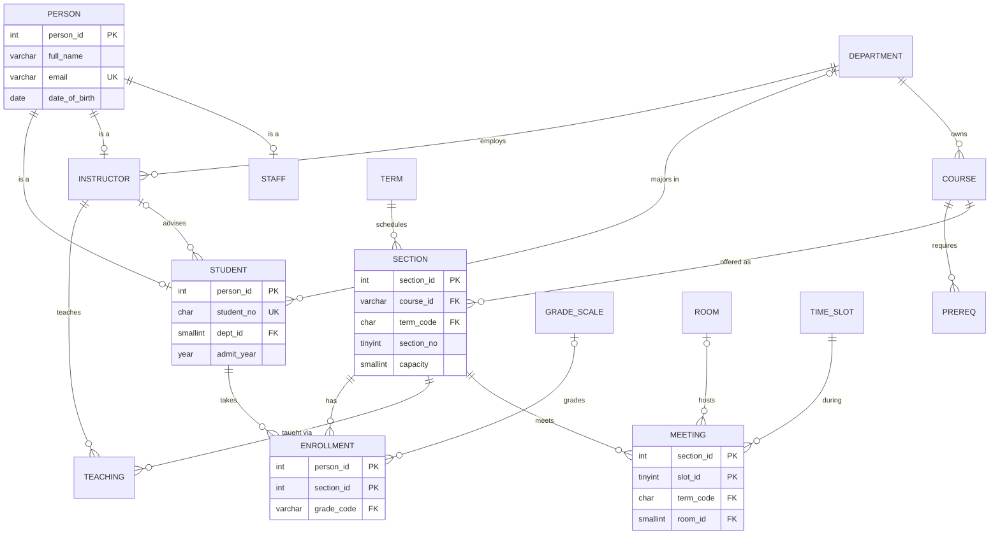

:::industry[Project brief — Bay Polytechnic University, Office of the Registrar]
**Client.** Bay Polytechnic (fictional) runs registration, grading and advising on a database built ten years ago: departments, instructors, students, courses with prerequisites, sections, enrollments and advisor assignments — the **`university`** dataset loaded in your lab. It works, but the registrar has a list of problems: a teaching assistant who is also a student exists twice with two e-mail addresses; nothing stops two sections from being booked into the same room at overlapping times; the system has never enforced prerequisites; a popular section was over-filled by four students on registration day; GPAs are computed differently in three reports; and every instructor can read every student's record.

**Your job.** Design **version 2** of the registrar database and migrate the legacy data into it. During the migration both versions live in the same schema — the new tables carry the prefix **`reg_`** — which is how real systems are replaced: the new model is built and validated next to the old one, then traffic is switched over.

**Deliverables**

1. Requirements and business rules (Stage 1); an EER model with specialization, weak entities and a ternary relationship (Stages 2–3).
2. A relational schema with a normalization analysis, including one deliberate decision *not* to decompose (Stages 4–5).
3. DDL and a migration from the legacy tables, with every enforceable rule declared (Stages 6–7).
4. Transcripts and GPA, academic standing, prerequisite chains, eligibility, timetable clash detection and an analytics pack (Stage 8).
5. Index and query tuning on a 10-year archive (48,000 extra enrollments) with measured plans (Stages 9 and 11).
6. A registration procedure that never over-fills a section (Stage 10), row-level privacy (Stage 12), a validation suite (Stage 13) and a production plan (Stage 14).

**Acceptance criteria**

- One person, one row: a person who is both a student and staff member exists once.
- The database rejects a second booking of the same room in the same time slot; overlapping bookings are found by a clash report that returns zero rows on a valid timetable.
- Every GPA in every report comes from one grade-point table and one formula.
- Concurrent registrations never exceed a section's capacity.
- An instructor's database account can list only the rosters of sections they teach.

**Estimated effort:** 18–24 hours after Modules 4–6 (in particular BCNF and analytical queries) and Module 8. The run blocks build v2 step by step in one lab; each graded exercise runs in a fresh lab with the `university` dataset plus whatever part of v2 it needs.
:::

University data is the classic teaching domain for databases for a good reason: it is small enough to understand completely, yet it contains nearly every hard modelling problem — people with several roles, entities that only exist relative to others, relationships among three things, recursive structures, time, and privacy. Treat this as a real engagement: every design decision below has an alternative, and the professional skill is to state the trade-off and choose.

## 1. Requirements Gathering

Start with the artefacts: the legacy schema, the reports people actually use, and the complaints. Query the legacy database before you interview anyone — it tells you what the institution *thinks* it records:

```sql run
SELECT table_name, table_rows
FROM information_schema.tables
WHERE table_schema = DATABASE()
ORDER BY table_name;
```

(`table_rows` is InnoDB's estimate, fine for orientation.) Then look for the problems the brief describes. Who is undeclared, and who has no advisor?

```sql run
SELECT SUM(dept_id IS NULL) AS undeclared_students,
       SUM(student_id NOT IN (SELECT student_id FROM advisors)) AS students_without_advisor,
       COUNT(*) AS students
FROM students;
```

### Worked example — stakeholder map and business rules

| Stakeholder | Core questions | Rules they care about |
|---|---|---|
| Registrar | Who is enrolled where? Which rooms are free? | Capacity; no room double-booking; prerequisites; one record per person |
| Students | What is my GPA? Can I take CS-157B? | Transcript accuracy; no timetable clashes |
| Instructors | Who is in my section? | Grade entry only for own sections |
| Advisors | How are my advisees doing? | Access only to own advisees |
| Deans / Institutional research | Pass rates, DFW rates, enrollment trends, instructor load | One GPA definition; consistent history |
| IT / compliance | Is student data protected? | FERPA-style privacy; audit of grade changes |

Business rules extracted from interviews (each will be traced to a mechanism):

- **BR1** A person has one identity (one e-mail, one record) regardless of how many roles they hold.
- **BR2** A section is an offering of one course in one term, numbered within that course and term (CS-157A section 2 in Fall 2024).
- **BR3** A room hosts at most one section at any moment; an instructor teaches at most one section at any moment.
- **BR4** Enrollment in a section may not exceed its capacity.
- **BR5** A student may enroll only after passing (C or better) every direct prerequisite.
- **BR6** GPA = Σ(grade points × credits) ÷ Σ(credits) over graded courses; W does not count.
- **BR7** Academic standing per term: Dean's List if term GPA ≥ 3.5 with ≥ 6 graded credits; probation if cumulative GPA < 2.0.
- **BR8** Every change of a recorded grade is audited (who, when, old, new).

```exercise
id: p6-ex1
title: Turn complaints into rules and mechanisms
difficulty: medium
kind: open
concepts: [requirements-analysis]
prompt: |
  For business rules **BR3**, **BR4**, **BR5** and **BR8**, state (a) whether a declarative constraint
  (PRIMARY/UNIQUE/FOREIGN KEY/CHECK) can enforce it completely in MySQL, (b) if not, which mechanism you will use
  (trigger, stored procedure, scheduled validation query, application), and (c) one question you would ask the
  registrar that could change your answer.
solution: |
  - **BR3 (no double-booking).** Partially declarative: `UNIQUE (term, room, slot)` stops two sections in the
    *same* slot, but overlapping *different* slots (10:30–11:45 vs 11:00–12:15) need an interval-overlap test
    across rows, which a UNIQUE/CHECK cannot express. Mechanism: the scheduling procedure checks overlaps before
    inserting, plus a clash report as a validation query. Question: "Are time slots a fixed grid, or can
    departments define arbitrary times?" (A fixed non-overlapping grid would make the UNIQUE constraint sufficient.)
  - **BR4 (capacity).** Not declarative — it is a rule about a COUNT over many rows. Mechanism: the registration
    procedure locks the section row and counts (Stage 10). Question: "Is there a waitlist, and may the registrar
    override capacity?" (adds a waitlist table and an override flag/privilege).
  - **BR5 (prerequisites).** Not declarative — it depends on other rows (the student's history) and on time.
    Mechanism: the registration procedure checks with a query; a validation report finds historical violations.
    Question: "Can instructors grant prerequisite waivers, and are concurrent enrollments (co-requisites) allowed?"
    (adds a waiver entity and changes the time comparison).
  - **BR8 (grade audit).** Not a constraint but enforceable in the database: an AFTER UPDATE trigger writes to an
    audit table on every grade change, whatever client makes it. Question: "Must the audit record the *reason*
    and the approving dean?" (then grade changes become a procedure with required parameters, not a plain UPDATE).
```

## 2. Entities and Relationships

### Specialization: people, students, instructors, staff

The legacy schema has separate `students` and `instructors` tables with nothing in common. But they are all **people**, and the registrar's first complaint (a TA recorded twice) is the classic symptom of a missing **generalization**. The EER model therefore has a superclass **Person** (identity, name, e-mail, date of birth) and subclasses **Student** (student number, major, admit year), **Instructor** (department, rank, salary, hire date) and **Staff** (unit, job title).

Two properties of the specialization must be decided with the client, because they change the schema:

| Property | Options | Decision here | Consequence |
|---|---|---|---|
| Disjointness | disjoint (d) — one subclass at most; overlapping (o) — several | **Overlapping**: a PhD student can teach; a student can work in the registrar's office | Subclass tables share the superclass key; a person can have rows in several |
| Completeness | total — every person is in some subclass; partial | **Total**: the registrar has no reason to store a person with no role | Not enforceable declaratively in MySQL (needs a deferred check); validated by query (Stage 13) |

Three standard relational mappings exist: one table per class (superclass + subclass tables sharing the key), one table per subclass only (repeating person attributes), or a single table with a type column and nullable subclass attributes. With **overlapping** subclasses the second option duplicates the person — exactly BR1's problem — and the single-table option collects many NULL-heavy columns and cannot declare "an instructor must have a department". The class-per-table mapping wins.

### Weak entity: section

A section has no identity of its own: "section 1" means nothing until you say *of which course, in which term*. Section is a **weak entity** with identifying owner **Course** (and term as part of the partial key): key = (course, term, section_no). In the relational schema we add a surrogate `section_id` because four other tables reference sections, but keep the weak-entity key as a `UNIQUE` constraint — the surrogate is a convenience, the natural key is the rule.

### Ternary relationship: meets

A section **meets** in a **room** during a **time slot**. This is a genuine ternary relationship, not three binaries: "section 21 meets on Monday 10:30–11:45" and "room MH-431 is used on Monday 10:30–11:45" do not together say *which* section uses the room. Its cardinality constraints are functional dependencies:

- (section, slot) → room — a section meets in one room in a given slot;
- (room, slot) → section — a room hosts one section in a given slot (BR3, the equal-slot case).

So the relationship has **two candidate keys**, (section, slot) and (room, slot) — and both become constraints.

### The other relationships

- Student **enrolls in** Section (M:N, attribute grade).
- Instructor **teaches** Section (M:N with a role: lead or co-instructor).
- Course **requires** Course (recursive M:N — the prerequisite graph).
- Instructor **advises** Student (1:N — each student has at most one advisor).
- Section **offered in** Term; Course **owned by** Department; Student **majors in** Department (optional — undeclared students).

```exercise
id: p6-ex2
title: Model degree programs
difficulty: hard
kind: open
concepts: [er-modeling, specialization]
prompt: |
  The provost wants degree audits. A **program** (e.g. "MS Applied Data Intelligence", "BS Computer Science",
  "Minor in Mathematics") belongs to a department, has required courses and elective groups ("choose 2 of
  DATA-225, DATA-226, DATA-245"), and students **declare** programs (a student can have one major and up to two
  minors; declarations have start and end dates). Extend the EER model: list the new entities, relationships,
  keys and cardinalities, and explain how this interacts with the existing `dept_id` on Student. Identify one
  rule that the schema cannot enforce declaratively.
solution: |
  - **Program** (program_id; code UNIQUE; name; level BS/MS/Minor; dept → Department, N:1).
  - **Requirement group** — weak entity of Program: (program, group_no); attributes min_courses (e.g. 2) and
    label ("Core", "Electives"). Required courses are simply groups whose min_courses equals their size.
  - **Group course** — M:N between Requirement group and Course: (program, group_no, course_id).
  - **Declaration** — M:N between Student and Program with attributes kind (MAJOR/MINOR), declared_on, ended_on;
    key (student, program, declared_on) so history is kept.
  - Student.dept_id becomes **derived** (the department of the current major) — keep it only as a cached value or
    drop it, otherwise the two will disagree; this is the same derived-data question as any maintained aggregate.
  - Not declarative: "at most one *current* major and two current minors per student" (a count over rows with a
    date condition). Options: a generated column `is_current_major` (1 when kind = MAJOR and ended_on IS NULL,
    else NULL) with `UNIQUE (student_id, is_current_major)` enforces the single-major part — the same NULL-ignoring
    UNIQUE trick used for lead instructors in Stage 7 — while "≤ 2 minors" needs a procedure or trigger.
```

## 3. ER Diagram

Mermaid's `erDiagram` has no notation for specialization, so the diagram shows the class-per-table mapping (each subclass 1:0..1 with Person) and the ternary relationship as the associative entity MEETING.



In a hand-drawn EER diagram (Elmasri–Navathe notation) you would draw Person with a circle labelled **o** (overlapping) connected by a **double line** (total participation) to the subclasses, Section as a double rectangle with its identifying relationship to Course as a double diamond, and MEETS as one diamond connected to SECTION, ROOM and TIME_SLOT. The Mermaid diagram above is the relational view of the same model.

:::note[Revise]
Weak entities, specialization/generalization constraints and their mappings are covered in [Weak Entities and EER](/lessons/m05-weak-entities-eer).
:::

## 4. Schema Design

Mapping decisions, in the order a reviewer will ask about them:

| Decision | Choice | Rationale |
|---|---|---|
| Person key | `person_id INT UNSIGNED`, kept equal to the legacy student/instructor ids during migration | Legacy ids are disjoint (8-digit students, 4-digit instructors); keeping them makes reconciliation trivial |
| Student number | `student_no CHAR(8) UNIQUE` in `reg_students` | The number printed on ID cards is a student attribute, not a person attribute |
| Subclass tables | PK = FK to `reg_people`, `ON DELETE CASCADE` | Deleting a person (e.g. a GDPR erasure of an applicant) removes their roles; deleting a student with enrollments is still blocked by the enrollment FK — as it should be |
| Terms | Table `reg_terms` with code (`'2024FA'`), season, year, start/end dates | Terms need dates for ordering and rules; codes like `'2024FA'` do **not** sort chronologically (`'FA'` < `'SP'`) |
| Sections | Surrogate `section_id`; weak-entity key `UNIQUE (course_id, term_code, section_no)` | Narrow FKs, natural rule preserved |
| Grades | Lookup `reg_grade_scale (grade_code, points, counts_in_gpa, is_passing)` | One source of grade points for every report (BR6); adding `C-` or `P/NP` is data, not code |
| Meetings | `reg_meetings (section_id, slot_id, term_code, room_id)`, PK (section, slot), `UNIQUE (term_code, room_id, slot_id)` | The ternary's two candidate keys; `term_code` is copied in so the room key can be per term |
| Constraint names | Prefixed `fk_reg_…`, `chk_reg_…` | In MySQL, foreign-key and CHECK constraint names are unique **per schema**, and the legacy tables already use names like `fk_students_dept` |

The copied `term_code` in `reg_meetings` deserves a second look: it is redundant (derivable from the section), so it could disagree with the section's term. A **composite foreign key** `(section_id, term_code) → reg_sections (section_id, term_code)` makes disagreement impossible, at the cost of a `UNIQUE (section_id, term_code)` on sections that is logically redundant with the primary key. That is a standard technique for making a copied column safe.

```text
reg_terms        (term_code PK, season, year, starts_on, ends_on, UK (year, season))
reg_grade_scale  (grade_code PK, points, counts_in_gpa, is_passing)
reg_people       (person_id PK, full_name, email UK, date_of_birth)
reg_students     (person_id PK/FK→reg_people, student_no UK, dept_id FK→departments, admit_year)
reg_instructors  (person_id PK/FK→reg_people, dept_id FK, academic_rank, salary, hired_on)
reg_staff        (person_id PK/FK→reg_people, unit, job_title)
reg_sections     (section_id PK, course_id FK→courses, term_code FK→reg_terms, section_no, capacity,
                  UK (course_id, term_code, section_no), UK (section_id, term_code))
reg_teaching     (section_id FK, person_id FK→reg_instructors, role, PK (section_id, person_id))
reg_enrollments  (person_id FK→reg_students, section_id FK, grade_code FK→reg_grade_scale, PK (person_id, section_id))
reg_rooms        (room_id PK, building, room_no, capacity, UK (building, room_no))
reg_time_slots   (slot_id PK, weekday, start_time, end_time, UK (weekday, start_time, end_time))
reg_meetings     (section_id, slot_id, term_code, room_id, PK (section_id, slot_id),
                  UK (term_code, room_id, slot_id), FK (section_id, term_code)→reg_sections)
reg_advising     (student_id PK/FK→reg_students, advisor_id FK→reg_instructors)
```

Courses, prerequisites and departments are reused from the legacy schema unchanged — they are already well designed, and a migration should change only what needs changing.

## 5. Normalization

### The registrar's export sheet

Advisers work from a wide export with one row per enrollment. Its dependencies, fed to the analyser:

```viz
type: fd
attributes: [student_id, student_name, major, course_id, course_title, credits, term, section_no, instructor, room, grade]
fds:
  - "student_id -> student_name, major"
  - "course_id -> course_title, credits"
  - "course_id, term, section_no -> instructor, room"
  - "student_id, course_id, term, section_no -> grade"
```

The key is {student_id, course_id, term, section_no}; every other FD has a determinant that is a proper subset of it, so the sheet is not even in 2NF. Decomposing by the FDs yields students, courses, sections and enrollments — the legacy schema's tables, which is why the legacy schema needed little change there.

### A subtle case: teaching assistants

The registrar wants to record which TA supports each student in a course with several TAs. Rules: each TA works for exactly one course; for a given course, each student has one TA. Attributes (student_id, course_id, ta_id):

```viz
type: fd
attributes: [student_id, course_id, ta_id]
fds:
  - "student_id, course_id -> ta_id"
  - "ta_id -> course_id"
```

The candidate keys are {student_id, course_id} and {student_id, ta_id}; every attribute is prime, so the relation is in **3NF** — but `ta_id → course_id` has a determinant that is not a superkey, so it is **not in BCNF**. The BCNF decomposition is (ta_id, course_id) and (student_id, ta_id). It removes the redundancy (a TA's course stored once), but it is **not dependency-preserving**: the rule "one TA per student per course" now spans two tables and can no longer be declared as a key. Inserting (s1, ta_7) and (s1, ta_9) where both TAs serve CS-157A is legal in the decomposed schema and violates the rule.

Make the trade-off concrete with data. In the 3NF table the rule is a primary key:

```sql run
CREATE TABLE reg_ta_support (
  student_id INT UNSIGNED NOT NULL,
  course_id  VARCHAR(10)  NOT NULL,
  ta_id      INT UNSIGNED NOT NULL,
  PRIMARY KEY (student_id, course_id),
  KEY idx_ta_support_ta (ta_id, course_id)
);
INSERT INTO reg_ta_support VALUES (20230001, 'CS-157A', 20230020), (20230002, 'CS-157A', 20230020);
SELECT ta_id, COUNT(DISTINCT course_id) AS courses_per_ta FROM reg_ta_support GROUP BY ta_id;
```

```sql run error
INSERT INTO reg_ta_support VALUES (20230001, 'CS-157A', 20230023);
```

The second TA for the same student and course is rejected by the key. What the 3NF design cannot declare is `ta_id → course_id` — a TA appearing with two courses — so that is the rule you would check in the assignment procedure or a validation query. Which rule is cheaper to protect procedurally? Here, the per-TA rule (one lookup) — so **staying in 3NF is the better design**. BCNF is the goal, not a law; the professional answer documents which dependency is not enforced and how it is checked.

```exercise
id: p6-ex3
title: Review — is reg_meetings in BCNF?
difficulty: hard
kind: open
concepts: [bcnf, functional-dependencies, ternary-relationships]
prompt: |
  `reg_meetings(section_id, slot_id, term_code, room_id)` has the FDs
  section_id → term_code; (section_id, slot_id) → room_id; (term_code, room_id, slot_id) → section_id.
  (Ignore NULL rooms.) Find the candidate keys, decide the highest normal form, and say whether you would
  decompose. Relate your answer to the composite foreign key on (section_id, term_code).
solution: |
  Closures: {section_id, slot_id}⁺ contains term_code (via section_id) and room_id, so it is a key.
  {term_code, room_id, slot_id}⁺ contains section_id, so it is also a key. Hence the candidate keys are
  {section_id, slot_id} and {term_code, room_id, slot_id}; prime attributes are all four.

  The FD section_id → term_code has a determinant that is not a superkey, so the relation is **not in BCNF**; but
  term_code is prime, so it **is in 3NF**. The BCNF decomposition would split off (section_id, term_code) — which
  already exists as reg_sections — and leave (section_id, slot_id, room_id); but then the room rule
  (term, room, slot) → section spans two tables and can no longer be a UNIQUE key: decomposition loses a
  dependency we care about (BR3).

  The design keeps 3NF and neutralizes the redundancy instead: term_code is copied, and the composite FK
  (section_id, term_code) → reg_sections guarantees the copy always equals the section's term, so the
  "update anomaly" BCNF guards against cannot occur. This is the same trade-off as the TA example, resolved with
  a declarative guard rather than a procedure.
```

:::note[Revise]
Closures, candidate keys, BCNF and dependency preservation are covered in [Boyce–Codd Normal Form](/lessons/m06-bcnf).
:::

## 6. MySQL Table Creation

Create the v2 core in dependency order. Note the prefixed constraint names — a forgotten prefix fails with *Duplicate foreign key constraint name*, because names such as `fk_students_dept` already exist in the legacy tables.

```sql run
CREATE TABLE reg_terms (
  term_code  CHAR(6) NOT NULL,
  season     ENUM('Spring','Summer','Fall') NOT NULL,
  year       YEAR NOT NULL,
  starts_on  DATE NOT NULL,
  ends_on    DATE NOT NULL,
  PRIMARY KEY (term_code),
  UNIQUE KEY uq_terms_year_season (year, season),
  CONSTRAINT chk_reg_terms_dates CHECK (ends_on > starts_on)
);
CREATE TABLE reg_grade_scale (
  grade_code     VARCHAR(2) NOT NULL,
  points         DECIMAL(3,2) NULL,
  counts_in_gpa  BOOLEAN NOT NULL,
  is_passing     BOOLEAN NOT NULL,
  PRIMARY KEY (grade_code),
  CONSTRAINT chk_reg_grade_points CHECK (points BETWEEN 0 AND 4),
  CONSTRAINT chk_reg_grade_gpa CHECK (counts_in_gpa = (points IS NOT NULL))
);
CREATE TABLE reg_people (
  person_id      INT UNSIGNED NOT NULL,
  full_name      VARCHAR(80)  NOT NULL,
  email          VARCHAR(255) NOT NULL,
  date_of_birth  DATE NULL,
  PRIMARY KEY (person_id),
  UNIQUE KEY uq_people_email (email)
);
CREATE TABLE reg_students (
  person_id   INT UNSIGNED NOT NULL,
  student_no  CHAR(8) NOT NULL,
  dept_id     SMALLINT UNSIGNED NULL,
  admit_year  YEAR NOT NULL,
  PRIMARY KEY (person_id),
  UNIQUE KEY uq_students_no (student_no),
  CONSTRAINT fk_reg_students_person FOREIGN KEY (person_id) REFERENCES reg_people (person_id) ON DELETE CASCADE,
  CONSTRAINT fk_reg_students_dept   FOREIGN KEY (dept_id)   REFERENCES departments (dept_id)
);
CREATE TABLE reg_instructors (
  person_id      INT UNSIGNED NOT NULL,
  dept_id        SMALLINT UNSIGNED NOT NULL,
  academic_rank  ENUM('Lecturer','Assistant Professor','Associate Professor','Professor') NOT NULL,
  salary         DECIMAL(10,2) NOT NULL,
  hired_on       DATE NOT NULL,
  PRIMARY KEY (person_id),
  CONSTRAINT fk_reg_instructors_person FOREIGN KEY (person_id) REFERENCES reg_people (person_id) ON DELETE CASCADE,
  CONSTRAINT fk_reg_instructors_dept   FOREIGN KEY (dept_id)   REFERENCES departments (dept_id)
);
CREATE TABLE reg_sections (
  section_id  INT UNSIGNED NOT NULL,
  course_id   VARCHAR(10) NOT NULL,
  term_code   CHAR(6) NOT NULL,
  section_no  TINYINT UNSIGNED NOT NULL,
  capacity    SMALLINT UNSIGNED NOT NULL,
  PRIMARY KEY (section_id),
  UNIQUE KEY uq_sections_offering (course_id, term_code, section_no),
  UNIQUE KEY uq_sections_id_term (section_id, term_code),
  CONSTRAINT fk_reg_sections_course FOREIGN KEY (course_id) REFERENCES courses (course_id),
  CONSTRAINT fk_reg_sections_term   FOREIGN KEY (term_code) REFERENCES reg_terms (term_code),
  CONSTRAINT chk_reg_sections_capacity CHECK (capacity > 0)
);
CREATE TABLE reg_enrollments (
  person_id   INT UNSIGNED NOT NULL,
  section_id  INT UNSIGNED NOT NULL,
  grade_code  VARCHAR(2) NULL,
  PRIMARY KEY (person_id, section_id),
  KEY idx_enrollments_section (section_id),
  CONSTRAINT fk_reg_enrollments_student FOREIGN KEY (person_id)  REFERENCES reg_students (person_id),
  CONSTRAINT fk_reg_enrollments_section FOREIGN KEY (section_id) REFERENCES reg_sections (section_id),
  CONSTRAINT fk_reg_enrollments_grade   FOREIGN KEY (grade_code) REFERENCES reg_grade_scale (grade_code)
);
CREATE TABLE reg_advising (
  student_id  INT UNSIGNED NOT NULL,
  advisor_id  INT UNSIGNED NOT NULL,
  PRIMARY KEY (student_id),
  KEY idx_advising_advisor (advisor_id),
  CONSTRAINT fk_reg_advising_student FOREIGN KEY (student_id) REFERENCES reg_students (person_id),
  CONSTRAINT fk_reg_advising_advisor FOREIGN KEY (advisor_id) REFERENCES reg_instructors (person_id)
);
```

### Migrate the legacy data

A migration is code, and like all code it is tested: every step is an `INSERT … SELECT` from the legacy tables, and every step is reconciled afterwards. Instructors have no e-mail in the legacy system, so one is generated; ranks are derived from hire dates as an agreed placeholder until HR supplies real ones.

```sql run
INSERT INTO reg_terms VALUES
  ('2023SP', 'Spring', 2023, '2023-01-25', '2023-05-19'), ('2023FA', 'Fall', 2023, '2023-08-21', '2023-12-15'),
  ('2024SP', 'Spring', 2024, '2024-01-24', '2024-05-17'), ('2024FA', 'Fall', 2024, '2024-08-21', '2024-12-13');
INSERT INTO reg_grade_scale VALUES
  ('A', 4.00, TRUE, TRUE), ('A-', 3.70, TRUE, TRUE), ('B+', 3.30, TRUE, TRUE), ('B', 3.00, TRUE, TRUE),
  ('B-', 2.70, TRUE, TRUE), ('C+', 2.30, TRUE, TRUE), ('C', 2.00, TRUE, TRUE), ('C-', 1.70, TRUE, FALSE),
  ('D+', 1.30, TRUE, FALSE), ('D', 1.00, TRUE, FALSE), ('F', 0.00, TRUE, FALSE), ('W', NULL, FALSE, FALSE);
INSERT INTO reg_people (person_id, full_name, email, date_of_birth)
SELECT student_id, name, email, '2000-01-01' + INTERVAL (student_id % 1500) DAY FROM students
UNION ALL
SELECT instructor_id, name, CONCAT(LOWER(REPLACE(name, ' ', '.')), '@example.edu'), NULL FROM instructors;
INSERT INTO reg_students (person_id, student_no, dept_id, admit_year)
SELECT student_id, CAST(student_id AS CHAR), dept_id, enrollment_year FROM students;
INSERT INTO reg_instructors (person_id, dept_id, academic_rank, salary, hired_on)
SELECT instructor_id, dept_id,
       CASE WHEN hired_on < '2015-01-01' THEN 'Professor'
            WHEN hired_on < '2019-01-01' THEN 'Associate Professor'
            ELSE 'Assistant Professor' END,
       salary, hired_on
FROM instructors;
INSERT INTO reg_sections (section_id, course_id, term_code, section_no, capacity)
SELECT s.section_id, s.course_id, t.term_code,
       ROW_NUMBER() OVER (PARTITION BY s.course_id, t.term_code ORDER BY s.section_id), s.capacity
FROM sections s JOIN reg_terms t ON t.season = s.term AND t.year = s.year;
INSERT INTO reg_enrollments (person_id, section_id, grade_code)
SELECT student_id, section_id, grade FROM enrollments;
INSERT INTO reg_advising (student_id, advisor_id) SELECT student_id, instructor_id FROM advisors;
```

`ROW_NUMBER() OVER (PARTITION BY course, term)` generates the weak entity's partial key (`section_no`) from the legacy surrogate order. Now **reconcile** — never trust a migration you have not counted:

```sql run
SELECT 'people'      AS entity, (SELECT COUNT(*) FROM students) + (SELECT COUNT(*) FROM instructors) AS legacy,
                                (SELECT COUNT(*) FROM reg_people) AS migrated
UNION ALL SELECT 'sections',    (SELECT COUNT(*) FROM sections),    (SELECT COUNT(*) FROM reg_sections)
UNION ALL SELECT 'enrollments', (SELECT COUNT(*) FROM enrollments), (SELECT COUNT(*) FROM reg_enrollments)
UNION ALL SELECT 'graded',      (SELECT COUNT(grade) FROM enrollments), (SELECT COUNT(grade_code) FROM reg_enrollments)
UNION ALL SELECT 'advising',    (SELECT COUNT(*) FROM advisors),    (SELECT COUNT(*) FROM reg_advising);
```

Counts are the minimum. A stronger check compares content — for example that every legacy grade maps to the same grade in v2, using an anti-join that must return zero rows:

```sql run
SELECT COUNT(*) AS grade_mismatches
FROM enrollments e
LEFT JOIN reg_enrollments r ON r.person_id = e.student_id AND r.section_id = e.section_id
WHERE r.person_id IS NULL OR NOT (r.grade_code <=> e.grade);
```

`<=>` is MySQL's NULL-safe equality: in-progress enrollments have NULL on both sides and must compare as equal.

```exercise
id: p6-ex4
title: Create the staff subclass
difficulty: medium
kind: dml
concepts: [specialization, foreign-keys, schema-design]
setup: |
  CREATE TABLE reg_people (person_id INT UNSIGNED NOT NULL PRIMARY KEY, full_name VARCHAR(80) NOT NULL, email VARCHAR(255) NOT NULL UNIQUE, date_of_birth DATE NULL);
  INSERT INTO reg_people (person_id, full_name, email) VALUES (20230020, 'Tomas Moradi', 'tomas.moradi@student.example.edu'), (9001, 'Grace Okoye', 'grace.okoye@example.edu'), (9002, 'Hiro Tanaka', 'hiro.tanaka@example.edu');
prompt: |
  Create the third subclass table **`reg_staff`** following the pattern of `reg_students` and `reg_instructors`:

  | column | type / rule |
  |---|---|
  | `person_id` | `INT UNSIGNED NOT NULL`, primary key, references `reg_people`; deleting the person deletes the staff row |
  | `unit` | `VARCHAR(60) NOT NULL` |
  | `job_title` | `VARCHAR(60) NOT NULL` |
  | `fte` | `DECIMAL(3,2) NOT NULL DEFAULT 1.00`, between 0.10 and 1.00 (full-time equivalent) |

  Name the foreign key `fk_reg_staff_person`. The grader inserts staff rows with `INSERT IGNORE` (including an
  unknown person and an invalid FTE), deletes person 9002, and lists what remains.
hints:
  - "The primary key is also the foreign key — that is what makes it a subclass table (1:0..1 with the superclass)."
  - "ON DELETE CASCADE on the foreign key implements 'deleting the person deletes the role'."
  - "CHECK (fte BETWEEN 0.10 AND 1.00)."
solution: |
  CREATE TABLE reg_staff (
    person_id  INT UNSIGNED NOT NULL,
    unit       VARCHAR(60) NOT NULL,
    job_title  VARCHAR(60) NOT NULL,
    fte        DECIMAL(3,2) NOT NULL DEFAULT 1.00,
    PRIMARY KEY (person_id),
    CONSTRAINT fk_reg_staff_person FOREIGN KEY (person_id) REFERENCES reg_people (person_id) ON DELETE CASCADE,
    CONSTRAINT chk_reg_staff_fte CHECK (fte BETWEEN 0.10 AND 1.00)
  );
check: |
  INSERT IGNORE INTO reg_staff (person_id, unit, job_title, fte) VALUES
    (20230020, 'Registrar', 'Student assistant', 0.25),
    (9001, 'Registrar', 'Associate registrar', 1.00),
    (9002, 'Facilities', 'Room scheduler', 0.50),
    (7777, 'Library', 'Archivist', 1.00),
    (9001, 'Registrar', 'Duplicate role', 1.00);
  INSERT IGNORE INTO reg_staff (person_id, unit, job_title, fte) VALUES (20230020, 'Advising', 'Peer advisor', 1.50);
  DELETE FROM reg_people WHERE person_id = 9002;
  SELECT person_id, unit, job_title, fte FROM reg_staff ORDER BY person_id;
explanation: |
  Two rows survive: the student assistant (overlapping specialization — the same person_id is also a student in
  the real schema) and the associate registrar. The archivist is rejected by the FK (no such person), the
  duplicate role by the PK (one staff row per person — if a person can hold two staff jobs, the job becomes a
  separate entity), the 1.50 FTE by the CHECK, and the room scheduler disappears when person 9002 is deleted,
  through the cascade. A common mistake is giving `reg_staff` its own AUTO_INCREMENT key plus a person_id column:
  that allows one person to have many staff rows and breaks the 1:0..1 shape of a subclass.
```

## 7. Constraints and Relationships

### The timetable: slots, rooms, meetings and the ternary keys

```sql run
CREATE TABLE reg_rooms (
  room_id   SMALLINT UNSIGNED NOT NULL AUTO_INCREMENT,
  building  VARCHAR(4) NOT NULL,
  room_no   VARCHAR(5) NOT NULL,
  capacity  SMALLINT UNSIGNED NOT NULL,
  PRIMARY KEY (room_id),
  UNIQUE KEY uq_rooms_code (building, room_no)
);
CREATE TABLE reg_time_slots (
  slot_id     TINYINT UNSIGNED NOT NULL,
  weekday     TINYINT UNSIGNED NOT NULL,
  start_time  TIME NOT NULL,
  end_time    TIME NOT NULL,
  PRIMARY KEY (slot_id),
  UNIQUE KEY uq_slots_time (weekday, start_time, end_time),
  CONSTRAINT chk_reg_slots_weekday CHECK (weekday BETWEEN 1 AND 5),
  CONSTRAINT chk_reg_slots_order CHECK (end_time > start_time)
);
CREATE TABLE reg_meetings (
  section_id  INT UNSIGNED NOT NULL,
  term_code   CHAR(6) NOT NULL,
  slot_id     TINYINT UNSIGNED NOT NULL,
  room_id     SMALLINT UNSIGNED NULL,
  PRIMARY KEY (section_id, slot_id),
  UNIQUE KEY uq_meetings_room_slot (term_code, room_id, slot_id),
  CONSTRAINT fk_reg_meetings_section FOREIGN KEY (section_id, term_code) REFERENCES reg_sections (section_id, term_code),
  CONSTRAINT fk_reg_meetings_slot    FOREIGN KEY (slot_id) REFERENCES reg_time_slots (slot_id),
  CONSTRAINT fk_reg_meetings_room    FOREIGN KEY (room_id) REFERENCES reg_rooms (room_id)
);
```

The legacy system knows each section's room but not its meeting times, so the scheduling office supplied a pattern per section (first slot of a Monday/Wednesday or Tuesday/Thursday pair). Slots 13–14 are a longer Monday/Wednesday 11:00–12:15 block that **overlaps** the 10:30–11:45 slots — the timetable grid is not clash-free by construction.

```sql run
INSERT INTO reg_rooms (building, room_no, capacity)
SELECT SUBSTRING_INDEX(room, '-', 1), SUBSTRING_INDEX(room, '-', -1), MAX(capacity)
FROM sections WHERE room IS NOT NULL GROUP BY room ORDER BY room;
INSERT INTO reg_time_slots VALUES
  (1, 1, '09:00', '10:15'), (2, 3, '09:00', '10:15'), (3, 1, '10:30', '11:45'), (4, 3, '10:30', '11:45'),
  (5, 1, '13:30', '14:45'), (6, 3, '13:30', '14:45'), (7, 2, '09:00', '10:15'), (8, 4, '09:00', '10:15'),
  (9, 2, '10:30', '11:45'), (10, 4, '10:30', '11:45'), (11, 2, '13:30', '14:45'), (12, 4, '13:30', '14:45'),
  (13, 1, '11:00', '12:15'), (14, 3, '11:00', '12:15'), (15, 1, '18:00', '20:45');
INSERT INTO reg_meetings (section_id, term_code, slot_id, room_id)
SELECT p.section_id, rs.term_code, p.first_slot + d.k, r.room_id
FROM (VALUES ROW(1,1), ROW(2,7), ROW(3,3), ROW(4,9), ROW(5,5), ROW(6,11), ROW(7,1), ROW(8,7), ROW(9,3),
             ROW(10,9), ROW(11,5), ROW(12,11), ROW(13,3), ROW(14,7), ROW(15,9), ROW(16,13), ROW(17,11),
             ROW(18,1), ROW(19,1), ROW(20,7), ROW(21,3), ROW(22,9), ROW(23,5), ROW(24,11)) AS p (section_id, first_slot)
CROSS JOIN (VALUES ROW(0), ROW(1)) AS d (k)
JOIN reg_sections rs ON rs.section_id = p.section_id
JOIN sections s      ON s.section_id = p.section_id
LEFT JOIN reg_rooms r ON CONCAT(r.building, '-', r.room_no) = s.room;
SELECT COUNT(*) AS meetings, COUNT(room_id) AS with_room, COUNT(DISTINCT section_id) AS sections
FROM reg_meetings;
```

`VALUES ROW(…)` is MySQL's table value constructor (8.0.19+), handy for small mapping tables inside a migration. Now test the two ternary keys. Booking a second section into MH-431 in exactly the slot section 21 already uses:

```sql run error
INSERT INTO reg_meetings (section_id, term_code, slot_id, room_id)
SELECT 24, '2024FA', 3, room_id FROM reg_rooms WHERE building = 'MH' AND room_no = '431';
```

And a meeting whose copied term disagrees with its section's term — the redundancy guard:

```sql run error
INSERT INTO reg_meetings (section_id, term_code, slot_id, room_id) VALUES (24, '2024SP', 15, NULL);
```

:::warning[NULL rooms and UNIQUE]
Section 11 has no room yet ("TBA"): its meetings have `room_id` NULL. A `UNIQUE` index treats NULLs as distinct, so any number of TBA meetings may share a slot — the desired behaviour here, but a surprise when you rely on UNIQUE to forbid duplicates in a nullable column.
:::

### At most one lead instructor per section

`reg_teaching` allows team teaching (several instructors per section), but exactly one of them may be the lead. "At most one row with role = 'LEAD' per section" is a **partial uniqueness** rule; PostgreSQL would use a partial index. MySQL has none, but a **generated column** that is 1 for lead rows and NULL otherwise, combined with the NULL-distinct behaviour of UNIQUE, achieves it. That is your exercise below. First, the subclass table from p6-ex4 and the teaching table (the reference solutions, so later stages can use them):

```sql run
CREATE TABLE reg_staff (
  person_id  INT UNSIGNED NOT NULL,
  unit       VARCHAR(60) NOT NULL,
  job_title  VARCHAR(60) NOT NULL,
  fte        DECIMAL(3,2) NOT NULL DEFAULT 1.00,
  PRIMARY KEY (person_id),
  CONSTRAINT fk_reg_staff_person FOREIGN KEY (person_id) REFERENCES reg_people (person_id) ON DELETE CASCADE,
  CONSTRAINT chk_reg_staff_fte CHECK (fte BETWEEN 0.10 AND 1.00)
);
INSERT INTO reg_people (person_id, full_name, email) VALUES (9001, 'Grace Okoye', 'grace.okoye@example.edu');
INSERT INTO reg_staff VALUES (20230020, 'Registrar', 'Student assistant', 0.25), (9001, 'Registrar', 'Associate registrar', 1.00);
CREATE TABLE reg_teaching (
  section_id   INT UNSIGNED NOT NULL,
  person_id    INT UNSIGNED NOT NULL,
  role         ENUM('LEAD','CO') NOT NULL DEFAULT 'LEAD',
  lead_marker  TINYINT AS (IF(role = 'LEAD', 1, NULL)) VIRTUAL,
  PRIMARY KEY (section_id, person_id),
  UNIQUE KEY uq_teaching_one_lead (section_id, lead_marker),
  KEY idx_teaching_person (person_id),
  CONSTRAINT fk_reg_teaching_section    FOREIGN KEY (section_id) REFERENCES reg_sections (section_id),
  CONSTRAINT fk_reg_teaching_instructor FOREIGN KEY (person_id)  REFERENCES reg_instructors (person_id)
);
INSERT INTO reg_teaching (section_id, person_id)
SELECT section_id, instructor_id FROM sections WHERE instructor_id IS NOT NULL;
SELECT p.person_id, p.full_name,
       EXISTS (SELECT 1 FROM reg_students s    WHERE s.person_id = p.person_id) AS is_student,
       EXISTS (SELECT 1 FROM reg_instructors i WHERE i.person_id = p.person_id) AS is_instructor,
       EXISTS (SELECT 1 FROM reg_staff f       WHERE f.person_id = p.person_id) AS is_staff
FROM reg_people p WHERE p.person_id IN (20230020, 9001, 1003)
ORDER BY p.person_id;
```

Tomas Moradi is a student **and** a staff member — one person row, two subclass rows: BR1 holds by construction.

```exercise
id: p6-ex5
title: Prove the one-lead rule
difficulty: hard
kind: dml
concepts: [generated-columns, unique-constraints]
setup: |
  CREATE TABLE reg_teaching_v1 (section_id INT UNSIGNED NOT NULL, person_id INT UNSIGNED NOT NULL, role ENUM('LEAD','CO') NOT NULL DEFAULT 'LEAD', PRIMARY KEY (section_id, person_id));
  INSERT INTO reg_teaching_v1 VALUES (21, 1008, 'LEAD'), (22, 1003, 'LEAD'), (22, 1012, 'CO');
prompt: |
  The lab contains `reg_teaching_v1 (section_id, person_id, role)` **without** the one-lead rule. Alter it (do
  not recreate it) so that the database rejects a second `LEAD` for the same section while still allowing any
  number of `CO` instructors:

  - add a generated column **`lead_marker`** that is 1 when role = 'LEAD' and NULL otherwise;
  - add a unique index **`uq_teaching_one_lead`** on (section_id, lead_marker).

  The grader then attempts, with `INSERT IGNORE`: a second lead for section 22, two more co-instructors for
  section 22, and a lead for a new section 23 — and lists the table.
hints:
  - "ALTER TABLE … ADD COLUMN lead_marker TINYINT AS (IF(role = 'LEAD', 1, NULL)) VIRTUAL — a VIRTUAL generated column can be indexed in InnoDB."
  - "UNIQUE treats NULLs as distinct, so CO rows (NULL marker) never conflict with each other."
solution: |
  ALTER TABLE reg_teaching_v1
    ADD COLUMN lead_marker TINYINT AS (IF(role = 'LEAD', 1, NULL)) VIRTUAL,
    ADD UNIQUE KEY uq_teaching_one_lead (section_id, lead_marker);
check: |
  INSERT IGNORE INTO reg_teaching_v1 (section_id, person_id, role) VALUES
    (22, 1001, 'LEAD'), (22, 1002, 'CO'), (22, 1005, 'CO'), (23, 1001, 'LEAD');
  SELECT section_id, person_id, role, lead_marker FROM reg_teaching_v1 ORDER BY section_id, person_id;
explanation: |
  Section 22 ends with one lead (1003) and three co-instructors; the attempted second lead (1001) is rejected
  with a duplicate-key error on `uq_teaching_one_lead`, which INSERT IGNORE turns into a warning. Section 23 gets
  its lead. The technique — a generated column that is NULL for rows the rule does not cover — is MySQL's
  substitute for a partial (filtered) unique index. A CHECK constraint cannot express it because it sees one row
  only; a trigger could, but would need a locking read to be safe under concurrency, whereas the unique index is
  enforced atomically by InnoDB. Note what the rule does **not** enforce: "at least one lead" — that again is a
  completeness rule for validation (Stage 13).
```

## 8. SQL Implementation

### Transcript and GPA — one formula, one table

BR6 says every report computes GPA the same way. Encode the formula once and build everything on it. A student's transcript by term, with term GPA and **cumulative** GPA — the cumulative value is a running ratio, so the window function accumulates the numerator and denominator separately:

```sql run
SELECT t.term_code,
       SUM(c.credits) AS graded_credits,
       ROUND(SUM(g.points * c.credits) / SUM(c.credits), 2) AS term_gpa,
       ROUND(SUM(SUM(g.points * c.credits)) OVER w / SUM(SUM(c.credits)) OVER w, 2) AS cumulative_gpa
FROM reg_enrollments e
JOIN reg_sections s     ON s.section_id = e.section_id
JOIN reg_terms t        ON t.term_code = s.term_code
JOIN courses c          ON c.course_id = s.course_id
JOIN reg_grade_scale g  ON g.grade_code = e.grade_code AND g.counts_in_gpa
WHERE e.person_id = 20230010
GROUP BY t.term_code, t.starts_on
WINDOW w AS (ORDER BY t.starts_on ROWS BETWEEN UNBOUNDED PRECEDING AND CURRENT ROW)
ORDER BY t.starts_on;
```

Three details make this correct: the window is ordered by `starts_on`, not by `term_code` (alphabetically `'2023FA'` sorts before `'2023SP'`); the in-progress Fall 2024 enrollment drops out because its NULL grade does not join the grade scale; and the cumulative GPA is Σpoints ÷ Σcredits over all terms so far, **not** the average of term GPAs — averaging averages would weight a 3-credit term like a 15-credit one.

### Prerequisite chains — recursive CTEs

The prerequisite graph is recursive: CS-157B requires CS-157A, which requires CS-146, which requires two courses. The full chain needs a recursive CTE; carrying a `path` string makes the result readable and is the basis of cycle detection later:

```sql run
WITH RECURSIVE chain AS (
  SELECT course_id, prereq_id, 1 AS depth,
         CAST(CONCAT(course_id, ' <- ', prereq_id) AS CHAR(200)) AS path
  FROM course_prereqs
  WHERE course_id = 'CS-157B'
  UNION ALL
  SELECT ch.course_id, cp.prereq_id, ch.depth + 1, CONCAT(ch.path, ' <- ', cp.prereq_id)
  FROM chain ch
  JOIN course_prereqs cp ON cp.course_id = ch.prereq_id
)
SELECT depth, prereq_id, path FROM chain ORDER BY depth, prereq_id;
```

The `CAST(… AS CHAR(200))` in the anchor matters: the column types of a recursive CTE are fixed by the anchor member, so without it the path column would be only as wide as the first row's string and longer paths would fail with a "data too long" error.

### Timetable clash detection — self-joins on intervals

Two meetings clash when they are in the same term, on the same weekday, and their intervals overlap: `a.start < b.end AND b.start < a.end` (half-open intervals; touching end-to-start is not a clash). Joining `reg_meetings` to itself finds clashing pairs; joining in the teaching table restricts them to the same instructor:

```sql run
SELECT t1.person_id AS instructor, m1.term_code, m1.section_id AS section_a, m2.section_id AS section_b,
       ts1.weekday, ts1.start_time AS a_start, ts1.end_time AS a_end, ts2.start_time AS b_start, ts2.end_time AS b_end
FROM reg_meetings m1
JOIN reg_meetings m2    ON m2.term_code = m1.term_code AND m1.section_id < m2.section_id
JOIN reg_time_slots ts1 ON ts1.slot_id = m1.slot_id
JOIN reg_time_slots ts2 ON ts2.slot_id = m2.slot_id
                       AND ts2.weekday = ts1.weekday
                       AND ts1.start_time < ts2.end_time AND ts2.start_time < ts1.end_time
JOIN reg_teaching t1    ON t1.section_id = m1.section_id
JOIN reg_teaching t2    ON t2.section_id = m2.section_id AND t2.person_id = t1.person_id
ORDER BY m1.term_code, instructor, ts1.weekday;
```

`m1.section_id < m2.section_id` reports each pair once (not twice, and never a section with itself). The report found that instructor 1006 is scheduled into sections 13 and 16 on both Monday and Wednesday in Spring 2024 — the 10:30 and 11:00 blocks overlap by 45 minutes. The UNIQUE key could not catch this, because the two sections use different slots.

Now process a change request from the scheduling office: *move CS-157B (section 22) to the Monday/Wednesday 11:00 block in room MH-431.*

```sql run
UPDATE reg_meetings m
JOIN reg_rooms r ON r.building = 'MH' AND r.room_no = '431'
SET m.slot_id = m.slot_id + 4, m.room_id = r.room_id
WHERE m.section_id = 22;
SELECT m.section_id, m.slot_id, ts.weekday, ts.start_time, ts.end_time, CONCAT(r.building, '-', r.room_no) AS room
FROM reg_meetings m JOIN reg_time_slots ts USING (slot_id) LEFT JOIN reg_rooms r USING (room_id)
WHERE m.section_id IN (21, 22)
ORDER BY m.section_id, ts.weekday;
```

The update was accepted — slots 13/14 differ from section 21's slots 3/4, so the unique key sees no duplicate — yet MH-431 is now double-booked from 11:00 to 11:45, and any student in both sections has a clash. Finding the student clashes is your exercise; the room report is in Stage 13.

```exercise
id: p6-ex6
title: Student timetable clashes
difficulty: hard
concepts: [self-joins, interval-overlap]
setup: |
  CREATE TABLE reg_time_slots (slot_id TINYINT UNSIGNED PRIMARY KEY, weekday TINYINT UNSIGNED NOT NULL, start_time TIME NOT NULL, end_time TIME NOT NULL);
  INSERT INTO reg_time_slots VALUES (1,1,'09:00','10:15'),(2,3,'09:00','10:15'),(3,1,'10:30','11:45'),(4,3,'10:30','11:45'),(5,1,'13:30','14:45'),(6,3,'13:30','14:45'),(7,2,'09:00','10:15'),(8,4,'09:00','10:15'),(9,2,'10:30','11:45'),(10,4,'10:30','11:45'),(11,2,'13:30','14:45'),(12,4,'13:30','14:45'),(13,1,'11:00','12:15'),(14,3,'11:00','12:15'),(15,1,'18:00','20:45');
  CREATE TABLE reg_meetings (section_id INT UNSIGNED NOT NULL, term_code CHAR(6) NOT NULL, slot_id TINYINT UNSIGNED NOT NULL, room_id SMALLINT UNSIGNED NULL, PRIMARY KEY (section_id, slot_id));
  INSERT INTO reg_meetings (section_id, term_code, slot_id) SELECT p.section_id, CONCAT(s.year, IF(s.term = 'Spring', 'SP', 'FA')), p.first_slot + d.k FROM (VALUES ROW(1,1), ROW(2,7), ROW(3,3), ROW(4,9), ROW(5,5), ROW(6,11), ROW(7,1), ROW(8,7), ROW(9,3), ROW(10,9), ROW(11,5), ROW(12,11), ROW(13,3), ROW(14,7), ROW(15,9), ROW(16,13), ROW(17,11), ROW(18,1), ROW(19,1), ROW(20,7), ROW(21,3), ROW(22,13), ROW(23,5), ROW(24,11)) AS p (section_id, first_slot) CROSS JOIN (VALUES ROW(0), ROW(1)) AS d (k) JOIN sections s ON s.section_id = p.section_id;
  INSERT INTO enrollments (student_id, section_id) VALUES (20230017, 13), (20230017, 16), (20230039, 4), (20230039, 6);
prompt: |
  The lab has the timetable after the change request (section 22 now meets Monday/Wednesday 11:00–12:15),
  and a few new registrations in the legacy `enrollments` table. List every **student clash**: a student
  enrolled in two sections of the same term whose meetings overlap on the same weekday. One row per student,
  pair of sections and weekday, with columns:

  `student_id`, `term_code`, `section_a`, `section_b` (section_a < section_b), `weekday`, `overlap_minutes`
  (length of the overlapping interval in minutes).
hints:
  - "Self-join reg_meetings (same term, m1.section_id < m2.section_id), join both to reg_time_slots on the same weekday with the overlap test a.start < b.end AND b.start < a.end, then join enrollments twice on the same student."
  - "Overlap length = LEAST(end_a, end_b) − GREATEST(start_a, start_b); TIMESTAMPDIFF(MINUTE, …) or TIME_TO_SEC(…)/60 converts it."
  - "Section ids are already per term, so joining enrollments to the meetings is enough; you do not need the sections table."
solution: |
  SELECT e1.student_id, m1.term_code, m1.section_id AS section_a, m2.section_id AS section_b, ts1.weekday,
         TIME_TO_SEC(TIMEDIFF(LEAST(ts1.end_time, ts2.end_time), GREATEST(ts1.start_time, ts2.start_time))) / 60 AS overlap_minutes
  FROM reg_meetings m1
  JOIN reg_meetings m2    ON m2.term_code = m1.term_code AND m1.section_id < m2.section_id
  JOIN reg_time_slots ts1 ON ts1.slot_id = m1.slot_id
  JOIN reg_time_slots ts2 ON ts2.slot_id = m2.slot_id AND ts2.weekday = ts1.weekday
                         AND ts1.start_time < ts2.end_time AND ts2.start_time < ts1.end_time
  JOIN enrollments e1 ON e1.section_id = m1.section_id
  JOIN enrollments e2 ON e2.section_id = m2.section_id AND e2.student_id = e1.student_id;
explanation: |
  The overlap predicate `a.start < b.end AND b.start < a.end` is the whole trick: it is true exactly when two
  half-open intervals share some time, and it covers containment and partial overlap with no special cases.
  Writing `a.start BETWEEN b.start AND b.end` instead misses the case where a starts before b and ends inside it,
  and counts back-to-back classes (10:15 end, 10:15 start) as clashes. The result has one student in sections 21
  and 22 (the change request created it) and a new registration in 13 and 16 — each on two weekdays. Section
  4 and 6 meet on Tuesday/Thursday at different times, so that registration produces no clash.
```

```exercise
id: p6-ex7
title: Every prerequisite, however deep
difficulty: medium
concepts: [recursive-cte]
prompt: |
  Using the legacy `course_prereqs` table, list **every** course a student must have completed (directly or
  transitively) before taking **DATA-226**, with columns `prereq_id`, `title` and `depth` (1 = direct
  prerequisite). If a course is reachable along several paths, show it once with its **smallest** depth.
hints:
  - "Anchor: rows of course_prereqs WHERE course_id = 'DATA-226'. Recursive member: join course_prereqs on course_id = the previous prereq_id."
  - "Aggregate after the recursion: GROUP BY prereq_id with MIN(depth), then join courses for the title."
solution: |
  WITH RECURSIVE chain AS (
    SELECT prereq_id, 1 AS depth FROM course_prereqs WHERE course_id = 'DATA-226'
    UNION ALL
    SELECT cp.prereq_id, ch.depth + 1
    FROM chain ch JOIN course_prereqs cp ON cp.course_id = ch.prereq_id
  )
  SELECT ch.prereq_id, c.title, MIN(ch.depth) AS depth
  FROM chain ch JOIN courses c ON c.course_id = ch.prereq_id
  GROUP BY ch.prereq_id, c.title;
explanation: |
  DATA-226 requires DATA-225 (depth 1), which requires DATA-200 (depth 2). Deduplicating with `MIN(depth)` after
  the recursion handles diamonds in the graph — a course reachable along two paths (not the case for DATA-226,
  but common in real catalogues) would otherwise appear twice with different depths. Using `UNION` instead of `UNION ALL` in the CTE also
  removes duplicate *rows*, but rows with different depths are not duplicates — the aggregation is still needed.
  On a graph with a cycle, `UNION ALL` recursion would run until `cte_max_recursion_depth` (default 1000) stops
  it with an error; Stage 13 shows how to detect cycles.
```

```exercise
id: p6-ex8
title: Who may register for CS-157B?
difficulty: challenge
concepts: [relational-division, not-exists, anti-join]
setup: |
  CREATE TABLE reg_grade_scale (grade_code VARCHAR(2) PRIMARY KEY, points DECIMAL(3,2) NULL, counts_in_gpa BOOLEAN NOT NULL, is_passing BOOLEAN NOT NULL);
  INSERT INTO reg_grade_scale VALUES ('A',4.00,TRUE,TRUE),('A-',3.70,TRUE,TRUE),('B+',3.30,TRUE,TRUE),('B',3.00,TRUE,TRUE),('B-',2.70,TRUE,TRUE),('C+',2.30,TRUE,TRUE),('C',2.00,TRUE,TRUE),('C-',1.70,TRUE,FALSE),('D+',1.30,TRUE,FALSE),('D',1.00,TRUE,FALSE),('F',0.00,TRUE,FALSE),('W',NULL,FALSE,FALSE);
prompt: |
  Registration for CS-157B opens. Using the legacy tables (`students`, `sections`, `enrollments`,
  `course_prereqs`) and `reg_grade_scale`, list the students who are **eligible**:

  - they have a passing grade (`is_passing`) in **every direct prerequisite** of CS-157B, and
  - they have **not** already passed CS-157B, and
  - they are **not** currently enrolled in CS-157B (an enrollment with NULL grade).

  Columns: `student_id`, `name`. Write it so that it would still be correct if CS-157B gained a second
  prerequisite tomorrow.
hints:
  - "'Passed every prerequisite' is relational division: there is NO prerequisite of CS-157B for which there is NO passing enrollment of the student — a double NOT EXISTS."
  - "Alternatively: count the distinct prerequisites the student passed and compare with the total number of prerequisites of the course."
  - "Two more NOT EXISTS conditions exclude students who passed CS-157B or are taking it now."
solution: |
  SELECT st.student_id, st.name
  FROM students st
  WHERE NOT EXISTS (
          SELECT 1 FROM course_prereqs cp
          WHERE cp.course_id = 'CS-157B'
            AND NOT EXISTS (
                  SELECT 1 FROM enrollments e
                  JOIN sections s ON s.section_id = e.section_id
                  JOIN reg_grade_scale g ON g.grade_code = e.grade
                  WHERE e.student_id = st.student_id AND s.course_id = cp.prereq_id AND g.is_passing))
    AND NOT EXISTS (
          SELECT 1 FROM enrollments e
          JOIN sections s ON s.section_id = e.section_id
          LEFT JOIN reg_grade_scale g ON g.grade_code = e.grade
          WHERE e.student_id = st.student_id AND s.course_id = 'CS-157B'
            AND (e.grade IS NULL OR g.is_passing));
explanation: |
  Relational division answers "for all" questions with "there is no counterexample". The double NOT EXISTS is
  correct for any number of prerequisites — and, a subtle point, also returns *every* student for a course with
  no prerequisites (nothing to violate), which is the right answer. The COUNT-based alternative must count
  **distinct** prerequisites passed (a retaken course would otherwise count twice) and needs care for the
  no-prerequisite case. The second NOT EXISTS uses a LEFT JOIN to the grade scale so that NULL (in progress)
  grades are caught by `e.grade IS NULL`; with an inner join they would vanish and a student taking CS-157B now
  would wrongly appear eligible.
```

### Academic standing — window functions over the whole population

Dean's List and probation are computed per student per term (BR7). Build the per-term figures once in a CTE and derive both the term and cumulative values with windows partitioned by student:

```sql run
WITH term_gpa AS (
  SELECT e.person_id, t.term_code, t.starts_on,
         SUM(c.credits) AS credits,
         SUM(g.points * c.credits) AS quality_points
  FROM reg_enrollments e
  JOIN reg_sections s    ON s.section_id = e.section_id
  JOIN reg_terms t       ON t.term_code = s.term_code
  JOIN courses c         ON c.course_id = s.course_id
  JOIN reg_grade_scale g ON g.grade_code = e.grade_code AND g.counts_in_gpa
  GROUP BY e.person_id, t.term_code, t.starts_on
),
standing AS (
  SELECT person_id, term_code, starts_on, credits,
         quality_points / credits AS term_gpa,
         SUM(quality_points) OVER w / SUM(credits) OVER w AS cumulative_gpa
  FROM term_gpa
  WINDOW w AS (PARTITION BY person_id ORDER BY starts_on ROWS BETWEEN UNBOUNDED PRECEDING AND CURRENT ROW)
)
SELECT term_code,
       SUM(term_gpa >= 3.5 AND credits >= 6) AS deans_list,
       SUM(cumulative_gpa < 2.0)             AS on_probation,
       COUNT(*)                              AS students_graded
FROM standing
GROUP BY term_code, starts_on
ORDER BY starts_on;
```

```exercise
id: p6-ex9
title: Top three students per department
difficulty: hard
concepts: [window-functions, dense-rank, gpa]
setup: |
  CREATE TABLE reg_grade_scale (grade_code VARCHAR(2) PRIMARY KEY, points DECIMAL(3,2) NULL, counts_in_gpa BOOLEAN NOT NULL, is_passing BOOLEAN NOT NULL);
  INSERT INTO reg_grade_scale VALUES ('A',4.00,TRUE,TRUE),('A-',3.70,TRUE,TRUE),('B+',3.30,TRUE,TRUE),('B',3.00,TRUE,TRUE),('B-',2.70,TRUE,TRUE),('C+',2.30,TRUE,TRUE),('C',2.00,TRUE,TRUE),('C-',1.70,TRUE,FALSE),('D+',1.30,TRUE,FALSE),('D',1.00,TRUE,FALSE),('F',0.00,TRUE,FALSE),('W',NULL,FALSE,FALSE);
prompt: |
  For the provost's awards, rank students **within their declared department** by cumulative GPA (BR6, using
  the legacy `enrollments`, `sections`, `courses`, `students`, `departments` and `reg_grade_scale`). Only
  students with at least **6 graded credits** are ranked; undeclared students are excluded.

  Return the students whose rank is **3 or better**, using `DENSE_RANK` (ties share a rank and do not create
  gaps). Columns: `department` (name), `student_id`, `gpa` (rounded to 2 decimals), `graded_credits`,
  `dept_rank`.
hints:
  - "Compute each student's GPA and graded credits in a CTE (join the grade scale with counts_in_gpa), HAVING SUM(credits) >= 6."
  - "Apply DENSE_RANK() OVER (PARTITION BY dept_id ORDER BY gpa DESC) in a second step, then filter rank <= 3 in an outer query — window results cannot be filtered in the same SELECT's WHERE."
  - "Rank on the unrounded GPA, or on the rounded one? The prompt rounds only for display — rank on the exact value."
solution: |
  WITH gpa AS (
    SELECT st.student_id, st.dept_id,
           SUM(c.credits) AS graded_credits,
           SUM(g.points * c.credits) / SUM(c.credits) AS gpa
    FROM students st
    JOIN enrollments e     ON e.student_id = st.student_id
    JOIN sections s        ON s.section_id = e.section_id
    JOIN courses c         ON c.course_id = s.course_id
    JOIN reg_grade_scale g ON g.grade_code = e.grade AND g.counts_in_gpa
    WHERE st.dept_id IS NOT NULL
    GROUP BY st.student_id, st.dept_id
    HAVING SUM(c.credits) >= 6
  ),
  ranked AS (
    SELECT gpa.*, DENSE_RANK() OVER (PARTITION BY dept_id ORDER BY gpa DESC) AS dept_rank
    FROM gpa
  )
  SELECT d.name AS department, r.student_id, ROUND(r.gpa, 2) AS gpa, r.graded_credits, r.dept_rank
  FROM ranked r JOIN departments d ON d.dept_id = r.dept_id
  WHERE r.dept_rank <= 3;
explanation: |
  The query has three logical layers: aggregate (GPA per student), rank (window over the aggregated rows),
  filter (outer WHERE). Window functions are evaluated after WHERE, GROUP BY and HAVING, so `WHERE dept_rank <= 3`
  inside the ranking query is an error. `DENSE_RANK` can return more than three students per department when
  GPAs tie — here Physics has two students tied at rank 3, so it returns four rows. The award committee must
  decide whether that is acceptable, which is why the prompt names the function. `RANK` would leave gaps after ties (1, 1, 3) and `ROW_NUMBER` would break ties arbitrarily, which
  is unfair unless a documented tie-breaker (e.g. more credits first) is added to the ORDER BY.
```

### Analytics for the deans

Institutional research asks for rates, not lists. A grade distribution per course with each grade's share of the course total — `SUM(COUNT(*)) OVER (PARTITION BY course)` divides by the course total without a second query:

```sql run
SELECT s.course_id, e.grade_code, COUNT(*) AS students,
       ROUND(100 * COUNT(*) / SUM(COUNT(*)) OVER (PARTITION BY s.course_id), 1) AS pct_of_course
FROM reg_enrollments e
JOIN reg_sections s    ON s.section_id = e.section_id
JOIN reg_grade_scale g ON g.grade_code = e.grade_code
WHERE s.course_id IN ('CS-157A', 'DATA-225')
GROUP BY s.course_id, e.grade_code, g.points
ORDER BY s.course_id, g.points DESC;
```

```exercise
id: p6-ex10
title: DFW rates — where do students struggle?
difficulty: hard
concepts: [conditional-aggregation, window-functions, analytics]
setup: |
  CREATE TABLE reg_grade_scale (grade_code VARCHAR(2) PRIMARY KEY, points DECIMAL(3,2) NULL, counts_in_gpa BOOLEAN NOT NULL, is_passing BOOLEAN NOT NULL);
  INSERT INTO reg_grade_scale VALUES ('A',4.00,TRUE,TRUE),('A-',3.70,TRUE,TRUE),('B+',3.30,TRUE,TRUE),('B',3.00,TRUE,TRUE),('B-',2.70,TRUE,TRUE),('C+',2.30,TRUE,TRUE),('C',2.00,TRUE,TRUE),('C-',1.70,TRUE,FALSE),('D+',1.30,TRUE,FALSE),('D',1.00,TRUE,FALSE),('F',0.00,TRUE,FALSE),('W',NULL,FALSE,FALSE);
prompt: |
  The **DFW rate** of a course is the share of final grades that are not passing (D, F, W and anything else with
  `is_passing = FALSE`) among all final grades (in-progress enrollments excluded). Using the legacy
  `enrollments`, `sections` and `courses` with `reg_grade_scale`, return one row per course that has at least
  **8** final grades:

  `course_id`, `final_grades`, `dfw` (count), `dfw_rate_pct` (rounded to 1 decimal), and `dept_avg_dfw_pct` —
  the average of `dfw_rate_pct` over the courses **of the same department** in this result, rounded to 1 decimal.
hints:
  - "Join the grade scale on the grade and count non-passing rows with SUM(NOT g.is_passing) or SUM(CASE …)."
  - "Filter courses with HAVING COUNT(*) >= 8 before computing the department average — the average is over the rows of the result."
  - "AVG(rate) OVER (PARTITION BY dept_id) on the grouped rows gives the department average next to each course; round only at the end."
solution: |
  WITH course_rates AS (
    SELECT c.course_id, c.dept_id,
           COUNT(*) AS final_grades,
           SUM(NOT g.is_passing) AS dfw,
           100 * SUM(NOT g.is_passing) / COUNT(*) AS dfw_rate
    FROM enrollments e
    JOIN sections s        ON s.section_id = e.section_id
    JOIN courses c         ON c.course_id = s.course_id
    JOIN reg_grade_scale g ON g.grade_code = e.grade
    GROUP BY c.course_id, c.dept_id
    HAVING COUNT(*) >= 8
  )
  SELECT course_id, final_grades, dfw, ROUND(dfw_rate, 1) AS dfw_rate_pct,
         ROUND(AVG(dfw_rate) OVER (PARTITION BY dept_id), 1) AS dept_avg_dfw_pct
  FROM course_rates;
explanation: |
  The inner join to the grade scale both maps grades to pass/fail and drops in-progress enrollments (NULL grade).
  `SUM(NOT is_passing)` relies on MySQL's booleans being 0/1 — portable SQL uses `SUM(CASE WHEN … THEN 1 ELSE 0 END)`.
  The department average is an **unweighted** mean of course rates; a weighted rate (all D/F/W of the department
  ÷ all final grades) answers a different question, and an analyst should say which one a dashboard shows.
  Small denominators make rates noisy — the HAVING threshold is a crude guard; serious institutional research
  reports confidence intervals or suppresses cells below a minimum size, partly for privacy.
```

## 9. Indexing Strategy

With 146 enrollments every plan is trivially fast, so nothing can be learned from timing it. The registrar's archive adds 8 historical terms (2019–2022) with 6,000 students and 48,000 enrollments — generated deterministically, through the same constraints:

```sql run
SET SESSION cte_max_recursion_depth = 50000;
INSERT INTO reg_terms (term_code, season, year, starts_on, ends_on)
WITH RECURSIVE k(n) AS (SELECT 0 UNION ALL SELECT n + 1 FROM k WHERE n < 7)
SELECT CONCAT(2019 + n DIV 2, IF(n % 2 = 0, 'SP', 'FA')), IF(n % 2 = 0, 'Spring', 'Fall'), 2019 + n DIV 2,
       MAKEDATE(2019 + n DIV 2, IF(n % 2 = 0, 25, 233)), MAKEDATE(2019 + n DIV 2, IF(n % 2 = 0, 139, 349))
FROM k;
INSERT INTO reg_people (person_id, full_name, email)
WITH RECURSIVE s(n) AS (SELECT 1 UNION ALL SELECT n + 1 FROM s WHERE n < 6000)
SELECT 30000000 + n, CONCAT('Archive Student ', n), CONCAT('as', n, '@alumni.example.edu') FROM s;
INSERT INTO reg_students (person_id, student_no, dept_id, admit_year)
SELECT person_id, CONCAT('A', LPAD(person_id - 30000000, 7, '0')), 1 + person_id % 5, 2019 + person_id % 4
FROM reg_people WHERE person_id > 30000000;
INSERT INTO reg_sections (section_id, course_id, term_code, section_no, capacity)
SELECT 1000 + t.n * 60 + c.n * 4 + j.n, c.course_id, t.term_code, 1 + j.n, 120
FROM (SELECT term_code, ROW_NUMBER() OVER (ORDER BY starts_on) - 1 AS n FROM reg_terms WHERE year < 2023) t
CROSS JOIN (SELECT course_id, ROW_NUMBER() OVER (ORDER BY course_id) - 1 AS n FROM courses) c
CROSS JOIN (VALUES ROW(0), ROW(1), ROW(2), ROW(3)) AS j (n);
INSERT INTO reg_enrollments (person_id, section_id, grade_code)
WITH RECURSIVE s(n) AS (SELECT 0 UNION ALL SELECT n + 1 FROM s WHERE n < 47999)
SELECT 30000001 + n % 6000, 1000 + (n DIV 6000) * 60 + ((n % 6000) * 7 + n DIV 6000) % 60,
       ELT(1 + ((n % 6000) * 31 + (n DIV 6000) * 17) % 11, 'A', 'A-', 'B+', 'B', 'B-', 'C+', 'C', 'C-', 'D', 'F', 'W')
FROM s;
ANALYZE TABLE reg_terms, reg_people, reg_students, reg_sections, reg_enrollments;
SELECT (SELECT COUNT(*) FROM reg_enrollments) AS enrollments, (SELECT COUNT(*) FROM reg_sections) AS sections,
       (SELECT COUNT(*) FROM reg_students) AS students;
```

The workload, by frequency:

| # | Query | Access path needed | Served by |
|---|---|---|---|
| Q1 | Transcript of one student | enrollments by student | PK `(person_id, section_id)` ✔ |
| Q2 | Roster of one section | enrollments by section | `idx_enrollments_section` ✔ |
| Q3 | Sections of a term (catalogue) | sections by term | the index InnoDB created for `fk_reg_sections_term` ✔ |
| Q4 | Dean's List for a term | sections by term → enrollments by section → grade | Q3 + Q2, plus a lookup of `grade_code` per enrollment |
| Q5 | Advisees of an advisor | advising by advisor | `idx_advising_advisor` ✔ |
| Q6 | Students of a department by admit year | students by (dept, year) | ✘ — exercise |

Q4 is the interesting one. Look at how it executes now:

```sql run measured
EXPLAIN ANALYZE
SELECT e.person_id, SUM(g.points * c.credits) / SUM(c.credits) AS term_gpa
FROM reg_sections s
JOIN reg_enrollments e ON e.section_id = s.section_id
JOIN courses c         ON c.course_id = s.course_id
JOIN reg_grade_scale g ON g.grade_code = e.grade_code AND g.counts_in_gpa
WHERE s.term_code = '2021FA'
GROUP BY e.person_id
HAVING SUM(c.credits) >= 3 AND term_gpa >= 3.5;
```

Read the plan bottom-up: the optimizer finds the term's 60 sections through `uq_sections_offering` (one lookup per course, using its `(course_id, term_code)` prefix), then fetches each section's ~100 enrollments with an *index lookup* on `idx_enrollments_section`. That secondary index stores `(section_id)` plus the primary key `(person_id, section_id)` — but not `grade_code`, so each of the 6,000 enrollments costs an extra probe into the clustered index to read its grade, followed by a grade-scale lookup. Extending the index with `grade_code` makes it **covering** for this join:

```sql run
ALTER TABLE reg_enrollments DROP INDEX idx_enrollments_section,
                            ADD INDEX idx_enrollments_section_grade (section_id, grade_code);
ANALYZE TABLE reg_enrollments;
```

```sql run measured
EXPLAIN ANALYZE
SELECT e.person_id, SUM(g.points * c.credits) / SUM(c.credits) AS term_gpa
FROM reg_sections s
JOIN reg_enrollments e ON e.section_id = s.section_id
JOIN courses c         ON c.course_id = s.course_id
JOIN reg_grade_scale g ON g.grade_code = e.grade_code AND g.counts_in_gpa
WHERE s.term_code = '2021FA'
GROUP BY e.person_id
HAVING SUM(c.credits) >= 3 AND term_gpa >= 3.5;
```

Compare the access to `e` in the two plans. With the new index the optimizer changes strategy: it pairs the 60 sections with the 11 GPA-counting grades (a 660-row hash join without a condition — a deliberate cross product) and probes `idx_enrollments_section_grade` with **both** columns, a *covering* index lookup that never touches the clustered index and never reads an enrollment whose grade does not count. The plan's actual row counts show the work moving from "6,000 lookups + 6,000 grade probes" to "660 covering probes". The replacement was done in one `ALTER TABLE` so the foreign key `fk_reg_enrollments_section` always had an index with `section_id` as its leftmost column — dropping the old index alone would be refused (error 1553). The cost: the index is a few bytes wider per row, and every grade change now also updates the secondary index — acceptable, since grades change a few times per enrollment, while the Dean's List runs every term.

:::performance[Small tables, honest conclusions]
Even 48,000 rows is small for a modern server; the measured times are milliseconds either way and your numbers will differ. What carries over to a university with 2 million historical enrollments is the plan *shape*: lookups per row versus covering index access, and the number of rows each iterator touches.
:::

```exercise
id: p6-ex11
title: Index the department roster
difficulty: medium
kind: dml
concepts: [composite-indexes, leftmost-prefix]
setup: |
  CREATE TABLE reg_students (person_id INT UNSIGNED NOT NULL PRIMARY KEY, student_no CHAR(8) NOT NULL UNIQUE, dept_id SMALLINT UNSIGNED NULL, admit_year YEAR NOT NULL, CONSTRAINT fk_reg_students_dept FOREIGN KEY (dept_id) REFERENCES departments (dept_id));
  INSERT INTO reg_students SELECT student_id, CAST(student_id AS CHAR), dept_id, enrollment_year FROM students;
prompt: |
  Advisors list the students of a department by admit year, newest cohort first:
  `SELECT … FROM reg_students WHERE dept_id = ? AND admit_year >= ? ORDER BY admit_year DESC, student_no`.

  Create one index **`idx_students_dept_year`** that serves the filter and the ordering, and leave
  `reg_students` with no redundant index. The grader lists the table's indexes from
  `information_schema.STATISTICS`.
hints:
  - "Equality column first, then the range/sort column, then the tie-breaker: (dept_id, admit_year, student_no)."
  - "The foreign key on dept_id has an automatically created index. Look at SHOW INDEX after creating yours — InnoDB drops an implicit FK index by itself when a new index can serve the foreign key."
solution: |
  CREATE INDEX idx_students_dept_year ON reg_students (dept_id, admit_year, student_no);
check: |
  SELECT index_name, seq_in_index, column_name
  FROM information_schema.statistics
  WHERE table_schema = DATABASE() AND table_name = 'reg_students'
  ORDER BY index_name, seq_in_index;
explanation: |
  With `dept_id` fixed by equality, the index entries are ordered by (admit_year, student_no), so the range on
  admit_year is one contiguous index range and the ORDER BY admit_year DESC, student_no … is *almost* satisfied:
  the index delivers admit_year DESC with student_no DESC within each year when read backwards. To avoid a sort
  for the mixed directions exactly, declare the index as `(dept_id, admit_year DESC, student_no)` — MySQL 8.0+
  supports descending index keys. Either version is accepted here; check the plan for "Using filesort" in your
  lab. The implicit `fk_reg_students_dept` index disappears by itself, because the new index starts with the FK
  column; an index you had created explicitly would have stayed and you would drop it yourself.
```

## 10. Transaction Management

Registration day: 900 students try to register in the first minute, and the last seat of a section is the hot spot. BR4 (capacity) is a rule about a **count over many rows** — and that makes it vulnerable to an anomaly that row locks alone do not prevent.

### Scenario 1 — write skew: count, then insert

```concurrency
title: Two students take the last seat
description: Section 22 has capacity 3 and 2 enrolled. Each registration counts the enrollments and inserts if there is room.
setup: |
  CREATE TABLE reg_sections_cap (section_id INT UNSIGNED PRIMARY KEY, capacity SMALLINT UNSIGNED NOT NULL);
  INSERT INTO reg_sections_cap VALUES (22, 3);
  CREATE TABLE reg_enroll (person_id INT UNSIGNED NOT NULL, section_id INT UNSIGNED NOT NULL, PRIMARY KEY (person_id, section_id), KEY idx_enroll_section (section_id));
  INSERT INTO reg_enroll VALUES (20230001, 22), (20230002, 22);
steps:
  - session: A
    sql: START TRANSACTION; SELECT COUNT(*) AS enrolled FROM reg_enroll WHERE section_id = 22;
    note: A sees 2 enrolled, capacity 3 — one seat left.
  - session: B
    sql: START TRANSACTION; SELECT COUNT(*) AS enrolled FROM reg_enroll WHERE section_id = 22;
    note: B sees the same 2 from its own snapshot.
  - session: A
    sql: INSERT INTO reg_enroll VALUES (20230030, 22); COMMIT;
  - session: B
    sql: INSERT INTO reg_enroll VALUES (20230031, 22); COMMIT;
    note: B's insert is a different row, so nothing blocks it and no constraint objects.
  - session: A
    sql: SELECT COUNT(*) AS enrolled, (SELECT capacity FROM reg_sections_cap WHERE section_id = 22) AS capacity FROM reg_enroll WHERE section_id = 22;
    note: Four students in a three-seat section.
```

Each transaction made a correct decision on its snapshot, and the two writes touched **different rows** — so there was no lost update to detect. This is **write skew**: the invariant spans rows that neither transaction locked. REPEATABLE READ does not prevent it; it is the textbook example of why "row-level locking" is not the same as "serializable".

### Scenario 2 — the fix: lock the parent row

Serialize registrations **for the same section** by locking the section row first. Everything that changes the section's enrollment count must take that lock, so the count read after it is stable:

```concurrency
title: Lock the section, then count
description: The section row acts as the mutex for its enrollment count.
setup: |
  CREATE TABLE reg_sections_cap (section_id INT UNSIGNED PRIMARY KEY, capacity SMALLINT UNSIGNED NOT NULL);
  INSERT INTO reg_sections_cap VALUES (22, 3);
  CREATE TABLE reg_enroll (person_id INT UNSIGNED NOT NULL, section_id INT UNSIGNED NOT NULL, PRIMARY KEY (person_id, section_id), KEY idx_enroll_section (section_id));
  INSERT INTO reg_enroll VALUES (20230001, 22), (20230002, 22);
steps:
  - session: A
    sql: START TRANSACTION; SELECT capacity FROM reg_sections_cap WHERE section_id = 22 FOR UPDATE; SELECT COUNT(*) AS enrolled FROM reg_enroll WHERE section_id = 22;
    note: A holds the section lock and sees 2 of 3 seats taken.
  - session: B
    sql: START TRANSACTION;
  - session: B
    sql: SELECT capacity FROM reg_sections_cap WHERE section_id = 22 FOR UPDATE;
    expect: blocks
    note: B queues behind A on the section row.
  - observe: locks
  - session: A
    sql: INSERT INTO reg_enroll VALUES (20230030, 22); COMMIT;
    note: A takes the last seat and releases the lock; B's locking read now returns.
  - session: B
    sql: SELECT COUNT(*) AS enrolled FROM reg_enroll WHERE section_id = 22;
    note: B counts 3 — the section is full, so the procedure rejects the registration.
  - session: B
    sql: ROLLBACK;
```

B's plain `COUNT(*)` saw A's committed row even under REPEATABLE READ, because an InnoDB transaction's snapshot is created by its **first consistent (non-locking) read**, and B's first read was the locking one. That ordering is load-bearing: had B run any plain SELECT before taking the lock, its snapshot would predate A's commit and the count would be stale. The robust habit is to make the count itself a locking read (`… FOR SHARE`) or to count immediately after acquiring the lock, as the procedure in exercise p6-ex12 does.

### Scenario 3 — SERIALIZABLE turns write skew into a deadlock

```concurrency
title: The same race under SERIALIZABLE
description: Under SERIALIZABLE, InnoDB turns plain SELECTs into shared locking reads.
setup: |
  CREATE TABLE reg_sections_cap (section_id INT UNSIGNED PRIMARY KEY, capacity SMALLINT UNSIGNED NOT NULL);
  INSERT INTO reg_sections_cap VALUES (22, 3);
  CREATE TABLE reg_enroll (person_id INT UNSIGNED NOT NULL, section_id INT UNSIGNED NOT NULL, PRIMARY KEY (person_id, section_id), KEY idx_enroll_section (section_id));
  INSERT INTO reg_enroll VALUES (20230001, 22), (20230002, 22);
steps:
  - session: A
    sql: SET SESSION TRANSACTION ISOLATION LEVEL SERIALIZABLE; START TRANSACTION; SELECT COUNT(*) AS enrolled FROM reg_enroll WHERE section_id = 22;
    note: The count takes shared next-key locks on section 22's index range, including the gap after it.
  - session: B
    sql: SET SESSION TRANSACTION ISOLATION LEVEL SERIALIZABLE; START TRANSACTION; SELECT COUNT(*) AS enrolled FROM reg_enroll WHERE section_id = 22;
    note: Shared locks are compatible, so B gets them too.
  - session: A
    sql: INSERT INTO reg_enroll VALUES (20230030, 22);
    expect: blocks
    note: A's insert needs an insert-intention lock in a gap B holds a shared lock on, so A waits for B.
  - session: B
    sql: INSERT INTO reg_enroll VALUES (20230031, 22);
    expect: any
    note: B now waits for A while A waits for B — a deadlock cycle. InnoDB detects it immediately and rolls back one transaction with error 1213; in the captured run the victim was B, and A's waiting INSERT then completed.
  - session: A
    sql: SELECT COUNT(*) AS enrolled_seen_by_a FROM reg_enroll WHERE section_id = 22;
  - session: A
    sql: COMMIT;
```

A ends with 3 enrolled — capacity holds — and B's registration was rolled back entirely. SERIALIZABLE prevents the anomaly, but by aborting one registration with a deadlock that the application must retry — under registration-day load, a storm of retries. Locking the section row (Scenario 2) prevents the anomaly by **queueing** instead, which is cheaper and predictable. This is the general lesson: prefer explicit, narrow locks on a well-chosen "mutex row" over raising the isolation level for the whole transaction.

:::note[Revise]
Snapshot creation, locking reads and the optimistic/pessimistic trade-off are covered in [Optimistic vs Pessimistic Concurrency](/lessons/m08-optimistic-pessimistic); write skew and SERIALIZABLE in the isolation-level lessons of Module 8.
:::

```exercise
id: p6-ex12
title: A registration procedure that respects capacity
difficulty: challenge
kind: dml
concepts: [stored-procedures, transactions, row-locking, write-skew]
setup: |
  CREATE TABLE reg_sections_cap (section_id INT UNSIGNED PRIMARY KEY, capacity SMALLINT UNSIGNED NOT NULL);
  INSERT INTO reg_sections_cap VALUES (21, 2), (22, 3);
  CREATE TABLE reg_enroll (person_id INT UNSIGNED NOT NULL, section_id INT UNSIGNED NOT NULL, PRIMARY KEY (person_id, section_id), KEY idx_enroll_section (section_id));
  INSERT INTO reg_enroll VALUES (20230001, 22), (20230002, 22), (20230003, 21);
prompt: |
  Write **`register(IN p_person_id INT UNSIGNED, IN p_section_id INT UNSIGNED, OUT p_result VARCHAR(12))`**,
  which in **its own transaction**:

  1. locks the section's row in `reg_sections_cap` with `FOR UPDATE` and reads its capacity — if the section does
     not exist, sets `p_result = 'NO_SECTION'`;
  2. if the student is already enrolled in the section, sets `'DUPLICATE'`;
  3. otherwise counts the section's enrollments; if the count is below capacity, inserts the enrollment and sets
     `'ENROLLED'`, else sets `'FULL'`;
  4. commits in every case.

  The grader runs a sequence of registrations and reads the results and the table.
hints:
  - "SELECT capacity INTO v_capacity FROM reg_sections_cap WHERE section_id = p_section_id FOR UPDATE; then test v_capacity IS NULL (initialise it to NULL — SELECT … INTO leaves the variable untouched when no row is found)."
  - "Use IF … ELSEIF … ELSE … END IF to pick exactly one outcome, and COMMIT once at the end."
  - "The duplicate check matters: inserting a duplicate would fail with error 1062 inside your transaction."
solution: |
  CREATE PROCEDURE register(IN p_person_id INT UNSIGNED, IN p_section_id INT UNSIGNED, OUT p_result VARCHAR(12))
  BEGIN
    DECLARE v_capacity INT DEFAULT NULL;
    DECLARE v_enrolled INT;
    START TRANSACTION;
    SELECT capacity INTO v_capacity FROM reg_sections_cap WHERE section_id = p_section_id FOR UPDATE;
    IF v_capacity IS NULL THEN
      SET p_result = 'NO_SECTION';
    ELSEIF EXISTS (SELECT 1 FROM reg_enroll WHERE person_id = p_person_id AND section_id = p_section_id) THEN
      SET p_result = 'DUPLICATE';
    ELSE
      SELECT COUNT(*) INTO v_enrolled FROM reg_enroll WHERE section_id = p_section_id;
      IF v_enrolled < v_capacity THEN
        INSERT INTO reg_enroll (person_id, section_id) VALUES (p_person_id, p_section_id);
        SET p_result = 'ENROLLED';
      ELSE
        SET p_result = 'FULL';
      END IF;
    END IF;
    COMMIT;
  END
check: |
  CALL register(20230030, 22, @r1);
  CALL register(20230031, 22, @r2);
  CALL register(20230001, 22, @r3);
  CALL register(20230031, 21, @r4);
  CALL register(20230032, 99, @r5);
  SELECT CONCAT_WS(',', @r1, @r2, @r3, @r4, @r5) AS results,
         (SELECT GROUP_CONCAT(CONCAT(section_id, ':', person_id) ORDER BY section_id, person_id) FROM reg_enroll) AS enrollments;
explanation: |
  Expected results: ENROLLED, FULL, DUPLICATE, ENROLLED, NO_SECTION. Because the count happens after the
  section's exclusive lock is held, and every registration for that section must take the same lock first, two
  concurrent calls for section 22 are serialized (Scenario 2) and capacity holds. Registrations for *different*
  sections do not block each other — the lock is as narrow as the invariant. An alternative is a maintained
  `enrolled_count` column on the section updated with an atomic conditional UPDATE
  (`SET enrolled_count = enrolled_count + 1 WHERE section_id = ? AND enrolled_count < capacity`), which is faster
  under heavy load but adds derived data that must be kept consistent with the enrollment rows.
```

## 11. Query Optimization

Analytical queries are where SQL style has the largest performance consequences. A classic example is computing each student's GPA rank within their department. The "row by row" formulation uses correlated subqueries; the set-based one aggregates once and ranks with a window function.

```sql run measured
EXPLAIN ANALYZE
WITH gpa AS (
  SELECT e.person_id, SUM(g.points * c.credits) / SUM(c.credits) AS gpa
  FROM reg_enrollments e
  JOIN reg_sections s    ON s.section_id = e.section_id
  JOIN courses c         ON c.course_id = s.course_id
  JOIN reg_grade_scale g ON g.grade_code = e.grade_code AND g.counts_in_gpa
  GROUP BY e.person_id
)
SELECT st.person_id, gpa.gpa,
       (SELECT COUNT(*) + 1 FROM gpa g2 JOIN reg_students s2 ON s2.person_id = g2.person_id
        WHERE s2.dept_id = st.dept_id AND g2.gpa > gpa.gpa) AS dept_rank
FROM reg_students st JOIN gpa ON gpa.person_id = st.person_id
WHERE st.dept_id = 2
ORDER BY dept_rank, st.person_id
LIMIT 5;
```

```sql run measured
EXPLAIN ANALYZE
WITH gpa AS (
  SELECT e.person_id, SUM(g.points * c.credits) / SUM(c.credits) AS gpa
  FROM reg_enrollments e
  JOIN reg_sections s    ON s.section_id = e.section_id
  JOIN courses c         ON c.course_id = s.course_id
  JOIN reg_grade_scale g ON g.grade_code = e.grade_code AND g.counts_in_gpa
  GROUP BY e.person_id
)
SELECT person_id, gpa, dept_rank
FROM (SELECT st.person_id, gpa.gpa,
             RANK() OVER (ORDER BY gpa.gpa DESC) AS dept_rank
      FROM reg_students st JOIN gpa ON gpa.person_id = st.person_id
      WHERE st.dept_id = 2) ranked
ORDER BY dept_rank, person_id
LIMIT 5;
```

Both return the same five students and ranks (`COUNT(*) + 1` of strictly better GPAs *is* the definition of `RANK`). Read the two plans: in the first, the correlated subquery is executed once per student of the department, and each execution scans the materialized `gpa` result again — work proportional to *n²*; in the second, the window function sorts the department's students once. On the build machine that was roughly 2.4 s against 0.1 s for 1,218 students — your times will differ, but the gap is the difference between quadratic and *n log n*, and it grows with every additional student.

Further habits for the analytical queries of Stage 8:

- **Aggregate before joining** when the join only adds descriptive columns (GPA per student first, then join names).
- **Filter early, rank late**: restrict to the department or term before the window function, so the sort is small.
- **Avoid functions on join and filter columns** (`CONCAT(year, term) = '2024FA'`) — they prevent index use, as in project p5's sargability section.
- **Check CTE materialization**: MySQL may merge a CTE into the outer query or materialize it once; a CTE referenced twice (like `gpa` above) is materialized, which is exactly what you want for an expensive aggregation.

## 12. Security

Student records are protected by law in most countries (FERPA in the US; GDPR in the EU). The database design must make the common access paths **least-privilege by construction**.

| Role | Access |
|---|---|
| `reg_registrar` | Read/write all registrar tables through procedures; read audit tables |
| `reg_instructor` | Read rosters of **own** sections; update grades of own sections through a procedure |
| `reg_advisor` | Read transcripts and standing of **own** advisees |
| `reg_student_portal` | Read own record only (the application authenticates the student and passes their id to definer-rights procedures) |
| `reg_analyst` | Read de-identified analytical views only |

MySQL has no built-in row-level security policies, so per-row rules are implemented with **definer-rights views** that filter on the connected account. The pattern: map database accounts to people, and expose a view that joins through the session's login name. Grant `SELECT` on the view, nothing on the base tables.

```sql run
CREATE TABLE reg_db_accounts (
  account_name  VARCHAR(64) NOT NULL,
  person_id     INT UNSIGNED NOT NULL,
  PRIMARY KEY (account_name),
  CONSTRAINT fk_reg_accounts_person FOREIGN KEY (person_id) REFERENCES reg_people (person_id)
);
CREATE SQL SECURITY DEFINER VIEW v_my_rosters AS
SELECT s.term_code, s.course_id, s.section_no, st.student_no, p.full_name, e.grade_code
FROM reg_db_accounts a
JOIN reg_teaching t    ON t.person_id = a.person_id
JOIN reg_sections s    ON s.section_id = t.section_id
JOIN reg_enrollments e ON e.section_id = s.section_id
JOIN reg_students st   ON st.person_id = e.person_id
JOIN reg_people p      ON p.person_id = e.person_id
WHERE a.account_name = SUBSTRING_INDEX(USER(), '@', 1);
INSERT INTO reg_db_accounts VALUES (SUBSTRING_INDEX(USER(), '@', 1), 1003);
SELECT term_code, course_id, COUNT(*) AS students
FROM v_my_rosters GROUP BY term_code, course_id ORDER BY term_code, course_id;
```

In the lab, your own account is mapped to instructor 1003 (Omar Kim), so the view shows only Omar Kim's sections — and it would show a different instructor's sections to a different account, from the same view definition. Note the function: inside a view or stored program defined with `SQL SECURITY DEFINER`, `CURRENT_USER()` returns the **definer's** account, so a filter on it would show every user the definer's rows. `USER()` returns the account name the *session* authenticated with, which is what a row-level filter needs. (In the lab the definer and the invoker are the same account, so both would appear to work — exactly the kind of bug that only shows up in production.) `date_of_birth` and e-mail addresses are simply not in the view: the instructor role never needs them.

The grants that complete the design (display-only — the sandbox cannot create roles):

```sql
CREATE ROLE reg_instructor, reg_advisor, reg_analyst;
GRANT SELECT ON university.v_my_rosters TO reg_instructor;
GRANT EXECUTE ON PROCEDURE university.record_grade TO reg_instructor;
GRANT SELECT ON university.v_my_advisees TO reg_advisor;
GRANT SELECT ON university.v_grade_distribution TO reg_analyst;
CREATE USER 'okim'@'%' IDENTIFIED BY '…' REQUIRE SSL DEFAULT ROLE reg_instructor;
```

**Grade-change audit (BR8)** is integrity as much as security: a trigger records every change, whatever path made it.

```sql run
CREATE TABLE reg_grade_changes (
  change_id   BIGINT UNSIGNED NOT NULL AUTO_INCREMENT PRIMARY KEY,
  person_id   INT UNSIGNED NOT NULL,
  section_id  INT UNSIGNED NOT NULL,
  old_grade   VARCHAR(2) NULL,
  new_grade   VARCHAR(2) NULL,
  changed_by  VARCHAR(288) NOT NULL,
  changed_at  DATETIME(6) NOT NULL
);
CREATE TRIGGER trg_reg_grade_audit
AFTER UPDATE ON reg_enrollments
FOR EACH ROW
  INSERT INTO reg_grade_changes (person_id, section_id, old_grade, new_grade, changed_by, changed_at)
  SELECT NEW.person_id, NEW.section_id, OLD.grade_code, NEW.grade_code, CURRENT_USER(), NOW(6)
  FROM DUAL WHERE NOT (OLD.grade_code <=> NEW.grade_code);
UPDATE reg_enrollments SET grade_code = 'B+' WHERE person_id = 20230010 AND section_id = 16;
UPDATE reg_enrollments SET grade_code = 'B+' WHERE person_id = 20230010 AND section_id = 16;
SELECT person_id, section_id, old_grade, new_grade FROM reg_grade_changes ORDER BY change_id;
```

The second, identical update changes nothing and is correctly not audited (`<=>` again handles NULL → grade transitions). `changed_by` stores the database account; when all instructors share an application account, the application's authenticated user must be passed in (a procedure parameter or a session variable set by the application), or the audit trail names the application instead of the person.

```exercise
id: p6-ex13
title: Advisors see only their advisees
difficulty: hard
kind: dml
concepts: [views, row-level-security, least-privilege]
setup: |
  CREATE TABLE reg_db_accounts (account_name VARCHAR(64) NOT NULL PRIMARY KEY, person_id INT UNSIGNED NOT NULL);
  INSERT INTO reg_db_accounts VALUES (SUBSTRING_INDEX(USER(), '@', 1), 1001), ('someone_else', 1006);
prompt: |
  Using the legacy tables `advisors`, `students` and `departments` plus `reg_db_accounts` (which maps database
  accounts to instructors — your lab account is mapped to instructor **1001**), create a view
  **`v_my_advisees`** that shows, for the **connected account's** instructor only, one row per advisee with
  columns `student_id`, `name`, `email`, `department` (department name, NULL for undeclared students).

  The grader reads the view's columns and its rows.
hints:
  - "Filter with WHERE a.account_name = SUBSTRING_INDEX(USER(), '@', 1) — USER() returns 'account@client-host' for the session. Do not use CURRENT_USER(): inside a definer-rights view it returns the definer."
  - "Undeclared students have dept_id NULL: use a LEFT JOIN to departments or they disappear from the view."
solution: |
  CREATE SQL SECURITY DEFINER VIEW v_my_advisees AS
  SELECT st.student_id, st.name, st.email, d.name AS department
  FROM reg_db_accounts a
  JOIN advisors ad ON ad.instructor_id = a.person_id
  JOIN students st ON st.student_id = ad.student_id
  LEFT JOIN departments d ON d.dept_id = st.dept_id
  WHERE a.account_name = SUBSTRING_INDEX(USER(), '@', 1);
check: |
  SELECT (SELECT GROUP_CONCAT(column_name ORDER BY ordinal_position) FROM information_schema.columns
          WHERE table_schema = DATABASE() AND table_name = 'v_my_advisees') AS view_columns,
         v.student_id, v.name, v.department
  FROM v_my_advisees v ORDER BY v.student_id;
explanation: |
  Instructor 1001 advises three students, one of whom (Diego Garcia) is undeclared; the account mapped to 1006
  would see seven different students from the same view. The LEFT JOIN keeps the undeclared advisee — a frequent
  bug in privacy views is losing rows that the authorized user is entitled to see. Two limits to state in a design review: row-level views protect only if
  users have **no** privileges on the base tables, and the mapping table itself becomes security-critical (whoever
  can write `reg_db_accounts` can read anyone's advisees) — so only the registrar's admin role may modify it.
```

## 13. Testing and Validation

The v2 schema declares most rules, but several of the most important ones are not declarable (Stages 1, 2 and 5 listed them). Those become **validation queries that must return zero rows**, run after the migration, after every bulk change, and nightly.

**V1 — total specialization: every person has at least one role.**

```sql run
SELECT p.person_id, p.full_name
FROM reg_people p
WHERE NOT EXISTS (SELECT 1 FROM reg_students s    WHERE s.person_id = p.person_id)
  AND NOT EXISTS (SELECT 1 FROM reg_instructors i WHERE i.person_id = p.person_id)
  AND NOT EXISTS (SELECT 1 FROM reg_staff f       WHERE f.person_id = p.person_id);
```

**V2 — room clashes (overlapping slots, which the UNIQUE key cannot see).**

```sql run
SELECT m1.term_code, m1.room_id, m1.section_id AS section_a, m2.section_id AS section_b, ts1.weekday
FROM reg_meetings m1
JOIN reg_meetings m2    ON m2.term_code = m1.term_code AND m2.room_id = m1.room_id AND m1.section_id < m2.section_id
JOIN reg_time_slots ts1 ON ts1.slot_id = m1.slot_id
JOIN reg_time_slots ts2 ON ts2.slot_id = m2.slot_id AND ts2.weekday = ts1.weekday
                       AND ts1.start_time < ts2.end_time AND ts2.start_time < ts1.end_time
ORDER BY m1.term_code, m1.room_id, ts1.weekday;
```

The change request of Stage 8 is caught: sections 21 and 22 share MH-431 on Mondays and Wednesdays. A validation suite is only useful if its failures are acted on — this one blocks publication of the Fall timetable.

**V3 — capacity.** No section holds more students than its capacity:

```sql run
SELECT s.section_id, s.capacity, COUNT(e.person_id) AS enrolled
FROM reg_sections s LEFT JOIN reg_enrollments e ON e.section_id = s.section_id
GROUP BY s.section_id, s.capacity
HAVING COUNT(e.person_id) > s.capacity;
```

**V4 — historical prerequisite violations.** The legacy system never enforced BR5. Measure the size of the problem (an analytical finding for the registrar, not something to "fix" in historical data):

```sql run
SELECT s.course_id, COUNT(*) AS enrollments_without_passed_prereq
FROM reg_enrollments e
JOIN reg_sections s ON s.section_id = e.section_id
JOIN reg_terms t    ON t.term_code = s.term_code
JOIN course_prereqs cp ON cp.course_id = s.course_id
WHERE t.year >= 2023
  AND NOT EXISTS (SELECT 1 FROM reg_enrollments e2
                  JOIN reg_sections s2    ON s2.section_id = e2.section_id
                  JOIN reg_terms t2       ON t2.term_code = s2.term_code
                  JOIN reg_grade_scale g  ON g.grade_code = e2.grade_code AND g.is_passing
                  WHERE e2.person_id = e.person_id AND s2.course_id = cp.prereq_id AND t2.starts_on < t.starts_on)
GROUP BY s.course_id
ORDER BY enrollments_without_passed_prereq DESC, s.course_id;
```

**V5 — the prerequisite graph has no cycles.** A cycle (A requires B requires A) would make every recursive query loop until it hits the recursion limit. Prove the detector works by adding a bad edge inside a transaction and rolling it back:

```sql run
START TRANSACTION;
INSERT INTO course_prereqs VALUES ('CS-046', 'CS-157B');
WITH RECURSIVE walk AS (
  SELECT course_id AS start_course, prereq_id, CAST(CONCAT(',', course_id, ',', prereq_id, ',') AS CHAR(500)) AS visited, 0 AS is_cycle
  FROM course_prereqs
  UNION ALL
  SELECT w.start_course, cp.prereq_id, CONCAT(w.visited, cp.prereq_id, ','),
         LOCATE(CONCAT(',', cp.prereq_id, ','), w.visited) > 0
  FROM walk w JOIN course_prereqs cp ON cp.course_id = w.prereq_id
  WHERE w.is_cycle = 0
)
SELECT start_course, visited FROM walk WHERE is_cycle = 1 ORDER BY start_course LIMIT 3;
ROLLBACK;
```

The `visited` string carries the path; the recursion stops extending a path as soon as it revisits a course, so the query terminates even on a cyclic graph. In production you would prevent the cycle at insert time — a trigger on `course_prereqs` can run the same check for the new edge and `SIGNAL` an error.

```exercise
id: p6-ex14
title: Sections without a lead instructor
difficulty: medium
concepts: [data-validation, anti-join]
setup: |
  CREATE TABLE reg_teaching (section_id INT UNSIGNED NOT NULL, person_id INT UNSIGNED NOT NULL, role ENUM('LEAD','CO') NOT NULL DEFAULT 'LEAD', PRIMARY KEY (section_id, person_id));
  INSERT INTO reg_teaching (section_id, person_id, role) SELECT section_id, instructor_id, IF(section_id IN (5, 19), 'CO', 'LEAD') FROM sections WHERE instructor_id IS NOT NULL;
  INSERT INTO reg_teaching VALUES (19, 1012, 'CO');
prompt: |
  The one-lead unique index (Stage 7) guarantees **at most** one lead; the completeness rule "every section has
  **exactly** one lead instructor" still needs a validation query. Using the legacy `sections` table and
  `reg_teaching`, list every section that has **no** `LEAD`, with columns `section_id`, `course_id`, and
  `instructors` — the number of instructors of any role recorded for it (0 if none).
hints:
  - "Start from sections (all of them) and LEFT JOIN reg_teaching; count rows per section and conditionally count leads."
  - "HAVING SUM(t.role = 'LEAD') = 0 is not enough on its own: for a section with no teaching rows, the SUM is NULL. Use COALESCE or COUNT(CASE …)."
solution: |
  SELECT s.section_id, s.course_id, COUNT(t.person_id) AS instructors
  FROM sections s
  LEFT JOIN reg_teaching t ON t.section_id = s.section_id
  GROUP BY s.section_id, s.course_id
  HAVING COUNT(CASE WHEN t.role = 'LEAD' THEN 1 END) = 0;
explanation: |
  Three sections fail: section 7 (no instructor at all — the legacy NULL instructor_id), section 5 (only a
  co-instructor) and section 19 (two co-instructors, no lead). An inner join would miss section 7 entirely, and
  `HAVING SUM(t.role = 'LEAD') = 0` would also miss it because the SUM over a NULL-only group is NULL, not 0 —
  the empty-input rule for aggregates. Completeness rules ("at least one", "exactly one") are the most common
  class of constraint that relational DDL cannot declare, which is why every serious schema ships with a
  validation suite like this one.
```

## 14. Production Considerations

- **Cut-over plan.** The `reg_` tables run in parallel with the legacy tables for one term: writes go to v2 through procedures, and a nightly job compares v2 with the legacy tables (the reconciliation queries of Stage 6). After a clean term, the legacy tables become read-only views over v2 for old reports, then are retired.
- **Registration-day peak.** The hot spots are the section rows of popular courses (Stage 10). Keep the `register` transaction to a few milliseconds, add a waitlist rather than retry loops, rate-limit at the application, and load-test with realistic contention (many students on few sections), not uniform random traffic.
- **Read/write separation.** Transcripts, Dean's List and analytics run on a **read replica**; replication lag of seconds is harmless for them, while registration and grade entry stay on the primary. Grade submission deadlines are a second peak — schedule heavy analytics away from them.
- **Archiving and retention.** Historical terms are immutable after grades are final: freeze them (revoke UPDATE through the procedures), and consider moving terms older than N years to an archive schema. Partitioning `reg_enrollments` by term is tempting but impossible while it has foreign keys — InnoDB does not support foreign keys on partitioned tables — and the hot queries are per student, which partitioning by term would not help.
- **Privacy operations.** Retention rules (how long applicant data is kept), right-to-erasure requests for non-enrolled applicants (`ON DELETE CASCADE` from `reg_people` was designed for this), de-identified analytical views with small-cell suppression, and audit of who read what (MySQL Enterprise Audit or the Percona/MariaDB audit plugins on the real server).
- **Backups and recovery.** Point-in-time recovery around the grade submission deadline is the critical scenario: a mistaken bulk grade update must be reversible to the second. The grade audit table gives a second, logical recovery path.
- **Analytics growth.** When the deans' questions outgrow the OLTP schema (multi-year cohort retention, time-to-degree, course-path mining), extract the data into a dimensional model — project p7 builds exactly that.

### Project review

```quiz
- id: q1
  question: "Why does v2 model people with a superclass table and subclass tables sharing its key, instead of separate student and instructor tables?"
  options:
    - "Because MySQL cannot join more than two tables efficiently"
    - "Because the specialization is overlapping — one person can be a student and staff — and separate tables would duplicate the person (the TA-recorded-twice problem)"
    - "Because subclass tables are required for 3NF"
    - "Because a single table with a type column is not allowed in MySQL"
  answer: 1
  explanation: "With overlapping subclasses, one-table-per-subclass repeats the person's attributes in each role table. A single table with a type column is allowed but NULL-heavy and cannot declare role-specific NOT NULL rules. Normal forms do not prescribe a specialization mapping."
  concepts: [specialization]
- id: q2
  question: "`reg_meetings` has UNIQUE (term_code, room_id, slot_id). Which double-booking does it NOT prevent?"
  options:
    - "Two sections in the same room in the same slot of the same term"
    - "Two sections in the same room in overlapping but different slots"
    - "The same section listed twice in the same slot"
    - "A meeting whose term differs from its section's term"
  answer: 1
  explanation: "UNIQUE compares values for equality; overlapping intervals with different slot ids are different values. That case needs the clash query (or a check in the scheduling procedure). The duplicate section/slot is the PK; the term mismatch is the composite FK."
  concepts: [ternary-relationships, unique-constraints]
- id: q3
  question: "A relation R(student, course, ta) has FDs {student, course} → ta and ta → course. Which statement is true?"
  options:
    - "R is in BCNF"
    - "R is in 3NF but not BCNF, and its BCNF decomposition is not dependency-preserving"
    - "R is not in 3NF because ta → course is transitive"
    - "R is in 2NF only"
  answer: 1
  explanation: "Keys are {student, course} and {student, ta}; course is prime, so ta → course does not violate 3NF, but ta is not a superkey, so BCNF fails. Decomposing into (ta, course) and (student, ta) loses {student, course} → ta."
  concepts: [bcnf, functional-dependencies]
- id: q4
  question: "Under REPEATABLE READ, two registrations each `SELECT COUNT(*)` (2 of 3 seats taken) and then INSERT a different row. What happens?"
  options:
    - "The second INSERT blocks until the first commits, then fails"
    - "Both commit and the section holds 4 students — write skew"
    - "InnoDB detects a lost update and rolls one back"
    - "The second COUNT(*) sees the first INSERT because of next-key locking"
  answer: 1
  explanation: "Plain SELECTs are snapshot reads that take no locks, and the INSERTs touch different rows, so nothing conflicts. Locking the section row before counting (or SERIALIZABLE, at the price of deadlocks) prevents it."
  concepts: [write-skew, transactions]
- id: q5
  question: "Which statements about the cumulative-GPA query are true? (Select all that apply.)"
  type: multi
  options:
    - "Ordering the window by term_code ('2023FA', '2023SP') would put terms in the wrong order"
    - "Cumulative GPA is the average of the term GPAs so far"
    - "SUM(SUM(points × credits)) OVER w is legal because window functions run after GROUP BY"
    - "In-progress enrollments are excluded because their NULL grade does not join the grade scale"
  answer: [0, 2, 3]
  explanation: "'FA' sorts before 'SP', so term codes are not chronological — order by starts_on. Averaging term GPAs ignores credit weights; the correct value is Σ quality points ÷ Σ credits. Window functions see grouped rows, so nesting an aggregate inside a window aggregate is valid."
  concepts: [window-functions, gpa]
- id: q6
  question: "The one-lead rule uses a generated column `lead_marker` (1 for LEAD, else NULL) with UNIQUE (section_id, lead_marker). Why does this work?"
  options:
    - "Generated columns are always unique"
    - "UNIQUE indexes treat NULLs as distinct, so only the LEAD rows (marker 1) compete for uniqueness"
    - "MySQL supports partial indexes with a WHERE clause"
    - "The CHECK constraint on role enforces it"
  answer: 1
  explanation: "MySQL has no partial (filtered) indexes; mapping non-covered rows to NULL emulates one. It enforces 'at most one', not 'at least one' — that remains a validation query."
  concepts: [generated-columns, unique-constraints]
- id: q7
  question: "A recursive CTE over the prerequisite graph runs until it fails with a recursion-depth error. What is the most likely cause and fix?"
  options:
    - "The graph is too large; raise cte_max_recursion_depth to 1,000,000"
    - "The graph contains a cycle; carry the visited path and stop when a node repeats, and prevent cycles on insert"
    - "UNION ALL is not allowed in recursive CTEs"
    - "The anchor member must use DISTINCT"
  answer: 1
  explanation: "A prerequisite graph of a few hundred courses is shallow; endless recursion means a cycle. Raising the limit only delays the error."
  concepts: [recursive-cte, data-validation]
- id: q8
  question: "Why was idx_enrollments_section replaced by (section_id, grade_code) in one ALTER TABLE statement?"
  options:
    - "MySQL cannot drop and add indexes in separate statements"
    - "The foreign key on section_id must always have a usable index; dropping the old index alone is refused (error 1553), and the new index makes the Dean's List join covering"
    - "Because grade_code must be the first column for the FK"
    - "To rebuild the clustered index"
  answer: 1
  explanation: "Combining DROP and ADD in one ALTER keeps the FK supported throughout; the wider index avoids a clustered-index lookup per enrollment for queries that need only section, student and grade."
  concepts: [indexes, foreign-keys, covering-index]
```
