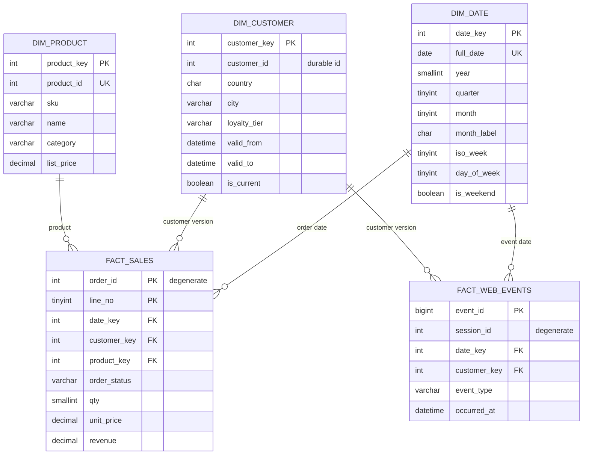
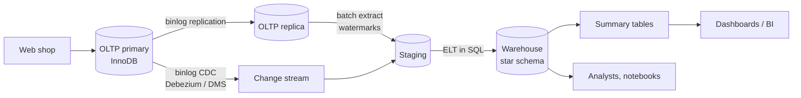

:::industry[Project brief — Fernway Outdoor, Data & Analytics]
**Client.** Fernway Outdoor (fictional) sells tents, packs, footwear, apparel and camp kitchens online in four countries. Its order system is a well-run MySQL OLTP database. Its analytics are not: every Monday an analyst runs twenty ad-hoc queries against the production primary, two of them take minutes and slow checkout, "revenue" differs by 6 % between the finance and marketing decks because one counts cancelled orders, and nobody can answer "do customers acquired in the spring sale come back?" because customer attributes are overwritten in place.

**Your job.** Build the company's first **analytics database**: a dimensional model fed by an incremental, re-runnable ETL process from the OLTP system, with data-quality checks, summary tables where they pay off, and a library of analytical queries — cohorts, retention, funnels, growth.

**Deliverables**

1. KPI definitions and a profile of the source system (Stage 1).
2. A bus matrix, declared grains, a star schema with conformed dimensions, and a date dimension (Stages 2–6).
3. Constraints appropriate to a warehouse, including SCD type 2 rules (Stage 7).
4. ELT procedures with watermarks that are atomic and idempotent, SCD2 history, and the analytical query library (Stage 8).
5. An index and summary-table strategy justified with measured plans (Stages 9 and 11).
6. A concurrency analysis of the ETL itself (Stage 10), a privacy model (Stage 12), a data-quality suite (Stage 13), and a production architecture (Stage 14).

**Acceptance criteria**

- Every KPI has one written definition and one query; revenue in the warehouse reconciles with the OLTP system to the cent.
- Running a load twice, or re-running a failed load, never duplicates or loses rows.
- An order is attributed to the customer attributes valid **when it was placed**, not today's.
- Data-quality assertions run after every load and fail loudly.
- Analysts see no names, e-mail addresses or small groups that could identify a person.

**Estimated effort:** 25–30 hours after Modules 4, 7 and 13 (in particular [Data Warehousing](/lessons/m13-data-warehousing) and [ETL and ELT](/lessons/m13-etl-elt)). In production the OLTP system and the warehouse are separate servers; in your lab they share one schema, distinguished by the prefixes `oltp_`, `stg_`, `etl_` and `dw_`. Each graded exercise runs in its own lab with a small generated data set.
:::

This is a **professional-level** project: the SQL is not exotic, but the engineering judgment is. Analytical systems fail quietly — a double-loaded day, a join that drops unmatched rows, a customer attribute overwritten in place — and the numbers still look plausible. The habits you practise here (declaring grain, reconciling counts, making every load idempotent, testing assumptions with real plans) are what separate analytics engineering from writing queries.

## 1. Requirements Gathering

### Stand up the source system

Before interviews, get the data. The OLTP schema below is the client's (simplified): customers, products, orders, order lines and a clickstream of web events. It is normalized for transactions — every fact stored once, foreign keys everywhere, indexes for point lookups. The data is generated deterministically: 3,000 customers signing up during 2024, ~23,000 orders through June 2025 with customers churning after 1–12 months, and 50,000 web sessions in the first half of 2025.

```sql run
CREATE TABLE oltp_customers (
  customer_id   INT UNSIGNED NOT NULL,
  email         VARCHAR(255) NOT NULL,
  full_name     VARCHAR(80)  NOT NULL,
  country       CHAR(2)      NOT NULL,
  city          VARCHAR(40)  NOT NULL,
  loyalty_tier  ENUM('BRONZE','SILVER','GOLD') NOT NULL DEFAULT 'BRONZE',
  signup_at     DATETIME     NOT NULL,
  updated_at    DATETIME(6)  NOT NULL,
  PRIMARY KEY (customer_id),
  UNIQUE KEY uq_customers_email (email),
  KEY idx_customers_updated (updated_at)
);
CREATE TABLE oltp_products (
  product_id  INT UNSIGNED NOT NULL,
  sku         VARCHAR(20)  NOT NULL,
  name        VARCHAR(100) NOT NULL,
  category    VARCHAR(30)  NOT NULL,
  list_price  DECIMAL(10,2) NOT NULL,
  updated_at  DATETIME(6)  NOT NULL,
  PRIMARY KEY (product_id),
  UNIQUE KEY uq_products_sku (sku),
  KEY idx_products_updated (updated_at)
);
CREATE TABLE oltp_orders (
  order_id     INT UNSIGNED NOT NULL,
  customer_id  INT UNSIGNED NOT NULL,
  status       ENUM('PLACED','SHIPPED','CANCELLED','RETURNED') NOT NULL,
  ordered_at   DATETIME     NOT NULL,
  updated_at   DATETIME(6)  NOT NULL,
  PRIMARY KEY (order_id),
  KEY idx_orders_customer (customer_id),
  KEY idx_orders_updated (updated_at),
  CONSTRAINT fk_orders_customer FOREIGN KEY (customer_id) REFERENCES oltp_customers (customer_id)
);
CREATE TABLE oltp_order_items (
  order_id    INT UNSIGNED NOT NULL,
  line_no     TINYINT UNSIGNED NOT NULL,
  product_id  INT UNSIGNED NOT NULL,
  qty         SMALLINT UNSIGNED NOT NULL,
  unit_price  DECIMAL(10,2) NOT NULL,
  PRIMARY KEY (order_id, line_no),
  CONSTRAINT fk_items_order   FOREIGN KEY (order_id)   REFERENCES oltp_orders (order_id),
  CONSTRAINT fk_items_product FOREIGN KEY (product_id) REFERENCES oltp_products (product_id)
);
CREATE TABLE oltp_events (
  event_id     BIGINT UNSIGNED NOT NULL AUTO_INCREMENT,
  session_id   INT UNSIGNED NOT NULL,
  customer_id  INT UNSIGNED NULL,
  event_type   ENUM('visit','view_product','add_to_cart','begin_checkout','purchase') NOT NULL,
  occurred_at  DATETIME NOT NULL,
  PRIMARY KEY (event_id)
);
```

```sql run
SET SESSION cte_max_recursion_depth = 60000;
INSERT INTO oltp_customers
WITH RECURSIVE s(n) AS (SELECT 1 UNION ALL SELECT n + 1 FROM s WHERE n < 3000)
SELECT n, CONCAT('customer', n, '@example.com'), CONCAT('Customer ', n),
       ELT(1 + n % 4, 'US', 'CA', 'GB', 'DE'),
       ELT(1 + n % 7, 'Portland', 'Denver', 'Toronto', 'Leeds', 'Munich', 'Austin', 'Vancouver'),
       ELT(1 + (n * 7) % 10, 'BRONZE', 'BRONZE', 'BRONZE', 'BRONZE', 'BRONZE', 'BRONZE', 'SILVER', 'SILVER', 'SILVER', 'GOLD'),
       '2024-01-01' + INTERVAL (n - 1) * 10512 SECOND,
       '2024-01-01' + INTERVAL (n - 1) * 10512 SECOND
FROM s;
INSERT INTO oltp_products
WITH RECURSIVE s(n) AS (SELECT 1 UNION ALL SELECT n + 1 FROM s WHERE n < 200)
SELECT n, CONCAT('FW-', LPAD(n, 4, '0')),
       CONCAT(ELT(1 + n % 5, 'Tent', 'Backpack', 'Hiking boot', 'Rain jacket', 'Camp stove'), ' ', n),
       ELT(1 + n % 5, 'Tents', 'Packs', 'Footwear', 'Apparel', 'Cooking'),
       10 + (n * 37) % 290, '2024-01-01'
FROM s;
INSERT INTO oltp_orders
WITH RECURSIVE s(n) AS (SELECT 1 UNION ALL SELECT n + 1 FROM s WHERE n < 30000)
SELECT n, 1 + i, IF(n % 17 = 0, 'CANCELLED', IF(n % 23 = 0, 'RETURNED', 'SHIPPED')),
       '2024-01-01' + INTERVAL i * 10512 SECOND + INTERVAL u * 3456 SECOND,
       '2024-01-01' + INTERVAL i * 10512 SECOND + INTERVAL u * 3456 SECOND + INTERVAL 1 HOUR
FROM (SELECT n, (n * 7919) % 3000 AS i,
             ((n DIV 3000) * 37 + n * 11) % 100 * (((n DIV 3000) * 53 + n * 29) % 100) AS u
      FROM s) x
WHERE '2024-01-01' + INTERVAL i * 10512 SECOND + INTERVAL u * 3456 SECOND < '2025-07-01'
  AND u * 0.04 < 30 * (1 + (i * 97) % 12);
INSERT INTO oltp_order_items
SELECT o.order_id, l.n, p.product_id, 1 + (o.order_id + l.n) % 3, p.list_price
FROM oltp_orders o
JOIN (SELECT 1 AS n UNION ALL SELECT 2 UNION ALL SELECT 3) l ON l.n <= 1 + o.order_id % 3
JOIN oltp_products p ON p.product_id = 1 + (o.order_id * 13 + l.n * 71) % 200;
INSERT INTO oltp_events (session_id, customer_id, event_type, occurred_at)
WITH RECURSIVE s(n) AS (SELECT 1 UNION ALL SELECT n + 1 FROM s WHERE n < 50000)
SELECT s.n, IF(s.n % 4 = 0, NULL, 1 + (s.n * 31) % 3000),
       ELT(st.k, 'visit', 'view_product', 'add_to_cart', 'begin_checkout', 'purchase'),
       '2025-01-01' + INTERVAL s.n * 311 SECOND + INTERVAL st.k * 40 SECOND
FROM s
JOIN (SELECT 1 AS k UNION ALL SELECT 2 UNION ALL SELECT 3 UNION ALL SELECT 4 UNION ALL SELECT 5) st
  ON st.k = 1
  OR (st.k = 2 AND s.n % 10 < 7)
  OR (st.k = 3 AND s.n % 10 < 3)
  OR (st.k = 4 AND s.n % 10 < 2 AND s.n % 3 <> 0)
  OR (st.k = 5 AND s.n % 10 < 2 AND s.n % 3 <> 0 AND s.n % 4 <> 1);
```

### Profile the source before you design anything

A data profile answers: how much, over what period, how clean, and what do the codes mean? It turns vague requirements into precise ones.

```sql run
SELECT 'orders' AS entity, COUNT(*) AS row_count, MIN(ordered_at) AS first_seen, MAX(ordered_at) AS last_seen FROM oltp_orders
UNION ALL SELECT 'order lines', COUNT(*), NULL, NULL FROM oltp_order_items
UNION ALL SELECT 'customers', COUNT(*), MIN(signup_at), MAX(signup_at) FROM oltp_customers
UNION ALL SELECT 'web events', COUNT(*), MIN(occurred_at), MAX(occurred_at) FROM oltp_events;
```

```sql run
SELECT o.status, COUNT(DISTINCT o.order_id) AS orders, SUM(i.qty * i.unit_price) AS line_value
FROM oltp_orders o JOIN oltp_order_items i ON i.order_id = o.order_id
GROUP BY o.status
ORDER BY orders DESC;
```

This one query explains the 6 % disagreement in the brief: the "revenue" in one deck sums every order line, the other excludes cancelled orders, and neither treats returns. That is not a SQL bug; it is a **missing definition**.

### Worked example — KPI definitions

| KPI | Definition (agreed with finance and marketing) | Notes for the model |
|---|---|---|
| Gross revenue | Σ qty × unit_price of order lines, **excluding CANCELLED** orders, by order date | Needs order status on the fact; order date, not ship date |
| Net revenue | Gross revenue minus lines of RETURNED orders | Status can change *after* the order — late-arriving updates |
| Orders | Count of distinct orders excluding CANCELLED | Fact grain is the line, so count distinct order ids |
| Active customers (month) | Customers with ≥ 1 non-cancelled order in the month | Durable customer id, not a dimension version key |
| Retention (month k) | Share of a first-purchase cohort with an order in month k after their first purchase | Requires each customer's first-order month |
| Funnel conversion | Share of sessions reaching each step: visit → product view → cart → checkout → purchase | Session grain; anonymous sessions included |

:::best-practice[Write the definition before the query]
Analytics disputes are almost never about SQL — they are about undefined terms. A professional KPI catalogue states the measure, the filter, the time attribute, the grain and the owner, and every dashboard links to it. When someone asks for "revenue", the first question is "gross or net, by order date or ship date, including tax and shipping?".
:::

```exercise
id: p7-ex1
title: Pin down "active customer" and "average order value"
difficulty: medium
kind: open
concepts: [requirements-analysis, kpi-definitions]
prompt: |
  Marketing asks for two more KPIs: **monthly active customers** split by loyalty tier, and **average order value
  (AOV)**. Write a precise definition for each (measure, filters, time attribute, grain), list two ambiguities
  you must resolve with the business for each, and state what each definition requires from the data model.
solution: |
  **Monthly active customers by tier.** Count of distinct durable customer ids with at least one non-cancelled
  order whose order date falls in the month; tier = the customer's tier **at the time of the order** (or at month
  end — must be decided).
  Ambiguities: (1) which tier when a customer was upgraded mid-month — the tier on each order (a customer could
  then appear under two tiers) or the tier at month end; (2) do returned orders still make a customer "active"?
  Model needs: the durable customer id on (or reachable from) the fact, and tier history — an SCD type 2
  customer dimension; counting distinct dimension *keys* would double-count customers with two versions.

  **Average order value.** Gross revenue ÷ number of distinct non-cancelled orders in the period, in the
  reporting currency.
  Ambiguities: (1) gross or net of returns, and before or after discounts, tax and shipping; (2) the average of
  per-order totals (Σ revenue ÷ Σ orders — correct) versus the average of daily AOVs (an average of averages —
  wrong unless days have equal order counts).
  Model needs: order id as a degenerate dimension on the line-level fact (to count distinct orders), the order
  status, and — for multi-currency — an exchange-rate dimension or a fact column in the reporting currency.
```

## 2. Entities and Relationships

### OLTP and OLAP model the same business differently

| | OLTP (source) | OLAP (warehouse) |
|---|---|---|
| Purpose | Run the business: place an order, update a status | Understand the business: trends, comparisons, cohorts |
| Typical query | Read/write a few rows by key, thousands per second | Read millions of rows, aggregate, a few per minute |
| Schema | Normalized (3NF), many tables, FKs | Dimensional: facts + denormalized dimensions |
| History | Current state, overwritten | History preserved (SCD), append-mostly |
| Freshness | Real time | Minutes to a day behind, by design |
| Optimized for | Write latency, concurrency, integrity | Scan and aggregation throughput, simple joins |

The warehouse does not copy the OLTP schema. It reorganizes the same facts around **business processes** (selling, browsing) and the **descriptive context** people slice by (when, who, what).

### Business processes, grain, and the bus matrix

Kimball's four-step method: choose the process, **declare the grain**, identify the dimensions, identify the facts. Grain is the single most important decision: it states exactly what one fact row means.

| Fact table | Process | Grain (one row = …) | Measures |
|---|---|---|---|
| `dw_fact_sales` | Selling | one **order line** | qty, unit_price, revenue (additive); order status (degenerate attribute) |
| `dw_fact_web_events` | Browsing | one **web event** | event count (implicitly 1 per row) |

The **bus matrix** shows which dimensions each process uses. Dimensions shared by several facts are **conformed**: the same table, keys and attribute values, so that "revenue by month" and "sessions by month" can be put side by side and divided.

| Dimension → / Fact ↓ | Date | Customer | Product | Order (degenerate) | Session (degenerate) |
|---|---|---|---|---|---|
| Sales | ✔ | ✔ | ✔ | ✔ | |
| Web events | ✔ | ✔ | | | ✔ |

Date and Customer are conformed. Product applies only to sales in v1 (events do not record which product was viewed — a gap to raise with the web team). *Degenerate* dimensions are identifiers with no attributes of their own (the order id, the session id) kept on the fact row.

### Dimensions and their history policies

- **Date** — a row per calendar day with year, quarter, month, ISO week, weekday, weekend flag (and fiscal attributes — exercise p7-ex4).
- **Customer** — country, city, loyalty tier. Tier and location change and analyses need the values **as of the order** → **SCD type 2** (a new row per version, with validity interval). Name and e-mail are **not** copied (privacy, Stage 12).
- **Product** — SKU, name, category, list price. Corrections overwrite → **SCD type 1** in v1.

```exercise
id: p7-ex2
title: Add a returns process to the bus matrix
difficulty: hard
kind: open
concepts: [dimensional-modeling, fact-grain, conformed-dimensions]
prompt: |
  Finance wants return analysis: return reasons, refund amounts, time from order to return, and return rate by
  product and customer tier. Today a return only flips the order status to RETURNED. Propose: (a) whether to
  model returns as a new fact table or as columns on `dw_fact_sales`; (b) its grain and measures; (c) its row in
  the bus matrix, including any new dimension; (d) how "return rate by product" is computed across the two facts.
solution: |
  (a) A **separate fact table**, `dw_fact_returns`. Returns are a different business process with their own time
  (return date), their own attributes (reason, condition) and possibly partial quantities; putting them on the
  sales fact forces either NULL-heavy columns or updates to historical rows and mixes two dates in one row.

  (b) Grain: one **returned order line** (order_id, line_no, return_id). Measures: returned_qty, refund_amount
  (additive), days_to_return (non-additive — average it, do not sum it).

  (c) Bus matrix row: Date (return date — a second **role** of the date dimension; the original order date can be
  a second date key), Customer (version valid at the return date, or the order's customer key — decide), Product,
  Order (degenerate), and a new small **Return reason** dimension (reason code, description, category such as
  "defective"/"changed mind").

  (d) Return rate = returned units ÷ sold units per product, computed by aggregating **each fact separately** to
  the common grain (product, month) and then joining the two aggregates on the conformed dimension keys — the
  "drill-across" pattern. Joining the two fact tables row-to-row would multiply rows and inflate both measures.
```

## 3. ER Diagram

A star schema is still an ER model — each fact is an associative entity among its dimensions, with the measures as attributes. Drawn with the fact in the middle, the shape gives the pattern its name.



Note the two keys on the customer dimension: `customer_key` is a **surrogate** that identifies a *version*; `customer_id` is the **durable** business key that identifies the *customer*. Facts point at versions; people-counting questions must count durable ids.

## 4. Schema Design

| Decision | Choice | Why |
|---|---|---|
| Dimension keys | Integer surrogates; date key as `yyyymmdd` integer | Surrogates decouple the warehouse from source key changes and make SCD2 possible; a readable date key (20250701) is a widely used exception |
| Fact primary key | The natural grain key `(order_id, line_no)` | Makes loads **idempotent**: re-loading a line updates it instead of duplicating it |
| Measures | `DECIMAL(12,2)` revenue precomputed as qty × unit_price | Additive across every dimension; exact |
| Status on the fact | Degenerate attribute `order_status` | Lets gross/net revenue be filters, and lets late status changes update the row |
| Foreign keys from facts to dimensions | **Not declared**; enforced by the ETL lookup and by data-quality assertions | Declared FKs cost a lookup per loaded row, forbid partitioning the fact table in InnoDB, and complicate reloads; integrity moves into the pipeline — a common, deliberate warehouse trade-off |
| Unknown members | Row with key 1 in customer and product dimensions ("Unknown / anonymous") | Facts never have NULL keys; unmatched rows stay countable and visible |
| ETL control | `etl_watermarks` (per source), `etl_runs` (audit log), staging tables `stg_…` | Restartable, auditable, ELT-style loads |

The contrast with the OLTP schema is deliberate. In p5 and p6, every relationship was a declared foreign key because the database was the last line of defence against bad *transactions*. In a warehouse, the only writer is the pipeline, and the defence is the pipeline's own checks.

```text
dw_dim_date        (date_key PK, full_date UK, year, quarter, month, month_label, month_name, iso_week,
                    day_of_week, day_name, is_weekend)
dw_dim_customer    (customer_key PK, customer_id, country, city, loyalty_tier, valid_from, valid_to, is_current,
                    UK (customer_id, valid_from))
dw_dim_product     (product_key PK, product_id UK, sku, name, category, list_price)
dw_fact_sales      (order_id, line_no, date_key, customer_key, product_key, order_status, qty, unit_price, revenue,
                    etl_run_id, PK (order_id, line_no))
dw_fact_web_events (event_id PK, session_id, date_key, customer_key, event_type, occurred_at)
etl_watermarks     (source_table PK, high_watermark, high_id)
etl_runs           (run_id PK, job, low_watermark, high_watermark, rows_read, rows_written)
stg_order_lines    (order_id, line_no, customer_id, product_id, order_status, ordered_at, qty, unit_price)
```

## 5. Normalization

A star schema **deliberately violates** third normal form in its dimensions. In `dw_dim_product`, product_key → category, and if categories had attributes (a category manager, a department), they would depend on category, not on the key — a transitive dependency. Normalizing them out gives a **snowflake schema** (product → category → department).

| | Star (denormalized dimensions) | Snowflake (normalized dimensions) |
|---|---|---|
| Joins per query | One per dimension | Several per dimension |
| Update anomalies | Possible — but the ETL is the only writer and rewrites attributes in bulk | Avoided |
| Storage | Slightly more (dimension tables are small anyway) | Slightly less |
| Usability for analysts and BI tools | Simple: every attribute one join from the fact | More complex SQL |

Normalization exists to protect data against anomalies caused by **many concurrent writers**. A warehouse has one writer — the pipeline — and many readers, so the balance tips towards fewer joins. The **fact** tables, on the other hand, stay normalized in the sense that matters: one row per grain, no repeated groups, measures that depend on the whole key.

The OLTP side shows why its 3NF is right for *its* job. Product name and category live only in `oltp_products`; an order line stores `product_id` and the `unit_price` actually charged (a historical fact about the line, not a copy of the list price):

```sql run
SELECT COUNT(*) AS order_lines, SUM(i.unit_price <> p.list_price) AS lines_priced_differently_from_today
FROM oltp_order_items i JOIN oltp_products p ON p.product_id = i.product_id;
```

All lines are priced at today's list price in the generated data (no price has changed yet) — but the column must exist, because the first price change would otherwise rewrite history.

```exercise
id: p7-ex3
title: Design review — snowflake the customer geography?
difficulty: medium
kind: open
concepts: [star-schema, normalization, scd-type-2]
prompt: |
  A colleague proposes moving `country` and `city` out of `dw_dim_customer` into a `dw_dim_geography`
  (geography_key, city, region, country, continent) referenced from the customer dimension — "to normalize it".
  Give one argument for and two against, and propose an alternative that keeps the benefit without the
  snowflake.
solution: |
  For: region and continent depend on city, not on the customer (a transitive dependency); a geography table
  stores each city's hierarchy once, and the hierarchy can be corrected in one place.

  Against: (1) every geographic query now needs two joins (fact → customer → geography), and BI tools handle
  snowflakes less well; (2) it entangles history: the customer dimension is SCD type 2, and if a city's region is
  corrected, should old customer versions see the old or the new region? A separate table forces you to answer
  that for every attribute, often with a second SCD.

  Alternative: keep city, region, country and continent **denormalized in the customer dimension**, populated by
  the ETL from a small, normalized `ref_geography` **staging/reference** table. The warehouse gets one-join
  usability, the reference data is maintained once, and the ETL decides explicitly whether a correction is applied
  to all versions (type 1 behaviour for that attribute) or only to new ones. If geography is also needed by facts
  that have no customer (e.g. warehouse locations), make it a **conformed** dimension of its own and reference it
  from those facts directly — still a star, not a snowflake.
```

## 6. MySQL Table Creation

### The date dimension

Every warehouse needs a date dimension. It turns "the third ISO week of Q2" or "weekends versus weekdays" into simple joins and filters, it carries attributes that no date function knows (fiscal periods, holidays, promotions), and it makes "days with no sales" visible as rows with no matching facts.

```sql run
CREATE TABLE dw_dim_date (
  date_key     INT UNSIGNED NOT NULL,
  full_date    DATE NOT NULL,
  year         SMALLINT UNSIGNED NOT NULL,
  quarter      TINYINT UNSIGNED NOT NULL,
  month        TINYINT UNSIGNED NOT NULL,
  month_label  CHAR(7) NOT NULL,
  month_name   VARCHAR(9) NOT NULL,
  iso_week     TINYINT UNSIGNED NOT NULL,
  day_of_week  TINYINT UNSIGNED NOT NULL,
  day_name     VARCHAR(9) NOT NULL,
  is_weekend   BOOLEAN NOT NULL,
  PRIMARY KEY (date_key),
  UNIQUE KEY uq_dim_date_full (full_date)
);
INSERT INTO dw_dim_date
WITH RECURSIVE d(dt) AS (SELECT DATE '2024-01-01' UNION ALL SELECT dt + INTERVAL 1 DAY FROM d WHERE dt < '2025-12-31')
SELECT CAST(DATE_FORMAT(dt, '%Y%m%d') AS UNSIGNED), dt, YEAR(dt), QUARTER(dt), MONTH(dt),
       DATE_FORMAT(dt, '%Y-%m'), MONTHNAME(dt), WEEK(dt, 3), WEEKDAY(dt) + 1, DAYNAME(dt), WEEKDAY(dt) >= 5
FROM d;
SELECT * FROM dw_dim_date WHERE full_date IN ('2024-12-30', '2025-01-01', '2025-07-05') ORDER BY date_key;
```

`WEEK(dt, 3)` is ISO-8601 week numbering — note that 30 December 2024 belongs to ISO week **1** of 2025, which is exactly the kind of rule a date dimension computes once so that nobody gets it wrong in a report. (`MONTHNAME`/`DAYNAME` follow the session's `lc_time_names`, `en_US` by default.)

### Dimensions, facts and ETL control

```sql run
CREATE TABLE dw_dim_customer (
  customer_key  INT UNSIGNED NOT NULL AUTO_INCREMENT,
  customer_id   INT UNSIGNED NOT NULL,
  country       CHAR(2)     NOT NULL,
  city          VARCHAR(40) NOT NULL,
  loyalty_tier  VARCHAR(10) NOT NULL,
  valid_from    DATETIME(6) NOT NULL,
  valid_to      DATETIME(6) NOT NULL DEFAULT '9999-12-31 00:00:00',
  is_current    BOOLEAN NOT NULL DEFAULT TRUE,
  PRIMARY KEY (customer_key),
  UNIQUE KEY uq_dim_customer_version (customer_id, valid_from)
);
CREATE TABLE dw_dim_product (
  product_key  INT UNSIGNED NOT NULL AUTO_INCREMENT,
  product_id   INT UNSIGNED NOT NULL,
  sku          VARCHAR(20)  NOT NULL,
  name         VARCHAR(100) NOT NULL,
  category     VARCHAR(30)  NOT NULL,
  list_price   DECIMAL(10,2) NULL,
  PRIMARY KEY (product_key),
  UNIQUE KEY uq_dim_product_id (product_id)
);
CREATE TABLE dw_fact_sales (
  order_id      INT UNSIGNED NOT NULL,
  line_no       TINYINT UNSIGNED NOT NULL,
  date_key      INT UNSIGNED NOT NULL,
  customer_key  INT UNSIGNED NOT NULL,
  product_key   INT UNSIGNED NOT NULL,
  order_status  VARCHAR(10) NOT NULL,
  qty           SMALLINT UNSIGNED NOT NULL,
  unit_price    DECIMAL(10,2) NOT NULL,
  revenue       DECIMAL(12,2) NOT NULL,
  etl_run_id    INT UNSIGNED NOT NULL,
  PRIMARY KEY (order_id, line_no),
  KEY idx_fact_sales_date (date_key),
  KEY idx_fact_sales_customer (customer_key),
  KEY idx_fact_sales_product (product_key)
);
CREATE TABLE dw_fact_web_events (
  event_id      BIGINT UNSIGNED NOT NULL,
  session_id    INT UNSIGNED NOT NULL,
  date_key      INT UNSIGNED NOT NULL,
  customer_key  INT UNSIGNED NOT NULL,
  event_type    VARCHAR(20) NOT NULL,
  occurred_at   DATETIME NOT NULL,
  PRIMARY KEY (event_id),
  KEY idx_fact_events_session (session_id),
  KEY idx_fact_events_date (date_key)
);
CREATE TABLE etl_watermarks (
  source_table    VARCHAR(64) NOT NULL,
  high_watermark  DATETIME(6) NULL,
  high_id         BIGINT UNSIGNED NULL,
  PRIMARY KEY (source_table)
);
CREATE TABLE etl_runs (
  run_id          INT UNSIGNED NOT NULL AUTO_INCREMENT,
  job             VARCHAR(30) NOT NULL,
  low_watermark   DATETIME(6) NULL,
  high_watermark  DATETIME(6) NULL,
  rows_read       INT UNSIGNED NULL,
  rows_written    INT UNSIGNED NULL,
  PRIMARY KEY (run_id)
);
CREATE TABLE stg_order_lines (
  order_id      INT UNSIGNED NOT NULL,
  line_no       TINYINT UNSIGNED NOT NULL,
  customer_id   INT UNSIGNED NOT NULL,
  product_id    INT UNSIGNED NOT NULL,
  order_status  VARCHAR(10) NOT NULL,
  ordered_at    DATETIME NOT NULL,
  qty           SMALLINT UNSIGNED NOT NULL,
  unit_price    DECIMAL(10,2) NOT NULL,
  PRIMARY KEY (order_id, line_no)
);
INSERT INTO dw_dim_customer (customer_key, customer_id, country, city, loyalty_tier, valid_from)
VALUES (1, 0, '--', 'Unknown', 'UNKNOWN', '1900-01-01');
INSERT INTO dw_dim_product (product_key, product_id, sku, name, category, list_price)
VALUES (1, 0, 'UNKNOWN', 'Unknown product', 'Unknown', NULL);
INSERT INTO etl_watermarks VALUES ('oltp_customers', '1900-01-01', NULL), ('oltp_products', '1900-01-01', NULL),
                                  ('oltp_orders', '1900-01-01', NULL), ('oltp_events', NULL, 0);
```

```exercise
id: p7-ex4
title: Add the fiscal calendar to the date dimension
difficulty: medium
kind: dml
concepts: [date-dimension]
setup: |
  SET SESSION cte_max_recursion_depth = 1000;
  CREATE TABLE dw_dim_date (date_key INT UNSIGNED NOT NULL PRIMARY KEY, full_date DATE NOT NULL UNIQUE, year SMALLINT UNSIGNED NOT NULL, quarter TINYINT UNSIGNED NOT NULL, month TINYINT UNSIGNED NOT NULL, is_weekend BOOLEAN NOT NULL);
  INSERT INTO dw_dim_date WITH RECURSIVE d(dt) AS (SELECT DATE '2024-01-01' UNION ALL SELECT dt + INTERVAL 1 DAY FROM d WHERE dt < '2025-12-31') SELECT CAST(DATE_FORMAT(dt, '%Y%m%d') AS UNSIGNED), dt, YEAR(dt), QUARTER(dt), MONTH(dt), WEEKDAY(dt) >= 5 FROM d;
prompt: |
  Fernway's fiscal year starts on **1 July** and is named after the calendar year in which it **ends**
  (1 July 2024 – 30 June 2025 is fiscal year 2025). Add to `dw_dim_date`:

  - `fiscal_year SMALLINT UNSIGNED NOT NULL`
  - `fiscal_quarter TINYINT UNSIGNED NOT NULL` — Q1 = July–September, …, Q4 = April–June
  - `is_holiday BOOLEAN NOT NULL DEFAULT FALSE` — set to TRUE for 2024-07-04, 2024-12-25, 2025-07-04 and 2025-12-25

  and populate them for every row. The grader summarizes the table by fiscal year and quarter.
hints:
  - "ALTER TABLE … ADD COLUMN … with a temporary DEFAULT (or add them as NULL), then UPDATE every row, then (optionally) tighten to NOT NULL."
  - "fiscal_year = year + (month >= 7); fiscal_quarter = ((month + 5) % 12) DIV 3 + 1."
solution: |
  ALTER TABLE dw_dim_date
    ADD COLUMN fiscal_year SMALLINT UNSIGNED NOT NULL DEFAULT 0,
    ADD COLUMN fiscal_quarter TINYINT UNSIGNED NOT NULL DEFAULT 0,
    ADD COLUMN is_holiday BOOLEAN NOT NULL DEFAULT FALSE;
  UPDATE dw_dim_date
  SET fiscal_year = year + (month >= 7),
      fiscal_quarter = ((month + 5) % 12) DIV 3 + 1,
      is_holiday = full_date IN ('2024-07-04', '2024-12-25', '2025-07-04', '2025-12-25');
check: |
  SELECT fiscal_year, fiscal_quarter, MIN(full_date) AS starts, MAX(full_date) AS ends,
         COUNT(*) AS days, SUM(is_holiday) AS holidays
  FROM dw_dim_date GROUP BY fiscal_year, fiscal_quarter ORDER BY fiscal_year, fiscal_quarter;
explanation: |
  The expected summary starts with fiscal 2024 Q3 (Jan–Mar 2024) and ends with fiscal 2026 Q2 (Oct–Dec 2025).
  This is the business case for a date dimension: "revenue by fiscal quarter" becomes
  `GROUP BY d.fiscal_year, d.fiscal_quarter` for every analyst, instead of a CASE expression re-implemented (and
  occasionally wrong) in every report. Holidays are pure data — no function can compute them — and they differ by
  country, which in a multi-country warehouse leads to a holiday table keyed by (date, country) or a set of
  per-country flags.
```

## 7. Constraints and Relationships

Warehouse constraints protect what the pipeline cannot easily check row by row, and above all the **SCD2 invariants**:

1. A version's interval is non-empty: `valid_from < valid_to`.
2. Versions of one customer do not overlap and leave no gaps.
3. Exactly one version is current, and it is the one with `valid_to = '9999-12-31'`.

Rule 1 is a CHECK; part of rule 3 ("at most one current") can be a unique index over a generated column (the same NULL-trick used for lead instructors in project p6); rules 2 and the "at least one" part of 3 span rows and become data-quality assertions (Stage 13).

```sql run
ALTER TABLE dw_dim_customer
  ADD CONSTRAINT chk_dim_customer_interval CHECK (valid_from < valid_to),
  ADD CONSTRAINT chk_dim_customer_current CHECK (is_current = (valid_to = '9999-12-31 00:00:00'));
ALTER TABLE dw_fact_sales
  ADD CONSTRAINT chk_fact_sales_revenue CHECK (revenue = qty * unit_price),
  ADD CONSTRAINT chk_fact_sales_status CHECK (order_status IN ('PLACED', 'SHIPPED', 'CANCELLED', 'RETURNED'));
```

```sql run error
INSERT INTO dw_dim_customer (customer_id, country, city, loyalty_tier, valid_from, valid_to, is_current)
VALUES (42, 'US', 'Denver', 'GOLD', '2025-03-01', '2025-02-01', FALSE);
```

```sql run error
INSERT INTO dw_fact_sales VALUES (999999, 1, 20250101, 1, 1, 'SHIPPED', 2, 10.00, 25.00, 0);
```

`chk_fact_sales_revenue` is a cheap guard against a whole class of transformation bugs (a revenue computed from the list price instead of the charged price, a currency conversion applied twice). On a fact table loaded in bulk it costs a multiplication per row — negligible next to the I/O.

```exercise
id: p7-ex5
title: At most one current version per customer
difficulty: hard
kind: dml
concepts: [scd-type-2, generated-columns, unique-constraints]
setup: |
  CREATE TABLE dw_dim_customer (customer_key INT UNSIGNED NOT NULL AUTO_INCREMENT PRIMARY KEY, customer_id INT UNSIGNED NOT NULL, loyalty_tier VARCHAR(10) NOT NULL, valid_from DATETIME(6) NOT NULL, valid_to DATETIME(6) NOT NULL DEFAULT '9999-12-31 00:00:00', is_current BOOLEAN NOT NULL DEFAULT TRUE, UNIQUE KEY uq_dim_customer_version (customer_id, valid_from));
  INSERT INTO dw_dim_customer (customer_id, loyalty_tier, valid_from, valid_to, is_current) VALUES (7, 'BRONZE', '2024-02-01', '2025-03-10 09:00:00', FALSE), (7, 'SILVER', '2025-03-10 09:00:00', '9999-12-31', TRUE), (8, 'GOLD', '2024-05-05', '9999-12-31', TRUE);
prompt: |
  A buggy merge once inserted a second current row for a customer. Make that impossible in the database:

  - add a stored or virtual generated column **`current_marker`** that is 1 for current rows and NULL otherwise;
  - add a unique index **`uq_dim_customer_one_current`** on (customer_id, current_marker);
  - add a CHECK **`chk_dim_customer_interval`** requiring valid_from < valid_to.

  The grader then tries, with `INSERT IGNORE`, a second current version for customer 7, a valid historical
  version for customer 8, an empty interval, and a new current customer 9 — and lists the dimension.
hints:
  - "ADD COLUMN current_marker TINYINT AS (IF(is_current, 1, NULL)) VIRTUAL, ADD UNIQUE KEY … (customer_id, current_marker)."
  - "UNIQUE indexes allow many NULLs, so historical rows never conflict."
solution: |
  ALTER TABLE dw_dim_customer
    ADD COLUMN current_marker TINYINT AS (IF(is_current, 1, NULL)) VIRTUAL,
    ADD UNIQUE KEY uq_dim_customer_one_current (customer_id, current_marker),
    ADD CONSTRAINT chk_dim_customer_interval CHECK (valid_from < valid_to);
check: |
  INSERT IGNORE INTO dw_dim_customer (customer_id, loyalty_tier, valid_from, valid_to, is_current) VALUES
    (7, 'GOLD',   '2025-06-01', '9999-12-31', TRUE),
    (8, 'SILVER', '2024-01-10', '2024-05-05', FALSE),
    (8, 'BRONZE', '2024-03-01', '2024-03-01', FALSE),
    (9, 'BRONZE', '2025-06-20', '9999-12-31', TRUE);
  SELECT customer_id, loyalty_tier, valid_from, valid_to, is_current
  FROM dw_dim_customer ORDER BY customer_id, valid_from;
explanation: |
  Customer 7 keeps exactly one current version (SILVER); the second current GOLD row is rejected by the unique
  index. Customer 8 gains a valid earlier version; the empty interval fails the CHECK; customer 9 is new. What the
  index cannot enforce: that customer 7's versions are contiguous, or that a customer has *at least* one current
  version — the Stage 13 assertions cover those. Notice also that the index makes the merge order matter: a
  merge must **expire** the old current row before inserting the new one, or its own insert violates the index —
  exactly the order the SCD2 procedure in Stage 8 uses.
```

## 8. SQL Implementation

### ETL or ELT?

Classical **ETL** transforms data in a separate engine before loading it. **ELT** loads raw (or lightly filtered) data into staging tables inside the analytical database and transforms it there with SQL. Because our source and target are both MySQL — and because SQL transformations are testable, reviewable and set-based — the pipeline is ELT: extract changed rows into `stg_` tables, transform and merge into `dw_` tables, and record what happened in `etl_runs`.

Every job follows the same contract:

1. **Read the watermark** and lock it (`FOR UPDATE`) so two runs of the same job cannot overlap.
2. **Extract** source rows with `low < updated_at ≤ high`, where `high` is fixed *before* reading — a half-open, gap-free window.
3. **Merge** into the target by its natural key (insert new, update changed) — re-running the window changes nothing.
4. **Advance the watermark and write the run log in the same transaction** as the merge — a failed run leaves no trace and is simply retried.

The upper bound `p_high` is a parameter: in production the scheduler passes `NOW(6)` minus a safety lag (Stage 10 explains why); here an explicit timestamp makes every run reproducible.

### SCD type 2 for customers

```sql run
CREATE PROCEDURE etl_load_customers(IN p_high DATETIME(6))
BEGIN
  DECLARE v_low DATETIME(6);
  DECLARE v_expired INT;
  DECLARE v_inserted INT;
  START TRANSACTION;
  SELECT high_watermark INTO v_low FROM etl_watermarks WHERE source_table = 'oltp_customers' FOR UPDATE;
  -- 1. close the current version of every customer whose tracked attributes changed in the window
  UPDATE dw_dim_customer d
  JOIN oltp_customers c ON c.customer_id = d.customer_id
  SET d.valid_to = c.updated_at, d.is_current = FALSE
  WHERE d.is_current
    AND c.updated_at > v_low AND c.updated_at <= p_high
    AND (d.country <> c.country OR d.city <> c.city OR d.loyalty_tier <> c.loyalty_tier);
  SET v_expired = ROW_COUNT();
  -- 2. open a version for every changed or new customer without a current version
  INSERT INTO dw_dim_customer (customer_id, country, city, loyalty_tier, valid_from)
  SELECT c.customer_id, c.country, c.city, c.loyalty_tier,
         IF(EXISTS (SELECT 1 FROM dw_dim_customer h WHERE h.customer_id = c.customer_id), c.updated_at, c.signup_at)
  FROM oltp_customers c
  WHERE c.updated_at > v_low AND c.updated_at <= p_high
    AND NOT EXISTS (SELECT 1 FROM dw_dim_customer d WHERE d.customer_id = c.customer_id AND d.is_current);
  SET v_inserted = ROW_COUNT();
  UPDATE etl_watermarks SET high_watermark = p_high WHERE source_table = 'oltp_customers';
  INSERT INTO etl_runs (job, low_watermark, high_watermark, rows_read, rows_written)
  VALUES ('customers', v_low, p_high, v_expired, v_inserted);
  COMMIT;
END
```

The expired version ends exactly where the new one begins (`valid_to` = `valid_from` = the change time), and validity intervals are half-open — `valid_from ≤ t < valid_to` — so every moment belongs to exactly one version. Step 1 must run before step 2: step 2 finds "customers without a current version", which after step 1 includes exactly the changed ones.

### SCD type 1 for products, and the sales fact

```sql run
CREATE PROCEDURE etl_load_products(IN p_high DATETIME(6))
BEGIN
  DECLARE v_low DATETIME(6);
  DECLARE v_rows INT;
  START TRANSACTION;
  SELECT high_watermark INTO v_low FROM etl_watermarks WHERE source_table = 'oltp_products' FOR UPDATE;
  INSERT INTO dw_dim_product (product_id, sku, name, category, list_price)
  SELECT * FROM (SELECT product_id, sku, name, category, list_price
                 FROM oltp_products WHERE updated_at > v_low AND updated_at <= p_high) AS src
  ON DUPLICATE KEY UPDATE sku = src.sku, name = src.name, category = src.category, list_price = src.list_price;
  SET v_rows = ROW_COUNT();
  UPDATE etl_watermarks SET high_watermark = p_high WHERE source_table = 'oltp_products';
  INSERT INTO etl_runs (job, low_watermark, high_watermark, rows_written) VALUES ('products', v_low, p_high, v_rows);
  COMMIT;
END
```

```sql run
CREATE PROCEDURE etl_load_sales(IN p_high DATETIME(6))
BEGIN
  DECLARE v_low DATETIME(6);
  DECLARE v_run INT UNSIGNED;
  DECLARE v_read INT;
  START TRANSACTION;
  SELECT high_watermark INTO v_low FROM etl_watermarks WHERE source_table = 'oltp_orders' FOR UPDATE;
  INSERT INTO etl_runs (job, low_watermark, high_watermark) VALUES ('sales', v_low, p_high);
  SET v_run = LAST_INSERT_ID();
  DELETE FROM stg_order_lines;
  INSERT INTO stg_order_lines (order_id, line_no, customer_id, product_id, order_status, ordered_at, qty, unit_price)
  SELECT o.order_id, i.line_no, o.customer_id, i.product_id, o.status, o.ordered_at, i.qty, i.unit_price
  FROM oltp_orders o JOIN oltp_order_items i ON i.order_id = o.order_id
  WHERE o.updated_at > v_low AND o.updated_at <= p_high;
  SET v_read = ROW_COUNT();
  INSERT INTO dw_fact_sales (order_id, line_no, date_key, customer_key, product_key, order_status, qty, unit_price, revenue, etl_run_id)
  SELECT * FROM (
    SELECT s.order_id, s.line_no, CAST(DATE_FORMAT(s.ordered_at, '%Y%m%d') AS UNSIGNED) AS date_key,
           COALESCE(c.customer_key, 1) AS customer_key, COALESCE(p.product_key, 1) AS product_key,
           s.order_status, s.qty, s.unit_price, s.qty * s.unit_price AS revenue, v_run AS etl_run_id
    FROM stg_order_lines s
    LEFT JOIN dw_dim_customer c ON c.customer_id = s.customer_id
                               AND s.ordered_at >= c.valid_from AND s.ordered_at < c.valid_to
    LEFT JOIN dw_dim_product p  ON p.product_id = s.product_id
  ) AS src
  ON DUPLICATE KEY UPDATE date_key = src.date_key, customer_key = src.customer_key, product_key = src.product_key,
                          order_status = src.order_status, qty = src.qty, unit_price = src.unit_price,
                          revenue = src.revenue, etl_run_id = src.etl_run_id;
  UPDATE etl_runs SET rows_read = v_read, rows_written = v_read WHERE run_id = v_run;
  UPDATE etl_watermarks SET high_watermark = p_high WHERE source_table = 'oltp_orders';
  COMMIT;
END
```

Three details carry the design:

- **`DELETE FROM stg_order_lines`, not `TRUNCATE`.** `TRUNCATE TABLE` is DDL in MySQL and causes an **implicit commit** — it would commit the half-finished transaction, including the locked watermark row's transaction, and destroy atomicity.
- **The point-in-time join** `ordered_at >= valid_from AND ordered_at < valid_to` picks the customer version valid when the order was placed. That is what SCD2 is *for*.
- **`LEFT JOIN … COALESCE(key, 1)`** maps an unmatched customer or product to the unknown member instead of silently dropping the line — an inner join would make revenue disappear without an error. The data-quality suite counts unknown-member rows.

### Initial load

The first run uses the same procedures, with the watermark at its initial value:

```sql run
CALL etl_load_customers('2025-07-01 00:00:00');
CALL etl_load_products('2025-07-01 00:00:00');
CALL etl_load_sales('2025-07-01 00:00:00');
SELECT run_id, job, low_watermark, high_watermark, rows_read, rows_written FROM etl_runs ORDER BY run_id;
```

Web events are append-only (events are never updated), so their watermark is the highest loaded `event_id`, not a timestamp. The initial load is a plain bulk insert with the same point-in-time customer lookup; writing the incremental version is exercise p7-ex6.

```sql run
INSERT INTO dw_fact_web_events (event_id, session_id, date_key, customer_key, event_type, occurred_at)
SELECT e.event_id, e.session_id, CAST(DATE_FORMAT(e.occurred_at, '%Y%m%d') AS UNSIGNED),
       COALESCE(c.customer_key, 1), e.event_type, e.occurred_at
FROM oltp_events e
LEFT JOIN dw_dim_customer c ON c.customer_id = e.customer_id
                           AND e.occurred_at >= c.valid_from AND e.occurred_at < c.valid_to;
UPDATE etl_watermarks SET high_id = (SELECT MAX(event_id) FROM dw_fact_web_events) WHERE source_table = 'oltp_events';
SELECT (SELECT COUNT(*) FROM dw_fact_web_events) AS events_loaded,
       (SELECT COUNT(*) FROM dw_fact_web_events WHERE customer_key = 1) AS anonymous_events;
```

### A day of new activity, and an incremental run

On 1 July 2025 the OLTP system does what it does every day. The loyalty service re-evaluates 40 customers (bronze moves to silver, silver to gold, gold stays gold — but every re-evaluated row gets a new `updated_at`), two of them also move to Seattle, 25 recent shipped orders are returned, and new orders arrive — some from the customers just re-evaluated.

```sql run
UPDATE oltp_customers
SET loyalty_tier = IF(loyalty_tier = 'BRONZE', 'SILVER', 'GOLD'),
    city = IF(customer_id IN (17, 2017), 'Seattle', city),
    updated_at = '2025-07-01 09:00:00'
WHERE customer_id % 75 = 17;
UPDATE oltp_orders SET status = 'RETURNED', updated_at = '2025-07-01 12:00:00'
WHERE status = 'SHIPPED' AND ordered_at >= '2025-05-01' AND order_id % 10 = 3
ORDER BY order_id LIMIT 25;
INSERT INTO oltp_orders (order_id, customer_id, status, ordered_at, updated_at)
SELECT 30000 + customer_id, customer_id, 'PLACED', '2025-07-01 15:00:00', '2025-07-01 15:00:00'
FROM oltp_customers WHERE customer_id % 75 = 17 OR customer_id % 101 = 0;
INSERT INTO oltp_order_items (order_id, line_no, product_id, qty, unit_price)
SELECT o.order_id, 1, p.product_id, 1, p.list_price
FROM oltp_orders o JOIN oltp_products p ON p.product_id = 1 + o.order_id % 200
WHERE o.order_id > 30000;
SELECT ROW_COUNT() AS new_order_lines;
```

```sql run
CALL etl_load_customers('2025-07-02 00:00:00');
CALL etl_load_products('2025-07-02 00:00:00');
CALL etl_load_sales('2025-07-02 00:00:00');
SELECT run_id, job, low_watermark, high_watermark, rows_read, rows_written FROM etl_runs WHERE run_id > 3 ORDER BY run_id;
```

Read the run log carefully. The customer job saw 40 touched rows but expired and re-opened only the customers whose **tracked attributes** actually changed — a gold customer who "stayed gold" got a new `updated_at` but correctly no new version (customer 17, already gold, got one only because of the move to Seattle). The sales job read only the order lines touched on 1 July: the new orders' lines *and* the lines of the returned orders, whose fact rows were updated in place. Customer 2792 was upgraded from bronze to silver; its history and the attribution of its recent orders:

```sql run
SELECT customer_key, customer_id, city, loyalty_tier, valid_from, valid_to, is_current
FROM dw_dim_customer WHERE customer_id = 2792 ORDER BY valid_from;
SELECT f.order_id, f.line_no, f.date_key, f.customer_key, c.loyalty_tier
FROM dw_fact_sales f JOIN dw_dim_customer c ON c.customer_key = f.customer_key
WHERE c.customer_id = 2792 AND f.date_key >= 20250301
ORDER BY f.order_id, f.line_no;
```

The four orders placed between March and June point at the bronze version (key 2793), the 1 July order at the silver one. Had the dimension been type 1, every historical order would now be reported under the new tier and city — and "revenue by tier" for last year would change every time someone was upgraded.

**Idempotency, demonstrated.** A scheduler retries a run after a timeout, not knowing whether it committed. Simulate the worst case — the watermark is reset and the same window loaded again — and compare a checksum of the fact table:

```sql run
SELECT COUNT(*) AS fact_rows, SUM(revenue) AS revenue, SUM(order_status = 'RETURNED') AS returned_lines FROM dw_fact_sales;
UPDATE etl_watermarks SET high_watermark = '2025-07-01 00:00:00' WHERE source_table = 'oltp_orders';
CALL etl_load_sales('2025-07-02 00:00:00');
SELECT COUNT(*) AS fact_rows, SUM(revenue) AS revenue, SUM(order_status = 'RETURNED') AS returned_lines FROM dw_fact_sales;
```

Identical. Because the merge is keyed on the grain (`order_id, line_no`), loading a window twice updates rows to the values they already have. An append-only `INSERT` would have doubled every 1 July line.

```exercise
id: p7-ex6
title: Incremental load of web events
difficulty: hard
kind: dml
concepts: [incremental-load, watermarks, idempotency]
setup: |
  CREATE TABLE oltp_events (event_id BIGINT UNSIGNED NOT NULL AUTO_INCREMENT PRIMARY KEY, session_id INT UNSIGNED NOT NULL, customer_id INT UNSIGNED NULL, event_type VARCHAR(20) NOT NULL, occurred_at DATETIME NOT NULL);
  CREATE TABLE dw_dim_customer (customer_key INT UNSIGNED NOT NULL PRIMARY KEY, customer_id INT UNSIGNED NOT NULL, valid_from DATETIME(6) NOT NULL, valid_to DATETIME(6) NOT NULL);
  INSERT INTO dw_dim_customer VALUES (1, 0, '1900-01-01', '9999-12-31'), (2, 50, '2024-01-01', '2025-03-01 10:00:00'), (3, 50, '2025-03-01 10:00:00', '9999-12-31'), (4, 60, '2024-06-01', '9999-12-31');
  CREATE TABLE dw_fact_web_events (event_id BIGINT UNSIGNED NOT NULL PRIMARY KEY, session_id INT UNSIGNED NOT NULL, date_key INT UNSIGNED NOT NULL, customer_key INT UNSIGNED NOT NULL, event_type VARCHAR(20) NOT NULL, occurred_at DATETIME NOT NULL);
  CREATE TABLE etl_watermarks (source_table VARCHAR(64) NOT NULL PRIMARY KEY, high_watermark DATETIME(6) NULL, high_id BIGINT UNSIGNED NULL);
  INSERT INTO etl_watermarks VALUES ('oltp_events', NULL, 3);
  INSERT INTO oltp_events (session_id, customer_id, event_type, occurred_at) VALUES (1, 50, 'visit', '2025-02-28 20:00:00'), (1, 50, 'view_product', '2025-02-28 20:01:00'), (2, NULL, 'visit', '2025-03-01 09:00:00'), (3, 50, 'visit', '2025-03-02 08:00:00'), (3, 50, 'add_to_cart', '2025-03-02 08:03:00'), (4, 60, 'visit', '2025-03-02 11:00:00'), (5, 99, 'visit', '2025-03-02 12:00:00');
  INSERT INTO dw_fact_web_events VALUES (1, 1, 20250228, 2, 'visit', '2025-02-28 20:00:00'), (2, 1, 20250228, 2, 'view_product', '2025-02-28 20:01:00'), (3, 2, 20250301, 1, 'visit', '2025-03-01 09:00:00');
prompt: |
  Write **`etl_load_events(IN p_high_id BIGINT UNSIGNED)`** that, in **one transaction**:

  1. reads and locks `etl_watermarks.high_id` for `'oltp_events'`;
  2. inserts every source event with `high_id < event_id <= p_high_id` into `dw_fact_web_events`, with
     `date_key` = the event date as `yyyymmdd`, and `customer_key` = the customer version valid at `occurred_at`
     (half-open interval), or the unknown member **1** for anonymous events and unknown customers;
  3. sets the watermark to `p_high_id`; commits.

  The load must be **idempotent**: re-running it after the watermark was reset must not fail or duplicate rows.
  The grader calls it with 7, resets the watermark to 3, calls it with 7 again, and lists the fact table.
hints:
  - "Read the watermark with SELECT high_id INTO v_low … FOR UPDATE inside the transaction."
  - "Point-in-time lookup: LEFT JOIN dw_dim_customer c ON c.customer_id = e.customer_id AND e.occurred_at >= c.valid_from AND e.occurred_at < c.valid_to, then COALESCE(c.customer_key, 1)."
  - "For idempotency, use INSERT IGNORE or INSERT … ON DUPLICATE KEY UPDATE on the event_id primary key — a plain INSERT fails with error 1062 on the re-run."
solution: |
  CREATE PROCEDURE etl_load_events(IN p_high_id BIGINT UNSIGNED)
  BEGIN
    DECLARE v_low BIGINT UNSIGNED;
    START TRANSACTION;
    SELECT high_id INTO v_low FROM etl_watermarks WHERE source_table = 'oltp_events' FOR UPDATE;
    INSERT INTO dw_fact_web_events (event_id, session_id, date_key, customer_key, event_type, occurred_at)
    SELECT * FROM (
      SELECT e.event_id, e.session_id, CAST(DATE_FORMAT(e.occurred_at, '%Y%m%d') AS UNSIGNED) AS date_key,
             COALESCE(c.customer_key, 1) AS customer_key, e.event_type, e.occurred_at
      FROM oltp_events e
      LEFT JOIN dw_dim_customer c ON c.customer_id = e.customer_id
                                 AND e.occurred_at >= c.valid_from AND e.occurred_at < c.valid_to
      WHERE e.event_id > v_low AND e.event_id <= p_high_id
    ) AS src
    ON DUPLICATE KEY UPDATE session_id = src.session_id, date_key = src.date_key, customer_key = src.customer_key,
                            event_type = src.event_type, occurred_at = src.occurred_at;
    UPDATE etl_watermarks SET high_id = p_high_id WHERE source_table = 'oltp_events';
    COMMIT;
  END
check: |
  CALL etl_load_events(7);
  UPDATE etl_watermarks SET high_id = 3 WHERE source_table = 'oltp_events';
  CALL etl_load_events(7);
  SELECT f.event_id, f.session_id, f.date_key, f.customer_key, f.event_type,
         (SELECT high_id FROM etl_watermarks WHERE source_table = 'oltp_events') AS watermark
  FROM dw_fact_web_events f ORDER BY f.event_id;
explanation: |
  Seven rows result. Events 4 and 5 belong to customer 50 **after** the version change at 2025-03-01 10:00, so
  they get key 3, not 2; event 7 (customer 99, unknown to the dimension) gets the unknown member 1, as does the
  anonymous event 3. An inner join would have dropped event 7 silently. Using an id watermark is safe only
  because ids are assigned in commit order closely enough for an append-only table — strictly, AUTO_INCREMENT
  values are assigned at insert time, not commit time, so a long transaction can commit a *lower* id after a
  higher one was already loaded; production pipelines either read with a safety margin (load up to
  `MAX(event_id) − k`) or use change data capture from the binary log (Stage 10). `INSERT IGNORE` would also make
  the re-run idempotent here, but it silently ignores *other* errors too (e.g. CHECK violations become warnings),
  which is why the explicit ON DUPLICATE KEY UPDATE is preferred.
```

```exercise
id: p7-ex7
title: Hybrid SCD — type 2 for tier, type 1 for city
difficulty: challenge
kind: dml
concepts: [scd-type-2, scd-type-1, merge]
setup: |
  CREATE TABLE oltp_customers (customer_id INT UNSIGNED NOT NULL PRIMARY KEY, city VARCHAR(40) NOT NULL, loyalty_tier VARCHAR(10) NOT NULL, signup_at DATETIME NOT NULL, updated_at DATETIME(6) NOT NULL);
  INSERT INTO oltp_customers VALUES (1, 'Portland', 'BRONZE', '2024-01-05', '2024-01-05'), (2, 'Denver', 'SILVER', '2024-02-10', '2024-02-10'), (3, 'Leeds', 'BRONZE', '2024-03-15', '2024-03-15');
  CREATE TABLE dw_dim_customer (customer_key INT UNSIGNED NOT NULL AUTO_INCREMENT PRIMARY KEY, customer_id INT UNSIGNED NOT NULL, city VARCHAR(40) NOT NULL, loyalty_tier VARCHAR(10) NOT NULL, valid_from DATETIME(6) NOT NULL, valid_to DATETIME(6) NOT NULL DEFAULT '9999-12-31 00:00:00', is_current BOOLEAN NOT NULL DEFAULT TRUE, UNIQUE KEY uq_version (customer_id, valid_from));
  INSERT INTO dw_dim_customer (customer_id, city, loyalty_tier, valid_from, valid_to, is_current) VALUES (1, 'Portlnd', 'BRONZE', '2024-01-05', '2024-11-01 10:00:00', FALSE), (1, 'Portlnd', 'SILVER', '2024-11-01 10:00:00', '9999-12-31', TRUE), (2, 'Denver', 'SILVER', '2024-02-10', '9999-12-31', TRUE), (3, 'Leeds', 'BRONZE', '2024-03-15', '9999-12-31', TRUE);
  UPDATE oltp_customers SET city = 'Portland', loyalty_tier = 'GOLD', updated_at = '2025-07-01 09:00:00' WHERE customer_id = 1;
  UPDATE oltp_customers SET city = 'Boulder', updated_at = '2025-07-01 09:30:00' WHERE customer_id = 2;
  UPDATE oltp_customers SET loyalty_tier = 'SILVER', updated_at = '2025-07-01 10:00:00' WHERE customer_id = 3;
  INSERT INTO oltp_customers VALUES (4, 'Munich', 'BRONZE', '2025-07-01 11:00:00', '2025-07-01 11:00:00');
prompt: |
  Analysts decided that a **city** change is a correction (type 1: overwrite it in **every** version of the
  customer), while a **loyalty_tier** change is history (type 2: expire the current version at `updated_at` and
  open a new one). Write the merge for the window `updated_at > '2025-07-01'` (no procedure needed — plain
  statements are fine) so that, afterwards:

  - customer 1 (city typo fixed **and** upgraded to GOLD) has its city corrected in all versions and a new GOLD version;
  - customer 2 (moved city only) has the new city in its single version — no new version;
  - customer 3 (tier change only) has a new version;
  - new customer 4 has its first version starting at `signup_at`.

  The grader lists the whole dimension.
hints:
  - "Order matters: (1) type 1 — UPDATE all versions' city from the source; (2) type 2 — expire current rows whose tier differs; (3) insert a version for every customer in the window without a current row."
  - "Doing the type-1 update first means step 2 compares only the type-2 attribute, so a pure city fix never creates a version."
  - "For a brand-new customer valid_from is signup_at; for a changed one it is updated_at (the moment the old version was closed)."
solution: |
  UPDATE dw_dim_customer d
  JOIN oltp_customers c ON c.customer_id = d.customer_id
  SET d.city = c.city
  WHERE c.updated_at > '2025-07-01' AND d.city <> c.city;
  UPDATE dw_dim_customer d
  JOIN oltp_customers c ON c.customer_id = d.customer_id
  SET d.valid_to = c.updated_at, d.is_current = FALSE
  WHERE d.is_current AND c.updated_at > '2025-07-01' AND d.loyalty_tier <> c.loyalty_tier;
  INSERT INTO dw_dim_customer (customer_id, city, loyalty_tier, valid_from)
  SELECT c.customer_id, c.city, c.loyalty_tier,
         IF(EXISTS (SELECT 1 FROM dw_dim_customer h WHERE h.customer_id = c.customer_id), c.updated_at, c.signup_at)
  FROM oltp_customers c
  WHERE c.updated_at > '2025-07-01'
    AND NOT EXISTS (SELECT 1 FROM dw_dim_customer d WHERE d.customer_id = c.customer_id AND d.is_current);
check: |
  SELECT customer_id, city, loyalty_tier, valid_from, valid_to, is_current
  FROM dw_dim_customer ORDER BY customer_id, valid_from;
explanation: |
  Customer 1 ends with three versions, all reading "Portland" (the typo is corrected in history, by decision),
  the last one GOLD from 2025-07-01 09:00. Customer 2 keeps one version with city Boulder — which also means
  *last year's* Denver orders are now reported under Boulder: that is exactly the semantics of type 1, and why
  the choice per attribute is a business decision, not a technical one. Customer 3 gets a SILVER version;
  customer 4 its first version. Running the type-2 step before the type-1 step would have opened a spurious
  version for customer 2 if the comparison included city — the order of the steps encodes the policy.
```

### The analytical query library

**Gross revenue by month and category** — the star join: filter and group on dimension attributes, sum the fact. Cancelled orders are excluded per the KPI definition:

```sql run
SELECT d.month_label, p.category, SUM(f.revenue) AS gross_revenue, COUNT(DISTINCT f.order_id) AS orders
FROM dw_fact_sales f
JOIN dw_dim_date d    ON d.date_key = f.date_key
JOIN dw_dim_product p ON p.product_key = f.product_key
WHERE f.order_status <> 'CANCELLED' AND d.year = 2025 AND d.quarter = 2
GROUP BY d.month_label, p.category
ORDER BY d.month_label, gross_revenue DESC;
```

**Revenue by loyalty tier, as of the order** — only possible with SCD2:

```sql run
SELECT c.loyalty_tier, SUM(f.revenue) AS gross_revenue, COUNT(DISTINCT c.customer_id) AS customers
FROM dw_fact_sales f
JOIN dw_dim_customer c ON c.customer_key = f.customer_key
JOIN dw_dim_date d     ON d.date_key = f.date_key
WHERE f.order_status <> 'CANCELLED' AND d.year = 2025
GROUP BY c.loyalty_tier
ORDER BY gross_revenue DESC;
```

Note `COUNT(DISTINCT c.customer_id)`, not `customer_key`: a customer upgraded in 2025 contributed revenue under two tiers and is correctly counted in both rows — but must not be counted twice *within* a tier.

**Cohorts.** Group customers by the month of their **first** non-cancelled order. The cohort sizes come first; the retention matrix is your exercise:

```sql run
WITH first_orders AS (
  SELECT c.customer_id, MIN(d.full_date) AS first_order_date
  FROM dw_fact_sales f
  JOIN dw_dim_customer c ON c.customer_key = f.customer_key
  JOIN dw_dim_date d     ON d.date_key = f.date_key
  WHERE f.order_status <> 'CANCELLED'
  GROUP BY c.customer_id
)
SELECT DATE_FORMAT(first_order_date, '%Y-%m') AS cohort, COUNT(*) AS customers
FROM first_orders
GROUP BY cohort
ORDER BY cohort
LIMIT 6;
```

**Funnel (simple form).** Sessions reaching each step, as a share of all sessions — one pass with conditional aggregation over a per-session summary:

```sql run
WITH sessions AS (
  SELECT session_id,
         MAX(event_type = 'visit') AS visited, MAX(event_type = 'view_product') AS viewed,
         MAX(event_type = 'add_to_cart') AS carted, MAX(event_type = 'begin_checkout') AS checked_out,
         MAX(event_type = 'purchase') AS purchased
  FROM dw_fact_web_events
  GROUP BY session_id
)
SELECT COUNT(*) AS sessions,
       ROUND(100 * AVG(viewed), 1) AS pct_viewed, ROUND(100 * AVG(carted), 1) AS pct_carted,
       ROUND(100 * AVG(checked_out), 1) AS pct_checkout, ROUND(100 * AVG(purchased), 1) AS pct_purchased
FROM sessions;
```

```exercise
id: p7-ex8
title: The retention matrix
difficulty: challenge
concepts: [cohort-analysis, window-functions, conditional-aggregation]
setup: |
  SET SESSION cte_max_recursion_depth = 10000;
  CREATE TABLE dw_dim_date (date_key INT UNSIGNED PRIMARY KEY, full_date DATE NOT NULL UNIQUE, year SMALLINT NOT NULL, month TINYINT NOT NULL, month_label CHAR(7) NOT NULL);
  INSERT INTO dw_dim_date WITH RECURSIVE d(dt) AS (SELECT DATE '2024-01-01' UNION ALL SELECT dt + INTERVAL 1 DAY FROM d WHERE dt < '2025-06-30') SELECT CAST(DATE_FORMAT(dt, '%Y%m%d') AS UNSIGNED), dt, YEAR(dt), MONTH(dt), DATE_FORMAT(dt, '%Y-%m') FROM d;
  CREATE TABLE dw_dim_customer (customer_key INT UNSIGNED PRIMARY KEY, customer_id INT UNSIGNED NOT NULL, loyalty_tier VARCHAR(10) NOT NULL, valid_from DATETIME NOT NULL, valid_to DATETIME NOT NULL);
  INSERT INTO dw_dim_customer WITH RECURSIVE s(n) AS (SELECT 1 UNION ALL SELECT n + 1 FROM s WHERE n < 300) SELECT n, n, 'BRONZE', '2024-01-01', IF(n % 10 = 0, '2024-09-01', '9999-12-31') FROM s;
  INSERT INTO dw_dim_customer WITH RECURSIVE s(n) AS (SELECT 1 UNION ALL SELECT n + 1 FROM s WHERE n < 300) SELECT 1000 + n, n, 'SILVER', '2024-09-01', '9999-12-31' FROM s WHERE n % 10 = 0;
  CREATE TABLE dw_fact_sales (order_id INT UNSIGNED NOT NULL, line_no TINYINT UNSIGNED NOT NULL, date_key INT UNSIGNED NOT NULL, customer_key INT UNSIGNED NOT NULL, product_key INT UNSIGNED NOT NULL, order_status VARCHAR(10) NOT NULL, qty SMALLINT UNSIGNED NOT NULL, revenue DECIMAL(12,2) NOT NULL, PRIMARY KEY (order_id, line_no));
  INSERT INTO dw_fact_sales SELECT n, 1, CAST(DATE_FORMAT(dt, '%Y%m%d') AS UNSIGNED), IF(c % 10 = 0 AND dt >= '2024-09-01', 1000 + c, c), 1 + (n * 13) % 50, IF(n % 17 = 0, 'CANCELLED', 'SHIPPED'), 1 + n % 3, (1 + n % 3) * (10 + (n * 37) % 290) FROM (WITH RECURSIVE s(n) AS (SELECT 1 UNION ALL SELECT n + 1 FROM s WHERE n < 3000) SELECT n, 1 + (n * 7919) % 300 AS c, DATE '2024-01-01' + INTERVAL ((n * 7919) % 300) DAY + INTERVAL (((n DIV 300) * 37 + n * 11) % 100 * (((n DIV 300) * 53 + n * 29) % 100)) DIV 40 DAY AS dt FROM s) x WHERE dt <= '2025-06-30';
prompt: |
  Build the retention matrix for the **2024** first-purchase cohorts. A customer's cohort is the month of their
  first non-cancelled order; they are "retained in month k" if they have a non-cancelled order in the calendar
  month k months after their cohort month (k = 0 is the cohort month itself, so it is always 100 %).

  Return one row per cohort month of 2024 with columns: `cohort` (`'YYYY-MM'`), `customers`, `m1_pct`, `m2_pct`,
  `m3_pct` — the percentage of the cohort retained in months 1, 2 and 3, rounded to 1 decimal.

  Customers are identified by the **durable** `customer_id` (some customers have two dimension versions).
hints:
  - "Step 1: one row per (customer_id, activity month) from the facts joined to the customer dimension — DISTINCT, non-cancelled."
  - "Step 2: the cohort month per customer is MIN(activity month) — a window function MIN(...) OVER (PARTITION BY customer_id) or a GROUP BY joined back."
  - "Step 3: month offset = TIMESTAMPDIFF(MONTH, cohort_month_start, activity_month_start); pivot with COUNT(DISTINCT CASE WHEN offset = 1 THEN customer_id END) and divide by the cohort size."
solution: |
  WITH activity AS (
    SELECT DISTINCT c.customer_id, DATE_FORMAT(d.full_date, '%Y-%m-01') AS activity_month
    FROM dw_fact_sales f
    JOIN dw_dim_customer c ON c.customer_key = f.customer_key
    JOIN dw_dim_date d     ON d.date_key = f.date_key
    WHERE f.order_status <> 'CANCELLED'
  ),
  with_cohort AS (
    SELECT customer_id, activity_month,
           MIN(activity_month) OVER (PARTITION BY customer_id) AS cohort_month
    FROM activity
  ),
  offsets AS (
    SELECT customer_id, cohort_month,
           TIMESTAMPDIFF(MONTH, cohort_month, activity_month) AS month_offset
    FROM with_cohort
  )
  SELECT DATE_FORMAT(cohort_month, '%Y-%m') AS cohort,
         COUNT(DISTINCT customer_id) AS customers,
         ROUND(100 * COUNT(DISTINCT CASE WHEN month_offset = 1 THEN customer_id END) / COUNT(DISTINCT customer_id), 1) AS m1_pct,
         ROUND(100 * COUNT(DISTINCT CASE WHEN month_offset = 2 THEN customer_id END) / COUNT(DISTINCT customer_id), 1) AS m2_pct,
         ROUND(100 * COUNT(DISTINCT CASE WHEN month_offset = 3 THEN customer_id END) / COUNT(DISTINCT customer_id), 1) AS m3_pct
  FROM offsets
  WHERE cohort_month < '2025-01-01'
  GROUP BY cohort_month;
explanation: |
  The two classic errors are both about identity. Grouping by `customer_key` splits every upgraded customer
  into two "customers" — the SILVER version looks like a brand-new customer acquired in September, inflating that
  cohort and deflating retention of the original one. And computing the cohort from the dimension's `valid_from`
  (the version start) instead of the first *order* measures something else entirely. Note also the window
  function: `MIN(activity_month) OVER (PARTITION BY customer_id)` attaches the cohort to every activity row
  without a self-join. In a live report two more rules apply: cells
  for months that have not happened yet (cohorts close to the end of the data) must be blank, not 0 %, and a
  tiny cohort — 2024-11 here has a single customer — must be flagged or suppressed rather than shown as 100 %.
```

```exercise
id: p7-ex9
title: A strict, ordered funnel
difficulty: challenge
concepts: [funnel-analysis, window-functions, conditional-aggregation]
setup: |
  CREATE TABLE dw_fact_web_events (event_id INT UNSIGNED NOT NULL PRIMARY KEY, session_id INT UNSIGNED NOT NULL, event_type VARCHAR(20) NOT NULL, occurred_at DATETIME NOT NULL);
  INSERT INTO dw_fact_web_events WITH RECURSIVE s(n) AS (SELECT 1 UNION ALL SELECT n + 1 FROM s WHERE n < 600) SELECT s.n * 10 + st.k, s.n, ELT(st.k, 'visit', 'view_product', 'add_to_cart', 'begin_checkout', 'purchase'), '2025-03-01' + INTERVAL s.n * 311 SECOND + INTERVAL IF(s.n % 13 = 0 AND st.k = 3, 1, st.k * 40) SECOND FROM s JOIN (SELECT 1 AS k UNION ALL SELECT 2 UNION ALL SELECT 3 UNION ALL SELECT 4 UNION ALL SELECT 5) st ON st.k = 1 OR (st.k = 2 AND s.n % 10 < 7) OR (st.k = 3 AND (s.n % 10 < 3 OR s.n % 29 = 0)) OR (st.k = 4 AND s.n % 10 < 2 AND s.n % 3 <> 0) OR (st.k = 5 AND s.n % 10 < 2 AND s.n % 3 <> 0 AND s.n % 4 <> 1);
prompt: |
  The simple funnel counts any session that *has* an event of a step. Product managers want a **strict**
  funnel: a session reaches step k only if it reached step k − 1 **and** its first event of step k happened
  **after** its first event of step k − 1. (Some sessions add to cart straight from a wishlist without viewing a
  product, and some record the cart event before the view.)

  Return five rows, one per step in funnel order, with columns: `step_no` (1–5), `step` (event type),
  `sessions` (reaching the step), `pct_of_start` (sessions ÷ sessions at step 1 × 100, 1 decimal) and
  `pct_of_previous` (sessions ÷ sessions at the previous step × 100, 1 decimal; NULL for step 1).
hints:
  - "Per session, compute the first time of each step with MIN(CASE WHEN event_type = '…' THEN occurred_at END)."
  - "Reaching step k: t1 IS NOT NULL; step 2: t2 > t1; step 3: reached step 2 and t3 > t2; … — the condition chains."
  - "Unpivot the five counts into rows (UNION ALL of five SELECTs, or a CROSS JOIN with a 1–5 table), then use FIRST_VALUE(sessions) OVER (ORDER BY step_no) and LAG(sessions) OVER (ORDER BY step_no)."
solution: |
  WITH t AS (
    SELECT session_id,
           MIN(CASE WHEN event_type = 'visit'          THEN occurred_at END) AS t1,
           MIN(CASE WHEN event_type = 'view_product'   THEN occurred_at END) AS t2,
           MIN(CASE WHEN event_type = 'add_to_cart'    THEN occurred_at END) AS t3,
           MIN(CASE WHEN event_type = 'begin_checkout' THEN occurred_at END) AS t4,
           MIN(CASE WHEN event_type = 'purchase'       THEN occurred_at END) AS t5
    FROM dw_fact_web_events GROUP BY session_id
  ),
  r AS (
    SELECT t1 IS NOT NULL AS s1,
           t1 IS NOT NULL AND t2 > t1 AS s2,
           t1 IS NOT NULL AND t2 > t1 AND t3 > t2 AS s3,
           t1 IS NOT NULL AND t2 > t1 AND t3 > t2 AND t4 > t3 AS s4,
           t1 IS NOT NULL AND t2 > t1 AND t3 > t2 AND t4 > t3 AND t5 > t4 AS s5
    FROM t
  ),
  counts AS (
    SELECT 1 AS step_no, 'visit' AS step, SUM(COALESCE(s1, 0)) AS sessions FROM r
    UNION ALL SELECT 2, 'view_product',   SUM(COALESCE(s2, 0)) FROM r
    UNION ALL SELECT 3, 'add_to_cart',    SUM(COALESCE(s3, 0)) FROM r
    UNION ALL SELECT 4, 'begin_checkout', SUM(COALESCE(s4, 0)) FROM r
    UNION ALL SELECT 5, 'purchase',       SUM(COALESCE(s5, 0)) FROM r
  )
  SELECT step_no, step, sessions,
         ROUND(100 * sessions / FIRST_VALUE(sessions) OVER (ORDER BY step_no), 1) AS pct_of_start,
         ROUND(100 * sessions / LAG(sessions) OVER (ORDER BY step_no), 1) AS pct_of_previous
  FROM counts
  ORDER BY step_no;
orderMatters: true
explanation: |
  The comparisons `t2 > t1` are NULL when a step is missing, and `NULL AND …` is NULL or FALSE — hence the
  `COALESCE(…, 0)` before summing. Sessions that reach the cart without a prior product view (the wishlist
  shortcut, or an out-of-order event) count in the simple funnel but not here, so step 3 is lower than in the
  simple version. Which funnel is "right" is a product decision; the strict one measures the designed path, the
  simple one measures intent. `FIRST_VALUE` and `LAG` over the five-row result give both conversion views
  without self-joins. At scale, funnels are computed per day and segment into a summary table rather than from raw
  events on every dashboard refresh.
```

```exercise
id: p7-ex10
title: Month-over-month growth and a moving average
difficulty: hard
concepts: [window-functions, lag, moving-average]
setup: |
  SET SESSION cte_max_recursion_depth = 10000;
  CREATE TABLE dw_dim_date (date_key INT UNSIGNED PRIMARY KEY, full_date DATE NOT NULL UNIQUE, year SMALLINT NOT NULL, month TINYINT NOT NULL, month_label CHAR(7) NOT NULL);
  INSERT INTO dw_dim_date WITH RECURSIVE d(dt) AS (SELECT DATE '2024-01-01' UNION ALL SELECT dt + INTERVAL 1 DAY FROM d WHERE dt < '2025-06-30') SELECT CAST(DATE_FORMAT(dt, '%Y%m%d') AS UNSIGNED), dt, YEAR(dt), MONTH(dt), DATE_FORMAT(dt, '%Y-%m') FROM d;
  CREATE TABLE dw_fact_sales (order_id INT UNSIGNED NOT NULL, line_no TINYINT UNSIGNED NOT NULL, date_key INT UNSIGNED NOT NULL, customer_key INT UNSIGNED NOT NULL, product_key INT UNSIGNED NOT NULL, order_status VARCHAR(10) NOT NULL, qty SMALLINT UNSIGNED NOT NULL, revenue DECIMAL(12,2) NOT NULL, PRIMARY KEY (order_id, line_no));
  INSERT INTO dw_fact_sales SELECT n, 1, CAST(DATE_FORMAT(dt, '%Y%m%d') AS UNSIGNED), c, 1 + (n * 13) % 50, IF(n % 17 = 0, 'CANCELLED', 'SHIPPED'), 1 + n % 3, (1 + n % 3) * (10 + (n * 37) % 290) FROM (WITH RECURSIVE s(n) AS (SELECT 1 UNION ALL SELECT n + 1 FROM s WHERE n < 3000) SELECT n, 1 + (n * 7919) % 300 AS c, DATE '2024-01-01' + INTERVAL ((n * 7919) % 300) DAY + INTERVAL (((n DIV 300) * 37 + n * 11) % 100 * (((n DIV 300) * 53 + n * 29) % 100)) DIV 40 DAY AS dt FROM s) x WHERE dt <= '2025-06-30';
prompt: |
  For the board pack, return one row per month from **2024-01 to 2025-06** (18 rows, in order), with:

  1. `month_label`
  2. `gross_revenue` — non-cancelled revenue of the month (**0** for a month without sales)
  3. `mom_growth_pct` — (this month − previous month) ÷ previous month × 100, rounded to 1 decimal; NULL for the first month
  4. `moving_avg_3m` — average gross revenue of this and the two previous months, rounded to 2 decimals (for the
     first two months, the average of the months available)

  Use the date dimension so that no month can be missing.
hints:
  - "Start from the distinct months of dw_dim_date and LEFT JOIN the monthly revenue, with COALESCE(…, 0)."
  - "LAG(gross_revenue) OVER (ORDER BY month_label) gives the previous month; NULLIF guards against division by zero."
  - "AVG(gross_revenue) OVER (ORDER BY month_label ROWS BETWEEN 2 PRECEDING AND CURRENT ROW) is a 3-row moving window — use ROWS, not RANGE."
solution: |
  WITH months AS (
    SELECT DISTINCT month_label FROM dw_dim_date WHERE full_date BETWEEN '2024-01-01' AND '2025-06-30'
  ),
  revenue AS (
    SELECT d.month_label, SUM(f.revenue) AS gross_revenue
    FROM dw_fact_sales f JOIN dw_dim_date d ON d.date_key = f.date_key
    WHERE f.order_status <> 'CANCELLED'
    GROUP BY d.month_label
  ),
  monthly AS (
    SELECT m.month_label, COALESCE(r.gross_revenue, 0) AS gross_revenue
    FROM months m LEFT JOIN revenue r ON r.month_label = m.month_label
  )
  SELECT month_label, gross_revenue,
         ROUND(100 * (gross_revenue - LAG(gross_revenue) OVER w) / NULLIF(LAG(gross_revenue) OVER w, 0), 1) AS mom_growth_pct,
         ROUND(AVG(gross_revenue) OVER (ORDER BY month_label ROWS BETWEEN 2 PRECEDING AND CURRENT ROW), 2) AS moving_avg_3m
  FROM monthly
  WINDOW w AS (ORDER BY month_label)
  ORDER BY month_label;
orderMatters: true
explanation: |
  Starting from the date dimension is what makes the window functions honest: `LAG` means "previous **row**", so
  if a month without sales were missing, LAG would silently compare March with January. `ROWS BETWEEN 2 PRECEDING
  AND CURRENT ROW` is a physical window of three rows; `RANGE` would need a numeric or date ordering key and
  behaves differently with ties. The first two moving averages cover fewer than three months — label such
  values in a report, or start the chart in the third month. Growth percentages on small bases are volatile; the
  moving average is the trend line management should read.
```

## 9. Indexing Strategy

Warehouse indexing differs from OLTP indexing because the queries differ: few, large, aggregating. Ask of each query: *what fraction of the fact table does it read?* If it is large, an index only adds random I/O — a full scan is the right plan. If it is small (a month of a two-year table, one customer), an index on the fact's dimension key pays off, and making it **covering** for the measures it needs avoids reading the wide row.

```sql run
ANALYZE TABLE dw_fact_sales, dw_dim_date, dw_dim_product, dw_dim_customer, dw_fact_web_events;
```

A typical dashboard tile — revenue by category for **one month**:

```sql run
EXPLAIN FORMAT=TREE
SELECT p.category, SUM(f.revenue) AS revenue
FROM dw_fact_sales f
JOIN dw_dim_date d    ON d.date_key = f.date_key
JOIN dw_dim_product p ON p.product_key = f.product_key
WHERE d.month_label = '2025-05' AND f.order_status <> 'CANCELLED'
GROUP BY p.category;
```

```sql run measured
EXPLAIN ANALYZE
SELECT p.category, SUM(f.revenue) AS revenue
FROM dw_fact_sales f
JOIN dw_dim_date d    ON d.date_key = f.date_key
JOIN dw_dim_product p ON p.product_key = f.product_key
WHERE d.month_label = '2025-05' AND f.order_status <> 'CANCELLED'
GROUP BY p.category;
```

This is the canonical **star join** plan shape: the optimizer starts from the filtered dimension (it scans the 731-row date dimension and keeps the 31 days of May), probes the fact through `idx_fact_sales_date` once per day (31 loops of about 21 rows), and looks up each product by primary key. The fact lookups through the secondary index still fetch every matching fact row from the clustered index to read `revenue`, `order_status` and `product_key`. A covering index for this access path:

```sql run
CREATE INDEX idx_fact_sales_date_cover ON dw_fact_sales (date_key, product_key, order_status, revenue);
ANALYZE TABLE dw_fact_sales;
```

```sql run measured
EXPLAIN ANALYZE
SELECT p.category, SUM(f.revenue) AS revenue
FROM dw_fact_sales f
JOIN dw_dim_date d    ON d.date_key = f.date_key
JOIN dw_dim_product p ON p.product_key = f.product_key
WHERE d.month_label = '2025-05' AND f.order_status <> 'CANCELLED'
GROUP BY p.category;
```

Compare the fact access in both plans: with the covering index the per-day probe becomes a *covering index lookup* that never visits the clustered index. At this lab's size the whole query takes a few milliseconds either way; the point is the access path, whose saving grows with the width of the fact rows and the number of rows per day. The index now makes `idx_fact_sales_date` redundant (it is a prefix of the new one) — drop it in a real system. The cost is paid at load time: every fact insert maintains one more B+ tree, which is why warehouse teams keep the index set small, drop and rebuild indexes around very large backfills, and lean on **summary tables** (Stage 11) for the most frequent dashboard queries.

:::note[Revise]
Plan reading, covering indexes and grouping strategies are in [Optimizing Aggregation and Sorting](/lessons/m07-optimizing-aggregation-sorting); dimensional modelling in [Data Warehousing](/lessons/m13-data-warehousing).
:::

```exercise
id: p7-ex11
title: Build and refresh a daily summary table
difficulty: hard
kind: dml
concepts: [summary-tables, idempotency, incremental-load]
setup: |
  CREATE TABLE dw_dim_product (product_key INT UNSIGNED PRIMARY KEY, product_id INT UNSIGNED NOT NULL UNIQUE, category VARCHAR(30) NOT NULL);
  INSERT INTO dw_dim_product VALUES (1, 0, 'Unknown'), (2, 10, 'Tents'), (3, 11, 'Packs'), (4, 12, 'Tents');
  CREATE TABLE dw_fact_sales (order_id INT UNSIGNED NOT NULL, line_no TINYINT UNSIGNED NOT NULL, date_key INT UNSIGNED NOT NULL, customer_key INT UNSIGNED NOT NULL, product_key INT UNSIGNED NOT NULL, order_status VARCHAR(10) NOT NULL, qty SMALLINT UNSIGNED NOT NULL, revenue DECIMAL(12,2) NOT NULL, PRIMARY KEY (order_id, line_no));
  INSERT INTO dw_fact_sales VALUES (1, 1, 20250630, 5, 2, 'SHIPPED', 1, 199.00), (1, 2, 20250630, 5, 3, 'SHIPPED', 2, 90.00), (2, 1, 20250630, 6, 4, 'CANCELLED', 1, 249.00), (3, 1, 20250701, 7, 2, 'SHIPPED', 2, 398.00), (4, 1, 20250701, 8, 4, 'RETURNED', 1, 249.00), (4, 2, 20250701, 8, 3, 'SHIPPED', 1, 45.00);
prompt: |
  Create **`dw_agg_daily_category`** with primary key (`date_key`, `category`) and columns `date_key INT UNSIGNED`,
  `category VARCHAR(30)`, `orders INT UNSIGNED` (distinct orders), `units INT UNSIGNED` and
  `gross_revenue DECIMAL(14,2)` — all **non-cancelled** lines. Populate it from the fact table.

  Then make the refresh **idempotent** for a re-load of 2025-07-01: write the statements that rebuild just that
  day (an order on that day was returned late, so its status changed) — in a single transaction, delete the
  day's rows and re-insert them. Execute this refresh after the following change, which you must also run:
  `UPDATE dw_fact_sales SET order_status = 'CANCELLED' WHERE order_id = 3;`

  The grader lists the summary table.
hints:
  - "CREATE TABLE … PRIMARY KEY (date_key, category); INSERT … SELECT f.date_key, p.category, COUNT(DISTINCT f.order_id), SUM(f.qty), SUM(f.revenue) … WHERE order_status <> 'CANCELLED' GROUP BY f.date_key, p.category."
  - "Refresh: START TRANSACTION; DELETE FROM dw_agg_daily_category WHERE date_key = 20250701; INSERT … SELECT … WHERE f.date_key = 20250701 …; COMMIT;"
  - "Why delete-then-insert instead of ON DUPLICATE KEY UPDATE? A category that has no sales left on that day must disappear from the summary."
solution: |
  CREATE TABLE dw_agg_daily_category (
    date_key       INT UNSIGNED NOT NULL,
    category       VARCHAR(30)  NOT NULL,
    orders         INT UNSIGNED NOT NULL,
    units          INT UNSIGNED NOT NULL,
    gross_revenue  DECIMAL(14,2) NOT NULL,
    PRIMARY KEY (date_key, category)
  );
  INSERT INTO dw_agg_daily_category
  SELECT f.date_key, p.category, COUNT(DISTINCT f.order_id), SUM(f.qty), SUM(f.revenue)
  FROM dw_fact_sales f JOIN dw_dim_product p ON p.product_key = f.product_key
  WHERE f.order_status <> 'CANCELLED'
  GROUP BY f.date_key, p.category;
  UPDATE dw_fact_sales SET order_status = 'CANCELLED' WHERE order_id = 3;
  START TRANSACTION;
  DELETE FROM dw_agg_daily_category WHERE date_key = 20250701;
  INSERT INTO dw_agg_daily_category
  SELECT f.date_key, p.category, COUNT(DISTINCT f.order_id), SUM(f.qty), SUM(f.revenue)
  FROM dw_fact_sales f JOIN dw_dim_product p ON p.product_key = f.product_key
  WHERE f.order_status <> 'CANCELLED' AND f.date_key = 20250701
  GROUP BY f.date_key, p.category;
  COMMIT;
check: |
  SELECT date_key, category, orders, units, gross_revenue FROM dw_agg_daily_category ORDER BY date_key, category;
explanation: |
  After the cancellation, 2025-07-01 keeps two categories (Packs: order 4's second line; Tents: the returned
  order 4 — returns are still gross revenue under the KPI definition), and order 3 no longer counts. An upsert
  would have left a stale Tents row with order 3's revenue if Tents had had no other sales that day:
  delete-and-reinsert of the affected **partition** of the summary (here a day) is the standard idempotent
  refresh. The refresh must cover every day whose facts changed in the load — which the ETL knows, because it
  staged exactly those order lines. Note that `orders` is not additive across categories (one order can span two
  categories), so a monthly order count must be computed from the fact, not by summing this table.
```

## 10. Transaction Management

The warehouse has a single writer, but concurrency still decides whether its numbers are right — at the **boundary with the OLTP system**.

### The watermark gap

A timestamp watermark assumes that once the pipeline has read up to time *T*, no row with `updated_at ≤ T` will appear later. Under MVCC that assumption is false: a transaction can set `updated_at` and **commit after** the ETL has read past that time.

```concurrency
title: A late commit slips under the watermark
description: An OLTP transaction stamps updated_at, but commits only after the ETL has extracted and advanced the watermark.
setup: |
  CREATE TABLE oltp_orders (order_id INT UNSIGNED PRIMARY KEY, status VARCHAR(10) NOT NULL, updated_at DATETIME(6) NOT NULL, KEY idx_updated (updated_at));
  INSERT INTO oltp_orders VALUES (1, 'SHIPPED', '2025-07-01 08:00:00'), (2, 'SHIPPED', '2025-07-01 08:30:00');
  CREATE TABLE etl_watermarks (source_table VARCHAR(64) PRIMARY KEY, high_watermark DATETIME(6) NOT NULL);
  INSERT INTO etl_watermarks VALUES ('oltp_orders', '2025-07-01 09:00:00');
steps:
  - session: A
    sql: START TRANSACTION; UPDATE oltp_orders SET status = 'RETURNED', updated_at = '2025-07-01 10:00:00' WHERE order_id = 1;
    note: The returns service stamps the change at 10:00 but does not commit yet (it is waiting on a payment provider).
  - session: B
    sql: START TRANSACTION; SELECT order_id, status FROM oltp_orders WHERE updated_at > '2025-07-01 09:00:00' AND updated_at <= '2025-07-01 11:00:00';
    note: The 11:00 ETL run extracts its window. A's change is uncommitted, so B's consistent read does not see it — the window looks empty.
  - session: B
    sql: UPDATE etl_watermarks SET high_watermark = '2025-07-01 11:00:00' WHERE source_table = 'oltp_orders'; COMMIT;
    note: The ETL advances the watermark to 11:00.
  - session: A
    sql: COMMIT;
    note: A commits at 11:02 — with updated_at = 10:00, behind the watermark.
  - session: B
    sql: SELECT order_id, status FROM oltp_orders WHERE updated_at > '2025-07-01 11:00:00' AND updated_at <= '2025-07-01 12:00:00';
    note: The next run's window starts at 11:00. The return of order 1 is never extracted; the warehouse reports it as shipped forever.
```

No locking mistake caused this: each transaction behaved correctly in isolation. The flaw is using a **wall-clock value written at update time** as if it were a **commit-order** sequence. Fixes, from simplest to most robust:

| Fix | How | Trade-off |
|---|---|---|
| Safety lag | `p_high = NOW(6) − INTERVAL 15 MINUTE`; a row is extracted only once every transaction that could have stamped it has committed | Data is 15 minutes staler; a transaction open longer than the lag still slips through |
| Overlapping windows | Extract `updated_at > watermark − 1 hour`, rely on idempotent merges to absorb the overlap | Re-reads data every run; requires idempotent loads (which we have) |
| Change data capture | Read committed changes from the **binary log** in commit order (Debezium, Maxwell, AWS DMS, Oracle GoldenGate) | Extra infrastructure; the only approach that is exact by construction |

The project's procedures already make overlapping windows safe because every merge is keyed on the grain — idempotency is what turns "re-read a bit more to be safe" from a duplication bug into a correctness tool.

### Concurrent ETL runs

If the scheduler starts a second run of the same job while the first is still running, both read the same watermark and load the same window — harmless with idempotent merges, but wasteful and, for non-idempotent steps (an append to an audit table, an e-mail), wrong. The `SELECT … FOR UPDATE` on the watermark row turns the job into a mutex:

```concurrency
title: The watermark row serializes runs of the same job
description: Two scheduler instances start the sales job at the same time.
setup: |
  CREATE TABLE etl_watermarks (source_table VARCHAR(64) PRIMARY KEY, high_watermark DATETIME(6) NOT NULL);
  INSERT INTO etl_watermarks VALUES ('oltp_orders', '2025-07-01 00:00:00'), ('oltp_customers', '2025-07-01 00:00:00');
steps:
  - session: A
    sql: START TRANSACTION; SELECT high_watermark FROM etl_watermarks WHERE source_table = 'oltp_orders' FOR UPDATE;
    note: Run A owns the sales job.
  - session: B
    sql: START TRANSACTION;
  - session: B
    sql: SELECT high_watermark FROM etl_watermarks WHERE source_table = 'oltp_orders' FOR UPDATE;
    expect: blocks
    note: Run B waits instead of loading the same window in parallel.
  - session: C
    sql: START TRANSACTION; SELECT high_watermark FROM etl_watermarks WHERE source_table = 'oltp_customers' FOR UPDATE; COMMIT;
    note: A different job locks a different row and is not blocked.
  - observe: locks
  - session: A
    sql: UPDATE etl_watermarks SET high_watermark = '2025-07-02 00:00:00' WHERE source_table = 'oltp_orders'; COMMIT;
    note: When A commits, B's locking read returns the new watermark — B's window starts where A's ended.
  - session: B
    sql: COMMIT;
```

### Long transactions and the OLTP system

An extraction reads a consistent snapshot of the OLTP tables. In InnoDB, a long-running consistent read prevents **purge** of undo records newer than its snapshot: while a two-hour extract runs on the primary, every update in those two hours keeps its old row versions, the history list grows, and OLTP queries that must walk version chains slow down. This is one of the strongest arguments for extracting from a **replica** or the binary log rather than the primary — and for small, frequent incremental windows instead of one nightly full extract.

:::note[Revise]
Snapshot reads, locking reads and their interaction are covered in [Optimistic vs Pessimistic Concurrency](/lessons/m08-optimistic-pessimistic); extraction strategies in [ETL and ELT](/lessons/m13-etl-elt).
:::

## 11. Query Optimization

### Summary tables versus on-the-fly aggregation

Dashboards ask the same aggregate question hundreds of times a day. A **summary table** (aggregate fact) precomputes it at a coarser grain. Build the month × category summary for gross revenue:

```sql run
CREATE TABLE dw_agg_month_category (
  month_label    CHAR(7)      NOT NULL,
  category       VARCHAR(30)  NOT NULL,
  orders         INT UNSIGNED NOT NULL,
  units          INT UNSIGNED NOT NULL,
  gross_revenue  DECIMAL(14,2) NOT NULL,
  PRIMARY KEY (month_label, category)
);
INSERT INTO dw_agg_month_category
SELECT d.month_label, p.category, COUNT(DISTINCT f.order_id), SUM(f.qty), SUM(f.revenue)
FROM dw_fact_sales f
JOIN dw_dim_date d    ON d.date_key = f.date_key
JOIN dw_dim_product p ON p.product_key = f.product_key
WHERE f.order_status <> 'CANCELLED'
GROUP BY d.month_label, p.category;
SELECT COUNT(*) AS summary_rows, (SELECT COUNT(*) FROM dw_fact_sales) AS fact_rows FROM dw_agg_month_category;
```

Now the dashboard question — gross revenue by category for the first half of 2025 — both ways:

```sql run measured
EXPLAIN ANALYZE
SELECT p.category, SUM(f.revenue) AS gross_revenue
FROM dw_fact_sales f
JOIN dw_dim_date d    ON d.date_key = f.date_key
JOIN dw_dim_product p ON p.product_key = f.product_key
WHERE f.order_status <> 'CANCELLED' AND d.full_date BETWEEN '2025-01-01' AND '2025-06-30'
GROUP BY p.category;
```

```sql run measured
EXPLAIN ANALYZE
SELECT category, SUM(gross_revenue) AS gross_revenue
FROM dw_agg_month_category
WHERE month_label BETWEEN '2025-01' AND '2025-06'
GROUP BY category;
```

```sql run
SELECT a.category, a.gross_revenue AS from_summary, b.gross_revenue AS from_fact, a.gross_revenue = b.gross_revenue AS equal
FROM (SELECT category, SUM(gross_revenue) AS gross_revenue FROM dw_agg_month_category
      WHERE month_label BETWEEN '2025-01' AND '2025-06' GROUP BY category) a
JOIN (SELECT p.category, SUM(f.revenue) AS gross_revenue
      FROM dw_fact_sales f JOIN dw_dim_date d ON d.date_key = f.date_key JOIN dw_dim_product p ON p.product_key = f.product_key
      WHERE f.order_status <> 'CANCELLED' AND d.full_date BETWEEN '2025-01-01' AND '2025-06-30'
      GROUP BY p.category) b ON b.category = a.category
ORDER BY a.category;
```

Same numbers. The on-the-fly plan joined and aggregated the half-year's 8,053 qualifying fact rows; the summary plan read 30 rows from a primary-key range (6 months × 5 categories). On the build machine that was roughly 14 ms against 1 ms — small absolute numbers at this lab's size, but the ratio of rows touched is what scales: it grows with order volume for the fact query and stays at 30 for the summary.

When summary tables are worth it, and when not:

| Use a summary table when… | Aggregate on the fly when… |
|---|---|
| The same aggregate is read far more often than the data changes (dashboards) | Questions are ad hoc and unpredictable |
| The measures are **additive** (revenue, units) or can be re-aggregated (sums and counts, from which averages follow) | Measures are distinct counts or medians that do not roll up (`orders` above cannot be summed across categories) |
| A refresh strategy exists: rebuild affected partitions in each ETL run, idempotently | The fact table is small enough that the scan is cheap — like this lab's, honestly |
| Staleness up to the ETL interval is acceptable | Results must reflect the latest load immediately without extra work |

MySQL has no materialized views; a summary table **is** the materialized view, refreshed by the pipeline. Its consistency is the pipeline's responsibility — the data-quality suite in Stage 13 reconciles it with the fact table.

### Other optimizations for analytical SQL

- **Filter on dimension attributes, join on surrogate keys.** `WHERE d.year = 2025` lets the optimizer drive from the small dimension; `WHERE YEAR(STR_TO_DATE(f.date_key, '%Y%m%d')) = 2025` forces a full fact scan.
- **Pre-aggregate before joining** large intermediate results (aggregate events per session first, then analyse sessions — the funnel queries do this).
- **Prefer window functions to self-joins** for running totals, ranks, and previous-period comparisons — one sort instead of a quadratic join (project p6 measured this).
- **Watch distinct counts.** `COUNT(DISTINCT customer_id)` over millions of rows needs a deduplication structure per group; at scale, warehouses approximate it (HyperLogLog sketches), which MySQL does not provide natively.

## 12. Security

The warehouse concentrates a company's data in one easily queried place — which makes it the most attractive target in the company. The design applies three principles:

1. **Data minimization.** The customer dimension carries no name, e-mail, street address or phone number. Analyses that genuinely need contact data (a marketing export) run in a separate, audited process against the OLTP system. You cannot leak what you did not copy.
2. **Pseudonymization.** `customer_id` is still a stable identifier that can be joined back to the OLTP system. For exports to third parties, replace it with a keyed hash whose key is held outside the warehouse — for example `SHA2(CONCAT(customer_id, :secret_key), 256)`; without the key, the hash cannot be reversed by trying all ids.
3. **Aggregate-only access with small-cell suppression** for broad audiences: a group of 3 customers in Leeds who bought camp stoves is close to identifying people.

Roles (display-only — the sandbox cannot create roles or users):

```sql
CREATE ROLE dw_loader, dw_analyst, dw_report_viewer;
GRANT SELECT ON fernway_oltp.* TO dw_loader;                      -- on the OLTP replica
GRANT SELECT, INSERT, UPDATE, DELETE ON fernway_dw.* TO dw_loader;
GRANT EXECUTE ON fernway_dw.* TO dw_loader;
GRANT SELECT ON fernway_dw.dw_fact_sales TO dw_analyst;
GRANT SELECT ON fernway_dw.dw_dim_date TO dw_analyst;
GRANT SELECT ON fernway_dw.dw_dim_product TO dw_analyst;
GRANT SELECT ON fernway_dw.dw_dim_customer TO dw_analyst;
GRANT SELECT ON fernway_dw.v_city_category_revenue TO dw_report_viewer;
```

The loader can write but analysts cannot, so a mistaken `UPDATE` in an analyst's notebook cannot corrupt the facts. Report viewers see only suppressed aggregates. A view that serves them:

```sql run
CREATE VIEW v_tier_month_revenue AS
SELECT d.month_label, c.loyalty_tier,
       COUNT(DISTINCT c.customer_id) AS customers,
       SUM(f.revenue) AS gross_revenue
FROM dw_fact_sales f
JOIN dw_dim_customer c ON c.customer_key = f.customer_key
JOIN dw_dim_date d     ON d.date_key = f.date_key
WHERE f.order_status <> 'CANCELLED'
GROUP BY d.month_label, c.loyalty_tier
HAVING COUNT(DISTINCT c.customer_id) >= 10;
SELECT * FROM v_tier_month_revenue WHERE month_label = '2025-07' ORDER BY loyalty_tier;
```

July 2025 so far has only the orders placed on 1 July, yet each tier still has at least ten customers, so all three rows are published. A finer cut is a different story — count how many tier × city cells of the same month would fall below the threshold:

```sql run
SELECT COUNT(*) AS tier_city_cells, SUM(customers < 10) AS cells_below_threshold
FROM (SELECT c.loyalty_tier, c.city, COUNT(DISTINCT c.customer_id) AS customers
      FROM dw_fact_sales f
      JOIN dw_dim_customer c ON c.customer_key = f.customer_key
      JOIN dw_dim_date d     ON d.date_key = f.date_key
      WHERE f.order_status <> 'CANCELLED' AND d.month_label = '2025-07'
      GROUP BY c.loyalty_tier, c.city) cells;
```

Every one of the 21 tier × city cells is below ten customers: small cells appear quickly as dimensions are crossed, and the threshold must therefore live in the view the audience uses, not in the analyst's good intentions.

```exercise
id: p7-ex12
title: A privacy-safe city report
difficulty: medium
kind: dml
concepts: [privacy, views, small-cell-suppression]
setup: |
  CREATE TABLE dw_dim_customer (customer_key INT UNSIGNED PRIMARY KEY, customer_id INT UNSIGNED NOT NULL, city VARCHAR(40) NOT NULL);
  INSERT INTO dw_dim_customer WITH RECURSIVE s(n) AS (SELECT 1 UNION ALL SELECT n + 1 FROM s WHERE n < 120) SELECT n, n, ELT(1 + n % 6, 'Portland', 'Denver', 'Toronto', 'Leeds', 'Munich', 'Austin') FROM s;
  INSERT INTO dw_dim_customer VALUES (500, 500, 'Reykjavik'), (501, 501, 'Reykjavik'), (502, 502, 'Hobart'), (121, 1, 'Denver');
  CREATE TABLE dw_dim_product (product_key INT UNSIGNED PRIMARY KEY, category VARCHAR(30) NOT NULL);
  INSERT INTO dw_dim_product VALUES (1, 'Tents'), (2, 'Cooking');
  CREATE TABLE dw_fact_sales (order_id INT UNSIGNED NOT NULL, line_no TINYINT UNSIGNED NOT NULL, date_key INT UNSIGNED NOT NULL, customer_key INT UNSIGNED NOT NULL, product_key INT UNSIGNED NOT NULL, order_status VARCHAR(10) NOT NULL, revenue DECIMAL(12,2) NOT NULL, PRIMARY KEY (order_id, line_no));
  INSERT INTO dw_fact_sales SELECT customer_key, 1, 20250501, customer_key, 1 + customer_key % 2, IF(customer_key % 13 = 0, 'CANCELLED', 'SHIPPED'), 50 + customer_key FROM dw_dim_customer;
prompt: |
  Create a view **`v_city_category_revenue`** for report viewers with columns `city`, `category`, `customers`
  (distinct durable `customer_id`s) and `gross_revenue` (non-cancelled), one row per city and category —
  **suppressing** any row with fewer than **10** distinct customers. The grader reads the view's column names
  and all its rows.
hints:
  - "Join fact → customer dimension → product dimension, filter order_status <> 'CANCELLED', GROUP BY city, category."
  - "Suppression is a HAVING clause on COUNT(DISTINCT customer_id) — counting customer_key would count customer 1 twice (it has two versions)."
solution: |
  CREATE VIEW v_city_category_revenue AS
  SELECT c.city, p.category, COUNT(DISTINCT c.customer_id) AS customers, SUM(f.revenue) AS gross_revenue
  FROM dw_fact_sales f
  JOIN dw_dim_customer c ON c.customer_key = f.customer_key
  JOIN dw_dim_product p  ON p.product_key = f.product_key
  WHERE f.order_status <> 'CANCELLED'
  GROUP BY c.city, p.category
  HAVING COUNT(DISTINCT c.customer_id) >= 10;
check: |
  SELECT (SELECT GROUP_CONCAT(column_name ORDER BY ordinal_position) FROM information_schema.columns
          WHERE table_schema = DATABASE() AND table_name = 'v_city_category_revenue') AS view_columns,
         v.city, v.category, v.customers, v.gross_revenue
  FROM v_city_category_revenue v ORDER BY v.city, v.category;
explanation: |
  Reykjavik and Hobart (two and one customers) never appear, and neither does any city–category cell under ten
  customers. Suppression alone is not complete protection: if a viewer can also see a city's **total**, the
  suppressed cell can be recovered by subtraction (total − visible cells) — "complementary suppression" or
  rounding/noise is needed when totals are published. Counting `customer_key` instead of `customer_id` is the
  identity bug again: customer 1 has two dimension versions in Denver and would be counted twice, which matters
  precisely at the threshold.
```

## 13. Testing and Validation

A warehouse is only trusted if it is **tested after every load**. Data-quality assertions are queries that return failing rows (or a failing count); the pipeline records them and stops publishing if any critical check fails. Build the suite as data — a results table filled by one `INSERT … SELECT` per check:

```sql run
CREATE TABLE dq_results (
  check_name  VARCHAR(60) NOT NULL,
  severity    ENUM('CRITICAL','WARNING') NOT NULL,
  failures    BIGINT NOT NULL,
  PRIMARY KEY (check_name)
);
INSERT INTO dq_results
SELECT 'revenue reconciles with OLTP (to the cent)', 'CRITICAL',
       (SELECT COUNT(*) FROM (
          SELECT o.order_id, SUM(i.qty * i.unit_price) AS v FROM oltp_orders o JOIN oltp_order_items i ON i.order_id = o.order_id
          WHERE o.updated_at <= (SELECT high_watermark FROM etl_watermarks WHERE source_table = 'oltp_orders')
          GROUP BY o.order_id) s
        LEFT JOIN (SELECT order_id, SUM(revenue) AS v FROM dw_fact_sales GROUP BY order_id) w ON w.order_id = s.order_id
        WHERE NOT (w.v <=> s.v))
UNION ALL
SELECT 'fact status matches OLTP status', 'CRITICAL',
       (SELECT COUNT(*) FROM dw_fact_sales f JOIN oltp_orders o ON o.order_id = f.order_id WHERE f.order_status <> o.status)
UNION ALL
SELECT 'every fact date exists in dim_date', 'CRITICAL',
       (SELECT COUNT(*) FROM dw_fact_sales f LEFT JOIN dw_dim_date d ON d.date_key = f.date_key WHERE d.date_key IS NULL)
UNION ALL
SELECT 'exactly one current version per customer', 'CRITICAL',
       (SELECT COUNT(*) FROM (SELECT customer_id FROM dw_dim_customer WHERE customer_id <> 0
                              GROUP BY customer_id HAVING SUM(is_current) <> 1) x)
UNION ALL
SELECT 'no gaps or overlaps between customer versions', 'CRITICAL',
       (SELECT COUNT(*) FROM (SELECT valid_from, LAG(valid_to) OVER (PARTITION BY customer_id ORDER BY valid_from) AS prev_to
                              FROM dw_dim_customer) x
        WHERE prev_to IS NOT NULL AND prev_to <> valid_from)
UNION ALL
SELECT 'sales lines mapped to the unknown customer', 'WARNING',
       (SELECT COUNT(*) FROM dw_fact_sales WHERE customer_key = 1)
UNION ALL
SELECT 'summary table matches fact (gross revenue)', 'CRITICAL',
       (SELECT COUNT(*) FROM dw_agg_month_category a
        LEFT JOIN (SELECT d.month_label, p.category, SUM(f.revenue) AS r
                   FROM dw_fact_sales f JOIN dw_dim_date d ON d.date_key = f.date_key JOIN dw_dim_product p ON p.product_key = f.product_key
                   WHERE f.order_status <> 'CANCELLED' GROUP BY d.month_label, p.category) b
          ON b.month_label = a.month_label AND b.category = a.category
        WHERE NOT (a.gross_revenue <=> b.r));
SELECT check_name, severity, failures, IF(failures = 0, 'PASS', 'FAIL') AS result FROM dq_results ORDER BY severity, check_name;
```

Every check passes on the current data — including the summary-table check, because the summary was built after the 1 July load. (Had it been built before, this check would be the one to fail, which is exactly why summary refreshes belong in the pipeline, not in someone's calendar.) A suite that has never failed has not been tested, so prove it detects a real defect — the classic one, a double load by a non-idempotent job that appended the 1 July lines a second time under new keys:

```sql run
INSERT INTO dw_fact_sales (order_id, line_no, date_key, customer_key, product_key, order_status, qty, unit_price, revenue, etl_run_id)
SELECT order_id + 1000000, line_no, date_key, customer_key, product_key, order_status, qty, unit_price, revenue, 0
FROM dw_fact_sales WHERE date_key = 20250701;
SELECT COUNT(*) AS orders_in_dw_not_in_oltp
FROM (SELECT DISTINCT order_id FROM dw_fact_sales) w
LEFT JOIN oltp_orders o ON o.order_id = w.order_id
WHERE o.order_id IS NULL;
DELETE FROM dw_fact_sales WHERE etl_run_id = 0;
```

A useful suite therefore checks in **both directions** — source → warehouse (nothing lost) and warehouse → source (nothing invented) — plus internal consistency (dimensions, summaries) and **freshness** (the latest fact date is within the expected lag of the watermark).

:::best-practice[Make data quality part of the pipeline, not a dashboard]
Run the assertions inside the orchestration after every load; on a CRITICAL failure, stop downstream steps (summary refresh, extracts) and alert. Store the results with the run id so you can show auditors when every number was last verified. Tools such as dbt tests and Great Expectations package the same idea; the SQL above is what they generate.
:::

```exercise
id: p7-ex13
title: Find the broken SCD2 histories
difficulty: hard
concepts: [data-validation, scd-type-2, window-functions]
setup: |
  CREATE TABLE dw_dim_customer (customer_key INT UNSIGNED PRIMARY KEY, customer_id INT UNSIGNED NOT NULL, loyalty_tier VARCHAR(10) NOT NULL, valid_from DATETIME NOT NULL, valid_to DATETIME NOT NULL, is_current BOOLEAN NOT NULL);
  INSERT INTO dw_dim_customer VALUES
    (1, 10, 'BRONZE', '2024-01-01', '2024-06-01', FALSE), (2, 10, 'SILVER', '2024-06-01', '9999-12-31', TRUE),
    (3, 11, 'BRONZE', '2024-01-01', '2024-05-01', FALSE), (4, 11, 'SILVER', '2024-06-01', '9999-12-31', TRUE),
    (5, 12, 'BRONZE', '2024-01-01', '2024-08-01', FALSE), (6, 12, 'SILVER', '2024-07-01', '9999-12-31', TRUE),
    (7, 13, 'BRONZE', '2024-01-01', '2024-03-01', FALSE), (8, 13, 'GOLD', '2024-03-01', '9999-12-31', FALSE),
    (9, 14, 'GOLD', '2024-02-01', '9999-12-31', TRUE), (10, 14, 'GOLD', '2024-09-01', '9999-12-31', TRUE);
prompt: |
  Write one query that lists every **customer_id** whose SCD2 history is broken, with columns `customer_id`,
  `versions`, `current_versions`, `gaps`, `overlaps`:

  - a **gap** is a pair of consecutive versions (by valid_from) where the next starts **after** the previous ends;
  - an **overlap** is a pair where the next starts **before** the previous ends;
  - a history is broken if it has a gap, an overlap, or a number of current versions other than 1.
hints:
  - "LAG(valid_to) OVER (PARTITION BY customer_id ORDER BY valid_from) gives the previous version's end next to each version's start."
  - "Count gaps with SUM(valid_from > prev_to) and overlaps with SUM(valid_from < prev_to) per customer; the first version has prev_to NULL and contributes NULL, which SUM ignores."
  - "Filter the aggregated rows with HAVING."
solution: |
  WITH v AS (
    SELECT customer_id, valid_from, is_current,
           LAG(valid_to) OVER (PARTITION BY customer_id ORDER BY valid_from) AS prev_to
    FROM dw_dim_customer
  )
  SELECT customer_id, COUNT(*) AS versions, SUM(is_current) AS current_versions,
         COALESCE(SUM(valid_from > prev_to), 0) AS gaps,
         COALESCE(SUM(valid_from < prev_to), 0) AS overlaps
  FROM v
  GROUP BY customer_id
  HAVING SUM(is_current) <> 1 OR COALESCE(SUM(valid_from > prev_to), 0) > 0 OR COALESCE(SUM(valid_from < prev_to), 0) > 0;
explanation: |
  Customer 10 is healthy. Customer 11 has a one-month gap (May 2024 orders would find no version and fall to the
  unknown member); customer 12 overlaps (July 2024 orders would match two versions and be **double-counted** by
  the point-in-time join — the most damaging defect, because totals silently grow); customer 13 has no current
  version (new orders fall to unknown); customer 14 has two current, overlapping versions. Each defect maps to a
  specific symptom in the facts, which is why these checks are CRITICAL. The unique "one current" index of
  exercise p7-ex5 prevents customer 14's state; the others can only be found by a query like this one.
```

## 14. Production Considerations

### Separate analytics from OLTP

Running the warehouse inside the OLTP primary — as this lab does for convenience — is the anti-pattern the brief started from. The production architecture separates them:



- **Extract from a replica or the change stream**, never from the primary: no long snapshots holding back purge, no analytical I/O competing with checkout.
- **Orchestrate** the jobs (Airflow, Dagster, dbt + a scheduler) with dependencies (dimensions before facts, facts before summaries, data quality before publish), retries — safe because the loads are idempotent — and alerting. The MySQL event scheduler can run SQL on a timer but has no dependencies, retries or alerting (and is off in this sandbox).
- **Freshness SLAs** are stated and monitored: "sales data is at most 30 minutes behind; the daily summary is complete by 06:00 UTC".

### When a row store stops being enough

InnoDB stores rows together; an analytical query that sums one column of a 2-billion-row fact still reads whole rows (or a covering index). **Columnar** engines store each column separately, compress it heavily and scan only the referenced columns with vectorized execution — typically an order of magnitude less I/O for aggregations. Options, described accurately (display-only — none of these run in the sandbox):

- **MySQL HeatWave** (Oracle's managed MySQL service on OCI, AWS and Azure — not part of MySQL Community Server): an in-memory, columnar, scale-out *secondary engine*. You keep InnoDB tables and load a columnar copy; the optimizer offloads eligible queries to it automatically.

  ```sql
  ALTER TABLE dw_fact_sales SECONDARY_ENGINE = RAPID;
  ALTER TABLE dw_fact_sales SECONDARY_LOAD;
  ```
- **Dedicated columnar warehouses** — ClickHouse, Snowflake, BigQuery, Amazon Redshift, and others — fed by the same CDC stream. The dimensional model, the ELT SQL and the data-quality suite of this project carry over with modest dialect changes; the MySQL-specific parts (ON DUPLICATE KEY UPDATE, the generated-column uniqueness trick) are replaced by `MERGE` statements and the platform's own constraints.
- **MariaDB ColumnStore** is a columnar engine for MariaDB (a MySQL fork), not for MySQL itself.

The move is driven by measurements — query latency at real data volumes, load windows, cost — not by fashion. A star schema of a few hundred million rows with good summary tables runs comfortably on InnoDB.

### Operations checklist

- **Partition large facts by date** (RANGE on `date_key`) for fast archiving and pruning — possible precisely because the facts declare no foreign keys (InnoDB does not support FKs on partitioned tables). See [Partitioning](/lessons/m12-partitioning).
- **Backfills and reprocessing.** Because loads are windowed and idempotent, reprocessing a month after a bug fix is "reset the watermark, re-run" — plan the extra load on the source.
- **Schema evolution.** New source columns arrive in staging first; dimension changes that alter history (a new type-2 attribute) need a decision about the past.
- **Cost of history.** SCD2 dimensions grow with every change; a customer table with daily-changing attributes needs those attributes in a separate "mini-dimension" or as fact attributes instead.
- **Lineage and documentation.** Every column in a dashboard traces to a KPI definition, a fact or dimension column, and the ETL step that filled it.

```exercise
id: p7-ex14
title: Architecture review for year two
difficulty: challenge
kind: open
concepts: [oltp-vs-olap, etl, data-warehousing]
prompt: |
  A year later Fernway has 40 M order lines, 2 billion web events, a 15-minute freshness target for the sales
  dashboard, and a new requirement: marketing wants to join web sessions with orders ("which sessions led to a
  purchase, and what was in the basket?"). Write a one-page review covering: (1) extraction (batch watermarks vs
  CDC, and why), (2) where each fact table should live, (3) how the session-to-order link is modelled,
  (4) which tables get summary tables and how they are refreshed, (5) the three data-quality checks you would
  make CRITICAL, and (6) one risk you would raise with management.
solution: |
  1. **Extraction.** Move orders and customers to **CDC from the binary log** (exact, commit-ordered, no watermark
     gap, no long snapshots on the primary); keep a daily reconciliation against a replica as a safety net. Web
     events come from the web tier's own event stream, not from MySQL at all.
  2. **Placement.** 2 billion events and growing is the point where a **columnar** store earns its cost (HeatWave
     if the company wants to stay on managed MySQL, otherwise a columnar warehouse). Sales facts (40 M) would fit
     InnoDB, but conformed dimensions should live where the facts that use them live — so move both facts and
     dimensions together and keep one dimensional model.
  3. **Session ↔ order.** Capture `session_id` on the order in the OLTP system (fix it at the source), and carry it
     as a degenerate dimension on `fact_sales`. Analyses then "drill across": aggregate events per session and
     sales per session separately and join on session_id — never join the two raw facts.
  4. **Summaries.** Daily × category × channel sales and daily × step funnel counts, refreshed incrementally for
     the days touched by each micro-batch (delete-and-reinsert per day partition), with the 15-minute SLA met by
     refreshing only today's partition each cycle.
  5. **CRITICAL checks.** Revenue reconciles with the source per day; no gaps/overlaps in SCD2 histories; freshness
     (latest committed source change is in the warehouse within 15 minutes). WARNING: unknown-member rates,
     row-count anomalies versus the same weekday last week.
  6. **Risk.** Privacy: joining sessions to identified customers turns behavioural data into personal data —
     requires a legal basis, retention limits on raw events, and access restricted to suppressed aggregates for
     most users. (Alternatives: cost growth of the columnar platform; dependency on a single CDC pipeline.)
```

### Project review

```quiz
- id: q1
  question: "Which statement best describes why the warehouse uses a star schema instead of copying the OLTP schema?"
  options:
    - "Star schemas are always smaller than normalized schemas"
    - "The warehouse has one writer and many analytical readers, so denormalized dimensions trade update anomalies (handled by the ETL) for simple, fast joins"
    - "MySQL cannot join more than four tables in one query"
    - "Normalized schemas cannot store history"
  answer: 1
  explanation: "Normalization protects against anomalies from many concurrent writers. With the pipeline as the only writer, fewer joins and analyst usability win. Star schemas are not necessarily smaller, MySQL joins far more tables, and normalized schemas can store history (they usually just don't)."
  concepts: [star-schema, oltp-vs-olap]
- id: q2
  question: "The sales fact's grain is one order line, keyed by (order_id, line_no). What does this key make possible?"
  options:
    - "Faster aggregation of revenue"
    - "Idempotent loads: re-loading a line updates it instead of inserting a duplicate"
    - "Automatic SCD type 2 for orders"
    - "Foreign keys from the fact to every dimension"
  answer: 1
  explanation: "With the natural grain key as primary key, INSERT … ON DUPLICATE KEY UPDATE turns a repeated window into a no-op (or an update of changed rows). That is what makes retries, overlapping windows and backfills safe."
  concepts: [fact-grain, idempotency]
- id: q3
  question: "Why does `etl_load_sales` use `DELETE FROM stg_order_lines` rather than `TRUNCATE TABLE`?"
  options:
    - "TRUNCATE is slower than DELETE"
    - "TRUNCATE causes an implicit commit, which would break the procedure's single transaction"
    - "TRUNCATE requires the DROP privilege only on MyISAM"
    - "DELETE resets AUTO_INCREMENT and TRUNCATE does not"
  answer: 1
  explanation: "TRUNCATE TABLE is DDL in MySQL and implicitly commits the current transaction, so the staging reset, merge and watermark update would no longer be atomic. (TRUNCATE is usually faster, and it — not DELETE — resets AUTO_INCREMENT.)"
  concepts: [etl, transactions]
- id: q4
  question: "An OLTP transaction sets updated_at = 10:00 but commits at 11:02. The ETL read the window (09:00, 11:00] at 11:00 and advanced the watermark. What happens to the change?"
  options:
    - "It is picked up by the next run because 10:00 > 09:00"
    - "It is never extracted — it committed behind the watermark"
    - "InnoDB blocks the ETL's read until the transaction commits"
    - "The ETL's REPEATABLE READ snapshot includes it"
  answer: 1
  explanation: "Consistent reads do not see uncommitted rows and do not wait for them. The next window starts at 11:00, so the 10:00 row is skipped forever. Fixes: a safety lag, overlapping windows with idempotent merges, or CDC from the binary log."
  concepts: [watermarks, incremental-load]
- id: q5
  question: "Which statements about the SCD type 2 customer dimension are true? (Select all that apply.)"
  type: multi
  options:
    - "Facts store the customer_key of the version valid when the order was placed"
    - "Counting distinct customer_key values counts customers correctly"
    - "Validity intervals are half-open, so each moment belongs to exactly one version"
    - "An overlap between two versions can double-count revenue in point-in-time joins"
  answer: [0, 2, 3]
  explanation: "customer_key identifies a version; people-counting must use the durable customer_id. Half-open intervals [valid_from, valid_to) tile time; an overlap makes the join match two versions, duplicating fact rows in results."
  concepts: [scd-type-2]
- id: q6
  question: "When is a summary table the wrong choice?"
  options:
    - "When the same additive aggregate is read hundreds of times a day"
    - "When the measure is a distinct count that does not roll up across the summary's grain, and questions are ad hoc"
    - "When the ETL can refresh affected days idempotently"
    - "When dashboards tolerate staleness up to the ETL interval"
  answer: 1
  explanation: "Distinct counts (orders, customers) cannot be summed across categories or days, and unpredictable ad-hoc questions rarely hit a precomputed grain. The other options describe the ideal case for a summary table."
  concepts: [summary-tables]
- id: q7
  question: "The retention query groups activity by customer_key. What goes wrong?"
  options:
    - "Nothing — customer_key is unique per customer"
    - "Customers with several dimension versions are split into several 'customers', creating false new customers in later cohorts and deflating retention"
    - "The query fails with ONLY_FULL_GROUP_BY"
    - "Cancelled orders are included automatically"
  answer: 1
  explanation: "Surrogate keys of an SCD2 dimension identify versions. Cohorts and retention are about people, so they must use the durable customer_id."
  concepts: [cohort-analysis, scd-type-2]
- id: q8
  question: "Which statement about columnar engines for MySQL users is accurate?"
  options:
    - "InnoDB can be switched to columnar storage with ENGINE=COLUMNAR"
    - "MySQL HeatWave is an in-memory columnar secondary engine offered as part of Oracle's managed MySQL service; queries are offloaded from InnoDB tables loaded into it"
    - "MariaDB ColumnStore can be installed into MySQL 8.4 Community Server"
    - "Columnar storage makes single-row OLTP updates faster"
  answer: 1
  explanation: "There is no columnar InnoDB mode. HeatWave (SECONDARY_ENGINE = RAPID) is a managed-service feature, not part of Community Server. ColumnStore is a MariaDB engine. Columnar stores are optimized for scans and aggregations; single-row updates are typically slower."
  concepts: [oltp-vs-olap, data-warehousing]
```
