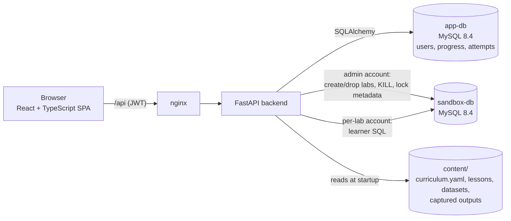

# Architecture

## Overview

| Layer | Technology | Why |
|---|---|---|
| Frontend | React 18, TypeScript, Vite, Tailwind CSS 4, TanStack Query, Monaco editor, Mermaid, custom SVG visualizations | Typed component architecture; Monaco gives a real SQL editing experience; visualizations are hand-built so they show exactly the algorithm being taught |
| Backend | Python 3.12, FastAPI, Pydantic, SQLAlchemy 2, Alembic, PyMySQL | As requested; async API with sandbox work moved to a thread pool |
| Application DB | MySQL 8.4 (SQLite allowed for local dev/tests) | Migrations via Alembic |
| Sandbox DB | A **separate** MySQL 8.4 server | Learner SQL never touches the application database server |
| Content | Markdown + YAML blocks in git, validated by a capture tool | Content is reviewable, diffable and verified against a real server |

## Content model

`content/curriculum.yaml` is the single source of truth for the hierarchy **Course → Module → Chapter → Lesson**,
levels (beginner → professional) and prerequisites. Lessons are Markdown files whose fenced blocks become
structured *segments* (`backend/app/content/parser.py`): runnable SQL, walkthroughs, concurrency scenarios,
visualizations, exercises and quizzes. See [AUTHORING.md](AUTHORING.md).

**No invented outputs.** `backend/scripts/capture_content.py` loads each lesson's dataset into a fresh sandbox lab,
executes every runnable block in order, replays concurrency scenarios with real concurrent connections, runs every
exercise's reference solution and stores the real results in `content/generated/captures/`. The UI shows those
captures (labelled with the MySQL version) and lets the learner re-run any block live.

**Secrets stay on the server.** The public lesson API strips exercise solutions/check queries and quiz answers.
Solutions unlock only after two attempts or a correct answer; quiz answers are revealed when the learner answers.

## Sandbox isolation

Each lab (`playground`, `lesson:<id>`, `exercise:<id>`, `conc:<lesson>:<block>`, `concurrency`) for each user maps to a
schema `lab_<sha256(owner|lab)[:20]>` **and a MySQL account of the same name** whose only privileges are on that
schema (`GRANT … ON lab\_xxx.*` — the underscore is escaped because `_` is a wildcard in GRANT).

Defence in depth, from outermost to innermost:

1. **API**: JWT auth, per-user rate limit (runs/minute), lab-key validation, script length and statement-count limits.
2. **Statement guard** (`sandbox/guard.py`): splits the script (`sandbox/splitter.py` understands quotes, comments,
   `DELIMITER` and `BEGIN … END` bodies) and rejects administration (GRANT, CREATE USER, SET GLOBAL, LOAD DATA,
   INTO OUTFILE, KILL, cross-schema USE, CREATE/DROP DATABASE…) with friendly explanations.
3. **MySQL privileges** — the real boundary: the lab account cannot see or touch anything outside its schema, so
   even SQL that bypasses the guard (e.g. via `PREPARE`) is contained.
4. **Resource limits**: `MAX_QUERIES_PER_HOUR` / `MAX_USER_CONNECTIONS` on each account, `max_execution_time` for
   SELECTs, a watchdog that `KILL QUERY`s any statement past the timeout, result-set truncation, a per-lab size
   quota check, idle-session disconnects and TTL-based lab cleanup.
5. **Server configuration** (docker-compose): binary log disabled, `local_infile=0`, `secure_file_priv=NULL`,
   event scheduler off, CPU/memory limits on the container.

Concurrent sessions (A/B/C) are separate connections owned by the backend process; a statement that waits on a
lock returns `blocked` after 1.5 s and its eventual result is collected by polling. Lock snapshots come from fixed,
lab-filtered queries on `performance_schema.data_locks` and `information_schema.innodb_trx` run by the admin account.

**Scaling note:** lab sessions live in the backend process, so run one worker per instance and use sticky routing if
you run several instances. Lab metadata lives in the sandbox server (`sandbox_meta.labs`) so cleanup survives restarts.

## Grading

`backend/app/grading.py` runs the reference solution (cached) and the learner's SQL on identical freshly loaded data,
then compares result multisets (column count, normalised values; order only when `orderMatters`). DML exercises
compare the result of a `check` query. Feedback explains row/column mismatches, shows unexpected rows, and reveals
missing rows after a first failed attempt.

## Learning analytics

Quiz answers and exercise attempts carry concept tags. `/api/progress/weak-concepts` computes an exponentially
weighted recent accuracy per concept and lists concepts with repeated misses, linked to the lessons that teach them.

## Testing

* `backend/tests` (pytest): splitter, guard, grading comparator, parser, API flows, sandbox isolation, grading,
  solution lock and real lock blocking between sessions (sandbox tests are skipped if MySQL is unreachable).
* `frontend/src/viz/algorithms.test.ts` (vitest): B+ tree invariants and FD algorithms (closure, keys, normal forms,
  minimal cover, 3NF synthesis, BCNF decomposition, dependency preservation).
* `backend/scripts/capture_content.py`: content lint + execution against MySQL (acts as an integration test of every lesson).
